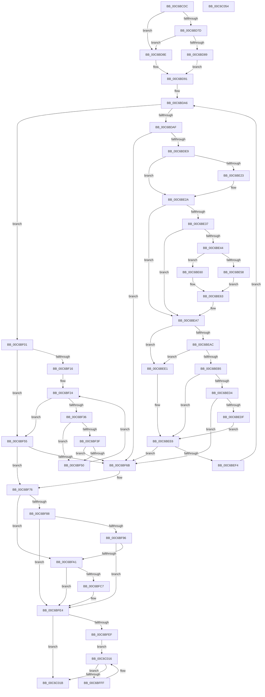

# MiInitializeLoadedModuleList

- RVA: `0x00C6BCDC`–`0x00C6C055` (길이 `889` bytes)
- VA: `0x0000000140C6BCDC`
- 실행 섹션: `INIT`
- PDB 이름 있음: `예`; PDB Function 태그: `아니요`
- unwind 정보 RVA: `0x000C7A90`
- 디코드: `213`개 명령, `889/889` bytes 표시
- 미해석 바이트: `0` (있으면 어셈블리에 `.byte`로 보존)

> 이 문서는 커널 이미지의 기계어와 PDB 기호를 분석해 생성했습니다. 4번과 5번은 함수 원형과 자료형을 바이너리 사용 방식에서 추정한 C 해석이며 원본 소스 복구 결과는 아닙니다.

## 1. Dependencies

- 직접 호출 지점: **25**; 고유 호출 대상: **25**
- 직접 호출자로 확인된 함수: **1**
- RIP 상대 이미지 참조: **21**

### Outgoing calls
- `0x00C6BD23` → [ExInitializeResourceLite2](../../text/41/ExInitializeResourceLite2_function_0041F710.md) (function, `0x0041F710`)
- `0x00C6BD2B` → [MiReloadBootLoadedDrivers](MiReloadBootLoadedDrivers_function_00C6C3F8.md) (function, `0x00C6C3F8`)
- `0x00C6BD9C` → [MiLocateKernelSections](MiLocateKernelSections_function_00C6C2A0.md) (function, `0x00C6C2A0`)
- `0x00C6BDBA` → [MiAcquireLoadLock](../../text/2A/MiAcquireLoadLock_function_002A3950.md) (function, `0x002A3950`)
- `0x00C6BDDC` → [MiConstructLoaderEntry](../../page/AA/MiConstructLoaderEntry_function_00AAA264.md) (function, `0x00AAA264`)
- `0x00C6BDFF` → [MiUpdateDriverLoadInProgress](../../text/43/MiUpdateDriverLoadInProgress_function_004318DC.md) (function, `0x004318DC`)
- `0x00C6BE07` → [MmReleaseLoadLock](../../text/4D/MmReleaseLoadLock_function_004D36D0.md) (function, `0x004D36D0`)
- `0x00C6BE4B` → [MmGetLoadedModuleImageAdditionalTablesAddress](../../text/3D/MmGetLoadedModuleImageAdditionalTablesAddress_function_003D4CF0.md) (function, `0x003D4CF0`)
- `0x00C6BE7B` → [RtlpxLookupFunctionTable](../../text/2F/RtlpxLookupFunctionTable_function_002F3610.md) (function, `0x002F3610`)
- `0x00C6BEA2` → [RtlRemoveInvertedFunctionTable](../../text/43/RtlRemoveInvertedFunctionTable_function_004320E8.md) (function, `0x004320E8`)
- `0x00C6BEC3` → [MiCaptureBootDriverRetpolineInfo](../../page/80/MiCaptureBootDriverRetpolineInfo_function_0080137C.md) (function, `0x0080137C`)
- `0x00C6BEEB` → [KasanDriverLoadImageInternal](../../text/4C/KasanDriverLoadImageInternal_function_004C2840.md) (function, `0x004C2840`)
- `0x00C6BF08` → [VfInitBootDriversLoaded](../C4/VfInitBootDriversLoaded_function_00C4BD0C.md) (function, `0x00C4BD0C`)
- `0x00C6BF47` → [VslReapplyBootIndirectPatches](../C2/VslReapplyBootIndirectPatches_function_00C29D68.md) (function, `0x00C29D68`)
- `0x00C6BF58` → [MiCreateBootDriverHotPatchLinkage](MiCreateBootDriverHotPatchLinkage_function_00C67358.md) (function, `0x00C67358`)
- `0x00C6BF5D` → [MiBuildImportsForBootDrivers](MiBuildImportsForBootDrivers_function_00C6B2E8.md) (function, `0x00C6B2E8`)
- `0x00C6BF62` → [MiUpdateBootDriverHotPatchImports](MiUpdateBootDriverHotPatchImports_function_00C674C0.md) (function, `0x00C674C0`)
- `0x00C6BF70` → [MxInstallMoreMemory](../../text/67/MxInstallMoreMemory_function_00671A04.md) (function, `0x00671A04`)
- `0x00C6BF76` → [MiInitializeKernelCfg](MiInitializeKernelCfg_function_00C6A2FC.md) (function, `0x00C6A2FC`)
- `0x00C6BFAB` → [memset](../../text/6C/memset_function_006C6C40.md) (function, `0x006C6C40`)
- `0x00C6BFBE` → [VslpEnterIumSecureMode](../../text/23/VslpEnterIumSecureMode_function_00235E50.md) (function, `0x00235E50`)
- `0x00C6BFDE` → [KeBugCheckEx](../../text/4F/KeBugCheckEx_function_004FD660.md) (function, `0x004FD660`)
- `0x00C6C00E` → [VslReserveProtectedPages](../../page/A9/VslReserveProtectedPages_function_00A90ACC.md) (function, `0x00A90ACC`)
- `0x00C6C022` → [RtlInitializeHistoryTable](../C4/RtlInitializeHistoryTable_function_00C47724.md) (function, `0x00C47724`)
- `0x00C6C02E` → [_security_check_cookie](../../text/6A/_security_check_cookie_function_006AC640.md) (function, `0x006AC640`)

### Direct callers
- [MiInitSystem](../C5/MiInitSystem_function_00C5E6C0.md) at `0x00C5E97A`

### Static image references
- `0x00C6BCFF` → RVA `0x00E0A740` (`.data`; read)
- `0x00C6BD19` → RVA `0x00EF54E0` (`.data`; read)
- `0x00C6BD30` → RVA `0x00E2D900` (`.data`; read)
- `0x00C6BD37` → RVA `0x00E2D908` (`.data`; write)
- `0x00C6BD3E` → RVA `0x00EF54C0` (`.data`; read)
- `0x00C6BD45` → RVA `0x00E2D900` (`.data`; write)
- `0x00C6BD4C` → RVA `0x00E2D930` (`.data`; read)
- `0x00C6BD53` → RVA `0x00E2D938` (`.data`; write)
- `0x00C6BD5A` → RVA `0x00E2D930` (`.data`; write)
- `0x00C6BD61` → RVA `0x00FC6B48` (`ALMOSTRO`; read)
- `0x00C6BD6D` → RVA `0x00EF54C8` (`.data`; write)
- `0x00C6BD74` → RVA `0x00EF54C0` (`.data`; write)
- `0x00C6BD7D` → RVA `0x00F10EC0` (`.data`; read)
- `0x00C6BE1A` → RVA `0x00E2D940` (`.data`; read)
- `0x00C6BE23` → RVA `0x00E2D940` (`.data`; write)
- `0x00C6BE2A` → RVA `0x00FC6B28` (`ALMOSTRO`; read)
- `0x00C6BE37` → RVA `0x00FC6A88` (`ALMOSTRO`; read)
- `0x00C6BE8C` → RVA `0x01200040` (`CFGRO`; write)
- `0x00C6BE94` → RVA `0x01200030` (`CFGRO`; write)
- `0x00C6BF01` → RVA `0x00E2D998` (`.data`; read)
- `0x00C6C01B` → RVA `0x00FC6A88` (`ALMOSTRO`; read/write)

## 2. Other-region calls and transfers

- 다른 실행 섹션으로 향하는 call: **16**
  - `0x00C6BD23` → [ExInitializeResourceLite2](../../text/41/ExInitializeResourceLite2_function_0041F710.md) (`INIT` → `.text`)
  - `0x00C6BDBA` → [MiAcquireLoadLock](../../text/2A/MiAcquireLoadLock_function_002A3950.md) (`INIT` → `.text`)
  - `0x00C6BDDC` → [MiConstructLoaderEntry](../../page/AA/MiConstructLoaderEntry_function_00AAA264.md) (`INIT` → `PAGE`)
  - `0x00C6BDFF` → [MiUpdateDriverLoadInProgress](../../text/43/MiUpdateDriverLoadInProgress_function_004318DC.md) (`INIT` → `.text`)
  - `0x00C6BE07` → [MmReleaseLoadLock](../../text/4D/MmReleaseLoadLock_function_004D36D0.md) (`INIT` → `.text`)
  - `0x00C6BE4B` → [MmGetLoadedModuleImageAdditionalTablesAddress](../../text/3D/MmGetLoadedModuleImageAdditionalTablesAddress_function_003D4CF0.md) (`INIT` → `.text`)
  - `0x00C6BE7B` → [RtlpxLookupFunctionTable](../../text/2F/RtlpxLookupFunctionTable_function_002F3610.md) (`INIT` → `.text`)
  - `0x00C6BEA2` → [RtlRemoveInvertedFunctionTable](../../text/43/RtlRemoveInvertedFunctionTable_function_004320E8.md) (`INIT` → `.text`)
  - `0x00C6BEC3` → [MiCaptureBootDriverRetpolineInfo](../../page/80/MiCaptureBootDriverRetpolineInfo_function_0080137C.md) (`INIT` → `PAGE`)
  - `0x00C6BEEB` → [KasanDriverLoadImageInternal](../../text/4C/KasanDriverLoadImageInternal_function_004C2840.md) (`INIT` → `.text`)
  - `0x00C6BF70` → [MxInstallMoreMemory](../../text/67/MxInstallMoreMemory_function_00671A04.md) (`INIT` → `.text`)
  - `0x00C6BFAB` → [memset](../../text/6C/memset_function_006C6C40.md) (`INIT` → `.text`)
  - `0x00C6BFBE` → [VslpEnterIumSecureMode](../../text/23/VslpEnterIumSecureMode_function_00235E50.md) (`INIT` → `.text`)
  - `0x00C6BFDE` → [KeBugCheckEx](../../text/4F/KeBugCheckEx_function_004FD660.md) (`INIT` → `.text`)
  - `0x00C6C00E` → [VslReserveProtectedPages](../../page/A9/VslReserveProtectedPages_function_00A90ACC.md) (`INIT` → `PAGE`)
  - `0x00C6C02E` → [_security_check_cookie](../../text/6A/_security_check_cookie_function_006AC640.md) (`INIT` → `.text`)
- 별도 외부 분기/꼬리 이동을 확인하지 못했습니다.

## 3. Assembly (complete function range)

```asm
00C6BCDC  48 8B C4                        mov rax, rsp
00C6BCDF  48 89 58 10                     mov qword ptr [rax + 0x10], rbx
00C6BCE3  48 89 70 18                     mov qword ptr [rax + 0x18], rsi
00C6BCE7  48 89 78 20                     mov qword ptr [rax + 0x20], rdi
00C6BCEB  55                              push rbp
00C6BCEC  41 54                           push r12
00C6BCEE  41 55                           push r13
00C6BCF0  41 56                           push r14
00C6BCF2  41 57                           push r15
00C6BCF4  48 8D 68 A1                     lea rbp, [rax - 0x5f]
00C6BCF8  48 81 EC E0 00 00 00            sub rsp, 0xe0
00C6BCFF  48 8B 05 3A EA 19 00            mov rax, qword ptr [rip + 0x19ea3a]
00C6BD06  48 33 C4                        xor rax, rsp
00C6BD09  48 89 45 27                     mov qword ptr [rbp + 0x27], rax
00C6BD0D  83 65 87 00                     and dword ptr [rbp - 0x79], 0
00C6BD11  4C 8B F1                        mov r14, rcx
00C6BD14  48 83 65 8F 00                  and qword ptr [rbp - 0x71], 0
00C6BD19  48 8D 0D C0 97 28 00            lea rcx, [rip + 0x2897c0]
00C6BD20  83 CA FF                        or edx, 0xffffffff
00C6BD23  E8 E8 39 7B FF                  call 0x14041f710
00C6BD28  49 8B CE                        mov rcx, r14
00C6BD2B  E8 C8 06 00 00                  call 0x140c6c3f8
00C6BD30  48 8D 05 C9 1B 1C 00            lea rax, [rip + 0x1c1bc9]
00C6BD37  48 89 05 CA 1B 1C 00            mov qword ptr [rip + 0x1c1bca], rax
00C6BD3E  48 8D 3D 7B 97 28 00            lea rdi, [rip + 0x28977b]
00C6BD45  48 89 05 B4 1B 1C 00            mov qword ptr [rip + 0x1c1bb4], rax
00C6BD4C  48 8D 05 DD 1B 1C 00            lea rax, [rip + 0x1c1bdd]
00C6BD53  48 89 05 DE 1B 1C 00            mov qword ptr [rip + 0x1c1bde], rax
00C6BD5A  48 89 05 CF 1B 1C 00            mov qword ptr [rip + 0x1c1bcf], rax
00C6BD61  48 8B 05 E0 AD 35 00            mov rax, qword ptr [rip + 0x35ade0]
00C6BD68  48 0F BA E0 29                  bt rax, 0x29
00C6BD6D  48 89 3D 54 97 28 00            mov qword ptr [rip + 0x289754], rdi
00C6BD74  48 89 3D 45 97 28 00            mov qword ptr [rip + 0x289745], rdi
00C6BD7B  72 11                           jb 0x140c6bd8e
00C6BD7D  F7 05 39 51 2A 00 00 00 02 00   test dword ptr [rip + 0x2a5139], 0x20000
00C6BD87  74 05                           je 0x140c6bd8e
00C6BD89  45 32 E4                        xor r12b, r12b
00C6BD8C  EB 03                           jmp 0x140c6bd91
00C6BD8E  41 B4 01                        mov r12b, 1
00C6BD91  4D 8D 6E 10                     lea r13, [r14 + 0x10]
00C6BD95  4D 8B 7D 00                     mov r15, qword ptr [r13]
00C6BD99  49 8B CF                        mov rcx, r15
00C6BD9C  E8 FF 04 00 00                  call 0x140c6c2a0
00C6BDA1  BE 00 00 00 80                  mov esi, 0x80000000
00C6BDA6  4D 3B FD                        cmp r15, r13
00C6BDA9  0F 84 52 01 00 00               je 0x140c6bf01
00C6BDAF  49 8B DF                        mov rbx, r15
00C6BDB2  B9 01 00 00 00                  mov ecx, 1
00C6BDB7  4D 8B 3F                        mov r15, qword ptr [r15]
00C6BDBA  E8 91 7B 63 FF                  call 0x1402a3950
00C6BDBF  48 8B F0                        mov rsi, rax
00C6BDC2  4C 8D 43 48                     lea r8, [rbx + 0x48]
00C6BDC6  48 8D 45 8F                     lea rax, [rbp - 0x71]
00C6BDCA  41 B9 00 00 00 10               mov r9d, 0x10000000
00C6BDD0  48 8D 53 58                     lea rdx, [rbx + 0x58]
00C6BDD4  48 89 44 24 20                  mov qword ptr [rsp + 0x20], rax
00C6BDD9  48 8B CB                        mov rcx, rbx
00C6BDDC  E8 83 E4 E3 FF                  call 0x140aaa264
00C6BDE1  85 C0                           test eax, eax
00C6BDE3  0F 88 82 01 00 00               js 0x140c6bf6b
00C6BDE9  48 8B 7D 8F                     mov rdi, qword ptr [rbp - 0x71]
00C6BDED  41 B9 02 00 00 00               mov r9d, 2
00C6BDF3  48 8B CF                        mov rcx, rdi
00C6BDF6  41 B8 00 00 00 10               mov r8d, 0x10000000
00C6BDFC  48 8B D3                        mov rdx, rbx
00C6BDFF  E8 D8 5A 7C FF                  call 0x1404318dc
00C6BE04  48 8B CE                        mov rcx, rsi
00C6BE07  E8 C4 78 86 FF                  call 0x1404d36d0
00C6BE0C  48 89 BB 90 00 00 00            mov qword ptr [rbx + 0x90], rdi
00C6BE13  83 8F B8 00 00 00 02            or dword ptr [rdi + 0xb8], 2
00C6BE1A  48 39 1D 1F 1B 1C 00            cmp qword ptr [rip + 0x1c1b1f], rbx
00C6BE21  75 07                           jne 0x140c6be2a
00C6BE23  48 89 3D 16 1B 1C 00            mov qword ptr [rip + 0x1c1b16], rdi
00C6BE2A  48 8B 05 F7 AC 35 00            mov rax, qword ptr [rip + 0x35acf7]
00C6BE31  48 39 47 30                     cmp qword ptr [rdi + 0x30], rax
00C6BE35  75 70                           jne 0x140c6bea7
00C6BE37  48 F7 05 46 AC 35 00 00 00 04 00  test qword ptr [rip + 0x35ac46], 0x40000
00C6BE42  75 63                           jne 0x140c6bea7
00C6BE44  48 8D 55 87                     lea rdx, [rbp - 0x79]
00C6BE48  48 8B CF                        mov rcx, rdi
00C6BE4B  E8 A0 8E 76 FF                  call 0x1403d4cf0
00C6BE50  48 8B F0                        mov rsi, rax
00C6BE53  48 85 C0                        test rax, rax
00C6BE56  74 08                           je 0x140c6be60
00C6BE58  2B 77 30                        sub esi, dword ptr [rdi + 0x30]
00C6BE5B  03 75 87                        add esi, dword ptr [rbp - 0x79]
00C6BE5E  EB 03                           jmp 0x140c6be63
00C6BE60  8B 77 40                        mov esi, dword ptr [rdi + 0x40]
00C6BE63  48 8B 5F 30                     mov rbx, qword ptr [rdi + 0x30]
00C6BE67  48 8D 55 97                     lea rdx, [rbp - 0x69]
00C6BE6B  0F 57 C0                        xorps xmm0, xmm0
00C6BE6E  33 C0                           xor eax, eax
00C6BE70  48 8B CB                        mov rcx, rbx
00C6BE73  48 89 45 A7                     mov qword ptr [rbp - 0x59], rax
00C6BE77  0F 11 45 97                     movups xmmword ptr [rbp - 0x69], xmm0
00C6BE7B  E8 90 77 68 FF                  call 0x1402f3610
00C6BE80  0F 10 45 97                     movups xmm0, xmmword ptr [rbp - 0x69]
00C6BE84  48 8B CB                        mov rcx, rbx
00C6BE87  F2 0F 10 4D A7                  movsd xmm1, qword ptr [rbp - 0x59]
00C6BE8C  F2 0F 11 0D AC 41 59 00         movsd qword ptr [rip + 0x5941ac], xmm1
00C6BE94  0F 29 05 95 41 59 00            movaps xmmword ptr [rip + 0x594195], xmm0
00C6BE9B  90                              nop
00C6BE9C  89 35 9E 41 59 00               mov dword ptr [rip + 0x59419e], esi
00C6BEA2  E8 41 62 7C FF                  call 0x1404320e8
00C6BEA7  45 84 E4                        test r12b, r12b
00C6BEAA  74 35                           je 0x140c6bee1
00C6BEAC  F7 47 68 00 00 80 00            test dword ptr [rdi + 0x68], 0x800000
00C6BEB3  75 2C                           jne 0x140c6bee1
00C6BEB5  8B 57 40                        mov edx, dword ptr [rdi + 0x40]
00C6BEB8  4C 8D 87 18 01 00 00            lea r8, [rdi + 0x118]
00C6BEBF  48 8B 4F 30                     mov rcx, qword ptr [rdi + 0x30]
00C6BEC3  E8 B4 54 B9 FF                  call 0x14080137c
00C6BEC8  BE 00 00 00 80                  mov esi, 0x80000000
00C6BECD  8D 0C 30                        lea ecx, [rax + rsi]
00C6BED0  85 CE                           test esi, ecx
00C6BED2  75 12                           jne 0x140c6bee6
00C6BED4  3D BB 00 00 C0                  cmp eax, 0xc00000bb
00C6BED9  0F 85 8C 00 00 00               jne 0x140c6bf6b
00C6BEDF  EB 05                           jmp 0x140c6bee6
00C6BEE1  BE 00 00 00 80                  mov esi, 0x80000000
00C6BEE6  33 D2                           xor edx, edx
00C6BEE8  48 8B CF                        mov rcx, rdi
00C6BEEB  E8 50 69 85 FF                  call 0x1404c2840
00C6BEF0  85 C0                           test eax, eax
00C6BEF2  78 77                           js 0x140c6bf6b
00C6BEF4  0F BA AF B8 00 00 00 11         bts dword ptr [rdi + 0xb8], 0x11
00C6BEFC  E9 A5 FE FF FF                  jmp 0x140c6bda6
00C6BF01  48 8B 1D 90 1A 1C 00            mov rbx, qword ptr [rip + 0x1c1a90]
00C6BF08  E8 FF FD FD FF                  call 0x140c4bd0c
00C6BF0D  48 3B 1D 84 1A 1C 00            cmp rbx, qword ptr [rip + 0x1c1a84]
00C6BF14  74 3F                           je 0x140c6bf55
00C6BF16  49 8B 86 F0 00 00 00            mov rax, qword ptr [r14 + 0xf0]
00C6BF1D  48 8B 98 C8 0E 00 00            mov rbx, qword ptr [rax + 0xec8]
00C6BF24  49 8B 86 F0 00 00 00            mov rax, qword ptr [r14 + 0xf0]
00C6BF2B  48 05 C8 0E 00 00               add rax, 0xec8
00C6BF31  48 3B D8                        cmp rbx, rax
00C6BF34  74 1F                           je 0x140c6bf55
00C6BF36  8B 43 28                        mov eax, dword ptr [rbx + 0x28]
00C6BF39  24 03                           and al, 3
00C6BF3B  3C 01                           cmp al, 1
00C6BF3D  75 11                           jne 0x140c6bf50
00C6BF3F  48 8B 4B 50                     mov rcx, qword ptr [rbx + 0x50]
00C6BF43  48 8B 49 30                     mov rcx, qword ptr [rcx + 0x30]
00C6BF47  E8 1C DE FB FF                  call 0x140c29d68
00C6BF4C  85 C0                           test eax, eax
00C6BF4E  78 1B                           js 0x140c6bf6b
00C6BF50  48 8B 1B                        mov rbx, qword ptr [rbx]
00C6BF53  EB CF                           jmp 0x140c6bf24
00C6BF55  49 8B CE                        mov rcx, r14
00C6BF58  E8 FB B3 FF FF                  call 0x140c67358
00C6BF5D  E8 86 F3 FF FF                  call 0x140c6b2e8
00C6BF62  E8 59 B5 FF FF                  call 0x140c674c0
00C6BF67  85 C0                           test eax, eax
00C6BF69  79 0B                           jns 0x140c6bf76
00C6BF6B  B9 20 00 00 00                  mov ecx, 0x20
00C6BF70  E8 8F 5A A0 FF                  call 0x140671a04
00C6BF75  CC                              int3
00C6BF76  E8 81 E3 FF FF                  call 0x140c6a2fc
00C6BF7B  48 F7 05 02 AB 35 00 00 00 04 00  test qword ptr [rip + 0x35ab02], 0x40000
00C6BF86  75 19                           jne 0x140c6bfa1
00C6BF88  48 8B 05 B9 AB 35 00            mov rax, qword ptr [rip + 0x35abb9]
00C6BF8F  48 0F BA E0 29                  bt rax, 0x29
00C6BF94  73 4E                           jae 0x140c6bfe4
00C6BF96  48 0F BA 25 E9 AA 35 00 0E      bt qword ptr [rip + 0x35aae9], 0xe
00C6BF9F  73 43                           jae 0x140c6bfe4
00C6BFA1  33 D2                           xor edx, edx
00C6BFA3  48 8D 4D B7                     lea rcx, [rbp - 0x49]
00C6BFA7  44 8D 42 68                     lea r8d, [rdx + 0x68]
00C6BFAB  E8 90 AC A5 FF                  call 0x1406c6c40
00C6BFB0  BA D8 00 00 00                  mov edx, 0xd8
00C6BFB5  4C 8D 4D B7                     lea r9, [rbp - 0x49]
00C6BFB9  45 33 C0                        xor r8d, r8d
00C6BFBC  B1 02                           mov cl, 2
00C6BFBE  E8 8D 9E 5C FF                  call 0x140235e50
00C6BFC3  85 C0                           test eax, eax
00C6BFC5  79 1D                           jns 0x140c6bfe4
00C6BFC7  48 83 64 24 20 00               and qword ptr [rsp + 0x20], 0
00C6BFCD  41 B9 02 00 00 00               mov r9d, 2
00C6BFD3  48 63 D0                        movsxd rdx, eax
00C6BFD6  45 33 C0                        xor r8d, r8d
00C6BFD9  B9 22 04 00 00                  mov ecx, 0x422
00C6BFDE  E8 7D 16 89 FF                  call 0x1404fd660
00C6BFE3  CC                              int3
00C6BFE4  48 0F BA 25 9B AA 35 00 0E      bt qword ptr [rip + 0x35aa9b], 0xe
00C6BFED  73 2C                           jae 0x140c6c01b
00C6BFEF  48 8B 1D CA 94 28 00            mov rbx, qword ptr [rip + 0x2894ca]
00C6BFF6  48 8D 3D C3 94 28 00            lea rdi, [rip + 0x2894c3]
00C6BFFD  EB 17                           jmp 0x140c6c016
00C6BFFF  48 8B 53 30                     mov rdx, qword ptr [rbx + 0x30]
00C6C003  41 B9 02 00 00 00               mov r9d, 2
00C6C009  45 33 C0                        xor r8d, r8d
00C6C00C  33 C9                           xor ecx, ecx
00C6C00E  E8 B9 4A E2 FF                  call 0x140a90acc
00C6C013  48 8B 1B                        mov rbx, qword ptr [rbx]
00C6C016  48 3B DF                        cmp rbx, rdi
00C6C019  75 E4                           jne 0x140c6bfff
00C6C01B  48 09 35 66 AA 35 00            or qword ptr [rip + 0x35aa66], rsi
00C6C022  E8 FD B6 FD FF                  call 0x140c47724
00C6C027  48 8B 4D 27                     mov rcx, qword ptr [rbp + 0x27]
00C6C02B  48 33 CC                        xor rcx, rsp
00C6C02E  E8 0D 06 A4 FF                  call 0x1406ac640
00C6C033  4C 8D 9C 24 E0 00 00 00         lea r11, [rsp + 0xe0]
00C6C03B  49 8B 5B 38                     mov rbx, qword ptr [r11 + 0x38]
00C6C03F  49 8B 73 40                     mov rsi, qword ptr [r11 + 0x40]
00C6C043  49 8B 7B 48                     mov rdi, qword ptr [r11 + 0x48]
00C6C047  49 8B E3                        mov rsp, r11
00C6C04A  41 5F                           pop r15
00C6C04C  41 5E                           pop r14
00C6C04E  41 5D                           pop r13
00C6C050  41 5C                           pop r12
00C6C052  5D                              pop rbp
00C6C053  C3                              ret
00C6C054  CC                              int3
```

## 4. C-style interpretation (structured pseudocode)

```c
__int64 __fastcall MiInitializeLoadedModuleList(__int64 a1, int a2)
{
    __int64 result;
    __int64 v_r12;
    __int64 v_rsi;
    __int64 v_rsp;
    unsigned __int64 v_stack_m28;
    unsigned __int64 v_stack_mE8;

    *(unsigned __int64 *)(v_rsp + 16) = v_rbx;
    *(unsigned __int64 *)(v_rsp + 24) = v_rsi;
    *(unsigned __int64 *)(v_rsp + 32) = v_rdi;
    v_rsp = (v_rsp) - (224);
    result = (*(unsigned __int64 *)(v_rip + 1698362)) ^ (v_rsp);
    *(unsigned __int64 *)(v_rsp - 95 + 39) = result;
    a2 = (unsigned int)((a2) | (0xFFFFFFFFULL));
    result = ExInitializeResourceLite2(v_rip + 2660288, a2, a3, a4);
    result = MiReloadBootLoadedDrivers(a1, a2, a3, a4);
    *(unsigned __int64 *)(v_rip + 1842122) = v_rip + 1842121;
    *(unsigned __int64 *)(v_rip + 1842100) = v_rip + 1842121;
    *(unsigned __int64 *)(v_rip + 1842142) = v_rip + 1842141;
    *(unsigned __int64 *)(v_rip + 1842127) = v_rip + 1842141;
    *(unsigned __int64 *)(v_rip + 2660180) = v_rip + 2660219;
    *(unsigned __int64 *)(v_rip + 2660165) = v_rip + 2660219;
    if (condition_is_below) goto loc_00C6BD8E;
    if (((*(unsigned int *)(v_rip + 2773305)) & (0x20000ULL)) == 0) goto loc_00C6BD8E;
    v_r12 = 0;
    goto loc_00C6BD91;
loc_00C6BD8E:
loc_00C6BD91:
    result = MiLocateKernelSections(*(unsigned __int64 *)(a1 + 16), a2, a3, a4);
loc_00C6BDA6:
    if ((*(unsigned __int64 *)(a1 + 16)) == (a1 + 16)) goto loc_00C6BF01;
    result = MiAcquireLoadLock(1, a2, a3, a4);
    v_stack_mE8 = v_rsp - 95 - 113;
    result = MiConstructLoaderEntry(*(unsigned __int64 *)(a1 + 16), *(unsigned __int64 *)(a1 + 16) + 88, *(unsigned __int64 *)(a1 + 16) + 72, (unsigned int)(0x10000000ULL));
    if (sign_flag) goto loc_00C6BF6B;
    result = MiUpdateDriverLoadInProgress(*(unsigned __int64 *)(v_rsp - 95 - 113), *(unsigned __int64 *)(a1 + 16), (unsigned int)(0x10000000ULL), 2);
    result = MmReleaseLoadLock(result, *(unsigned __int64 *)(a1 + 16), (unsigned int)(0x10000000ULL), 2);
    *(unsigned __int64 *)(*(unsigned __int64 *)(a1 + 16) + 144) = *(unsigned __int64 *)(v_rsp - 95 - 113);
    if ((*(unsigned __int64 *)(v_rip + 1841951)) == (*(unsigned __int64 *)(a1 + 16))) {
        *(unsigned __int64 *)(v_rip + 1841942) = *(unsigned __int64 *)(v_rsp - 95 - 113);
    }
    if ((*(unsigned __int64 *)(*(unsigned __int64 *)(v_rsp - 95 - 113) + 48)) != (*(unsigned __int64 *)(v_rip + 3517687))) goto loc_00C6BEA7;
    if (((*(unsigned __int64 *)(v_rip + 3517510)) & (0x40000ULL)) != 0) goto loc_00C6BEA7;
    result = MmGetLoadedModuleImageAdditionalTablesAddress(*(unsigned __int64 *)(v_rsp - 95 - 113), v_rsp - 95 - 121, (unsigned int)(0x10000000ULL), 2);
    if (result == 0) goto loc_00C6BE60;
    v_rsi = (unsigned int)((result) - (*(unsigned int *)(*(unsigned __int64 *)(v_rsp - 95 - 113) + 48)));
    v_rsi = (unsigned int)((v_rsi) + (*(unsigned int *)(v_rsp - 95 - 121)));
    goto loc_00C6BE63;
loc_00C6BE60:
loc_00C6BE63:
    result = 0;
    *(unsigned __int64 *)(v_rsp - 95 - 89) = 0;
    *(unsigned __int64 *)(v_rsp - 95 - 105) = v_xmm0;
    result = RtlpxLookupFunctionTable(*(unsigned __int64 *)(*(unsigned __int64 *)(v_rsp - 95 - 113) + 48), v_rsp - 95 - 105, (unsigned int)(0x10000000ULL), 2);
    *(unsigned __int64 *)(v_rip + 5849516) = v_xmm1;
    *(unsigned __int64 *)(v_rip + 5849493) = v_xmm0;
    *(unsigned int *)(v_rip + 5849502) = (unsigned int)((unsigned int)(*(unsigned int *)(*(unsigned __int64 *)(v_rsp - 95 - 113) + 64)));
    result = RtlRemoveInvertedFunctionTable(*(unsigned __int64 *)(*(unsigned __int64 *)(v_rsp - 95 - 113) + 48), v_rsp - 95 - 105, (unsigned int)(0x10000000ULL), 2);
loc_00C6BEA7:
    if (1 == 0) goto loc_00C6BEE1;
    if (((*(unsigned int *)(*(unsigned __int64 *)(v_rsp - 95 - 113) + 104)) & (0x800000ULL)) != 0) goto loc_00C6BEE1;
    result = MiCaptureBootDriverRetpolineInfo(*(unsigned __int64 *)(*(unsigned __int64 *)(v_rsp - 95 - 113) + 48), (unsigned int)(*(unsigned int *)(*(unsigned __int64 *)(v_rsp - 95 - 113) + 64)), *(unsigned __int64 *)(v_rsp - 95 - 113) + 280, 2);
    if ((((unsigned int)((unsigned int)(0x80000000ULL))) & ((unsigned int)(result + (unsigned int)(0x80000000ULL) * 1))) != 0) goto loc_00C6BEE6;
    if (((unsigned int)(result)) != 0xC00000BBULL) goto loc_00C6BF6B;
    goto loc_00C6BEE6;
loc_00C6BEE1:
loc_00C6BEE6:
    a2 = 0;
    result = KasanDriverLoadImageInternal(*(unsigned __int64 *)(v_rsp - 95 - 113), a2, *(unsigned __int64 *)(v_rsp - 95 - 113) + 280, 2);
    if (sign_flag) goto loc_00C6BF6B;
    goto loc_00C6BDA6;
loc_00C6BF01:
    result = VfInitBootDriversLoaded(*(unsigned __int64 *)(v_rsp - 95 - 113), a2, *(unsigned __int64 *)(v_rsp - 95 - 113) + 280, 2);
    if ((*(unsigned __int64 *)(v_rip + 1841808)) == (*(unsigned __int64 *)(v_rip + 1841796))) goto loc_00C6BF55;
loc_00C6BF24:
    result = (*(unsigned __int64 *)(a1 + 240)) + (0xEC8ULL);
    if ((*(unsigned __int64 *)(*(unsigned __int64 *)(a1 + 240) + 3784)) == result) goto loc_00C6BF55;
    result = (unsigned __int8)(((unsigned int)(*(unsigned int *)(*(unsigned __int64 *)(*(unsigned __int64 *)(a1 + 240) + 3784) + 40))) & (3));
    if (((unsigned __int8)(result)) != 1) goto loc_00C6BF50;
    result = VslReapplyBootIndirectPatches(*(unsigned __int64 *)(*(unsigned __int64 *)(*(unsigned __int64 *)(*(unsigned __int64 *)(a1 + 240) + 3784) + 80) + 48), a2, *(unsigned __int64 *)(v_rsp - 95 - 113) + 280, 2);
    if (sign_flag) goto loc_00C6BF6B;
loc_00C6BF50:
    goto loc_00C6BF24;
loc_00C6BF55:
    result = MiCreateBootDriverHotPatchLinkage(a1, a2, *(unsigned __int64 *)(v_rsp - 95 - 113) + 280, 2);
    result = MiBuildImportsForBootDrivers(a1, a2, *(unsigned __int64 *)(v_rsp - 95 - 113) + 280, 2);
    result = MiUpdateBootDriverHotPatchImports(a1, a2, *(unsigned __int64 *)(v_rsp - 95 - 113) + 280, 2);
    if (sign_flag) {
        a1 = 32;
        result = MxInstallMoreMemory(a1, a2, *(unsigned __int64 *)(v_rsp - 95 - 113) + 280, 2);
    }
    result = MiInitializeKernelCfg(a1, a2, *(unsigned __int64 *)(v_rsp - 95 - 113) + 280, 2);
    if (((*(unsigned __int64 *)(v_rip + 3517186)) & (0x40000ULL)) != 0) goto loc_00C6BFA1;
    if (condition_is_above_or_equal) goto loc_00C6BFE4;
    if (condition_is_above_or_equal) goto loc_00C6BFE4;
loc_00C6BFA1:
    a2 = 0;
    result = memset(v_rsp - 95 - 73, a2, a2 + 104, 2);
    a3 = 0;
    result = VslpEnterIumSecureMode(2, 216, a3, v_rsp - 95 - 73);
    if (sign_flag) {
        a4 = 2;
        a2 = (int)((unsigned int)(result));
        a3 = 0;
        a1 = 0x422ULL;
        result = KeBugCheckEx(a1, a2, a3, a4);
    }
    if (condition_is_above_or_equal) goto loc_00C6C01B;
    goto loc_00C6C016;
loc_00C6BFFF:
    a3 = 0;
    a1 = 0;
    result = VslReserveProtectedPages(a1, *(unsigned __int64 *)(*(unsigned __int64 *)(v_rip + 2659530) + 48), a3, 2);
loc_00C6C016:
    if ((*(unsigned __int64 *)(*(unsigned __int64 *)(v_rip + 2659530))) != (v_rip + 2659523)) goto loc_00C6BFFF;
loc_00C6C01B:
    result = RtlInitializeHistoryTable(a1, *(unsigned __int64 *)(*(unsigned __int64 *)(v_rip + 2659530) + 48), a3, 2);
    a1 = (*(unsigned __int64 *)(v_rsp - 95 + 39)) ^ (v_rsp);
    result = _security_check_cookie(a1, *(unsigned __int64 *)(*(unsigned __int64 *)(v_rip + 2659530) + 48), a3, 2);
    return result;
}
```

## 5. (Beta) C Style

```c
int64_t MiInitializeLoadedModuleList(void *Arg1, int32_t Arg2)
{
    uint8_t *arg1 = (uint8_t *)Arg1;

    int64_t result;
    int64_t local_r12;
    int64_t local_rsi;
    int64_t local_rsp;
    uint64_t v_stack_m28;
    uint64_t v_stack_mE8;

    *(uint64_t *)(local_rsp + 0x10) = local_rbx;
    *(uint64_t *)(local_rsp + 0x18) = local_rsi;
    *(uint64_t *)(local_rsp + 0x20) = local_rdi;
    local_rsp = (local_rsp) - (224);
    result = (*(uint64_t *)(v_rip + 0x19EA3A)) ^ (local_rsp);
    *(uint64_t *)(local_rsp - 0x5F + 0x27) = result;
    Arg2 = (uint32_t)((Arg2) | (0xFFFFFFFFULL));
    result = ExInitializeResourceLite2(v_rip + 2660288, Arg2, a3, a4);
    result = MiReloadBootLoadedDrivers(Arg1, Arg2, a3, a4);
    *(uint64_t *)(v_rip + 0x1C1BCA) = v_rip + 1842121;
    *(uint64_t *)(v_rip + 0x1C1BB4) = v_rip + 1842121;
    *(uint64_t *)(v_rip + 0x1C1BDE) = v_rip + 1842141;
    *(uint64_t *)(v_rip + 0x1C1BCF) = v_rip + 1842141;
    *(uint64_t *)(v_rip + 0x289754) = v_rip + 2660219;
    *(uint64_t *)(v_rip + 0x289745) = v_rip + 2660219;
    if (condition_is_below) goto loc_00C6BD8E;
    if (((*(uint32_t *)(v_rip + 0x2A5139)) & (0x20000ULL)) == 0) goto loc_00C6BD8E;
    local_r12 = 0;
    goto loc_00C6BD91;
loc_00C6BD8E:
loc_00C6BD91:
    result = MiLocateKernelSections(*(uint64_t *)(arg1 + 0x10), Arg2, a3, a4);
loc_00C6BDA6:
    if ((*(uint64_t *)(arg1 + 0x10)) == (Arg1 + 16)) goto loc_00C6BF01;
    result = MiAcquireLoadLock(1, Arg2, a3, a4);
    v_stack_mE8 = local_rsp - 95 - 113;
    result = MiConstructLoaderEntry(*(uint64_t *)(arg1 + 0x10), *(uint64_t *)(arg1 + 0x10) + 88, *(uint64_t *)(arg1 + 0x10) + 72, (uint32_t)(0x10000000ULL));
    if (sign_flag) goto loc_00C6BF6B;
    result = MiUpdateDriverLoadInProgress(*(uint64_t *)(local_rsp - 0x5F - 0x71), *(uint64_t *)(arg1 + 0x10), (uint32_t)(0x10000000ULL), 2);
    result = MmReleaseLoadLock(result, *(uint64_t *)(arg1 + 0x10), (uint32_t)(0x10000000ULL), 2);
    *(uint64_t *)(*(uint64_t *)(arg1 + 0x10) + 0x90) = *(uint64_t *)(local_rsp - 0x5F - 0x71);
    if ((*(uint64_t *)(v_rip + 0x1C1B1F)) == (*(uint64_t *)(arg1 + 0x10))) {
        *(uint64_t *)(v_rip + 0x1C1B16) = *(uint64_t *)(local_rsp - 0x5F - 0x71);
    }
    if ((*(uint64_t *)(*(uint64_t *)(local_rsp - 0x5F - 0x71) + 0x30)) != (*(uint64_t *)(v_rip + 0x35ACF7))) goto loc_00C6BEA7;
    if (((*(uint64_t *)(v_rip + 0x35AC46)) & (0x40000ULL)) != 0) goto loc_00C6BEA7;
    result = MmGetLoadedModuleImageAdditionalTablesAddress(*(uint64_t *)(local_rsp - 0x5F - 0x71), local_rsp - 95 - 121, (uint32_t)(0x10000000ULL), 2);
    if (result == 0) goto loc_00C6BE60;
    local_rsi = (uint32_t)((result) - (*(uint32_t *)(*(uint64_t *)(local_rsp - 0x5F - 0x71) + 0x30)));
    local_rsi = (uint32_t)((local_rsi) + (*(uint32_t *)(local_rsp - 0x5F - 0x79)));
    goto loc_00C6BE63;
loc_00C6BE60:
loc_00C6BE63:
    result = 0;
    *(uint64_t *)(local_rsp - 0x5F - 0x59) = 0;
    *(uint64_t *)(local_rsp - 0x5F - 0x69) = v_xmm0;
    result = RtlpxLookupFunctionTable(*(uint64_t *)(*(uint64_t *)(local_rsp - 0x5F - 0x71) + 0x30), local_rsp - 95 - 105, (uint32_t)(0x10000000ULL), 2);
    *(uint64_t *)(v_rip + 0x5941AC) = v_xmm1;
    *(uint64_t *)(v_rip + 0x594195) = v_xmm0;
    *(uint32_t *)(v_rip + 0x59419E) = (uint32_t)((uint32_t)(*(uint32_t *)(*(uint64_t *)(local_rsp - 0x5F - 0x71) + 0x40)));
    result = RtlRemoveInvertedFunctionTable(*(uint64_t *)(*(uint64_t *)(local_rsp - 0x5F - 0x71) + 0x30), local_rsp - 95 - 105, (uint32_t)(0x10000000ULL), 2);
loc_00C6BEA7:
    if (1 == 0) goto loc_00C6BEE1;
    if (((*(uint32_t *)(*(uint64_t *)(local_rsp - 0x5F - 0x71) + 0x68)) & (0x800000ULL)) != 0) goto loc_00C6BEE1;
    result = MiCaptureBootDriverRetpolineInfo(*(uint64_t *)(*(uint64_t *)(local_rsp - 0x5F - 0x71) + 0x30), (uint32_t)(*(uint32_t *)(*(uint64_t *)(local_rsp - 0x5F - 0x71) + 0x40)), *(uint64_t *)(local_rsp - 0x5F - 0x71) + 280, 2);
    if ((((uint32_t)((uint32_t)(0x80000000ULL))) & ((uint32_t)(result + (uint32_t)(0x80000000ULL) * 1))) != 0) goto loc_00C6BEE6;
    if (((uint32_t)(result)) != 0xC00000BBULL) goto loc_00C6BF6B;
    goto loc_00C6BEE6;
loc_00C6BEE1:
loc_00C6BEE6:
    Arg2 = 0;
    result = KasanDriverLoadImageInternal(*(uint64_t *)(local_rsp - 0x5F - 0x71), Arg2, *(uint64_t *)(local_rsp - 0x5F - 0x71) + 280, 2);
    if (sign_flag) goto loc_00C6BF6B;
    goto loc_00C6BDA6;
loc_00C6BF01:
    result = VfInitBootDriversLoaded(*(uint64_t *)(local_rsp - 0x5F - 0x71), Arg2, *(uint64_t *)(local_rsp - 0x5F - 0x71) + 280, 2);
    if ((*(uint64_t *)(v_rip + 0x1C1A90)) == (*(uint64_t *)(v_rip + 0x1C1A84))) goto loc_00C6BF55;
loc_00C6BF24:
    result = (*(uint64_t *)(arg1 + 0xF0)) + (0xEC8ULL);
    if ((*(uint64_t *)(*(uint64_t *)(arg1 + 0xF0) + 0xEC8)) == result) goto loc_00C6BF55;
    result = (uint8_t)(((uint32_t)(*(uint32_t *)(*(uint64_t *)(*(uint64_t *)(arg1 + 0xF0) + 0xEC8) + 0x28))) & (3));
    if (((uint8_t)(result)) != 1) goto loc_00C6BF50;
    result = VslReapplyBootIndirectPatches(*(uint64_t *)(*(uint64_t *)(*(uint64_t *)(*(uint64_t *)(arg1 + 0xF0) + 0xEC8) + 0x50) + 0x30), Arg2, *(uint64_t *)(local_rsp - 0x5F - 0x71) + 280, 2);
    if (sign_flag) goto loc_00C6BF6B;
loc_00C6BF50:
    goto loc_00C6BF24;
loc_00C6BF55:
    result = MiCreateBootDriverHotPatchLinkage(Arg1, Arg2, *(uint64_t *)(local_rsp - 0x5F - 0x71) + 280, 2);
    result = MiBuildImportsForBootDrivers(Arg1, Arg2, *(uint64_t *)(local_rsp - 0x5F - 0x71) + 280, 2);
    result = MiUpdateBootDriverHotPatchImports(Arg1, Arg2, *(uint64_t *)(local_rsp - 0x5F - 0x71) + 280, 2);
    if (sign_flag) {
        Arg1 = 32;
        result = MxInstallMoreMemory(Arg1, Arg2, *(uint64_t *)(local_rsp - 0x5F - 0x71) + 280, 2);
    }
    result = MiInitializeKernelCfg(Arg1, Arg2, *(uint64_t *)(local_rsp - 0x5F - 0x71) + 280, 2);
    if (((*(uint64_t *)(v_rip + 0x35AB02)) & (0x40000ULL)) != 0) goto loc_00C6BFA1;
    if (condition_is_above_or_equal) goto loc_00C6BFE4;
    if (condition_is_above_or_equal) goto loc_00C6BFE4;
loc_00C6BFA1:
    Arg2 = 0;
    result = memset(local_rsp - 95 - 73, Arg2, Arg2 + 104, 2);
    a3 = 0;
    result = VslpEnterIumSecureMode(2, 216, a3, local_rsp - 95 - 73);
    if (sign_flag) {
        a4 = 2;
        Arg2 = (int32_t)((uint32_t)(result));
        a3 = 0;
        Arg1 = 0x422ULL;
        result = KeBugCheckEx(Arg1, Arg2, a3, a4);
    }
    if (condition_is_above_or_equal) goto loc_00C6C01B;
    goto loc_00C6C016;
loc_00C6BFFF:
    a3 = 0;
    Arg1 = 0;
    result = VslReserveProtectedPages(Arg1, *(uint64_t *)(*(uint64_t *)(v_rip + 0x2894CA) + 0x30), a3, 2);
loc_00C6C016:
    if ((*(uint64_t *)(*(uint64_t *)(v_rip + 0x2894CA))) != (v_rip + 2659523)) goto loc_00C6BFFF;
loc_00C6C01B:
    result = RtlInitializeHistoryTable(Arg1, *(uint64_t *)(*(uint64_t *)(v_rip + 0x2894CA) + 0x30), a3, 2);
    Arg1 = (*(uint64_t *)(local_rsp - 0x5F + 0x27)) ^ (local_rsp);
    result = _security_check_cookie(Arg1, *(uint64_t *)(*(uint64_t *)(v_rip + 0x2894CA) + 0x30), a3, 2);
    return result;
}
```

### 관측된 메모리 오프셋

구조체 형식이 확인되지 않은 접근은 인자 기준의 오프셋으로만 기록했습니다.

| 기준 인자 | 오프셋 표현 | 폭 (bit) | 접근 |
|---|---:|---:|---|
| `Arg1` | `+ 0x0` | `64` | `R` |
| `Arg1` | `+ 0x10` | `64` | `R` |
| `Arg1` | `+ 0xF0` | `64` | `R` |

## 6. Execution-region graph

[열기: 2D/3D 그래프와 함수 탐색 컨트롤 패널](../../../control-panel.html?section=init&rva=0x00C6BCDC&view=graph)

- 2D 그래프는 위에서 아래로 흐르고, 3D 그래프는 빈 공간을 드래그해 회전합니다. Shift+드래그는 이동, 휠은 확대·축소, 함수 노드 선택은 대상 보고서 이동입니다.

### Static fallback


