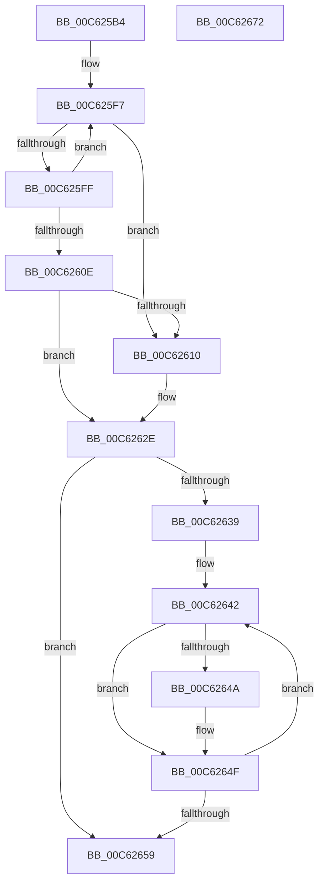

# MiInitializeLoaderDescriptors

- RVA: `0x00C625B4`–`0x00C62673` (길이 `191` bytes)
- VA: `0x0000000140C625B4`
- 실행 섹션: `INIT`
- PDB 이름 있음: `예`; PDB Function 태그: `아니요`
- unwind 정보 RVA: `0x000D79A0`
- 디코드: `49`개 명령, `191/191` bytes 표시
- 미해석 바이트: `0` (있으면 어셈블리에 `.byte`로 보존)

> 이 문서는 커널 이미지의 기계어와 PDB 기호를 분석해 생성했습니다. 4번과 5번은 함수 원형과 자료형을 바이너리 사용 방식에서 추정한 C 해석이며 원본 소스 복구 결과는 아닙니다.

## 1. Dependencies

- 직접 호출 지점: **5**; 고유 호출 대상: **4**
- 직접 호출자로 확인된 함수: **1**
- RIP 상대 이미지 참조: **5**

### Outgoing calls
- `0x00C625D7` → [MxComputeFreeNodeDescriptorRequirements](MxComputeFreeNodeDescriptorRequirements_function_00C62F78.md) (function, `0x00C62F78`)
- `0x00C625E4` → [MxWalkFreeNodeDescriptors](MxWalkFreeNodeDescriptors_function_00C641B8.md) (function, `0x00C641B8`)
- `0x00C6261F` → [memset](../../text/6C/memset_function_006C6C40.md) (function, `0x006C6C40`)
- `0x00C62629` → [MxWalkFreeNodeDescriptors](MxWalkFreeNodeDescriptors_function_00C641B8.md) (function, `0x00C641B8`)
- `0x00C62664` → [_security_check_cookie](../../text/6A/_security_check_cookie_function_006AC640.md) (function, `0x006AC640`)

### Direct callers
- [MiInitNucleus](../C5/MiInitNucleus_function_00C5FD38.md) at `0x00C5FF24`

### Static image references
- `0x00C625BD` → RVA `0x00E0A740` (`.data`; read)
- `0x00C625F0` → RVA `0x010093D8` (`INITDATA`; read)
- `0x00C62612` → RVA `0x010093D0` (`INITDATA`; read)
- `0x00C6262E` → RVA `0x00FC5000` (`ALMOSTRO`; read)
- `0x00C62639` → RVA `0x010093F8` (`INITDATA`; read)

## 2. Other-region calls and transfers

- 다른 실행 섹션으로 향하는 call: **2**
  - `0x00C6261F` → [memset](../../text/6C/memset_function_006C6C40.md) (`INIT` → `.text`)
  - `0x00C62664` → [_security_check_cookie](../../text/6A/_security_check_cookie_function_006AC640.md) (`INIT` → `.text`)
- 별도 외부 분기/꼬리 이동을 확인하지 못했습니다.

## 3. Assembly (complete function range)

```asm
00C625B4  40 53                           push rbx
00C625B6  48 81 EC 30 02 00 00            sub rsp, 0x230
00C625BD  48 8B 05 7C 81 1A 00            mov rax, qword ptr [rip + 0x1a817c]
00C625C4  48 33 C4                        xor rax, rsp
00C625C7  48 89 84 24 20 02 00 00         mov qword ptr [rsp + 0x220], rax
00C625CF  48 8D 54 24 20                  lea rdx, [rsp + 0x20]
00C625D4  48 8B D9                        mov rbx, rcx
00C625D7  E8 9C 09 00 00                  call 0x140c62f78
00C625DC  48 8D 54 24 20                  lea rdx, [rsp + 0x20]
00C625E1  48 8B CB                        mov rcx, rbx
00C625E4  E8 CF 1B 00 00                  call 0x140c641b8
00C625E9  33 D2                           xor edx, edx
00C625EB  4C 8D 44 24 20                  lea r8, [rsp + 0x20]
00C625F0  4C 8D 0D E1 6D 3A 00            lea r9, [rip + 0x3a6de1]
00C625F7  49 8B 01                        mov rax, qword ptr [r9]
00C625FA  49 39 00                        cmp qword ptr [r8], rax
00C625FD  77 11                           ja 0x140c62610
00C625FF  FF C2                           inc edx
00C62601  49 83 C1 38                     add r9, 0x38
00C62605  49 83 C0 08                     add r8, 8
00C62609  83 FA 40                        cmp edx, 0x40
00C6260C  72 E9                           jb 0x140c625f7
00C6260E  74 1E                           je 0x140c6262e
00C62610  33 D2                           xor edx, edx
00C62612  48 8D 0D B7 6D 3A 00            lea rcx, [rip + 0x3a6db7]
00C62619  41 B8 00 0E 00 00               mov r8d, 0xe00
00C6261F  E8 1C 46 A6 FF                  call 0x1406c6c40
00C62624  33 D2                           xor edx, edx
00C62626  48 8B CB                        mov rcx, rbx
00C62629  E8 8A 1B 00 00                  call 0x140c641b8
00C6262E  0F B7 0D CB 29 36 00            movzx ecx, word ptr [rip + 0x3629cb]
00C62635  85 C9                           test ecx, ecx
00C62637  74 20                           je 0x140c62659
00C62639  48 8D 05 B8 6D 3A 00            lea rax, [rip + 0x3a6db8]
00C62640  8B D1                           mov edx, ecx
00C62642  48 8B 08                        mov rcx, qword ptr [rax]
00C62645  48 85 C9                        test rcx, rcx
00C62648  74 05                           je 0x140c6264f
00C6264A  0F BA 69 18 1E                  bts dword ptr [rcx + 0x18], 0x1e
00C6264F  48 83 C0 38                     add rax, 0x38
00C62653  48 83 EA 01                     sub rdx, 1
00C62657  75 E9                           jne 0x140c62642
00C62659  48 8B 8C 24 20 02 00 00         mov rcx, qword ptr [rsp + 0x220]
00C62661  48 33 CC                        xor rcx, rsp
00C62664  E8 D7 9F A4 FF                  call 0x1406ac640
00C62669  48 81 C4 30 02 00 00            add rsp, 0x230
00C62670  5B                              pop rbx
00C62671  C3                              ret
00C62672  CC                              int3
```

## 4. C-style interpretation (structured pseudocode)

```c
__int64 __fastcall MiInitializeLoaderDescriptors(__int64 a1)
{
    __int64 result;
    __int64 v_rsp;
    unsigned __int64 v_stack_m18;
    unsigned __int64 v_stack_m218;

    v_rsp = (v_rsp) - (560);
    result = (*(unsigned __int64 *)(v_rip + 1737084)) ^ (v_rsp);
    v_stack_m18 = result;
    result = MxComputeFreeNodeDescriptorRequirements(a1, v_stack_m218, a3, a4);
    result = MxWalkFreeNodeDescriptors(a1, v_stack_m218, a3, a4);
    a2 = 0;
loc_00C625F7:
    if ((*(unsigned __int64 *)(v_stack_m218)) > (*(unsigned __int64 *)(v_rip + 3829217))) goto loc_00C62610;
    a2 = (unsigned int)((a2) + 1);
    a4 = (v_rip + 3829217) + (56);
    a3 = (v_stack_m218) + (8);
    if (((unsigned int)(a2)) < 64) goto loc_00C625F7;
    result = *(unsigned __int64 *)(v_rip + 3829217);
    if (((unsigned int)(a2)) != 64) {
        a2 = 0;
        a1 = v_rip + 3829175;
        a3 = 0xE00ULL;
        result = memset(a1, a2, a3, a4);
        a2 = 0;
        a1 = a1;
        result = MxWalkFreeNodeDescriptors(a1, a2, a3, a4);
    }
    if ((unsigned int)(*(unsigned __int16 *)(v_rip + 3549643)) == 0) goto loc_00C62659;
loc_00C62642:
    if (*(unsigned __int64 *)(v_rip + 3829176) != 0) {
    }
    result = (v_rip + 3829176) + (56);
    a2 = ((unsigned int)((unsigned int)(*(unsigned __int16 *)(v_rip + 3549643)))) - (1);
    if (condition_is_not_equal) goto loc_00C62642;
loc_00C62659:
    a1 = (v_stack_m18) ^ (v_rsp);
    result = _security_check_cookie(a1, a2, a3, a4);
    v_rsp = (v_rsp) + (560);
    return result;
}
```

## 5. (Beta) C Style

```c
int64_t MiInitializeLoaderDescriptors(int64_t Arg1)
{
    int64_t result;
    int64_t local_rsp;
    uint64_t v_stack_m18;
    uint64_t v_stack_m218;

    local_rsp = (local_rsp) - (560);
    result = (*(uint64_t *)(v_rip + 0x1A817C)) ^ (local_rsp);
    v_stack_m18 = result;
    result = MxComputeFreeNodeDescriptorRequirements(Arg1, v_stack_m218, a3, a4);
    result = MxWalkFreeNodeDescriptors(Arg1, v_stack_m218, a3, a4);
    a2 = 0;
loc_00C625F7:
    if ((*(uint64_t *)(v_stack_m218)) > (*(uint64_t *)(v_rip + 0x3A6DE1))) goto loc_00C62610;
    a2 = (uint32_t)((a2) + 1);
    a4 = (v_rip + 3829217) + (56);
    a3 = (v_stack_m218) + (8);
    if (((uint32_t)(a2)) < 64) goto loc_00C625F7;
    result = *(uint64_t *)(v_rip + 0x3A6DE1);
    if (((uint32_t)(a2)) != 64) {
        a2 = 0;
        Arg1 = v_rip + 3829175;
        a3 = 0xE00ULL;
        result = memset(Arg1, a2, a3, a4);
        a2 = 0;
        Arg1 = Arg1;
        result = MxWalkFreeNodeDescriptors(Arg1, a2, a3, a4);
    }
    if ((uint32_t)(*(uint16_t *)(v_rip + 0x3629CB)) == 0) goto loc_00C62659;
loc_00C62642:
    if (*(uint64_t *)(v_rip + 0x3A6DB8) != 0) {
    }
    result = (v_rip + 3829176) + (56);
    a2 = ((uint32_t)((uint32_t)(*(uint16_t *)(v_rip + 0x3629CB)))) - (1);
    if (condition_is_not_equal) goto loc_00C62642;
loc_00C62659:
    Arg1 = (v_stack_m18) ^ (local_rsp);
    result = _security_check_cookie(Arg1, a2, a3, a4);
    local_rsp = (local_rsp) + (560);
    return result;
}
```

## 6. Execution-region graph

[열기: 2D/3D 그래프와 함수 탐색 컨트롤 패널](../../../control-panel.html?section=init&rva=0x00C625B4&view=graph)

- 2D 그래프는 위에서 아래로 흐르고, 3D 그래프는 빈 공간을 드래그해 회전합니다. Shift+드래그는 이동, 휠은 확대·축소, 함수 노드 선택은 대상 보고서 이동입니다.

### Static fallback


