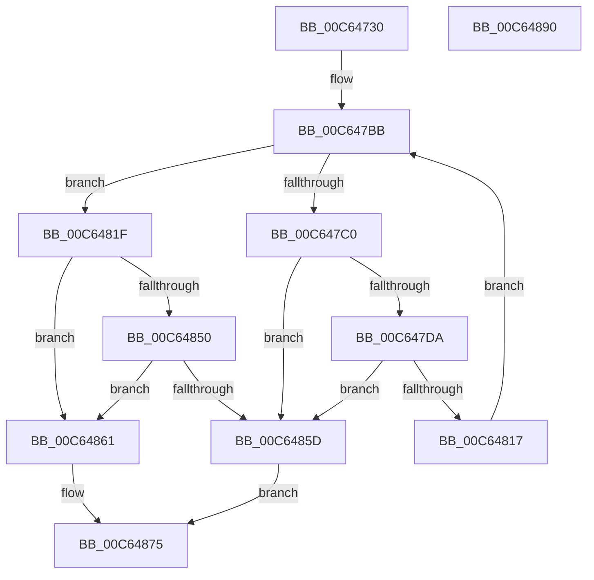

# MiInitializeMirroring

- RVA: `0x00C64730`–`0x00C64891` (길이 `353` bytes)
- VA: `0x0000000140C64730`
- 실행 섹션: `INIT`
- PDB 이름 있음: `예`; PDB Function 태그: `아니요`
- unwind 정보 RVA: `0x00060130`
- 디코드: `79`개 명령, `353/353` bytes 표시
- 미해석 바이트: `0` (있으면 어셈블리에 `.byte`로 보존)

> 이 문서는 커널 이미지의 기계어와 PDB 기호를 분석해 생성했습니다. 4번과 5번은 함수 원형과 자료형을 바이너리 사용 방식에서 추정한 C 해석이며 원본 소스 복구 결과는 아닙니다.

## 1. Dependencies

- 직접 호출 지점: **5**; 고유 호출 대상: **5**
- 직접 호출자로 확인된 함수: **1**
- RIP 상대 이미지 참조: **16**

### Outgoing calls
- `0x00C647C9` → [MiReservePtes](../../text/31/MiReservePtes_function_00318D20.md) (function, `0x00318D20`)
- `0x00C6480E` → [MiInitializeDynamicBitmap](../../text/67/MiInitializeDynamicBitmap_function_0067F5BC.md) (function, `0x0067F5BC`)
- `0x00C64829` → [MiLockDynamicMemoryExclusive](../../text/67/MiLockDynamicMemoryExclusive_function_006730F8.md) (function, `0x006730F8`)
- `0x00C64854` → [MiUpdateMirrorBitmaps](../../page/AD/MiUpdateMirrorBitmaps_function_00ADA220.md) (function, `0x00ADA220`)
- `0x00C6486B` → [MiUnlockDynamicMemoryExclusive](../../text/67/MiUnlockDynamicMemoryExclusive_function_00673C5C.md) (function, `0x00673C5C`)

### Direct callers
- [MiInitSystem](../C5/MiInitSystem_function_00C5E6C0.md) at `0x00C5EAD2`

### Static image references
- `0x00C64749` → RVA `0x00E30180` (`.data`; read/write)
- `0x00C64751` → RVA `0x00E30158` (`.data`; read)
- `0x00C64758` → RVA `0x00E30168` (`.data`; read/write)
- `0x00C64760` → RVA `0x00E30160` (`.data`; write)
- `0x00C64767` → RVA `0x00E30158` (`.data`; write)
- `0x00C6476E` → RVA `0x0047F9C0` (`MiFinishResume`; read)
- `0x00C64775` → RVA `0x00E30178` (`.data`; write)
- `0x00C6477C` → RVA `0x00E30150` (`.data`; write)
- `0x00C64785` → RVA `0x00E30152` (`.data`; write)
- `0x00C6478C` → RVA `0x00E30154` (`.data`; write)
- `0x00C6479F` → RVA `0x00E2DCE0` (`.data`; read)
- `0x00C647C2` → RVA `0x00E37668` (`.data`; read)
- `0x00C64822` → RVA `0x00E38D00` (`.data`; read)
- `0x00C64833` → RVA `0x00FC5204` (`ALMOSTRO`; read)
- `0x00C6483E` → RVA `0x00E30190` (`.data`; read)
- `0x00C64845` → RVA `0x00E301A0` (`.data`; read)

## 2. Other-region calls and transfers

- 다른 실행 섹션으로 향하는 call: **5**
  - `0x00C647C9` → [MiReservePtes](../../text/31/MiReservePtes_function_00318D20.md) (`INIT` → `.text`)
  - `0x00C6480E` → [MiInitializeDynamicBitmap](../../text/67/MiInitializeDynamicBitmap_function_0067F5BC.md) (`INIT` → `.text`)
  - `0x00C64829` → [MiLockDynamicMemoryExclusive](../../text/67/MiLockDynamicMemoryExclusive_function_006730F8.md) (`INIT` → `.text`)
  - `0x00C64854` → [MiUpdateMirrorBitmaps](../../page/AD/MiUpdateMirrorBitmaps_function_00ADA220.md) (`INIT` → `PAGE`)
  - `0x00C6486B` → [MiUnlockDynamicMemoryExclusive](../../text/67/MiUnlockDynamicMemoryExclusive_function_00673C5C.md) (`INIT` → `.text`)
- 별도 외부 분기/꼬리 이동을 확인하지 못했습니다.

## 3. Assembly (complete function range)

```asm
00C64730  48 8B C4                        mov rax, rsp
00C64733  48 89 58 08                     mov qword ptr [rax + 8], rbx
00C64737  48 89 68 10                     mov qword ptr [rax + 0x10], rbp
00C6473B  48 89 70 18                     mov qword ptr [rax + 0x18], rsi
00C6473F  48 89 78 20                     mov qword ptr [rax + 0x20], rdi
00C64743  41 56                           push r14
00C64745  48 83 EC 40                     sub rsp, 0x40
00C64749  48 83 0D 2F BA 1C 00 FF         or qword ptr [rip + 0x1cba2f], 0xffffffffffffffff
00C64751  48 8D 05 00 BA 1C 00            lea rax, [rip + 0x1cba00]
00C64758  48 83 25 08 BA 1C 00 00         and qword ptr [rip + 0x1cba08], 0
00C64760  48 89 05 F9 B9 1C 00            mov qword ptr [rip + 0x1cb9f9], rax
00C64767  48 89 05 EA B9 1C 00            mov qword ptr [rip + 0x1cb9ea], rax
00C6476E  48 8D 05 4B B2 81 FF            lea rax, [rip - 0x7e4db5]
00C64775  48 89 05 FC B9 1C 00            mov qword ptr [rip + 0x1cb9fc], rax
00C6477C  66 C7 05 CB B9 1C 00 01 00      mov word ptr [rip + 0x1cb9cb], 1
00C64785  C6 05 C6 B9 1C 00 06            mov byte ptr [rip + 0x1cb9c6], 6
00C6478C  C7 05 BE B9 1C 00 01 00 00 00   mov dword ptr [rip + 0x1cb9be], 1
00C64796  65 48 8B 34 25 88 01 00 00      mov rsi, qword ptr gs:[0x188]
00C6479F  48 8B 2D 3A 95 1C 00            mov rbp, qword ptr [rip + 0x1c953a]
00C647A6  48 8D 5D 08                     lea rbx, [rbp + 8]
00C647AA  48 C1 EB 03                     shr rbx, 3
00C647AE  48 81 C3 FF 0F 00 00            add rbx, 0xfff
00C647B5  48 C1 EB 0C                     shr rbx, 0xc
00C647B9  33 FF                           xor edi, edi
00C647BB  83 FF 02                        cmp edi, 2
00C647BE  73 5F                           jae 0x140c6481f
00C647C0  8B D3                           mov edx, ebx
00C647C2  48 8D 0D 9F 2E 1D 00            lea rcx, [rip + 0x1d2e9f]
00C647C9  E8 52 45 6B FF                  call 0x140318d20
00C647CE  48 8B D0                        mov rdx, rax
00C647D1  48 85 C0                        test rax, rax
00C647D4  0F 84 83 00 00 00               je 0x140c6485d
00C647DA  8B C7                           mov eax, edi
00C647DC  4C 8D 74 24 20                  lea r14, [rsp + 0x20]
00C647E1  48 C1 E0 04                     shl rax, 4
00C647E5  4C 03 F0                        add r14, rax
00C647E8  48 C1 E2 19                     shl rdx, 0x19
00C647EC  48 B8 00 00 00 00 80 F6 FF FF   movabs rax, 0xfffff68000000000
00C647F6  48 C1 E0 19                     shl rax, 0x19
00C647FA  4C 8D 45 01                     lea r8, [rbp + 1]
00C647FE  48 2B D0                        sub rdx, rax
00C64801  41 B9 06 00 00 00               mov r9d, 6
00C64807  48 C1 FA 10                     sar rdx, 0x10
00C6480B  49 8B CE                        mov rcx, r14
00C6480E  E8 A9 AD A1 FF                  call 0x14067f5bc
00C64813  85 C0                           test eax, eax
00C64815  74 46                           je 0x140c6485d
00C64817  49 83 26 00                     and qword ptr [r14], 0
00C6481B  FF C7                           inc edi
00C6481D  EB 9C                           jmp 0x140c647bb
00C6481F  48 8B D6                        mov rdx, rsi
00C64822  48 8D 0D D7 44 1D 00            lea rcx, [rip + 0x1d44d7]
00C64829  E8 CA E8 A0 FF                  call 0x1406730f8
00C6482E  0F 10 44 24 20                  movups xmm0, xmmword ptr [rsp + 0x20]
00C64833  8B 05 CB 09 36 00               mov eax, dword ptr [rip + 0x3609cb]
00C64839  0F 10 4C 24 30                  movups xmm1, xmmword ptr [rsp + 0x30]
00C6483E  0F 11 05 4B B9 1C 00            movups xmmword ptr [rip + 0x1cb94b], xmm0
00C64845  0F 11 0D 54 B9 1C 00            movups xmmword ptr [rip + 0x1cb954], xmm1
00C6484C  A8 01                           test al, 1
00C6484E  74 11                           je 0x140c64861
00C64850  33 D2                           xor edx, edx
00C64852  33 C9                           xor ecx, ecx
00C64854  E8 C7 59 E7 FF                  call 0x140ada220
00C64859  85 C0                           test eax, eax
00C6485B  75 04                           jne 0x140c64861
00C6485D  33 C0                           xor eax, eax
00C6485F  EB 14                           jmp 0x140c64875
00C64861  48 8B D6                        mov rdx, rsi
00C64864  48 8D 0D 95 44 1D 00            lea rcx, [rip + 0x1d4495]
00C6486B  E8 EC F3 A0 FF                  call 0x140673c5c
00C64870  B8 01 00 00 00                  mov eax, 1
00C64875  48 8B 5C 24 50                  mov rbx, qword ptr [rsp + 0x50]
00C6487A  48 8B 6C 24 58                  mov rbp, qword ptr [rsp + 0x58]
00C6487F  48 8B 74 24 60                  mov rsi, qword ptr [rsp + 0x60]
00C64884  48 8B 7C 24 68                  mov rdi, qword ptr [rsp + 0x68]
00C64889  48 83 C4 40                     add rsp, 0x40
00C6488D  41 5E                           pop r14
00C6488F  C3                              ret
00C64890  CC                              int3
```

## 4. C-style interpretation (structured pseudocode)

```c
__int64 __fastcall MiInitializeMirroring(void)
{
    __int64 result;
    __int64 v_r14;
    __int64 v_rbx;
    __int64 v_rdi;
    __int64 v_rsp;
    unsigned __int64 v_stack_m18;
    unsigned __int64 v_stack_m28;
    unsigned __int64 v_stack_p10;
    unsigned __int64 v_stack_p18;
    unsigned __int64 v_stack_p20;
    unsigned __int64 v_stack_p8;

    *(unsigned __int64 *)(v_rsp + 8) = v_rbx;
    *(unsigned __int64 *)(v_rsp + 16) = v_rbp;
    *(unsigned __int64 *)(v_rsp + 24) = v_rsi;
    *(unsigned __int64 *)(v_rsp + 32) = v_rdi;
    v_rsp = (v_rsp) - (64);
    *(unsigned __int64 *)(v_rip + 1882617) = v_rip + 1882624;
    *(unsigned __int64 *)(v_rip + 1882602) = v_rip + 1882624;
    *(unsigned __int64 *)(v_rip + 1882620) = v_rip - 8277429;
    *(unsigned __int16 *)(v_rip + 1882571) = 1;
    *(unsigned __int8 *)(v_rip + 1882566) = 6;
    *(unsigned int *)(v_rip + 1882558) = 1;
    v_rbx = (*(unsigned __int64 *)(v_rip + 1873210) + 8) >> (3);
    v_rbx = (v_rbx) + (0xFFFULL);
    v_rbx = (v_rbx) >> (12);
    v_rdi = 0;
loc_00C647BB:
    if (0 >= 2) goto loc_00C6481F;
    result = MiReservePtes(v_rip + 1912479, (unsigned int)((unsigned int)(v_rbx)), a3, a4);
    if (result == 0) goto loc_00C6485D;
    result = (0) << (4);
    v_r14 = (v_stack_m28) + (result);
    a2 = (result) << (25);
    result = (result) << (25);
    a2 = (a2) - (result);
    a2 = (a2) >> (16);
    result = MiInitializeDynamicBitmap(v_r14, a2, *(unsigned __int64 *)(v_rip + 1873210) + 1, 6);
    if ((unsigned int)(result) == 0) goto loc_00C6485D;
    v_rdi = (unsigned int)((v_rdi) + 1);
    goto loc_00C647BB;
loc_00C6481F:
    result = MiLockDynamicMemoryExclusive(v_rip + 1918167, *(unsigned __int64 *)(gs_base + (0 + 392)), *(unsigned __int64 *)(v_rip + 1873210) + 1, 6);
    *(unsigned __int64 *)(v_rip + 1882443) = v_xmm0;
    *(unsigned __int64 *)(v_rip + 1882452) = v_xmm1;
    if ((((unsigned __int8)((unsigned int)(*(unsigned int *)(v_rip + 3541451)))) & (1)) == 0) goto loc_00C64861;
    a2 = 0;
    a1 = 0;
    result = MiUpdateMirrorBitmaps(a1, a2, *(unsigned __int64 *)(v_rip + 1873210) + 1, 6);
    if ((unsigned int)(result) != 0) goto loc_00C64861;
loc_00C6485D:
    result = 0;
    goto loc_00C64875;
loc_00C64861:
    result = MiUnlockDynamicMemoryExclusive(v_rip + 1918101, *(unsigned __int64 *)(gs_base + (0 + 392)), *(unsigned __int64 *)(v_rip + 1873210) + 1, 6);
loc_00C64875:
    v_rsp = (v_rsp) + (64);
    return 1;
}
```

## 5. (Beta) C Style

```c
void MiInitializeMirroring(void)
{
    int64_t result;
    int64_t local_r14;
    int64_t local_rbx;
    int64_t local_rdi;
    int64_t local_rsp;
    uint64_t v_stack_m18;
    uint64_t v_stack_m28;
    uint64_t v_stack_p10;
    uint64_t v_stack_p18;
    uint64_t v_stack_p20;
    uint64_t v_stack_p8;

    *(uint64_t *)(local_rsp + 0x8) = local_rbx;
    *(uint64_t *)(local_rsp + 0x10) = local_rbp;
    *(uint64_t *)(local_rsp + 0x18) = local_rsi;
    *(uint64_t *)(local_rsp + 0x20) = local_rdi;
    local_rsp = (local_rsp) - (64);
    *(uint64_t *)(v_rip + 0x1CB9F9) = v_rip + 1882624;
    *(uint64_t *)(v_rip + 0x1CB9EA) = v_rip + 1882624;
    *(uint64_t *)(v_rip + 0x1CB9FC) = v_rip - 8277429;
    *(uint16_t *)(v_rip + 0x1CB9CB) = 1;
    *(uint8_t *)(v_rip + 0x1CB9C6) = 6;
    *(uint32_t *)(v_rip + 0x1CB9BE) = 1;
    local_rbx = (*(uint64_t *)(v_rip + 0x1C953A) + 8) >> (3);
    local_rbx = (local_rbx) + (0xFFFULL);
    local_rbx = (local_rbx) >> (12);
    local_rdi = 0;
loc_00C647BB:
    if (0 >= 2) goto loc_00C6481F;
    result = MiReservePtes(v_rip + 1912479, (uint32_t)((uint32_t)(local_rbx)), a3, a4);
    if (result == 0) goto loc_00C6485D;
    result = (0) << (4);
    local_r14 = (v_stack_m28) + (result);
    a2 = (result) << (25);
    result = (result) << (25);
    a2 = (a2) - (result);
    a2 = (a2) >> (16);
    result = MiInitializeDynamicBitmap(local_r14, a2, *(uint64_t *)(v_rip + 0x1C953A) + 1, 6);
    if ((uint32_t)(result) == 0) goto loc_00C6485D;
    local_rdi = (uint32_t)((local_rdi) + 1);
    goto loc_00C647BB;
loc_00C6481F:
    result = MiLockDynamicMemoryExclusive(v_rip + 1918167, *(uint64_t *)(gs_base + (0 + 0x188)), *(uint64_t *)(v_rip + 0x1C953A) + 1, 6);
    *(uint64_t *)(v_rip + 0x1CB94B) = v_xmm0;
    *(uint64_t *)(v_rip + 0x1CB954) = v_xmm1;
    if ((((uint8_t)((uint32_t)(*(uint32_t *)(v_rip + 0x3609CB)))) & (1)) == 0) goto loc_00C64861;
    a2 = 0;
    a1 = 0;
    result = MiUpdateMirrorBitmaps(a1, a2, *(uint64_t *)(v_rip + 0x1C953A) + 1, 6);
    if ((uint32_t)(result) != 0) goto loc_00C64861;
loc_00C6485D:
    result = 0;
    goto loc_00C64875;
loc_00C64861:
    result = MiUnlockDynamicMemoryExclusive(v_rip + 1918101, *(uint64_t *)(gs_base + (0 + 0x188)), *(uint64_t *)(v_rip + 0x1C953A) + 1, 6);
loc_00C64875:
    local_rsp = (local_rsp) + (64);
    return 1;
}
```

## 6. Execution-region graph

[열기: 2D/3D 그래프와 함수 탐색 컨트롤 패널](../../../control-panel.html?section=init&rva=0x00C64730&view=graph)

- 2D 그래프는 위에서 아래로 흐르고, 3D 그래프는 빈 공간을 드래그해 회전합니다. Shift+드래그는 이동, 휠은 확대·축소, 함수 노드 선택은 대상 보고서 이동입니다.

### Static fallback


