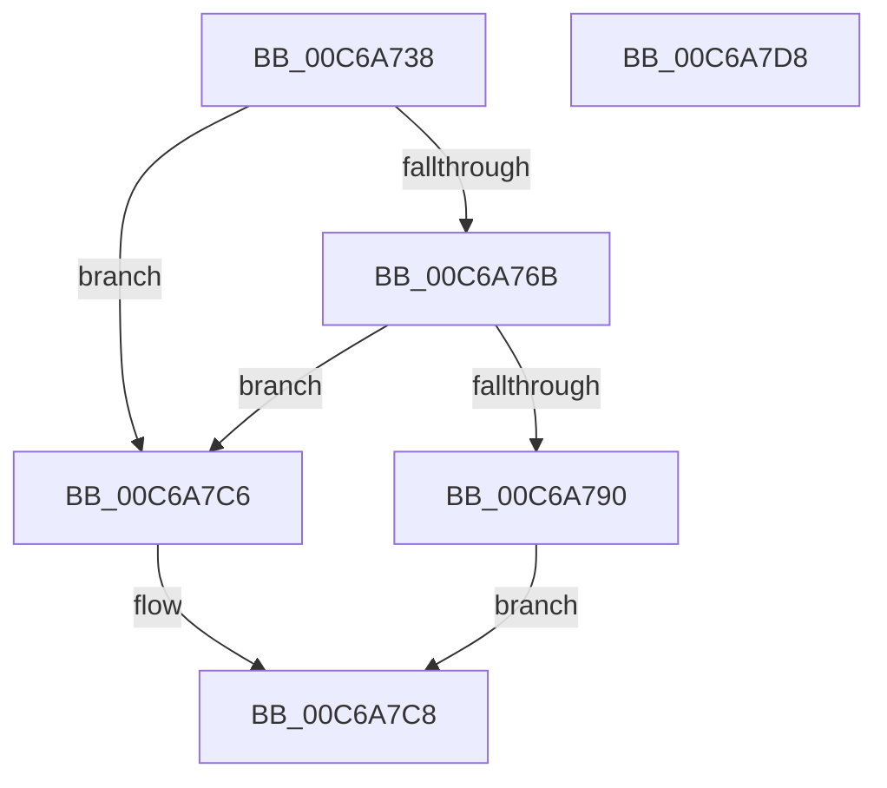

# MiInitializeNonCachedMappingRegion

- RVA: `0x00C6A738`–`0x00C6A7D9` (길이 `161` bytes)
- VA: `0x0000000140C6A738`
- 실행 섹션: `INIT`
- PDB 이름 있음: `예`; PDB Function 태그: `아니요`
- unwind 정보 RVA: `0x00086C28`
- 디코드: `42`개 명령, `161/161` bytes 표시
- 미해석 바이트: `0` (있으면 어셈블리에 `.byte`로 보존)

> 이 문서는 커널 이미지의 기계어와 PDB 기호를 분석해 생성했습니다. 4번과 5번은 함수 원형과 자료형을 바이너리 사용 방식에서 추정한 C 해석이며 원본 소스 복구 결과는 아닙니다.

## 1. Dependencies

- 직접 호출 지점: **3**; 고유 호출 대상: **3**
- 직접 호출자로 확인된 함수: **1**
- RIP 상대 이미지 참조: **4**

### Outgoing calls
- `0x00C6A760` → [MiInitializeDynamicRegion](MiInitializeDynamicRegion_function_00C65C2C.md) (function, `0x00C65C2C`)
- `0x00C6A786` → [MiAllocatePool](../../text/35/MiAllocatePool_function_0035B540.md) (function, `0x0035B540`)
- `0x00C6A7B8` → [MiInitializePteInfo](MiInitializePteInfo_function_00C6A7E0.md) (function, `0x00C6A7E0`)

### Direct callers
- [MiInitNucleus](../C5/MiInitNucleus_function_00C5FD38.md) at `0x00C6036E`

### Static image references
- `0x00C6A747` → RVA `0x00E38C50` (`.data`; read)
- `0x00C6A753` → RVA `0x00E38C48` (`.data`; read)
- `0x00C6A76B` → RVA `0x00FC5000` (`ALMOSTRO`; read)
- `0x00C6A7A9` → RVA `0x00E35E80` (`.data`; read)

## 2. Other-region calls and transfers

- 다른 실행 섹션으로 향하는 call: **1**
  - `0x00C6A786` → [MiAllocatePool](../../text/35/MiAllocatePool_function_0035B540.md) (`INIT` → `.text`)
- 별도 외부 분기/꼬리 이동을 확인하지 못했습니다.

## 3. Assembly (complete function range)

```asm
00C6A738  48 89 5C 24 08                  mov qword ptr [rsp + 8], rbx
00C6A73D  48 89 74 24 10                  mov qword ptr [rsp + 0x10], rsi
00C6A742  57                              push rdi
00C6A743  48 83 EC 40                     sub rsp, 0x40
00C6A747  48 8B 3D 02 E5 1C 00            mov rdi, qword ptr [rip + 0x1ce502]
00C6A74E  B9 06 00 00 00                  mov ecx, 6
00C6A753  48 8B 35 EE E4 1C 00            mov rsi, qword ptr [rip + 0x1ce4ee]
00C6A75A  4C 8B C7                        mov r8, rdi
00C6A75D  48 8B D6                        mov rdx, rsi
00C6A760  E8 C7 B4 FF FF                  call 0x140c65c2c
00C6A765  33 DB                           xor ebx, ebx
00C6A767  85 C0                           test eax, eax
00C6A769  74 5B                           je 0x140c6a7c6
00C6A76B  0F B7 05 8E A8 35 00            movzx eax, word ptr [rip + 0x35a88e]
00C6A772  41 B8 4D 6D 20 20               mov r8d, 0x20206d4d
00C6A778  8D 0C 40                        lea ecx, [rax + rax*2]
00C6A77B  48 8D 14 C9                     lea rdx, [rcx + rcx*8]
00C6A77F  48 C1 E2 03                     shl rdx, 3
00C6A783  8D 4B 40                        lea ecx, [rbx + 0x40]
00C6A786  E8 B5 0D 6F FF                  call 0x14035b540
00C6A78B  48 85 C0                        test rax, rax
00C6A78E  74 36                           je 0x140c6a7c6
00C6A790  48 89 44 24 38                  mov qword ptr [rsp + 0x38], rax
00C6A795  44 8D 4B 05                     lea r9d, [rbx + 5]
00C6A799  C7 44 24 30 01 00 00 00         mov dword ptr [rsp + 0x30], 1
00C6A7A1  8D 53 06                        lea edx, [rbx + 6]
00C6A7A4  48 89 7C 24 28                  mov qword ptr [rsp + 0x28], rdi
00C6A7A9  48 8D 0D D0 B6 1C 00            lea rcx, [rip + 0x1cb6d0]
00C6A7B0  45 33 C0                        xor r8d, r8d
00C6A7B3  48 89 74 24 20                  mov qword ptr [rsp + 0x20], rsi
00C6A7B8  E8 23 00 00 00                  call 0x140c6a7e0
00C6A7BD  85 C0                           test eax, eax
00C6A7BF  0F 95 C3                        setne bl
00C6A7C2  8B C3                           mov eax, ebx
00C6A7C4  EB 02                           jmp 0x140c6a7c8
00C6A7C6  33 C0                           xor eax, eax
00C6A7C8  48 8B 5C 24 50                  mov rbx, qword ptr [rsp + 0x50]
00C6A7CD  48 8B 74 24 58                  mov rsi, qword ptr [rsp + 0x58]
00C6A7D2  48 83 C4 40                     add rsp, 0x40
00C6A7D6  5F                              pop rdi
00C6A7D7  C3                              ret
00C6A7D8  CC                              int3
```

## 4. C-style interpretation (structured pseudocode)

```c
__int64 __fastcall MiInitializeNonCachedMappingRegion(void)
{
    __int64 result;
    __int64 v_rbx;
    __int64 v_rsp;
    unsigned __int64 v_stack_m10;
    unsigned int v_stack_m18;
    unsigned __int64 v_stack_m20;
    unsigned __int64 v_stack_m28;
    unsigned __int64 v_stack_p10;
    unsigned __int64 v_stack_p8;

    v_stack_p8 = v_rbx;
    v_stack_p10 = v_rsi;
    v_rsp = (v_rsp) - (64);
    result = MiInitializeDynamicRegion(6, *(unsigned __int64 *)(v_rip + 1893614), *(unsigned __int64 *)(v_rip + 1893634), a4);
    v_rbx = 0;
    if ((unsigned int)(result) == 0) goto loc_00C6A7C6;
    a2 = (*(unsigned __int16 *)(v_rip + 3516558) + *(unsigned __int16 *)(v_rip + 3516558) * 2 + *(unsigned __int16 *)(v_rip + 3516558) + *(unsigned __int16 *)(v_rip + 3516558) * 2 * 8) << (3);
    result = MiAllocatePool(v_rbx + 64, a2, (unsigned int)(0x20206D4DULL), a4);
    if (result == 0) goto loc_00C6A7C6;
    v_stack_m10 = result;
    v_stack_m18 = 1;
    v_stack_m20 = *(unsigned __int64 *)(v_rip + 1893634);
    a3 = 0;
    v_stack_m28 = *(unsigned __int64 *)(v_rip + 1893614);
    result = MiInitializePteInfo(v_rip + 1881808, v_rbx + 6, a3, v_rbx + 5);
    v_rbx = ((unsigned int)(result) != 0) ? 1 : 0;
    goto loc_00C6A7C8;
loc_00C6A7C6:
    result = 0;
loc_00C6A7C8:
    v_rsp = (v_rsp) + (64);
    return result;
}
```

## 5. (Beta) C Style

```c
void MiInitializeNonCachedMappingRegion(void)
{
    int64_t result;
    int64_t local_rbx;
    int64_t local_rsp;
    uint64_t v_stack_m10;
    uint32_t v_stack_m18;
    uint64_t v_stack_m20;
    uint64_t v_stack_m28;
    uint64_t v_stack_p10;
    uint64_t v_stack_p8;

    v_stack_p8 = local_rbx;
    v_stack_p10 = local_rsi;
    local_rsp = (local_rsp) - (64);
    result = MiInitializeDynamicRegion(6, *(uint64_t *)(v_rip + 0x1CE4EE), *(uint64_t *)(v_rip + 0x1CE502), a4);
    local_rbx = 0;
    if ((uint32_t)(result) == 0) goto loc_00C6A7C6;
    a2 = (*(uint16_t *)(v_rip + 0x35A88E) + *(uint16_t *)(v_rip + 0x35A88E) * 2 + *(uint16_t *)(v_rip + 0x35A88E) + *(uint16_t *)(v_rip + 0x35A88E) * 2 * 8) << (3);
    result = MiAllocatePool(local_rbx + 64, a2, (uint32_t)(0x20206D4DULL), a4);
    if (result == 0) goto loc_00C6A7C6;
    v_stack_m10 = result;
    v_stack_m18 = 1;
    v_stack_m20 = *(uint64_t *)(v_rip + 0x1CE502);
    a3 = 0;
    v_stack_m28 = *(uint64_t *)(v_rip + 0x1CE4EE);
    result = MiInitializePteInfo(v_rip + 1881808, local_rbx + 6, a3, local_rbx + 5);
    local_rbx = ((uint32_t)(result) != 0) ? 1 : 0;
    goto loc_00C6A7C8;
loc_00C6A7C6:
    result = 0;
loc_00C6A7C8:
    local_rsp = (local_rsp) + (64);
    return result;
}
```

## 6. Execution-region graph

[열기: 2D/3D 그래프와 함수 탐색 컨트롤 패널](../../../control-panel.html?section=init&rva=0x00C6A738&view=graph)

- 2D 그래프는 위에서 아래로 흐르고, 3D 그래프는 빈 공간을 드래그해 회전합니다. Shift+드래그는 이동, 휠은 확대·축소, 함수 노드 선택은 대상 보고서 이동입니다.

### Static fallback


