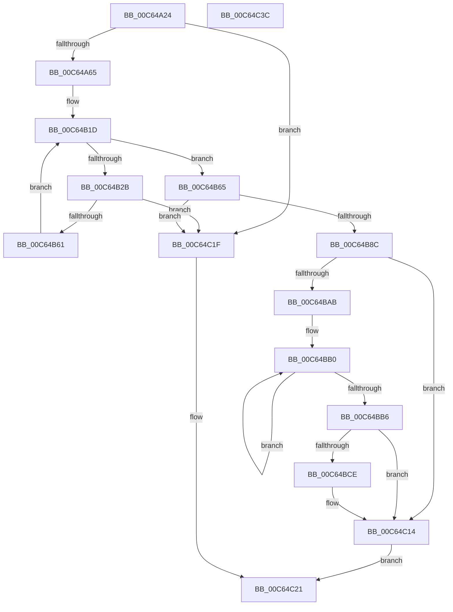

# MiInitializeNonPagedPool

- RVA: `0x00C64A24`–`0x00C64C3D` (길이 `537` bytes)
- VA: `0x0000000140C64A24`
- 실행 섹션: `INIT`
- PDB 이름 있음: `예`; PDB Function 태그: `아니요`
- unwind 정보 RVA: `0x0005E6B4`
- 디코드: `134`개 명령, `537/537` bytes 표시
- 미해석 바이트: `0` (있으면 어셈블리에 `.byte`로 보존)

> 이 문서는 커널 이미지의 기계어와 PDB 기호를 분석해 생성했습니다. 4번과 5번은 함수 원형과 자료형을 바이너리 사용 방식에서 추정한 C 해석이며 원본 소스 복구 결과는 아닙니다.

## 1. Dependencies

- 직접 호출 지점: **12**; 고유 호출 대상: **11**
- 직접 호출자로 확인된 함수: **1**
- RIP 상대 이미지 참조: **12**

### Outgoing calls
- `0x00C64A42` → [MiGetAnyMultiplexedVm](../../text/44/MiGetAnyMultiplexedVm_function_00448BD0.md) (function, `0x00448BD0`)
- `0x00C64A58` → [MiInitializeSystemWorkingSetList](../../page/7F/MiInitializeSystemWorkingSetList_function_007FB7D4.md) (function, `0x007FB7D4`)
- `0x00C64A6D` → [KiQueryUnbiasedInterruptTime](../../text/42/KiQueryUnbiasedInterruptTime_function_0042D180.md) (function, `0x0042D180`)
- `0x00C64AB2` → [ExGenRandom](../../text/41/ExGenRandom_function_0041B010.md) (function, `0x0041B010`)
- `0x00C64ABF` → [ExGenRandom](../../text/41/ExGenRandom_function_0041B010.md) (function, `0x0041B010`)
- `0x00C64B54` → [MiBuildDynamicRegion](../../text/67/MiBuildDynamicRegion_function_0067F470.md) (function, `0x0067F470`)
- `0x00C64B7F` → [MiInitializeDynamicRegion](MiInitializeDynamicRegion_function_00C65C2C.md) (function, `0x00C65C2C`)
- `0x00C64BA2` → [MI_IS_PHYSICAL_ADDRESS](../../text/23/MI_IS_PHYSICAL_ADDRESS_function_0023B3A0.md) (function, `0x0023B3A0`)
- `0x00C64BD1` → [MiVaToPfnEx](../../text/23/MiVaToPfnEx_function_0023A1A0.md) (function, `0x0023A1A0`)
- `0x00C64BFD` → [MiConvertActiveLargePageToSmall](../../text/42/MiConvertActiveLargePageToSmall_function_00420AF8.md) (function, `0x00420AF8`)
- `0x00C64C0F` → [MiAddExpansionNonPagedPool](../../text/68/MiAddExpansionNonPagedPool_function_00682B4C.md) (function, `0x00682B4C`)
- `0x00C64C16` → [MiInitializeNonPagedPoolThresholds](../../text/67/MiInitializeNonPagedPoolThresholds_function_0067CA64.md) (function, `0x0067CA64`)

### Direct callers
- [MiInitNucleus](../C5/MiInitNucleus_function_00C5FD38.md) at `0x00C6018A`

### Static image references
- `0x00C64A4A` → RVA `0x00E38D00` (`.data`; read)
- `0x00C64AD6` → RVA `0x00E38BC0` (`.data`; read)
- `0x00C64AE4` → RVA `0x00E37600` (`.data`; write)
- `0x00C64AEB` → RVA `0x00E38BB8` (`.data`; read)
- `0x00C64B03` → RVA `0x00E37658` (`.data`; write)
- `0x00C64B0A` → RVA `0x00FC5000` (`ALMOSTRO`; read)
- `0x00C64B2B` → RVA `0x00E2DBF8` (`.data`; read)
- `0x00C64B65` → RVA `0x00E38C90` (`.data`; read)
- `0x00C64B71` → RVA `0x00E38C88` (`.data`; read)
- `0x00C64B8C` → RVA `0x00FC6DE0` (`ALMOSTRO`; read)
- `0x00C64B97` → RVA `0x00FC6C38` (`ALMOSTRO`; read)
- `0x00C64BB6` → RVA `0x00011C60` (`.rdata`; read)

## 2. Other-region calls and transfers

- 다른 실행 섹션으로 향하는 call: **11**
  - `0x00C64A42` → [MiGetAnyMultiplexedVm](../../text/44/MiGetAnyMultiplexedVm_function_00448BD0.md) (`INIT` → `.text`)
  - `0x00C64A58` → [MiInitializeSystemWorkingSetList](../../page/7F/MiInitializeSystemWorkingSetList_function_007FB7D4.md) (`INIT` → `PAGE`)
  - `0x00C64A6D` → [KiQueryUnbiasedInterruptTime](../../text/42/KiQueryUnbiasedInterruptTime_function_0042D180.md) (`INIT` → `.text`)
  - `0x00C64AB2` → [ExGenRandom](../../text/41/ExGenRandom_function_0041B010.md) (`INIT` → `.text`)
  - `0x00C64ABF` → [ExGenRandom](../../text/41/ExGenRandom_function_0041B010.md) (`INIT` → `.text`)
  - `0x00C64B54` → [MiBuildDynamicRegion](../../text/67/MiBuildDynamicRegion_function_0067F470.md) (`INIT` → `.text`)
  - `0x00C64BA2` → [MI_IS_PHYSICAL_ADDRESS](../../text/23/MI_IS_PHYSICAL_ADDRESS_function_0023B3A0.md) (`INIT` → `.text`)
  - `0x00C64BD1` → [MiVaToPfnEx](../../text/23/MiVaToPfnEx_function_0023A1A0.md) (`INIT` → `.text`)
  - `0x00C64BFD` → [MiConvertActiveLargePageToSmall](../../text/42/MiConvertActiveLargePageToSmall_function_00420AF8.md) (`INIT` → `.text`)
  - `0x00C64C0F` → [MiAddExpansionNonPagedPool](../../text/68/MiAddExpansionNonPagedPool_function_00682B4C.md) (`INIT` → `.text`)
  - `0x00C64C16` → [MiInitializeNonPagedPoolThresholds](../../text/67/MiInitializeNonPagedPoolThresholds_function_0067CA64.md) (`INIT` → `.text`)
- 별도 외부 분기/꼬리 이동을 확인하지 못했습니다.

## 3. Assembly (complete function range)

```asm
00C64A24  48 8B C4                        mov rax, rsp
00C64A27  48 89 58 08                     mov qword ptr [rax + 8], rbx
00C64A2B  48 89 68 10                     mov qword ptr [rax + 0x10], rbp
00C64A2F  48 89 70 18                     mov qword ptr [rax + 0x18], rsi
00C64A33  48 89 78 20                     mov qword ptr [rax + 0x20], rdi
00C64A37  41 56                           push r14
00C64A39  48 83 EC 20                     sub rsp, 0x20
00C64A3D  B9 06 00 00 00                  mov ecx, 6
00C64A42  E8 89 41 7E FF                  call 0x140448bd0
00C64A47  45 33 C9                        xor r9d, r9d
00C64A4A  48 8D 0D AF 42 1D 00            lea rcx, [rip + 0x1d42af]
00C64A51  48 8B D0                        mov rdx, rax
00C64A54  45 8D 41 07                     lea r8d, [r9 + 7]
00C64A58  E8 77 6D B9 FF                  call 0x1407fb7d4
00C64A5D  85 C0                           test eax, eax
00C64A5F  0F 88 BA 01 00 00               js 0x140c64c1f
00C64A65  BD 01 00 00 00                  mov ebp, 1
00C64A6A  40 8A CD                        mov cl, bpl
00C64A6D  E8 0E 87 7C FF                  call 0x14042d180
00C64A72  65 4C 8B 04 25 20 00 00 00      mov r8, qword ptr gs:[0x20]
00C64A7B  48 8B F8                        mov rdi, rax
00C64A7E  48 C1 E7 20                     shl rdi, 0x20
00C64A82  48 8B C8                        mov rcx, rax
00C64A85  0F 31                           rdtsc
00C64A87  48 C1 E9 1C                     shr rcx, 0x1c
00C64A8B  48 C1 E2 20                     shl rdx, 0x20
00C64A8F  48 0B C2                        or rax, rdx
00C64A92  48 33 C1                        xor rax, rcx
00C64A95  41 8B 88 38 2D 00 00            mov ecx, dword ptr [r8 + 0x2d38]
00C64A9C  48 C1 E8 04                     shr rax, 4
00C64AA0  48 33 C1                        xor rax, rcx
00C64AA3  41 8B 88 50 86 00 00            mov ecx, dword ptr [r8 + 0x8650]
00C64AAA  48 33 C1                        xor rax, rcx
00C64AAD  33 C9                           xor ecx, ecx
00C64AAF  48 33 F8                        xor rdi, rax
00C64AB2  E8 59 65 7B FF                  call 0x14041b010
00C64AB7  8B D8                           mov ebx, eax
00C64AB9  33 C9                           xor ecx, ecx
00C64ABB  48 C1 E3 20                     shl rbx, 0x20
00C64ABF  E8 4C 65 7B FF                  call 0x14041b010
00C64AC4  8B C0                           mov eax, eax
00C64AC6  49 BE 00 00 00 00 00 10 00 00   movabs r14, 0x100000000000
00C64AD0  48 0B C3                        or rax, rbx
00C64AD3  48 33 F8                        xor rdi, rax
00C64AD6  48 8B 05 E3 40 1D 00            mov rax, qword ptr [rip + 0x1d40e3]
00C64ADD  48 0F 44 FD                     cmove rdi, rbp
00C64AE1  49 3B C6                        cmp rax, r14
00C64AE4  48 89 3D 15 2B 1D 00            mov qword ptr [rip + 0x1d2b15], rdi
00C64AEB  48 8B 3D C6 40 1D 00            mov rdi, qword ptr [rip + 0x1d40c6]
00C64AF2  49 0F 47 C6                     cmova rax, r14
00C64AF6  48 8B C8                        mov rcx, rax
00C64AF9  33 D2                           xor edx, edx
00C64AFB  48 C1 E9 0C                     shr rcx, 0xc
00C64AFF  48 C1 E8 15                     shr rax, 0x15
00C64B03  48 89 0D 4E 2B 1D 00            mov qword ptr [rip + 0x1d2b4e], rcx
00C64B0A  0F B7 0D EF 04 36 00            movzx ecx, word ptr [rip + 0x3604ef]
00C64B11  48 F7 F1                        div rcx
00C64B14  48 8B F0                        mov rsi, rax
00C64B17  48 C1 E6 15                     shl rsi, 0x15
00C64B1B  33 DB                           xor ebx, ebx
00C64B1D  0F B7 0D DC 04 36 00            movzx ecx, word ptr [rip + 0x3604dc]
00C64B24  48 8B D7                        mov rdx, rdi
00C64B27  3B D9                           cmp ebx, ecx
00C64B29  73 3A                           jae 0x140c64b65
00C64B2B  48 8B 05 C6 90 1C 00            mov rax, qword ptr [rip + 0x1c90c6]
00C64B32  4C 8D 04 5B                     lea r8, [rbx + rbx*2]
00C64B36  49 C1 E0 07                     shl r8, 7
00C64B3A  49 89 7C 00 68                  mov qword ptr [r8 + rax + 0x68], rdi
00C64B3F  48 03 FE                        add rdi, rsi
00C64B42  49 89 7C 00 70                  mov qword ptr [r8 + rax + 0x70], rdi
00C64B47  48 8B 0D AA 90 1C 00            mov rcx, qword ptr [rip + 0x1c90aa]
00C64B4E  49 03 C8                        add rcx, r8
00C64B51  4C 8B C6                        mov r8, rsi
00C64B54  E8 17 A9 A1 FF                  call 0x14067f470
00C64B59  85 C0                           test eax, eax
00C64B5B  0F 84 BE 00 00 00               je 0x140c64c1f
00C64B61  03 DD                           add ebx, ebp
00C64B63  EB B8                           jmp 0x140c64b1d
00C64B65  4C 8B 05 24 41 1D 00            mov r8, qword ptr [rip + 0x1d4124]
00C64B6C  B9 0E 00 00 00                  mov ecx, 0xe
00C64B71  48 8B 15 10 41 1D 00            mov rdx, qword ptr [rip + 0x1d4110]
00C64B78  4D 3B C6                        cmp r8, r14
00C64B7B  4D 0F 47 C6                     cmova r8, r14
00C64B7F  E8 A8 10 00 00                  call 0x140c65c2c
00C64B84  85 C0                           test eax, eax
00C64B86  0F 84 93 00 00 00               je 0x140c64c1f
00C64B8C  48 8B 1D 4D 22 36 00            mov rbx, qword ptr [rip + 0x36224d]
00C64B93  48 C1 E3 0C                     shl rbx, 0xc
00C64B97  48 03 1D 9A 20 36 00            add rbx, qword ptr [rip + 0x36209a]
00C64B9E  48 8D 4B FF                     lea rcx, [rbx - 1]
00C64BA2  E8 F9 67 5D FF                  call 0x14023b3a0
00C64BA7  85 C0                           test eax, eax
00C64BA9  74 69                           je 0x140c64c14
00C64BAB  BA 02 00 00 00                  mov edx, 2
00C64BB0  FF CA                           dec edx
00C64BB2  2B C5                           sub eax, ebp
00C64BB4  75 FA                           jne 0x140c64bb0
00C64BB6  48 8D 3D A3 D0 3A FF            lea rdi, [rip - 0xc52f5d]
00C64BBD  48 8B 3C D7                     mov rdi, qword ptr [rdi + rdx*8]
00C64BC1  48 C1 E7 0C                     shl rdi, 0xc
00C64BC5  48 8D 77 FF                     lea rsi, [rdi - 1]
00C64BC9  48 23 F3                        and rsi, rbx
00C64BCC  74 46                           je 0x140c64c14
00C64BCE  48 8B CB                        mov rcx, rbx
00C64BD1  E8 CA 55 5D FF                  call 0x14023a1a0
00C64BD6  48 8B CE                        mov rcx, rsi
00C64BD9  4C 8B C0                        mov r8, rax
00C64BDC  48 C1 E9 0C                     shr rcx, 0xc
00C64BE0  48 8B D8                        mov rbx, rax
00C64BE3  4C 2B C1                        sub r8, rcx
00C64BE6  4B 8D 0C 40                     lea rcx, [r8 + r8*2]
00C64BEA  48 C1 E1 04                     shl rcx, 4
00C64BEE  48 B8 00 00 00 00 00 DE FF FF   movabs rax, 0xffffde0000000000
00C64BF8  48 03 C8                        add rcx, rax
00C64BFB  33 D2                           xor edx, edx
00C64BFD  E8 F6 BE 7B FF                  call 0x140420af8
00C64C02  48 2B FE                        sub rdi, rsi
00C64C05  48 8B CB                        mov rcx, rbx
00C64C08  48 C1 EF 0C                     shr rdi, 0xc
00C64C0C  48 8B D7                        mov rdx, rdi
00C64C0F  E8 38 DF A1 FF                  call 0x140682b4c
00C64C14  33 C9                           xor ecx, ecx
00C64C16  E8 49 7E A1 FF                  call 0x14067ca64
00C64C1B  8B C5                           mov eax, ebp
00C64C1D  EB 02                           jmp 0x140c64c21
00C64C1F  33 C0                           xor eax, eax
00C64C21  48 8B 5C 24 30                  mov rbx, qword ptr [rsp + 0x30]
00C64C26  48 8B 6C 24 38                  mov rbp, qword ptr [rsp + 0x38]
00C64C2B  48 8B 74 24 40                  mov rsi, qword ptr [rsp + 0x40]
00C64C30  48 8B 7C 24 48                  mov rdi, qword ptr [rsp + 0x48]
00C64C35  48 83 C4 20                     add rsp, 0x20
00C64C39  41 5E                           pop r14
00C64C3B  C3                              ret
00C64C3C  CC                              int3
```

## 4. C-style interpretation (structured pseudocode)

```c
__int64 __fastcall MiInitializeNonPagedPool(__int64 a1, __int64 a2, __int64 a3, int a4)
{
    __int64 result;
    __int64 v_rbx;
    __int64 v_rdi;
    __int64 v_rsi;
    __int64 v_rsp;
    unsigned __int64 v_stack_p10;
    unsigned __int64 v_stack_p18;
    unsigned __int64 v_stack_p20;
    unsigned __int64 v_stack_p8;

    *(unsigned __int64 *)(v_rsp + 8) = v_rbx;
    *(unsigned __int64 *)(v_rsp + 16) = v_rbp;
    *(unsigned __int64 *)(v_rsp + 24) = v_rsi;
    *(unsigned __int64 *)(v_rsp + 32) = v_rdi;
    v_rsp = (v_rsp) - (32);
    result = MiGetAnyMultiplexedVm(6, a2, a3, a4);
    a4 = 0;
    result = MiInitializeSystemWorkingSetList(v_rip + 1917615, result, a4 + 7, a4);
    if (sign_flag) goto loc_00C64C1F;
    result = KiQueryUnbiasedInterruptTime(1, result, a4 + 7, a4);
    v_rdi = (result) << (32);
    a1 = (result) >> (28);
    a2 = (result) << (32);
    result = (result) | (a2);
    result = (result) ^ (a1);
    result = (result) >> (4);
    result = (result) ^ ((unsigned int)(*(unsigned int *)(*(unsigned __int64 *)(gs_base + (0 + 32)) + 11576)));
    result = (result) ^ ((unsigned int)(*(unsigned int *)(*(unsigned __int64 *)(gs_base + (0 + 32)) + 34384)));
    a1 = 0;
    v_rdi = (v_rdi) ^ (result);
    result = ExGenRandom(a1, a2, *(unsigned __int64 *)(gs_base + (0 + 32)), a4);
    a1 = 0;
    v_rbx = ((unsigned int)((unsigned int)(result))) << (32);
    result = ExGenRandom(a1, a2, *(unsigned __int64 *)(gs_base + (0 + 32)), a4);
    result = ((unsigned int)((unsigned int)(result))) | (v_rbx);
    v_rdi = (v_rdi) ^ (result);
    if (condition_is_equal) { v_rdi = 1; }
    *(unsigned __int64 *)(v_rip + 1911573) = v_rdi;
    result = *(unsigned __int64 *)(v_rip + 1917155);
    if ((*(unsigned __int64 *)(v_rip + 1917155)) > v_r14) { result = v_r14; }
    a2 = 0;
    a1 = (result) >> (12);
    result = (result) >> (21);
    *(unsigned __int64 *)(v_rip + 1911630) = a1;
    v_rsi = (result) << (21);
    v_rbx = 0;
loc_00C64B1D:
    if (0 >= ((unsigned int)(*(unsigned __int16 *)(v_rip + 3540188)))) goto loc_00C64B65;
    a3 = (v_rbx + v_rbx * 2) << (7);
    *(unsigned __int64 *)(a3 + *(unsigned __int64 *)(v_rip + 1872070) * 1 + 104) = *(unsigned __int64 *)(v_rip + 1917126);
    v_rdi = (*(unsigned __int64 *)(v_rip + 1917126)) + (v_rsi);
    *(unsigned __int64 *)(a3 + *(unsigned __int64 *)(v_rip + 1872070) * 1 + 112) = v_rdi;
    a1 = (*(unsigned __int64 *)(v_rip + 1872042)) + (a3);
    result = MiBuildDynamicRegion(a1, *(unsigned __int64 *)(v_rip + 1917126), v_rsi, a4);
    if ((unsigned int)(result) == 0) goto loc_00C64C1F;
    v_rbx = (unsigned int)((v_rbx) + (1));
    goto loc_00C64B1D;
loc_00C64B65:
    a3 = *(unsigned __int64 *)(v_rip + 1917220);
    if ((*(unsigned __int64 *)(v_rip + 1917220)) > v_r14) { a3 = v_r14; }
    result = MiInitializeDynamicRegion(14, *(unsigned __int64 *)(v_rip + 1917200), a3, a4);
    if ((unsigned int)(result) == 0) goto loc_00C64C1F;
    v_rbx = (*(unsigned __int64 *)(v_rip + 3547725)) << (12);
    v_rbx = (v_rbx) + (*(unsigned __int64 *)(v_rip + 3547290));
    result = MI_IS_PHYSICAL_ADDRESS(v_rbx - 1, *(unsigned __int64 *)(v_rip + 1917200), a3, a4);
    if ((unsigned int)(result) == 0) goto loc_00C64C14;
loc_00C64BB0:
    a2 = (unsigned int)((2) - 1);
    result = (unsigned int)((result) - (1));
    if (condition_is_not_equal) goto loc_00C64BB0;
    v_rdi = (*(unsigned __int64 *)(v_rip - 12922717 + a2 * 8)) << (12);
    v_rsi = (v_rdi - 1) & (v_rbx);
    if (!(condition_is_equal)) {
        a1 = v_rbx;
        result = MiVaToPfnEx(a1, a2, a3, a4);
        a1 = v_rsi;
        a3 = result;
        a1 = (a1) >> (12);
        v_rbx = result;
        a3 = (a3) - (a1);
        a1 = a3 + a3 * 2;
        a1 = (a1) << (4);
        a1 = (a1) + (result);
        a2 = 0;
        result = MiConvertActiveLargePageToSmall(a1, a2, a3, a4);
        v_rdi = (v_rdi) - (v_rsi);
        a1 = v_rbx;
        v_rdi = (v_rdi) >> (12);
        a2 = v_rdi;
        result = MiAddExpansionNonPagedPool(a1, a2, a3, a4);
    }
    a1 = 0;
    result = MiInitializeNonPagedPoolThresholds(a1, a2, a3, a4);
    goto loc_00C64C21;
loc_00C64C1F:
    result = 0;
loc_00C64C21:
    v_rsp = (v_rsp) + (32);
    return result;
}
```

## 5. (Beta) C Style

```c
int64_t MiInitializeNonPagedPool(int64_t Arg1, int64_t Arg2, int64_t Arg3, int32_t Arg4)
{
    int64_t result;
    int64_t local_rbx;
    int64_t local_rdi;
    int64_t local_rsi;
    int64_t local_rsp;
    uint64_t v_stack_p10;
    uint64_t v_stack_p18;
    uint64_t v_stack_p20;
    uint64_t v_stack_p8;

    *(uint64_t *)(local_rsp + 0x8) = local_rbx;
    *(uint64_t *)(local_rsp + 0x10) = local_rbp;
    *(uint64_t *)(local_rsp + 0x18) = local_rsi;
    *(uint64_t *)(local_rsp + 0x20) = local_rdi;
    local_rsp = (local_rsp) - (32);
    result = MiGetAnyMultiplexedVm(6, Arg2, Arg3, Arg4);
    Arg4 = 0;
    result = MiInitializeSystemWorkingSetList(v_rip + 1917615, result, Arg4 + 7, Arg4);
    if (sign_flag) goto loc_00C64C1F;
    result = KiQueryUnbiasedInterruptTime(1, result, Arg4 + 7, Arg4);
    local_rdi = (result) << (32);
    Arg1 = (result) >> (28);
    Arg2 = (result) << (32);
    result = (result) | (Arg2);
    result = (result) ^ (Arg1);
    result = (result) >> (4);
    result = (result) ^ ((uint32_t)(*(uint32_t *)(*(uint64_t *)(gs_base + (0 + 0x20)) + 0x2D38)));
    result = (result) ^ ((uint32_t)(*(uint32_t *)(*(uint64_t *)(gs_base + (0 + 0x20)) + 0x8650)));
    Arg1 = 0;
    local_rdi = (local_rdi) ^ (result);
    result = ExGenRandom(Arg1, Arg2, *(uint64_t *)(gs_base + (0 + 0x20)), Arg4);
    Arg1 = 0;
    local_rbx = ((uint32_t)((uint32_t)(result))) << (32);
    result = ExGenRandom(Arg1, Arg2, *(uint64_t *)(gs_base + (0 + 0x20)), Arg4);
    result = ((uint32_t)((uint32_t)(result))) | (local_rbx);
    local_rdi = (local_rdi) ^ (result);
    if (condition_is_equal) { local_rdi = 1; }
    *(uint64_t *)(v_rip + 0x1D2B15) = local_rdi;
    result = *(uint64_t *)(v_rip + 0x1D40E3);
    if ((*(uint64_t *)(v_rip + 0x1D40E3)) > local_r14) { result = local_r14; }
    Arg2 = 0;
    Arg1 = (result) >> (12);
    result = (result) >> (21);
    *(uint64_t *)(v_rip + 0x1D2B4E) = Arg1;
    local_rsi = (result) << (21);
    local_rbx = 0;
loc_00C64B1D:
    if (0 >= ((uint32_t)(*(uint16_t *)(v_rip + 0x3604DC)))) goto loc_00C64B65;
    Arg3 = (local_rbx + local_rbx * 2) << (7);
    *(uint64_t *)(Arg3 + *(uint64_t *)(v_rip + 0x1C90C6) * 1 + 0x68) = *(uint64_t *)(v_rip + 0x1D40C6);
    local_rdi = (*(uint64_t *)(v_rip + 0x1D40C6)) + (local_rsi);
    *(uint64_t *)(Arg3 + *(uint64_t *)(v_rip + 0x1C90C6) * 1 + 0x70) = local_rdi;
    Arg1 = (*(uint64_t *)(v_rip + 0x1C90AA)) + (Arg3);
    result = MiBuildDynamicRegion(Arg1, *(uint64_t *)(v_rip + 0x1D40C6), local_rsi, Arg4);
    if ((uint32_t)(result) == 0) goto loc_00C64C1F;
    local_rbx = (uint32_t)((local_rbx) + (1));
    goto loc_00C64B1D;
loc_00C64B65:
    Arg3 = *(uint64_t *)(v_rip + 0x1D4124);
    if ((*(uint64_t *)(v_rip + 0x1D4124)) > local_r14) { Arg3 = local_r14; }
    result = MiInitializeDynamicRegion(14, *(uint64_t *)(v_rip + 0x1D4110), Arg3, Arg4);
    if ((uint32_t)(result) == 0) goto loc_00C64C1F;
    local_rbx = (*(uint64_t *)(v_rip + 0x36224D)) << (12);
    local_rbx = (local_rbx) + (*(uint64_t *)(v_rip + 0x36209A));
    result = MI_IS_PHYSICAL_ADDRESS(local_rbx - 1, *(uint64_t *)(v_rip + 0x1D4110), Arg3, Arg4);
    if ((uint32_t)(result) == 0) goto loc_00C64C14;
loc_00C64BB0:
    Arg2 = (uint32_t)((2) - 1);
    result = (uint32_t)((result) - (1));
    if (condition_is_not_equal) goto loc_00C64BB0;
    local_rdi = (*(uint64_t *)(v_rip - 0xC52F5D + Arg2 * 8)) << (12);
    local_rsi = (local_rdi - 1) & (local_rbx);
    if (!(condition_is_equal)) {
        Arg1 = local_rbx;
        result = MiVaToPfnEx(Arg1, Arg2, Arg3, Arg4);
        Arg1 = local_rsi;
        Arg3 = result;
        Arg1 = (Arg1) >> (12);
        local_rbx = result;
        Arg3 = (Arg3) - (Arg1);
        Arg1 = Arg3 + Arg3 * 2;
        Arg1 = (Arg1) << (4);
        Arg1 = (Arg1) + (result);
        Arg2 = 0;
        result = MiConvertActiveLargePageToSmall(Arg1, Arg2, Arg3, Arg4);
        local_rdi = (local_rdi) - (local_rsi);
        Arg1 = local_rbx;
        local_rdi = (local_rdi) >> (12);
        Arg2 = local_rdi;
        result = MiAddExpansionNonPagedPool(Arg1, Arg2, Arg3, Arg4);
    }
    Arg1 = 0;
    result = MiInitializeNonPagedPoolThresholds(Arg1, Arg2, Arg3, Arg4);
    goto loc_00C64C21;
loc_00C64C1F:
    result = 0;
loc_00C64C21:
    local_rsp = (local_rsp) + (32);
    return result;
}
```

## 6. Execution-region graph

[열기: 2D/3D 그래프와 함수 탐색 컨트롤 패널](../../../control-panel.html?section=init&rva=0x00C64A24&view=graph)

- 2D 그래프는 위에서 아래로 흐르고, 3D 그래프는 빈 공간을 드래그해 회전합니다. Shift+드래그는 이동, 휠은 확대·축소, 함수 노드 선택은 대상 보고서 이동입니다.

### Static fallback


