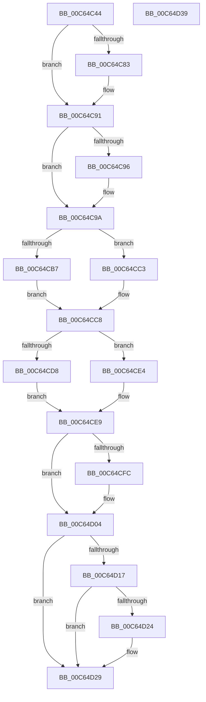

# MiInitializePagedPoolEvents

- RVA: `0x00C64C44`–`0x00C64D3A` (길이 `246` bytes)
- VA: `0x0000000140C64C44`
- 실행 섹션: `INIT`
- PDB 이름 있음: `예`; PDB Function 태그: `아니요`
- unwind 정보 RVA: `0x00060BC4`
- 디코드: `64`개 명령, `246/246` bytes 표시
- 미해석 바이트: `0` (있으면 어셈블리에 `.byte`로 보존)

> 이 문서는 커널 이미지의 기계어와 PDB 기호를 분석해 생성했습니다. 4번과 5번은 함수 원형과 자료형을 바이너리 사용 방식에서 추정한 C 해석이며 원본 소스 복구 결과는 아닙니다.

## 1. Dependencies

- 직접 호출 지점: **10**; 고유 호출 대상: **8**
- 직접 호출자로 확인된 함수: **1**
- RIP 상대 이미지 참조: **6**

### Outgoing calls
- `0x00C64C73` → [KeAbPreAcquire](../../text/21/KeAbPreAcquire_function_00210230.md) (function, `0x00210230`)
- `0x00C64C8C` → [ExfAcquirePushLockExclusiveEx](../../text/20/ExfAcquirePushLockExclusiveEx_function_0020FC90.md) (function, `0x0020FC90`)
- `0x00C64C9F` → [MiFreePoolPagesLeft](../../text/45/MiFreePoolPagesLeft_function_00450C40.md) (function, `0x00450C40`)
- `0x00C64CBC` → [KeSetEvent](../../text/33/KeSetEvent_function_0033F310.md) (function, `0x0033F310`)
- `0x00C64CC3` → [KeResetEvent](../../text/24/KeResetEvent_function_00248350.md) (function, `0x00248350`)
- `0x00C64CDD` → [KeSetEvent](../../text/33/KeSetEvent_function_0033F310.md) (function, `0x0033F310`)
- `0x00C64CE4` → [KeResetEvent](../../text/24/KeResetEvent_function_00248350.md) (function, `0x00248350`)
- `0x00C64CFF` → [ExfTryToWakePushLock](../../text/26/ExfTryToWakePushLock_function_00265DD0.md) (function, `0x00265DD0`)
- `0x00C64D07` → [KeAbPostRelease](../../text/2E/KeAbPostRelease_function_002E1600.md) (function, `0x002E1600`)
- `0x00C64D24` → [KiCheckForKernelApcDelivery](../../text/2E/KiCheckForKernelApcDelivery_function_002E2C80.md) (function, `0x002E2C80`)

### Direct callers
- [MiInitializeMemoryEvents](../../page/81/MiInitializeMemoryEvents_function_0081123C.md) at `0x00811302`

### Static image references
- `0x00C64C5C` → RVA `0x00E37640` (`.data`; read)
- `0x00C64CA4` → RVA `0x00E2CB68` (`.data`; read)
- `0x00C64CAE` → RVA `0x00E38E00` (`.data`; read)
- `0x00C64CC8` → RVA `0x00E2CB60` (`.data`; read)
- `0x00C64CCF` → RVA `0x00E38DF8` (`.data`; read)
- `0x00C64CED` → RVA `0x00E37640` (`.data`; read/write)

## 2. Other-region calls and transfers

- 다른 실행 섹션으로 향하는 call: **10**
  - `0x00C64C73` → [KeAbPreAcquire](../../text/21/KeAbPreAcquire_function_00210230.md) (`INIT` → `.text`)
  - `0x00C64C8C` → [ExfAcquirePushLockExclusiveEx](../../text/20/ExfAcquirePushLockExclusiveEx_function_0020FC90.md) (`INIT` → `.text`)
  - `0x00C64C9F` → [MiFreePoolPagesLeft](../../text/45/MiFreePoolPagesLeft_function_00450C40.md) (`INIT` → `.text`)
  - `0x00C64CBC` → [KeSetEvent](../../text/33/KeSetEvent_function_0033F310.md) (`INIT` → `.text`)
  - `0x00C64CC3` → [KeResetEvent](../../text/24/KeResetEvent_function_00248350.md) (`INIT` → `.text`)
  - `0x00C64CDD` → [KeSetEvent](../../text/33/KeSetEvent_function_0033F310.md) (`INIT` → `.text`)
  - `0x00C64CE4` → [KeResetEvent](../../text/24/KeResetEvent_function_00248350.md) (`INIT` → `.text`)
  - `0x00C64CFF` → [ExfTryToWakePushLock](../../text/26/ExfTryToWakePushLock_function_00265DD0.md) (`INIT` → `.text`)
  - `0x00C64D07` → [KeAbPostRelease](../../text/2E/KeAbPostRelease_function_002E1600.md) (`INIT` → `.text`)
  - `0x00C64D24` → [KiCheckForKernelApcDelivery](../../text/2E/KiCheckForKernelApcDelivery_function_002E2C80.md) (`INIT` → `.text`)
- 별도 외부 분기/꼬리 이동을 확인하지 못했습니다.

## 3. Assembly (complete function range)

```asm
00C64C44  48 89 5C 24 08                  mov qword ptr [rsp + 8], rbx
00C64C49  48 89 74 24 10                  mov qword ptr [rsp + 0x10], rsi
00C64C4E  57                              push rdi
00C64C4F  48 83 EC 20                     sub rsp, 0x20
00C64C53  65 48 8B 1C 25 88 01 00 00      mov rbx, qword ptr gs:[0x188]
00C64C5C  48 8D 35 DD 29 1D 00            lea rsi, [rip + 0x1d29dd]
00C64C63  45 33 C0                        xor r8d, r8d
00C64C66  33 D2                           xor edx, edx
00C64C68  48 8B CE                        mov rcx, rsi
00C64C6B  66 FF 8B E6 01 00 00            dec word ptr [rbx + 0x1e6]
00C64C72  90                              nop
00C64C73  E8 B8 B5 5A FF                  call 0x140210230
00C64C78  F0 48 0F BA 2E 00               lock bts qword ptr [rsi], 0
00C64C7E  48 8B F8                        mov rdi, rax
00C64C81  73 0E                           jae 0x140c64c91
00C64C83  4C 8B C6                        mov r8, rsi
00C64C86  48 8B D0                        mov rdx, rax
00C64C89  48 8B CE                        mov rcx, rsi
00C64C8C  E8 FF AF 5A FF                  call 0x14020fc90
00C64C91  48 85 FF                        test rdi, rdi
00C64C94  74 04                           je 0x140c64c9a
00C64C96  C6 47 0A 01                     mov byte ptr [rdi + 0xa], 1
00C64C9A  B9 05 00 00 00                  mov ecx, 5
00C64C9F  E8 9C BF 7E FF                  call 0x140450c40
00C64CA4  48 3B 05 BD 7E 1C 00            cmp rax, qword ptr [rip + 0x1c7ebd]
00C64CAB  48 8B F8                        mov rdi, rax
00C64CAE  48 8B 0D 4B 41 1D 00            mov rcx, qword ptr [rip + 0x1d414b]
00C64CB5  72 0C                           jb 0x140c64cc3
00C64CB7  45 33 C0                        xor r8d, r8d
00C64CBA  33 D2                           xor edx, edx
00C64CBC  E8 4F A6 6D FF                  call 0x14033f310
00C64CC1  EB 05                           jmp 0x140c64cc8
00C64CC3  E8 88 36 5E FF                  call 0x140248350
00C64CC8  48 3B 3D 91 7E 1C 00            cmp rdi, qword ptr [rip + 0x1c7e91]
00C64CCF  48 8B 0D 22 41 1D 00            mov rcx, qword ptr [rip + 0x1d4122]
00C64CD6  77 0C                           ja 0x140c64ce4
00C64CD8  45 33 C0                        xor r8d, r8d
00C64CDB  33 D2                           xor edx, edx
00C64CDD  E8 2E A6 6D FF                  call 0x14033f310
00C64CE2  EB 05                           jmp 0x140c64ce9
00C64CE4  E8 67 36 5E FF                  call 0x140248350
00C64CE9  48 83 C8 FF                     or rax, 0xffffffffffffffff
00C64CED  F0 48 0F C1 05 4A 29 1D 00      lock xadd qword ptr [rip + 0x1d294a], rax
00C64CF6  24 06                           and al, 6
00C64CF8  3C 02                           cmp al, 2
00C64CFA  75 08                           jne 0x140c64d04
00C64CFC  48 8B CE                        mov rcx, rsi
00C64CFF  E8 CC 10 60 FF                  call 0x140265dd0
00C64D04  48 8B CE                        mov rcx, rsi
00C64D07  E8 F4 C8 67 FF                  call 0x1402e1600
00C64D0C  90                              nop
00C64D0D  66 83 83 E6 01 00 00 01         add word ptr [rbx + 0x1e6], 1
00C64D15  75 12                           jne 0x140c64d29
00C64D17  48 8D 83 98 00 00 00            lea rax, [rbx + 0x98]
00C64D1E  90                              nop
00C64D1F  48 39 00                        cmp qword ptr [rax], rax
00C64D22  74 05                           je 0x140c64d29
00C64D24  E8 57 DF 67 FF                  call 0x1402e2c80
00C64D29  48 8B 5C 24 30                  mov rbx, qword ptr [rsp + 0x30]
00C64D2E  48 8B 74 24 38                  mov rsi, qword ptr [rsp + 0x38]
00C64D33  48 83 C4 20                     add rsp, 0x20
00C64D37  5F                              pop rdi
00C64D38  C3                              ret
00C64D39  CC                              int3
```

## 4. C-style interpretation (structured pseudocode)

```c
__int64 __fastcall MiInitializePagedPoolEvents(__int64 a1, int a2, int a3)
{
    __int64 result;
    __int64 v_rsp;
    unsigned __int64 v_stack_p10;
    unsigned __int64 v_stack_p8;

    v_stack_p8 = v_rbx;
    v_stack_p10 = v_rsi;
    v_rsp = (v_rsp) - (32);
    a3 = 0;
    a2 = 0;
    result = KeAbPreAcquire(v_rip + 1911261, a2, a3, a4);
    if (!(condition_is_above_or_equal)) {
        a3 = v_rip + 1911261;
        a2 = result;
        a1 = v_rip + 1911261;
        result = ExfAcquirePushLockExclusiveEx(a1, a2, a3, a4);
    }
    if (result != 0) {
        *(unsigned __int8 *)(result + 10) = 1;
    }
    result = MiFreePoolPagesLeft(5, a2, a3, a4);
    if (result < (*(unsigned __int64 *)(v_rip + 1867453))) goto loc_00C64CC3;
    a3 = 0;
    a2 = 0;
    result = KeSetEvent(*(unsigned __int64 *)(v_rip + 1917259), a2, a3, a4);
    goto loc_00C64CC8;
loc_00C64CC3:
    result = KeResetEvent(*(unsigned __int64 *)(v_rip + 1917259), a2, a3, a4);
loc_00C64CC8:
    if (result > (*(unsigned __int64 *)(v_rip + 1867409))) goto loc_00C64CE4;
    a3 = 0;
    a2 = 0;
    result = KeSetEvent(*(unsigned __int64 *)(v_rip + 1917218), a2, a3, a4);
    goto loc_00C64CE9;
loc_00C64CE4:
    result = KeResetEvent(*(unsigned __int64 *)(v_rip + 1917218), a2, a3, a4);
loc_00C64CE9:
    result = (result) | (-1);
    result = (unsigned __int8)((result) & (6));
    if (((unsigned __int8)(result)) == 2) {
        a1 = v_rip + 1911261;
        result = ExfTryToWakePushLock(a1, a2, a3, a4);
    }
    result = KeAbPostRelease(v_rip + 1911261, a2, a3, a4);
    if (((unsigned __int8)(result)) != 2) goto loc_00C64D29;
    result = *(unsigned __int64 *)(gs_base + (0 + 392)) + 152;
    if ((*(unsigned __int64 *)(*(unsigned __int64 *)(gs_base + (0 + 392)) + 152)) != (*(unsigned __int64 *)(gs_base + (0 + 392)) + 152)) {
        result = KiCheckForKernelApcDelivery(v_rip + 1911261, a2, a3, a4);
    }
    v_rsp = (v_rsp) + (32);
    return result;
}
```

## 5. (Beta) C Style

```c
int64_t MiInitializePagedPoolEvents(int64_t Arg1, int32_t Arg2, int32_t Arg3)
{
    int64_t result;
    int64_t local_rsp;
    uint64_t v_stack_p10;
    uint64_t v_stack_p8;

    v_stack_p8 = local_rbx;
    v_stack_p10 = local_rsi;
    local_rsp = (local_rsp) - (32);
    Arg3 = 0;
    Arg2 = 0;
    result = KeAbPreAcquire(v_rip + 1911261, Arg2, Arg3, a4);
    if (!(condition_is_above_or_equal)) {
        Arg3 = v_rip + 1911261;
        Arg2 = result;
        Arg1 = v_rip + 1911261;
        result = ExfAcquirePushLockExclusiveEx(Arg1, Arg2, Arg3, a4);
    }
    if (result != 0) {
        *(uint8_t *)(result + 0xA) = 1;
    }
    result = MiFreePoolPagesLeft(5, Arg2, Arg3, a4);
    if (result < (*(uint64_t *)(v_rip + 0x1C7EBD))) goto loc_00C64CC3;
    Arg3 = 0;
    Arg2 = 0;
    result = KeSetEvent(*(uint64_t *)(v_rip + 0x1D414B), Arg2, Arg3, a4);
    goto loc_00C64CC8;
loc_00C64CC3:
    result = KeResetEvent(*(uint64_t *)(v_rip + 0x1D414B), Arg2, Arg3, a4);
loc_00C64CC8:
    if (result > (*(uint64_t *)(v_rip + 0x1C7E91))) goto loc_00C64CE4;
    Arg3 = 0;
    Arg2 = 0;
    result = KeSetEvent(*(uint64_t *)(v_rip + 0x1D4122), Arg2, Arg3, a4);
    goto loc_00C64CE9;
loc_00C64CE4:
    result = KeResetEvent(*(uint64_t *)(v_rip + 0x1D4122), Arg2, Arg3, a4);
loc_00C64CE9:
    result = (result) | (-1);
    result = (uint8_t)((result) & (6));
    if (((uint8_t)(result)) == 2) {
        Arg1 = v_rip + 1911261;
        result = ExfTryToWakePushLock(Arg1, Arg2, Arg3, a4);
    }
    result = KeAbPostRelease(v_rip + 1911261, Arg2, Arg3, a4);
    if (((uint8_t)(result)) != 2) goto loc_00C64D29;
    result = *(uint64_t *)(gs_base + (0 + 0x188)) + 152;
    if ((*(uint64_t *)(*(uint64_t *)(gs_base + (0 + 0x188)) + 0x98)) != (*(uint64_t *)(gs_base + (0 + 0x188)) + 152)) {
        result = KiCheckForKernelApcDelivery(v_rip + 1911261, Arg2, Arg3, a4);
    }
    local_rsp = (local_rsp) + (32);
    return result;
}
```

## 6. Execution-region graph

[열기: 2D/3D 그래프와 함수 탐색 컨트롤 패널](../../../control-panel.html?section=init&rva=0x00C64C44&view=graph)

- 2D 그래프는 위에서 아래로 흐르고, 3D 그래프는 빈 공간을 드래그해 회전합니다. Shift+드래그는 이동, 휠은 확대·축소, 함수 노드 선택은 대상 보고서 이동입니다.

### Static fallback


