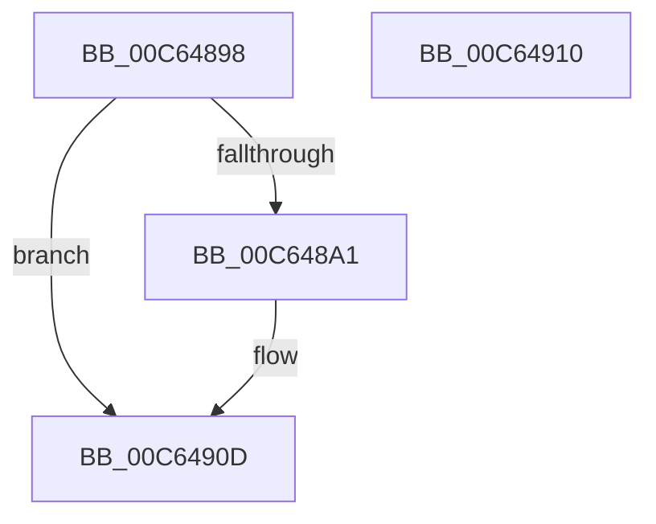

# MiInitializePartitions

- RVA: `0x00C64898`–`0x00C64911` (길이 `121` bytes)
- VA: `0x0000000140C64898`
- 실행 섹션: `INIT`
- PDB 이름 있음: `예`; PDB Function 태그: `아니요`
- unwind 정보 RVA: `0x000DB714`
- 디코드: `22`개 명령, `121/121` bytes 표시
- 미해석 바이트: `0` (있으면 어셈블리에 `.byte`로 보존)

> 이 문서는 커널 이미지의 기계어와 PDB 기호를 분석해 생성했습니다. 4번과 5번은 함수 원형과 자료형을 바이너리 사용 방식에서 추정한 C 해석이며 원본 소스 복구 결과는 아닙니다.

## 1. Dependencies

- 직접 호출 지점: **0**; 고유 호출 대상: **0**
- 직접 호출자로 확인된 함수: **1**
- RIP 상대 이미지 참조: **14**

### Outgoing calls
- 직접 디코드된 call 명령이 없습니다.

### Direct callers
- [MiCreatePfnDatabase](../C5/MiCreatePfnDatabase_function_00C5F930.md) at `0x00C5FA74`

### Static image references
- `0x00C648A1` → RVA `0x00E30048` (`.data`; read/write)
- `0x00C648A9` → RVA `0x00E30070` (`.data`; read)
- `0x00C648B0` → RVA `0x00E30068` (`.data`; write)
- `0x00C648B7` → RVA `0x00E30050` (`.data`; read)
- `0x00C648C9` → RVA `0x00E30070` (`.data`; write)
- `0x00C648CF` → RVA `0x00E30050` (`.data`; write)
- `0x00C648D5` → RVA `0x00E30058` (`.data`; read)
- `0x00C648DC` → RVA `0x00E30060` (`.data`; write)
- `0x00C648E3` → RVA `0x00E30058` (`.data`; write)
- `0x00C648EA` → RVA `0x00E38D00` (`.data`; read)
- `0x00C648F1` → RVA `0x00E30080` (`.data`; write)
- `0x00C648F8` → RVA `0x00E30080` (`.data`; read)
- `0x00C648FF` → RVA `0x00E30088` (`.data`; write)
- `0x00C64906` → RVA `0x00E30078` (`.data`; write)

## 2. Other-region calls and transfers

- 다른 실행 섹션으로 향하는 call: **0**
- 별도 외부 분기/꼬리 이동을 확인하지 못했습니다.

## 3. Assembly (complete function range)

```asm
00C64898  BA 01 00 00 00                  mov edx, 1
00C6489D  85 C9                           test ecx, ecx
00C6489F  75 6C                           jne 0x140c6490d
00C648A1  48 83 25 9F B7 1C 00 00         and qword ptr [rip + 0x1cb79f], 0
00C648A9  48 8D 0D C0 B7 1C 00            lea rcx, [rip + 0x1cb7c0]
00C648B0  48 89 0D B1 B7 1C 00            mov qword ptr [rip + 0x1cb7b1], rcx
00C648B7  48 8D 05 92 B7 1C 00            lea rax, [rip + 0x1cb792]
00C648BE  0F BE 0D 8B B7 1C 00            movsx ecx, byte ptr [rip + 0x1cb78b]
00C648C5  0F BA E9 00                     bts ecx, 0
00C648C9  89 15 A1 B7 1C 00               mov dword ptr [rip + 0x1cb7a1], edx
00C648CF  88 0D 7B B7 1C 00               mov byte ptr [rip + 0x1cb77b], cl
00C648D5  48 8D 0D 7C B7 1C 00            lea rcx, [rip + 0x1cb77c]
00C648DC  48 89 0D 7D B7 1C 00            mov qword ptr [rip + 0x1cb77d], rcx
00C648E3  48 89 0D 6E B7 1C 00            mov qword ptr [rip + 0x1cb76e], rcx
00C648EA  48 8D 0D 0F 44 1D 00            lea rcx, [rip + 0x1d440f]
00C648F1  48 89 0D 88 B7 1C 00            mov qword ptr [rip + 0x1cb788], rcx
00C648F8  48 8D 0D 81 B7 1C 00            lea rcx, [rip + 0x1cb781]
00C648FF  48 89 0D 82 B7 1C 00            mov qword ptr [rip + 0x1cb782], rcx
00C64906  48 89 05 6B B7 1C 00            mov qword ptr [rip + 0x1cb76b], rax
00C6490D  8B C2                           mov eax, edx
00C6490F  C3                              ret
00C64910  CC                              int3
```

## 4. C-style interpretation (structured pseudocode)

```c
__int64 __fastcall MiInitializePartitions(int a1)
{
    __int64 result;

    if (a1 == 0) {
        a1 = v_rip + 1882048;
        *(unsigned __int64 *)(v_rip + 1882033) = a1;
        result = v_rip + 1882002;
        a1 = (__int8)(*(unsigned __int8 *)(v_rip + 1881995));
        *(unsigned int *)(v_rip + 1882017) = 1;
        *(unsigned __int8 *)(v_rip + 1881979) = (unsigned __int8)(a1);
        a1 = v_rip + 1881980;
        *(unsigned __int64 *)(v_rip + 1881981) = a1;
        *(unsigned __int64 *)(v_rip + 1881966) = a1;
        a1 = v_rip + 1917967;
        *(unsigned __int64 *)(v_rip + 1881992) = a1;
        a1 = v_rip + 1881985;
        *(unsigned __int64 *)(v_rip + 1881986) = a1;
        *(unsigned __int64 *)(v_rip + 1881963) = result;
    }
    return 1;
}
```

## 5. (Beta) C Style

```c
int64_t MiInitializePartitions(int32_t Arg1)
{
    int64_t result;

    if (Arg1 == 0) {
        Arg1 = v_rip + 1882048;
        *(uint64_t *)(v_rip + 0x1CB7B1) = Arg1;
        result = v_rip + 1882002;
        Arg1 = (int8_t)(*(uint8_t *)(v_rip + 0x1CB78B));
        *(uint32_t *)(v_rip + 0x1CB7A1) = 1;
        *(uint8_t *)(v_rip + 0x1CB77B) = (uint8_t)(Arg1);
        Arg1 = v_rip + 1881980;
        *(uint64_t *)(v_rip + 0x1CB77D) = Arg1;
        *(uint64_t *)(v_rip + 0x1CB76E) = Arg1;
        Arg1 = v_rip + 1917967;
        *(uint64_t *)(v_rip + 0x1CB788) = Arg1;
        Arg1 = v_rip + 1881985;
        *(uint64_t *)(v_rip + 0x1CB782) = Arg1;
        *(uint64_t *)(v_rip + 0x1CB76B) = result;
    }
    return 1;
}
```

## 6. Execution-region graph

[열기: 2D/3D 그래프와 함수 탐색 컨트롤 패널](../../../control-panel.html?section=init&rva=0x00C64898&view=graph)

- 2D 그래프는 위에서 아래로 흐르고, 3D 그래프는 빈 공간을 드래그해 회전합니다. Shift+드래그는 이동, 휠은 확대·축소, 함수 노드 선택은 대상 보고서 이동입니다.

### Static fallback


