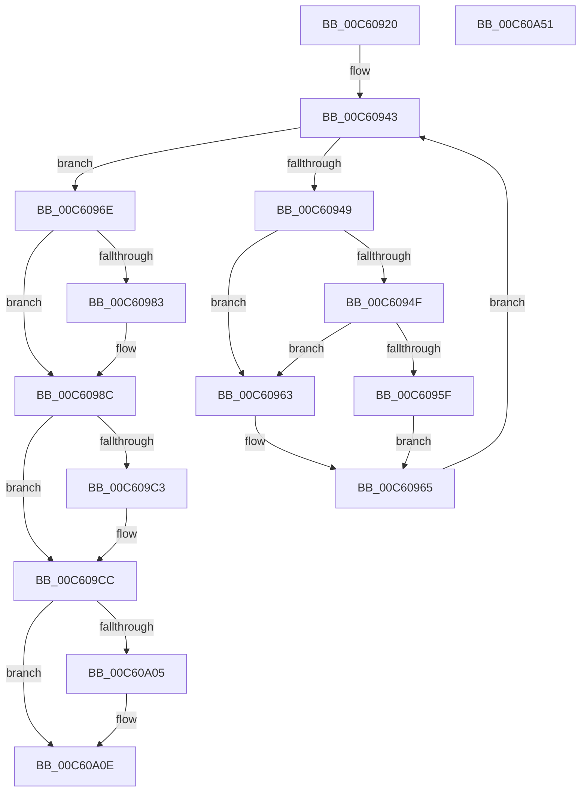

# MiInitializePhysicalMemoryBlocks

- RVA: `0x00C60920`–`0x00C60A52` (길이 `306` bytes)
- VA: `0x0000000140C60920`
- 실행 섹션: `INIT`
- PDB 이름 있음: `예`; PDB Function 태그: `아니요`
- unwind 정보 RVA: `0x0007CF64`
- 디코드: `80`개 명령, `306/306` bytes 표시
- 미해석 바이트: `0` (있으면 어셈블리에 `.byte`로 보존)

> 이 문서는 커널 이미지의 기계어와 PDB 기호를 분석해 생성했습니다. 4번과 5번은 함수 원형과 자료형을 바이너리 사용 방식에서 추정한 C 해석이며 원본 소스 복구 결과는 아닙니다.

## 1. Dependencies

- 직접 호출 지점: **14**; 고유 호출 대상: **10**
- 직접 호출자로 확인된 함수: **1**
- RIP 상대 이미지 참조: **7**

### Outgoing calls
- `0x00C60976` → [MmInitializeMemoryLimits](MmInitializeMemoryLimits_function_00C67150.md) (function, `0x00C67150`)
- `0x00C60986` → [MxInstallMoreMemory](../../text/67/MxInstallMoreMemory_function_00671A04.md) (function, `0x00671A04`)
- `0x00C60996` → [MiConvertInitialMemoryBlock](../../page/7F/MiConvertInitialMemoryBlock_function_007FA10C.md) (function, `0x007FA10C`)
- `0x00C609A3` → [ExFreePoolWithTag](../../poolcode/B8/ExFreePoolWithTag_function_00B82870.md) (function, `0x00B82870`)
- `0x00C609B2` → [MiCreateNodeLists](../../page/7F/MiCreateNodeLists_function_007FA220.md) (function, `0x007FA220`)
- `0x00C609C6` → [MxInstallMoreMemory](../../text/67/MxInstallMoreMemory_function_00671A04.md) (function, `0x00671A04`)
- `0x00C609D8` → [MiComputeNodeMemory](../../text/67/MiComputeNodeMemory_function_00671AA4.md) (function, `0x00671AA4`)
- `0x00C609DF` → [KeQueryPerformanceCounter](../../text/37/KeQueryPerformanceCounter_function_0037E7E0.md) (function, `0x0037E7E0`)
- `0x00C609FC` → [MiCreatePfnBitMaps](../../page/80/MiCreatePfnBitMaps_function_0080BBC8.md) (function, `0x0080BBC8`)
- `0x00C60A08` → [MxInstallMoreMemory](../../text/67/MxInstallMoreMemory_function_00671A04.md) (function, `0x00671A04`)
- `0x00C60A10` → [KeQueryPerformanceCounter](../../text/37/KeQueryPerformanceCounter_function_0037E7E0.md) (function, `0x0037E7E0`)
- `0x00C60A1F` → [MiMarkLargePageRanges](MiMarkLargePageRanges_function_00C60CFC.md) (function, `0x00C60CFC`)
- `0x00C60A26` → [KeQueryPerformanceCounter](../../text/37/KeQueryPerformanceCounter_function_0037E7E0.md) (function, `0x0037E7E0`)
- `0x00C60A3A` → [_security_check_cookie](../../text/6A/_security_check_cookie_function_006AC640.md) (function, `0x006AC640`)

### Direct callers
- [MiInitNucleus](../C5/MiInitNucleus_function_00C5FD38.md) at `0x00C601DF`

### Static image references
- `0x00C6092F` → RVA `0x00E0A740` (`.data`; read)
- `0x00C6098F` → RVA `0x00E38D00` (`.data`; read)
- `0x00C609B7` → RVA `0x00E38D20` (`.data`; write)
- `0x00C609E7` → RVA `0x01008858` (`INITDATA`; write)
- `0x00C609F5` → RVA `0x00FC6B88` (`ALMOSTRO`; write)
- `0x00C60A18` → RVA `0x01008860` (`INITDATA`; write)
- `0x00C60A2B` → RVA `0x01008868` (`INITDATA`; write)

## 2. Other-region calls and transfers

- 다른 실행 섹션으로 향하는 call: **12**
  - `0x00C60986` → [MxInstallMoreMemory](../../text/67/MxInstallMoreMemory_function_00671A04.md) (`INIT` → `.text`)
  - `0x00C60996` → [MiConvertInitialMemoryBlock](../../page/7F/MiConvertInitialMemoryBlock_function_007FA10C.md) (`INIT` → `PAGE`)
  - `0x00C609A3` → [ExFreePoolWithTag](../../poolcode/B8/ExFreePoolWithTag_function_00B82870.md) (`INIT` → `POOLCODE`)
  - `0x00C609B2` → [MiCreateNodeLists](../../page/7F/MiCreateNodeLists_function_007FA220.md) (`INIT` → `PAGE`)
  - `0x00C609C6` → [MxInstallMoreMemory](../../text/67/MxInstallMoreMemory_function_00671A04.md) (`INIT` → `.text`)
  - `0x00C609D8` → [MiComputeNodeMemory](../../text/67/MiComputeNodeMemory_function_00671AA4.md) (`INIT` → `.text`)
  - `0x00C609DF` → [KeQueryPerformanceCounter](../../text/37/KeQueryPerformanceCounter_function_0037E7E0.md) (`INIT` → `.text`)
  - `0x00C609FC` → [MiCreatePfnBitMaps](../../page/80/MiCreatePfnBitMaps_function_0080BBC8.md) (`INIT` → `PAGE`)
  - `0x00C60A08` → [MxInstallMoreMemory](../../text/67/MxInstallMoreMemory_function_00671A04.md) (`INIT` → `.text`)
  - `0x00C60A10` → [KeQueryPerformanceCounter](../../text/37/KeQueryPerformanceCounter_function_0037E7E0.md) (`INIT` → `.text`)
  - `0x00C60A26` → [KeQueryPerformanceCounter](../../text/37/KeQueryPerformanceCounter_function_0037E7E0.md) (`INIT` → `.text`)
  - `0x00C60A3A` → [_security_check_cookie](../../text/6A/_security_check_cookie_function_006AC640.md) (`INIT` → `.text`)
- 별도 외부 분기/꼬리 이동을 확인하지 못했습니다.

## 3. Assembly (complete function range)

```asm
00C60920  48 89 5C 24 10                  mov qword ptr [rsp + 0x10], rbx
00C60925  48 89 74 24 18                  mov qword ptr [rsp + 0x18], rsi
00C6092A  57                              push rdi
00C6092B  48 83 EC 60                     sub rsp, 0x60
00C6092F  48 8B 05 0A 9E 1A 00            mov rax, qword ptr [rip + 0x1a9e0a]
00C60936  48 33 C4                        xor rax, rsp
00C60939  48 89 44 24 50                  mov qword ptr [rsp + 0x50], rax
00C6093E  48 8B F9                        mov rdi, rcx
00C60941  33 C0                           xor eax, eax
00C60943  48 83 F8 2F                     cmp rax, 0x2f
00C60947  7D 25                           jge 0x140c6096e
00C60949  48 83 F8 2C                     cmp rax, 0x2c
00C6094D  77 14                           ja 0x140c60963
00C6094F  48 B9 48 00 C0 C0 C5 15 00 00   movabs rcx, 0x15c5c0c00048
00C60959  48 0F A3 C1                     bt rcx, rax
00C6095D  73 04                           jae 0x140c60963
00C6095F  32 C9                           xor cl, cl
00C60961  EB 02                           jmp 0x140c60965
00C60963  B1 01                           mov cl, 1
00C60965  88 4C 04 20                     mov byte ptr [rsp + rax + 0x20], cl
00C60969  48 FF C0                        inc rax
00C6096C  EB D5                           jmp 0x140c60943
00C6096E  48 8D 54 24 20                  lea rdx, [rsp + 0x20]
00C60973  48 8B CF                        mov rcx, rdi
00C60976  E8 D5 67 00 00                  call 0x140c67150
00C6097B  48 8B D8                        mov rbx, rax
00C6097E  48 85 C0                        test rax, rax
00C60981  75 09                           jne 0x140c6098c
00C60983  8D 48 11                        lea ecx, [rax + 0x11]
00C60986  E8 79 10 A1 FF                  call 0x140671a04
00C6098B  CC                              int3
00C6098C  48 8B D3                        mov rdx, rbx
00C6098F  48 8D 0D 6A 83 1D 00            lea rcx, [rip + 0x1d836a]
00C60996  E8 71 97 B9 FF                  call 0x1407fa10c
00C6099B  33 D2                           xor edx, edx
00C6099D  48 8B CB                        mov rcx, rbx
00C609A0  48 8B F0                        mov rsi, rax
00C609A3  E8 C8 1E F2 FF                  call 0x140b82870
00C609A8  48 8B D6                        mov rdx, rsi
00C609AB  48 8D 0D 4E 83 1D 00            lea rcx, [rip + 0x1d834e]
00C609B2  E8 69 98 B9 FF                  call 0x1407fa220
00C609B7  48 89 05 62 83 1D 00            mov qword ptr [rip + 0x1d8362], rax
00C609BE  48 85 C0                        test rax, rax
00C609C1  75 09                           jne 0x140c609cc
00C609C3  8D 48 13                        lea ecx, [rax + 0x13]
00C609C6  E8 39 10 A1 FF                  call 0x140671a04
00C609CB  CC                              int3
00C609CC  BA 01 00 00 00                  mov edx, 1
00C609D1  48 8D 0D 28 83 1D 00            lea rcx, [rip + 0x1d8328]
00C609D8  E8 C7 10 A1 FF                  call 0x140671aa4
00C609DD  33 C9                           xor ecx, ecx
00C609DF  E8 FC DD 71 FF                  call 0x14037e7e0
00C609E4  48 8B D6                        mov rdx, rsi
00C609E7  48 89 05 6A 7E 3A 00            mov qword ptr [rip + 0x3a7e6a], rax
00C609EE  48 8D 0D 0B 83 1D 00            lea rcx, [rip + 0x1d830b]
00C609F5  48 89 35 8C 61 36 00            mov qword ptr [rip + 0x36618c], rsi
00C609FC  E8 C7 B1 BA FF                  call 0x14080bbc8
00C60A01  85 C0                           test eax, eax
00C60A03  75 09                           jne 0x140c60a0e
00C60A05  8D 48 16                        lea ecx, [rax + 0x16]
00C60A08  E8 F7 0F A1 FF                  call 0x140671a04
00C60A0D  CC                              int3
00C60A0E  33 C9                           xor ecx, ecx
00C60A10  E8 CB DD 71 FF                  call 0x14037e7e0
00C60A15  48 8B CF                        mov rcx, rdi
00C60A18  48 89 05 41 7E 3A 00            mov qword ptr [rip + 0x3a7e41], rax
00C60A1F  E8 D8 02 00 00                  call 0x140c60cfc
00C60A24  33 C9                           xor ecx, ecx
00C60A26  E8 B5 DD 71 FF                  call 0x14037e7e0
00C60A2B  48 89 05 36 7E 3A 00            mov qword ptr [rip + 0x3a7e36], rax
00C60A32  48 8B 4C 24 50                  mov rcx, qword ptr [rsp + 0x50]
00C60A37  48 33 CC                        xor rcx, rsp
00C60A3A  E8 01 BC A4 FF                  call 0x1406ac640
00C60A3F  4C 8D 5C 24 60                  lea r11, [rsp + 0x60]
00C60A44  49 8B 5B 18                     mov rbx, qword ptr [r11 + 0x18]
00C60A48  49 8B 73 20                     mov rsi, qword ptr [r11 + 0x20]
00C60A4C  49 8B E3                        mov rsp, r11
00C60A4F  5F                              pop rdi
00C60A50  C3                              ret
00C60A51  CC                              int3
```

## 4. C-style interpretation (structured pseudocode)

```c
__int64 __fastcall MiInitializePhysicalMemoryBlocks(__int64 a1)
{
    __int64 result;
    __int64 v_rsp;
    unsigned __int64 v_stack_m18;
    unsigned __int64 v_stack_m48;
    unsigned __int64 v_stack_m8;
    unsigned __int64 v_stack_p10;
    unsigned __int64 v_stack_p18;

    v_stack_p10 = v_rbx;
    v_stack_p18 = v_rsi;
    v_rsp = (v_rsp) - (96);
    result = (*(unsigned __int64 *)(v_rip + 1744394)) ^ (v_rsp);
    v_stack_m18 = result;
    result = 0;
loc_00C60943:
    if (0 >= 47) goto loc_00C6096E;
    if (0 > 44) goto loc_00C60963;
    if (0 >= 44) goto loc_00C60963;
    a1 = 0;
    goto loc_00C60965;
loc_00C60963:
loc_00C60965:
    *(unsigned __int8 *)(v_rsp + result * 1 + 32) = 1;
    result = (result) + 1;
    goto loc_00C60943;
loc_00C6096E:
    result = MmInitializeMemoryLimits(0, v_stack_m48, a3, a4);
    if (result == 0) {
        a1 = result + 17;
        result = MxInstallMoreMemory(a1, v_stack_m48, a3, a4);
    }
    result = MiConvertInitialMemoryBlock(v_rip + 1934186, result, a3, a4);
    a2 = 0;
    result = ExFreePoolWithTag(result, a2, a3, a4);
    result = MiCreateNodeLists(v_rip + 1934158, result, a3, a4);
    *(unsigned __int64 *)(v_rip + 1934178) = result;
    if (result == 0) {
        a1 = result + 19;
        result = MxInstallMoreMemory(a1, result, a3, a4);
    }
    result = MiComputeNodeMemory(v_rip + 1934120, 1, a3, a4);
    a1 = 0;
    result = KeQueryPerformanceCounter(a1, 1, a3, a4);
    *(unsigned __int64 *)(v_rip + 3833450) = result;
    *(unsigned __int64 *)(v_rip + 3563916) = result;
    result = MiCreatePfnBitMaps(v_rip + 1934091, result, a3, a4);
    if ((unsigned int)(result) == 0) {
        a1 = result + 22;
        result = MxInstallMoreMemory(a1, result, a3, a4);
    }
    a1 = 0;
    result = KeQueryPerformanceCounter(a1, result, a3, a4);
    *(unsigned __int64 *)(v_rip + 3833409) = result;
    result = MiMarkLargePageRanges(0, result, a3, a4);
    a1 = 0;
    result = KeQueryPerformanceCounter(a1, result, a3, a4);
    *(unsigned __int64 *)(v_rip + 3833398) = result;
    a1 = (v_stack_m18) ^ (v_rsp);
    result = _security_check_cookie(a1, result, a3, a4);
    return result;
}
```

## 5. (Beta) C Style

```c
int64_t MiInitializePhysicalMemoryBlocks(int64_t Arg1)
{
    int64_t result;
    int64_t local_rsp;
    uint64_t v_stack_m18;
    uint64_t v_stack_m48;
    uint64_t v_stack_m8;
    uint64_t v_stack_p10;
    uint64_t v_stack_p18;

    v_stack_p10 = local_rbx;
    v_stack_p18 = local_rsi;
    local_rsp = (local_rsp) - (96);
    result = (*(uint64_t *)(v_rip + 0x1A9E0A)) ^ (local_rsp);
    v_stack_m18 = result;
    result = 0;
loc_00C60943:
    if (0 >= 47) goto loc_00C6096E;
    if (0 > 44) goto loc_00C60963;
    if (0 >= 44) goto loc_00C60963;
    Arg1 = 0;
    goto loc_00C60965;
loc_00C60963:
loc_00C60965:
    *(uint8_t *)(local_rsp + result * 1 + 0x20) = 1;
    result = (result) + 1;
    goto loc_00C60943;
loc_00C6096E:
    result = MmInitializeMemoryLimits(0, v_stack_m48, a3, a4);
    if (result == 0) {
        Arg1 = result + 17;
        result = MxInstallMoreMemory(Arg1, v_stack_m48, a3, a4);
    }
    result = MiConvertInitialMemoryBlock(v_rip + 1934186, result, a3, a4);
    a2 = 0;
    result = ExFreePoolWithTag(result, a2, a3, a4);
    result = MiCreateNodeLists(v_rip + 1934158, result, a3, a4);
    *(uint64_t *)(v_rip + 0x1D8362) = result;
    if (result == 0) {
        Arg1 = result + 19;
        result = MxInstallMoreMemory(Arg1, result, a3, a4);
    }
    result = MiComputeNodeMemory(v_rip + 1934120, 1, a3, a4);
    Arg1 = 0;
    result = KeQueryPerformanceCounter(Arg1, 1, a3, a4);
    *(uint64_t *)(v_rip + 0x3A7E6A) = result;
    *(uint64_t *)(v_rip + 0x36618C) = result;
    result = MiCreatePfnBitMaps(v_rip + 1934091, result, a3, a4);
    if ((uint32_t)(result) == 0) {
        Arg1 = result + 22;
        result = MxInstallMoreMemory(Arg1, result, a3, a4);
    }
    Arg1 = 0;
    result = KeQueryPerformanceCounter(Arg1, result, a3, a4);
    *(uint64_t *)(v_rip + 0x3A7E41) = result;
    result = MiMarkLargePageRanges(0, result, a3, a4);
    Arg1 = 0;
    result = KeQueryPerformanceCounter(Arg1, result, a3, a4);
    *(uint64_t *)(v_rip + 0x3A7E36) = result;
    Arg1 = (v_stack_m18) ^ (local_rsp);
    result = _security_check_cookie(Arg1, result, a3, a4);
    return result;
}
```

## 6. Execution-region graph

[열기: 2D/3D 그래프와 함수 탐색 컨트롤 패널](../../../control-panel.html?section=init&rva=0x00C60920&view=graph)

- 2D 그래프는 위에서 아래로 흐르고, 3D 그래프는 빈 공간을 드래그해 회전합니다. Shift+드래그는 이동, 휠은 확대·축소, 함수 노드 선택은 대상 보고서 이동입니다.

### Static fallback


