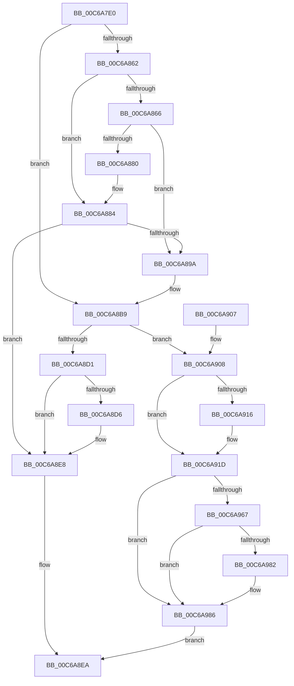

# MiInitializePteInfo

- RVA: `0x00C6A7E0`–`0x00C6A990` (길이 `432` bytes)
- VA: `0x0000000140C6A7E0`
- 실행 섹션: `INIT`
- PDB 이름 있음: `예`; PDB Function 태그: `아니요`
- unwind 정보 RVA: `0x000D9354`
- 디코드: `117`개 명령, `432/432` bytes 표시
- 미해석 바이트: `0` (있으면 어셈블리에 `.byte`로 보존)

> 이 문서는 커널 이미지의 기계어와 PDB 기호를 분석해 생성했습니다. 4번과 5번은 함수 원형과 자료형을 바이너리 사용 방식에서 추정한 C 해석이며 원본 소스 복구 결과는 아닙니다.

## 1. Dependencies

- 직접 호출 지점: **5**; 고유 호출 대상: **3**
- 직접 호출자로 확인된 함수: **4**
- RIP 상대 이미지 참조: **2**

### Outgoing calls
- `0x00C6A873` → [MiReservePtes](../../text/31/MiReservePtes_function_00318D20.md) (function, `0x00318D20`)
- `0x00C6A88D` → [MiReservePtes](../../text/31/MiReservePtes_function_00318D20.md) (function, `0x00318D20`)
- `0x00C6A8C5` → [MiInitializeDynamicBitmap](../../text/67/MiInitializeDynamicBitmap_function_0067F5BC.md) (function, `0x0067F5BC`)
- `0x00C6A8E3` → [MiReleasePtes](../../text/24/MiReleasePtes_function_00247240.md) (function, `0x00247240`)
- `0x00C6A979` → [MiInitializeDynamicBitmap](../../text/67/MiInitializeDynamicBitmap_function_0067F5BC.md) (function, `0x0067F5BC`)

### Direct callers
- [MiInitializeSystemSpaceMap](MiInitializeSystemSpaceMap_function_00C64E60.md) at `0x00C64EDC`
- [MiInitializeKernelStacks](MiInitializeKernelStacks_function_00C680B8.md) at `0x00C681F4`
- [MiInitializeNonCachedMappingRegion](MiInitializeNonCachedMappingRegion_function_00C6A738.md) at `0x00C6A7B8`
- [MiInitializeSystemPtes](MiInitializeSystemPtes_function_00C6A998.md) at `0x00C6AADC`

### Static image references
- `0x00C6A81E` → RVA `0x00FC51FC` (`ALMOSTRO`; read)
- `0x00C6A869` → RVA `0x00E37668` (`.data`; read)

## 2. Other-region calls and transfers

- 다른 실행 섹션으로 향하는 call: **5**
  - `0x00C6A873` → [MiReservePtes](../../text/31/MiReservePtes_function_00318D20.md) (`INIT` → `.text`)
  - `0x00C6A88D` → [MiReservePtes](../../text/31/MiReservePtes_function_00318D20.md) (`INIT` → `.text`)
  - `0x00C6A8C5` → [MiInitializeDynamicBitmap](../../text/67/MiInitializeDynamicBitmap_function_0067F5BC.md) (`INIT` → `.text`)
  - `0x00C6A8E3` → [MiReleasePtes](../../text/24/MiReleasePtes_function_00247240.md) (`INIT` → `.text`)
  - `0x00C6A979` → [MiInitializeDynamicBitmap](../../text/67/MiInitializeDynamicBitmap_function_0067F5BC.md) (`INIT` → `.text`)
- 별도 외부 분기/꼬리 이동을 확인하지 못했습니다.

## 3. Assembly (complete function range)

```asm
00C6A7E0  48 8B C4                        mov rax, rsp
00C6A7E3  48 89 58 08                     mov qword ptr [rax + 8], rbx
00C6A7E7  48 89 68 18                     mov qword ptr [rax + 0x18], rbp
00C6A7EB  48 89 70 20                     mov qword ptr [rax + 0x20], rsi
00C6A7EF  89 50 10                        mov dword ptr [rax + 0x10], edx
00C6A7F2  57                              push rdi
00C6A7F3  41 54                           push r12
00C6A7F5  41 55                           push r13
00C6A7F7  41 56                           push r14
00C6A7F9  41 57                           push r15
00C6A7FB  48 83 EC 20                     sub rsp, 0x20
00C6A7FF  48 8B 44 24 78                  mov rax, qword ptr [rsp + 0x78]
00C6A804  33 D2                           xor edx, edx
00C6A806  48 C1 E8 0C                     shr rax, 0xc
00C6A80A  49 8B F0                        mov rsi, r8
00C6A80D  44 8B 84 24 80 00 00 00         mov r8d, dword ptr [rsp + 0x80]
00C6A815  48 FF C8                        dec rax
00C6A818  49 03 C0                        add rax, r8
00C6A81B  48 8B D9                        mov rbx, rcx
00C6A81E  8B 0D D8 A9 35 00               mov ecx, dword ptr [rip + 0x35a9d8]
00C6A824  45 8B E9                        mov r13d, r9d
00C6A827  49 F7 F0                        div r8
00C6A82A  83 E1 02                        and ecx, 2
00C6A82D  4C 8B E0                        mov r12, rax
00C6A830  4C 8D 78 07                     lea r15, [rax + 7]
00C6A834  8B C1                           mov eax, ecx
00C6A836  49 C1 EF 03                     shr r15, 3
00C6A83A  49 81 C7 FF 0F 00 00            add r15, 0xfff
00C6A841  49 81 E7 00 F0 FF FF            and r15, 0xfffffffffffff000
00C6A848  49 8B FF                        mov rdi, r15
00C6A84B  48 C1 EF 0C                     shr rdi, 0xc
00C6A84F  F7 D8                           neg eax
00C6A851  45 1B F6                        sbb r14d, r14d
00C6A854  33 ED                           xor ebp, ebp
00C6A856  41 83 E6 02                     and r14d, 2
00C6A85A  41 FF C6                        inc r14d
00C6A85D  48 85 F6                        test rsi, rsi
00C6A860  75 57                           jne 0x140c6a8b9
00C6A862  85 C9                           test ecx, ecx
00C6A864  74 1E                           je 0x140c6a884
00C6A866  41 8B D6                        mov edx, r14d
00C6A869  48 8D 0D F8 CD 1C 00            lea rcx, [rip + 0x1ccdf8]
00C6A870  0F AF D7                        imul edx, edi
00C6A873  E8 A8 E4 6A FF                  call 0x140318d20
00C6A878  48 8B E8                        mov rbp, rax
00C6A87B  48 85 C0                        test rax, rax
00C6A87E  75 1A                           jne 0x140c6a89a
00C6A880  44 8D 76 01                     lea r14d, [rsi + 1]
00C6A884  8B D7                           mov edx, edi
00C6A886  48 8D 0D DB CD 1C 00            lea rcx, [rip + 0x1ccddb]
00C6A88D  E8 8E E4 6A FF                  call 0x140318d20
00C6A892  48 8B E8                        mov rbp, rax
00C6A895  48 85 C0                        test rax, rax
00C6A898  74 4E                           je 0x140c6a8e8
00C6A89A  48 8B F5                        mov rsi, rbp
00C6A89D  48 B8 00 00 00 00 80 F6 FF FF   movabs rax, 0xfffff68000000000
00C6A8A7  48 C1 E6 19                     shl rsi, 0x19
00C6A8AB  48 8B C0                        mov rax, rax
00C6A8AE  48 C1 E0 19                     shl rax, 0x19
00C6A8B2  48 2B F0                        sub rsi, rax
00C6A8B5  48 C1 FE 10                     sar rsi, 0x10
00C6A8B9  45 8B CD                        mov r9d, r13d
00C6A8BC  4D 8B C4                        mov r8, r12
00C6A8BF  48 8B D6                        mov rdx, rsi
00C6A8C2  48 8B CB                        mov rcx, rbx
00C6A8C5  E8 F2 4C A1 FF                  call 0x14067f5bc
00C6A8CA  45 33 ED                        xor r13d, r13d
00C6A8CD  85 C0                           test eax, eax
00C6A8CF  75 37                           jne 0x140c6a908
00C6A8D1  48 85 ED                        test rbp, rbp
00C6A8D4  74 12                           je 0x140c6a8e8
00C6A8D6  44 8B C7                        mov r8d, edi
00C6A8D9  48 8D 0D 88 CD 1C 00            lea rcx, [rip + 0x1ccd88]
00C6A8E0  48 8B D5                        mov rdx, rbp
00C6A8E3  E8 58 C9 5D FF                  call 0x140247240
00C6A8E8  33 C0                           xor eax, eax
00C6A8EA  48 8B 5C 24 50                  mov rbx, qword ptr [rsp + 0x50]
00C6A8EF  48 8B 6C 24 60                  mov rbp, qword ptr [rsp + 0x60]
00C6A8F4  48 8B 74 24 68                  mov rsi, qword ptr [rsp + 0x68]
00C6A8F9  48 83 C4 20                     add rsp, 0x20
00C6A8FD  41 5F                           pop r15
00C6A8FF  41 5E                           pop r14
00C6A901  41 5D                           pop r13
00C6A903  41 5C                           pop r12
00C6A905  5F                              pop rdi
00C6A906  C3                              ret
00C6A907  CC                              int3
00C6A908  83 BC 24 80 00 00 00 10         cmp dword ptr [rsp + 0x80], 0x10
00C6A910  44 89 6B 28                     mov dword ptr [rbx + 0x28], r13d
00C6A914  75 07                           jne 0x140c6a91d
00C6A916  C7 43 28 01 00 00 00            mov dword ptr [rbx + 0x28], 1
00C6A91D  8B 44 24 58                     mov eax, dword ptr [rsp + 0x58]
00C6A921  48 8B 4C 24 70                  mov rcx, qword ptr [rsp + 0x70]
00C6A926  89 43 2C                        mov dword ptr [rbx + 0x2c], eax
00C6A929  48 B8 F8 FF FF FF 7F 00 00 00   movabs rax, 0x7ffffffff8
00C6A933  48 C1 E9 09                     shr rcx, 9
00C6A937  48 23 C8                        and rcx, rax
00C6A93A  48 B8 00 00 00 00 80 F6 FF FF   movabs rax, 0xfffff68000000000
00C6A944  48 8B C0                        mov rax, rax
00C6A947  48 03 C8                        add rcx, rax
00C6A94A  4C 89 6B 48                     mov qword ptr [rbx + 0x48], r13
00C6A94E  48 8B 84 24 88 00 00 00         mov rax, qword ptr [rsp + 0x88]
00C6A956  48 89 43 50                     mov qword ptr [rbx + 0x50], rax
00C6A95A  48 89 4B 20                     mov qword ptr [rbx + 0x20], rcx
00C6A95E  4C 89 2B                        mov qword ptr [rbx], r13
00C6A961  41 83 FE 01                     cmp r14d, 1
00C6A965  74 1F                           je 0x140c6a986
00C6A967  4F 8D 04 24                     lea r8, [r12 + r12]
00C6A96B  41 B9 04 00 00 00               mov r9d, 4
00C6A971  4A 8D 14 3E                     lea rdx, [rsi + r15]
00C6A975  48 8D 4B 10                     lea rcx, [rbx + 0x10]
00C6A979  E8 3E 4C A1 FF                  call 0x14067f5bc
00C6A97E  85 C0                           test eax, eax
00C6A980  74 04                           je 0x140c6a986
00C6A982  83 4B 28 04                     or dword ptr [rbx + 0x28], 4
00C6A986  B8 01 00 00 00                  mov eax, 1
00C6A98B  E9 5A FF FF FF                  jmp 0x140c6a8ea
```

## 4. C-style interpretation (structured pseudocode)

```c
__int64 __fastcall MiInitializePteInfo(__int64 a1, int a2, __int64 a3, int a4, __int64 a5, __int64 a6, unsigned int a7, __int64 a8)
{
    __int64 result;
    __int64 v_r13;
    __int64 v_r14;
    __int64 v_r15;
    __int64 v_rbp;
    __int64 v_rdi;
    __int64 v_rsi;
    __int64 v_rsp;
    unsigned __int64 v_stack_p18;
    unsigned __int64 v_stack_p20;
    unsigned int v_stack_p58;
    unsigned __int64 v_stack_p8;

    *(unsigned __int64 *)(v_rsp + 8) = v_rbx;
    *(unsigned __int64 *)(v_rsp + 24) = v_rbp;
    *(unsigned __int64 *)(v_rsp + 32) = v_rsi;
    *(unsigned int *)(v_rsp + 16) = a2;
    v_rsp = (v_rsp) - (32);
    a2 = 0;
    result = (a6) >> (12);
    result = (result) - 1;
    result = (result) + ((unsigned int)(a7));
    a1 = (unsigned int)(((unsigned int)(*(unsigned int *)(v_rip + 3516888))) & (2));
    v_r15 = (result + 7) >> (3);
    v_r15 = (v_r15) + (0xFFFULL);
    v_r15 = (v_r15) & (0xFFFFFFFFFFFFF000ULL);
    v_rdi = (v_r15) >> (12);
    result = (unsigned int)(-((unsigned int)((unsigned int)(a1))));
    v_rbp = 0;
    v_r14 = (unsigned int)((v_r14) & (2));
    v_r14 = (unsigned int)((v_r14) + 1);
    if (a3 != 0) goto loc_00C6A8B9;
    if ((unsigned int)(a1) == 0) goto loc_00C6A884;
    a2 = (unsigned int)(((unsigned int)((unsigned int)(v_r14))) * ((unsigned int)(v_rdi)));
    result = MiReservePtes(v_rip + 1887736, a2, (unsigned int)(a7), a4);
    if (result != 0) goto loc_00C6A89A;
loc_00C6A884:
    result = MiReservePtes(v_rip + 1887707, (unsigned int)((unsigned int)(v_rdi)), (unsigned int)(a7), a4);
    if (result == 0) goto loc_00C6A8E8;
loc_00C6A89A:
    v_rsi = (result) << (25);
    result = (result) << (25);
    v_rsi = (v_rsi) - (result);
    v_rsi = (v_rsi) >> (16);
loc_00C6A8B9:
    result = MiInitializeDynamicBitmap(a1, v_rsi, result, (unsigned int)((unsigned int)((unsigned int)(a4))));
    v_r13 = 0;
    if ((unsigned int)(result) != 0) goto loc_00C6A908;
    if (result != 0) {
        a3 = (unsigned int)(v_rdi);
        a1 = v_rip + 1887624;
        a2 = result;
        result = MiReleasePtes(a1, a2, a3, (unsigned int)((unsigned int)((unsigned int)(a4))));
    }
    result = 0;
loc_00C6A8EA:
    v_rsp = (v_rsp) + (32);
    return result;
loc_00C6A908:
    *(unsigned int *)(v_stack_p8 + 40) = 0;
    if (a7 == 16) {
        *(unsigned int *)(v_stack_p8 + 40) = 1;
    }
    *(unsigned int *)(v_stack_p8 + 44) = (unsigned int)((unsigned int)(v_stack_p58));
    a1 = (a5) >> (9);
    a1 = (a1) & ((unsigned int)(v_stack_p58));
    a1 = (a1) + ((unsigned int)(v_stack_p58));
    *(unsigned __int64 *)(v_stack_p8 + 72) = 0;
    *(unsigned __int64 *)(v_stack_p8 + 80) = a8;
    *(unsigned __int64 *)(v_stack_p8 + 32) = a1;
    *(unsigned __int64 *)(v_stack_p8) = 0;
    if (((unsigned int)(a3 + 1)) == 1) goto loc_00C6A986;
    result = MiInitializeDynamicBitmap(v_stack_p8 + 16, v_stack_p20 + v_r15 * 1, result + result * 1, 4);
    if ((unsigned int)(result) != 0) {
    }
    goto loc_00C6A8EA;
}
```

## 5. (Beta) C Style

```c
int64_t MiInitializePteInfo(void *Arg1, int32_t Arg2, int64_t Arg3, int32_t Arg4, int64_t Arg5, int64_t Arg6, uint32_t Arg7, int64_t Arg8)
{
    uint8_t *arg1 = (uint8_t *)Arg1;

    int64_t result;
    int64_t local_r13;
    int64_t local_r14;
    int64_t local_r15;
    int64_t local_rbp;
    int64_t local_rdi;
    int64_t local_rsi;
    int64_t local_rsp;
    uint64_t v_stack_p18;
    uint64_t v_stack_p20;
    uint32_t v_stack_p58;
    uint64_t v_stack_p8;

    *(uint64_t *)(local_rsp + 0x8) = local_rbx;
    *(uint64_t *)(local_rsp + 0x18) = local_rbp;
    *(uint64_t *)(local_rsp + 0x20) = local_rsi;
    *(uint32_t *)(local_rsp + 0x10) = Arg2;
    local_rsp = (local_rsp) - (32);
    Arg2 = 0;
    result = (Arg6) >> (12);
    result = (result) - 1;
    result = (result) + ((uint32_t)(Arg7));
    Arg1 = (uint32_t)(((uint32_t)(*(uint32_t *)(v_rip + 0x35A9D8))) & (2));
    local_r15 = (result + 7) >> (3);
    local_r15 = (local_r15) + (0xFFFULL);
    local_r15 = (local_r15) & (0xFFFFFFFFFFFFF000ULL);
    local_rdi = (local_r15) >> (12);
    result = (uint32_t)(-((uint32_t)((uint32_t)(Arg1))));
    local_rbp = 0;
    local_r14 = (uint32_t)((local_r14) & (2));
    local_r14 = (uint32_t)((local_r14) + 1);
    if (Arg3 != 0) goto loc_00C6A8B9;
    if ((uint32_t)(Arg1) == 0) goto loc_00C6A884;
    Arg2 = (uint32_t)(((uint32_t)((uint32_t)(local_r14))) * ((uint32_t)(local_rdi)));
    result = MiReservePtes(v_rip + 1887736, Arg2, (uint32_t)(Arg7), Arg4);
    if (result != 0) goto loc_00C6A89A;
loc_00C6A884:
    result = MiReservePtes(v_rip + 1887707, (uint32_t)((uint32_t)(local_rdi)), (uint32_t)(Arg7), Arg4);
    if (result == 0) goto loc_00C6A8E8;
loc_00C6A89A:
    local_rsi = (result) << (25);
    result = (result) << (25);
    local_rsi = (local_rsi) - (result);
    local_rsi = (local_rsi) >> (16);
loc_00C6A8B9:
    result = MiInitializeDynamicBitmap(Arg1, local_rsi, result, (uint32_t)((uint32_t)((uint32_t)(Arg4))));
    local_r13 = 0;
    if ((uint32_t)(result) != 0) goto loc_00C6A908;
    if (result != 0) {
        Arg3 = (uint32_t)(local_rdi);
        Arg1 = v_rip + 1887624;
        Arg2 = result;
        result = MiReleasePtes(Arg1, Arg2, Arg3, (uint32_t)((uint32_t)((uint32_t)(Arg4))));
    }
    result = 0;
loc_00C6A8EA:
    local_rsp = (local_rsp) + (32);
    return result;
loc_00C6A908:
    *(uint32_t *)(v_stack_p8 + 0x28) = 0;
    if (Arg7 == 16) {
        *(uint32_t *)(v_stack_p8 + 0x28) = 1;
    }
    *(uint32_t *)(v_stack_p8 + 0x2C) = (uint32_t)((uint32_t)(v_stack_p58));
    Arg1 = (Arg5) >> (9);
    Arg1 = (Arg1) & ((uint32_t)(v_stack_p58));
    Arg1 = (Arg1) + ((uint32_t)(v_stack_p58));
    *(uint64_t *)(v_stack_p8 + 0x48) = 0;
    *(uint64_t *)(v_stack_p8 + 0x50) = Arg8;
    *(void **)(v_stack_p8 + 0x20) = Arg1;
    *(uint64_t *)(v_stack_p8) = 0;
    if (((uint32_t)(Arg3 + 1)) == 1) goto loc_00C6A986;
    result = MiInitializeDynamicBitmap(v_stack_p8 + 16, v_stack_p20 + local_r15 * 1, result + result * 1, 4);
    if ((uint32_t)(result) != 0) {
    }
    goto loc_00C6A8EA;
}
```

### 관측된 메모리 오프셋

구조체 형식이 확인되지 않은 접근은 인자 기준의 오프셋으로만 기록했습니다.

| 기준 인자 | 오프셋 표현 | 폭 (bit) | 접근 |
|---|---:|---:|---|
| `Arg1` | `+ 0x0` | `64` | `W` |
| `Arg1` | `+ 0x10` | `64` | `R` |
| `Arg1` | `+ 0x20` | `64` | `W` |
| `Arg1` | `+ 0x28` | `32` | `R/W` |
| `Arg1` | `+ 0x28` | `32` | `W` |
| `Arg1` | `+ 0x2C` | `32` | `W` |
| `Arg1` | `+ 0x48` | `64` | `W` |
| `Arg1` | `+ 0x50` | `64` | `W` |

## 6. Execution-region graph

[열기: 2D/3D 그래프와 함수 탐색 컨트롤 패널](../../../control-panel.html?section=init&rva=0x00C6A7E0&view=graph)

- 2D 그래프는 위에서 아래로 흐르고, 3D 그래프는 빈 공간을 드래그해 회전합니다. Shift+드래그는 이동, 휠은 확대·축소, 함수 노드 선택은 대상 보고서 이동입니다.

### Static fallback


