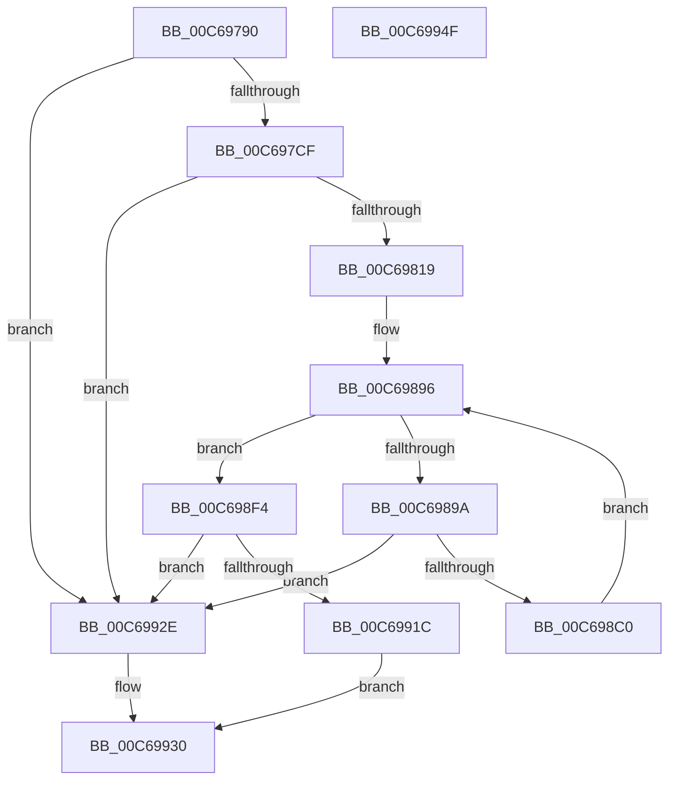

# MiInitializeRelocations

- RVA: `0x00C69790`–`0x00C69950` (길이 `448` bytes)
- VA: `0x0000000140C69790`
- 실행 섹션: `INIT`
- PDB 이름 있음: `예`; PDB Function 태그: `아니요`
- unwind 정보 RVA: `0x000C3F04`
- 디코드: `106`개 명령, `448/448` bytes 표시
- 미해석 바이트: `0` (있으면 어셈블리에 `.byte`로 보존)

> 이 문서는 커널 이미지의 기계어와 PDB 기호를 분석해 생성했습니다. 4번과 5번은 함수 원형과 자료형을 바이너리 사용 방식에서 추정한 C 해석이며 원본 소스 복구 결과는 아닙니다.

## 1. Dependencies

- 직접 호출 지점: **9**; 고유 호출 대상: **2**
- 직접 호출자로 확인된 함수: **1**
- RIP 상대 이미지 참조: **14**

### Outgoing calls
- `0x00C697C1` → [MiAllocatePool](../../text/35/MiAllocatePool_function_0035B540.md) (function, `0x0035B540`)
- `0x00C697E8` → [ExGenRandom](../../text/41/ExGenRandom_function_0041B010.md) (function, `0x0041B010`)
- `0x00C6980B` → [MiAllocatePool](../../text/35/MiAllocatePool_function_0035B540.md) (function, `0x0035B540`)
- `0x00C6982F` → [ExGenRandom](../../text/41/ExGenRandom_function_0041B010.md) (function, `0x0041B010`)
- `0x00C6985B` → [ExGenRandom](../../text/41/ExGenRandom_function_0041B010.md) (function, `0x0041B010`)
- `0x00C698B6` → [MiAllocatePool](../../text/35/MiAllocatePool_function_0035B540.md) (function, `0x0035B540`)
- `0x00C698C9` → [ExGenRandom](../../text/41/ExGenRandom_function_0041B010.md) (function, `0x0041B010`)
- `0x00C698F6` → [ExGenRandom](../../text/41/ExGenRandom_function_0041B010.md) (function, `0x0041B010`)
- `0x00C69912` → [MiAllocatePool](../../text/35/MiAllocatePool_function_0035B540.md) (function, `0x0035B540`)

### Direct callers
- [MiInitSystem](../C5/MiInitSystem_function_00C5E6C0.md) at `0x00C5EA67`

### Static image references
- `0x00C697D4` → RVA `0x00E2D730` (`.data`; write)
- `0x00C697E1` → RVA `0x00E2D738` (`.data`; write)
- `0x00C697FB` → RVA `0x00E2D740` (`.data`; write)
- `0x00C6981F` → RVA `0x00E2D7C8` (`.data`; write)
- `0x00C69828` → RVA `0x00E2D7C0` (`.data`; write)
- `0x00C69852` → RVA `0x00E2D7D0` (`.data`; write)
- `0x00C69876` → RVA `0x00E2D748` (`.data`; write)
- `0x00C6987D` → RVA `0x00E2D750` (`.data`; write)
- `0x00C69888` → RVA `0x00E2D758` (`.data`; write)
- `0x00C6988F` → RVA `0x00E2D760` (`.data`; write)
- `0x00C6989A` → RVA `0x00E2D768` (`.data`; read)
- `0x00C69908` → RVA `0x00E2D7A8` (`.data`; write)
- `0x00C6991C` → RVA `0x00E2D7B8` (`.data`; write)
- `0x00C69925` → RVA `0x00E2D7B0` (`.data`; write)

## 2. Other-region calls and transfers

- 다른 실행 섹션으로 향하는 call: **9**
  - `0x00C697C1` → [MiAllocatePool](../../text/35/MiAllocatePool_function_0035B540.md) (`INIT` → `.text`)
  - `0x00C697E8` → [ExGenRandom](../../text/41/ExGenRandom_function_0041B010.md) (`INIT` → `.text`)
  - `0x00C6980B` → [MiAllocatePool](../../text/35/MiAllocatePool_function_0035B540.md) (`INIT` → `.text`)
  - `0x00C6982F` → [ExGenRandom](../../text/41/ExGenRandom_function_0041B010.md) (`INIT` → `.text`)
  - `0x00C6985B` → [ExGenRandom](../../text/41/ExGenRandom_function_0041B010.md) (`INIT` → `.text`)
  - `0x00C698B6` → [MiAllocatePool](../../text/35/MiAllocatePool_function_0035B540.md) (`INIT` → `.text`)
  - `0x00C698C9` → [ExGenRandom](../../text/41/ExGenRandom_function_0041B010.md) (`INIT` → `.text`)
  - `0x00C698F6` → [ExGenRandom](../../text/41/ExGenRandom_function_0041B010.md) (`INIT` → `.text`)
  - `0x00C69912` → [MiAllocatePool](../../text/35/MiAllocatePool_function_0035B540.md) (`INIT` → `.text`)
- 별도 외부 분기/꼬리 이동을 확인하지 못했습니다.

## 3. Assembly (complete function range)

```asm
00C69790  48 8B C4                        mov rax, rsp
00C69793  48 89 58 08                     mov qword ptr [rax + 8], rbx
00C69797  48 89 70 10                     mov qword ptr [rax + 0x10], rsi
00C6979B  48 89 78 18                     mov qword ptr [rax + 0x18], rdi
00C6979F  4C 89 60 20                     mov qword ptr [rax + 0x20], r12
00C697A3  41 55                           push r13
00C697A5  41 56                           push r14
00C697A7  41 57                           push r15
00C697A9  48 83 EC 20                     sub rsp, 0x20
00C697AD  41 BE 00 01 00 00               mov r14d, 0x100
00C697B3  BA 00 00 01 00                  mov edx, 0x10000
00C697B8  41 8B CE                        mov ecx, r14d
00C697BB  41 B8 4D 6D 52 69               mov r8d, 0x69526d4d
00C697C1  E8 7A 1D 6F FF                  call 0x14035b540
00C697C6  48 85 C0                        test rax, rax
00C697C9  0F 84 5F 01 00 00               je 0x140c6992e
00C697CF  BE 01 00 00 00                  mov esi, 1
00C697D4  48 C7 05 51 3F 1C 00 FF FF 07 00  mov qword ptr [rip + 0x1c3f51], 0x7ffff
00C697DF  8B CE                           mov ecx, esi
00C697E1  48 89 05 50 3F 1C 00            mov qword ptr [rip + 0x1c3f50], rax
00C697E8  E8 23 18 7B FF                  call 0x14041b010
00C697ED  25 FE FF 07 00                  and eax, 0x7fffe
00C697F2  41 BF 00 05 00 00               mov r15d, 0x500
00C697F8  41 8B D7                        mov edx, r15d
00C697FB  48 89 05 3E 3F 1C 00            mov qword ptr [rip + 0x1c3f3e], rax
00C69802  41 B8 4D 6D 52 69               mov r8d, 0x69526d4d
00C69808  41 8B CE                        mov ecx, r14d
00C6980B  E8 30 1D 6F FF                  call 0x14035b540
00C69810  48 85 C0                        test rax, rax
00C69813  0F 84 15 01 00 00               je 0x140c6992e
00C69819  41 BC 00 28 00 00               mov r12d, 0x2800
00C6981F  48 89 05 A2 3F 1C 00            mov qword ptr [rip + 0x1c3fa2], rax
00C69826  8B CE                           mov ecx, esi
00C69828  4C 89 25 91 3F 1C 00            mov qword ptr [rip + 0x1c3f91], r12
00C6982F  E8 DC 17 7B FF                  call 0x14041b010
00C69834  8B C8                           mov ecx, eax
00C69836  48 B8 CD CC CC CC CC CC CC CC   movabs rax, 0xcccccccccccccccd
00C69840  48 F7 E1                        mul rcx
00C69843  48 C1 EA 0D                     shr rdx, 0xd
00C69847  48 8D 04 92                     lea rax, [rdx + rdx*4]
00C6984B  48 C1 E0 0B                     shl rax, 0xb
00C6984F  48 2B C8                        sub rcx, rax
00C69852  48 89 0D 77 3F 1C 00            mov qword ptr [rip + 0x1c3f77], rcx
00C69859  8B CE                           mov ecx, esi
00C6985B  E8 B0 17 7B FF                  call 0x14041b010
00C69860  0F B6 C8                        movzx ecx, al
00C69863  41 BD 00 00 00 E0               mov r13d, 0xe0000000
00C69869  48 C1 E1 10                     shl rcx, 0x10
00C6986D  33 FF                           xor edi, edi
00C6986F  48 8D 81 00 00 00 78            lea rax, [rcx + 0x78000000]
00C69876  48 89 05 CB 3E 1C 00            mov qword ptr [rip + 0x1c3ecb], rax
00C6987D  48 89 05 CC 3E 1C 00            mov qword ptr [rip + 0x1c3ecc], rax
00C69884  4A 8D 04 29                     lea rax, [rcx + r13]
00C69888  48 89 05 C9 3E 1C 00            mov qword ptr [rip + 0x1c3ec9], rax
00C6988F  48 89 05 CA 3E 1C 00            mov qword ptr [rip + 0x1c3eca], rax
00C69896  3B FE                           cmp edi, esi
00C69898  73 5A                           jae 0x140c698f4
00C6989A  48 8D 05 C7 3E 1C 00            lea rax, [rip + 0x1c3ec7]
00C698A1  8B DF                           mov ebx, edi
00C698A3  48 C1 E3 06                     shl rbx, 6
00C698A7  41 B8 4D 6D 52 69               mov r8d, 0x69526d4d
00C698AD  49 8B D7                        mov rdx, r15
00C698B0  49 8B CE                        mov rcx, r14
00C698B3  48 03 D8                        add rbx, rax
00C698B6  E8 85 1C 6F FF                  call 0x14035b540
00C698BB  48 85 C0                        test rax, rax
00C698BE  74 6E                           je 0x140c6992e
00C698C0  8B CE                           mov ecx, esi
00C698C2  4C 89 23                        mov qword ptr [rbx], r12
00C698C5  48 89 43 08                     mov qword ptr [rbx + 8], rax
00C698C9  E8 42 17 7B FF                  call 0x14041b010
00C698CE  0F B6 C8                        movzx ecx, al
00C698D1  48 C1 E1 10                     shl rcx, 0x10
00C698D5  03 FE                           add edi, esi
00C698D7  48 8D 81 00 00 00 78            lea rax, [rcx + 0x78000000]
00C698DE  48 89 43 10                     mov qword ptr [rbx + 0x10], rax
00C698E2  48 89 43 18                     mov qword ptr [rbx + 0x18], rax
00C698E6  4A 8D 04 29                     lea rax, [rcx + r13]
00C698EA  48 89 43 20                     mov qword ptr [rbx + 0x20], rax
00C698EE  48 89 43 28                     mov qword ptr [rbx + 0x28], rax
00C698F2  EB A2                           jmp 0x140c69896
00C698F4  8B CE                           mov ecx, esi
00C698F6  E8 15 17 7B FF                  call 0x14041b010
00C698FB  44 0F B6 C8                     movzx r9d, al
00C698FF  41 B8 4D 6D 52 69               mov r8d, 0x69526d4d
00C69905  49 8B D7                        mov rdx, r15
00C69908  4C 89 0D 99 3E 1C 00            mov qword ptr [rip + 0x1c3e99], r9
00C6990F  49 8B CE                        mov rcx, r14
00C69912  E8 29 1C 6F FF                  call 0x14035b540
00C69917  48 85 C0                        test rax, rax
00C6991A  74 12                           je 0x140c6992e
00C6991C  48 89 05 95 3E 1C 00            mov qword ptr [rip + 0x1c3e95], rax
00C69923  8B C6                           mov eax, esi
00C69925  4C 89 25 84 3E 1C 00            mov qword ptr [rip + 0x1c3e84], r12
00C6992C  EB 02                           jmp 0x140c69930
00C6992E  33 C0                           xor eax, eax
00C69930  48 8B 5C 24 40                  mov rbx, qword ptr [rsp + 0x40]
00C69935  48 8B 74 24 48                  mov rsi, qword ptr [rsp + 0x48]
00C6993A  48 8B 7C 24 50                  mov rdi, qword ptr [rsp + 0x50]
00C6993F  4C 8B 64 24 58                  mov r12, qword ptr [rsp + 0x58]
00C69944  48 83 C4 20                     add rsp, 0x20
00C69948  41 5F                           pop r15
00C6994A  41 5E                           pop r14
00C6994C  41 5D                           pop r13
00C6994E  C3                              ret
00C6994F  CC                              int3
```

## 4. C-style interpretation (structured pseudocode)

```c
__int64 __fastcall MiInitializeRelocations(void)
{
    __int64 result;
    __int64 v_rbx;
    __int64 v_rdi;
    __int64 v_rsp;
    unsigned __int64 v_stack_p10;
    unsigned __int64 v_stack_p18;
    unsigned __int64 v_stack_p20;
    unsigned __int64 v_stack_p8;

    *(unsigned __int64 *)(v_rsp + 8) = v_rbx;
    *(unsigned __int64 *)(v_rsp + 16) = v_rsi;
    *(unsigned __int64 *)(v_rsp + 24) = v_rdi;
    *(unsigned __int64 *)(v_rsp + 32) = v_r12;
    v_rsp = (v_rsp) - (32);
    result = MiAllocatePool(256, (unsigned int)(0x10000ULL), (unsigned int)(0x69526D4DULL), a4);
    if (result == 0) goto loc_00C6992E;
    *(unsigned __int64 *)(v_rip + 1851217) = 0x7FFFFULL;
    *(unsigned __int64 *)(v_rip + 1851216) = result;
    result = ExGenRandom(1, (unsigned int)(0x10000ULL), (unsigned int)(0x69526D4DULL), a4);
    result = (unsigned int)((result) & (0x7FFFEULL));
    *(unsigned __int64 *)(v_rip + 1851198) = result;
    result = MiAllocatePool(256, (unsigned int)((unsigned int)((unsigned int)(0x500ULL))), (unsigned int)(0x69526D4DULL), a4);
    if (result == 0) goto loc_00C6992E;
    *(unsigned __int64 *)(v_rip + 1851298) = result;
    *(unsigned __int64 *)(v_rip + 1851281) = (unsigned int)(0x2800ULL);
    result = ExGenRandom(1, (unsigned int)((unsigned int)((unsigned int)(0x500ULL))), (unsigned int)(0x69526D4DULL), a4);
    a2 = ((unsigned int)((unsigned int)((unsigned int)(0x500ULL)))) >> (13);
    result = (a2 + a2 * 4) << (11);
    a1 = ((unsigned int)((unsigned int)(result))) - (result);
    *(unsigned __int64 *)(v_rip + 1851255) = a1;
    result = ExGenRandom(1, a2, (unsigned int)(0x69526D4DULL), a4);
    a1 = ((unsigned __int8)(result)) << (16);
    v_rdi = 0;
    *(unsigned __int64 *)(v_rip + 1851083) = a1 + 2013265920;
    *(unsigned __int64 *)(v_rip + 1851084) = a1 + 2013265920;
    *(unsigned __int64 *)(v_rip + 1851081) = a1 + (unsigned int)(0xE0000000ULL) * 1;
    *(unsigned __int64 *)(v_rip + 1851082) = a1 + (unsigned int)(0xE0000000ULL) * 1;
loc_00C69896:
    if (0 >= 1) goto loc_00C698F4;
    v_rbx = (0) << (6);
    v_rbx = (v_rbx) + (v_rip + 1851079);
    result = MiAllocatePool(256, (unsigned int)(0x500ULL), (unsigned int)(0x69526D4DULL), a4);
    if (result == 0) goto loc_00C6992E;
    *(unsigned __int64 *)(v_rbx) = (unsigned int)(0x2800ULL);
    *(unsigned __int64 *)(v_rbx + 8) = result;
    result = ExGenRandom(1, (unsigned int)(0x500ULL), (unsigned int)(0x69526D4DULL), a4);
    a1 = ((unsigned __int8)(result)) << (16);
    v_rdi = (unsigned int)((v_rdi) + (1));
    *(unsigned __int64 *)(v_rbx + 16) = a1 + 2013265920;
    *(unsigned __int64 *)(v_rbx + 24) = a1 + 2013265920;
    *(unsigned __int64 *)(v_rbx + 32) = a1 + (unsigned int)(0xE0000000ULL) * 1;
    *(unsigned __int64 *)(v_rbx + 40) = a1 + (unsigned int)(0xE0000000ULL) * 1;
    goto loc_00C69896;
loc_00C698F4:
    result = ExGenRandom(1, (unsigned int)(0x500ULL), (unsigned int)(0x69526D4DULL), a4);
    *(unsigned __int64 *)(v_rip + 1851033) = (unsigned __int8)(result);
    result = MiAllocatePool(256, (unsigned int)(0x500ULL), (unsigned int)(0x69526D4DULL), (unsigned __int8)(result));
    if (result == 0) goto loc_00C6992E;
    *(unsigned __int64 *)(v_rip + 1851029) = result;
    *(unsigned __int64 *)(v_rip + 1851012) = (unsigned int)(0x2800ULL);
    goto loc_00C69930;
loc_00C6992E:
    result = 0;
loc_00C69930:
    v_rsp = (v_rsp) + (32);
    return result;
}
```

## 5. (Beta) C Style

```c
void MiInitializeRelocations(void)
{
    int64_t result;
    int64_t local_rbx;
    int64_t local_rdi;
    int64_t local_rsp;
    uint64_t v_stack_p10;
    uint64_t v_stack_p18;
    uint64_t v_stack_p20;
    uint64_t v_stack_p8;

    *(uint64_t *)(local_rsp + 0x8) = local_rbx;
    *(uint64_t *)(local_rsp + 0x10) = local_rsi;
    *(uint64_t *)(local_rsp + 0x18) = local_rdi;
    *(uint64_t *)(local_rsp + 0x20) = local_r12;
    local_rsp = (local_rsp) - (32);
    result = MiAllocatePool(256, (uint32_t)(0x10000ULL), (uint32_t)(0x69526D4DULL), a4);
    if (result == 0) goto loc_00C6992E;
    *(uint64_t *)(v_rip + 0x1C3F51) = 0x7FFFFULL;
    *(uint64_t *)(v_rip + 0x1C3F50) = result;
    result = ExGenRandom(1, (uint32_t)(0x10000ULL), (uint32_t)(0x69526D4DULL), a4);
    result = (uint32_t)((result) & (0x7FFFEULL));
    *(uint64_t *)(v_rip + 0x1C3F3E) = result;
    result = MiAllocatePool(256, (uint32_t)((uint32_t)((uint32_t)(0x500ULL))), (uint32_t)(0x69526D4DULL), a4);
    if (result == 0) goto loc_00C6992E;
    *(uint64_t *)(v_rip + 0x1C3FA2) = result;
    *(uint64_t *)(v_rip + 0x1C3F91) = (uint32_t)(0x2800ULL);
    result = ExGenRandom(1, (uint32_t)((uint32_t)((uint32_t)(0x500ULL))), (uint32_t)(0x69526D4DULL), a4);
    a2 = ((uint32_t)((uint32_t)((uint32_t)(0x500ULL)))) >> (13);
    result = (a2 + a2 * 4) << (11);
    a1 = ((uint32_t)((uint32_t)(result))) - (result);
    *(uint64_t *)(v_rip + 0x1C3F77) = a1;
    result = ExGenRandom(1, a2, (uint32_t)(0x69526D4DULL), a4);
    a1 = ((uint8_t)(result)) << (16);
    local_rdi = 0;
    *(uint64_t *)(v_rip + 0x1C3ECB) = a1 + 2013265920;
    *(uint64_t *)(v_rip + 0x1C3ECC) = a1 + 2013265920;
    *(uint64_t *)(v_rip + 0x1C3EC9) = a1 + (uint32_t)(0xE0000000ULL) * 1;
    *(uint64_t *)(v_rip + 0x1C3ECA) = a1 + (uint32_t)(0xE0000000ULL) * 1;
loc_00C69896:
    if (0 >= 1) goto loc_00C698F4;
    local_rbx = (0) << (6);
    local_rbx = (local_rbx) + (v_rip + 1851079);
    result = MiAllocatePool(256, (uint32_t)(0x500ULL), (uint32_t)(0x69526D4DULL), a4);
    if (result == 0) goto loc_00C6992E;
    *(uint64_t *)(local_rbx) = (uint32_t)(0x2800ULL);
    *(uint64_t *)(local_rbx + 0x8) = result;
    result = ExGenRandom(1, (uint32_t)(0x500ULL), (uint32_t)(0x69526D4DULL), a4);
    a1 = ((uint8_t)(result)) << (16);
    local_rdi = (uint32_t)((local_rdi) + (1));
    *(uint64_t *)(local_rbx + 0x10) = a1 + 2013265920;
    *(uint64_t *)(local_rbx + 0x18) = a1 + 2013265920;
    *(uint64_t *)(local_rbx + 0x20) = a1 + (uint32_t)(0xE0000000ULL) * 1;
    *(uint64_t *)(local_rbx + 0x28) = a1 + (uint32_t)(0xE0000000ULL) * 1;
    goto loc_00C69896;
loc_00C698F4:
    result = ExGenRandom(1, (uint32_t)(0x500ULL), (uint32_t)(0x69526D4DULL), a4);
    *(uint64_t *)(v_rip + 0x1C3E99) = (uint8_t)(result);
    result = MiAllocatePool(256, (uint32_t)(0x500ULL), (uint32_t)(0x69526D4DULL), (uint8_t)(result));
    if (result == 0) goto loc_00C6992E;
    *(uint64_t *)(v_rip + 0x1C3E95) = result;
    *(uint64_t *)(v_rip + 0x1C3E84) = (uint32_t)(0x2800ULL);
    goto loc_00C69930;
loc_00C6992E:
    result = 0;
loc_00C69930:
    local_rsp = (local_rsp) + (32);
    return result;
}
```

## 6. Execution-region graph

[열기: 2D/3D 그래프와 함수 탐색 컨트롤 패널](../../../control-panel.html?section=init&rva=0x00C69790&view=graph)

- 2D 그래프는 위에서 아래로 흐르고, 3D 그래프는 빈 공간을 드래그해 회전합니다. Shift+드래그는 이동, 휠은 확대·축소, 함수 노드 선택은 대상 보고서 이동입니다.

### Static fallback


