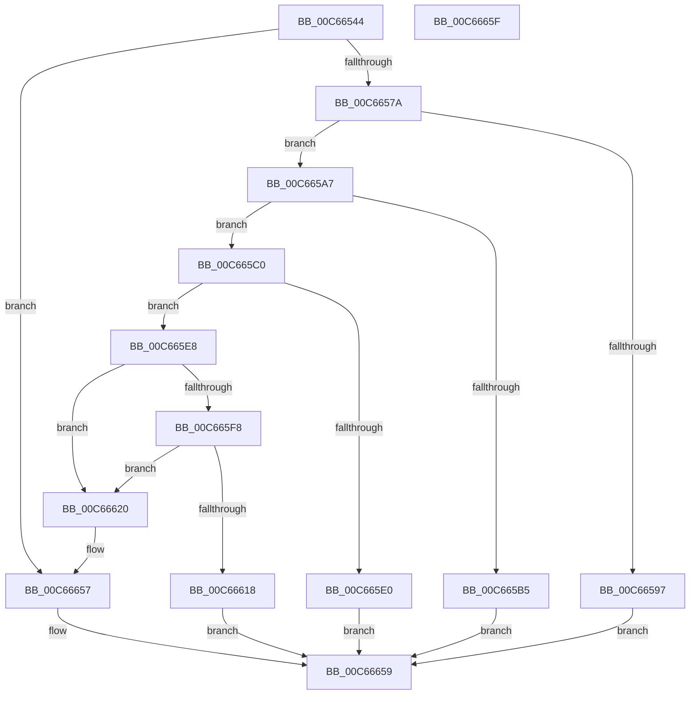

# MiInitializeRetpoline

- RVA: `0x00C66544`–`0x00C66660` (길이 `284` bytes)
- VA: `0x0000000140C66544`
- 실행 섹션: `INIT`
- PDB 이름 있음: `예`; PDB Function 태그: `아니요`
- unwind 정보 RVA: `0x0005CF00`
- 디코드: `61`개 명령, `284/284` bytes 표시
- 미해석 바이트: `0` (있으면 어셈블리에 `.byte`로 보존)

> 이 문서는 커널 이미지의 기계어와 PDB 기호를 분석해 생성했습니다. 4번과 5번은 함수 원형과 자료형을 바이너리 사용 방식에서 추정한 C 해석이며 원본 소스 복구 결과는 아닙니다.

## 1. Dependencies

- 직접 호출 지점: **5**; 고유 호출 대상: **4**
- 직접 호출자로 확인된 함수: **1**
- RIP 상대 이미지 참조: **16**

### Outgoing calls
- `0x00C66586` → [MiReservePtes](../../text/31/MiReservePtes_function_00318D20.md) (function, `0x00318D20`)
- `0x00C665AC` → [MiCreateRetpolineBitmap](MiCreateRetpolineBitmap_function_00C66418.md) (function, `0x00C66418`)
- `0x00C665D7` → [MiMarkRetpolineBits](../../page/AA/MiMarkRetpolineBits_function_00AA0394.md) (function, `0x00AA0394`)
- `0x00C665EF` → [RtlIsImageFullyRetpolined](../../text/4C/RtlIsImageFullyRetpolined_function_004CDE74.md) (function, `0x004CDE74`)
- `0x00C6660F` → [MiMarkRetpolineBits](../../page/AA/MiMarkRetpolineBits_function_00AA0394.md) (function, `0x00AA0394`)

### Direct callers
- [MiInitializeKernelScp](MiInitializeKernelScp_function_00C664B8.md) at `0x00C6650D`

### Static image references
- `0x00C66550` → RVA `0x00E2D868` (`.data`; read)
- `0x00C66557` → RVA `0x00E2D870` (`.data`; write)
- `0x00C66561` → RVA `0x00E2D868` (`.data`; write)
- `0x00C66568` → RVA `0x00FC6B48` (`ALMOSTRO`; read)
- `0x00C6657F` → RVA `0x00E37668` (`.data`; read)
- `0x00C6658B` → RVA `0x00E2D850` (`.data`; write)
- `0x00C665C0` → RVA `0x00FC6CB0` (`ALMOSTRO`; read)
- `0x00C665CD` → RVA `0x00FC6B28` (`ALMOSTRO`; read)
- `0x00C665E8` → RVA `0x00FC6B98` (`ALMOSTRO`; read)
- `0x00C665F8` → RVA `0x00FC6D90` (`ALMOSTRO`; read)
- `0x00C66620` → RVA `0x00E2D83C` (`.data`; read)
- `0x00C66635` → RVA `0x00FC7398` (`ALMOSTRO`; write)
- `0x00C6663C` → RVA `0x00E375AC` (`.data`; read)
- `0x00C66642` → RVA `0x00E375B0` (`.data`; read)
- `0x00C6664B` → RVA `0x00E013D8` (`.data`; write)
- `0x00C66651` → RVA `0x00E013D4` (`.data`; write)

## 2. Other-region calls and transfers

- 다른 실행 섹션으로 향하는 call: **4**
  - `0x00C66586` → [MiReservePtes](../../text/31/MiReservePtes_function_00318D20.md) (`INIT` → `.text`)
  - `0x00C665D7` → [MiMarkRetpolineBits](../../page/AA/MiMarkRetpolineBits_function_00AA0394.md) (`INIT` → `PAGE`)
  - `0x00C665EF` → [RtlIsImageFullyRetpolined](../../text/4C/RtlIsImageFullyRetpolined_function_004CDE74.md) (`INIT` → `.text`)
  - `0x00C6660F` → [MiMarkRetpolineBits](../../page/AA/MiMarkRetpolineBits_function_00AA0394.md) (`INIT` → `PAGE`)
- 별도 외부 분기/꼬리 이동을 확인하지 못했습니다.

## 3. Assembly (complete function range)

```asm
00C66544  40 53                           push rbx
00C66546  48 83 EC 20                     sub rsp, 0x20
00C6654A  48 83 64 24 38 00               and qword ptr [rsp + 0x38], 0
00C66550  48 8D 05 11 73 1C 00            lea rax, [rip + 0x1c7311]
00C66557  48 89 05 12 73 1C 00            mov qword ptr [rip + 0x1c7312], rax
00C6655E  48 8B D9                        mov rbx, rcx
00C66561  48 89 05 00 73 1C 00            mov qword ptr [rip + 0x1c7300], rax
00C66568  48 8B 05 D9 05 36 00            mov rax, qword ptr [rip + 0x3605d9]
00C6656F  48 0F BA E0 29                  bt rax, 0x29
00C66574  0F 83 DD 00 00 00               jae 0x140c66657
00C6657A  BA 01 00 00 00                  mov edx, 1
00C6657F  48 8D 0D E2 10 1D 00            lea rcx, [rip + 0x1d10e2]
00C66586  E8 95 27 6B FF                  call 0x140318d20
00C6658B  48 89 05 BE 72 1C 00            mov qword ptr [rip + 0x1c72be], rax
00C66592  48 85 C0                        test rax, rax
00C66595  75 10                           jne 0x140c665a7
00C66597  C7 03 A3 00 00 00               mov dword ptr [rbx], 0xa3
00C6659D  B8 9A 00 00 C0                  mov eax, 0xc000009a
00C665A2  E9 B2 00 00 00                  jmp 0x140c66659
00C665A7  48 8D 4C 24 38                  lea rcx, [rsp + 0x38]
00C665AC  E8 67 FE FF FF                  call 0x140c66418
00C665B1  85 C0                           test eax, eax
00C665B3  79 0B                           jns 0x140c665c0
00C665B5  C7 03 A4 00 00 00               mov dword ptr [rbx], 0xa4
00C665BB  E9 99 00 00 00                  jmp 0x140c66659
00C665C0  48 8B 15 E9 06 36 00            mov rdx, qword ptr [rip + 0x3606e9]
00C665C7  41 B8 01 00 00 00               mov r8d, 1
00C665CD  48 8B 0D 54 05 36 00            mov rcx, qword ptr [rip + 0x360554]
00C665D4  48 2B D1                        sub rdx, rcx
00C665D7  E8 B8 9D E3 FF                  call 0x140aa0394
00C665DC  85 C0                           test eax, eax
00C665DE  79 08                           jns 0x140c665e8
00C665E0  C7 03 A5 00 00 00               mov dword ptr [rbx], 0xa5
00C665E6  EB 71                           jmp 0x140c66659
00C665E8  48 8B 0D A9 05 36 00            mov rcx, qword ptr [rip + 0x3605a9]
00C665EF  E8 80 78 86 FF                  call 0x1404cde74
00C665F4  85 C0                           test eax, eax
00C665F6  74 28                           je 0x140c66620
00C665F8  48 8B 15 91 07 36 00            mov rdx, qword ptr [rip + 0x360791]
00C665FF  41 B8 01 00 00 00               mov r8d, 1
00C66605  48 8B 0D 8C 05 36 00            mov rcx, qword ptr [rip + 0x36058c]
00C6660C  48 2B D1                        sub rdx, rcx
00C6660F  E8 80 9D E3 FF                  call 0x140aa0394
00C66614  85 C0                           test eax, eax
00C66616  79 08                           jns 0x140c66620
00C66618  C7 03 A6 00 00 00               mov dword ptr [rbx], 0xa6
00C6661E  EB 39                           jmp 0x140c66659
00C66620  8B 05 16 72 1C 00               mov eax, dword ptr [rip + 0x1c7216]
00C66626  48 B9 00 00 00 10 00 E0 FF FF   movabs rcx, 0xffffe00010000000
00C66630  48 03 4C 24 38                  add rcx, qword ptr [rsp + 0x38]
00C66635  48 89 0D 5C 0D 36 00            mov qword ptr [rip + 0x360d5c], rcx
00C6663C  8B 0D 6A 0F 1D 00               mov ecx, dword ptr [rip + 0x1d0f6a]
00C66642  03 0D 68 0F 1D 00               add ecx, dword ptr [rip + 0x1d0f68]
00C66648  C1 E0 0C                        shl eax, 0xc
00C6664B  89 05 87 AD 19 00               mov dword ptr [rip + 0x19ad87], eax
00C66651  89 0D 7D AD 19 00               mov dword ptr [rip + 0x19ad7d], ecx
00C66657  33 C0                           xor eax, eax
00C66659  48 83 C4 20                     add rsp, 0x20
00C6665D  5B                              pop rbx
00C6665E  C3                              ret
00C6665F  CC                              int3
```

## 4. C-style interpretation (structured pseudocode)

```c
__int64 __fastcall MiInitializeRetpoline(__int64 a1)
{
    __int64 result;
    __int64 v_rsp;
    unsigned __int64 v_stack_p10;

    v_rsp = (v_rsp) - (32);
    *(unsigned __int64 *)(v_rip + 1864466) = v_rip + 1864465;
    *(unsigned __int64 *)(v_rip + 1864448) = v_rip + 1864465;
    if (condition_is_above_or_equal) goto loc_00C66657;
    result = MiReservePtes(v_rip + 1904866, 1, a3, a4);
    *(unsigned __int64 *)(v_rip + 1864382) = result;
    if (result != 0) goto loc_00C665A7;
    *(unsigned int *)(a1) = 163;
    goto loc_00C66659;
loc_00C665A7:
    result = MiCreateRetpolineBitmap(v_stack_p10, 1, a3, a4);
    if (!sign_flag) goto loc_00C665C0;
    *(unsigned int *)(a1) = 164;
    goto loc_00C66659;
loc_00C665C0:
    a2 = (*(unsigned __int64 *)(v_rip + 3540713)) - (*(unsigned __int64 *)(v_rip + 3540308));
    result = MiMarkRetpolineBits(*(unsigned __int64 *)(v_rip + 3540308), a2, 1, a4);
    if (!sign_flag) goto loc_00C665E8;
    *(unsigned int *)(a1) = 165;
    goto loc_00C66659;
loc_00C665E8:
    result = RtlIsImageFullyRetpolined(*(unsigned __int64 *)(v_rip + 3540393), a2, 1, a4);
    if ((unsigned int)(result) == 0) goto loc_00C66620;
    a2 = (*(unsigned __int64 *)(v_rip + 3540881)) - (*(unsigned __int64 *)(v_rip + 3540364));
    result = MiMarkRetpolineBits(*(unsigned __int64 *)(v_rip + 3540364), a2, 1, a4);
    if (!sign_flag) goto loc_00C66620;
    *(unsigned int *)(a1) = 166;
    goto loc_00C66659;
loc_00C66620:
    a1 = (*(unsigned __int64 *)(v_rip + 3540364)) + (v_stack_p10);
    *(unsigned __int64 *)(v_rip + 3542364) = a1;
    a1 = (unsigned int)(((unsigned int)(*(unsigned int *)(v_rip + 1904490))) + (*(unsigned int *)(v_rip + 1904488)));
    result = (unsigned int)(((unsigned int)(*(unsigned int *)(v_rip + 1864214))) << (12));
    *(unsigned int *)(v_rip + 1682823) = (unsigned int)(result);
    *(unsigned int *)(v_rip + 1682813) = (unsigned int)(a1);
loc_00C66657:
    result = 0;
loc_00C66659:
    v_rsp = (v_rsp) + (32);
    return result;
}
```

## 5. (Beta) C Style

```c
int64_t MiInitializeRetpoline(void *Arg1)
{
    uint8_t *arg1 = (uint8_t *)Arg1;

    int64_t result;
    int64_t local_rsp;
    uint64_t v_stack_p10;

    local_rsp = (local_rsp) - (32);
    *(uint64_t *)(v_rip + 0x1C7312) = v_rip + 1864465;
    *(uint64_t *)(v_rip + 0x1C7300) = v_rip + 1864465;
    if (condition_is_above_or_equal) goto loc_00C66657;
    result = MiReservePtes(v_rip + 1904866, 1, a3, a4);
    *(uint64_t *)(v_rip + 0x1C72BE) = result;
    if (result != 0) goto loc_00C665A7;
    *(uint32_t *)(arg1) = 163;
    goto loc_00C66659;
loc_00C665A7:
    result = MiCreateRetpolineBitmap(v_stack_p10, 1, a3, a4);
    if (!sign_flag) goto loc_00C665C0;
    *(uint32_t *)(arg1) = 164;
    goto loc_00C66659;
loc_00C665C0:
    a2 = (*(uint64_t *)(v_rip + 0x3606E9)) - (*(uint64_t *)(v_rip + 0x360554));
    result = MiMarkRetpolineBits(*(uint64_t *)(v_rip + 0x360554), a2, 1, a4);
    if (!sign_flag) goto loc_00C665E8;
    *(uint32_t *)(arg1) = 165;
    goto loc_00C66659;
loc_00C665E8:
    result = RtlIsImageFullyRetpolined(*(uint64_t *)(v_rip + 0x3605A9), a2, 1, a4);
    if ((uint32_t)(result) == 0) goto loc_00C66620;
    a2 = (*(uint64_t *)(v_rip + 0x360791)) - (*(uint64_t *)(v_rip + 0x36058C));
    result = MiMarkRetpolineBits(*(uint64_t *)(v_rip + 0x36058C), a2, 1, a4);
    if (!sign_flag) goto loc_00C66620;
    *(uint32_t *)(arg1) = 166;
    goto loc_00C66659;
loc_00C66620:
    Arg1 = (*(uint64_t *)(v_rip + 0x36058C)) + (v_stack_p10);
    *(void **)(v_rip + 0x360D5C) = Arg1;
    Arg1 = (uint32_t)(((uint32_t)(*(uint32_t *)(v_rip + 0x1D0F6A))) + (*(uint32_t *)(v_rip + 0x1D0F68)));
    result = (uint32_t)(((uint32_t)(*(uint32_t *)(v_rip + 0x1C7216))) << (12));
    *(uint32_t *)(v_rip + 0x19AD87) = (uint32_t)(result);
    *(uint32_t *)(v_rip + 0x19AD7D) = (uint32_t)(Arg1);
loc_00C66657:
    result = 0;
loc_00C66659:
    local_rsp = (local_rsp) + (32);
    return result;
}
```

### 관측된 메모리 오프셋

구조체 형식이 확인되지 않은 접근은 인자 기준의 오프셋으로만 기록했습니다.

| 기준 인자 | 오프셋 표현 | 폭 (bit) | 접근 |
|---|---:|---:|---|
| `Arg1` | `+ 0x0` | `32` | `W` |

## 6. Execution-region graph

[열기: 2D/3D 그래프와 함수 탐색 컨트롤 패널](../../../control-panel.html?section=init&rva=0x00C66544&view=graph)

- 2D 그래프는 위에서 아래로 흐르고, 3D 그래프는 빈 공간을 드래그해 회전합니다. Shift+드래그는 이동, 휠은 확대·축소, 함수 노드 선택은 대상 보고서 이동입니다.

### Static fallback


