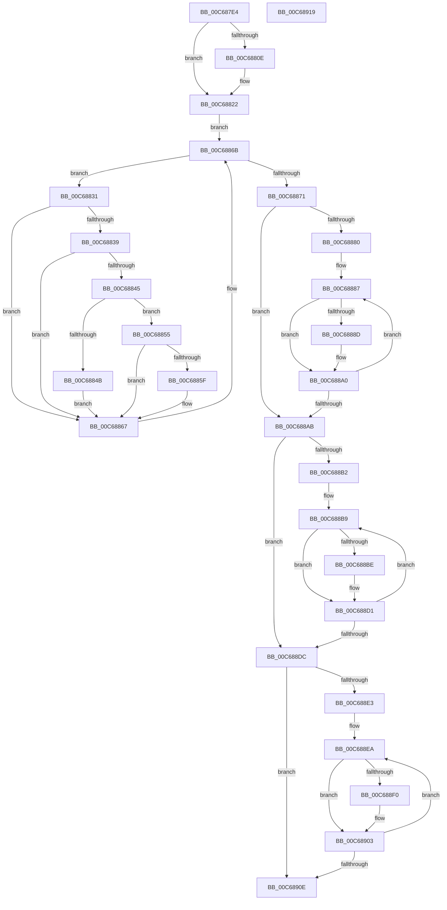

# MiInitializeSystemChannelOrdering

- RVA: `0x00C687E4`–`0x00C6891A` (길이 `310` bytes)
- VA: `0x0000000140C687E4`
- 실행 섹션: `INIT`
- PDB 이름 있음: `예`; PDB Function 태그: `아니요`
- unwind 정보 RVA: `0x0005CAAC`
- 디코드: `79`개 명령, `310/310` bytes 표시
- 미해석 바이트: `0` (있으면 어셈블리에 `.byte`로 보존)

> 이 문서는 커널 이미지의 기계어와 PDB 기호를 분석해 생성했습니다. 4번과 5번은 함수 원형과 자료형을 바이너리 사용 방식에서 추정한 C 해석이며 원본 소스 복구 결과는 아닙니다.

## 1. Dependencies

- 직접 호출 지점: **1**; 고유 호출 대상: **1**
- 직접 호출자로 확인된 함수: **1**
- RIP 상대 이미지 참조: **3**

### Outgoing calls
- `0x00C68812` → [MiPageToChannel](../../text/2B/MiPageToChannel_function_002B9B48.md) (function, `0x002B9B48`)

### Direct callers
- [MiInitializeChannelOrdering](../../page/80/MiInitializeChannelOrdering_function_00808018.md) at `0x00808051`

### Static image references
- `0x00C687F0` → RVA `0x010093D0` (`INITDATA`; read)
- `0x00C68822` → RVA `0x00E2DC28` (`.data`; read)
- `0x00C6883D` → RVA `0x00FC5002` (`ALMOSTRO`; read)

## 2. Other-region calls and transfers

- 다른 실행 섹션으로 향하는 call: **1**
  - `0x00C68812` → [MiPageToChannel](../../text/2B/MiPageToChannel_function_002B9B48.md) (`INIT` → `.text`)
- 별도 외부 분기/꼬리 이동을 확인하지 못했습니다.

## 3. Assembly (complete function range)

```asm
00C687E4  48 89 5C 24 08                  mov qword ptr [rsp + 8], rbx
00C687E9  57                              push rdi
00C687EA  48 83 EC 20                     sub rsp, 0x20
00C687EE  8B DA                           mov ebx, edx
00C687F0  48 8D 05 D9 0B 3A 00            lea rax, [rip + 0x3a0bd9]
00C687F7  48 69 FB 80 DF 00 00            imul rdi, rbx, 0xdf80
00C687FE  48 03 79 10                     add rdi, qword ptr [rcx + 0x10]
00C68802  48 6B CB 38                     imul rcx, rbx, 0x38
00C68806  48 83 7C 01 08 00               cmp qword ptr [rcx + rax + 8], 0
00C6880C  74 14                           je 0x140c68822
00C6880E  48 8B 0C 01                     mov rcx, qword ptr [rcx + rax]
00C68812  E8 31 13 65 FF                  call 0x1402b9b48
00C68817  0F B6 C0                        movzx eax, al
00C6881A  C6 84 38 85 3B 00 00 02         mov byte ptr [rax + rdi + 0x3b85], 2
00C68822  48 8B 0D FF 53 1C 00            mov rcx, qword ptr [rip + 0x1c53ff]
00C68829  41 BA 01 00 00 00               mov r10d, 1
00C6882F  EB 3A                           jmp 0x140c6886b
00C68831  0F B7 41 0A                     movzx eax, word ptr [rcx + 0xa]
00C68835  3B C3                           cmp eax, ebx
00C68837  75 2E                           jne 0x140c68867
00C68839  0F B6 41 0C                     movzx eax, byte ptr [rcx + 0xc]
00C6883D  3A 05 BF C7 35 00               cmp al, byte ptr [rip + 0x35c7bf]
00C68843  73 22                           jae 0x140c68867
00C68845  80 79 0E 00                     cmp byte ptr [rcx + 0xe], 0
00C68849  75 0A                           jne 0x140c68855
00C6884B  C6 84 38 85 3B 00 00 02         mov byte ptr [rax + rdi + 0x3b85], 2
00C68853  EB 12                           jmp 0x140c68867
00C68855  80 BC 38 85 3B 00 00 02         cmp byte ptr [rax + rdi + 0x3b85], 2
00C6885D  74 08                           je 0x140c68867
00C6885F  44 88 94 38 85 3B 00 00         mov byte ptr [rax + rdi + 0x3b85], r10b
00C68867  48 83 C1 10                     add rcx, 0x10
00C6886B  48 83 39 FF                     cmp qword ptr [rcx], -1
00C6886F  75 C0                           jne 0x140c68831
00C68871  8A 15 8B C7 35 00               mov dl, byte ptr [rip + 0x35c78b]
00C68877  33 C9                           xor ecx, ecx
00C68879  45 32 C0                        xor r8b, r8b
00C6887C  84 D2                           test dl, dl
00C6887E  74 2B                           je 0x140c688ab
00C68880  4C 8D 8F 85 3B 00 00            lea r9, [rdi + 0x3b85]
00C68887  41 80 39 02                     cmp byte ptr [r9], 2
00C6888B  75 13                           jne 0x140c688a0
00C6888D  44 88 84 39 81 3B 00 00         mov byte ptr [rcx + rdi + 0x3b81], r8b
00C68895  44 88 84 39 83 3B 00 00         mov byte ptr [rcx + rdi + 0x3b83], r8b
00C6889D  41 03 CA                        add ecx, r10d
00C688A0  45 02 C2                        add r8b, r10b
00C688A3  4D 03 CA                        add r9, r10
00C688A6  44 3A C2                        cmp r8b, dl
00C688A9  72 DC                           jb 0x140c68887
00C688AB  45 32 C0                        xor r8b, r8b
00C688AE  84 D2                           test dl, dl
00C688B0  74 2A                           je 0x140c688dc
00C688B2  4C 8D 8F 85 3B 00 00            lea r9, [rdi + 0x3b85]
00C688B9  45 38 11                        cmp byte ptr [r9], r10b
00C688BC  75 13                           jne 0x140c688d1
00C688BE  44 88 84 39 81 3B 00 00         mov byte ptr [rcx + rdi + 0x3b81], r8b
00C688C6  44 88 84 39 83 3B 00 00         mov byte ptr [rcx + rdi + 0x3b83], r8b
00C688CE  41 03 CA                        add ecx, r10d
00C688D1  45 02 C2                        add r8b, r10b
00C688D4  4D 03 CA                        add r9, r10
00C688D7  44 3A C2                        cmp r8b, dl
00C688DA  72 DD                           jb 0x140c688b9
00C688DC  45 32 C0                        xor r8b, r8b
00C688DF  84 D2                           test dl, dl
00C688E1  74 2B                           je 0x140c6890e
00C688E3  4C 8D 8F 85 3B 00 00            lea r9, [rdi + 0x3b85]
00C688EA  41 80 39 00                     cmp byte ptr [r9], 0
00C688EE  75 13                           jne 0x140c68903
00C688F0  44 88 84 39 81 3B 00 00         mov byte ptr [rcx + rdi + 0x3b81], r8b
00C688F8  44 88 84 39 83 3B 00 00         mov byte ptr [rcx + rdi + 0x3b83], r8b
00C68900  41 03 CA                        add ecx, r10d
00C68903  45 02 C2                        add r8b, r10b
00C68906  4D 03 CA                        add r9, r10
00C68909  44 3A C2                        cmp r8b, dl
00C6890C  72 DC                           jb 0x140c688ea
00C6890E  48 8B 5C 24 30                  mov rbx, qword ptr [rsp + 0x30]
00C68913  48 83 C4 20                     add rsp, 0x20
00C68917  5F                              pop rdi
00C68918  C3                              ret
00C68919  CC                              int3
```

## 4. C-style interpretation (structured pseudocode)

```c
__int64 __fastcall MiInitializeSystemChannelOrdering(__int64 a1, int a2, unsigned __int8 a3)
{
    __int64 result;
    __int64 v_rdi;
    __int64 v_rsp;
    unsigned __int64 v_stack_p8;

    v_stack_p8 = v_rbx;
    v_rsp = (v_rsp) - (32);
    v_rdi = (v_rdi) * ((unsigned int)(a2));
    v_rdi = (v_rdi) + (*(unsigned __int64 *)(a1 + 16));
    a1 = (a1) * ((unsigned int)(a2));
    result = v_rip + 3804121;
    if ((*(unsigned __int64 *)(a1 + v_rip + 3804121 * 1 + 8)) != 0) {
        a1 = *(unsigned __int64 *)(a1 + v_rip + 3804121 * 1);
        result = MiPageToChannel(a1, a2, a3, a4);
        result = (unsigned __int8)(result);
        *(unsigned __int8 *)(result + v_rdi * 1 + 15237) = 2;
    }
    goto loc_00C6886B;
loc_00C68831:
    if (((unsigned int)(*(unsigned __int16 *)(*(unsigned __int64 *)(v_rip + 1856511) + 10))) != ((unsigned int)((unsigned int)(a2)))) goto loc_00C68867;
    if (((unsigned __int8)(*(unsigned __int8 *)(*(unsigned __int64 *)(v_rip + 1856511) + 12))) >= (*(unsigned __int8 *)(v_rip + 3524543))) goto loc_00C68867;
    if ((*(unsigned __int8 *)(*(unsigned __int64 *)(v_rip + 1856511) + 14)) != 0) goto loc_00C68855;
    *(unsigned __int8 *)(*(unsigned __int8 *)(*(unsigned __int64 *)(v_rip + 1856511) + 12) + v_rdi * 1 + 15237) = 2;
    goto loc_00C68867;
loc_00C68855:
    if ((*(unsigned __int8 *)(*(unsigned __int8 *)(*(unsigned __int64 *)(v_rip + 1856511) + 12) + v_rdi * 1 + 15237)) != 2) {
        *(unsigned __int8 *)(*(unsigned __int8 *)(*(unsigned __int64 *)(v_rip + 1856511) + 12) + v_rdi * 1 + 15237) = 1;
    }
    a1 = (*(unsigned __int64 *)(v_rip + 1856511)) + (16);
loc_00C6886B:
    if ((*(unsigned __int64 *)(a1)) != -1) goto loc_00C68831;
    a1 = 0;
    a3 = 0;
    if ((unsigned __int8)(*(unsigned __int8 *)(v_rip + 3524491)) == 0) goto loc_00C688AB;
loc_00C68887:
    if ((*(unsigned __int8 *)(v_rdi + 15237)) == 2) {
        *(unsigned __int8 *)(a1 + v_rdi * 1 + 15233) = 0;
        *(unsigned __int8 *)(a1 + v_rdi * 1 + 15235) = 0;
        a1 = (unsigned int)((a1) + (1));
    }
    a3 = (unsigned __int8)((a3) + (1));
    a4 = (v_rdi + 15237) + (1);
    if (a3 < ((unsigned __int8)(*(unsigned __int8 *)(v_rip + 3524491)))) goto loc_00C68887;
loc_00C688AB:
    a3 = 0;
    if ((unsigned __int8)(*(unsigned __int8 *)(v_rip + 3524491)) == 0) goto loc_00C688DC;
loc_00C688B9:
    if ((*(unsigned __int8 *)(v_rdi + 15237)) == 1) {
        *(unsigned __int8 *)(a1 + v_rdi * 1 + 15233) = 0;
        *(unsigned __int8 *)(a1 + v_rdi * 1 + 15235) = 0;
        a1 = (unsigned int)((a1) + (1));
    }
    a3 = (unsigned __int8)((a3) + (1));
    a4 = (v_rdi + 15237) + (1);
    if (a3 < ((unsigned __int8)(*(unsigned __int8 *)(v_rip + 3524491)))) goto loc_00C688B9;
loc_00C688DC:
    a3 = 0;
    if ((unsigned __int8)(*(unsigned __int8 *)(v_rip + 3524491)) == 0) goto loc_00C6890E;
loc_00C688EA:
    if ((*(unsigned __int8 *)(v_rdi + 15237)) == 0) {
        *(unsigned __int8 *)(a1 + v_rdi * 1 + 15233) = 0;
        *(unsigned __int8 *)(a1 + v_rdi * 1 + 15235) = 0;
        a1 = (unsigned int)((a1) + (1));
    }
    a3 = (unsigned __int8)((a3) + (1));
    a4 = (v_rdi + 15237) + (1);
    if (a3 < ((unsigned __int8)(*(unsigned __int8 *)(v_rip + 3524491)))) goto loc_00C688EA;
loc_00C6890E:
    v_rsp = (v_rsp) + (32);
    return *(unsigned __int8 *)(*(unsigned __int64 *)(v_rip + 1856511) + 12);
}
```

## 5. (Beta) C Style

```c
int64_t MiInitializeSystemChannelOrdering(void *Arg1, int32_t Arg2, uint8_t Arg3)
{
    uint8_t *arg1 = (uint8_t *)Arg1;

    int64_t result;
    int64_t local_rdi;
    int64_t local_rsp;
    uint64_t v_stack_p8;

    v_stack_p8 = local_rbx;
    local_rsp = (local_rsp) - (32);
    local_rdi = (local_rdi) * ((uint32_t)(Arg2));
    local_rdi = (local_rdi) + (*(uint64_t *)(arg1 + 0x10));
    Arg1 = (Arg1) * ((uint32_t)(Arg2));
    result = v_rip + 3804121;
    if ((*(uint64_t *)(arg1 + v_rip + 0x3A0BD9 * 1 + 0x8)) != 0) {
        Arg1 = *(uint64_t *)(arg1 + v_rip + 0x3A0BD9 * 1);
        result = MiPageToChannel(Arg1, Arg2, Arg3, a4);
        result = (uint8_t)(result);
        *(uint8_t *)(result + local_rdi * 1 + 0x3B85) = 2;
    }
    goto loc_00C6886B;
loc_00C68831:
    if (((uint32_t)(*(uint16_t *)(*(uint64_t *)(v_rip + 0x1C53FF) + 0xA))) != ((uint32_t)((uint32_t)(Arg2)))) goto loc_00C68867;
    if (((uint8_t)(*(uint8_t *)(*(uint64_t *)(v_rip + 0x1C53FF) + 0xC))) >= (*(uint8_t *)(v_rip + 0x35C7BF))) goto loc_00C68867;
    if ((*(uint8_t *)(*(uint64_t *)(v_rip + 0x1C53FF) + 0xE)) != 0) goto loc_00C68855;
    *(uint8_t *)(*(uint8_t *)(*(uint64_t *)(v_rip + 0x1C53FF) + 0xC) + local_rdi * 1 + 0x3B85) = 2;
    goto loc_00C68867;
loc_00C68855:
    if ((*(uint8_t *)(*(uint8_t *)(*(uint64_t *)(v_rip + 0x1C53FF) + 0xC) + local_rdi * 1 + 0x3B85)) != 2) {
        *(uint8_t *)(*(uint8_t *)(*(uint64_t *)(v_rip + 0x1C53FF) + 0xC) + local_rdi * 1 + 0x3B85) = 1;
    }
    Arg1 = (*(uint64_t *)(v_rip + 0x1C53FF)) + (16);
loc_00C6886B:
    if ((*(uint64_t *)(arg1)) != -1) goto loc_00C68831;
    Arg1 = 0;
    Arg3 = 0;
    if ((uint8_t)(*(uint8_t *)(v_rip + 0x35C78B)) == 0) goto loc_00C688AB;
loc_00C68887:
    if ((*(uint8_t *)(local_rdi + 0x3B85)) == 2) {
        *(uint8_t *)(arg1 + local_rdi * 1 + 0x3B81) = 0;
        *(uint8_t *)(arg1 + local_rdi * 1 + 0x3B83) = 0;
        Arg1 = (uint32_t)((Arg1) + (1));
    }
    Arg3 = (uint8_t)((Arg3) + (1));
    a4 = (local_rdi + 15237) + (1);
    if (Arg3 < ((uint8_t)(*(uint8_t *)(v_rip + 0x35C78B)))) goto loc_00C68887;
loc_00C688AB:
    Arg3 = 0;
    if ((uint8_t)(*(uint8_t *)(v_rip + 0x35C78B)) == 0) goto loc_00C688DC;
loc_00C688B9:
    if ((*(uint8_t *)(local_rdi + 0x3B85)) == 1) {
        *(uint8_t *)(arg1 + local_rdi * 1 + 0x3B81) = 0;
        *(uint8_t *)(arg1 + local_rdi * 1 + 0x3B83) = 0;
        Arg1 = (uint32_t)((Arg1) + (1));
    }
    Arg3 = (uint8_t)((Arg3) + (1));
    a4 = (local_rdi + 15237) + (1);
    if (Arg3 < ((uint8_t)(*(uint8_t *)(v_rip + 0x35C78B)))) goto loc_00C688B9;
loc_00C688DC:
    Arg3 = 0;
    if ((uint8_t)(*(uint8_t *)(v_rip + 0x35C78B)) == 0) goto loc_00C6890E;
loc_00C688EA:
    if ((*(uint8_t *)(local_rdi + 0x3B85)) == 0) {
        *(uint8_t *)(arg1 + local_rdi * 1 + 0x3B81) = 0;
        *(uint8_t *)(arg1 + local_rdi * 1 + 0x3B83) = 0;
        Arg1 = (uint32_t)((Arg1) + (1));
    }
    Arg3 = (uint8_t)((Arg3) + (1));
    a4 = (local_rdi + 15237) + (1);
    if (Arg3 < ((uint8_t)(*(uint8_t *)(v_rip + 0x35C78B)))) goto loc_00C688EA;
loc_00C6890E:
    local_rsp = (local_rsp) + (32);
    return *(uint8_t *)(*(uint64_t *)(v_rip + 0x1C53FF) + 0xC);
}
```

### 관측된 메모리 오프셋

구조체 형식이 확인되지 않은 접근은 인자 기준의 오프셋으로만 기록했습니다.

| 기준 인자 | 오프셋 표현 | 폭 (bit) | 접근 |
|---|---:|---:|---|
| `Arg1` | `+ 0x0 + rax*1` | `64` | `R` |
| `Arg1` | `+ 0x8 + rax*1` | `64` | `R` |
| `Arg1` | `+ 0x10` | `64` | `R` |

## 6. Execution-region graph

[열기: 2D/3D 그래프와 함수 탐색 컨트롤 패널](../../../control-panel.html?section=init&rva=0x00C687E4&view=graph)

- 2D 그래프는 위에서 아래로 흐르고, 3D 그래프는 빈 공간을 드래그해 회전합니다. Shift+드래그는 이동, 휠은 확대·축소, 함수 노드 선택은 대상 보고서 이동입니다.

### Static fallback


