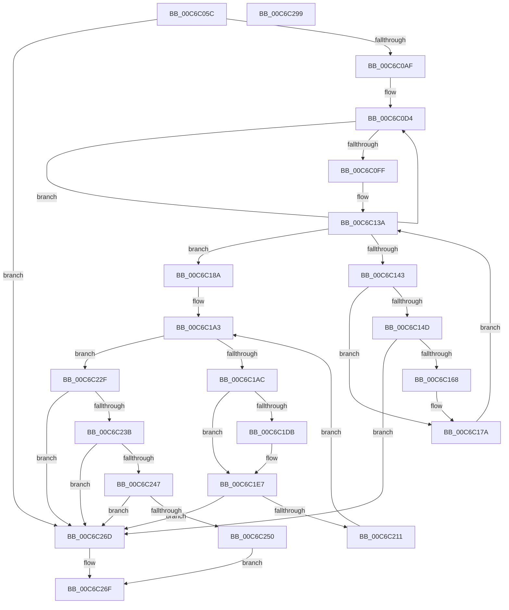

# MiInitializeSystemImageRegion

- RVA: `0x00C6C05C`–`0x00C6C29A` (길이 `574` bytes)
- VA: `0x0000000140C6C05C`
- 실행 섹션: `INIT`
- PDB 이름 있음: `예`; PDB Function 태그: `아니요`
- unwind 정보 RVA: `0x000D9464`
- 디코드: `144`개 명령, `574/574` bytes 표시
- 미해석 바이트: `0` (있으면 어셈블리에 `.byte`로 보존)

> 이 문서는 커널 이미지의 기계어와 PDB 기호를 분석해 생성했습니다. 4번과 5번은 함수 원형과 자료형을 바이너리 사용 방식에서 추정한 C 해석이며 원본 소스 복구 결과는 아닙니다.

## 1. Dependencies

- 직접 호출 지점: **11**; 고유 호출 대상: **11**
- 직접 호출자로 확인된 함수: **1**
- RIP 상대 이미지 참조: **10**

### Outgoing calls
- `0x00C6C0A2` → [MiInitializeDynamicRegion](MiInitializeDynamicRegion_function_00C65C2C.md) (function, `0x00C65C2C`)
- `0x00C6C116` → [MxMarkActiveDriverBits](MxMarkActiveDriverBits_function_00C6C998.md) (function, `0x00C6C998`)
- `0x00C6C15B` → [MiSplitBitmapPages](../../text/3B/MiSplitBitmapPages_function_003B4A34.md) (function, `0x003B4A34`)
- `0x00C6C175` → [RtlClearBitsEx](../../text/29/RtlClearBitsEx_function_00297740.md) (function, `0x00297740`)
- `0x00C6C1D2` → [MI_IS_PHYSICAL_ADDRESS](../../text/23/MI_IS_PHYSICAL_ADDRESS_function_0023B3A0.md) (function, `0x0023B3A0`)
- `0x00C6C207` → [MiAllocatePool](../../text/35/MiAllocatePool_function_0035B540.md) (function, `0x0035B540`)
- `0x00C6C232` → [MiInitializeBootLoadedDriverPfns](MiInitializeBootLoadedDriverPfns_function_00C6BB10.md) (function, `0x00C6BB10`)
- `0x00C6C23E` → [MiInitializeDriverPtes](MiInitializeDriverPtes_function_00C61818.md) (function, `0x00C61818`)
- `0x00C6C247` → [MiCreateInitialSystemWsles](MiCreateInitialSystemWsles_function_00C642C8.md) (function, `0x00C642C8`)
- `0x00C6C261` → [MiFreeKernelPadSections](MiFreeKernelPadSections_function_00C6B5CC.md) (function, `0x00C6B5CC`)
- `0x00C6C277` → [_security_check_cookie](../../text/6A/_security_check_cookie_function_006AC640.md) (function, `0x006AC640`)

### Direct callers
- [MiInitSystem](../C5/MiInitSystem_function_00C5E6C0.md) at `0x00C5E965`

### Static image references
- `0x00C6C077` → RVA `0x00E0A740` (`.data`; read)
- `0x00C6C086` → RVA `0x00E38CC0` (`.data`; read)
- `0x00C6C090` → RVA `0x00E38CB8` (`.data`; read)
- `0x00C6C10F` → RVA `0x00E2EFF0` (`.data`; read)
- `0x00C6C11B` → RVA `0x00E2EFF8` (`.data`; read)
- `0x00C6C18A` → RVA `0x00E2D958` (`.data`; read/write)
- `0x00C6C192` → RVA `0x00E2D980` (`.data`; read/write)
- `0x00C6C19C` → RVA `0x00E2EFF0` (`.data`; write)
- `0x00C6C1B3` → RVA `0x00E2D940` (`.data`; read)
- `0x00C6C215` → RVA `0x00E2D948` (`.data`; read)

## 2. Other-region calls and transfers

- 다른 실행 섹션으로 향하는 call: **5**
  - `0x00C6C15B` → [MiSplitBitmapPages](../../text/3B/MiSplitBitmapPages_function_003B4A34.md) (`INIT` → `.text`)
  - `0x00C6C175` → [RtlClearBitsEx](../../text/29/RtlClearBitsEx_function_00297740.md) (`INIT` → `.text`)
  - `0x00C6C1D2` → [MI_IS_PHYSICAL_ADDRESS](../../text/23/MI_IS_PHYSICAL_ADDRESS_function_0023B3A0.md) (`INIT` → `.text`)
  - `0x00C6C207` → [MiAllocatePool](../../text/35/MiAllocatePool_function_0035B540.md) (`INIT` → `.text`)
  - `0x00C6C277` → [_security_check_cookie](../../text/6A/_security_check_cookie_function_006AC640.md) (`INIT` → `.text`)
- 별도 외부 분기/꼬리 이동을 확인하지 못했습니다.

## 3. Assembly (complete function range)

```asm
00C6C05C  48 89 5C 24 10                  mov qword ptr [rsp + 0x10], rbx
00C6C061  48 89 6C 24 18                  mov qword ptr [rsp + 0x18], rbp
00C6C066  48 89 74 24 20                  mov qword ptr [rsp + 0x20], rsi
00C6C06B  57                              push rdi
00C6C06C  41 56                           push r14
00C6C06E  41 57                           push r15
00C6C070  48 81 EC 80 00 00 00            sub rsp, 0x80
00C6C077  48 8B 05 C2 E6 19 00            mov rax, qword ptr [rip + 0x19e6c2]
00C6C07E  48 33 C4                        xor rax, rsp
00C6C081  48 89 44 24 70                  mov qword ptr [rsp + 0x70], rax
00C6C086  48 8B 3D 33 CC 1C 00            mov rdi, qword ptr [rip + 0x1ccc33]
00C6C08D  48 8B E9                        mov rbp, rcx
00C6C090  48 8B 1D 21 CC 1C 00            mov rbx, qword ptr [rip + 0x1ccc21]
00C6C097  4C 8B C7                        mov r8, rdi
00C6C09A  48 8B D3                        mov rdx, rbx
00C6C09D  B9 0B 00 00 00                  mov ecx, 0xb
00C6C0A2  E8 85 9B FF FF                  call 0x140c65c2c
00C6C0A7  85 C0                           test eax, eax
00C6C0A9  0F 84 BE 01 00 00               je 0x140c6c26d
00C6C0AF  4C 8D 47 FF                     lea r8, [rdi - 1]
00C6C0B3  49 BE 00 00 00 00 80 F6 FF FF   movabs r14, 0xfffff68000000000
00C6C0BD  4C 03 C3                        add r8, rbx
00C6C0C0  48 8D 4C 24 38                  lea rcx, [rsp + 0x38]
00C6C0C5  BA 04 00 00 00                  mov edx, 4
00C6C0CA  49 BF F8 FF FF FF 7F 00 00 00   movabs r15, 0x7ffffffff8
00C6C0D4  48 C1 EB 09                     shr rbx, 9
00C6C0D8  49 23 DF                        and rbx, r15
00C6C0DB  49 8B C6                        mov rax, r14
00C6C0DE  49 C1 E8 09                     shr r8, 9
00C6C0E2  48 03 D8                        add rbx, rax
00C6C0E5  4D 23 C7                        and r8, r15
00C6C0E8  49 8B C6                        mov rax, r14
00C6C0EB  4C 03 C0                        add r8, rax
00C6C0EE  48 89 59 F8                     mov qword ptr [rcx - 8], rbx
00C6C0F2  4C 89 01                        mov qword ptr [rcx], r8
00C6C0F5  48 8D 49 10                     lea rcx, [rcx + 0x10]
00C6C0F9  48 83 EA 01                     sub rdx, 1
00C6C0FD  75 D5                           jne 0x140c6c0d4
00C6C0FF  4C 8D 4C 24 30                  lea r9, [rsp + 0x30]
00C6C104  C7 44 24 20 03 00 00 00         mov dword ptr [rsp + 0x20], 3
00C6C10C  48 8B D3                        mov rdx, rbx
00C6C10F  48 8D 0D DA 2E 1C 00            lea rcx, [rip + 0x1c2eda]
00C6C116  E8 7D 08 00 00                  call 0x140c6c998
00C6C11B  48 8B 35 D6 2E 1C 00            mov rsi, qword ptr [rip + 0x1c2ed6]
00C6C122  48 8B FE                        mov rdi, rsi
00C6C125  48 C1 EF 09                     shr rdi, 9
00C6C129  49 23 FF                        and rdi, r15
00C6C12C  49 8B C6                        mov rax, r14
00C6C12F  48 03 F8                        add rdi, rax
00C6C132  41 BE 00 80 00 00               mov r14d, 0x8000
00C6C138  33 DB                           xor ebx, ebx
00C6C13A  48 3B 1D AF 2E 1C 00            cmp rbx, qword ptr [rip + 0x1c2eaf]
00C6C141  73 47                           jae 0x140c6c18a
00C6C143  48 8B 07                        mov rax, qword ptr [rdi]
00C6C146  48 0F BA E0 0B                  bt rax, 0xb
00C6C14B  72 2D                           jb 0x140c6c17a
00C6C14D  45 33 C9                        xor r9d, r9d
00C6C150  48 8B D6                        mov rdx, rsi
00C6C153  45 8D 41 08                     lea r8d, [r9 + 8]
00C6C157  41 8D 49 04                     lea ecx, [r9 + 4]
00C6C15B  E8 D4 88 74 FF                  call 0x1403b4a34
00C6C160  85 C0                           test eax, eax
00C6C162  0F 84 05 01 00 00               je 0x140c6c26d
00C6C168  4D 8B C6                        mov r8, r14
00C6C16B  48 8D 0D 7E 2E 1C 00            lea rcx, [rip + 0x1c2e7e]
00C6C172  48 8B D3                        mov rdx, rbx
00C6C175  E8 C6 B5 62 FF                  call 0x140297740
00C6C17A  48 81 C6 00 10 00 00            add rsi, 0x1000
00C6C181  48 83 C7 08                     add rdi, 8
00C6C185  49 03 DE                        add rbx, r14
00C6C188  EB B0                           jmp 0x140c6c13a
00C6C18A  48 83 25 C6 17 1C 00 00         and qword ptr [rip + 0x1c17c6], 0
00C6C192  48 83 25 E6 17 1C 00 00         and qword ptr [rip + 0x1c17e6], 0
00C6C19A  33 F6                           xor esi, esi
00C6C19C  48 89 1D 4D 2E 1C 00            mov qword ptr [rip + 0x1c2e4d], rbx
00C6C1A3  83 FE 01                        cmp esi, 1
00C6C1A6  0F 83 83 00 00 00               jae 0x140c6c22f
00C6C1AC  BB 00 00 00 00                  mov ebx, 0
00C6C1B1  8B FE                           mov edi, esi
00C6C1B3  48 8D 0D 86 17 1C 00            lea rcx, [rip + 0x1c1786]
00C6C1BA  48 8B 0C F1                     mov rcx, qword ptr [rcx + rsi*8]
00C6C1BE  8B 41 40                        mov eax, dword ptr [rcx + 0x40]
00C6C1C1  A9 FF 0F 00 00                  test eax, 0xfff
00C6C1C6  48 8B 49 30                     mov rcx, qword ptr [rcx + 0x30]
00C6C1CA  0F 95 C3                        setne bl
00C6C1CD  C1 E8 0C                        shr eax, 0xc
00C6C1D0  03 D8                           add ebx, eax
00C6C1D2  E8 C9 F1 5C FF                  call 0x14023b3a0
00C6C1D7  85 C0                           test eax, eax
00C6C1D9  74 0C                           je 0x140c6c1e7
00C6C1DB  81 C3 FF 01 00 00               add ebx, 0x1ff
00C6C1E1  81 E3 00 FE FF FF               and ebx, 0xfffffe00
00C6C1E7  B9 00 00 00 00                  mov ecx, 0
00C6C1EC  8B D3                           mov edx, ebx
00C6C1EE  F6 C3 3F                        test bl, 0x3f
00C6C1F1  41 B8 6D 4D 20 20               mov r8d, 0x20204d6d
00C6C1F7  0F 95 C1                        setne cl
00C6C1FA  C1 EA 06                        shr edx, 6
00C6C1FD  03 D1                           add edx, ecx
00C6C1FF  B9 40 00 00 00                  mov ecx, 0x40
00C6C204  C1 E2 03                        shl edx, 3
00C6C207  E8 34 F3 6E FF                  call 0x14035b540
00C6C20C  48 85 C0                        test rax, rax
00C6C20F  74 5C                           je 0x140c6c26d
00C6C211  48 C1 E7 04                     shl rdi, 4
00C6C215  48 8D 0D 2C 17 1C 00            lea rcx, [rip + 0x1c172c]
00C6C21C  48 03 F9                        add rdi, rcx
00C6C21F  8B CB                           mov ecx, ebx
00C6C221  FF C6                           inc esi
00C6C223  48 89 0F                        mov qword ptr [rdi], rcx
00C6C226  48 89 47 08                     mov qword ptr [rdi + 8], rax
00C6C22A  E9 74 FF FF FF                  jmp 0x140c6c1a3
00C6C22F  48 8B CD                        mov rcx, rbp
00C6C232  E8 D9 F8 FF FF                  call 0x140c6bb10
00C6C237  85 C0                           test eax, eax
00C6C239  74 32                           je 0x140c6c26d
00C6C23B  48 8B CD                        mov rcx, rbp
00C6C23E  E8 D5 55 FF FF                  call 0x140c61818
00C6C243  85 C0                           test eax, eax
00C6C245  74 26                           je 0x140c6c26d
00C6C247  E8 7C 80 FF FF                  call 0x140c642c8
00C6C24C  85 C0                           test eax, eax
00C6C24E  74 1D                           je 0x140c6c26d
00C6C250  48 8B 15 E9 16 1C 00            mov rdx, qword ptr [rip + 0x1c16e9]
00C6C257  48 8B 4A 30                     mov rcx, qword ptr [rdx + 0x30]
00C6C25B  8B 52 40                        mov edx, dword ptr [rdx + 0x40]
00C6C25E  48 03 D1                        add rdx, rcx
00C6C261  E8 66 F3 FF FF                  call 0x140c6b5cc
00C6C266  B8 01 00 00 00                  mov eax, 1
00C6C26B  EB 02                           jmp 0x140c6c26f
00C6C26D  33 C0                           xor eax, eax
00C6C26F  48 8B 4C 24 70                  mov rcx, qword ptr [rsp + 0x70]
00C6C274  48 33 CC                        xor rcx, rsp
00C6C277  E8 C4 03 A4 FF                  call 0x1406ac640
00C6C27C  4C 8D 9C 24 80 00 00 00         lea r11, [rsp + 0x80]
00C6C284  49 8B 5B 28                     mov rbx, qword ptr [r11 + 0x28]
00C6C288  49 8B 6B 30                     mov rbp, qword ptr [r11 + 0x30]
00C6C28C  49 8B 73 38                     mov rsi, qword ptr [r11 + 0x38]
00C6C290  49 8B E3                        mov rsp, r11
00C6C293  41 5F                           pop r15
00C6C295  41 5E                           pop r14
00C6C297  5F                              pop rdi
00C6C298  C3                              ret
00C6C299  CC                              int3
```

## 4. C-style interpretation (structured pseudocode)

```c
__int64 __fastcall MiInitializeSystemImageRegion(__int64 a1)
{
    __int64 result;
    __int64 v_rbx;
    __int64 v_rdi;
    __int64 v_rsi;
    __int64 v_rsp;
    unsigned __int64 v_stack_m18;
    unsigned __int64 v_stack_m28;
    unsigned __int64 v_stack_m60;
    unsigned __int64 v_stack_m68;
    unsigned int v_stack_m78;
    unsigned __int64 v_stack_p10;
    unsigned __int64 v_stack_p18;
    unsigned __int64 v_stack_p20;

    v_stack_p10 = v_rbx;
    v_stack_p18 = v_rbp;
    v_stack_p20 = v_rsi;
    v_rsp = (v_rsp) - (128);
    result = (*(unsigned __int64 *)(v_rip + 1697474)) ^ (v_rsp);
    v_stack_m28 = result;
    result = MiInitializeDynamicRegion(11, *(unsigned __int64 *)(v_rip + 1887265), *(unsigned __int64 *)(v_rip + 1887283), a4);
    if ((unsigned int)(result) == 0) goto loc_00C6C26D;
    a3 = (*(unsigned __int64 *)(v_rip + 1887283) - 1) + (*(unsigned __int64 *)(v_rip + 1887265));
loc_00C6C0D4:
    v_rbx = (*(unsigned __int64 *)(v_rip + 1887265)) >> (9);
    v_rbx = (v_rbx) & (v_r15);
    a3 = (a3) >> (9);
    v_rbx = (v_rbx) + (v_r14);
    a3 = (a3) & (v_r15);
    a3 = (a3) + (v_r14);
    *(unsigned __int64 *)(v_stack_m60 - 8) = v_rbx;
    *(unsigned __int64 *)(v_stack_m60) = a3;
    a2 = (4) - (1);
    if (condition_is_not_equal) goto loc_00C6C0D4;
    v_stack_m78 = 3;
    result = MxMarkActiveDriverBits(v_rip + 1847002, v_rbx, a3, v_stack_m68);
    v_rdi = (*(unsigned __int64 *)(v_rip + 1846998)) >> (9);
    v_rdi = (v_rdi) & (v_r15);
    v_rdi = (v_rdi) + (v_r14);
    v_rbx = 0;
loc_00C6C13A:
    if (0 >= (*(unsigned __int64 *)(v_rip + 1846959))) goto loc_00C6C18A;
    if (0 < (*(unsigned __int64 *)(v_rip + 1846959))) goto loc_00C6C17A;
    a4 = 0;
    result = MiSplitBitmapPages(a4 + 4, *(unsigned __int64 *)(v_rip + 1846998), a4 + 8, a4);
    if ((unsigned int)(result) == 0) goto loc_00C6C26D;
    result = RtlClearBitsEx(v_rip + 1846910, 0, (unsigned int)(0x8000ULL), a4);
loc_00C6C17A:
    v_rsi = (*(unsigned __int64 *)(v_rip + 1846998)) + (0x1000ULL);
    v_rdi = (v_rdi) + (8);
    v_rbx = (v_rbx) + ((unsigned int)(0x8000ULL));
    goto loc_00C6C13A;
loc_00C6C18A:
    v_rsi = 0;
    *(unsigned __int64 *)(v_rip + 1846861) = v_rbx;
loc_00C6C1A3:
    if (0 >= 1) goto loc_00C6C22F;
    v_rbx = ((((unsigned int)((unsigned int)(*(unsigned int *)(*(unsigned __int64 *)(v_rip + 1841030 + v_rsi * 8) + 64)))) & (0xFFFULL)) != 0) ? 1 : 0;
    result = (unsigned int)(((unsigned int)(*(unsigned int *)(*(unsigned __int64 *)(v_rip + 1841030 + v_rsi * 8) + 64))) >> (12));
    v_rbx = (unsigned int)((v_rbx) + ((unsigned int)(result)));
    result = MI_IS_PHYSICAL_ADDRESS(*(unsigned __int64 *)(*(unsigned __int64 *)(v_rip + 1841030 + v_rsi * 8) + 48), 0, (unsigned int)(0x8000ULL), a4);
    if ((unsigned int)(result) != 0) {
        v_rbx = (unsigned int)((v_rbx) + (511));
        v_rbx = (unsigned int)((v_rbx) & (0xFFFFFE00ULL));
    }
    a1 = ((((unsigned __int8)(v_rbx)) & (63)) != 0) ? 1 : 0;
    a2 = (unsigned int)(((unsigned int)((unsigned int)(v_rbx))) >> (6));
    a2 = (unsigned int)((a2) + ((unsigned int)(a1)));
    a2 = (unsigned int)((a2) << (3));
    result = MiAllocatePool(64, a2, (unsigned int)(0x20204D6DULL), a4);
    if (result == 0) goto loc_00C6C26D;
    v_rdi = (0) << (4);
    v_rdi = (v_rdi) + (v_rip + 1840940);
    v_rsi = (unsigned int)((v_rsi) + 1);
    *(unsigned __int64 *)(v_rdi) = (unsigned int)((unsigned int)(v_rbx));
    *(unsigned __int64 *)(v_rdi + 8) = result;
    goto loc_00C6C1A3;
loc_00C6C22F:
    result = MiInitializeBootLoadedDriverPfns(a1, a2, (unsigned int)(0x20204D6DULL), a4);
    if ((unsigned int)(result) == 0) goto loc_00C6C26D;
    result = MiInitializeDriverPtes(a1, a2, (unsigned int)(0x20204D6DULL), a4);
    if ((unsigned int)(result) == 0) goto loc_00C6C26D;
    result = MiCreateInitialSystemWsles(a1, a2, (unsigned int)(0x20204D6DULL), a4);
    if ((unsigned int)(result) == 0) goto loc_00C6C26D;
    a2 = ((unsigned int)(*(unsigned int *)(*(unsigned __int64 *)(v_rip + 1840873) + 64))) + (*(unsigned __int64 *)(*(unsigned __int64 *)(v_rip + 1840873) + 48));
    result = MiFreeKernelPadSections(*(unsigned __int64 *)(*(unsigned __int64 *)(v_rip + 1840873) + 48), a2, (unsigned int)(0x20204D6DULL), a4);
    goto loc_00C6C26F;
loc_00C6C26D:
    result = 0;
loc_00C6C26F:
    a1 = (v_stack_m28) ^ (v_rsp);
    result = _security_check_cookie(a1, a2, (unsigned int)(0x20204D6DULL), a4);
    return result;
}
```

## 5. (Beta) C Style

```c
int64_t MiInitializeSystemImageRegion(int64_t Arg1)
{
    int64_t result;
    int64_t local_rbx;
    int64_t local_rdi;
    int64_t local_rsi;
    int64_t local_rsp;
    uint64_t v_stack_m18;
    uint64_t v_stack_m28;
    uint64_t v_stack_m60;
    uint64_t v_stack_m68;
    uint32_t v_stack_m78;
    uint64_t v_stack_p10;
    uint64_t v_stack_p18;
    uint64_t v_stack_p20;

    v_stack_p10 = local_rbx;
    v_stack_p18 = local_rbp;
    v_stack_p20 = local_rsi;
    local_rsp = (local_rsp) - (128);
    result = (*(uint64_t *)(v_rip + 0x19E6C2)) ^ (local_rsp);
    v_stack_m28 = result;
    result = MiInitializeDynamicRegion(11, *(uint64_t *)(v_rip + 0x1CCC21), *(uint64_t *)(v_rip + 0x1CCC33), a4);
    if ((uint32_t)(result) == 0) goto loc_00C6C26D;
    a3 = (*(uint64_t *)(v_rip + 0x1CCC33) - 1) + (*(uint64_t *)(v_rip + 0x1CCC21));
loc_00C6C0D4:
    local_rbx = (*(uint64_t *)(v_rip + 0x1CCC21)) >> (9);
    local_rbx = (local_rbx) & (local_r15);
    a3 = (a3) >> (9);
    local_rbx = (local_rbx) + (local_r14);
    a3 = (a3) & (local_r15);
    a3 = (a3) + (local_r14);
    *(uint64_t *)(v_stack_m60 - 0x8) = local_rbx;
    *(uint64_t *)(v_stack_m60) = a3;
    a2 = (4) - (1);
    if (condition_is_not_equal) goto loc_00C6C0D4;
    v_stack_m78 = 3;
    result = MxMarkActiveDriverBits(v_rip + 1847002, local_rbx, a3, v_stack_m68);
    local_rdi = (*(uint64_t *)(v_rip + 0x1C2ED6)) >> (9);
    local_rdi = (local_rdi) & (local_r15);
    local_rdi = (local_rdi) + (local_r14);
    local_rbx = 0;
loc_00C6C13A:
    if (0 >= (*(uint64_t *)(v_rip + 0x1C2EAF))) goto loc_00C6C18A;
    if (0 < (*(uint64_t *)(v_rip + 0x1C2EAF))) goto loc_00C6C17A;
    a4 = 0;
    result = MiSplitBitmapPages(a4 + 4, *(uint64_t *)(v_rip + 0x1C2ED6), a4 + 8, a4);
    if ((uint32_t)(result) == 0) goto loc_00C6C26D;
    result = RtlClearBitsEx(v_rip + 1846910, 0, (uint32_t)(0x8000ULL), a4);
loc_00C6C17A:
    local_rsi = (*(uint64_t *)(v_rip + 0x1C2ED6)) + (0x1000ULL);
    local_rdi = (local_rdi) + (8);
    local_rbx = (local_rbx) + ((uint32_t)(0x8000ULL));
    goto loc_00C6C13A;
loc_00C6C18A:
    local_rsi = 0;
    *(uint64_t *)(v_rip + 0x1C2E4D) = local_rbx;
loc_00C6C1A3:
    if (0 >= 1) goto loc_00C6C22F;
    local_rbx = ((((uint32_t)((uint32_t)(*(uint32_t *)(*(uint64_t *)(v_rip + 0x1C1786 + local_rsi * 8) + 0x40)))) & (0xFFFULL)) != 0) ? 1 : 0;
    result = (uint32_t)(((uint32_t)(*(uint32_t *)(*(uint64_t *)(v_rip + 0x1C1786 + local_rsi * 8) + 0x40))) >> (12));
    local_rbx = (uint32_t)((local_rbx) + ((uint32_t)(result)));
    result = MI_IS_PHYSICAL_ADDRESS(*(uint64_t *)(*(uint64_t *)(v_rip + 0x1C1786 + local_rsi * 8) + 0x30), 0, (uint32_t)(0x8000ULL), a4);
    if ((uint32_t)(result) != 0) {
        local_rbx = (uint32_t)((local_rbx) + (511));
        local_rbx = (uint32_t)((local_rbx) & (0xFFFFFE00ULL));
    }
    Arg1 = ((((uint8_t)(local_rbx)) & (63)) != 0) ? 1 : 0;
    a2 = (uint32_t)(((uint32_t)((uint32_t)(local_rbx))) >> (6));
    a2 = (uint32_t)((a2) + ((uint32_t)(Arg1)));
    a2 = (uint32_t)((a2) << (3));
    result = MiAllocatePool(64, a2, (uint32_t)(0x20204D6DULL), a4);
    if (result == 0) goto loc_00C6C26D;
    local_rdi = (0) << (4);
    local_rdi = (local_rdi) + (v_rip + 1840940);
    local_rsi = (uint32_t)((local_rsi) + 1);
    *(uint64_t *)(local_rdi) = (uint32_t)((uint32_t)(local_rbx));
    *(uint64_t *)(local_rdi + 0x8) = result;
    goto loc_00C6C1A3;
loc_00C6C22F:
    result = MiInitializeBootLoadedDriverPfns(Arg1, a2, (uint32_t)(0x20204D6DULL), a4);
    if ((uint32_t)(result) == 0) goto loc_00C6C26D;
    result = MiInitializeDriverPtes(Arg1, a2, (uint32_t)(0x20204D6DULL), a4);
    if ((uint32_t)(result) == 0) goto loc_00C6C26D;
    result = MiCreateInitialSystemWsles(Arg1, a2, (uint32_t)(0x20204D6DULL), a4);
    if ((uint32_t)(result) == 0) goto loc_00C6C26D;
    a2 = ((uint32_t)(*(uint32_t *)(*(uint64_t *)(v_rip + 0x1C16E9) + 0x40))) + (*(uint64_t *)(*(uint64_t *)(v_rip + 0x1C16E9) + 0x30));
    result = MiFreeKernelPadSections(*(uint64_t *)(*(uint64_t *)(v_rip + 0x1C16E9) + 0x30), a2, (uint32_t)(0x20204D6DULL), a4);
    goto loc_00C6C26F;
loc_00C6C26D:
    result = 0;
loc_00C6C26F:
    Arg1 = (v_stack_m28) ^ (local_rsp);
    result = _security_check_cookie(Arg1, a2, (uint32_t)(0x20204D6DULL), a4);
    return result;
}
```

## 6. Execution-region graph

[열기: 2D/3D 그래프와 함수 탐색 컨트롤 패널](../../../control-panel.html?section=init&rva=0x00C6C05C&view=graph)

- 2D 그래프는 위에서 아래로 흐르고, 3D 그래프는 빈 공간을 드래그해 회전합니다. Shift+드래그는 이동, 휠은 확대·축소, 함수 노드 선택은 대상 보고서 이동입니다.

### Static fallback


