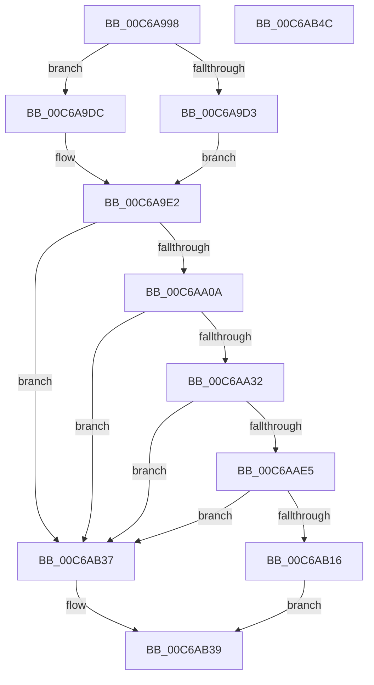

# MiInitializeSystemPtes

- RVA: `0x00C6A998`–`0x00C6AB4D` (길이 `437` bytes)
- VA: `0x0000000140C6A998`
- 실행 섹션: `INIT`
- PDB 이름 있음: `예`; PDB Function 태그: `아니요`
- unwind 정보 RVA: `0x0009CA28`
- 디코드: `103`개 명령, `437/437` bytes 표시
- 미해석 바이트: `0` (있으면 어셈블리에 `.byte`로 보존)

> 이 문서는 커널 이미지의 기계어와 PDB 기호를 분석해 생성했습니다. 4번과 5번은 함수 원형과 자료형을 바이너리 사용 방식에서 추정한 C 해석이며 원본 소스 복구 결과는 아닙니다.

## 1. Dependencies

- 직접 호출 지점: **8**; 고유 호출 대상: **6**
- 직접 호출자로 확인된 함수: **1**
- RIP 상대 이미지 참조: **11**

### Outgoing calls
- `0x00C6A9BD` → [MiGetAnyMultiplexedVm](../../text/44/MiGetAnyMultiplexedVm_function_00448BD0.md) (function, `0x00448BD0`)
- `0x00C6A9FD` → [MiInitializeSystemWorkingSetList](../../page/7F/MiInitializeSystemWorkingSetList_function_007FB7D4.md) (function, `0x007FB7D4`)
- `0x00C6AA0F` → [MiGetAnyMultiplexedVm](../../text/44/MiGetAnyMultiplexedVm_function_00448BD0.md) (function, `0x00448BD0`)
- `0x00C6AA25` → [MiInitializeSystemWorkingSetList](../../page/7F/MiInitializeSystemWorkingSetList_function_007FB7D4.md) (function, `0x007FB7D4`)
- `0x00C6AA87` → [ExGenRandom](../../text/41/ExGenRandom_function_0041B010.md) (function, `0x0041B010`)
- `0x00C6AADC` → [MiInitializePteInfo](MiInitializePteInfo_function_00C6A7E0.md) (function, `0x00C6A7E0`)
- `0x00C6AB0D` → [MiInitializeDynamicRegion](MiInitializeDynamicRegion_function_00C65C2C.md) (function, `0x00C65C2C`)
- `0x00C6AB1C` → [MiObtainSystemVa](../../text/3B/MiObtainSystemVa_function_003B4F44.md) (function, `0x003B4F44`)

### Direct callers
- [MiInitNucleus](../C5/MiInitNucleus_function_00C5FD38.md) at `0x00C6016F`

### Static image references
- `0x00C6A9AA` → RVA `0x00E38BE8` (`.data`; read)
- `0x00C6A9B6` → RVA `0x00E38BF0` (`.data`; read)
- `0x00C6A9D3` → RVA `0x00E38840` (`.data`; read)
- `0x00C6A9E5` → RVA `0x00E36080` (`.data`; read)
- `0x00C6A9F2` → RVA `0x00E38D00` (`.data`; read)
- `0x00C6AA5C` → RVA `0x00FC51FC` (`ALMOSTRO`; read)
- `0x00C6AA9E` → RVA `0x00E35E18` (`.data`; read)
- `0x00C6AAAD` → RVA `0x00E2EF68` (`.data`; write)
- `0x00C6AACF` → RVA `0x00E37668` (`.data`; read)
- `0x00C6AB21` → RVA `0x00FC6A88` (`ALMOSTRO`; read/write)
- `0x00C6AB2D` → RVA `0x00E35FB0` (`.data`; read/write)

## 2. Other-region calls and transfers

- 다른 실행 섹션으로 향하는 call: **6**
  - `0x00C6A9BD` → [MiGetAnyMultiplexedVm](../../text/44/MiGetAnyMultiplexedVm_function_00448BD0.md) (`INIT` → `.text`)
  - `0x00C6A9FD` → [MiInitializeSystemWorkingSetList](../../page/7F/MiInitializeSystemWorkingSetList_function_007FB7D4.md) (`INIT` → `PAGE`)
  - `0x00C6AA0F` → [MiGetAnyMultiplexedVm](../../text/44/MiGetAnyMultiplexedVm_function_00448BD0.md) (`INIT` → `.text`)
  - `0x00C6AA25` → [MiInitializeSystemWorkingSetList](../../page/7F/MiInitializeSystemWorkingSetList_function_007FB7D4.md) (`INIT` → `PAGE`)
  - `0x00C6AA87` → [ExGenRandom](../../text/41/ExGenRandom_function_0041B010.md) (`INIT` → `.text`)
  - `0x00C6AB1C` → [MiObtainSystemVa](../../text/3B/MiObtainSystemVa_function_003B4F44.md) (`INIT` → `.text`)
- 별도 외부 분기/꼬리 이동을 확인하지 못했습니다.

## 3. Assembly (complete function range)

```asm
00C6A998  48 89 5C 24 10                  mov qword ptr [rsp + 0x10], rbx
00C6A99D  48 89 6C 24 18                  mov qword ptr [rsp + 0x18], rbp
00C6A9A2  56                              push rsi
00C6A9A3  57                              push rdi
00C6A9A4  41 56                           push r14
00C6A9A6  48 83 EC 40                     sub rsp, 0x40
00C6A9AA  48 8B 2D 37 E2 1C 00            mov rbp, qword ptr [rip + 0x1ce237]
00C6A9B1  B9 04 00 00 00                  mov ecx, 4
00C6A9B6  48 8B 35 33 E2 1C 00            mov rsi, qword ptr [rip + 0x1ce233]
00C6A9BD  E8 0E E2 7D FF                  call 0x140448bd0
00C6A9C2  48 8B F8                        mov rdi, rax
00C6A9C5  8B 88 B8 00 00 00               mov ecx, dword ptr [rax + 0xb8]
00C6A9CB  80 E1 0F                        and cl, 0xf
00C6A9CE  80 F9 01                        cmp cl, 1
00C6A9D1  75 09                           jne 0x140c6a9dc
00C6A9D3  48 8D 05 66 DE 1C 00            lea rax, [rip + 0x1cde66]
00C6A9DA  EB 06                           jmp 0x140c6a9e2
00C6A9DC  48 05 C0 00 00 00               add rax, 0xc0
00C6A9E2  45 33 C9                        xor r9d, r9d
00C6A9E5  48 8D 0D 94 B6 1C 00            lea rcx, [rip + 0x1cb694]
00C6A9EC  48 89 08                        mov qword ptr [rax], rcx
00C6A9EF  48 8B D7                        mov rdx, rdi
00C6A9F2  48 8D 0D 07 E3 1C 00            lea rcx, [rip + 0x1ce307]
00C6A9F9  45 8D 41 05                     lea r8d, [r9 + 5]
00C6A9FD  E8 D2 0D B9 FF                  call 0x1407fb7d4
00C6AA02  85 C0                           test eax, eax
00C6AA04  0F 88 2D 01 00 00               js 0x140c6ab37
00C6AA0A  B9 05 00 00 00                  mov ecx, 5
00C6AA0F  E8 BC E1 7D FF                  call 0x140448bd0
00C6AA14  45 33 C9                        xor r9d, r9d
00C6AA17  48 8D 0D E2 E2 1C 00            lea rcx, [rip + 0x1ce2e2]
00C6AA1E  48 8B D0                        mov rdx, rax
00C6AA21  45 8D 41 06                     lea r8d, [r9 + 6]
00C6AA25  E8 AA 0D B9 FF                  call 0x1407fb7d4
00C6AA2A  85 C0                           test eax, eax
00C6AA2C  0F 88 05 01 00 00               js 0x140c6ab37
00C6AA32  65 48 8B 04 25 20 00 00 00      mov rax, qword ptr gs:[0x20]
00C6AA3B  48 8B DE                        mov rbx, rsi
00C6AA3E  48 C1 EB 0C                     shr rbx, 0xc
00C6AA42  48 8B CB                        mov rcx, rbx
00C6AA45  48 C1 EB 0C                     shr rbx, 0xc
00C6AA49  48 C1 E9 03                     shr rcx, 3
00C6AA4D  48 83 88 B0 8F 00 00 FF         or qword ptr [rax + 0x8fb0], 0xffffffffffffffff
00C6AA55  48 81 C1 FF 0F 00 00            add rcx, 0xfff
00C6AA5C  8B 05 9A A7 35 00               mov eax, dword ptr [rip + 0x35a79a]
00C6AA62  48 81 E1 00 F0 FF FF            and rcx, 0xfffffffffffff000
00C6AA69  83 E0 02                        and eax, 2
00C6AA6C  4C 8D B3 FF FF 1F 00            lea r14, [rbx + 0x1fffff]
00C6AA73  48 83 C8 01                     or rax, 1
00C6AA77  48 0F AF C1                     imul rax, rcx
00C6AA7B  B9 01 00 00 00                  mov ecx, 1
00C6AA80  4C 03 F0                        add r14, rax
00C6AA83  49 C1 EE 15                     shr r14, 0x15
00C6AA87  E8 84 05 7B FF                  call 0x14041b010
00C6AA8C  25 FF 3F 00 00                  and eax, 0x3fff
00C6AA91  48 8B CD                        mov rcx, rbp
00C6AA94  41 03 C6                        add eax, r14d
00C6AA97  48 C1 E0 15                     shl rax, 0x15
00C6AA9B  48 2B C8                        sub rcx, rax
00C6AA9E  48 8B 05 73 B3 1C 00            mov rax, qword ptr [rip + 0x1cb373]
00C6AAA5  48 03 CE                        add rcx, rsi
00C6AAA8  48 89 44 24 38                  mov qword ptr [rsp + 0x38], rax
00C6AAAD  48 89 0D B4 44 1C 00            mov qword ptr [rip + 0x1c44b4], rcx
00C6AAB4  C7 44 24 30 01 00 00 00         mov dword ptr [rsp + 0x30], 1
00C6AABC  48 89 74 24 28                  mov qword ptr [rsp + 0x28], rsi
00C6AAC1  4C 8D 04 0B                     lea r8, [rbx + rcx]
00C6AAC5  48 89 6C 24 20                  mov qword ptr [rsp + 0x20], rbp
00C6AACA  BB 08 00 00 00                  mov ebx, 8
00C6AACF  48 8D 0D 92 CB 1C 00            lea rcx, [rip + 0x1ccb92]
00C6AAD6  8B D3                           mov edx, ebx
00C6AAD8  44 8D 4B FC                     lea r9d, [rbx - 4]
00C6AADC  E8 FF FC FF FF                  call 0x140c6a7e0
00C6AAE1  85 C0                           test eax, eax
00C6AAE3  74 52                           je 0x140c6ab37
00C6AAE5  8B 87 B8 00 00 00               mov eax, dword ptr [rdi + 0xb8]
00C6AAEB  4C 8B C6                        mov r8, rsi
00C6AAEE  89 44 24 60                     mov dword ptr [rsp + 0x60], eax
00C6AAF2  48 8B D5                        mov rdx, rbp
00C6AAF5  24 F5                           and al, 0xf5
00C6AAF7  8B CB                           mov ecx, ebx
00C6AAF9  0C 05                           or al, 5
00C6AAFB  88 44 24 60                     mov byte ptr [rsp + 0x60], al
00C6AAFF  44 0F B7 4C 24 60               movzx r9d, word ptr [rsp + 0x60]
00C6AB05  66 44 89 8F B8 00 00 00         mov word ptr [rdi + 0xb8], r9w
00C6AB0D  E8 1A B1 FF FF                  call 0x140c65c2c
00C6AB12  85 C0                           test eax, eax
00C6AB14  74 21                           je 0x140c6ab37
00C6AB16  8D 53 04                        lea edx, [rbx + 4]
00C6AB19  41 8B CE                        mov ecx, r14d
00C6AB1C  E8 23 A4 74 FF                  call 0x1403b4f44
00C6AB21  48 0F BA 2D 5E BF 35 00 1E      bts qword ptr [rip + 0x35bf5e], 0x1e
00C6AB2A  8D 43 F9                        lea eax, [rbx - 7]
00C6AB2D  48 83 25 7B B4 1C 00 00         and qword ptr [rip + 0x1cb47b], 0
00C6AB35  EB 02                           jmp 0x140c6ab39
00C6AB37  33 C0                           xor eax, eax
00C6AB39  48 8B 5C 24 68                  mov rbx, qword ptr [rsp + 0x68]
00C6AB3E  48 8B 6C 24 70                  mov rbp, qword ptr [rsp + 0x70]
00C6AB43  48 83 C4 40                     add rsp, 0x40
00C6AB47  41 5E                           pop r14
00C6AB49  5F                              pop rdi
00C6AB4A  5E                              pop rsi
00C6AB4B  C3                              ret
00C6AB4C  CC                              int3
```

## 4. C-style interpretation (structured pseudocode)

```c
__int64 __fastcall MiInitializeSystemPtes(__int64 a1, __int64 a2, __int64 a3, int a4)
{
    __int64 result;
    __int64 v_r14;
    __int64 v_rbx;
    __int64 v_rsp;
    unsigned __int64 v_stack_m20;
    unsigned int v_stack_m28;
    unsigned __int64 v_stack_m30;
    unsigned __int64 v_stack_m38;
    unsigned __int64 v_stack_p10;
    unsigned __int64 v_stack_p18;
    unsigned int v_stack_p8;

    v_stack_p10 = v_rbx;
    v_stack_p18 = v_rbp;
    v_rsp = (v_rsp) - (64);
    result = MiGetAnyMultiplexedVm(4, a2, a3, a4);
    a1 = (unsigned __int8)(((unsigned int)(*(unsigned int *)(result + 184))) & (15));
    if (((unsigned __int8)(a1)) != 1) goto loc_00C6A9DC;
    goto loc_00C6A9E2;
loc_00C6A9DC:
    result = (v_rip + 1891942) + (192);
loc_00C6A9E2:
    a4 = 0;
    *(unsigned __int64 *)(result) = v_rip + 1881748;
    result = MiInitializeSystemWorkingSetList(v_rip + 1893127, result, a4 + 5, a4);
    if (sign_flag) goto loc_00C6AB37;
    result = MiGetAnyMultiplexedVm(5, result, a4 + 5, a4);
    a4 = 0;
    result = MiInitializeSystemWorkingSetList(v_rip + 1893090, result, a4 + 6, a4);
    if (sign_flag) goto loc_00C6AB37;
    v_rbx = (*(unsigned __int64 *)(v_rip + 1892915)) >> (12);
    v_rbx = (v_rbx) >> (12);
    a1 = (v_rbx) >> (3);
    a1 = (a1) + (0xFFFULL);
    a1 = (a1) & (0xFFFFFFFFFFFFF000ULL);
    result = (unsigned int)(((unsigned int)(*(unsigned int *)(v_rip + 3516314))) & (2));
    result = (result) | (1);
    result = (result) * (a1);
    v_r14 = (v_rbx + 2097151) + (result);
    v_r14 = (v_r14) >> (21);
    result = ExGenRandom(1, result, a4 + 6, a4);
    result = (unsigned int)((result) & (0x3FFFULL));
    result = (unsigned int)((result) + ((unsigned int)(v_r14)));
    result = (result) << (21);
    a1 = (*(unsigned __int64 *)(v_rip + 1892919)) - (result);
    a1 = (a1) + (*(unsigned __int64 *)(v_rip + 1892915));
    v_stack_m20 = *(unsigned __int64 *)(v_rip + 1880947);
    *(unsigned __int64 *)(v_rip + 1852596) = a1;
    v_stack_m28 = 1;
    v_stack_m30 = *(unsigned __int64 *)(v_rip + 1892915);
    v_stack_m38 = *(unsigned __int64 *)(v_rip + 1892919);
    result = MiInitializePteInfo(v_rip + 1887122, 8, v_rbx + a1 * 1, 8 - 4);
    if ((unsigned int)(result) == 0) goto loc_00C6AB37;
    v_stack_p8 = (unsigned int)((unsigned int)(*(unsigned int *)(result + 184)));
    result = (unsigned __int8)(((unsigned int)(*(unsigned int *)(result + 184))) & (245));
    result = (unsigned __int8)((result) | (5));
    v_stack_p8 = (unsigned __int8)(result);
    *(unsigned __int16 *)(result + 184) = (unsigned __int16)(v_stack_p8);
    result = MiInitializeDynamicRegion(8, *(unsigned __int64 *)(v_rip + 1892919), *(unsigned __int64 *)(v_rip + 1892915), v_stack_p8);
    if ((unsigned int)(result) == 0) goto loc_00C6AB37;
    result = MiObtainSystemVa((unsigned int)((unsigned int)(v_r14)), 8 + 4, *(unsigned __int64 *)(v_rip + 1892915), v_stack_p8);
    goto loc_00C6AB39;
loc_00C6AB37:
    result = 0;
loc_00C6AB39:
    v_rsp = (v_rsp) + (64);
    return result;
}
```

## 5. (Beta) C Style

```c
int64_t MiInitializeSystemPtes(int64_t Arg1, int64_t Arg2, int64_t Arg3, int32_t Arg4)
{
    int64_t result;
    int64_t local_r14;
    int64_t local_rbx;
    int64_t local_rsp;
    uint64_t v_stack_m20;
    uint32_t v_stack_m28;
    uint64_t v_stack_m30;
    uint64_t v_stack_m38;
    uint64_t v_stack_p10;
    uint64_t v_stack_p18;
    uint32_t v_stack_p8;

    v_stack_p10 = local_rbx;
    v_stack_p18 = local_rbp;
    local_rsp = (local_rsp) - (64);
    result = MiGetAnyMultiplexedVm(4, Arg2, Arg3, Arg4);
    Arg1 = (uint8_t)(((uint32_t)(*(uint32_t *)(result + 0xB8))) & (15));
    if (((uint8_t)(Arg1)) != 1) goto loc_00C6A9DC;
    goto loc_00C6A9E2;
loc_00C6A9DC:
    result = (v_rip + 1891942) + (192);
loc_00C6A9E2:
    Arg4 = 0;
    *(uint64_t *)(result) = v_rip + 1881748;
    result = MiInitializeSystemWorkingSetList(v_rip + 1893127, result, Arg4 + 5, Arg4);
    if (sign_flag) goto loc_00C6AB37;
    result = MiGetAnyMultiplexedVm(5, result, Arg4 + 5, Arg4);
    Arg4 = 0;
    result = MiInitializeSystemWorkingSetList(v_rip + 1893090, result, Arg4 + 6, Arg4);
    if (sign_flag) goto loc_00C6AB37;
    local_rbx = (*(uint64_t *)(v_rip + 0x1CE233)) >> (12);
    local_rbx = (local_rbx) >> (12);
    Arg1 = (local_rbx) >> (3);
    Arg1 = (Arg1) + (0xFFFULL);
    Arg1 = (Arg1) & (0xFFFFFFFFFFFFF000ULL);
    result = (uint32_t)(((uint32_t)(*(uint32_t *)(v_rip + 0x35A79A))) & (2));
    result = (result) | (1);
    result = (result) * (Arg1);
    local_r14 = (local_rbx + 2097151) + (result);
    local_r14 = (local_r14) >> (21);
    result = ExGenRandom(1, result, Arg4 + 6, Arg4);
    result = (uint32_t)((result) & (0x3FFFULL));
    result = (uint32_t)((result) + ((uint32_t)(local_r14)));
    result = (result) << (21);
    Arg1 = (*(uint64_t *)(v_rip + 0x1CE237)) - (result);
    Arg1 = (Arg1) + (*(uint64_t *)(v_rip + 0x1CE233));
    v_stack_m20 = *(uint64_t *)(v_rip + 0x1CB373);
    *(uint64_t *)(v_rip + 0x1C44B4) = Arg1;
    v_stack_m28 = 1;
    v_stack_m30 = *(uint64_t *)(v_rip + 0x1CE233);
    v_stack_m38 = *(uint64_t *)(v_rip + 0x1CE237);
    result = MiInitializePteInfo(v_rip + 1887122, 8, local_rbx + Arg1 * 1, 8 - 4);
    if ((uint32_t)(result) == 0) goto loc_00C6AB37;
    v_stack_p8 = (uint32_t)((uint32_t)(*(uint32_t *)(result + 0xB8)));
    result = (uint8_t)(((uint32_t)(*(uint32_t *)(result + 0xB8))) & (245));
    result = (uint8_t)((result) | (5));
    v_stack_p8 = (uint8_t)(result);
    *(uint16_t *)(result + 0xB8) = (uint16_t)(v_stack_p8);
    result = MiInitializeDynamicRegion(8, *(uint64_t *)(v_rip + 0x1CE237), *(uint64_t *)(v_rip + 0x1CE233), v_stack_p8);
    if ((uint32_t)(result) == 0) goto loc_00C6AB37;
    result = MiObtainSystemVa((uint32_t)((uint32_t)(local_r14)), 8 + 4, *(uint64_t *)(v_rip + 0x1CE233), v_stack_p8);
    goto loc_00C6AB39;
loc_00C6AB37:
    result = 0;
loc_00C6AB39:
    local_rsp = (local_rsp) + (64);
    return result;
}
```

## 6. Execution-region graph

[열기: 2D/3D 그래프와 함수 탐색 컨트롤 패널](../../../control-panel.html?section=init&rva=0x00C6A998&view=graph)

- 2D 그래프는 위에서 아래로 흐르고, 3D 그래프는 빈 공간을 드래그해 회전합니다. Shift+드래그는 이동, 휠은 확대·축소, 함수 노드 선택은 대상 보고서 이동입니다.

### Static fallback


