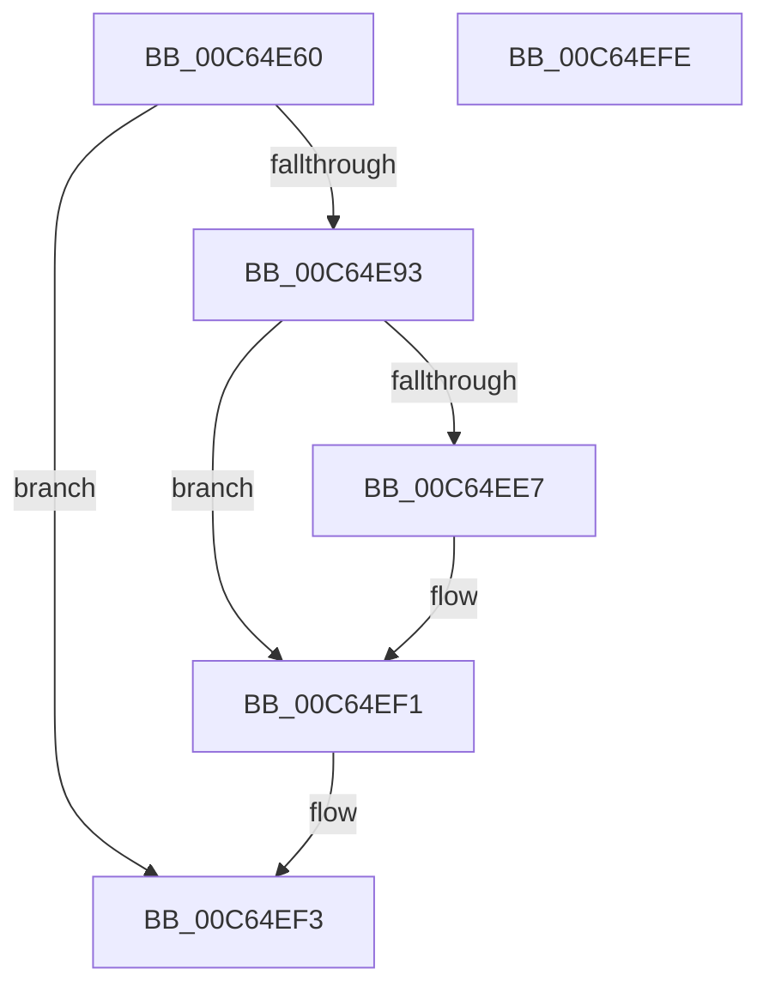

# MiInitializeSystemSpaceMap

- RVA: `0x00C64E60`–`0x00C64EFF` (길이 `159` bytes)
- VA: `0x0000000140C64E60`
- 실행 섹션: `INIT`
- PDB 이름 있음: `예`; PDB Function 태그: `아니요`
- unwind 정보 RVA: `0x00065960`
- 디코드: `38`개 명령, `159/159` bytes 표시
- 미해석 바이트: `0` (있으면 어셈블리에 `.byte`로 보존)

> 이 문서는 커널 이미지의 기계어와 PDB 기호를 분석해 생성했습니다. 4번과 5번은 함수 원형과 자료형을 바이너리 사용 방식에서 추정한 C 해석이며 원본 소스 복구 결과는 아닙니다.

## 1. Dependencies

- 직접 호출 지점: **3**; 고유 호출 대상: **3**
- 직접 호출자로 확인된 함수: **1**
- RIP 상대 이미지 참조: **6**

### Outgoing calls
- `0x00C64E86` → [MiAllocatePool](../../text/35/MiAllocatePool_function_0035B540.md) (function, `0x0035B540`)
- `0x00C64EDC` → [MiInitializePteInfo](MiInitializePteInfo_function_00C6A7E0.md) (function, `0x00C6A7E0`)
- `0x00C64EEC` → [ExFreePoolWithTag](../../poolcode/B8/ExFreePoolWithTag_function_00B82870.md) (function, `0x00B82870`)

### Direct callers
- [MiInitSystem](../C5/MiInitSystem_function_00C5E6C0.md) at `0x00C5E932`

### Static image references
- `0x00C64E6A` → RVA `0x00FC5000` (`ALMOSTRO`; read)
- `0x00C64E93` → RVA `0x00E38CA8` (`.data`; read)
- `0x00C64EA0` → RVA `0x00E38CB0` (`.data`; read)
- `0x00C64EAA` → RVA `0x00E36040` (`.data`; read/write)
- `0x00C64EB2` → RVA `0x00E36048` (`.data`; read/write)
- `0x00C64ED5` → RVA `0x00E35E20` (`.data`; read)

## 2. Other-region calls and transfers

- 다른 실행 섹션으로 향하는 call: **2**
  - `0x00C64E86` → [MiAllocatePool](../../text/35/MiAllocatePool_function_0035B540.md) (`INIT` → `.text`)
  - `0x00C64EEC` → [ExFreePoolWithTag](../../poolcode/B8/ExFreePoolWithTag_function_00B82870.md) (`INIT` → `POOLCODE`)
- 별도 외부 분기/꼬리 이동을 확인하지 못했습니다.

## 3. Assembly (complete function range)

```asm
00C64E60  48 89 5C 24 08                  mov qword ptr [rsp + 8], rbx
00C64E65  57                              push rdi
00C64E66  48 83 EC 40                     sub rsp, 0x40
00C64E6A  0F B7 05 8F 01 36 00            movzx eax, word ptr [rip + 0x36018f]
00C64E71  B9 40 00 00 00                  mov ecx, 0x40
00C64E76  03 C0                           add eax, eax
00C64E78  41 B8 4D 6D 20 20               mov r8d, 0x20206d4d
00C64E7E  48 8D 14 C0                     lea rdx, [rax + rax*8]
00C64E82  48 C1 E2 03                     shl rdx, 3
00C64E86  E8 B5 66 6F FF                  call 0x14035b540
00C64E8B  48 8B D8                        mov rbx, rax
00C64E8E  48 85 C0                        test rax, rax
00C64E91  74 60                           je 0x140c64ef3
00C64E93  48 8B 0D 0E 3E 1D 00            mov rcx, qword ptr [rip + 0x1d3e0e]
00C64E9A  41 B9 04 00 00 00               mov r9d, 4
00C64EA0  48 8B 05 09 3E 1D 00            mov rax, qword ptr [rip + 0x1d3e09]
00C64EA7  45 33 C0                        xor r8d, r8d
00C64EAA  48 83 25 8E 11 1D 00 00         and qword ptr [rip + 0x1d118e], 0
00C64EB2  48 83 25 8E 11 1D 00 00         and qword ptr [rip + 0x1d118e], 0
00C64EBA  48 89 5C 24 38                  mov qword ptr [rsp + 0x38], rbx
00C64EBF  41 8D 51 0D                     lea edx, [r9 + 0xd]
00C64EC3  C7 44 24 30 10 00 00 00         mov dword ptr [rsp + 0x30], 0x10
00C64ECB  48 89 44 24 28                  mov qword ptr [rsp + 0x28], rax
00C64ED0  48 89 4C 24 20                  mov qword ptr [rsp + 0x20], rcx
00C64ED5  48 8D 0D 44 0F 1D 00            lea rcx, [rip + 0x1d0f44]
00C64EDC  E8 FF 58 00 00                  call 0x140c6a7e0
00C64EE1  8B F8                           mov edi, eax
00C64EE3  85 C0                           test eax, eax
00C64EE5  75 0A                           jne 0x140c64ef1
00C64EE7  33 D2                           xor edx, edx
00C64EE9  48 8B CB                        mov rcx, rbx
00C64EEC  E8 7F D9 F1 FF                  call 0x140b82870
00C64EF1  8B C7                           mov eax, edi
00C64EF3  48 8B 5C 24 50                  mov rbx, qword ptr [rsp + 0x50]
00C64EF8  48 83 C4 40                     add rsp, 0x40
00C64EFC  5F                              pop rdi
00C64EFD  C3                              ret
00C64EFE  CC                              int3
```

## 4. C-style interpretation (structured pseudocode)

```c
__int64 __fastcall MiInitializeSystemSpaceMap(void)
{
    __int64 result;
    __int64 v_rsp;
    unsigned __int64 v_stack_m10;
    unsigned int v_stack_m18;
    unsigned __int64 v_stack_m20;
    unsigned __int64 v_stack_m28;
    unsigned __int64 v_stack_p8;

    v_stack_p8 = v_rbx;
    v_rsp = (v_rsp) - (64);
    result = (unsigned int)((*(unsigned __int16 *)(v_rip + 3539343)) + ((unsigned int)(*(unsigned __int16 *)(v_rip + 3539343))));
    a2 = (result + result * 8) << (3);
    result = MiAllocatePool(64, a2, (unsigned int)(0x20206D4DULL), a4);
    if (result == 0) goto loc_00C64EF3;
    a3 = 0;
    v_stack_m10 = result;
    v_stack_m18 = 16;
    v_stack_m20 = *(unsigned __int64 *)(v_rip + 1916425);
    v_stack_m28 = *(unsigned __int64 *)(v_rip + 1916430);
    result = MiInitializePteInfo(v_rip + 1904452, 4 + 13, a3, 4);
    if ((unsigned int)(result) == 0) {
        a2 = 0;
        a1 = result;
        result = ExFreePoolWithTag(a1, a2, a3, 4);
    }
loc_00C64EF3:
    v_rsp = (v_rsp) + (64);
    return (unsigned int)((unsigned int)((unsigned int)((unsigned int)(result))));
}
```

## 5. (Beta) C Style

```c
void MiInitializeSystemSpaceMap(void)
{
    int64_t result;
    int64_t local_rsp;
    uint64_t v_stack_m10;
    uint32_t v_stack_m18;
    uint64_t v_stack_m20;
    uint64_t v_stack_m28;
    uint64_t v_stack_p8;

    v_stack_p8 = local_rbx;
    local_rsp = (local_rsp) - (64);
    result = (uint32_t)((*(uint16_t *)(v_rip + 0x36018F)) + ((uint32_t)(*(uint16_t *)(v_rip + 0x36018F))));
    a2 = (result + result * 8) << (3);
    result = MiAllocatePool(64, a2, (uint32_t)(0x20206D4DULL), a4);
    if (result == 0) goto loc_00C64EF3;
    a3 = 0;
    v_stack_m10 = result;
    v_stack_m18 = 16;
    v_stack_m20 = *(uint64_t *)(v_rip + 0x1D3E09);
    v_stack_m28 = *(uint64_t *)(v_rip + 0x1D3E0E);
    result = MiInitializePteInfo(v_rip + 1904452, 4 + 13, a3, 4);
    if ((uint32_t)(result) == 0) {
        a2 = 0;
        a1 = result;
        result = ExFreePoolWithTag(a1, a2, a3, 4);
    }
loc_00C64EF3:
    local_rsp = (local_rsp) + (64);
    return (uint32_t)((uint32_t)((uint32_t)((uint32_t)(result))));
}
```

## 6. Execution-region graph

[열기: 2D/3D 그래프와 함수 탐색 컨트롤 패널](../../../control-panel.html?section=init&rva=0x00C64E60&view=graph)

- 2D 그래프는 위에서 아래로 흐르고, 3D 그래프는 빈 공간을 드래그해 회전합니다. Shift+드래그는 이동, 휠은 확대·축소, 함수 노드 선택은 대상 보고서 이동입니다.

### Static fallback


