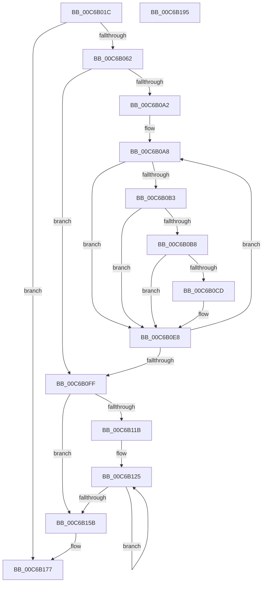

# MiInitializeTbFlush

- RVA: `0x00C6B01C`–`0x00C6B196` (길이 `378` bytes)
- VA: `0x0000000140C6B01C`
- 실행 섹션: `INIT`
- PDB 이름 있음: `예`; PDB Function 태그: `아니요`
- unwind 정보 RVA: `0x000AC264`
- 디코드: `103`개 명령, `378/378` bytes 표시
- 미해석 바이트: `0` (있으면 어셈블리에 `.byte`로 보존)

> 이 문서는 커널 이미지의 기계어와 PDB 기호를 분석해 생성했습니다. 4번과 5번은 함수 원형과 자료형을 바이너리 사용 방식에서 추정한 C 해석이며 원본 소스 복구 결과는 아닙니다.

## 1. Dependencies

- 직접 호출 지점: **6**; 고유 호출 대상: **5**
- 직접 호출자로 확인된 함수: **1**
- RIP 상대 이미지 참조: **4**

### Outgoing calls
- `0x00C6B051` → [MiReservePtes](../../text/31/MiReservePtes_function_00318D20.md) (function, `0x00318D20`)
- `0x00C6B074` → [MiMakeValidPte](../../text/2C/MiMakeValidPte_function_002C5590.md) (function, `0x002C5590`)
- `0x00C6B0D9` → [MiCheckLinearProtectedPteAccessedBit](../../text/29/MiCheckLinearProtectedPteAccessedBit_function_00292D80.md) (function, `0x00292D80`)
- `0x00C6B10C` → [MiCalibrateTbFlush](../../text/69/MiCalibrateTbFlush_function_006955EC.md) (function, `0x006955EC`)
- `0x00C6B138` → [MiCalibrateTbFlush](../../text/69/MiCalibrateTbFlush_function_006955EC.md) (function, `0x006955EC`)
- `0x00C6B172` → [MiReleasePtes](../../text/24/MiReleasePtes_function_00247240.md) (function, `0x00247240`)

### Direct callers
- [MiInitSystem](../C5/MiInitSystem_function_00C5E6C0.md) at `0x00C5EAA2`
- [MiInitSystem](../C5/MiInitSystem_function_00C5E6C0.md) at `0x00C5EABF`

### Static image references
- `0x00C6B042` → RVA `0x00E37668` (`.data`; read)
- `0x00C6B062` → RVA `0x00E37478` (`.data`; read)
- `0x00C6B0A8` → RVA `0x00FC6A88` (`ALMOSTRO`; read)
- `0x00C6B168` → RVA `0x00E2DCD0` (`.data`; write)

## 2. Other-region calls and transfers

- 다른 실행 섹션으로 향하는 call: **6**
  - `0x00C6B051` → [MiReservePtes](../../text/31/MiReservePtes_function_00318D20.md) (`INIT` → `.text`)
  - `0x00C6B074` → [MiMakeValidPte](../../text/2C/MiMakeValidPte_function_002C5590.md) (`INIT` → `.text`)
  - `0x00C6B0D9` → [MiCheckLinearProtectedPteAccessedBit](../../text/29/MiCheckLinearProtectedPteAccessedBit_function_00292D80.md) (`INIT` → `.text`)
  - `0x00C6B10C` → [MiCalibrateTbFlush](../../text/69/MiCalibrateTbFlush_function_006955EC.md) (`INIT` → `.text`)
  - `0x00C6B138` → [MiCalibrateTbFlush](../../text/69/MiCalibrateTbFlush_function_006955EC.md) (`INIT` → `.text`)
  - `0x00C6B172` → [MiReleasePtes](../../text/24/MiReleasePtes_function_00247240.md) (`INIT` → `.text`)
- 별도 외부 분기/꼬리 이동을 확인하지 못했습니다.

## 3. Assembly (complete function range)

```asm
00C6B01C  48 8B C4                        mov rax, rsp
00C6B01F  48 89 58 08                     mov qword ptr [rax + 8], rbx
00C6B023  48 89 68 10                     mov qword ptr [rax + 0x10], rbp
00C6B027  48 89 70 18                     mov qword ptr [rax + 0x18], rsi
00C6B02B  57                              push rdi
00C6B02C  41 54                           push r12
00C6B02E  41 55                           push r13
00C6B030  41 56                           push r14
00C6B032  41 57                           push r15
00C6B034  48 83 EC 40                     sub rsp, 0x40
00C6B038  8B F9                           mov edi, ecx
00C6B03A  0F 57 C0                        xorps xmm0, xmm0
00C6B03D  0F 57 C9                        xorps xmm1, xmm1
00C6B040  8B D1                           mov edx, ecx
00C6B042  48 8D 0D 1F C6 1C 00            lea rcx, [rip + 0x1cc61f]
00C6B049  0F 11 40 B8                     movups xmmword ptr [rax - 0x48], xmm0
00C6B04D  0F 11 48 C8                     movups xmmword ptr [rax - 0x38], xmm1
00C6B051  E8 CA DC 6A FF                  call 0x140318d20
00C6B056  4C 8B F8                        mov r15, rax
00C6B059  48 85 C0                        test rax, rax
00C6B05C  0F 84 15 01 00 00               je 0x140c6b177
00C6B062  48 8B 15 0F C4 1C 00            mov rdx, qword ptr [rip + 0x1cc40f]
00C6B069  BD 01 00 00 00                  mov ebp, 1
00C6B06E  44 8B C5                        mov r8d, ebp
00C6B071  48 8B C8                        mov rcx, rax
00C6B074  E8 17 A5 65 FF                  call 0x1402c5590
00C6B079  49 8B F7                        mov rsi, r15
00C6B07C  48 BA 00 00 00 00 80 F6 FF FF   movabs rdx, 0xfffff68000000000
00C6B086  48 C1 E6 19                     shl rsi, 0x19
00C6B08A  48 8B D8                        mov rbx, rax
00C6B08D  48 8B C2                        mov rax, rdx
00C6B090  48 C1 E0 19                     shl rax, 0x19
00C6B094  48 2B F0                        sub rsi, rax
00C6B097  48 C1 FE 10                     sar rsi, 0x10
00C6B09B  4C 8B E6                        mov r12, rsi
00C6B09E  85 FF                           test edi, edi
00C6B0A0  74 5D                           je 0x140c6b0ff
00C6B0A2  4D 8B F7                        mov r14, r15
00C6B0A5  44 8B EF                        mov r13d, edi
00C6B0A8  48 0F BA 25 D7 B9 35 00 24      bt qword ptr [rip + 0x35b9d7], 0x24
00C6B0B1  73 35                           jae 0x140c6b0e8
00C6B0B3  F6 C3 20                        test bl, 0x20
00C6B0B6  75 30                           jne 0x140c6b0e8
00C6B0B8  48 8B C2                        mov rax, rdx
00C6B0BB  48 B9 00 00 00 00 40 00 00 00   movabs rcx, 0x4000000000
00C6B0C5  48 03 C1                        add rax, rcx
00C6B0C8  4C 3B F0                        cmp r14, rax
00C6B0CB  72 1B                           jb 0x140c6b0e8
00C6B0CD  41 B8 80 00 00 00               mov r8d, 0x80
00C6B0D3  48 8B D3                        mov rdx, rbx
00C6B0D6  49 8B CE                        mov rcx, r14
00C6B0D9  E8 A2 7C 62 FF                  call 0x140292d80
00C6B0DE  48 BA 00 00 00 00 80 F6 FF FF   movabs rdx, 0xfffff68000000000
00C6B0E8  49 89 1E                        mov qword ptr [r14], rbx
00C6B0EB  49 83 C6 08                     add r14, 8
00C6B0EF  49 8B 04 24                     mov rax, qword ptr [r12]
00C6B0F3  49 81 C4 00 10 00 00            add r12, 0x1000
00C6B0FA  4C 2B ED                        sub r13, rbp
00C6B0FD  75 A9                           jne 0x140c6b0a8
00C6B0FF  4C 8D 4C 24 20                  lea r9, [rsp + 0x20]
00C6B104  44 8B C7                        mov r8d, edi
00C6B107  33 D2                           xor edx, edx
00C6B109  48 8B CE                        mov rcx, rsi
00C6B10C  E8 DB A4 A2 FF                  call 0x1406955ec
00C6B111  44 8D 77 FF                     lea r14d, [rdi - 1]
00C6B115  41 83 FE 02                     cmp r14d, 2
00C6B119  7E 40                           jle 0x140c6b15b
00C6B11B  4C 8B 64 24 28                  mov r12, qword ptr [rsp + 0x28]
00C6B120  4C 03 64 24 20                  add r12, qword ptr [rsp + 0x20]
00C6B125  41 8D 1C 2E                     lea ebx, [r14 + rbp]
00C6B129  44 8B C7                        mov r8d, edi
00C6B12C  D1 FB                           sar ebx, 1
00C6B12E  4C 8D 4C 24 30                  lea r9, [rsp + 0x30]
00C6B133  8B D3                           mov edx, ebx
00C6B135  48 8B CE                        mov rcx, rsi
00C6B138  E8 AF A4 A2 FF                  call 0x1406955ec
00C6B13D  48 8B 54 24 38                  mov rdx, qword ptr [rsp + 0x38]
00C6B142  48 03 54 24 30                  add rdx, qword ptr [rsp + 0x30]
00C6B147  49 3B D4                        cmp rdx, r12
00C6B14A  0F 46 EB                        cmovbe ebp, ebx
00C6B14D  41 0F 46 DE                     cmovbe ebx, r14d
00C6B151  44 8B F3                        mov r14d, ebx
00C6B154  8D 45 01                        lea eax, [rbp + 1]
00C6B157  3B D8                           cmp ebx, eax
00C6B159  7F CA                           jg 0x140c6b125
00C6B15B  48 63 C5                        movsxd rax, ebp
00C6B15E  48 8D 0D 03 C5 1C 00            lea rcx, [rip + 0x1cc503]
00C6B165  44 8B C7                        mov r8d, edi
00C6B168  48 89 05 61 2B 1C 00            mov qword ptr [rip + 0x1c2b61], rax
00C6B16F  49 8B D7                        mov rdx, r15
00C6B172  E8 C9 C0 5D FF                  call 0x140247240
00C6B177  4C 8D 5C 24 40                  lea r11, [rsp + 0x40]
00C6B17C  49 8B 5B 30                     mov rbx, qword ptr [r11 + 0x30]
00C6B180  49 8B 6B 38                     mov rbp, qword ptr [r11 + 0x38]
00C6B184  49 8B 73 40                     mov rsi, qword ptr [r11 + 0x40]
00C6B188  49 8B E3                        mov rsp, r11
00C6B18B  41 5F                           pop r15
00C6B18D  41 5E                           pop r14
00C6B18F  41 5D                           pop r13
00C6B191  41 5C                           pop r12
00C6B193  5F                              pop rdi
00C6B194  C3                              ret
00C6B195  CC                              int3
```

## 4. C-style interpretation (structured pseudocode)

```c
__int64 __fastcall MiInitializeTbFlush(int a1)
{
    __int64 result;
    __int64 v_r12;
    __int64 v_r13;
    __int64 v_r14;
    __int64 v_rbp;
    __int64 v_rbx;
    __int64 v_rsi;
    __int64 v_rsp;
    unsigned __int64 v_stack_m28;
    unsigned __int64 v_stack_m30;
    unsigned __int64 v_stack_m38;
    unsigned __int64 v_stack_m40;
    unsigned __int64 v_stack_m48;

    *(unsigned __int64 *)(v_rsp + 8) = v_rbx;
    *(unsigned __int64 *)(v_rsp + 16) = v_rbp;
    *(unsigned __int64 *)(v_rsp + 24) = v_rsi;
    v_rsp = (v_rsp) - (64);
    *(unsigned __int64 *)(v_rsp - 72) = v_xmm0;
    *(unsigned __int64 *)(v_rsp - 56) = v_xmm1;
    result = MiReservePtes(v_rip + 1885727, (unsigned int)(a1), a3, a4);
    if (result == 0) goto loc_00C6B177;
    result = MiMakeValidPte(result, *(unsigned __int64 *)(v_rip + 1885199), 1, a4);
    v_rsi = (result) << (25);
    result = (*(unsigned __int64 *)(v_rip + 1885199)) << (25);
    v_rsi = (v_rsi) - (result);
    v_rsi = (v_rsi) >> (16);
    if ((unsigned int)((unsigned int)(a1)) == 0) goto loc_00C6B0FF;
loc_00C6B0A8:
    if (condition_is_above_or_equal) goto loc_00C6B0E8;
    if ((((unsigned __int8)(result)) & (32)) != 0) goto loc_00C6B0E8;
    result = (*(unsigned __int64 *)(v_rip + 1885199)) + (result);
    if (result >= result) {
        a3 = 128;
        a2 = result;
        a1 = result;
        result = MiCheckLinearProtectedPteAccessedBit(a1, a2, a3, a4);
    }
    *(unsigned __int64 *)(result) = result;
    v_r14 = (result) + (8);
    v_r12 = (v_rsi) + (0x1000ULL);
    v_r13 = ((unsigned int)((unsigned int)((unsigned int)(a1)))) - (1);
    if (condition_is_not_equal) goto loc_00C6B0A8;
loc_00C6B0FF:
    a2 = 0;
    result = MiCalibrateTbFlush(v_rsi, a2, (unsigned int)((unsigned int)((unsigned int)(a1))), v_stack_m48);
    if (((unsigned int)((unsigned int)(a1) - 1)) <= 2) goto loc_00C6B15B;
    v_r12 = (v_stack_m40) + (v_stack_m48);
loc_00C6B125:
    v_rbx = (unsigned int)(((unsigned int)(a1) - 1 + 1 * 1) >> (1));
    result = MiCalibrateTbFlush(v_rsi, (unsigned int)((unsigned int)(v_rbx)), (unsigned int)((unsigned int)((unsigned int)(a1))), v_stack_m38);
    a2 = (v_stack_m30) + (v_stack_m38);
    v_rbp = 1;
    if (a2 <= v_r12) {
        v_rbp = (unsigned int)(v_rbx);
        v_rbx = (unsigned int)((unsigned int)(a1) - 1);
    }
    if (((unsigned int)(v_rbx)) > ((unsigned int)(v_rbp + 1))) goto loc_00C6B125;
loc_00C6B15B:
    *(unsigned __int64 *)(v_rip + 1846113) = (int)((unsigned int)(v_rbp));
    result = MiReleasePtes(v_rip + 1885443, result, (unsigned int)((unsigned int)((unsigned int)(a1))), v_stack_m38);
loc_00C6B177:
    return result;
}
```

## 5. (Beta) C Style

```c
int64_t MiInitializeTbFlush(int32_t Arg1)
{
    int64_t result;
    int64_t local_r12;
    int64_t local_r13;
    int64_t local_r14;
    int64_t local_rbp;
    int64_t local_rbx;
    int64_t local_rsi;
    int64_t local_rsp;
    uint64_t v_stack_m28;
    uint64_t v_stack_m30;
    uint64_t v_stack_m38;
    uint64_t v_stack_m40;
    uint64_t v_stack_m48;

    *(uint64_t *)(local_rsp + 0x8) = local_rbx;
    *(uint64_t *)(local_rsp + 0x10) = local_rbp;
    *(uint64_t *)(local_rsp + 0x18) = local_rsi;
    local_rsp = (local_rsp) - (64);
    *(uint64_t *)(local_rsp - 0x48) = v_xmm0;
    *(uint64_t *)(local_rsp - 0x38) = v_xmm1;
    result = MiReservePtes(v_rip + 1885727, (uint32_t)(Arg1), a3, a4);
    if (result == 0) goto loc_00C6B177;
    result = MiMakeValidPte(result, *(uint64_t *)(v_rip + 0x1CC40F), 1, a4);
    local_rsi = (result) << (25);
    result = (*(uint64_t *)(v_rip + 0x1CC40F)) << (25);
    local_rsi = (local_rsi) - (result);
    local_rsi = (local_rsi) >> (16);
    if ((uint32_t)((uint32_t)(Arg1)) == 0) goto loc_00C6B0FF;
loc_00C6B0A8:
    if (condition_is_above_or_equal) goto loc_00C6B0E8;
    if ((((uint8_t)(result)) & (32)) != 0) goto loc_00C6B0E8;
    result = (*(uint64_t *)(v_rip + 0x1CC40F)) + (result);
    if (result >= result) {
        a3 = 128;
        a2 = result;
        Arg1 = result;
        result = MiCheckLinearProtectedPteAccessedBit(Arg1, a2, a3, a4);
    }
    *(uint64_t *)(result) = result;
    local_r14 = (result) + (8);
    local_r12 = (local_rsi) + (0x1000ULL);
    local_r13 = ((uint32_t)((uint32_t)((uint32_t)(Arg1)))) - (1);
    if (condition_is_not_equal) goto loc_00C6B0A8;
loc_00C6B0FF:
    a2 = 0;
    result = MiCalibrateTbFlush(local_rsi, a2, (uint32_t)((uint32_t)((uint32_t)(Arg1))), v_stack_m48);
    if (((uint32_t)((uint32_t)(Arg1) - 1)) <= 2) goto loc_00C6B15B;
    local_r12 = (v_stack_m40) + (v_stack_m48);
loc_00C6B125:
    local_rbx = (uint32_t)(((uint32_t)(Arg1) - 1 + 1 * 1) >> (1));
    result = MiCalibrateTbFlush(local_rsi, (uint32_t)((uint32_t)(local_rbx)), (uint32_t)((uint32_t)((uint32_t)(Arg1))), v_stack_m38);
    a2 = (v_stack_m30) + (v_stack_m38);
    local_rbp = 1;
    if (a2 <= local_r12) {
        local_rbp = (uint32_t)(local_rbx);
        local_rbx = (uint32_t)((uint32_t)(Arg1) - 1);
    }
    if (((uint32_t)(local_rbx)) > ((uint32_t)(local_rbp + 1))) goto loc_00C6B125;
loc_00C6B15B:
    *(uint64_t *)(v_rip + 0x1C2B61) = (int32_t)((uint32_t)(local_rbp));
    result = MiReleasePtes(v_rip + 1885443, result, (uint32_t)((uint32_t)((uint32_t)(Arg1))), v_stack_m38);
loc_00C6B177:
    return result;
}
```

## 6. Execution-region graph

[열기: 2D/3D 그래프와 함수 탐색 컨트롤 패널](../../../control-panel.html?section=init&rva=0x00C6B01C&view=graph)

- 2D 그래프는 위에서 아래로 흐르고, 3D 그래프는 빈 공간을 드래그해 회전합니다. Shift+드래그는 이동, 휠은 확대·축소, 함수 노드 선택은 대상 보고서 이동입니다.

### Static fallback


