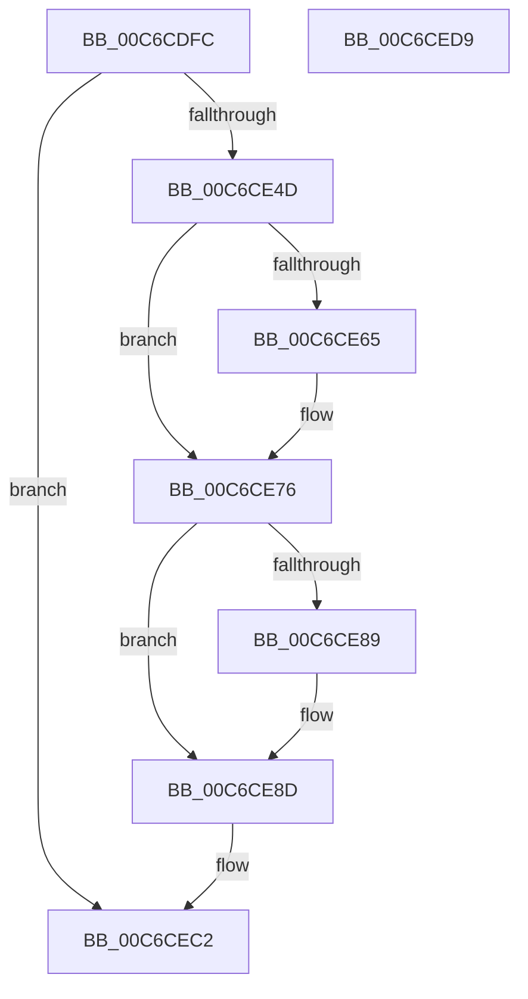

# MiInitializeUltraSpace

- RVA: `0x00C6CDFC`–`0x00C6CEDA` (길이 `222` bytes)
- VA: `0x0000000140C6CDFC`
- 실행 섹션: `INIT`
- PDB 이름 있음: `예`; PDB Function 태그: `아니요`
- unwind 정보 RVA: `0x0008DF5C`
- 디코드: `70`개 명령, `222/222` bytes 표시
- 미해석 바이트: `0` (있으면 어셈블리에 `.byte`로 보존)

> 이 문서는 커널 이미지의 기계어와 PDB 기호를 분석해 생성했습니다. 4번과 5번은 함수 원형과 자료형을 바이너리 사용 방식에서 추정한 C 해석이며 원본 소스 복구 결과는 아닙니다.

## 1. Dependencies

- 직접 호출 지점: **5**; 고유 호출 대상: **5**
- 직접 호출자로 확인된 함수: **1**
- RIP 상대 이미지 참조: **0**

### Outgoing calls
- `0x00C6CE40` → [MiAllocatePool](../../text/35/MiAllocatePool_function_0035B540.md) (function, `0x0035B540`)
- `0x00C6CE5B` → [RtlSetAllBitsEx](../../text/4A/RtlSetAllBitsEx_function_004A9220.md) (function, `0x004A9220`)
- `0x00C6CE71` → [RtlClearBitsEx](../../text/29/RtlClearBitsEx_function_00297740.md) (function, `0x00297740`)
- `0x00C6CE7D` → [ExGenRandom](../../text/41/ExGenRandom_function_0041B010.md) (function, `0x0041B010`)
- `0x00C6CEB4` → [memset](../../text/6C/memset_function_006C6C40.md) (function, `0x006C6C40`)

### Direct callers
- [MiCreateTopLevelUltraMappings](MiCreateTopLevelUltraMappings_function_00C6CCB0.md) at `0x00C6CD27`

### Static image references
- 디코드된 RIP-relative 메모리 참조가 없습니다.

## 2. Other-region calls and transfers

- 다른 실행 섹션으로 향하는 call: **5**
  - `0x00C6CE40` → [MiAllocatePool](../../text/35/MiAllocatePool_function_0035B540.md) (`INIT` → `.text`)
  - `0x00C6CE5B` → [RtlSetAllBitsEx](../../text/4A/RtlSetAllBitsEx_function_004A9220.md) (`INIT` → `.text`)
  - `0x00C6CE71` → [RtlClearBitsEx](../../text/29/RtlClearBitsEx_function_00297740.md) (`INIT` → `.text`)
  - `0x00C6CE7D` → [ExGenRandom](../../text/41/ExGenRandom_function_0041B010.md) (`INIT` → `.text`)
  - `0x00C6CEB4` → [memset](../../text/6C/memset_function_006C6C40.md) (`INIT` → `.text`)
- 별도 외부 분기/꼬리 이동을 확인하지 못했습니다.

## 3. Assembly (complete function range)

```asm
00C6CDFC  48 89 5C 24 08                  mov qword ptr [rsp + 8], rbx
00C6CE01  48 89 6C 24 10                  mov qword ptr [rsp + 0x10], rbp
00C6CE06  56                              push rsi
00C6CE07  57                              push rdi
00C6CE08  41 54                           push r12
00C6CE0A  41 56                           push r14
00C6CE0C  41 57                           push r15
00C6CE0E  48 83 EC 20                     sub rsp, 0x20
00C6CE12  49 8B F0                        mov rsi, r8
00C6CE15  4C 8B E2                        mov r12, rdx
00C6CE18  48 8B E9                        mov rbp, rcx
00C6CE1B  48 C1 EE 1E                     shr rsi, 0x1e
00C6CE1F  41 B8 4D 6D 20 20               mov r8d, 0x20206d4d
00C6CE25  B9 42 00 00 00                  mov ecx, 0x42
00C6CE2A  48 8D 5E 3F                     lea rbx, [rsi + 0x3f]
00C6CE2E  48 83 E3 C0                     and rbx, 0xffffffffffffffc0
00C6CE32  4C 8B F3                        mov r14, rbx
00C6CE35  49 C1 EE 06                     shr r14, 6
00C6CE39  49 C1 E6 04                     shl r14, 4
00C6CE3D  49 8B D6                        mov rdx, r14
00C6CE40  E8 FB E6 6E FF                  call 0x14035b540
00C6CE45  4C 8B F8                        mov r15, rax
00C6CE48  48 85 C0                        test rax, rax
00C6CE4B  74 75                           je 0x140c6cec2
00C6CE4D  48 8D 7D 18                     lea rdi, [rbp + 0x18]
00C6CE51  48 8B CF                        mov rcx, rdi
00C6CE54  48 89 1F                        mov qword ptr [rdi], rbx
00C6CE57  4C 89 7F 08                     mov qword ptr [rdi + 8], r15
00C6CE5B  E8 C0 C3 83 FF                  call 0x1404a9220
00C6CE60  48 3B F3                        cmp rsi, rbx
00C6CE63  74 11                           je 0x140c6ce76
00C6CE65  4C 8B C3                        mov r8, rbx
00C6CE68  48 8B D6                        mov rdx, rsi
00C6CE6B  4C 2B C6                        sub r8, rsi
00C6CE6E  48 8B CF                        mov rcx, rdi
00C6CE71  E8 CA A8 62 FF                  call 0x140297740
00C6CE76  BF 01 00 00 00                  mov edi, 1
00C6CE7B  8B CF                           mov ecx, edi
00C6CE7D  E8 8E E1 7A FF                  call 0x14041b010
00C6CE82  8B D6                           mov edx, esi
00C6CE84  0F BD CA                        bsr ecx, edx
00C6CE87  74 04                           je 0x140c6ce8d
00C6CE89  8B D7                           mov edx, edi
00C6CE8B  D3 E2                           shl edx, cl
00C6CE8D  FF CA                           dec edx
00C6CE8F  8B C0                           mov eax, eax
00C6CE91  48 23 D0                        and rdx, rax
00C6CE94  49 D1 EE                        shr r14, 1
00C6CE97  48 89 55 10                     mov qword ptr [rbp + 0x10], rdx
00C6CE9B  33 D2                           xor edx, edx
00C6CE9D  48 89 5D 28                     mov qword ptr [rbp + 0x28], rbx
00C6CEA1  48 C1 EB 05                     shr rbx, 5
00C6CEA5  48 C1 E3 02                     shl rbx, 2
00C6CEA9  4B 8D 0C 3E                     lea rcx, [r14 + r15]
00C6CEAD  4C 8B C3                        mov r8, rbx
00C6CEB0  48 89 4D 30                     mov qword ptr [rbp + 0x30], rcx
00C6CEB4  E8 87 9D A5 FF                  call 0x1406c6c40
00C6CEB9  8B C7                           mov eax, edi
00C6CEBB  4C 89 65 08                     mov qword ptr [rbp + 8], r12
00C6CEBF  89 75 38                        mov dword ptr [rbp + 0x38], esi
00C6CEC2  48 8B 5C 24 50                  mov rbx, qword ptr [rsp + 0x50]
00C6CEC7  48 8B 6C 24 58                  mov rbp, qword ptr [rsp + 0x58]
00C6CECC  48 83 C4 20                     add rsp, 0x20
00C6CED0  41 5F                           pop r15
00C6CED2  41 5E                           pop r14
00C6CED4  41 5C                           pop r12
00C6CED6  5F                              pop rdi
00C6CED7  5E                              pop rsi
00C6CED8  C3                              ret
00C6CED9  CC                              int3
```

## 4. C-style interpretation (structured pseudocode)

```c
__int64 __fastcall MiInitializeUltraSpace(__int64 a1, __int64 a2, __int64 a3)
{
    __int64 result;
    __int64 v_r14;
    __int64 v_rbx;
    __int64 v_rsi;
    __int64 v_rsp;
    unsigned __int64 v_stack_p10;
    unsigned __int64 v_stack_p8;

    v_stack_p8 = v_rbx;
    v_stack_p10 = v_rbp;
    v_rsp = (v_rsp) - (32);
    v_rsi = (a3) >> (30);
    v_rbx = (v_rsi + 63) & (-64);
    v_r14 = (v_rbx) >> (6);
    v_r14 = (v_r14) << (4);
    result = MiAllocatePool(66, v_r14, (unsigned int)(0x20206D4DULL), a4);
    if (result == 0) goto loc_00C6CEC2;
    *(unsigned __int64 *)(a1 + 24) = v_rbx;
    *(unsigned __int64 *)(a1 + 24 + 8) = result;
    result = RtlSetAllBitsEx(a1 + 24, v_r14, (unsigned int)(0x20206D4DULL), a4);
    if (v_rsi != v_rbx) {
        a3 = v_rbx;
        a2 = v_rsi;
        a3 = (a3) - (v_rsi);
        a1 = a1 + 24;
        result = RtlClearBitsEx(a1, a2, a3, a4);
    }
    result = ExGenRandom(1, a2, a3, a4);
    if (!(condition_is_equal)) {
        a2 = 1;
        a2 = (unsigned int)((a2) << (1));
    }
    a2 = (unsigned int)((a2) - 1);
    a2 = (a2) & ((unsigned int)((unsigned int)(result)));
    v_r14 = (v_r14) >> (1);
    *(unsigned __int64 *)(a1 + 16) = a2;
    a2 = 0;
    *(unsigned __int64 *)(a1 + 40) = v_rbx;
    v_rbx = (v_rbx) >> (5);
    v_rbx = (v_rbx) << (2);
    *(unsigned __int64 *)(a1 + 48) = v_r14 + result * 1;
    result = memset(v_r14 + result * 1, a2, v_rbx, a4);
    *(unsigned __int64 *)(a1 + 8) = 0;
    *(unsigned int *)(a1 + 56) = (unsigned int)(v_rsi);
loc_00C6CEC2:
    v_rsp = (v_rsp) + (32);
    return 1;
}
```

## 5. (Beta) C Style

```c
int64_t MiInitializeUltraSpace(void *Arg1, int64_t Arg2, int64_t Arg3)
{
    uint8_t *arg1 = (uint8_t *)Arg1;

    int64_t result;
    int64_t local_r14;
    int64_t local_rbx;
    int64_t local_rsi;
    int64_t local_rsp;
    uint64_t v_stack_p10;
    uint64_t v_stack_p8;

    v_stack_p8 = local_rbx;
    v_stack_p10 = local_rbp;
    local_rsp = (local_rsp) - (32);
    local_rsi = (Arg3) >> (30);
    local_rbx = (local_rsi + 63) & (-64);
    local_r14 = (local_rbx) >> (6);
    local_r14 = (local_r14) << (4);
    result = MiAllocatePool(66, local_r14, (uint32_t)(0x20206D4DULL), a4);
    if (result == 0) goto loc_00C6CEC2;
    *(uint64_t *)(arg1 + 0x18) = local_rbx;
    *(uint64_t *)(arg1 + 0x18 + 0x8) = result;
    result = RtlSetAllBitsEx(Arg1 + 24, local_r14, (uint32_t)(0x20206D4DULL), a4);
    if (local_rsi != local_rbx) {
        Arg3 = local_rbx;
        Arg2 = local_rsi;
        Arg3 = (Arg3) - (local_rsi);
        Arg1 = Arg1 + 24;
        result = RtlClearBitsEx(Arg1, Arg2, Arg3, a4);
    }
    result = ExGenRandom(1, Arg2, Arg3, a4);
    if (!(condition_is_equal)) {
        Arg2 = 1;
        Arg2 = (uint32_t)((Arg2) << (1));
    }
    Arg2 = (uint32_t)((Arg2) - 1);
    Arg2 = (Arg2) & ((uint32_t)((uint32_t)(result)));
    local_r14 = (local_r14) >> (1);
    *(uint64_t *)(arg1 + 0x10) = Arg2;
    Arg2 = 0;
    *(uint64_t *)(arg1 + 0x28) = local_rbx;
    local_rbx = (local_rbx) >> (5);
    local_rbx = (local_rbx) << (2);
    *(uint64_t *)(arg1 + 0x30) = local_r14 + result * 1;
    result = memset(local_r14 + result * 1, Arg2, local_rbx, a4);
    *(uint64_t *)(arg1 + 0x8) = 0;
    *(uint32_t *)(arg1 + 0x38) = (uint32_t)(local_rsi);
loc_00C6CEC2:
    local_rsp = (local_rsp) + (32);
    return 1;
}
```

### 관측된 메모리 오프셋

구조체 형식이 확인되지 않은 접근은 인자 기준의 오프셋으로만 기록했습니다.

| 기준 인자 | 오프셋 표현 | 폭 (bit) | 접근 |
|---|---:|---:|---|
| `Arg1` | `+ 0x0` | `64` | `W` |
| `Arg1` | `+ 0x8` | `64` | `W` |
| `Arg1` | `+ 0x10` | `64` | `W` |
| `Arg1` | `+ 0x18` | `64` | `R` |
| `Arg1` | `+ 0x28` | `64` | `W` |
| `Arg1` | `+ 0x30` | `64` | `W` |
| `Arg1` | `+ 0x38` | `32` | `W` |

## 6. Execution-region graph

[열기: 2D/3D 그래프와 함수 탐색 컨트롤 패널](../../../control-panel.html?section=init&rva=0x00C6CDFC&view=graph)

- 2D 그래프는 위에서 아래로 흐르고, 3D 그래프는 빈 공간을 드래그해 회전합니다. Shift+드래그는 이동, 휠은 확대·축소, 함수 노드 선택은 대상 보고서 이동입니다.

### Static fallback


