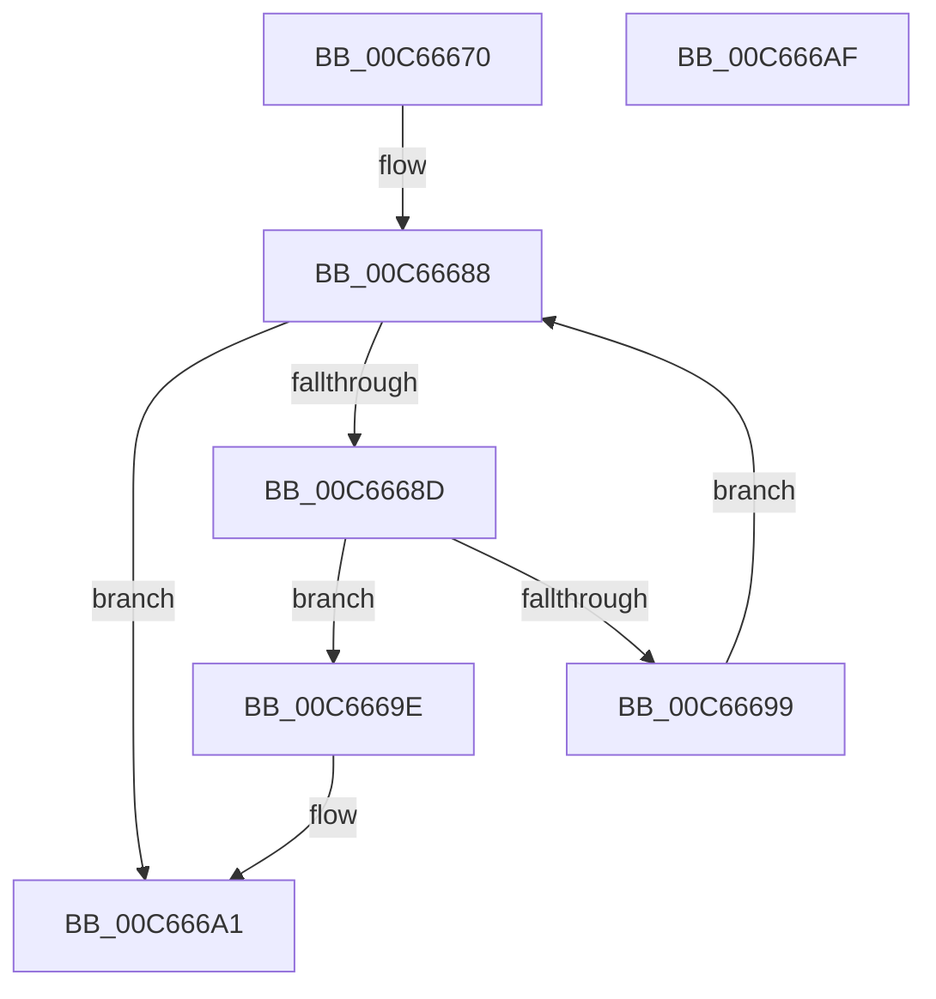

# MiIsBootImageTargetFullyRetpolined

- RVA: `0x00C66670`–`0x00C666B0` (길이 `64` bytes)
- VA: `0x0000000140C66670`
- 실행 섹션: `INIT`
- PDB 이름 있음: `예`; PDB Function 태그: `아니요`
- unwind 정보 RVA: `0x0005C788`
- 디코드: `20`개 명령, `64/64` bytes 표시
- 미해석 바이트: `0` (있으면 어셈블리에 `.byte`로 보존)

> 이 문서는 커널 이미지의 기계어와 PDB 기호를 분석해 생성했습니다. 4번과 5번은 함수 원형과 자료형을 바이너리 사용 방식에서 추정한 C 해석이며 원본 소스 복구 결과는 아닙니다.

## 1. Dependencies

- 직접 호출 지점: **2**; 고유 호출 대상: **2**
- 직접 호출자로 확인된 함수: **0**
- RIP 상대 이미지 참조: **1**

### Outgoing calls
- `0x00C66690` → [MiImageContainsVa](../../text/4B/MiImageContainsVa_function_004B1874.md) (function, `0x004B1874`)
- `0x00C666A5` → [RtlIsImageFullyRetpolined](../../text/4C/RtlIsImageFullyRetpolined_function_004CDE74.md) (function, `0x004CDE74`)

### Direct callers
- 이 함수 시작 RVA로 연결되는 직접 call은 확인되지 않았습니다. 간접 호출은 완전히 역산할 수 없습니다.

### Static image references
- `0x00C66674` → RVA `0x00FC6B20` (`ALMOSTRO`; read)

## 2. Other-region calls and transfers

- 다른 실행 섹션으로 향하는 call: **2**
  - `0x00C66690` → [MiImageContainsVa](../../text/4B/MiImageContainsVa_function_004B1874.md) (`INIT` → `.text`)
  - `0x00C666A5` → [RtlIsImageFullyRetpolined](../../text/4C/RtlIsImageFullyRetpolined_function_004CDE74.md) (`INIT` → `.text`)
- 별도 외부 분기/꼬리 이동을 확인하지 못했습니다.

## 3. Assembly (complete function range)

```asm
00C66670  48 83 EC 28                     sub rsp, 0x28
00C66674  4C 8B 15 A5 04 36 00            mov r10, qword ptr [rip + 0x3604a5]
00C6667B  45 33 C9                        xor r9d, r9d
00C6667E  49 83 C2 10                     add r10, 0x10
00C66682  48 8B D1                        mov rdx, rcx
00C66685  4D 8B 02                        mov r8, qword ptr [r10]
00C66688  4D 3B C2                        cmp r8, r10
00C6668B  74 14                           je 0x140c666a1
00C6668D  49 8B C8                        mov rcx, r8
00C66690  E8 DF B1 84 FF                  call 0x1404b1874
00C66695  85 C0                           test eax, eax
00C66697  75 05                           jne 0x140c6669e
00C66699  4D 8B 00                        mov r8, qword ptr [r8]
00C6669C  EB EA                           jmp 0x140c66688
00C6669E  4D 8B C8                        mov r9, r8
00C666A1  49 8B 49 30                     mov rcx, qword ptr [r9 + 0x30]
00C666A5  E8 CA 77 86 FF                  call 0x1404cde74
00C666AA  48 83 C4 28                     add rsp, 0x28
00C666AE  C3                              ret
00C666AF  CC                              int3
```

## 4. C-style interpretation (structured pseudocode)

```c
__int64 __fastcall MiIsBootImageTargetFullyRetpolined(__int64 a1, __int64 a2, __int64 a3, int a4)
{
    __int64 result;
    __int64 v_r10;
    __int64 v_rsp;

    v_rsp = (v_rsp) - (40);
    a4 = 0;
    v_r10 = (*(unsigned __int64 *)(v_rip + 3540133)) + (16);
loc_00C66688:
    if ((*(unsigned __int64 *)(v_r10)) == v_r10) goto loc_00C666A1;
    result = MiImageContainsVa(*(unsigned __int64 *)(v_r10), a1, *(unsigned __int64 *)(v_r10), a4);
    if ((unsigned int)(result) != 0) goto loc_00C6669E;
    goto loc_00C66688;
loc_00C6669E:
loc_00C666A1:
    result = RtlIsImageFullyRetpolined(*(unsigned __int64 *)(*(unsigned __int64 *)(*(unsigned __int64 *)(v_r10)) + 48), a1, *(unsigned __int64 *)(*(unsigned __int64 *)(v_r10)), *(unsigned __int64 *)(*(unsigned __int64 *)(v_r10)));
    v_rsp = (v_rsp) + (40);
    return result;
}
```

## 5. (Beta) C Style

```c
int64_t MiIsBootImageTargetFullyRetpolined(int64_t Arg1, int64_t Arg2, int64_t Arg3, int32_t Arg4)
{
    int64_t result;
    int64_t local_r10;
    int64_t local_rsp;

    local_rsp = (local_rsp) - (40);
    Arg4 = 0;
    local_r10 = (*(uint64_t *)(v_rip + 0x3604A5)) + (16);
loc_00C66688:
    if ((*(uint64_t *)(local_r10)) == local_r10) goto loc_00C666A1;
    result = MiImageContainsVa(*(uint64_t *)(local_r10), Arg1, *(uint64_t *)(local_r10), Arg4);
    if ((uint32_t)(result) != 0) goto loc_00C6669E;
    goto loc_00C66688;
loc_00C6669E:
loc_00C666A1:
    result = RtlIsImageFullyRetpolined(*(uint64_t *)(*(uint64_t *)(*(uint64_t *)(local_r10)) + 0x30), Arg1, *(uint64_t *)(*(uint64_t *)(local_r10)), *(uint64_t *)(*(uint64_t *)(local_r10)));
    local_rsp = (local_rsp) + (40);
    return result;
}
```

## 6. Execution-region graph

[열기: 2D/3D 그래프와 함수 탐색 컨트롤 패널](../../../control-panel.html?section=init&rva=0x00C66670&view=graph)

- 2D 그래프는 위에서 아래로 흐르고, 3D 그래프는 빈 공간을 드래그해 회전합니다. Shift+드래그는 이동, 휠은 확대·축소, 함수 노드 선택은 대상 보고서 이동입니다.

### Static fallback


