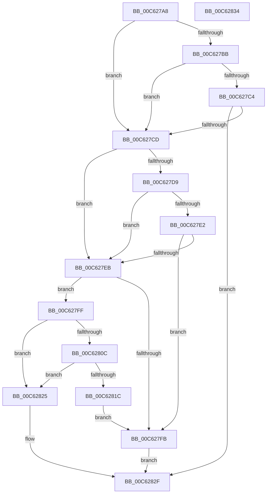

# MiIsRegularMemory

- RVA: `0x00C627A8`–`0x00C62835` (길이 `141` bytes)
- VA: `0x0000000140C627A8`
- 실행 섹션: `INIT`
- PDB 이름 있음: `예`; PDB Function 태그: `아니요`
- unwind 정보 RVA: `0x0005C788`
- 디코드: `41`개 명령, `141/141` bytes 표시
- 미해석 바이트: `0` (있으면 어셈블리에 `.byte`로 보존)

> 이 문서는 커널 이미지의 기계어와 PDB 기호를 분석해 생성했습니다. 4번과 5번은 함수 원형과 자료형을 바이너리 사용 방식에서 추정한 C 해석이며 원본 소스 복구 결과는 아닙니다.

## 1. Dependencies

- 직접 호출 지점: **1**; 고유 호출 대상: **1**
- 직접 호출자로 확인된 함수: **2**
- RIP 상대 이미지 참조: **4**

### Outgoing calls
- `0x00C627EE` → [MiFindDescriptorByPfn](../C5/MiFindDescriptorByPfn_function_00C5FBA0.md) (function, `0x00C5FBA0`)

### Direct callers
- [MxMarkValidMappings](MxMarkValidMappings_function_00C611C0.md) at `0x00C6124C`
- [MxMarkValidMappings](MxMarkValidMappings_function_00C611C0.md) at `0x00C61294`
- [MxCreatePfnsForPtes](MxCreatePfnsForPtes_function_00C635B0.md) at `0x00C6371B`

### Static image references
- `0x00C627AC` → RVA `0x01008710` (`INITDATA`; read)
- `0x00C627CD` → RVA `0x01008718` (`INITDATA`; read)
- `0x00C6281C` → RVA `0x01008718` (`INITDATA`; write)
- `0x00C62825` → RVA `0x01008710` (`INITDATA`; write)

## 2. Other-region calls and transfers

- 다른 실행 섹션으로 향하는 call: **0**
- 별도 외부 분기/꼬리 이동을 확인하지 못했습니다.

## 3. Assembly (complete function range)

```asm
00C627A8  48 83 EC 28                     sub rsp, 0x28
00C627AC  48 8B 05 5D 5F 3A 00            mov rax, qword ptr [rip + 0x3a5f5d]
00C627B3  4C 8B D1                        mov r10, rcx
00C627B6  48 85 C0                        test rax, rax
00C627B9  74 12                           je 0x140c627cd
00C627BB  4C 8B 48 20                     mov r9, qword ptr [rax + 0x20]
00C627BF  49 3B D1                        cmp rdx, r9
00C627C2  72 09                           jb 0x140c627cd
00C627C4  4C 03 48 28                     add r9, qword ptr [rax + 0x28]
00C627C8  49 3B D1                        cmp rdx, r9
00C627CB  72 62                           jb 0x140c6282f
00C627CD  48 8B 05 44 5F 3A 00            mov rax, qword ptr [rip + 0x3a5f44]
00C627D4  48 85 C0                        test rax, rax
00C627D7  74 12                           je 0x140c627eb
00C627D9  48 8B 48 20                     mov rcx, qword ptr [rax + 0x20]
00C627DD  48 3B D1                        cmp rdx, rcx
00C627E0  72 09                           jb 0x140c627eb
00C627E2  48 03 48 28                     add rcx, qword ptr [rax + 0x28]
00C627E6  48 3B D1                        cmp rdx, rcx
00C627E9  72 10                           jb 0x140c627fb
00C627EB  49 8B CA                        mov rcx, r10
00C627EE  E8 AD D3 FF FF                  call 0x140c5fba0
00C627F3  4C 8B D8                        mov r11, rax
00C627F6  48 85 C0                        test rax, rax
00C627F9  75 04                           jne 0x140c627ff
00C627FB  33 C0                           xor eax, eax
00C627FD  EB 30                           jmp 0x140c6282f
00C627FF  8B 40 18                        mov eax, dword ptr [rax + 0x18]
00C62802  25 FF FF FF 1F                  and eax, 0x1fffffff
00C62807  83 F8 2C                        cmp eax, 0x2c
00C6280A  77 19                           ja 0x140c62825
00C6280C  48 B9 48 00 C0 C0 C5 15 00 00   movabs rcx, 0x15c5c0c00048
00C62816  48 0F A3 C1                     bt rcx, rax
00C6281A  73 09                           jae 0x140c62825
00C6281C  4C 89 1D F5 5E 3A 00            mov qword ptr [rip + 0x3a5ef5], r11
00C62823  EB D6                           jmp 0x140c627fb
00C62825  4C 89 1D E4 5E 3A 00            mov qword ptr [rip + 0x3a5ee4], r11
00C6282C  49 8B C3                        mov rax, r11
00C6282F  48 83 C4 28                     add rsp, 0x28
00C62833  C3                              ret
00C62834  CC                              int3
```

## 4. C-style interpretation (structured pseudocode)

```c
__int64 __fastcall MiIsRegularMemory(__int64 a1, __int64 a2)
{
    __int64 result;
    __int64 v_rsp;

    v_rsp = (v_rsp) - (40);
    if (*(unsigned __int64 *)(v_rip + 3825501) == 0) goto loc_00C627CD;
    if (a2 < (*(unsigned __int64 *)(*(unsigned __int64 *)(v_rip + 3825501) + 32))) goto loc_00C627CD;
    a4 = (*(unsigned __int64 *)(*(unsigned __int64 *)(v_rip + 3825501) + 32)) + (*(unsigned __int64 *)(*(unsigned __int64 *)(v_rip + 3825501) + 40));
    if (a2 < a4) goto loc_00C6282F;
loc_00C627CD:
    if (*(unsigned __int64 *)(v_rip + 3825476) == 0) goto loc_00C627EB;
    if (a2 < (*(unsigned __int64 *)(*(unsigned __int64 *)(v_rip + 3825476) + 32))) goto loc_00C627EB;
    a1 = (*(unsigned __int64 *)(*(unsigned __int64 *)(v_rip + 3825476) + 32)) + (*(unsigned __int64 *)(*(unsigned __int64 *)(v_rip + 3825476) + 40));
    if (a2 < a1) goto loc_00C627FB;
loc_00C627EB:
    result = MiFindDescriptorByPfn(a1, a2, a3, a4);
    if (result != 0) goto loc_00C627FF;
loc_00C627FB:
    result = 0;
    goto loc_00C6282F;
loc_00C627FF:
    result = (unsigned int)(((unsigned int)(*(unsigned int *)(result + 24))) & (0x1FFFFFFFULL));
    if (((unsigned int)(result)) > 44) goto loc_00C62825;
    if (((unsigned int)(result)) >= 44) goto loc_00C62825;
    *(unsigned __int64 *)(v_rip + 3825397) = result;
    goto loc_00C627FB;
loc_00C62825:
    *(unsigned __int64 *)(v_rip + 3825380) = result;
loc_00C6282F:
    v_rsp = (v_rsp) + (40);
    return result;
}
```

## 5. (Beta) C Style

```c
int64_t MiIsRegularMemory(int64_t Arg1, int64_t Arg2)
{
    int64_t result;
    int64_t local_rsp;

    local_rsp = (local_rsp) - (40);
    if (*(uint64_t *)(v_rip + 0x3A5F5D) == 0) goto loc_00C627CD;
    if (Arg2 < (*(uint64_t *)(*(uint64_t *)(v_rip + 0x3A5F5D) + 0x20))) goto loc_00C627CD;
    a4 = (*(uint64_t *)(*(uint64_t *)(v_rip + 0x3A5F5D) + 0x20)) + (*(uint64_t *)(*(uint64_t *)(v_rip + 0x3A5F5D) + 0x28));
    if (Arg2 < a4) goto loc_00C6282F;
loc_00C627CD:
    if (*(uint64_t *)(v_rip + 0x3A5F44) == 0) goto loc_00C627EB;
    if (Arg2 < (*(uint64_t *)(*(uint64_t *)(v_rip + 0x3A5F44) + 0x20))) goto loc_00C627EB;
    Arg1 = (*(uint64_t *)(*(uint64_t *)(v_rip + 0x3A5F44) + 0x20)) + (*(uint64_t *)(*(uint64_t *)(v_rip + 0x3A5F44) + 0x28));
    if (Arg2 < Arg1) goto loc_00C627FB;
loc_00C627EB:
    result = MiFindDescriptorByPfn(Arg1, Arg2, a3, a4);
    if (result != 0) goto loc_00C627FF;
loc_00C627FB:
    result = 0;
    goto loc_00C6282F;
loc_00C627FF:
    result = (uint32_t)(((uint32_t)(*(uint32_t *)(result + 0x18))) & (0x1FFFFFFFULL));
    if (((uint32_t)(result)) > 44) goto loc_00C62825;
    if (((uint32_t)(result)) >= 44) goto loc_00C62825;
    *(uint64_t *)(v_rip + 0x3A5EF5) = result;
    goto loc_00C627FB;
loc_00C62825:
    *(uint64_t *)(v_rip + 0x3A5EE4) = result;
loc_00C6282F:
    local_rsp = (local_rsp) + (40);
    return result;
}
```

## 6. Execution-region graph

[열기: 2D/3D 그래프와 함수 탐색 컨트롤 패널](../../../control-panel.html?section=init&rva=0x00C627A8&view=graph)

- 2D 그래프는 위에서 아래로 흐르고, 3D 그래프는 빈 공간을 드래그해 회전합니다. Shift+드래그는 이동, 휠은 확대·축소, 함수 노드 선택은 대상 보고서 이동입니다.

### Static fallback


