# MiLimitLoaderBlockHighMemory

- RVA: `0x00C66AA8`–`0x00C66C4E` (길이 `422` bytes)
- VA: `0x0000000140C66AA8`
- 실행 섹션: `INIT`
- PDB 이름 있음: `예`; PDB Function 태그: `아니요`
- unwind 정보 RVA: `0x000B8D7C`
- 디코드: `137`개 명령, `422/422` bytes 표시
- 미해석 바이트: `0` (있으면 어셈블리에 `.byte`로 보존)

> 이 문서는 커널 이미지의 기계어와 PDB 기호를 분석해 생성했습니다. 4번과 5번은 함수 원형과 자료형을 바이너리 사용 방식에서 추정한 C 해석이며 원본 소스 복구 결과는 아닙니다.

## 1. Dependencies

- 직접 호출 지점: **2**; 고유 호출 대상: **2**
- 직접 호출자로 확인된 함수: **1**
- RIP 상대 이미지 참조: **1**

### Outgoing calls
- `0x00C66BE7` → [RtlRbRemoveNode](../../text/2E/RtlRbRemoveNode_function_002E4C10.md) (function, `0x002E4C10`)
- `0x00C66C31` → [KeBugCheckEx](../../text/4F/KeBugCheckEx_function_004FD660.md) (function, `0x004FD660`)

### Direct callers
- [MiMemoryLicense](MiMemoryLicense_function_00C66E5C.md) at `0x00C66F61`

### Static image references
- `0x00C66ABA` → RVA `0x00FC6B30` (`ALMOSTRO`; read)

## 2. Other-region calls and transfers

- 다른 실행 섹션으로 향하는 call: **2**
  - `0x00C66BE7` → [RtlRbRemoveNode](../../text/2E/RtlRbRemoveNode_function_002E4C10.md) (`INIT` → `.text`)
  - `0x00C66C31` → [KeBugCheckEx](../../text/4F/KeBugCheckEx_function_004FD660.md) (`INIT` → `.text`)
- 별도 외부 분기/꼬리 이동을 확인하지 못했습니다.

## 3. Assembly (complete function range)

```asm
00C66AA8  48 89 5C 24 10                  mov qword ptr [rsp + 0x10], rbx
00C66AAD  48 89 6C 24 18                  mov qword ptr [rsp + 0x18], rbp
00C66AB2  56                              push rsi
00C66AB3  57                              push rdi
00C66AB4  41 56                           push r14
00C66AB6  48 83 EC 30                     sub rsp, 0x30
00C66ABA  4C 8B 35 6F 00 36 00            mov r14, qword ptr [rip + 0x36006f]
00C66AC1  48 8D A9 60 01 00 00            lea rbp, [rcx + 0x160]
00C66AC8  48 B8 00 00 00 00 20 00 00 00   movabs rax, 0x2000000000
00C66AD2  33 FF                           xor edi, edi
00C66AD4  4C 23 F0                        and r14, rax
00C66AD7  48 8B F2                        mov rsi, rdx
00C66ADA  48 8B 45 08                     mov rax, qword ptr [rbp + 8]
00C66ADE  A8 01                           test al, 1
00C66AE0  74 16                           je 0x140c66af8
00C66AE2  48 83 F8 01                     cmp rax, 1
00C66AE6  75 04                           jne 0x140c66aec
00C66AE8  33 DB                           xor ebx, ebx
00C66AEA  EB 0F                           jmp 0x140c66afb
00C66AEC  48 8B DD                        mov rbx, rbp
00C66AEF  48 83 CB 01                     or rbx, 1
00C66AF3  48 33 D8                        xor rbx, rax
00C66AF6  EB 03                           jmp 0x140c66afb
00C66AF8  48 8B D8                        mov rbx, rax
00C66AFB  48 85 DB                        test rbx, rbx
00C66AFE  0F 84 33 01 00 00               je 0x140c66c37
00C66B04  48 8B 43 08                     mov rax, qword ptr [rbx + 8]
00C66B08  48 8B D3                        mov rdx, rbx
00C66B0B  48 8B CB                        mov rcx, rbx
00C66B0E  48 85 C0                        test rax, rax
00C66B11  74 23                           je 0x140c66b36
00C66B13  48 8B 08                        mov rcx, qword ptr [rax]
00C66B16  48 8B D8                        mov rbx, rax
00C66B19  48 85 C9                        test rcx, rcx
00C66B1C  74 22                           je 0x140c66b40
00C66B1E  48 8B 01                        mov rax, qword ptr [rcx]
00C66B21  48 8B D9                        mov rbx, rcx
00C66B24  48 8B C8                        mov rcx, rax
00C66B27  48 85 C0                        test rax, rax
00C66B2A  75 F2                           jne 0x140c66b1e
00C66B2C  EB 12                           jmp 0x140c66b40
00C66B2E  48 39 0B                        cmp qword ptr [rbx], rcx
00C66B31  74 0D                           je 0x140c66b40
00C66B33  48 8B CB                        mov rcx, rbx
00C66B36  48 8B 5B 10                     mov rbx, qword ptr [rbx + 0x10]
00C66B3A  48 83 E3 FC                     and rbx, 0xfffffffffffffffc
00C66B3E  75 EE                           jne 0x140c66b2e
00C66B40  8B 42 18                        mov eax, dword ptr [rdx + 0x18]
00C66B43  4D 85 F6                        test r14, r14
00C66B46  75 1A                           jne 0x140c66b62
00C66B48  83 F8 26                        cmp eax, 0x26
00C66B4B  75 09                           jne 0x140c66b56
00C66B4D  41 8D 46 18                     lea eax, [r14 + 0x18]
00C66B51  89 42 18                        mov dword ptr [rdx + 0x18], eax
00C66B54  EB 20                           jmp 0x140c66b76
00C66B56  83 F8 27                        cmp eax, 0x27
00C66B59  75 07                           jne 0x140c66b62
00C66B5B  B8 02 00 00 00                  mov eax, 2
00C66B60  EB EF                           jmp 0x140c66b51
00C66B62  83 F8 1E                        cmp eax, 0x1e
00C66B65  74 3E                           je 0x140c66ba5
00C66B67  83 F8 1F                        cmp eax, 0x1f
00C66B6A  74 39                           je 0x140c66ba5
00C66B6C  83 F8 06                        cmp eax, 6
00C66B6F  74 34                           je 0x140c66ba5
00C66B71  83 F8 20                        cmp eax, 0x20
00C66B74  74 2F                           je 0x140c66ba5
00C66B76  8B C8                           mov ecx, eax
00C66B78  83 F8 22                        cmp eax, 0x22
00C66B7B  74 28                           je 0x140c66ba5
00C66B7D  83 F8 17                        cmp eax, 0x17
00C66B80  74 23                           je 0x140c66ba5
00C66B82  83 F8 03                        cmp eax, 3
00C66B85  74 1E                           je 0x140c66ba5
00C66B87  83 F8 16                        cmp eax, 0x16
00C66B8A  74 19                           je 0x140c66ba5
00C66B8C  83 F8 2A                        cmp eax, 0x2a
00C66B8F  74 14                           je 0x140c66ba5
00C66B91  83 F8 26                        cmp eax, 0x26
00C66B94  74 0F                           je 0x140c66ba5
00C66B96  83 F8 27                        cmp eax, 0x27
00C66B99  74 0A                           je 0x140c66ba5
00C66B9B  83 F8 2C                        cmp eax, 0x2c
00C66B9E  74 05                           je 0x140c66ba5
00C66BA0  83 F8 28                        cmp eax, 0x28
00C66BA3  75 0B                           jne 0x140c66bb0
00C66BA5  8B C8                           mov ecx, eax
00C66BA7  83 F8 03                        cmp eax, 3
00C66BAA  0F 85 4B FF FF FF               jne 0x140c66afb
00C66BB0  4C 8B 42 28                     mov r8, qword ptr [rdx + 0x28]
00C66BB4  4C 8B 52 20                     mov r10, qword ptr [rdx + 0x20]
00C66BB8  4B 8D 04 02                     lea rax, [r10 + r8]
00C66BBC  48 3B C6                        cmp rax, rsi
00C66BBF  76 3A                           jbe 0x140c66bfb
00C66BC1  83 F9 18                        cmp ecx, 0x18
00C66BC4  77 0A                           ja 0x140c66bd0
00C66BC6  B8 34 01 00 01                  mov eax, 0x1000134
00C66BCB  0F A3 C8                        bt eax, ecx
00C66BCE  72 0F                           jb 0x140c66bdf
00C66BD0  83 F9 03                        cmp ecx, 3
00C66BD3  74 0A                           je 0x140c66bdf
00C66BD5  83 F9 21                        cmp ecx, 0x21
00C66BD8  74 05                           je 0x140c66bdf
00C66BDA  83 F9 23                        cmp ecx, 0x23
00C66BDD  75 3D                           jne 0x140c66c1c
00C66BDF  4C 3B D6                        cmp r10, rsi
00C66BE2  72 0D                           jb 0x140c66bf1
00C66BE4  48 8B CD                        mov rcx, rbp
00C66BE7  E8 24 E0 67 FF                  call 0x1402e4c10
00C66BEC  E9 0A FF FF FF                  jmp 0x140c66afb
00C66BF1  4C 8B C6                        mov r8, rsi
00C66BF4  4D 2B C2                        sub r8, r10
00C66BF7  4C 89 42 28                     mov qword ptr [rdx + 0x28], r8
00C66BFB  49 8D 40 FF                     lea rax, [r8 - 1]
00C66BFF  49 03 C2                        add rax, r10
00C66C02  48 3B C7                        cmp rax, rdi
00C66C05  0F 86 F0 FE FF FF               jbe 0x140c66afb
00C66C0B  83 F9 03                        cmp ecx, 3
00C66C0E  0F 84 E7 FE FF FF               je 0x140c66afb
00C66C14  48 8B F8                        mov rdi, rax
00C66C17  E9 DF FE FF FF                  jmp 0x140c66afb
00C66C1C  4C 89 44 24 20                  mov qword ptr [rsp + 0x20], r8
00C66C21  4D 8B CA                        mov r9, r10
00C66C24  4C 8B C6                        mov r8, rsi
00C66C27  BA 08 03 03 03                  mov edx, 0x3030308
00C66C2C  B9 1A 00 00 00                  mov ecx, 0x1a
00C66C31  E8 2A 6A 89 FF                  call 0x1404fd660
00C66C36  CC                              int3
00C66C37  48 8B 5C 24 58                  mov rbx, qword ptr [rsp + 0x58]
00C66C3C  48 8B C7                        mov rax, rdi
00C66C3F  48 8B 6C 24 60                  mov rbp, qword ptr [rsp + 0x60]
00C66C44  48 83 C4 30                     add rsp, 0x30
00C66C48  41 5E                           pop r14
00C66C4A  5F                              pop rdi
00C66C4B  5E                              pop rsi
00C66C4C  C3                              ret
00C66C4D  CC                              int3
```

## 4. C-style interpretation (structured pseudocode)

```c
__int64 __fastcall MiLimitLoaderBlockHighMemory(__int64 a1, __int64 a2)
{
    __int64 result;
    __int64 v_r14;
    __int64 v_rbx;
    __int64 v_rdi;
    __int64 v_rsp;
    unsigned __int64 v_stack_m28;
    unsigned __int64 v_stack_p10;
    unsigned __int64 v_stack_p18;

    v_stack_p10 = v_rbx;
    v_stack_p18 = v_rbp;
    v_rsp = (v_rsp) - (48);
    v_rdi = 0;
    v_r14 = (*(unsigned __int64 *)(v_rip + 3539055)) & (result);
    if ((((unsigned __int8)(*(unsigned __int64 *)(a1 + 352 + 8))) & (1)) == 0) goto loc_00C66AF8;
    if ((*(unsigned __int64 *)(a1 + 352 + 8)) != 1) goto loc_00C66AEC;
    v_rbx = 0;
    goto loc_00C66AFB;
loc_00C66AEC:
    v_rbx = (a1 + 352) | (1);
    v_rbx = (v_rbx) ^ (*(unsigned __int64 *)(a1 + 352 + 8));
    goto loc_00C66AFB;
loc_00C66AF8:
loc_00C66AFB:
    if (*(unsigned __int64 *)(a1 + 352 + 8) == 0) goto loc_00C66C37;
    if (*(unsigned __int64 *)(*(unsigned __int64 *)(a1 + 352 + 8) + 8) == 0) goto loc_00C66B36;
    if (*(unsigned __int64 *)(*(unsigned __int64 *)(*(unsigned __int64 *)(a1 + 352 + 8) + 8)) == 0) goto loc_00C66B40;
loc_00C66B1E:
    if (*(unsigned __int64 *)(*(unsigned __int64 *)(*(unsigned __int64 *)(*(unsigned __int64 *)(a1 + 352 + 8) + 8))) != 0) goto loc_00C66B1E;
    goto loc_00C66B40;
loc_00C66B2E:
    if ((*(unsigned __int64 *)(*(unsigned __int64 *)(*(unsigned __int64 *)(*(unsigned __int64 *)(a1 + 352 + 8) + 8)))) == (*(unsigned __int64 *)(*(unsigned __int64 *)(*(unsigned __int64 *)(*(unsigned __int64 *)(a1 + 352 + 8) + 8))))) goto loc_00C66B40;
loc_00C66B36:
    v_rbx = (*(unsigned __int64 *)(*(unsigned __int64 *)(*(unsigned __int64 *)(*(unsigned __int64 *)(a1 + 352 + 8) + 8)) + 16)) & (-4);
    if (condition_is_not_equal) goto loc_00C66B2E;
loc_00C66B40:
    if (v_r14 != 0) goto loc_00C66B62;
    if (((unsigned int)((unsigned int)(*(unsigned int *)(*(unsigned __int64 *)(a1 + 352 + 8) + 24)))) != 38) goto loc_00C66B56;
loc_00C66B51:
    *(unsigned int *)(*(unsigned __int64 *)(a1 + 352 + 8) + 24) = (unsigned int)(v_r14 + 24);
    goto loc_00C66B76;
loc_00C66B56:
    if (((unsigned int)(v_r14 + 24)) != 39) goto loc_00C66B62;
    goto loc_00C66B51;
loc_00C66B62:
    if (2 == 30) goto loc_00C66BA5;
    if (2 == 31) goto loc_00C66BA5;
    if (2 == 6) goto loc_00C66BA5;
    if (2 == 32) goto loc_00C66BA5;
loc_00C66B76:
    if (2 == 34) goto loc_00C66BA5;
    if (2 == 23) goto loc_00C66BA5;
    if (2 == 3) goto loc_00C66BA5;
    if (2 == 22) goto loc_00C66BA5;
    if (2 == 42) goto loc_00C66BA5;
    if (2 == 38) goto loc_00C66BA5;
    if (2 == 39) goto loc_00C66BA5;
    if (2 == 44) goto loc_00C66BA5;
    if (2 != 40) goto loc_00C66BB0;
loc_00C66BA5:
    if (2 != 3) goto loc_00C66AFB;
loc_00C66BB0:
    if ((*(unsigned __int64 *)(*(unsigned __int64 *)(a1 + 352 + 8) + 32) + *(unsigned __int64 *)(*(unsigned __int64 *)(a1 + 352 + 8) + 40) * 1) <= a2) goto loc_00C66BFB;
    if (2 > 24) goto loc_00C66BD0;
    if (2 < 24) goto loc_00C66BDF;
loc_00C66BD0:
    if (2 == 3) goto loc_00C66BDF;
    if (2 == 33) goto loc_00C66BDF;
    if (2 != 35) goto loc_00C66C1C;
loc_00C66BDF:
    if ((*(unsigned __int64 *)(*(unsigned __int64 *)(a1 + 352 + 8) + 32)) < a2) goto loc_00C66BF1;
    result = RtlRbRemoveNode(a1 + 352, *(unsigned __int64 *)(a1 + 352 + 8), *(unsigned __int64 *)(*(unsigned __int64 *)(a1 + 352 + 8) + 40), a4);
    goto loc_00C66AFB;
loc_00C66BF1:
    a3 = (a2) - (*(unsigned __int64 *)(*(unsigned __int64 *)(a1 + 352 + 8) + 32));
    *(unsigned __int64 *)(*(unsigned __int64 *)(a1 + 352 + 8) + 40) = a3;
loc_00C66BFB:
    result = (a3 - 1) + (*(unsigned __int64 *)(*(unsigned __int64 *)(a1 + 352 + 8) + 32));
    if (result <= 0) goto loc_00C66AFB;
    if (((unsigned int)(a1 + 352)) == 3) goto loc_00C66AFB;
    goto loc_00C66AFB;
loc_00C66C1C:
    v_stack_m28 = a3;
    result = KeBugCheckEx(26, (unsigned int)(0x3030308ULL), a2, *(unsigned __int64 *)(*(unsigned __int64 *)(a1 + 352 + 8) + 32));
loc_00C66C37:
    v_rsp = (v_rsp) + (48);
    return result;
}
```

## 5. (Beta) C Style

```c
int64_t MiLimitLoaderBlockHighMemory(void *Arg1, int64_t Arg2)
{
    uint8_t *arg1 = (uint8_t *)Arg1;

    int64_t result;
    int64_t local_r14;
    int64_t local_rbx;
    int64_t local_rdi;
    int64_t local_rsp;
    uint64_t v_stack_m28;
    uint64_t v_stack_p10;
    uint64_t v_stack_p18;

    v_stack_p10 = local_rbx;
    v_stack_p18 = local_rbp;
    local_rsp = (local_rsp) - (48);
    local_rdi = 0;
    local_r14 = (*(uint64_t *)(v_rip + 0x36006F)) & (result);
    if ((((uint8_t)(*(uint64_t *)(arg1 + 0x160 + 0x8))) & (1)) == 0) goto loc_00C66AF8;
    if ((*(uint64_t *)(arg1 + 0x160 + 0x8)) != 1) goto loc_00C66AEC;
    local_rbx = 0;
    goto loc_00C66AFB;
loc_00C66AEC:
    local_rbx = (Arg1 + 352) | (1);
    local_rbx = (local_rbx) ^ (*(uint64_t *)(arg1 + 0x160 + 0x8));
    goto loc_00C66AFB;
loc_00C66AF8:
loc_00C66AFB:
    if (*(uint64_t *)(arg1 + 0x160 + 0x8) == 0) goto loc_00C66C37;
    if (*(uint64_t *)(*(uint64_t *)(arg1 + 0x160 + 0x8) + 0x8) == 0) goto loc_00C66B36;
    if (*(uint64_t *)(*(uint64_t *)(*(uint64_t *)(arg1 + 0x160 + 0x8) + 0x8)) == 0) goto loc_00C66B40;
loc_00C66B1E:
    if (*(uint64_t *)(*(uint64_t *)(*(uint64_t *)(*(uint64_t *)(arg1 + 0x160 + 0x8) + 0x8))) != 0) goto loc_00C66B1E;
    goto loc_00C66B40;
loc_00C66B2E:
    if ((*(uint64_t *)(*(uint64_t *)(*(uint64_t *)(*(uint64_t *)(arg1 + 0x160 + 0x8) + 0x8)))) == (*(uint64_t *)(*(uint64_t *)(*(uint64_t *)(*(uint64_t *)(arg1 + 0x160 + 0x8) + 0x8))))) goto loc_00C66B40;
loc_00C66B36:
    local_rbx = (*(uint64_t *)(*(uint64_t *)(*(uint64_t *)(*(uint64_t *)(arg1 + 0x160 + 0x8) + 0x8)) + 0x10)) & (-4);
    if (condition_is_not_equal) goto loc_00C66B2E;
loc_00C66B40:
    if (local_r14 != 0) goto loc_00C66B62;
    if (((uint32_t)((uint32_t)(*(uint32_t *)(*(uint64_t *)(arg1 + 0x160 + 0x8) + 0x18)))) != 38) goto loc_00C66B56;
loc_00C66B51:
    *(uint32_t *)(*(uint64_t *)(arg1 + 0x160 + 0x8) + 0x18) = (uint32_t)(local_r14 + 24);
    goto loc_00C66B76;
loc_00C66B56:
    if (((uint32_t)(local_r14 + 24)) != 39) goto loc_00C66B62;
    goto loc_00C66B51;
loc_00C66B62:
    if (2 == 30) goto loc_00C66BA5;
    if (2 == 31) goto loc_00C66BA5;
    if (2 == 6) goto loc_00C66BA5;
    if (2 == 32) goto loc_00C66BA5;
loc_00C66B76:
    if (2 == 34) goto loc_00C66BA5;
    if (2 == 23) goto loc_00C66BA5;
    if (2 == 3) goto loc_00C66BA5;
    if (2 == 22) goto loc_00C66BA5;
    if (2 == 42) goto loc_00C66BA5;
    if (2 == 38) goto loc_00C66BA5;
    if (2 == 39) goto loc_00C66BA5;
    if (2 == 44) goto loc_00C66BA5;
    if (2 != 40) goto loc_00C66BB0;
loc_00C66BA5:
    if (2 != 3) goto loc_00C66AFB;
loc_00C66BB0:
    if ((*(uint64_t *)(*(uint64_t *)(arg1 + 0x160 + 0x8) + 0x20) + *(uint64_t *)(*(uint64_t *)(arg1 + 0x160 + 0x8) + 0x28) * 1) <= Arg2) goto loc_00C66BFB;
    if (2 > 24) goto loc_00C66BD0;
    if (2 < 24) goto loc_00C66BDF;
loc_00C66BD0:
    if (2 == 3) goto loc_00C66BDF;
    if (2 == 33) goto loc_00C66BDF;
    if (2 != 35) goto loc_00C66C1C;
loc_00C66BDF:
    if ((*(uint64_t *)(*(uint64_t *)(arg1 + 0x160 + 0x8) + 0x20)) < Arg2) goto loc_00C66BF1;
    result = RtlRbRemoveNode(Arg1 + 352, *(uint64_t *)(arg1 + 0x160 + 0x8), *(uint64_t *)(*(uint64_t *)(arg1 + 0x160 + 0x8) + 0x28), a4);
    goto loc_00C66AFB;
loc_00C66BF1:
    a3 = (Arg2) - (*(uint64_t *)(*(uint64_t *)(arg1 + 0x160 + 0x8) + 0x20));
    *(uint64_t *)(*(uint64_t *)(arg1 + 0x160 + 0x8) + 0x28) = a3;
loc_00C66BFB:
    result = (a3 - 1) + (*(uint64_t *)(*(uint64_t *)(arg1 + 0x160 + 0x8) + 0x20));
    if (result <= 0) goto loc_00C66AFB;
    if (((uint32_t)(Arg1 + 352)) == 3) goto loc_00C66AFB;
    goto loc_00C66AFB;
loc_00C66C1C:
    v_stack_m28 = a3;
    result = KeBugCheckEx(26, (uint32_t)(0x3030308ULL), Arg2, *(uint64_t *)(*(uint64_t *)(arg1 + 0x160 + 0x8) + 0x20));
loc_00C66C37:
    local_rsp = (local_rsp) + (48);
    return result;
}
```

### 관측된 메모리 오프셋

구조체 형식이 확인되지 않은 접근은 인자 기준의 오프셋으로만 기록했습니다.

| 기준 인자 | 오프셋 표현 | 폭 (bit) | 접근 |
|---|---:|---:|---|
| `Arg1` | `+ 0x8` | `64` | `R` |
| `Arg1` | `+ 0x160` | `64` | `R` |

## 6. Execution-region graph

[열기: 2D/3D 그래프와 함수 탐색 컨트롤 패널](../../../control-panel.html?section=init&rva=0x00C66AA8&view=graph)

- 2D 그래프는 위에서 아래로 흐르고, 3D 그래프는 빈 공간을 드래그해 회전합니다. Shift+드래그는 이동, 휠은 확대·축소, 함수 노드 선택은 대상 보고서 이동입니다.

### Static fallback

```mermaid
flowchart TD
  bb_00C66AA8[BB_00C66AA8]
  bb_00C66AE2[BB_00C66AE2]
  bb_00C66AE8[BB_00C66AE8]
  bb_00C66AEC[BB_00C66AEC]
  bb_00C66AF8[BB_00C66AF8]
  bb_00C66AFB[BB_00C66AFB]
  bb_00C66B04[BB_00C66B04]
  bb_00C66B13[BB_00C66B13]
  bb_00C66B1E[BB_00C66B1E]
  bb_00C66B2C[BB_00C66B2C]
  bb_00C66B2E[BB_00C66B2E]
  bb_00C66B33[BB_00C66B33]
  bb_00C66B36[BB_00C66B36]
  bb_00C66B40[BB_00C66B40]
  bb_00C66B48[BB_00C66B48]
  bb_00C66B4D[BB_00C66B4D]
  bb_00C66B51[BB_00C66B51]
  bb_00C66B56[BB_00C66B56]
  bb_00C66B5B[BB_00C66B5B]
  bb_00C66B62[BB_00C66B62]
  bb_00C66B67[BB_00C66B67]
  bb_00C66B6C[BB_00C66B6C]
  bb_00C66B71[BB_00C66B71]
  bb_00C66B76[BB_00C66B76]
  bb_00C66B7D[BB_00C66B7D]
  bb_00C66B82[BB_00C66B82]
  bb_00C66B87[BB_00C66B87]
  bb_00C66B8C[BB_00C66B8C]
  bb_00C66B91[BB_00C66B91]
  bb_00C66B96[BB_00C66B96]
  bb_00C66B9B[BB_00C66B9B]
  bb_00C66BA0[BB_00C66BA0]
  bb_00C66BA5[BB_00C66BA5]
  bb_00C66BB0[BB_00C66BB0]
  bb_00C66BC1[BB_00C66BC1]
  bb_00C66BC6[BB_00C66BC6]
  bb_00C66BD0[BB_00C66BD0]
  bb_00C66BD5[BB_00C66BD5]
  bb_00C66BDA[BB_00C66BDA]
  bb_00C66BDF[BB_00C66BDF]
  bb_00C66BE4[BB_00C66BE4]
  bb_00C66BF1[BB_00C66BF1]
  bb_00C66BFB[BB_00C66BFB]
  bb_00C66C0B[BB_00C66C0B]
  bb_00C66C14[BB_00C66C14]
  bb_00C66C1C[BB_00C66C1C]
  bb_00C66C37[BB_00C66C37]
  bb_00C66C4D[BB_00C66C4D]
  bb_00C66AA8 -->|branch| bb_00C66AF8
  bb_00C66AA8 -->|fallthrough| bb_00C66AE2
  bb_00C66AE2 -->|branch| bb_00C66AEC
  bb_00C66AE2 -->|fallthrough| bb_00C66AE8
  bb_00C66AE8 -->|branch| bb_00C66AFB
  bb_00C66AEC -->|branch| bb_00C66AFB
  bb_00C66AF8 -->|flow| bb_00C66AFB
  bb_00C66AFB -->|branch| bb_00C66C37
  bb_00C66AFB -->|fallthrough| bb_00C66B04
  bb_00C66B04 -->|branch| bb_00C66B36
  bb_00C66B04 -->|fallthrough| bb_00C66B13
  bb_00C66B13 -->|branch| bb_00C66B40
  bb_00C66B13 -->|fallthrough| bb_00C66B1E
  bb_00C66B1E -->|branch| bb_00C66B1E
  bb_00C66B1E -->|fallthrough| bb_00C66B2C
  bb_00C66B2C -->|branch| bb_00C66B40
  bb_00C66B2E -->|branch| bb_00C66B40
  bb_00C66B2E -->|fallthrough| bb_00C66B33
  bb_00C66B33 -->|flow| bb_00C66B36
  bb_00C66B36 -->|branch| bb_00C66B2E
  bb_00C66B36 -->|fallthrough| bb_00C66B40
  bb_00C66B40 -->|branch| bb_00C66B62
  bb_00C66B40 -->|fallthrough| bb_00C66B48
  bb_00C66B48 -->|branch| bb_00C66B56
  bb_00C66B48 -->|fallthrough| bb_00C66B4D
  bb_00C66B4D -->|flow| bb_00C66B51
  bb_00C66B51 -->|branch| bb_00C66B76
  bb_00C66B56 -->|branch| bb_00C66B62
  bb_00C66B56 -->|fallthrough| bb_00C66B5B
  bb_00C66B5B -->|branch| bb_00C66B51
  bb_00C66B62 -->|branch| bb_00C66BA5
  bb_00C66B62 -->|fallthrough| bb_00C66B67
  bb_00C66B67 -->|branch| bb_00C66BA5
  bb_00C66B67 -->|fallthrough| bb_00C66B6C
  bb_00C66B6C -->|branch| bb_00C66BA5
  bb_00C66B6C -->|fallthrough| bb_00C66B71
  bb_00C66B71 -->|branch| bb_00C66BA5
  bb_00C66B71 -->|fallthrough| bb_00C66B76
  bb_00C66B76 -->|branch| bb_00C66BA5
  bb_00C66B76 -->|fallthrough| bb_00C66B7D
  bb_00C66B7D -->|branch| bb_00C66BA5
  bb_00C66B7D -->|fallthrough| bb_00C66B82
  bb_00C66B82 -->|branch| bb_00C66BA5
  bb_00C66B82 -->|fallthrough| bb_00C66B87
  bb_00C66B87 -->|branch| bb_00C66BA5
  bb_00C66B87 -->|fallthrough| bb_00C66B8C
  bb_00C66B8C -->|branch| bb_00C66BA5
  bb_00C66B8C -->|fallthrough| bb_00C66B91
  bb_00C66B91 -->|branch| bb_00C66BA5
  bb_00C66B91 -->|fallthrough| bb_00C66B96
  bb_00C66B96 -->|branch| bb_00C66BA5
  bb_00C66B96 -->|fallthrough| bb_00C66B9B
  bb_00C66B9B -->|branch| bb_00C66BA5
  bb_00C66B9B -->|fallthrough| bb_00C66BA0
  bb_00C66BA0 -->|branch| bb_00C66BB0
  bb_00C66BA0 -->|fallthrough| bb_00C66BA5
  bb_00C66BA5 -->|branch| bb_00C66AFB
  bb_00C66BA5 -->|fallthrough| bb_00C66BB0
  bb_00C66BB0 -->|branch| bb_00C66BFB
  bb_00C66BB0 -->|fallthrough| bb_00C66BC1
  bb_00C66BC1 -->|branch| bb_00C66BD0
  bb_00C66BC1 -->|fallthrough| bb_00C66BC6
  bb_00C66BC6 -->|branch| bb_00C66BDF
  bb_00C66BC6 -->|fallthrough| bb_00C66BD0
  bb_00C66BD0 -->|branch| bb_00C66BDF
  bb_00C66BD0 -->|fallthrough| bb_00C66BD5
  bb_00C66BD5 -->|branch| bb_00C66BDF
  bb_00C66BD5 -->|fallthrough| bb_00C66BDA
  bb_00C66BDA -->|branch| bb_00C66C1C
  bb_00C66BDA -->|fallthrough| bb_00C66BDF
  bb_00C66BDF -->|branch| bb_00C66BF1
  bb_00C66BDF -->|fallthrough| bb_00C66BE4
  bb_00C66BE4 -->|branch| bb_00C66AFB
  bb_00C66BF1 -->|flow| bb_00C66BFB
  bb_00C66BFB -->|branch| bb_00C66AFB
  bb_00C66BFB -->|fallthrough| bb_00C66C0B
  bb_00C66C0B -->|branch| bb_00C66AFB
  bb_00C66C0B -->|fallthrough| bb_00C66C14
  bb_00C66C14 -->|branch| bb_00C66AFB
  bb_00C66C1C -->|flow| bb_00C66C37
```


