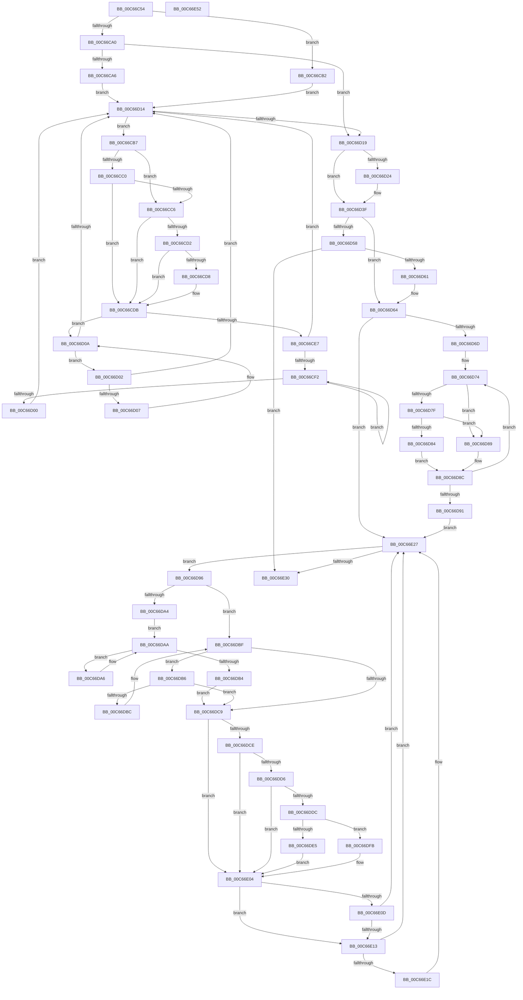

# MiLimitLoaderBlockTotalMemory

- RVA: `0x00C66C54`–`0x00C66E53` (길이 `511` bytes)
- VA: `0x0000000140C66C54`
- 실행 섹션: `INIT`
- PDB 이름 있음: `예`; PDB Function 태그: `아니요`
- unwind 정보 RVA: `0x000D83D8`
- 디코드: `161`개 명령, `511/511` bytes 표시
- 미해석 바이트: `0` (있으면 어셈블리에 `.byte`로 보존)

> 이 문서는 커널 이미지의 기계어와 PDB 기호를 분석해 생성했습니다. 4번과 5번은 함수 원형과 자료형을 바이너리 사용 방식에서 추정한 C 해석이며 원본 소스 복구 결과는 아닙니다.

## 1. Dependencies

- 직접 호출 지점: **2**; 고유 호출 대상: **2**
- 직접 호출자로 확인된 함수: **1**
- RIP 상대 이미지 참조: **0**

### Outgoing calls
- `0x00C66D39` → [KeBugCheckEx](../../text/4F/KeBugCheckEx_function_004FD660.md) (function, `0x004FD660`)
- `0x00C66DEB` → [RtlRbRemoveNode](../../text/2E/RtlRbRemoveNode_function_002E4C10.md) (function, `0x002E4C10`)

### Direct callers
- [MiMemoryLicense](MiMemoryLicense_function_00C66E5C.md) at `0x00C66F6C`

### Static image references
- 디코드된 RIP-relative 메모리 참조가 없습니다.

## 2. Other-region calls and transfers

- 다른 실행 섹션으로 향하는 call: **2**
  - `0x00C66D39` → [KeBugCheckEx](../../text/4F/KeBugCheckEx_function_004FD660.md) (`INIT` → `.text`)
  - `0x00C66DEB` → [RtlRbRemoveNode](../../text/2E/RtlRbRemoveNode_function_002E4C10.md) (`INIT` → `.text`)
- 별도 외부 분기/꼬리 이동을 확인하지 못했습니다.

## 3. Assembly (complete function range)

```asm
00C66C54  48 8B C4                        mov rax, rsp
00C66C57  48 89 58 08                     mov qword ptr [rax + 8], rbx
00C66C5B  48 89 68 10                     mov qword ptr [rax + 0x10], rbp
00C66C5F  48 89 70 18                     mov qword ptr [rax + 0x18], rsi
00C66C63  48 89 78 20                     mov qword ptr [rax + 0x20], rdi
00C66C67  41 54                           push r12
00C66C69  41 55                           push r13
00C66C6B  41 56                           push r14
00C66C6D  48 83 EC 30                     sub rsp, 0x30
00C66C71  4C 8D B1 60 01 00 00            lea r14, [rcx + 0x160]
00C66C78  45 33 C0                        xor r8d, r8d
00C66C7B  49 8B 46 08                     mov rax, qword ptr [r14 + 8]
00C66C7F  45 33 C9                        xor r9d, r9d
00C66C82  4C 8B D8                        mov r11, rax
00C66C85  33 ED                           xor ebp, ebp
00C66C87  4C 8B D2                        mov r10, rdx
00C66C8A  49 BD 48 00 C0 C0 C5 15 00 00   movabs r13, 0x15c5c0c00048
00C66C94  41 BC 34 01 00 01               mov r12d, 0x1000134
00C66C9A  41 83 E3 01                     and r11d, 1
00C66C9E  74 12                           je 0x140c66cb2
00C66CA0  48 83 F8 01                     cmp rax, 1
00C66CA4  74 73                           je 0x140c66d19
00C66CA6  49 8B CE                        mov rcx, r14
00C66CA9  48 83 C9 01                     or rcx, 1
00C66CAD  48 33 C8                        xor rcx, rax
00C66CB0  EB 62                           jmp 0x140c66d14
00C66CB2  48 8B C8                        mov rcx, rax
00C66CB5  EB 5D                           jmp 0x140c66d14
00C66CB7  48 63 51 18                     movsxd rdx, dword ptr [rcx + 0x18]
00C66CBB  83 FA 2C                        cmp edx, 0x2c
00C66CBE  77 06                           ja 0x140c66cc6
00C66CC0  49 0F A3 D5                     bt r13, rdx
00C66CC4  72 15                           jb 0x140c66cdb
00C66CC6  48 8B 41 28                     mov rax, qword ptr [rcx + 0x28]
00C66CCA  4C 03 C0                        add r8, rax
00C66CCD  83 FA 18                        cmp edx, 0x18
00C66CD0  77 09                           ja 0x140c66cdb
00C66CD2  41 0F A3 D4                     bt r12d, edx
00C66CD6  73 03                           jae 0x140c66cdb
00C66CD8  4C 03 C8                        add r9, rax
00C66CDB  48 8B 41 08                     mov rax, qword ptr [rcx + 8]
00C66CDF  48 8B D1                        mov rdx, rcx
00C66CE2  48 85 C0                        test rax, rax
00C66CE5  74 23                           je 0x140c66d0a
00C66CE7  48 8B 10                        mov rdx, qword ptr [rax]
00C66CEA  48 8B C8                        mov rcx, rax
00C66CED  48 85 D2                        test rdx, rdx
00C66CF0  74 22                           je 0x140c66d14
00C66CF2  48 8B 02                        mov rax, qword ptr [rdx]
00C66CF5  48 8B CA                        mov rcx, rdx
00C66CF8  48 8B D0                        mov rdx, rax
00C66CFB  48 85 C0                        test rax, rax
00C66CFE  75 F2                           jne 0x140c66cf2
00C66D00  EB 12                           jmp 0x140c66d14
00C66D02  48 39 11                        cmp qword ptr [rcx], rdx
00C66D05  74 0D                           je 0x140c66d14
00C66D07  48 8B D1                        mov rdx, rcx
00C66D0A  48 8B 49 10                     mov rcx, qword ptr [rcx + 0x10]
00C66D0E  48 83 E1 FC                     and rcx, 0xfffffffffffffffc
00C66D12  75 EE                           jne 0x140c66d02
00C66D14  48 85 C9                        test rcx, rcx
00C66D17  75 9E                           jne 0x140c66cb7
00C66D19  49 8B C0                        mov rax, r8
00C66D1C  49 2B C1                        sub rax, r9
00C66D1F  49 3B C2                        cmp rax, r10
00C66D22  76 1B                           jbe 0x140c66d3f
00C66D24  4C 89 4C 24 20                  mov qword ptr [rsp + 0x20], r9
00C66D29  BA 10 03 03 03                  mov edx, 0x3030310
00C66D2E  4D 8B C8                        mov r9, r8
00C66D31  B9 1A 00 00 00                  mov ecx, 0x1a
00C66D36  4D 8B C2                        mov r8, r10
00C66D39  E8 22 69 89 FF                  call 0x1404fd660
00C66D3E  CC                              int3
00C66D3F  49 8B C0                        mov rax, r8
00C66D42  49 2B C2                        sub rax, r10
00C66D45  4D 3B D0                        cmp r10, r8
00C66D48  48 1B F6                        sbb rsi, rsi
00C66D4B  33 DB                           xor ebx, ebx
00C66D4D  48 23 F0                        and rsi, rax
00C66D50  49 8B 06                        mov rax, qword ptr [r14]
00C66D53  4D 85 DB                        test r11, r11
00C66D56  74 0C                           je 0x140c66d64
00C66D58  48 85 C0                        test rax, rax
00C66D5B  0F 84 CF 00 00 00               je 0x140c66e30
00C66D61  49 33 C6                        xor rax, r14
00C66D64  48 85 C0                        test rax, rax
00C66D67  0F 84 BA 00 00 00               je 0x140c66e27
00C66D6D  41 8A 56 08                     mov dl, byte ptr [r14 + 8]
00C66D71  80 E2 01                        and dl, 1
00C66D74  48 8B 48 08                     mov rcx, qword ptr [rax + 8]
00C66D78  48 8B D8                        mov rbx, rax
00C66D7B  84 D2                           test dl, dl
00C66D7D  74 0A                           je 0x140c66d89
00C66D7F  48 85 C9                        test rcx, rcx
00C66D82  74 05                           je 0x140c66d89
00C66D84  48 33 C1                        xor rax, rcx
00C66D87  EB 03                           jmp 0x140c66d8c
00C66D89  48 8B C1                        mov rax, rcx
00C66D8C  48 85 C0                        test rax, rax
00C66D8F  75 E3                           jne 0x140c66d74
00C66D91  E9 91 00 00 00                  jmp 0x140c66e27
00C66D96  48 8B 03                        mov rax, qword ptr [rbx]
00C66D99  48 8B FB                        mov rdi, rbx
00C66D9C  48 8B CB                        mov rcx, rbx
00C66D9F  48 85 C0                        test rax, rax
00C66DA2  74 1B                           je 0x140c66dbf
00C66DA4  EB 04                           jmp 0x140c66daa
00C66DA6  48 8B 43 08                     mov rax, qword ptr [rbx + 8]
00C66DAA  48 83 78 08 00                  cmp qword ptr [rax + 8], 0
00C66DAF  48 8B D8                        mov rbx, rax
00C66DB2  75 F2                           jne 0x140c66da6
00C66DB4  EB 13                           jmp 0x140c66dc9
00C66DB6  48 39 4B 08                     cmp qword ptr [rbx + 8], rcx
00C66DBA  74 0D                           je 0x140c66dc9
00C66DBC  48 8B CB                        mov rcx, rbx
00C66DBF  48 8B 5B 10                     mov rbx, qword ptr [rbx + 0x10]
00C66DC3  48 83 E3 FC                     and rbx, 0xfffffffffffffffc
00C66DC7  75 ED                           jne 0x140c66db6
00C66DC9  48 85 F6                        test rsi, rsi
00C66DCC  74 36                           je 0x140c66e04
00C66DCE  8B 47 18                        mov eax, dword ptr [rdi + 0x18]
00C66DD1  83 F8 18                        cmp eax, 0x18
00C66DD4  77 2E                           ja 0x140c66e04
00C66DD6  41 0F A3 C4                     bt r12d, eax
00C66DDA  73 28                           jae 0x140c66e04
00C66DDC  48 8B 47 28                     mov rax, qword ptr [rdi + 0x28]
00C66DE0  48 3B C6                        cmp rax, rsi
00C66DE3  77 16                           ja 0x140c66dfb
00C66DE5  48 8B D7                        mov rdx, rdi
00C66DE8  49 8B CE                        mov rcx, r14
00C66DEB  E8 20 DE 67 FF                  call 0x1402e4c10
00C66DF0  48 2B 77 28                     sub rsi, qword ptr [rdi + 0x28]
00C66DF4  48 83 67 28 00                  and qword ptr [rdi + 0x28], 0
00C66DF9  EB 09                           jmp 0x140c66e04
00C66DFB  48 2B C6                        sub rax, rsi
00C66DFE  48 89 47 28                     mov qword ptr [rdi + 0x28], rax
00C66E02  33 F6                           xor esi, esi
00C66E04  48 63 47 18                     movsxd rax, dword ptr [rdi + 0x18]
00C66E08  83 F8 2C                        cmp eax, 0x2c
00C66E0B  77 06                           ja 0x140c66e13
00C66E0D  49 0F A3 C5                     bt r13, rax
00C66E11  72 14                           jb 0x140c66e27
00C66E13  48 8B 57 28                     mov rdx, qword ptr [rdi + 0x28]
00C66E17  48 85 D2                        test rdx, rdx
00C66E1A  74 0B                           je 0x140c66e27
00C66E1C  48 03 57 20                     add rdx, qword ptr [rdi + 0x20]
00C66E20  48 3B D5                        cmp rdx, rbp
00C66E23  48 0F 47 EA                     cmova rbp, rdx
00C66E27  48 85 DB                        test rbx, rbx
00C66E2A  0F 85 66 FF FF FF               jne 0x140c66d96
00C66E30  48 8B 5C 24 50                  mov rbx, qword ptr [rsp + 0x50]
00C66E35  48 8B C5                        mov rax, rbp
00C66E38  48 8B 6C 24 58                  mov rbp, qword ptr [rsp + 0x58]
00C66E3D  48 8B 74 24 60                  mov rsi, qword ptr [rsp + 0x60]
00C66E42  48 8B 7C 24 68                  mov rdi, qword ptr [rsp + 0x68]
00C66E47  48 83 C4 30                     add rsp, 0x30
00C66E4B  41 5E                           pop r14
00C66E4D  41 5D                           pop r13
00C66E4F  41 5C                           pop r12
00C66E51  C3                              ret
00C66E52  CC                              int3
```

## 4. C-style interpretation (structured pseudocode)

```c
__int64 __fastcall MiLimitLoaderBlockTotalMemory(__int64 a1, __int64 a2, int a3, int a4)
{
    __int64 result;
    __int64 v_r11;
    __int64 v_rbp;
    __int64 v_rbx;
    __int64 v_rsi;
    __int64 v_rsp;
    unsigned __int64 v_stack_m28;
    unsigned __int64 v_stack_p10;
    unsigned __int64 v_stack_p18;
    unsigned __int64 v_stack_p20;
    unsigned __int64 v_stack_p8;

    *(unsigned __int64 *)(v_rsp + 8) = v_rbx;
    *(unsigned __int64 *)(v_rsp + 16) = v_rbp;
    *(unsigned __int64 *)(v_rsp + 24) = v_rsi;
    *(unsigned __int64 *)(v_rsp + 32) = v_rdi;
    v_rsp = (v_rsp) - (48);
    a3 = 0;
    a4 = 0;
    v_rbp = 0;
    v_r11 = (unsigned int)((*(unsigned __int64 *)(a1 + 352 + 8)) & (1));
    if (condition_is_equal) goto loc_00C66CB2;
    if ((*(unsigned __int64 *)(a1 + 352 + 8)) == 1) goto loc_00C66D19;
    a1 = (a1 + 352) | (1);
    a1 = (a1) ^ (*(unsigned __int64 *)(a1 + 352 + 8));
    goto loc_00C66D14;
loc_00C66CB2:
    goto loc_00C66D14;
loc_00C66CB7:
    if (((unsigned int)((int)(*(unsigned int *)(*(unsigned __int64 *)(a1 + 352 + 8) + 24)))) > 44) goto loc_00C66CC6;
    if (((unsigned int)((int)(*(unsigned int *)(*(unsigned __int64 *)(a1 + 352 + 8) + 24)))) < 44) goto loc_00C66CDB;
loc_00C66CC6:
    a3 = (a3) + (*(unsigned __int64 *)(*(unsigned __int64 *)(a1 + 352 + 8) + 40));
    if (((unsigned int)((int)(*(unsigned int *)(*(unsigned __int64 *)(a1 + 352 + 8) + 24)))) > 24) goto loc_00C66CDB;
    if (((unsigned int)((int)(*(unsigned int *)(*(unsigned __int64 *)(a1 + 352 + 8) + 24)))) < 24) {
        a4 = (a4) + (*(unsigned __int64 *)(*(unsigned __int64 *)(a1 + 352 + 8) + 40));
    }
    if (*(unsigned __int64 *)(*(unsigned __int64 *)(a1 + 352 + 8) + 8) == 0) goto loc_00C66D0A;
    if (*(unsigned __int64 *)(*(unsigned __int64 *)(*(unsigned __int64 *)(a1 + 352 + 8) + 8)) == 0) goto loc_00C66D14;
loc_00C66CF2:
    if (*(unsigned __int64 *)(*(unsigned __int64 *)(*(unsigned __int64 *)(*(unsigned __int64 *)(a1 + 352 + 8) + 8))) != 0) goto loc_00C66CF2;
    goto loc_00C66D14;
loc_00C66D02:
    if ((*(unsigned __int64 *)(*(unsigned __int64 *)(*(unsigned __int64 *)(*(unsigned __int64 *)(a1 + 352 + 8) + 8)))) == (*(unsigned __int64 *)(*(unsigned __int64 *)(*(unsigned __int64 *)(*(unsigned __int64 *)(a1 + 352 + 8) + 8))))) goto loc_00C66D14;
loc_00C66D0A:
    a1 = (*(unsigned __int64 *)(*(unsigned __int64 *)(*(unsigned __int64 *)(*(unsigned __int64 *)(a1 + 352 + 8) + 8)) + 16)) & (-4);
    if (condition_is_not_equal) goto loc_00C66D02;
loc_00C66D14:
    if (a1 != 0) goto loc_00C66CB7;
loc_00C66D19:
    result = (a3) - (a4);
    if (result >= = a2) {
        v_stack_m28 = a4;
        a2 = 0x3030310ULL;
        a4 = a3;
        a1 = 26;
        a3 = a2;
        result = KeBugCheckEx(a1, a2, a3, a4);
    }
    result = (a3) - (a2);
    v_rbx = 0;
    v_rsi = (v_rsi) & (result);
    if (v_r11 == 0) goto loc_00C66D64;
    if (*(unsigned __int64 *)(a1 + 352) == 0) goto loc_00C66E30;
    result = (*(unsigned __int64 *)(a1 + 352)) ^ (a1 + 352);
loc_00C66D64:
    if (result == 0) goto loc_00C66E27;
    a2 = (unsigned __int8)((*(unsigned __int8 *)(a1 + 352 + 8)) & (1));
loc_00C66D74:
    if ((unsigned __int8)(a2) == 0) goto loc_00C66D89;
    if (*(unsigned __int64 *)(result + 8) == 0) goto loc_00C66D89;
    result = (result) ^ (*(unsigned __int64 *)(result + 8));
    goto loc_00C66D8C;
loc_00C66D89:
loc_00C66D8C:
    if (*(unsigned __int64 *)(result + 8) != 0) goto loc_00C66D74;
    goto loc_00C66E27;
loc_00C66D96:
    if (*(unsigned __int64 *)(result) == 0) goto loc_00C66DBF;
    goto loc_00C66DAA;
loc_00C66DA6:
loc_00C66DAA:
    if ((*(unsigned __int64 *)(*(unsigned __int64 *)(result + 8) + 8)) != 0) goto loc_00C66DA6;
    goto loc_00C66DC9;
loc_00C66DB6:
    if ((*(unsigned __int64 *)(*(unsigned __int64 *)(result + 8) + 8)) == result) goto loc_00C66DC9;
loc_00C66DBF:
    v_rbx = (*(unsigned __int64 *)(*(unsigned __int64 *)(result + 8) + 16)) & (-4);
    if (condition_is_not_equal) goto loc_00C66DB6;
loc_00C66DC9:
    if (v_rsi == 0) goto loc_00C66E04;
    if (((unsigned int)((unsigned int)(*(unsigned int *)(result + 24)))) > 24) goto loc_00C66E04;
    if (((unsigned int)((unsigned int)(*(unsigned int *)(result + 24)))) >= 24) goto loc_00C66E04;
    if ((*(unsigned __int64 *)(result + 40)) > v_rsi) goto loc_00C66DFB;
    result = RtlRbRemoveNode(a1 + 352, result, a3, a4);
    v_rsi = (v_rsi) - (*(unsigned __int64 *)(result + 40));
    goto loc_00C66E04;
loc_00C66DFB:
    result = (result) - (v_rsi);
    *(unsigned __int64 *)(result + 40) = result;
    v_rsi = 0;
loc_00C66E04:
    if (((unsigned int)((int)(*(unsigned int *)(result + 24)))) > 44) goto loc_00C66E13;
    if (((unsigned int)((int)(*(unsigned int *)(result + 24)))) < 44) goto loc_00C66E27;
loc_00C66E13:
    if (*(unsigned __int64 *)(result + 40) != 0) {
        a2 = (*(unsigned __int64 *)(result + 40)) + (*(unsigned __int64 *)(result + 32));
        if (a2 > 0) { v_rbp = a2; }
    }
    if (v_rbx != 0) goto loc_00C66D96;
loc_00C66E30:
    v_rsp = (v_rsp) + (48);
    return v_rbp;
}
```

## 5. (Beta) C Style

```c
int64_t MiLimitLoaderBlockTotalMemory(void *Arg1, int64_t Arg2, int32_t Arg3, int32_t Arg4)
{
    uint8_t *arg1 = (uint8_t *)Arg1;

    int64_t result;
    int64_t local_r11;
    int64_t local_rbp;
    int64_t local_rbx;
    int64_t local_rsi;
    int64_t local_rsp;
    uint64_t v_stack_m28;
    uint64_t v_stack_p10;
    uint64_t v_stack_p18;
    uint64_t v_stack_p20;
    uint64_t v_stack_p8;

    *(uint64_t *)(local_rsp + 0x8) = local_rbx;
    *(uint64_t *)(local_rsp + 0x10) = local_rbp;
    *(uint64_t *)(local_rsp + 0x18) = local_rsi;
    *(uint64_t *)(local_rsp + 0x20) = local_rdi;
    local_rsp = (local_rsp) - (48);
    Arg3 = 0;
    Arg4 = 0;
    local_rbp = 0;
    local_r11 = (uint32_t)((*(uint64_t *)(arg1 + 0x160 + 0x8)) & (1));
    if (condition_is_equal) goto loc_00C66CB2;
    if ((*(uint64_t *)(arg1 + 0x160 + 0x8)) == 1) goto loc_00C66D19;
    Arg1 = (Arg1 + 352) | (1);
    Arg1 = (Arg1) ^ (*(uint64_t *)(arg1 + 0x160 + 0x8));
    goto loc_00C66D14;
loc_00C66CB2:
    goto loc_00C66D14;
loc_00C66CB7:
    if (((uint32_t)((int32_t)(*(uint32_t *)(*(uint64_t *)(arg1 + 0x160 + 0x8) + 0x18)))) > 44) goto loc_00C66CC6;
    if (((uint32_t)((int32_t)(*(uint32_t *)(*(uint64_t *)(arg1 + 0x160 + 0x8) + 0x18)))) < 44) goto loc_00C66CDB;
loc_00C66CC6:
    Arg3 = (Arg3) + (*(uint64_t *)(*(uint64_t *)(arg1 + 0x160 + 0x8) + 0x28));
    if (((uint32_t)((int32_t)(*(uint32_t *)(*(uint64_t *)(arg1 + 0x160 + 0x8) + 0x18)))) > 24) goto loc_00C66CDB;
    if (((uint32_t)((int32_t)(*(uint32_t *)(*(uint64_t *)(arg1 + 0x160 + 0x8) + 0x18)))) < 24) {
        Arg4 = (Arg4) + (*(uint64_t *)(*(uint64_t *)(arg1 + 0x160 + 0x8) + 0x28));
    }
    if (*(uint64_t *)(*(uint64_t *)(arg1 + 0x160 + 0x8) + 0x8) == 0) goto loc_00C66D0A;
    if (*(uint64_t *)(*(uint64_t *)(*(uint64_t *)(arg1 + 0x160 + 0x8) + 0x8)) == 0) goto loc_00C66D14;
loc_00C66CF2:
    if (*(uint64_t *)(*(uint64_t *)(*(uint64_t *)(*(uint64_t *)(arg1 + 0x160 + 0x8) + 0x8))) != 0) goto loc_00C66CF2;
    goto loc_00C66D14;
loc_00C66D02:
    if ((*(uint64_t *)(*(uint64_t *)(*(uint64_t *)(*(uint64_t *)(arg1 + 0x160 + 0x8) + 0x8)))) == (*(uint64_t *)(*(uint64_t *)(*(uint64_t *)(*(uint64_t *)(arg1 + 0x160 + 0x8) + 0x8))))) goto loc_00C66D14;
loc_00C66D0A:
    Arg1 = (*(uint64_t *)(*(uint64_t *)(*(uint64_t *)(*(uint64_t *)(arg1 + 0x160 + 0x8) + 0x8)) + 0x10)) & (-4);
    if (condition_is_not_equal) goto loc_00C66D02;
loc_00C66D14:
    if (Arg1 != NULL) goto loc_00C66CB7;
loc_00C66D19:
    result = (Arg3) - (Arg4);
    if (result >= = Arg2) {
        v_stack_m28 = Arg4;
        Arg2 = 0x3030310ULL;
        Arg4 = Arg3;
        Arg1 = 26;
        Arg3 = Arg2;
        result = KeBugCheckEx(Arg1, Arg2, Arg3, Arg4);
    }
    result = (Arg3) - (Arg2);
    local_rbx = 0;
    local_rsi = (local_rsi) & (result);
    if (local_r11 == 0) goto loc_00C66D64;
    if (*(uint64_t *)(arg1 + 0x160) == 0) goto loc_00C66E30;
    result = (*(uint64_t *)(arg1 + 0x160)) ^ (Arg1 + 352);
loc_00C66D64:
    if (result == 0) goto loc_00C66E27;
    Arg2 = (uint8_t)((*(uint8_t *)(arg1 + 0x160 + 0x8)) & (1));
loc_00C66D74:
    if ((uint8_t)(Arg2) == 0) goto loc_00C66D89;
    if (*(uint64_t *)(result + 0x8) == 0) goto loc_00C66D89;
    result = (result) ^ (*(uint64_t *)(result + 0x8));
    goto loc_00C66D8C;
loc_00C66D89:
loc_00C66D8C:
    if (*(uint64_t *)(result + 0x8) != 0) goto loc_00C66D74;
    goto loc_00C66E27;
loc_00C66D96:
    if (*(uint64_t *)(result) == 0) goto loc_00C66DBF;
    goto loc_00C66DAA;
loc_00C66DA6:
loc_00C66DAA:
    if ((*(uint64_t *)(*(uint64_t *)(result + 0x8) + 0x8)) != 0) goto loc_00C66DA6;
    goto loc_00C66DC9;
loc_00C66DB6:
    if ((*(uint64_t *)(*(uint64_t *)(result + 0x8) + 0x8)) == result) goto loc_00C66DC9;
loc_00C66DBF:
    local_rbx = (*(uint64_t *)(*(uint64_t *)(result + 0x8) + 0x10)) & (-4);
    if (condition_is_not_equal) goto loc_00C66DB6;
loc_00C66DC9:
    if (local_rsi == 0) goto loc_00C66E04;
    if (((uint32_t)((uint32_t)(*(uint32_t *)(result + 0x18)))) > 24) goto loc_00C66E04;
    if (((uint32_t)((uint32_t)(*(uint32_t *)(result + 0x18)))) >= 24) goto loc_00C66E04;
    if ((*(uint64_t *)(result + 0x28)) > local_rsi) goto loc_00C66DFB;
    result = RtlRbRemoveNode(Arg1 + 352, result, Arg3, Arg4);
    local_rsi = (local_rsi) - (*(uint64_t *)(result + 0x28));
    goto loc_00C66E04;
loc_00C66DFB:
    result = (result) - (local_rsi);
    *(uint64_t *)(result + 0x28) = result;
    local_rsi = 0;
loc_00C66E04:
    if (((uint32_t)((int32_t)(*(uint32_t *)(result + 0x18)))) > 44) goto loc_00C66E13;
    if (((uint32_t)((int32_t)(*(uint32_t *)(result + 0x18)))) < 44) goto loc_00C66E27;
loc_00C66E13:
    if (*(uint64_t *)(result + 0x28) != 0) {
        Arg2 = (*(uint64_t *)(result + 0x28)) + (*(uint64_t *)(result + 0x20));
        if (Arg2 > 0) { local_rbp = Arg2; }
    }
    if (local_rbx != 0) goto loc_00C66D96;
loc_00C66E30:
    local_rsp = (local_rsp) + (48);
    return local_rbp;
}
```

### 관측된 메모리 오프셋

구조체 형식이 확인되지 않은 접근은 인자 기준의 오프셋으로만 기록했습니다.

| 기준 인자 | 오프셋 표현 | 폭 (bit) | 접근 |
|---|---:|---:|---|
| `Arg1` | `+ 0x0` | `64` | `R` |
| `Arg1` | `+ 0x8` | `8` | `R` |
| `Arg1` | `+ 0x8` | `64` | `R` |
| `Arg1` | `+ 0x160` | `64` | `R` |

## 6. Execution-region graph

[열기: 2D/3D 그래프와 함수 탐색 컨트롤 패널](../../../control-panel.html?section=init&rva=0x00C66C54&view=graph)

- 2D 그래프는 위에서 아래로 흐르고, 3D 그래프는 빈 공간을 드래그해 회전합니다. Shift+드래그는 이동, 휠은 확대·축소, 함수 노드 선택은 대상 보고서 이동입니다.

### Static fallback


