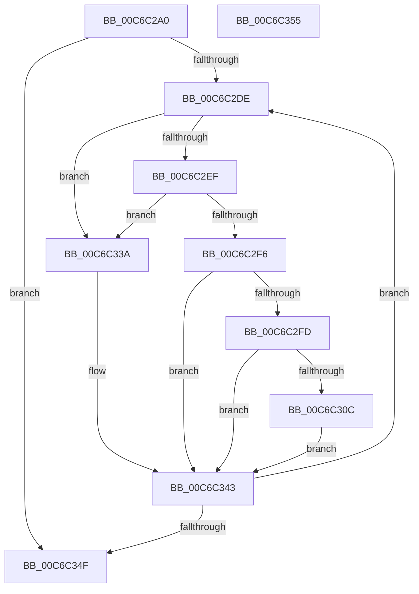

# MiLocateKernelSections

- RVA: `0x00C6C2A0`–`0x00C6C356` (길이 `182` bytes)
- VA: `0x0000000140C6C2A0`
- 실행 섹션: `INIT`
- PDB 이름 있음: `예`; PDB Function 태그: `아니요`
- unwind 정보 RVA: `0x0005CF00`
- 디코드: `48`개 명령, `182/182` bytes 표시
- 미해석 바이트: `0` (있으면 어셈블리에 `.byte`로 보존)

> 이 문서는 커널 이미지의 기계어와 PDB 기호를 분석해 생성했습니다. 4번과 5번은 함수 원형과 자료형을 바이너리 사용 방식에서 추정한 C 해석이며 원본 소스 복구 결과는 아닙니다.

## 1. Dependencies

- 직접 호출 지점: **1**; 고유 호출 대상: **1**
- 직접 호출자로 확인된 함수: **1**
- RIP 상대 이미지 참조: **3**

### Outgoing calls
- `0x00C6C2BF` → [RtlImageNtHeaderEx](../../text/41/RtlImageNtHeaderEx_function_0041EAA0.md) (function, `0x0041EAA0`)

### Direct callers
- [MiInitializeLoadedModuleList](MiInitializeLoadedModuleList_function_00C6BCDC.md) at `0x00C6BD9C`

### Static image references
- `0x00C6C30C` → RVA `0x00EF5498` (`.data`; write)
- `0x00C6C331` → RVA `0x00EF54A0` (`.data`; write)
- `0x00C6C33A` → RVA `0x00FC6A88` (`ALMOSTRO`; read/write)

## 2. Other-region calls and transfers

- 다른 실행 섹션으로 향하는 call: **1**
  - `0x00C6C2BF` → [RtlImageNtHeaderEx](../../text/41/RtlImageNtHeaderEx_function_0041EAA0.md) (`INIT` → `.text`)
- 별도 외부 분기/꼬리 이동을 확인하지 못했습니다.

## 3. Assembly (complete function range)

```asm
00C6C2A0  40 53                           push rbx
00C6C2A2  48 83 EC 20                     sub rsp, 0x20
00C6C2A6  48 8B 59 30                     mov rbx, qword ptr [rcx + 0x30]
00C6C2AA  4C 8D 4C 24 30                  lea r9, [rsp + 0x30]
00C6C2AF  48 83 64 24 30 00               and qword ptr [rsp + 0x30], 0
00C6C2B5  45 33 C0                        xor r8d, r8d
00C6C2B8  48 8B D3                        mov rdx, rbx
00C6C2BB  41 8D 48 01                     lea ecx, [r8 + 1]
00C6C2BF  E8 DC 27 7B FF                  call 0x14041eaa0
00C6C2C4  48 8B 4C 24 30                  mov rcx, qword ptr [rsp + 0x30]
00C6C2C9  0F B7 41 14                     movzx eax, word ptr [rcx + 0x14]
00C6C2CD  48 8D 51 18                     lea rdx, [rcx + 0x18]
00C6C2D1  44 0F B7 41 06                  movzx r8d, word ptr [rcx + 6]
00C6C2D6  48 03 D0                        add rdx, rax
00C6C2D9  45 85 C0                        test r8d, r8d
00C6C2DC  74 71                           je 0x140c6c34f
00C6C2DE  8B 02                           mov eax, dword ptr [rdx]
00C6C2E0  44 8B 4A 10                     mov r9d, dword ptr [rdx + 0x10]
00C6C2E4  44 8B 52 08                     mov r10d, dword ptr [rdx + 8]
00C6C2E8  3D 2E 63 6F 76                  cmp eax, 0x766f632e
00C6C2ED  74 4B                           je 0x140c6c33a
00C6C2EF  3D 2E 69 72 74                  cmp eax, 0x7472692e
00C6C2F4  74 44                           je 0x140c6c33a
00C6C2F6  3D 50 4F 4F 4C                  cmp eax, 0x4c4f4f50
00C6C2FB  75 46                           jne 0x140c6c343
00C6C2FD  8B 4A 0C                        mov ecx, dword ptr [rdx + 0xc]
00C6C300  48 03 CB                        add rcx, rbx
00C6C303  81 7A 04 43 4F 44 45            cmp dword ptr [rdx + 4], 0x45444f43
00C6C30A  75 37                           jne 0x140c6c343
00C6C30C  48 89 0D 85 91 28 00            mov qword ptr [rip + 0x289185], rcx
00C6C313  45 3B CA                        cmp r9d, r10d
00C6C316  45 0F 42 CA                     cmovb r9d, r10d
00C6C31A  48 81 C1 FF 0F 00 00            add rcx, 0xfff
00C6C321  41 8B C1                        mov eax, r9d
00C6C324  48 03 C8                        add rcx, rax
00C6C327  48 81 E1 00 F0 FF FF            and rcx, 0xfffffffffffff000
00C6C32E  48 FF C9                        dec rcx
00C6C331  48 89 0D 68 91 28 00            mov qword ptr [rip + 0x289168], rcx
00C6C338  EB 09                           jmp 0x140c6c343
00C6C33A  48 0F BA 2D 45 A7 35 00 0A      bts qword ptr [rip + 0x35a745], 0xa
00C6C343  41 FF C8                        dec r8d
00C6C346  48 83 C2 28                     add rdx, 0x28
00C6C34A  45 85 C0                        test r8d, r8d
00C6C34D  7F 8F                           jg 0x140c6c2de
00C6C34F  48 83 C4 20                     add rsp, 0x20
00C6C353  5B                              pop rbx
00C6C354  C3                              ret
00C6C355  CC                              int3
```

## 4. C-style interpretation (structured pseudocode)

```c
__int64 __fastcall MiLocateKernelSections(__int64 a1, __int64 a2, int a3)
{
    __int64 result;
    __int64 v_rsp;
    unsigned __int64 v_stack_p8;

    v_rsp = (v_rsp) - (32);
    a3 = 0;
    result = RtlImageNtHeaderEx(a3 + 1, *(unsigned __int64 *)(a1 + 48), a3, v_stack_p8);
    a2 = (v_stack_p8 + 24) + (*(unsigned __int16 *)(v_stack_p8 + 20));
    if ((unsigned int)(*(unsigned __int16 *)(v_stack_p8 + 6)) == 0) goto loc_00C6C34F;
loc_00C6C2DE:
    if (((unsigned int)((unsigned int)(*(unsigned int *)(a2)))) == 0x766F632EULL) goto loc_00C6C33A;
    if (((unsigned int)((unsigned int)(*(unsigned int *)(a2)))) == 0x7472692EULL) goto loc_00C6C33A;
    if (((unsigned int)((unsigned int)(*(unsigned int *)(a2)))) != 0x4C4F4F50ULL) goto loc_00C6C343;
    a1 = ((unsigned int)(*(unsigned int *)(a2 + 12))) + (*(unsigned __int64 *)(a1 + 48));
    if ((*(unsigned int *)(a2 + 4)) != 0x45444F43ULL) goto loc_00C6C343;
    *(unsigned __int64 *)(v_rip + 2658693) = a1;
    a4 = (unsigned int)(*(unsigned int *)(a2 + 16));
    if (((unsigned int)((unsigned int)(*(unsigned int *)(a2 + 16)))) < ((unsigned int)((unsigned int)(*(unsigned int *)(a2 + 8))))) { a4 = (unsigned int)((unsigned int)(*(unsigned int *)(a2 + 8))); }
    a1 = (a1) + (0xFFFULL);
    a1 = (a1) + ((unsigned int)((unsigned int)(a4)));
    a1 = (a1) & (0xFFFFFFFFFFFFF000ULL);
    a1 = (a1) - 1;
    *(unsigned __int64 *)(v_rip + 2658664) = a1;
    goto loc_00C6C343;
loc_00C6C33A:
loc_00C6C343:
    a3 = (unsigned int)((*(unsigned __int16 *)(v_stack_p8 + 6)) - 1);
    a2 = (a2) + (40);
    if (condition_is_greater) goto loc_00C6C2DE;
loc_00C6C34F:
    v_rsp = (v_rsp) + (32);
    return (unsigned int)((unsigned int)(a4));
}
```

## 5. (Beta) C Style

```c
int64_t MiLocateKernelSections(void *Arg1, int64_t Arg2, int32_t Arg3)
{
    uint8_t *arg1 = (uint8_t *)Arg1;

    int64_t result;
    int64_t local_rsp;
    uint64_t v_stack_p8;

    local_rsp = (local_rsp) - (32);
    Arg3 = 0;
    result = RtlImageNtHeaderEx(Arg3 + 1, *(uint64_t *)(arg1 + 0x30), Arg3, v_stack_p8);
    Arg2 = (v_stack_p8 + 24) + (*(uint16_t *)(v_stack_p8 + 0x14));
    if ((uint32_t)(*(uint16_t *)(v_stack_p8 + 0x6)) == 0) goto loc_00C6C34F;
loc_00C6C2DE:
    if (((uint32_t)((uint32_t)(*(uint32_t *)(Arg2)))) == 0x766F632EULL) goto loc_00C6C33A;
    if (((uint32_t)((uint32_t)(*(uint32_t *)(Arg2)))) == 0x7472692EULL) goto loc_00C6C33A;
    if (((uint32_t)((uint32_t)(*(uint32_t *)(Arg2)))) != 0x4C4F4F50ULL) goto loc_00C6C343;
    Arg1 = ((uint32_t)(*(uint32_t *)(Arg2 + 0xC))) + (*(uint64_t *)(arg1 + 0x30));
    if ((*(uint32_t *)(Arg2 + 0x4)) != 0x45444F43ULL) goto loc_00C6C343;
    *(void **)(v_rip + 0x289185) = Arg1;
    a4 = (uint32_t)(*(uint32_t *)(Arg2 + 0x10));
    if (((uint32_t)((uint32_t)(*(uint32_t *)(Arg2 + 0x10)))) < ((uint32_t)((uint32_t)(*(uint32_t *)(Arg2 + 0x8))))) { a4 = (uint32_t)((uint32_t)(*(uint32_t *)(Arg2 + 0x8))); }
    Arg1 = (Arg1) + (0xFFFULL);
    Arg1 = (Arg1) + ((uint32_t)((uint32_t)(a4)));
    Arg1 = (Arg1) & (0xFFFFFFFFFFFFF000ULL);
    Arg1 = (Arg1) - 1;
    *(void **)(v_rip + 0x289168) = Arg1;
    goto loc_00C6C343;
loc_00C6C33A:
loc_00C6C343:
    Arg3 = (uint32_t)((*(uint16_t *)(v_stack_p8 + 0x6)) - 1);
    Arg2 = (Arg2) + (40);
    if (condition_is_greater) goto loc_00C6C2DE;
loc_00C6C34F:
    local_rsp = (local_rsp) + (32);
    return (uint32_t)((uint32_t)(a4));
}
```

### 관측된 메모리 오프셋

구조체 형식이 확인되지 않은 접근은 인자 기준의 오프셋으로만 기록했습니다.

| 기준 인자 | 오프셋 표현 | 폭 (bit) | 접근 |
|---|---:|---:|---|
| `Arg1` | `+ 0x30` | `64` | `R` |

## 6. Execution-region graph

[열기: 2D/3D 그래프와 함수 탐색 컨트롤 패널](../../../control-panel.html?section=init&rva=0x00C6C2A0&view=graph)

- 2D 그래프는 위에서 아래로 흐르고, 3D 그래프는 빈 공간을 드래그해 회전합니다. Shift+드래그는 이동, 휠은 확대·축소, 함수 노드 선택은 대상 보고서 이동입니다.

### Static fallback


