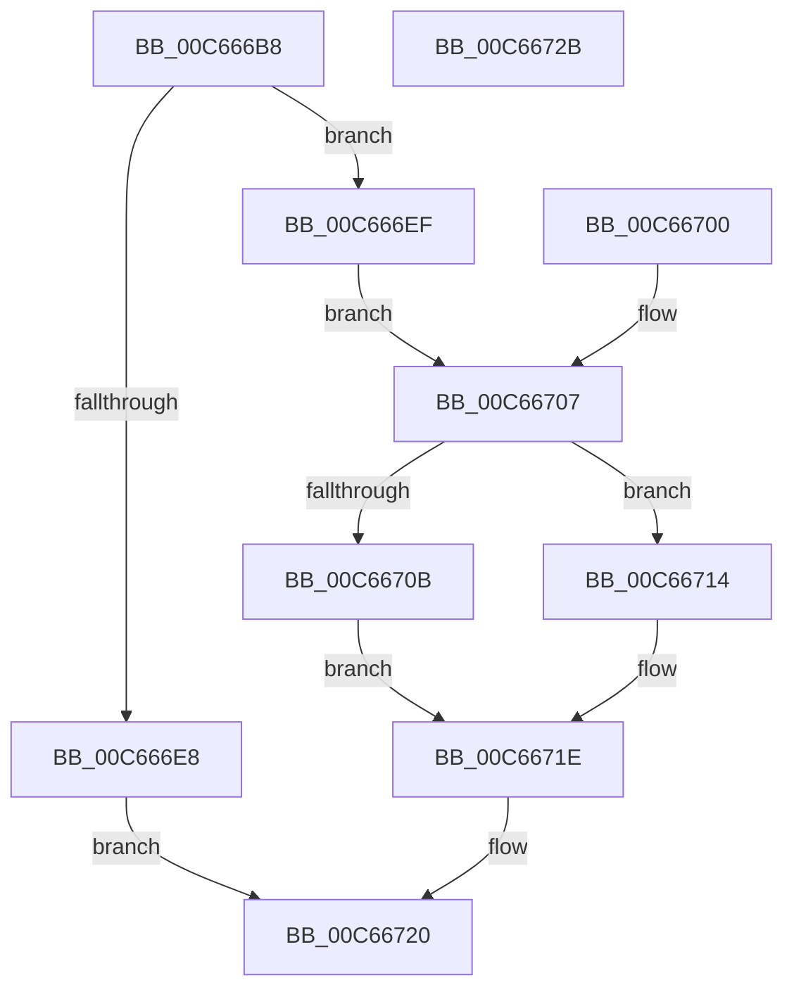

# MiLockKernelScpSection

- RVA: `0x00C666B8`–`0x00C6672C` (길이 `116` bytes)
- VA: `0x0000000140C666B8`
- 실행 섹션: `INIT`
- PDB 이름 있음: `예`; PDB Function 태그: `아니요`
- unwind 정보 RVA: `0x000D8330`
- 디코드: `35`개 명령, `116/116` bytes 표시
- 미해석 바이트: `0` (있으면 어셈블리에 `.byte`로 보존)

> 이 문서는 커널 이미지의 기계어와 PDB 기호를 분석해 생성했습니다. 4번과 5번은 함수 원형과 자료형을 바이너리 사용 방식에서 추정한 C 해석이며 원본 소스 복구 결과는 아닙니다.

## 1. Dependencies

- 직접 호출 지점: **3**; 고유 호출 대상: **3**
- 직접 호출자로 확인된 함수: **1**
- RIP 상대 이미지 참조: **3**

### Outgoing calls
- `0x00C666D6` → [MmCreateMdl](../../text/46/MmCreateMdl_function_00463E20.md) (function, `0x00463E20`)
- `0x00C666F9` → [MmProbeAndLockPages](../../text/23/MmProbeAndLockPages_function_0023B990.md) (function, `0x0023B990`)
- `0x00C66719` → [ExFreePoolWithTag](../../poolcode/B8/ExFreePoolWithTag_function_00B82870.md) (function, `0x00B82870`)

### Direct callers
- [MiInitializeKernelScp](MiInitializeKernelScp_function_00C664B8.md) at `0x00C664C1`

### Static image references
- `0x00C666C2` → RVA `0x00E2D830` (`.data`; read)
- `0x00C666C9` → RVA `0x00E2D83C` (`.data`; read)
- `0x00C6670B` → RVA `0x00E2D840` (`.data`; write)

## 2. Other-region calls and transfers

- 다른 실행 섹션으로 향하는 call: **3**
  - `0x00C666D6` → [MmCreateMdl](../../text/46/MmCreateMdl_function_00463E20.md) (`INIT` → `.text`)
  - `0x00C666F9` → [MmProbeAndLockPages](../../text/23/MmProbeAndLockPages_function_0023B990.md) (`INIT` → `.text`)
  - `0x00C66719` → [ExFreePoolWithTag](../../poolcode/B8/ExFreePoolWithTag_function_00B82870.md) (`INIT` → `POOLCODE`)
- 별도 외부 분기/꼬리 이동을 확인하지 못했습니다.

## 3. Assembly (complete function range)

```asm
00C666B8  48 89 5C 24 10                  mov qword ptr [rsp + 0x10], rbx
00C666BD  57                              push rdi
00C666BE  48 83 EC 20                     sub rsp, 0x20
00C666C2  48 8B 15 67 71 1C 00            mov rdx, qword ptr [rip + 0x1c7167]
00C666C9  44 8B 05 6C 71 1C 00            mov r8d, dword ptr [rip + 0x1c716c]
00C666D0  41 C1 E0 0C                     shl r8d, 0xc
00C666D4  33 C9                           xor ecx, ecx
00C666D6  E8 45 D7 7F FF                  call 0x140463e20
00C666DB  48 8B D8                        mov rbx, rax
00C666DE  48 89 44 24 30                  mov qword ptr [rsp + 0x30], rax
00C666E3  48 85 C0                        test rax, rax
00C666E6  75 07                           jne 0x140c666ef
00C666E8  B8 9A 00 00 C0                  mov eax, 0xc000009a
00C666ED  EB 31                           jmp 0x140c66720
00C666EF  33 FF                           xor edi, edi
00C666F1  45 33 C0                        xor r8d, r8d
00C666F4  33 D2                           xor edx, edx
00C666F6  48 8B C8                        mov rcx, rax
00C666F9  E8 92 52 5D FF                  call 0x14023b990
00C666FE  EB 07                           jmp 0x140c66707
00C66700  8B F8                           mov edi, eax
00C66702  48 8B 5C 24 30                  mov rbx, qword ptr [rsp + 0x30]
00C66707  85 FF                           test edi, edi
00C66709  78 09                           js 0x140c66714
00C6670B  48 89 1D 2E 71 1C 00            mov qword ptr [rip + 0x1c712e], rbx
00C66712  EB 0A                           jmp 0x140c6671e
00C66714  33 D2                           xor edx, edx
00C66716  48 8B CB                        mov rcx, rbx
00C66719  E8 52 C1 F1 FF                  call 0x140b82870
00C6671E  8B C7                           mov eax, edi
00C66720  48 8B 5C 24 38                  mov rbx, qword ptr [rsp + 0x38]
00C66725  48 83 C4 20                     add rsp, 0x20
00C66729  5F                              pop rdi
00C6672A  C3                              ret
00C6672B  CC                              int3
```

## 4. C-style interpretation (structured pseudocode)

```c
__int64 __fastcall MiLockKernelScpSection(int a1)
{
    __int64 result;
    __int64 v_rdi;
    __int64 v_rsp;
    unsigned __int64 v_stack_p10;
    unsigned __int64 v_stack_p8;

    v_stack_p10 = v_rbx;
    v_rsp = (v_rsp) - (32);
    a3 = (unsigned int)(((unsigned int)(*(unsigned int *)(v_rip + 1864044))) << (12));
    a1 = 0;
    result = MmCreateMdl(a1, *(unsigned __int64 *)(v_rip + 1864039), a3, a4);
    v_stack_p8 = result;
    if (result != 0) goto loc_00C666EF;
    goto loc_00C66720;
loc_00C666EF:
    v_rdi = 0;
    a3 = 0;
    a2 = 0;
    result = MmProbeAndLockPages((unsigned int)(0xC000009AULL), a2, a3, a4);
    goto loc_00C66707;
loc_00C66707:
    if (sign_flag) goto loc_00C66714;
    *(unsigned __int64 *)(v_rip + 1863982) = result;
    goto loc_00C6671E;
loc_00C66714:
    a2 = 0;
    result = ExFreePoolWithTag(result, a2, a3, a4);
loc_00C6671E:
loc_00C66720:
    v_rsp = (v_rsp) + (32);
    return 0;
}
```

## 5. (Beta) C Style

```c
int64_t MiLockKernelScpSection(int32_t Arg1)
{
    int64_t result;
    int64_t local_rdi;
    int64_t local_rsp;
    uint64_t v_stack_p10;
    uint64_t v_stack_p8;

    v_stack_p10 = local_rbx;
    local_rsp = (local_rsp) - (32);
    a3 = (uint32_t)(((uint32_t)(*(uint32_t *)(v_rip + 0x1C716C))) << (12));
    Arg1 = 0;
    result = MmCreateMdl(Arg1, *(uint64_t *)(v_rip + 0x1C7167), a3, a4);
    v_stack_p8 = result;
    if (result != 0) goto loc_00C666EF;
    goto loc_00C66720;
loc_00C666EF:
    local_rdi = 0;
    a3 = 0;
    a2 = 0;
    result = MmProbeAndLockPages((uint32_t)(0xC000009AULL), a2, a3, a4);
    goto loc_00C66707;
loc_00C66707:
    if (sign_flag) goto loc_00C66714;
    *(uint64_t *)(v_rip + 0x1C712E) = result;
    goto loc_00C6671E;
loc_00C66714:
    a2 = 0;
    result = ExFreePoolWithTag(result, a2, a3, a4);
loc_00C6671E:
loc_00C66720:
    local_rsp = (local_rsp) + (32);
    return 0;
}
```

## 6. Execution-region graph

[열기: 2D/3D 그래프와 함수 탐색 컨트롤 패널](../../../control-panel.html?section=init&rva=0x00C666B8&view=graph)

- 2D 그래프는 위에서 아래로 흐르고, 3D 그래프는 빈 공간을 드래그해 회전합니다. Shift+드래그는 이동, 휠은 확대·축소, 함수 노드 선택은 대상 보고서 이동입니다.

### Static fallback


