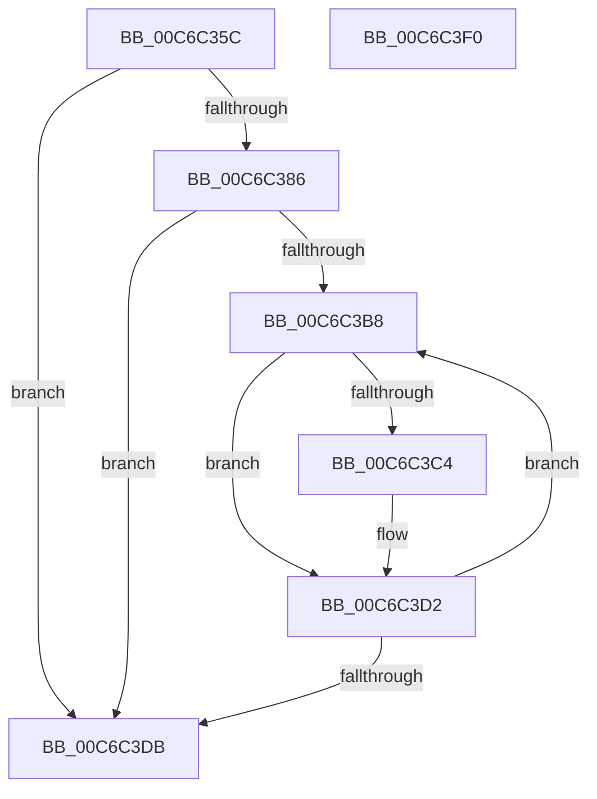

# MiLockPagableSections

- RVA: `0x00C6C35C`–`0x00C6C3F1` (길이 `149` bytes)
- VA: `0x0000000140C6C35C`
- 실행 섹션: `INIT`
- PDB 이름 있음: `예`; PDB Function 태그: `아니요`
- unwind 정보 RVA: `0x0006C8E8`
- 디코드: `43`개 명령, `149/149` bytes 표시
- 미해석 바이트: `0` (있으면 어셈블리에 `.byte`로 보존)

> 이 문서는 커널 이미지의 기계어와 PDB 기호를 분석해 생성했습니다. 4번과 5번은 함수 원형과 자료형을 바이너리 사용 방식에서 추정한 C 해석이며 원본 소스 복구 결과는 아닙니다.

## 1. Dependencies

- 직접 호출 지점: **4**; 고유 호출 대상: **4**
- 직접 호출자로 확인된 함수: **3**
- RIP 상대 이미지 참조: **0**

### Outgoing calls
- `0x00C6C37C` → [MiImagePagable](../../page/7F/MiImagePagable_function_007F8BD0.md) (function, `0x007F8BD0`)
- `0x00C6C39B` → [RtlImageNtHeaderEx](../../text/41/RtlImageNtHeaderEx_function_0041EAA0.md) (function, `0x0041EAA0`)
- `0x00C6C3BB` → [MmImageSectionPagable](../../page/A4/MmImageSectionPagable_function_00A4B78C.md) (function, `0x00A4B78C`)
- `0x00C6C3CD` → [MiLockPagableImageSection](../../text/2A/MiLockPagableImageSection_function_002A3A60.md) (function, `0x002A3A60`)

### Direct callers
- [MiCancelPhase0Locking](../../page/A4/MiCancelPhase0Locking_function_00A4BC60.md) at `0x00A4BC7B`
- [MiEnablePagingOfDriver](../C5/MiEnablePagingOfDriver_function_00C5F550.md) at `0x00C5F5C6`
- [MiUnlockBootPageSections](MiUnlockBootPageSections_function_00C6C7D0.md) at `0x00C6C7E6`

### Static image references
- 디코드된 RIP-relative 메모리 참조가 없습니다.

## 2. Other-region calls and transfers

- 다른 실행 섹션으로 향하는 call: **4**
  - `0x00C6C37C` → [MiImagePagable](../../page/7F/MiImagePagable_function_007F8BD0.md) (`INIT` → `PAGE`)
  - `0x00C6C39B` → [RtlImageNtHeaderEx](../../text/41/RtlImageNtHeaderEx_function_0041EAA0.md) (`INIT` → `.text`)
  - `0x00C6C3BB` → [MmImageSectionPagable](../../page/A4/MmImageSectionPagable_function_00A4B78C.md) (`INIT` → `PAGE`)
  - `0x00C6C3CD` → [MiLockPagableImageSection](../../text/2A/MiLockPagableImageSection_function_002A3A60.md) (`INIT` → `.text`)
- 별도 외부 분기/꼬리 이동을 확인하지 못했습니다.

## 3. Assembly (complete function range)

```asm
00C6C35C  48 89 5C 24 10                  mov qword ptr [rsp + 0x10], rbx
00C6C361  48 89 6C 24 18                  mov qword ptr [rsp + 0x18], rbp
00C6C366  48 89 74 24 20                  mov qword ptr [rsp + 0x20], rsi
00C6C36B  57                              push rdi
00C6C36C  48 83 EC 20                     sub rsp, 0x20
00C6C370  48 8B 59 30                     mov rbx, qword ptr [rcx + 0x30]
00C6C374  8B EA                           mov ebp, edx
00C6C376  48 8B D3                        mov rdx, rbx
00C6C379  48 8B F1                        mov rsi, rcx
00C6C37C  E8 4F C8 B8 FF                  call 0x1407f8bd0
00C6C381  48 85 C0                        test rax, rax
00C6C384  74 55                           je 0x140c6c3db
00C6C386  48 83 64 24 30 00               and qword ptr [rsp + 0x30], 0
00C6C38C  4C 8D 4C 24 30                  lea r9, [rsp + 0x30]
00C6C391  45 33 C0                        xor r8d, r8d
00C6C394  48 8B D3                        mov rdx, rbx
00C6C397  41 8D 48 01                     lea ecx, [r8 + 1]
00C6C39B  E8 00 27 7B FF                  call 0x14041eaa0
00C6C3A0  48 8B 4C 24 30                  mov rcx, qword ptr [rsp + 0x30]
00C6C3A5  0F B7 41 14                     movzx eax, word ptr [rcx + 0x14]
00C6C3A9  48 8D 59 18                     lea rbx, [rcx + 0x18]
00C6C3AD  0F B7 79 06                     movzx edi, word ptr [rcx + 6]
00C6C3B1  48 03 D8                        add rbx, rax
00C6C3B4  85 FF                           test edi, edi
00C6C3B6  74 23                           je 0x140c6c3db
00C6C3B8  48 8B CB                        mov rcx, rbx
00C6C3BB  E8 CC F3 DD FF                  call 0x140a4b78c
00C6C3C0  85 C0                           test eax, eax
00C6C3C2  74 0E                           je 0x140c6c3d2
00C6C3C4  44 8B C5                        mov r8d, ebp
00C6C3C7  48 8B D3                        mov rdx, rbx
00C6C3CA  48 8B CE                        mov rcx, rsi
00C6C3CD  E8 8E 76 63 FF                  call 0x1402a3a60
00C6C3D2  48 83 C3 28                     add rbx, 0x28
00C6C3D6  83 C7 FF                        add edi, -1
00C6C3D9  75 DD                           jne 0x140c6c3b8
00C6C3DB  48 8B 5C 24 38                  mov rbx, qword ptr [rsp + 0x38]
00C6C3E0  48 8B 6C 24 40                  mov rbp, qword ptr [rsp + 0x40]
00C6C3E5  48 8B 74 24 48                  mov rsi, qword ptr [rsp + 0x48]
00C6C3EA  48 83 C4 20                     add rsp, 0x20
00C6C3EE  5F                              pop rdi
00C6C3EF  C3                              ret
00C6C3F0  CC                              int3
```

## 4. C-style interpretation (structured pseudocode)

```c
__int64 __fastcall MiLockPagableSections(__int64 a1, int a2, int a3)
{
    __int64 result;
    __int64 v_rbx;
    __int64 v_rdi;
    __int64 v_rsp;
    unsigned __int64 v_stack_p10;
    unsigned __int64 v_stack_p18;
    unsigned __int64 v_stack_p20;
    unsigned __int64 v_stack_p8;

    v_stack_p10 = v_rbx;
    v_stack_p18 = v_rbp;
    v_stack_p20 = v_rsi;
    v_rsp = (v_rsp) - (32);
    result = MiImagePagable(a1, *(unsigned __int64 *)(a1 + 48), a3, a4);
    if (result == 0) goto loc_00C6C3DB;
    a3 = 0;
    result = RtlImageNtHeaderEx(a3 + 1, *(unsigned __int64 *)(a1 + 48), a3, v_stack_p8);
    v_rbx = (v_stack_p8 + 24) + (*(unsigned __int16 *)(v_stack_p8 + 20));
    if ((unsigned int)(*(unsigned __int16 *)(v_stack_p8 + 6)) == 0) goto loc_00C6C3DB;
loc_00C6C3B8:
    result = MmImageSectionPagable(v_rbx, *(unsigned __int64 *)(a1 + 48), a3, v_stack_p8);
    if ((unsigned int)(result) != 0) {
        a3 = (unsigned int)((unsigned int)(a2));
        a2 = v_rbx;
        a1 = a1;
        result = MiLockPagableImageSection(a1, a2, a3, v_stack_p8);
    }
    v_rbx = (v_rbx) + (40);
    v_rdi = (unsigned int)((*(unsigned __int16 *)(v_stack_p8 + 6)) + (-1));
    if (condition_is_not_equal) goto loc_00C6C3B8;
loc_00C6C3DB:
    v_rsp = (v_rsp) + (32);
    return result;
}
```

## 5. (Beta) C Style

```c
int64_t MiLockPagableSections(void *Arg1, int32_t Arg2, int32_t Arg3)
{
    uint8_t *arg1 = (uint8_t *)Arg1;

    int64_t result;
    int64_t local_rbx;
    int64_t local_rdi;
    int64_t local_rsp;
    uint64_t v_stack_p10;
    uint64_t v_stack_p18;
    uint64_t v_stack_p20;
    uint64_t v_stack_p8;

    v_stack_p10 = local_rbx;
    v_stack_p18 = local_rbp;
    v_stack_p20 = local_rsi;
    local_rsp = (local_rsp) - (32);
    result = MiImagePagable(Arg1, *(uint64_t *)(arg1 + 0x30), Arg3, a4);
    if (result == 0) goto loc_00C6C3DB;
    Arg3 = 0;
    result = RtlImageNtHeaderEx(Arg3 + 1, *(uint64_t *)(arg1 + 0x30), Arg3, v_stack_p8);
    local_rbx = (v_stack_p8 + 24) + (*(uint16_t *)(v_stack_p8 + 0x14));
    if ((uint32_t)(*(uint16_t *)(v_stack_p8 + 0x6)) == 0) goto loc_00C6C3DB;
loc_00C6C3B8:
    result = MmImageSectionPagable(local_rbx, *(uint64_t *)(arg1 + 0x30), Arg3, v_stack_p8);
    if ((uint32_t)(result) != 0) {
        Arg3 = (uint32_t)((uint32_t)(Arg2));
        Arg2 = local_rbx;
        Arg1 = Arg1;
        result = MiLockPagableImageSection(Arg1, Arg2, Arg3, v_stack_p8);
    }
    local_rbx = (local_rbx) + (40);
    local_rdi = (uint32_t)((*(uint16_t *)(v_stack_p8 + 0x6)) + (-1));
    if (condition_is_not_equal) goto loc_00C6C3B8;
loc_00C6C3DB:
    local_rsp = (local_rsp) + (32);
    return result;
}
```

### 관측된 메모리 오프셋

구조체 형식이 확인되지 않은 접근은 인자 기준의 오프셋으로만 기록했습니다.

| 기준 인자 | 오프셋 표현 | 폭 (bit) | 접근 |
|---|---:|---:|---|
| `Arg1` | `+ 0x30` | `64` | `R` |

## 6. Execution-region graph

[열기: 2D/3D 그래프와 함수 탐색 컨트롤 패널](../../../control-panel.html?section=init&rva=0x00C6C35C&view=graph)

- 2D 그래프는 위에서 아래로 흐르고, 3D 그래프는 빈 공간을 드래그해 회전합니다. Shift+드래그는 이동, 휠은 확대·축소, 함수 노드 선택은 대상 보고서 이동입니다.

### Static fallback


