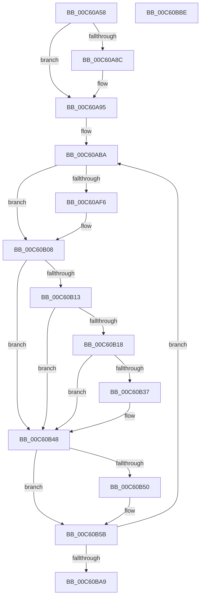

# MiMapDummyPages

- RVA: `0x00C60A58`–`0x00C60BBF` (길이 `359` bytes)
- VA: `0x0000000140C60A58`
- 실행 섹션: `INIT`
- PDB 이름 있음: `예`; PDB Function 태그: `아니요`
- unwind 정보 RVA: `0x000BE6C8`
- 디코드: `97`개 명령, `359/359` bytes 표시
- 미해석 바이트: `0` (있으면 어셈블리에 `.byte`로 보존)

> 이 문서는 커널 이미지의 기계어와 PDB 기호를 분석해 생성했습니다. 4번과 5번은 함수 원형과 자료형을 바이너리 사용 방식에서 추정한 C 해석이며 원본 소스 복구 결과는 아닙니다.

## 1. Dependencies

- 직접 호출 지점: **12**; 고유 호출 대상: **12**
- 직접 호출자로 확인된 함수: **1**
- RIP 상대 이미지 참조: **3**

### Outgoing calls
- `0x00C60A7F` → [MiReservePtes](../../text/31/MiReservePtes_function_00318D20.md) (function, `0x00318D20`)
- `0x00C60A8F` → [MxInstallMoreMemory](../../text/67/MxInstallMoreMemory_function_00671A04.md) (function, `0x00671A04`)
- `0x00C60A9A` → [MiGetAnyMultiplexedVm](../../text/44/MiGetAnyMultiplexedVm_function_00448BD0.md) (function, `0x00448BD0`)
- `0x00C60AC7` → [MiMakeValidPte](../../text/2C/MiMakeValidPte_function_002C5590.md) (function, `0x002C5590`)
- `0x00C60ADA` → [MiLockWorkingSetOptimal](../../text/23/MiLockWorkingSetOptimal_function_00238FC0.md) (function, `0x00238FC0`)
- `0x00C60AED` → [MiPteInShadowRange](../../text/23/MiPteInShadowRange_function_0023FB00.md) (function, `0x0023FB00`)
- `0x00C60AFB` → [MiSanitizeShadowPxe](../../text/29/MiSanitizeShadowPxe_function_00294B68.md) (function, `0x00294B68`)
- `0x00C60B43` → [MiCheckLinearProtectedPteAccessedBit](../../text/29/MiCheckLinearProtectedPteAccessedBit_function_00292D80.md) (function, `0x00292D80`)
- `0x00C60B56` → [MiWritePteShadow](../../text/29/MiWritePteShadow_function_00294EAC.md) (function, `0x00294EAC`)
- `0x00C60B68` → [MiIncreaseUsedPtes](../../text/24/MiIncreaseUsedPtes_function_00243630.md) (function, `0x00243630`)
- `0x00C60B78` → [MiUnlockWorkingSetOptimal](../../text/23/MiUnlockWorkingSetOptimal_function_00238DFC.md) (function, `0x00238DFC`)
- `0x00C60B8E` → [MiComputeHash64](../../text/43/MiComputeHash64_function_00432DC0.md) (function, `0x00432DC0`)

### Direct callers
- [MiInitNucleus](../C5/MiInitNucleus_function_00C5FD38.md) at `0x00C6019C`

### Static image references
- `0x00C60A78` → RVA `0x00E37668` (`.data`; read)
- `0x00C60AB3` → RVA `0x00E37460` (`.data`; read)
- `0x00C60B08` → RVA `0x00FC6A88` (`ALMOSTRO`; read)

## 2. Other-region calls and transfers

- 다른 실행 섹션으로 향하는 call: **12**
  - `0x00C60A7F` → [MiReservePtes](../../text/31/MiReservePtes_function_00318D20.md) (`INIT` → `.text`)
  - `0x00C60A8F` → [MxInstallMoreMemory](../../text/67/MxInstallMoreMemory_function_00671A04.md) (`INIT` → `.text`)
  - `0x00C60A9A` → [MiGetAnyMultiplexedVm](../../text/44/MiGetAnyMultiplexedVm_function_00448BD0.md) (`INIT` → `.text`)
  - `0x00C60AC7` → [MiMakeValidPte](../../text/2C/MiMakeValidPte_function_002C5590.md) (`INIT` → `.text`)
  - `0x00C60ADA` → [MiLockWorkingSetOptimal](../../text/23/MiLockWorkingSetOptimal_function_00238FC0.md) (`INIT` → `.text`)
  - `0x00C60AED` → [MiPteInShadowRange](../../text/23/MiPteInShadowRange_function_0023FB00.md) (`INIT` → `.text`)
  - `0x00C60AFB` → [MiSanitizeShadowPxe](../../text/29/MiSanitizeShadowPxe_function_00294B68.md) (`INIT` → `.text`)
  - `0x00C60B43` → [MiCheckLinearProtectedPteAccessedBit](../../text/29/MiCheckLinearProtectedPteAccessedBit_function_00292D80.md) (`INIT` → `.text`)
  - `0x00C60B56` → [MiWritePteShadow](../../text/29/MiWritePteShadow_function_00294EAC.md) (`INIT` → `.text`)
  - `0x00C60B68` → [MiIncreaseUsedPtes](../../text/24/MiIncreaseUsedPtes_function_00243630.md) (`INIT` → `.text`)
  - `0x00C60B78` → [MiUnlockWorkingSetOptimal](../../text/23/MiUnlockWorkingSetOptimal_function_00238DFC.md) (`INIT` → `.text`)
  - `0x00C60B8E` → [MiComputeHash64](../../text/43/MiComputeHash64_function_00432DC0.md) (`INIT` → `.text`)
- 별도 외부 분기/꼬리 이동을 확인하지 못했습니다.

## 3. Assembly (complete function range)

```asm
00C60A58  48 89 5C 24 18                  mov qword ptr [rsp + 0x18], rbx
00C60A5D  55                              push rbp
00C60A5E  56                              push rsi
00C60A5F  57                              push rdi
00C60A60  41 54                           push r12
00C60A62  41 55                           push r13
00C60A64  41 56                           push r14
00C60A66  41 57                           push r15
00C60A68  48 83 EC 20                     sub rsp, 0x20
00C60A6C  BE 02 00 00 00                  mov esi, 2
00C60A71  C6 44 24 60 00                  mov byte ptr [rsp + 0x60], 0
00C60A76  8B D6                           mov edx, esi
00C60A78  48 8D 0D E9 6B 1D 00            lea rcx, [rip + 0x1d6be9]
00C60A7F  E8 9C 82 6B FF                  call 0x140318d20
00C60A84  48 8B F8                        mov rdi, rax
00C60A87  48 85 C0                        test rax, rax
00C60A8A  75 09                           jne 0x140c60a95
00C60A8C  8D 4E 04                        lea ecx, [rsi + 4]
00C60A8F  E8 70 0F A1 FF                  call 0x140671a04
00C60A94  CC                              int3
00C60A95  B9 04 00 00 00                  mov ecx, 4
00C60A9A  E8 31 81 7E FF                  call 0x140448bd0
00C60A9F  4C 8B E0                        mov r12, rax
00C60AA2  48 B8 00 00 00 00 80 F6 FF FF   movabs rax, 0xfffff68000000000
00C60AAC  48 8B E8                        mov rbp, rax
00C60AAF  48 C1 E5 19                     shl rbp, 0x19
00C60AB3  4C 8D 3D A6 69 1D 00            lea r15, [rip + 0x1d69a6]
00C60ABA  49 8B 57 E0                     mov rdx, qword ptr [r15 - 0x20]
00C60ABE  41 B8 01 00 00 20               mov r8d, 0x20000001
00C60AC4  48 8B CF                        mov rcx, rdi
00C60AC7  E8 C4 4A 66 FF                  call 0x1402c5590
00C60ACC  4C 8D 44 24 60                  lea r8, [rsp + 0x60]
00C60AD1  48 8B D7                        mov rdx, rdi
00C60AD4  49 8B CC                        mov rcx, r12
00C60AD7  48 8B D8                        mov rbx, rax
00C60ADA  E8 E1 84 5D FF                  call 0x140238fc0
00C60ADF  48 8B CF                        mov rcx, rdi
00C60AE2  48 89 5C 24 68                  mov qword ptr [rsp + 0x68], rbx
00C60AE7  4C 8B E8                        mov r13, rax
00C60AEA  45 33 F6                        xor r14d, r14d
00C60AED  E8 0E F0 5D FF                  call 0x14023fb00
00C60AF2  85 C0                           test eax, eax
00C60AF4  74 12                           je 0x140c60b08
00C60AF6  48 8D 54 24 68                  lea rdx, [rsp + 0x68]
00C60AFB  E8 68 40 63 FF                  call 0x140294b68
00C60B00  48 8B 5C 24 68                  mov rbx, qword ptr [rsp + 0x68]
00C60B05  44 8B F0                        mov r14d, eax
00C60B08  48 0F BA 25 77 5F 36 00 24      bt qword ptr [rip + 0x365f77], 0x24
00C60B11  73 35                           jae 0x140c60b48
00C60B13  F6 C3 20                        test bl, 0x20
00C60B16  75 30                           jne 0x140c60b48
00C60B18  48 B8 00 00 00 00 80 F6 FF FF   movabs rax, 0xfffff68000000000
00C60B22  48 8B C8                        mov rcx, rax
00C60B25  48 B8 00 00 00 00 40 00 00 00   movabs rax, 0x4000000000
00C60B2F  48 03 C8                        add rcx, rax
00C60B32  48 3B F9                        cmp rdi, rcx
00C60B35  72 11                           jb 0x140c60b48
00C60B37  41 B8 80 00 00 00               mov r8d, 0x80
00C60B3D  48 8B D3                        mov rdx, rbx
00C60B40  48 8B CF                        mov rcx, rdi
00C60B43  E8 38 22 63 FF                  call 0x140292d80
00C60B48  48 89 1F                        mov qword ptr [rdi], rbx
00C60B4B  45 85 F6                        test r14d, r14d
00C60B4E  74 0B                           je 0x140c60b5b
00C60B50  48 8B D3                        mov rdx, rbx
00C60B53  48 8B CF                        mov rcx, rdi
00C60B56  E8 51 43 63 FF                  call 0x140294eac
00C60B5B  41 B9 06 00 00 00               mov r9d, 6
00C60B61  49 8B D5                        mov rdx, r13
00C60B64  45 8D 41 FB                     lea r8d, [r9 - 5]
00C60B68  E8 C3 2A 5E FF                  call 0x140243630
00C60B6D  44 8A 44 24 60                  mov r8b, byte ptr [rsp + 0x60]
00C60B72  49 8B D5                        mov rdx, r13
00C60B75  49 8B CC                        mov rcx, r12
00C60B78  E8 7F 82 5D FF                  call 0x140238dfc
00C60B7D  48 8B CF                        mov rcx, rdi
00C60B80  48 C1 E1 19                     shl rcx, 0x19
00C60B84  48 2B CD                        sub rcx, rbp
00C60B87  48 C1 F9 10                     sar rcx, 0x10
00C60B8B  49 89 0F                        mov qword ptr [r15], rcx
00C60B8E  E8 2D 22 7D FF                  call 0x140432dc0
00C60B93  49 89 47 08                     mov qword ptr [r15 + 8], rax
00C60B97  48 83 C7 08                     add rdi, 8
00C60B9B  49 83 C7 38                     add r15, 0x38
00C60B9F  48 83 EE 01                     sub rsi, 1
00C60BA3  0F 85 11 FF FF FF               jne 0x140c60aba
00C60BA9  48 8B 5C 24 70                  mov rbx, qword ptr [rsp + 0x70]
00C60BAE  48 83 C4 20                     add rsp, 0x20
00C60BB2  41 5F                           pop r15
00C60BB4  41 5E                           pop r14
00C60BB6  41 5D                           pop r13
00C60BB8  41 5C                           pop r12
00C60BBA  5F                              pop rdi
00C60BBB  5E                              pop rsi
00C60BBC  5D                              pop rbp
00C60BBD  C3                              ret
00C60BBE  CC                              int3
```

## 4. C-style interpretation (structured pseudocode)

```c
__int64 __fastcall MiMapDummyPages(void)
{
    __int64 result;
    __int64 v_r14;
    __int64 v_r15;
    __int64 v_rbp;
    __int64 v_rbx;
    __int64 v_rdi;
    __int64 v_rsi;
    __int64 v_rsp;
    unsigned __int64 v_stack_p10;
    unsigned __int64 v_stack_p18;
    unsigned __int8 v_stack_p8;

    v_stack_p18 = v_rbx;
    v_rsp = (v_rsp) - (32);
    v_stack_p8 = 0;
    result = MiReservePtes(v_rip + 1928169, 2, a3, a4);
    if (result == 0) {
        a1 = 2 + 4;
        result = MxInstallMoreMemory(a1, 2, a3, a4);
    }
    result = MiGetAnyMultiplexedVm(4, 2, a3, a4);
    v_rbp = (result) << (25);
loc_00C60ABA:
    result = MiMakeValidPte(result, *(unsigned __int64 *)(v_rip + 1927590 - 32), (unsigned int)(0x20000001ULL), a4);
    result = MiLockWorkingSetOptimal(result, result, v_stack_p8, a4);
    v_stack_p10 = result;
    v_r14 = 0;
    result = MiPteInShadowRange(result, result, v_stack_p8, a4);
    v_rbx = result;
    if ((unsigned int)(result) != 0) {
        a2 = v_stack_p10;
        result = MiSanitizeShadowPxe(result, a2, v_stack_p8, a4);
        v_rbx = v_stack_p10;
        v_r14 = (unsigned int)(result);
    }
    if (condition_is_above_or_equal) goto loc_00C60B48;
    if ((((unsigned __int8)(v_rbx)) & (32)) != 0) goto loc_00C60B48;
    a1 = (result) + (result);
    if (result >= a1) {
        a3 = 128;
        a2 = v_rbx;
        a1 = result;
        result = MiCheckLinearProtectedPteAccessedBit(a1, a2, a3, a4);
    }
    *(unsigned __int64 *)(result) = v_rbx;
    if ((unsigned int)(v_r14) != 0) {
        a2 = v_rbx;
        a1 = result;
        result = MiWritePteShadow(a1, a2, a3, a4);
    }
    result = MiIncreaseUsedPtes(a1, result, 6 - 5, 6);
    result = MiUnlockWorkingSetOptimal(result, result, v_stack_p8, 6);
    a1 = (result) << (25);
    a1 = (a1) - (v_rbp);
    a1 = (a1) >> (16);
    *(unsigned __int64 *)(v_rip + 1927590) = a1;
    result = MiComputeHash64(a1, result, v_stack_p8, 6);
    *(unsigned __int64 *)(v_rip + 1927590 + 8) = result;
    v_rdi = (result) + (8);
    v_r15 = (v_rip + 1927590) + (56);
    v_rsi = (2) - (1);
    if (condition_is_not_equal) goto loc_00C60ABA;
    v_rsp = (v_rsp) + (32);
    return result;
}
```

## 5. (Beta) C Style

```c
void MiMapDummyPages(void)
{
    int64_t result;
    int64_t local_r14;
    int64_t local_r15;
    int64_t local_rbp;
    int64_t local_rbx;
    int64_t local_rdi;
    int64_t local_rsi;
    int64_t local_rsp;
    uint64_t v_stack_p10;
    uint64_t v_stack_p18;
    uint8_t v_stack_p8;

    v_stack_p18 = local_rbx;
    local_rsp = (local_rsp) - (32);
    v_stack_p8 = 0;
    result = MiReservePtes(v_rip + 1928169, 2, a3, a4);
    if (result == 0) {
        a1 = 2 + 4;
        result = MxInstallMoreMemory(a1, 2, a3, a4);
    }
    result = MiGetAnyMultiplexedVm(4, 2, a3, a4);
    local_rbp = (result) << (25);
loc_00C60ABA:
    result = MiMakeValidPte(result, *(uint64_t *)(v_rip + 0x1D69A6 - 0x20), (uint32_t)(0x20000001ULL), a4);
    result = MiLockWorkingSetOptimal(result, result, v_stack_p8, a4);
    v_stack_p10 = result;
    local_r14 = 0;
    result = MiPteInShadowRange(result, result, v_stack_p8, a4);
    local_rbx = result;
    if ((uint32_t)(result) != 0) {
        a2 = v_stack_p10;
        result = MiSanitizeShadowPxe(result, a2, v_stack_p8, a4);
        local_rbx = v_stack_p10;
        local_r14 = (uint32_t)(result);
    }
    if (condition_is_above_or_equal) goto loc_00C60B48;
    if ((((uint8_t)(local_rbx)) & (32)) != 0) goto loc_00C60B48;
    a1 = (result) + (result);
    if (result >= a1) {
        a3 = 128;
        a2 = local_rbx;
        a1 = result;
        result = MiCheckLinearProtectedPteAccessedBit(a1, a2, a3, a4);
    }
    *(uint64_t *)(result) = local_rbx;
    if ((uint32_t)(local_r14) != 0) {
        a2 = local_rbx;
        a1 = result;
        result = MiWritePteShadow(a1, a2, a3, a4);
    }
    result = MiIncreaseUsedPtes(a1, result, 6 - 5, 6);
    result = MiUnlockWorkingSetOptimal(result, result, v_stack_p8, 6);
    a1 = (result) << (25);
    a1 = (a1) - (local_rbp);
    a1 = (a1) >> (16);
    *(uint64_t *)(v_rip + 0x1D69A6) = a1;
    result = MiComputeHash64(a1, result, v_stack_p8, 6);
    *(uint64_t *)(v_rip + 0x1D69A6 + 0x8) = result;
    local_rdi = (result) + (8);
    local_r15 = (v_rip + 1927590) + (56);
    local_rsi = (2) - (1);
    if (condition_is_not_equal) goto loc_00C60ABA;
    local_rsp = (local_rsp) + (32);
    return result;
}
```

## 6. Execution-region graph

[열기: 2D/3D 그래프와 함수 탐색 컨트롤 패널](../../../control-panel.html?section=init&rva=0x00C60A58&view=graph)

- 2D 그래프는 위에서 아래로 흐르고, 3D 그래프는 빈 공간을 드래그해 회전합니다. Shift+드래그는 이동, 휠은 확대·축소, 함수 노드 선택은 대상 보고서 이동입니다.

### Static fallback


