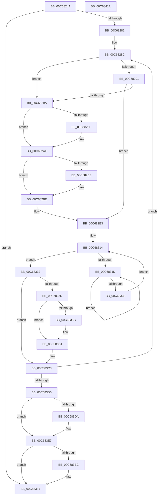

# MiMarkBootKernelStack

- RVA: `0x00C68244`–`0x00C6841B` (길이 `471` bytes)
- VA: `0x0000000140C68244`
- 실행 섹션: `INIT`
- PDB 이름 있음: `예`; PDB Function 태그: `아니요`
- unwind 정보 RVA: `0x00060284`
- 디코드: `124`개 명령, `471/471` bytes 표시
- 미해석 바이트: `0` (있으면 어셈블리에 `.byte`로 보존)

> 이 문서는 커널 이미지의 기계어와 PDB 기호를 분석해 생성했습니다. 4번과 5번은 함수 원형과 자료형을 바이너리 사용 방식에서 추정한 C 해석이며 원본 소스 복구 결과는 아닙니다.

## 1. Dependencies

- 직접 호출 지점: **16**; 고유 호출 대상: **13**
- 직접 호출자로 확인된 함수: **1**
- RIP 상대 이미지 참조: **1**

### Outgoing calls
- `0x00C68262` → [MiVaToFlushVm](../../text/31/MiVaToFlushVm_function_0031AD84.md) (function, `0x0031AD84`)
- `0x00C6826D` → [MiLockWorkingSetShared](../../text/27/MiLockWorkingSetShared_function_0027CBF0.md) (function, `0x0027CBF0`)
- `0x00C682A2` → [MiFlushTbList](../../text/31/MiFlushTbList_function_00311FC0.md) (function, `0x00311FC0`)
- `0x00C682A7` → [MiReleaseProcessorFlushList](../../text/31/MiReleaseProcessorFlushList_function_00313C70.md) (function, `0x00313C70`)
- `0x00C682B9` → [MiUnlockPageTable](../../text/21/MiUnlockPageTable_function_00216EC0.md) (function, `0x00216EC0`)
- `0x00C682DE` → [MiLockNestedPageTable](../../text/23/MiLockNestedPageTable_function_0023E890.md) (function, `0x0023E890`)
- `0x00C68322` → [KeYieldProcessorEx](../../text/3F/KeYieldProcessorEx_function_003FBD00.md) (function, `0x003FBD00`)
- `0x00C6833C` → [MiMarkKernelStack](../../text/2A/MiMarkKernelStack_function_002A2290.md) (function, `0x002A2290`)
- `0x00C6836D` → [MiWriteValidPteNewProtection](../../text/28/MiWriteValidPteNewProtection_function_00281810.md) (function, `0x00281810`)
- `0x00C6838C` → [MiGetProcessorFlushList](../../text/24/MiGetProcessorFlushList_function_00242C90.md) (function, `0x00242C90`)
- `0x00C683AC` → [MiInitializeTbFlushList](../../text/29/MiInitializeTbFlushList_function_00294F00.md) (function, `0x00294F00`)
- `0x00C683BE` → [MiInsertTbFlushEntry](../../text/29/MiInsertTbFlushEntry_function_00293670.md) (function, `0x00293670`)
- `0x00C683DD` → [MiFlushTbList](../../text/31/MiFlushTbList_function_00311FC0.md) (function, `0x00311FC0`)
- `0x00C683E2` → [MiReleaseProcessorFlushList](../../text/31/MiReleaseProcessorFlushList_function_00313C70.md) (function, `0x00313C70`)
- `0x00C683F2` → [MiUnlockPageTable](../../text/21/MiUnlockPageTable_function_00216EC0.md) (function, `0x00216EC0`)
- `0x00C683FD` → [MiUnlockWorkingSetShared](../../text/27/MiUnlockWorkingSetShared_function_0027D690.md) (function, `0x0027D690`)

### Direct callers
- [MiInitializeKernelStacks](MiInitializeKernelStacks_function_00C680B8.md) at `0x00C68124`
- [MiInitializeKernelStacks](MiInitializeKernelStacks_function_00C680B8.md) at `0x00C6814E`

### Static image references
- `0x00C68350` → RVA `0x00FC6A88` (`ALMOSTRO`; read)

## 2. Other-region calls and transfers

- 다른 실행 섹션으로 향하는 call: **16**
  - `0x00C68262` → [MiVaToFlushVm](../../text/31/MiVaToFlushVm_function_0031AD84.md) (`INIT` → `.text`)
  - `0x00C6826D` → [MiLockWorkingSetShared](../../text/27/MiLockWorkingSetShared_function_0027CBF0.md) (`INIT` → `.text`)
  - `0x00C682A2` → [MiFlushTbList](../../text/31/MiFlushTbList_function_00311FC0.md) (`INIT` → `.text`)
  - `0x00C682A7` → [MiReleaseProcessorFlushList](../../text/31/MiReleaseProcessorFlushList_function_00313C70.md) (`INIT` → `.text`)
  - `0x00C682B9` → [MiUnlockPageTable](../../text/21/MiUnlockPageTable_function_00216EC0.md) (`INIT` → `.text`)
  - `0x00C682DE` → [MiLockNestedPageTable](../../text/23/MiLockNestedPageTable_function_0023E890.md) (`INIT` → `.text`)
  - `0x00C68322` → [KeYieldProcessorEx](../../text/3F/KeYieldProcessorEx_function_003FBD00.md) (`INIT` → `.text`)
  - `0x00C6833C` → [MiMarkKernelStack](../../text/2A/MiMarkKernelStack_function_002A2290.md) (`INIT` → `.text`)
  - `0x00C6836D` → [MiWriteValidPteNewProtection](../../text/28/MiWriteValidPteNewProtection_function_00281810.md) (`INIT` → `.text`)
  - `0x00C6838C` → [MiGetProcessorFlushList](../../text/24/MiGetProcessorFlushList_function_00242C90.md) (`INIT` → `.text`)
  - `0x00C683AC` → [MiInitializeTbFlushList](../../text/29/MiInitializeTbFlushList_function_00294F00.md) (`INIT` → `.text`)
  - `0x00C683BE` → [MiInsertTbFlushEntry](../../text/29/MiInsertTbFlushEntry_function_00293670.md) (`INIT` → `.text`)
  - `0x00C683DD` → [MiFlushTbList](../../text/31/MiFlushTbList_function_00311FC0.md) (`INIT` → `.text`)
  - `0x00C683E2` → [MiReleaseProcessorFlushList](../../text/31/MiReleaseProcessorFlushList_function_00313C70.md) (`INIT` → `.text`)
  - `0x00C683F2` → [MiUnlockPageTable](../../text/21/MiUnlockPageTable_function_00216EC0.md) (`INIT` → `.text`)
  - `0x00C683FD` → [MiUnlockWorkingSetShared](../../text/27/MiUnlockWorkingSetShared_function_0027D690.md) (`INIT` → `.text`)
- 별도 외부 분기/꼬리 이동을 확인하지 못했습니다.

## 3. Assembly (complete function range)

```asm
00C68244  48 89 5C 24 18                  mov qword ptr [rsp + 0x18], rbx
00C68249  55                              push rbp
00C6824A  56                              push rsi
00C6824B  57                              push rdi
00C6824C  41 54                           push r12
00C6824E  41 55                           push r13
00C68250  41 56                           push r14
00C68252  41 57                           push r15
00C68254  48 83 EC 30                     sub rsp, 0x30
00C68258  4C 8B E2                        mov r12, rdx
00C6825B  4C 8B F1                        mov r14, rcx
00C6825E  33 FF                           xor edi, edi
00C68260  33 F6                           xor esi, esi
00C68262  E8 1D 2B 6B FF                  call 0x14031ad84
00C68267  48 8B C8                        mov rcx, rax
00C6826A  4C 8B F8                        mov r15, rax
00C6826D  E8 7E 49 61 FF                  call 0x14027cbf0
00C68272  88 44 24 70                     mov byte ptr [rsp + 0x70], al
00C68276  44 8A E8                        mov r13b, al
00C68279  4D 3B F4                        cmp r14, r12
00C6827C  0F 83 75 01 00 00               jae 0x140c683f7
00C68282  49 BD 00 00 00 00 80 F6 FF FF   movabs r13, 0xfffff68000000000
00C6828C  48 85 FF                        test rdi, rdi
00C6828F  74 09                           je 0x140c6829a
00C68291  49 F7 C6 FF 0F 00 00            test r14, 0xfff
00C68298  75 49                           jne 0x140c682e3
00C6829A  48 85 F6                        test rsi, rsi
00C6829D  74 0F                           je 0x140c682ae
00C6829F  48 8B CE                        mov rcx, rsi
00C682A2  E8 19 9D 6A FF                  call 0x140311fc0
00C682A7  E8 C4 B9 6A FF                  call 0x140313c70
00C682AC  33 F6                           xor esi, esi
00C682AE  48 85 FF                        test rdi, rdi
00C682B1  74 0B                           je 0x140c682be
00C682B3  48 8B D7                        mov rdx, rdi
00C682B6  49 8B CF                        mov rcx, r15
00C682B9  E8 02 EC 5A FF                  call 0x140216ec0
00C682BE  49 8B FE                        mov rdi, r14
00C682C1  48 B8 F8 FF FF FF 7F 00 00 00   movabs rax, 0x7ffffffff8
00C682CB  48 C1 EF 09                     shr rdi, 9
00C682CF  48 23 F8                        and rdi, rax
00C682D2  49 8B C5                        mov rax, r13
00C682D5  48 03 F8                        add rdi, rax
00C682D8  49 8B CF                        mov rcx, r15
00C682DB  48 8B D7                        mov rdx, rdi
00C682DE  E8 AD 65 5D FF                  call 0x14023e890
00C682E3  49 8B 1E                        mov rbx, qword ptr [r14]
00C682E6  48 B9 FF FF FF FF FF 00 00 00   movabs rcx, 0xffffffffff
00C682F0  48 8B C3                        mov rax, rbx
00C682F3  48 C1 E8 0C                     shr rax, 0xc
00C682F7  48 23 C1                        and rax, rcx
00C682FA  48 8D 2C 40                     lea rbp, [rax + rax*2]
00C682FE  48 C1 E5 04                     shl rbp, 4
00C68302  48 B8 00 00 00 00 00 DE FF FF   movabs rax, 0xffffde0000000000
00C6830C  48 03 E8                        add rbp, rax
00C6830F  83 64 24 78 00                  and dword ptr [rsp + 0x78], 0
00C68314  F0 48 0F BA 6D 18 3F            lock bts qword ptr [rbp + 0x18], 0x3f
00C6831B  73 15                           jae 0x140c68332
00C6831D  48 8D 4C 24 78                  lea rcx, [rsp + 0x78]
00C68322  E8 D9 39 79 FF                  call 0x1403fbd00
00C68327  48 8B 45 18                     mov rax, qword ptr [rbp + 0x18]
00C6832B  48 85 C0                        test rax, rax
00C6832E  78 ED                           js 0x140c6831d
00C68330  EB E2                           jmp 0x140c68314
00C68332  49 C7 C0 F0 FF FF FF            mov r8, 0xfffffffffffffff0
00C68339  48 8B D5                        mov rdx, rbp
00C6833C  E8 4F 9F 63 FF                  call 0x1402a2290
00C68341  48 B8 FF FF FF FF FF FF FF 7F   movabs rax, 0x7fffffffffffffff
00C6834B  F0 48 21 45 18                  lock and qword ptr [rbp + 0x18], rax
00C68350  48 F7 05 2D E7 35 00 00 00 02 00  test qword ptr [rip + 0x35e72d], 0x20000
00C6835B  75 66                           jne 0x140c683c3
00C6835D  48 BA 62 00 00 00 00 00 00 80   movabs rdx, 0x8000000000000062
00C68367  49 8B CE                        mov rcx, r14
00C6836A  48 0B D3                        or rdx, rbx
00C6836D  E8 9E 94 61 FF                  call 0x140281810
00C68372  49 8B DE                        mov rbx, r14
00C68375  48 C1 E3 19                     shl rbx, 0x19
00C68379  49 8B C5                        mov rax, r13
00C6837C  48 C1 E0 19                     shl rax, 0x19
00C68380  48 2B D8                        sub rbx, rax
00C68383  48 C1 FB 10                     sar rbx, 0x10
00C68387  48 85 F6                        test rsi, rsi
00C6838A  75 25                           jne 0x140c683b1
00C6838C  E8 FF A8 5D FF                  call 0x140242c90
00C68391  41 B9 01 00 00 00               mov r9d, 1
00C68397  C7 44 24 20 20 00 00 00         mov dword ptr [rsp + 0x20], 0x20
00C6839F  49 8B D7                        mov rdx, r15
00C683A2  48 8B C8                        mov rcx, rax
00C683A5  48 8B F0                        mov rsi, rax
00C683A8  44 8B 40 0C                     mov r8d, dword ptr [rax + 0xc]
00C683AC  E8 4F CB 62 FF                  call 0x140294f00
00C683B1  45 33 C9                        xor r9d, r9d
00C683B4  48 8B D3                        mov rdx, rbx
00C683B7  48 8B CE                        mov rcx, rsi
00C683BA  45 8D 41 01                     lea r8d, [r9 + 1]
00C683BE  E8 AD B2 62 FF                  call 0x140293670
00C683C3  49 83 C6 08                     add r14, 8
00C683C7  4D 3B F4                        cmp r14, r12
00C683CA  0F 82 BC FE FF FF               jb 0x140c6828c
00C683D0  44 8A 6C 24 70                  mov r13b, byte ptr [rsp + 0x70]
00C683D5  48 85 F6                        test rsi, rsi
00C683D8  74 0D                           je 0x140c683e7
00C683DA  48 8B CE                        mov rcx, rsi
00C683DD  E8 DE 9B 6A FF                  call 0x140311fc0
00C683E2  E8 89 B8 6A FF                  call 0x140313c70
00C683E7  48 85 FF                        test rdi, rdi
00C683EA  74 0B                           je 0x140c683f7
00C683EC  48 8B D7                        mov rdx, rdi
00C683EF  49 8B CF                        mov rcx, r15
00C683F2  E8 C9 EA 5A FF                  call 0x140216ec0
00C683F7  41 8A D5                        mov dl, r13b
00C683FA  49 8B CF                        mov rcx, r15
00C683FD  E8 8E 52 61 FF                  call 0x14027d690
00C68402  48 8B 9C 24 80 00 00 00         mov rbx, qword ptr [rsp + 0x80]
00C6840A  48 83 C4 30                     add rsp, 0x30
00C6840E  41 5F                           pop r15
00C68410  41 5E                           pop r14
00C68412  41 5D                           pop r13
00C68414  41 5C                           pop r12
00C68416  5F                              pop rdi
00C68417  5E                              pop rsi
00C68418  5D                              pop rbp
00C68419  C3                              ret
00C6841A  CC                              int3
```

## 4. C-style interpretation (structured pseudocode)

```c
__int64 __fastcall MiMarkBootKernelStack(__int64 a1, __int64 a2)
{
    __int64 result;
    __int64 v_r14;
    __int64 v_rbp;
    __int64 v_rbx;
    __int64 v_rdi;
    __int64 v_rsi;
    __int64 v_rsp;
    unsigned int v_stack_m48;
    unsigned int v_stack_p10;
    unsigned __int64 v_stack_p18;
    unsigned __int8 v_stack_p8;

    v_stack_p18 = v_rbx;
    v_rsp = (v_rsp) - (48);
    v_rdi = 0;
    v_rsi = 0;
    result = MiVaToFlushVm(a1, a2, a3, a4);
    result = MiLockWorkingSetShared(result, a2, a3, a4);
    v_stack_p8 = (unsigned __int8)(result);
    if (a1 >= a2) goto loc_00C683F7;
loc_00C6828C:
    if (0 == 0) goto loc_00C6829A;
    if (((a1) & (0xFFFULL)) != 0) goto loc_00C682E3;
loc_00C6829A:
    if (0 != 0) {
        a1 = 0;
        result = MiFlushTbList(a1, a2, a3, a4);
        result = MiReleaseProcessorFlushList(a1, a2, a3, a4);
        v_rsi = 0;
    }
    if (0 != 0) {
        a2 = 0;
        a1 = result;
        result = MiUnlockPageTable(a1, a2, a3, a4);
    }
    v_rdi = (a1) >> (9);
    v_rdi = (v_rdi) & (result);
    v_rdi = (v_rdi) + ((unsigned __int8)(result));
    result = MiLockNestedPageTable(result, v_rdi, a3, a4);
loc_00C682E3:
    result = (*(unsigned __int64 *)(a1)) >> (12);
    result = (result) & (result);
    v_rbp = (result + result * 2) << (4);
    v_rbp = (v_rbp) + (result);
loc_00C68314:
    if (condition_is_above_or_equal) goto loc_00C68332;
loc_00C6831D:
    result = KeYieldProcessorEx(v_stack_p10, v_rdi, a3, a4);
    if (sign_flag) goto loc_00C6831D;
    goto loc_00C68314;
loc_00C68332:
    result = MiMarkKernelStack(v_stack_p10, v_rbp, -16, a4);
    if (((*(unsigned __int64 *)(v_rip + 3532589)) & (0x20000ULL)) != 0) goto loc_00C683C3;
    a2 = (v_rbp) | (*(unsigned __int64 *)(a1));
    result = MiWriteValidPteNewProtection(a1, a2, -16, a4);
    v_rbx = (a1) << (25);
    result = ((unsigned __int8)(result)) << (25);
    v_rbx = (v_rbx) - (result);
    v_rbx = (v_rbx) >> (16);
    if (0 == 0) {
        result = MiGetProcessorFlushList(a1, a2, -16, a4);
        a4 = 1;
        v_stack_m48 = 32;
        a2 = result;
        a1 = result;
        v_rsi = result;
        a3 = *(unsigned int *)(result + 12);
        result = MiInitializeTbFlushList(a1, a2, a3, a4);
    }
    a4 = 0;
    result = MiInsertTbFlushEntry(v_rsi, v_rbx, a4 + 1, a4);
loc_00C683C3:
    v_r14 = (a1) + (8);
    if (v_r14 < a2) goto loc_00C6828C;
    if (v_rsi != 0) {
        a1 = v_rsi;
        result = MiFlushTbList(a1, v_rbx, a4 + 1, a4);
        result = MiReleaseProcessorFlushList(a1, v_rbx, a4 + 1, a4);
    }
    if (v_rdi != 0) {
        a2 = v_rdi;
        a1 = result;
        result = MiUnlockPageTable(a1, a2, a4 + 1, a4);
    }
    result = MiUnlockWorkingSetShared(result, (unsigned __int8)(v_stack_p8), a4 + 1, a4);
    v_rsp = (v_rsp) + (48);
    return result;
}
```

## 5. (Beta) C Style

```c
int64_t MiMarkBootKernelStack(int64_t Arg1, int64_t Arg2)
{
    int64_t result;
    int64_t local_r14;
    int64_t local_rbp;
    int64_t local_rbx;
    int64_t local_rdi;
    int64_t local_rsi;
    int64_t local_rsp;
    uint32_t v_stack_m48;
    uint32_t v_stack_p10;
    uint64_t v_stack_p18;
    uint8_t v_stack_p8;

    v_stack_p18 = local_rbx;
    local_rsp = (local_rsp) - (48);
    local_rdi = 0;
    local_rsi = 0;
    result = MiVaToFlushVm(Arg1, Arg2, a3, a4);
    result = MiLockWorkingSetShared(result, Arg2, a3, a4);
    v_stack_p8 = (uint8_t)(result);
    if (Arg1 >= Arg2) goto loc_00C683F7;
loc_00C6828C:
    if (0 == 0) goto loc_00C6829A;
    if (((Arg1) & (0xFFFULL)) != 0) goto loc_00C682E3;
loc_00C6829A:
    if (0 != 0) {
        Arg1 = 0;
        result = MiFlushTbList(Arg1, Arg2, a3, a4);
        result = MiReleaseProcessorFlushList(Arg1, Arg2, a3, a4);
        local_rsi = 0;
    }
    if (0 != 0) {
        Arg2 = 0;
        Arg1 = result;
        result = MiUnlockPageTable(Arg1, Arg2, a3, a4);
    }
    local_rdi = (Arg1) >> (9);
    local_rdi = (local_rdi) & (result);
    local_rdi = (local_rdi) + ((uint8_t)(result));
    result = MiLockNestedPageTable(result, local_rdi, a3, a4);
loc_00C682E3:
    result = (*(uint64_t *)(Arg1)) >> (12);
    result = (result) & (result);
    local_rbp = (result + result * 2) << (4);
    local_rbp = (local_rbp) + (result);
loc_00C68314:
    if (condition_is_above_or_equal) goto loc_00C68332;
loc_00C6831D:
    result = KeYieldProcessorEx(v_stack_p10, local_rdi, a3, a4);
    if (sign_flag) goto loc_00C6831D;
    goto loc_00C68314;
loc_00C68332:
    result = MiMarkKernelStack(v_stack_p10, local_rbp, -16, a4);
    if (((*(uint64_t *)(v_rip + 0x35E72D)) & (0x20000ULL)) != 0) goto loc_00C683C3;
    Arg2 = (local_rbp) | (*(uint64_t *)(Arg1));
    result = MiWriteValidPteNewProtection(Arg1, Arg2, -16, a4);
    local_rbx = (Arg1) << (25);
    result = ((uint8_t)(result)) << (25);
    local_rbx = (local_rbx) - (result);
    local_rbx = (local_rbx) >> (16);
    if (0 == 0) {
        result = MiGetProcessorFlushList(Arg1, Arg2, -16, a4);
        a4 = 1;
        v_stack_m48 = 32;
        Arg2 = result;
        Arg1 = result;
        local_rsi = result;
        a3 = *(uint32_t *)(result + 0xC);
        result = MiInitializeTbFlushList(Arg1, Arg2, a3, a4);
    }
    a4 = 0;
    result = MiInsertTbFlushEntry(local_rsi, local_rbx, a4 + 1, a4);
loc_00C683C3:
    local_r14 = (Arg1) + (8);
    if (local_r14 < Arg2) goto loc_00C6828C;
    if (local_rsi != 0) {
        Arg1 = local_rsi;
        result = MiFlushTbList(Arg1, local_rbx, a4 + 1, a4);
        result = MiReleaseProcessorFlushList(Arg1, local_rbx, a4 + 1, a4);
    }
    if (local_rdi != 0) {
        Arg2 = local_rdi;
        Arg1 = result;
        result = MiUnlockPageTable(Arg1, Arg2, a4 + 1, a4);
    }
    result = MiUnlockWorkingSetShared(result, (uint8_t)(v_stack_p8), a4 + 1, a4);
    local_rsp = (local_rsp) + (48);
    return result;
}
```

## 6. Execution-region graph

[열기: 2D/3D 그래프와 함수 탐색 컨트롤 패널](../../../control-panel.html?section=init&rva=0x00C68244&view=graph)

- 2D 그래프는 위에서 아래로 흐르고, 3D 그래프는 빈 공간을 드래그해 회전합니다. Shift+드래그는 이동, 휠은 확대·축소, 함수 노드 선택은 대상 보고서 이동입니다.

### Static fallback


