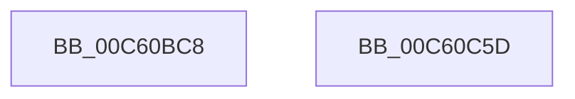

# MiMarkLargePageMappings

- RVA: `0x00C60BC8`–`0x00C60C5E` (길이 `150` bytes)
- VA: `0x0000000140C60BC8`
- 실행 섹션: `INIT`
- PDB 이름 있음: `예`; PDB Function 태그: `아니요`
- unwind 정보 RVA: `0x000B78D0`
- 디코드: `32`개 명령, `150/150` bytes 표시
- 미해석 바이트: `0` (있으면 어셈블리에 `.byte`로 보존)

> 이 문서는 커널 이미지의 기계어와 PDB 기호를 분석해 생성했습니다. 4번과 5번은 함수 원형과 자료형을 바이너리 사용 방식에서 추정한 C 해석이며 원본 소스 복구 결과는 아닙니다.

## 1. Dependencies

- 직접 호출 지점: **5**; 고유 호출 대상: **5**
- 직접 호출자로 확인된 함수: **1**
- RIP 상대 이미지 참조: **1**

### Outgoing calls
- `0x00C60BDE` → [memset](../../text/6C/memset_function_006C6C40.md) (function, `0x006C6C40`)
- `0x00C60BE8` → [MiGetAnyMultiplexedVm](../../text/44/MiGetAnyMultiplexedVm_function_00448BD0.md) (function, `0x00448BD0`)
- `0x00C60C35` → [MiLockWorkingSetShared](../../text/27/MiLockWorkingSetShared_function_0027CBF0.md) (function, `0x0027CBF0`)
- `0x00C60C43` → [MiWalkPageTables](../../text/2C/MiWalkPageTables_function_002C2710.md) (function, `0x002C2710`)
- `0x00C60C4F` → [MiUnlockWorkingSetShared](../../text/27/MiUnlockWorkingSetShared_function_0027D690.md) (function, `0x0027D690`)

### Direct callers
- [MiMarkLargePageRanges](MiMarkLargePageRanges_function_00C60CFC.md) at `0x00C60D1B`

### Static image references
- `0x00C60C21` → RVA `0x00C60C70` (`MiMarkLargePagePte`; read)

## 2. Other-region calls and transfers

- 다른 실행 섹션으로 향하는 call: **5**
  - `0x00C60BDE` → [memset](../../text/6C/memset_function_006C6C40.md) (`INIT` → `.text`)
  - `0x00C60BE8` → [MiGetAnyMultiplexedVm](../../text/44/MiGetAnyMultiplexedVm_function_00448BD0.md) (`INIT` → `.text`)
  - `0x00C60C35` → [MiLockWorkingSetShared](../../text/27/MiLockWorkingSetShared_function_0027CBF0.md) (`INIT` → `.text`)
  - `0x00C60C43` → [MiWalkPageTables](../../text/2C/MiWalkPageTables_function_002C2710.md) (`INIT` → `.text`)
  - `0x00C60C4F` → [MiUnlockWorkingSetShared](../../text/27/MiUnlockWorkingSetShared_function_0027D690.md) (`INIT` → `.text`)
- 별도 외부 분기/꼬리 이동을 확인하지 못했습니다.

## 3. Assembly (complete function range)

```asm
00C60BC8  40 53                           push rbx
00C60BCA  48 81 EC E0 00 00 00            sub rsp, 0xe0
00C60BD1  33 D2                           xor edx, edx
00C60BD3  48 8D 4C 24 20                  lea rcx, [rsp + 0x20]
00C60BD8  41 B8 C0 00 00 00               mov r8d, 0xc0
00C60BDE  E8 5D 60 A6 FF                  call 0x1406c6c40
00C60BE3  B9 04 00 00 00                  mov ecx, 4
00C60BE8  E8 E3 7F 7E FF                  call 0x140448bd0
00C60BED  8B 4C 24 24                     mov ecx, dword ptr [rsp + 0x24]
00C60BF1  48 8B D8                        mov rbx, rax
00C60BF4  48 83 4C 24 50 FF               or qword ptr [rsp + 0x50], 0xffffffffffffffff
00C60BFA  81 E1 7F FE FF FF               and ecx, 0xfffffe7f
00C60C00  83 C9 40                        or ecx, 0x40
00C60C03  C7 44 24 20 07 22 00 00         mov dword ptr [rsp + 0x20], 0x2207
00C60C0B  48 B8 00 00 00 00 00 80 FF FF   movabs rax, 0xffff800000000000
00C60C15  89 4C 24 24                     mov dword ptr [rsp + 0x24], ecx
00C60C19  48 89 44 24 48                  mov qword ptr [rsp + 0x48], rax
00C60C1E  48 8B CB                        mov rcx, rbx
00C60C21  48 8D 05 48 00 00 00            lea rax, [rip + 0x48]
00C60C28  48 89 5C 24 40                  mov qword ptr [rsp + 0x40], rbx
00C60C2D  48 89 84 24 C8 00 00 00         mov qword ptr [rsp + 0xc8], rax
00C60C35  E8 B6 BF 61 FF                  call 0x14027cbf0
00C60C3A  48 8D 4C 24 20                  lea rcx, [rsp + 0x20]
00C60C3F  88 44 24 29                     mov byte ptr [rsp + 0x29], al
00C60C43  E8 C8 1A 66 FF                  call 0x1402c2710
00C60C48  8A 54 24 29                     mov dl, byte ptr [rsp + 0x29]
00C60C4C  48 8B CB                        mov rcx, rbx
00C60C4F  E8 3C CA 61 FF                  call 0x14027d690
00C60C54  48 81 C4 E0 00 00 00            add rsp, 0xe0
00C60C5B  5B                              pop rbx
00C60C5C  C3                              ret
00C60C5D  CC                              int3
```

## 4. C-style interpretation (structured pseudocode)

```c
__int64 __fastcall MiMarkLargePageMappings(__int64 a1, int a2)
{
    __int64 result;
    __int64 v_rsp;
    unsigned __int64 v_stack_m20;
    unsigned __int64 v_stack_m98;
    unsigned __int64 v_stack_mA0;
    unsigned __int64 v_stack_mA8;
    unsigned __int8 v_stack_mBF;
    unsigned int v_stack_mC4;
    unsigned __int64 v_stack_mC8;

    v_rsp = (v_rsp) - (224);
    a2 = 0;
    result = memset(v_stack_mC8, a2, 192, a4);
    result = MiGetAnyMultiplexedVm(4, a2, 192, a4);
    a1 = (unsigned int)(((unsigned int)(v_stack_mC4)) & (0xFFFFFE7FULL));
    a1 = (unsigned int)((a1) | (64));
    v_stack_mC8 = 0x2207ULL;
    v_stack_mC4 = (unsigned int)(a1);
    v_stack_mA0 = result;
    v_stack_mA8 = result;
    v_stack_m20 = v_rip + 72;
    result = MiLockWorkingSetShared(result, a2, 192, a4);
    v_stack_mBF = (unsigned __int8)(result);
    result = MiWalkPageTables(v_stack_mC8, a2, 192, a4);
    result = MiUnlockWorkingSetShared(result, v_stack_mBF, 192, a4);
    v_rsp = (v_rsp) + (224);
    return result;
}
```

## 5. (Beta) C Style

```c
int64_t MiMarkLargePageMappings(int64_t Arg1, int32_t Arg2)
{
    int64_t result;
    int64_t local_rsp;
    uint64_t v_stack_m20;
    uint64_t v_stack_m98;
    uint64_t v_stack_mA0;
    uint64_t v_stack_mA8;
    uint8_t v_stack_mBF;
    uint32_t v_stack_mC4;
    uint64_t v_stack_mC8;

    local_rsp = (local_rsp) - (224);
    Arg2 = 0;
    result = memset(v_stack_mC8, Arg2, 192, a4);
    result = MiGetAnyMultiplexedVm(4, Arg2, 192, a4);
    Arg1 = (uint32_t)(((uint32_t)(v_stack_mC4)) & (0xFFFFFE7FULL));
    Arg1 = (uint32_t)((Arg1) | (64));
    v_stack_mC8 = 0x2207ULL;
    v_stack_mC4 = (uint32_t)(Arg1);
    v_stack_mA0 = result;
    v_stack_mA8 = result;
    v_stack_m20 = v_rip + 72;
    result = MiLockWorkingSetShared(result, Arg2, 192, a4);
    v_stack_mBF = (uint8_t)(result);
    result = MiWalkPageTables(v_stack_mC8, Arg2, 192, a4);
    result = MiUnlockWorkingSetShared(result, v_stack_mBF, 192, a4);
    local_rsp = (local_rsp) + (224);
    return result;
}
```

## 6. Execution-region graph

[열기: 2D/3D 그래프와 함수 탐색 컨트롤 패널](../../../control-panel.html?section=init&rva=0x00C60BC8&view=graph)

- 2D 그래프는 위에서 아래로 흐르고, 3D 그래프는 빈 공간을 드래그해 회전합니다. Shift+드래그는 이동, 휠은 확대·축소, 함수 노드 선택은 대상 보고서 이동입니다.

### Static fallback


