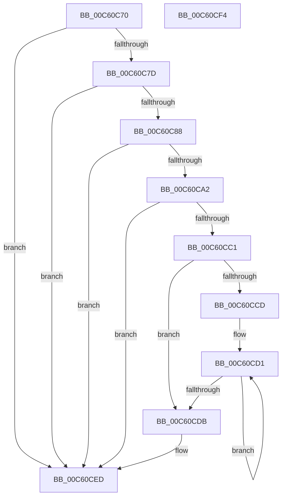

# MiMarkLargePagePte

- RVA: `0x00C60C70`–`0x00C60CF5` (길이 `133` bytes)
- VA: `0x0000000140C60C70`
- 실행 섹션: `INIT`
- PDB 이름 있음: `예`; PDB Function 태그: `아니요`
- unwind 정보 RVA: `0x0005C788`
- 디코드: `35`개 명령, `133/133` bytes 표시
- 미해석 바이트: `0` (있으면 어셈블리에 `.byte`로 보존)

> 이 문서는 커널 이미지의 기계어와 PDB 기호를 분석해 생성했습니다. 4번과 5번은 함수 원형과 자료형을 바이너리 사용 방식에서 추정한 C 해석이며 원본 소스 복구 결과는 아닙니다.

## 1. Dependencies

- 직접 호출 지점: **1**; 고유 호출 대상: **1**
- 직접 호출자로 확인된 함수: **0**
- RIP 상대 이미지 참조: **2**

### Outgoing calls
- `0x00C60CE8` → [MiUpdateLargePageBitMap](../../text/37/MiUpdateLargePageBitMap_function_0037619C.md) (function, `0x0037619C`)

### Direct callers
- 이 함수 시작 RVA로 연결되는 직접 call은 확인되지 않았습니다. 간접 호출은 완전히 역산할 수 없습니다.

### Static image references
- `0x00C60C99` → RVA `0x00E2DCE0` (`.data`; read)
- `0x00C60CE1` → RVA `0x00E38D00` (`.data`; read)

## 2. Other-region calls and transfers

- 다른 실행 섹션으로 향하는 call: **1**
  - `0x00C60CE8` → [MiUpdateLargePageBitMap](../../text/37/MiUpdateLargePageBitMap_function_0037619C.md) (`INIT` → `.text`)
- 별도 외부 분기/꼬리 이동을 확인하지 못했습니다.

## 3. Assembly (complete function range)

```asm
00C60C70  48 83 EC 28                     sub rsp, 0x28
00C60C74  45 8B C8                        mov r9d, r8d
00C60C77  41 83 F8 03                     cmp r8d, 3
00C60C7B  74 70                           je 0x140c60ced
00C60C7D  48 8B 12                        mov rdx, qword ptr [rdx]
00C60C80  8A C2                           mov al, dl
00C60C82  24 81                           and al, 0x81
00C60C84  3C 81                           cmp al, 0x81
00C60C86  75 65                           jne 0x140c60ced
00C60C88  48 C1 EA 0C                     shr rdx, 0xc
00C60C8C  48 B8 FF FF FF FF FF 00 00 00   movabs rax, 0xffffffffff
00C60C96  48 23 D0                        and rdx, rax
00C60C99  48 3B 15 40 D0 1C 00            cmp rdx, qword ptr [rip + 0x1cd040]
00C60CA0  77 4B                           ja 0x140c60ced
00C60CA2  48 8D 04 52                     lea rax, [rdx + rdx*2]
00C60CA6  48 03 C0                        add rax, rax
00C60CA9  48 B9 28 00 00 00 00 DE FF FF   movabs rcx, 0xffffde0000000028
00C60CB3  48 8B 04 C1                     mov rax, qword ptr [rcx + rax*8]
00C60CB7  48 C1 E8 36                     shr rax, 0x36
00C60CBB  0F BA E0 00                     bt eax, 0
00C60CBF  73 2C                           jae 0x140c60ced
00C60CC1  41 B8 00 02 00 00               mov r8d, 0x200
00C60CC7  41 83 F9 01                     cmp r9d, 1
00C60CCB  7E 0E                           jle 0x140c60cdb
00C60CCD  41 8D 49 FF                     lea ecx, [r9 - 1]
00C60CD1  49 C1 E0 09                     shl r8, 9
00C60CD5  48 83 E9 01                     sub rcx, 1
00C60CD9  75 F6                           jne 0x140c60cd1
00C60CDB  41 B9 05 00 00 00               mov r9d, 5
00C60CE1  48 8D 0D 18 80 1D 00            lea rcx, [rip + 0x1d8018]
00C60CE8  E8 AF 54 71 FF                  call 0x14037619c
00C60CED  33 C0                           xor eax, eax
00C60CEF  48 83 C4 28                     add rsp, 0x28
00C60CF3  C3                              ret
00C60CF4  CC                              int3
```

## 4. C-style interpretation (structured pseudocode)

```c
__int64 __fastcall MiMarkLargePagePte(__int64 a1, __int64 a2, int a3)
{
    __int64 result;
    __int64 v_rsp;

    v_rsp = (v_rsp) - (40);
    if (a3 == 3) goto loc_00C60CED;
    result = (unsigned __int8)(((unsigned __int8)(*(unsigned __int64 *)(a2))) & (129));
    if (((unsigned __int8)(result)) != 129) goto loc_00C60CED;
    a2 = (*(unsigned __int64 *)(a2)) >> (12);
    a2 = (a2) & (result);
    if (a2 > (*(unsigned __int64 *)(v_rip + 1888320))) goto loc_00C60CED;
    result = (a2 + a2 * 2) + (a2 + a2 * 2);
    result = (*(unsigned __int64 *)(a1 + result * 8)) >> (54);
    if (condition_is_above_or_equal) goto loc_00C60CED;
    if (((unsigned int)((unsigned int)(a3))) <= 1) goto loc_00C60CDB;
loc_00C60CD1:
    a3 = (512) << (9);
    a1 = ((unsigned int)(a3) - 1) - (1);
    if (condition_is_not_equal) goto loc_00C60CD1;
loc_00C60CDB:
    result = MiUpdateLargePageBitMap(v_rip + 1933336, a2, a3, 5);
loc_00C60CED:
    result = 0;
    v_rsp = (v_rsp) + (40);
    return result;
}
```

## 5. (Beta) C Style

```c
int64_t MiMarkLargePagePte(int64_t Arg1, void *Arg2, int32_t Arg3)
{
    uint8_t *arg2 = (uint8_t *)Arg2;

    int64_t result;
    int64_t local_rsp;

    local_rsp = (local_rsp) - (40);
    if (Arg3 == 3) goto loc_00C60CED;
    result = (uint8_t)(((uint8_t)(*(uint64_t *)(arg2))) & (129));
    if (((uint8_t)(result)) != 129) goto loc_00C60CED;
    Arg2 = (*(uint64_t *)(arg2)) >> (12);
    Arg2 = (Arg2) & (result);
    if (Arg2 > (*(uint64_t *)(v_rip + 0x1CD040))) goto loc_00C60CED;
    result = (Arg2 + Arg2 * 2) + (Arg2 + Arg2 * 2);
    result = (*(uint64_t *)(Arg1 + result * 8)) >> (54);
    if (condition_is_above_or_equal) goto loc_00C60CED;
    if (((uint32_t)((uint32_t)(Arg3))) <= 1) goto loc_00C60CDB;
loc_00C60CD1:
    Arg3 = (512) << (9);
    Arg1 = ((uint32_t)(Arg3) - 1) - (1);
    if (condition_is_not_equal) goto loc_00C60CD1;
loc_00C60CDB:
    result = MiUpdateLargePageBitMap(v_rip + 1933336, Arg2, Arg3, 5);
loc_00C60CED:
    result = 0;
    local_rsp = (local_rsp) + (40);
    return result;
}
```

### 관측된 메모리 오프셋

구조체 형식이 확인되지 않은 접근은 인자 기준의 오프셋으로만 기록했습니다.

| 기준 인자 | 오프셋 표현 | 폭 (bit) | 접근 |
|---|---:|---:|---|
| `Arg2` | `+ 0x0` | `64` | `R` |

## 6. Execution-region graph

[열기: 2D/3D 그래프와 함수 탐색 컨트롤 패널](../../../control-panel.html?section=init&rva=0x00C60C70&view=graph)

- 2D 그래프는 위에서 아래로 흐르고, 3D 그래프는 빈 공간을 드래그해 회전합니다. Shift+드래그는 이동, 휠은 확대·축소, 함수 노드 선택은 대상 보고서 이동입니다.

### Static fallback


