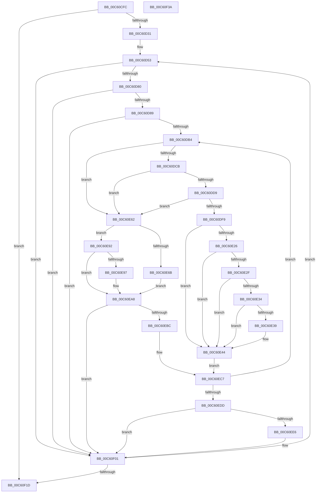

# MiMarkLargePageRanges

- RVA: `0x00C60CFC`–`0x00C60F3B` (길이 `575` bytes)
- VA: `0x0000000140C60CFC`
- 실행 섹션: `INIT`
- PDB 이름 있음: `예`; PDB Function 태그: `아니요`
- unwind 정보 RVA: `0x00075C18`
- 디코드: `139`개 명령, `575/575` bytes 표시
- 미해석 바이트: `0` (있으면 어셈블리에 `.byte`로 보존)

> 이 문서는 커널 이미지의 기계어와 PDB 기호를 분석해 생성했습니다. 4번과 5번은 함수 원형과 자료형을 바이너리 사용 방식에서 추정한 C 해석이며 원본 소스 복구 결과는 아닙니다.

## 1. Dependencies

- 직접 호출 지점: **4**; 고유 호출 대상: **3**
- 직접 호출자로 확인된 함수: **1**
- RIP 상대 이미지 참조: **2**

### Outgoing calls
- `0x00C60D1B` → [MiMarkLargePageMappings](MiMarkLargePageMappings_function_00C60BC8.md) (function, `0x00C60BC8`)
- `0x00C60E1C` → [MiFindDescriptorByPfn](../C5/MiFindDescriptorByPfn_function_00C5FBA0.md) (function, `0x00C5FBA0`)
- `0x00C60E81` → [MiUpdateLargePageBitMap](../../text/37/MiUpdateLargePageBitMap_function_0037619C.md) (function, `0x0037619C`)
- `0x00C60EFC` → [MiUpdateLargePageBitMap](../../text/37/MiUpdateLargePageBitMap_function_0037619C.md) (function, `0x0037619C`)

### Direct callers
- [MiInitializePhysicalMemoryBlocks](MiInitializePhysicalMemoryBlocks_function_00C60920.md) at `0x00C60A1F`

### Static image references
- `0x00C60D20` → RVA `0x00FC6B88` (`ALMOSTRO`; read)
- `0x00C60E6E` → RVA `0x00E38D00` (`.data`; read)

## 2. Other-region calls and transfers

- 다른 실행 섹션으로 향하는 call: **2**
  - `0x00C60E81` → [MiUpdateLargePageBitMap](../../text/37/MiUpdateLargePageBitMap_function_0037619C.md) (`INIT` → `.text`)
  - `0x00C60EFC` → [MiUpdateLargePageBitMap](../../text/37/MiUpdateLargePageBitMap_function_0037619C.md) (`INIT` → `.text`)
- 별도 외부 분기/꼬리 이동을 확인하지 못했습니다.

## 3. Assembly (complete function range)

```asm
00C60CFC  48 89 5C 24 08                  mov qword ptr [rsp + 8], rbx
00C60D01  48 89 6C 24 10                  mov qword ptr [rsp + 0x10], rbp
00C60D06  48 89 74 24 18                  mov qword ptr [rsp + 0x18], rsi
00C60D0B  57                              push rdi
00C60D0C  41 54                           push r12
00C60D0E  41 55                           push r13
00C60D10  41 56                           push r14
00C60D12  41 57                           push r15
00C60D14  48 83 EC 20                     sub rsp, 0x20
00C60D18  4C 8B E9                        mov r13, rcx
00C60D1B  E8 A8 FE FF FF                  call 0x140c60bc8
00C60D20  48 8B 05 61 5E 36 00            mov rax, qword ptr [rip + 0x365e61]
00C60D27  8B 28                           mov ebp, dword ptr [rax]
00C60D29  85 ED                           test ebp, ebp
00C60D2B  0F 84 EC 01 00 00               je 0x140c60f1d
00C60D31  44 8B F5                        mov r14d, ebp
00C60D34  49 B8 00 00 00 00 00 DE FF FF   movabs r8, 0xffffde0000000000
00C60D3E  49 C1 E6 04                     shl r14, 4
00C60D42  48 C7 C6 00 FE FF FF            mov rsi, 0xfffffffffffffe00
00C60D49  49 B9 AB AA AA AA AA AA AA AA   movabs r9, 0xaaaaaaaaaaaaaaab
00C60D53  48 8B 05 2E 5E 36 00            mov rax, qword ptr [rip + 0x365e2e]
00C60D5A  4D 8D 76 F0                     lea r14, [r14 - 0x10]
00C60D5E  FF CD                           dec ebp
00C60D60  49 8B 4C 06 10                  mov rcx, qword ptr [r14 + rax + 0x10]
00C60D65  49 8B 54 06 18                  mov rdx, qword ptr [r14 + rax + 0x18]
00C60D6A  48 03 D1                        add rdx, rcx
00C60D6D  48 81 C1 FF 01 00 00            add rcx, 0x1ff
00C60D74  48 23 D6                        and rdx, rsi
00C60D77  48 23 CE                        and rcx, rsi
00C60D7A  0F 84 81 01 00 00               je 0x140c60f01
00C60D80  48 3B CA                        cmp rcx, rdx
00C60D83  0F 83 78 01 00 00               jae 0x140c60f01
00C60D89  4C 8D 1C 49                     lea r11, [rcx + rcx*2]
00C60D8D  48 83 CF FF                     or rdi, 0xffffffffffffffff
00C60D91  49 C1 E3 04                     shl r11, 4
00C60D95  33 DB                           xor ebx, ebx
00C60D97  49 8B C0                        mov rax, r8
00C60D9A  48 2B D1                        sub rdx, rcx
00C60D9D  4C 03 D8                        add r11, rax
00C60DA0  4C 8D 24 52                     lea r12, [rdx + rdx*2]
00C60DA4  49 C1 E4 04                     shl r12, 4
00C60DA8  4D 03 E3                        add r12, r11
00C60DAB  4D 3B DC                        cmp r11, r12
00C60DAE  0F 83 4D 01 00 00               jae 0x140c60f01
00C60DB4  49 8B 43 18                     mov rax, qword ptr [r11 + 0x18]
00C60DB8  48 B9 FF FF FF FF FF FF FF 3F   movabs rcx, 0x3fffffffffffffff
00C60DC2  48 85 C1                        test rcx, rax
00C60DC5  0F 84 97 00 00 00               je 0x140c60e62
00C60DCB  41 8A 43 22                     mov al, byte ptr [r11 + 0x22]
00C60DCF  24 07                           and al, 7
00C60DD1  3C 06                           cmp al, 6
00C60DD3  0F 85 89 00 00 00               jne 0x140c60e62
00C60DD9  49 8B 43 28                     mov rax, qword ptr [r11 + 0x28]
00C60DDD  48 B9 FF FF FF FF FF 00 00 00   movabs rcx, 0xffffffffff
00C60DE7  48 23 C1                        and rax, rcx
00C60DEA  48 B9 FE FF FF FF 3F 00 00 00   movabs rcx, 0x3ffffffffe
00C60DF4  48 3B C1                        cmp rax, rcx
00C60DF7  75 69                           jne 0x140c60e62
00C60DF9  49 8B C0                        mov rax, r8
00C60DFC  4D 8B FB                        mov r15, r11
00C60DFF  49 8B CD                        mov rcx, r13
00C60E02  4C 2B F8                        sub r15, rax
00C60E05  BE 01 00 00 00                  mov esi, 1
00C60E0A  49 C1 FF 04                     sar r15, 4
00C60E0E  4D 0F AF F9                     imul r15, r9
00C60E12  48 85 DB                        test rbx, rbx
00C60E15  49 8B D7                        mov rdx, r15
00C60E18  49 0F 44 FF                     cmove rdi, r15
00C60E1C  E8 7F ED FF FF                  call 0x140c5fba0
00C60E21  48 85 C0                        test rax, rax
00C60E24  74 1E                           je 0x140c60e44
00C60E26  8B 48 18                        mov ecx, dword ptr [rax + 0x18]
00C60E29  0F BA E1 1D                     bt ecx, 0x1d
00C60E2D  72 15                           jb 0x140c60e44
00C60E2F  83 F9 02                        cmp ecx, 2
00C60E32  74 10                           je 0x140c60e44
00C60E34  83 F9 18                        cmp ecx, 0x18
00C60E37  74 0B                           je 0x140c60e44
00C60E39  48 8B 70 28                     mov rsi, qword ptr [rax + 0x28]
00C60E3D  48 03 70 20                     add rsi, qword ptr [rax + 0x20]
00C60E41  49 2B F7                        sub rsi, r15
00C60E44  48 03 DE                        add rbx, rsi
00C60E47  49 B8 00 00 00 00 00 DE FF FF   movabs r8, 0xffffde0000000000
00C60E51  48 8D 04 76                     lea rax, [rsi + rsi*2]
00C60E55  48 C7 C6 00 FE FF FF            mov rsi, 0xfffffffffffffe00
00C60E5C  48 C1 E0 04                     shl rax, 4
00C60E60  EB 65                           jmp 0x140c60ec7
00C60E62  48 81 FB 00 02 00 00            cmp rbx, 0x200
00C60E69  72 27                           jb 0x140c60e92
00C60E6B  48 23 DE                        and rbx, rsi
00C60E6E  48 8D 0D 8B 7E 1D 00            lea rcx, [rip + 0x1d7e8b]
00C60E75  4C 8B C3                        mov r8, rbx
00C60E78  41 B9 03 00 00 00               mov r9d, 3
00C60E7E  48 8B D7                        mov rdx, rdi
00C60E81  E8 16 53 71 FF                  call 0x14037619c
00C60E86  49 B8 00 00 00 00 00 DE FF FF   movabs r8, 0xffffde0000000000
00C60E90  EB 16                           jmp 0x140c60ea8
00C60E92  48 85 DB                        test rbx, rbx
00C60E95  75 11                           jne 0x140c60ea8
00C60E97  49 8B C0                        mov rax, r8
00C60E9A  49 8B FB                        mov rdi, r11
00C60E9D  48 2B F8                        sub rdi, rax
00C60EA0  48 C1 FF 04                     sar rdi, 4
00C60EA4  49 0F AF F9                     imul rdi, r9
00C60EA8  48 8D 83 00 02 00 00            lea rax, [rbx + 0x200]
00C60EAF  BB 00 00 00 00                  mov ebx, 0
00C60EB4  48 03 C7                        add rax, rdi
00C60EB7  48 23 C6                        and rax, rsi
00C60EBA  74 45                           je 0x140c60f01
00C60EBC  4C 8D 1C 40                     lea r11, [rax + rax*2]
00C60EC0  49 C1 E3 04                     shl r11, 4
00C60EC4  49 8B C0                        mov rax, r8
00C60EC7  4C 03 D8                        add r11, rax
00C60ECA  49 B9 AB AA AA AA AA AA AA AA   movabs r9, 0xaaaaaaaaaaaaaaab
00C60ED4  4D 3B DC                        cmp r11, r12
00C60ED7  0F 82 D7 FE FF FF               jb 0x140c60db4
00C60EDD  48 81 FB 00 02 00 00            cmp rbx, 0x200
00C60EE4  72 1B                           jb 0x140c60f01
00C60EE6  48 23 DE                        and rbx, rsi
00C60EE9  48 8D 0D 10 7E 1D 00            lea rcx, [rip + 0x1d7e10]
00C60EF0  4C 8B C3                        mov r8, rbx
00C60EF3  41 B9 03 00 00 00               mov r9d, 3
00C60EF9  48 8B D7                        mov rdx, rdi
00C60EFC  E8 9B 52 71 FF                  call 0x14037619c
00C60F01  49 B8 00 00 00 00 00 DE FF FF   movabs r8, 0xffffde0000000000
00C60F0B  49 B9 AB AA AA AA AA AA AA AA   movabs r9, 0xaaaaaaaaaaaaaaab
00C60F15  85 ED                           test ebp, ebp
00C60F17  0F 85 36 FE FF FF               jne 0x140c60d53
00C60F1D  48 8B 5C 24 50                  mov rbx, qword ptr [rsp + 0x50]
00C60F22  48 8B 6C 24 58                  mov rbp, qword ptr [rsp + 0x58]
00C60F27  48 8B 74 24 60                  mov rsi, qword ptr [rsp + 0x60]
00C60F2C  48 83 C4 20                     add rsp, 0x20
00C60F30  41 5F                           pop r15
00C60F32  41 5E                           pop r14
00C60F34  41 5D                           pop r13
00C60F36  41 5C                           pop r12
00C60F38  5F                              pop rdi
00C60F39  C3                              ret
00C60F3A  CC                              int3
```

## 4. C-style interpretation (structured pseudocode)

```c
__int64 __fastcall MiMarkLargePageRanges(__int64 a1)
{
    __int64 result;
    __int64 v_r11;
    __int64 v_r12;
    __int64 v_r14;
    __int64 v_r15;
    __int64 v_rbp;
    __int64 v_rbx;
    __int64 v_rdi;
    __int64 v_rsi;
    __int64 v_rsp;
    unsigned __int64 v_stack_p10;
    unsigned __int64 v_stack_p18;
    unsigned __int64 v_stack_p8;

    v_stack_p8 = v_rbx;
    v_stack_p10 = v_rbp;
    v_stack_p18 = v_rsi;
    v_rsp = (v_rsp) - (32);
    result = MiMarkLargePageMappings(a1, a2, a3, a4);
    if ((unsigned int)((unsigned int)(*(unsigned int *)(*(unsigned __int64 *)(v_rip + 3563105)))) == 0) goto loc_00C60F1D;
    v_r14 = ((unsigned int)((unsigned int)((unsigned int)(*(unsigned int *)(*(unsigned __int64 *)(v_rip + 3563105)))))) << (4);
loc_00C60D53:
    v_rbp = (unsigned int)(((unsigned int)(*(unsigned int *)(*(unsigned __int64 *)(v_rip + 3563105)))) - 1);
    a2 = (*(unsigned __int64 *)(v_r14 - 16 + *(unsigned __int64 *)(v_rip + 3563054) * 1 + 24)) + (*(unsigned __int64 *)(v_r14 - 16 + *(unsigned __int64 *)(v_rip + 3563054) * 1 + 16));
    a1 = (*(unsigned __int64 *)(v_r14 - 16 + *(unsigned __int64 *)(v_rip + 3563054) * 1 + 16)) + (511);
    a2 = (a2) & (-512);
    a1 = (a1) & (-512);
    if (condition_is_equal) goto loc_00C60F01;
    if (a1 >= a2) goto loc_00C60F01;
    v_rdi = (v_rdi) | (-1);
    v_r11 = (a1 + a1 * 2) << (4);
    v_rbx = 0;
    a2 = (a2) - (a1);
    v_r11 = (v_r11) + (a3);
    v_r12 = (a2 + a2 * 2) << (4);
    v_r12 = (v_r12) + (v_r11);
    if (v_r11 >= v_r12) goto loc_00C60F01;
loc_00C60DB4:
    if (((a1) & (*(unsigned __int64 *)(v_r11 + 24))) == 0) goto loc_00C60E62;
    result = (unsigned __int8)((*(unsigned __int8 *)(v_r11 + 34)) & (7));
    if (((unsigned __int8)(result)) != 6) goto loc_00C60E62;
    result = (*(unsigned __int64 *)(v_r11 + 40)) & (a1);
    if (result != a1) goto loc_00C60E62;
    v_r15 = (v_r11) - (a3);
    v_r15 = (v_r15) >> (4);
    v_r15 = (v_r15) * (a4);
    if (0 == 0) { v_rdi = v_r15; }
    result = MiFindDescriptorByPfn(a1, v_r15, a3, a4);
    if (result == 0) goto loc_00C60E44;
    if (condition_is_below) goto loc_00C60E44;
    if (((unsigned int)((unsigned int)(*(unsigned int *)(result + 24)))) == 2) goto loc_00C60E44;
    v_rsi = 1;
    if (((unsigned int)((unsigned int)(*(unsigned int *)(result + 24)))) != 24) {
        v_rsi = *(unsigned __int64 *)(result + 40);
        v_rsi = (v_rsi) + (*(unsigned __int64 *)(result + 32));
        v_rsi = (v_rsi) - (v_r15);
    }
    v_rbx = (v_rbx) + (v_rsi);
    result = (v_rsi + v_rsi * 2) << (4);
    goto loc_00C60EC7;
loc_00C60E62:
    if (v_rbx < 512) goto loc_00C60E92;
    v_rbx = (v_rbx) & (-512);
    result = MiUpdateLargePageBitMap(v_rip + 1932939, v_rdi, v_rbx, 3);
    goto loc_00C60EA8;
loc_00C60E92:
    if (v_rbx == 0) {
        result = v_rbx;
        v_rdi = v_r11;
        v_rdi = (v_rdi) - (result);
        v_rdi = (v_rdi) >> (4);
        v_rdi = (v_rdi) * (3);
    }
    result = (v_rbx + 512) + (v_rdi);
    result = (result) & (-512);
    if (condition_is_equal) goto loc_00C60F01;
    v_r11 = (result + result * 2) << (4);
loc_00C60EC7:
    v_r11 = (v_r11) + (v_rbx);
    if (v_r11 < v_r12) goto loc_00C60DB4;
    result = v_rbx;
    v_rbx = 0;
    if (0 >= 512) {
        v_rbx = (0) & (-512);
        a1 = v_rip + 1932816;
        a3 = v_rbx;
        a4 = 3;
        a2 = v_rdi;
        result = MiUpdateLargePageBitMap(a1, a2, a3, a4);
    }
    if ((unsigned int)(v_rbp) != 0) goto loc_00C60D53;
loc_00C60F1D:
    v_rsp = (v_rsp) + (32);
    return result;
}
```

## 5. (Beta) C Style

```c
int64_t MiMarkLargePageRanges(int64_t Arg1)
{
    int64_t result;
    int64_t local_r11;
    int64_t local_r12;
    int64_t local_r14;
    int64_t local_r15;
    int64_t local_rbp;
    int64_t local_rbx;
    int64_t local_rdi;
    int64_t local_rsi;
    int64_t local_rsp;
    uint64_t v_stack_p10;
    uint64_t v_stack_p18;
    uint64_t v_stack_p8;

    v_stack_p8 = local_rbx;
    v_stack_p10 = local_rbp;
    v_stack_p18 = local_rsi;
    local_rsp = (local_rsp) - (32);
    result = MiMarkLargePageMappings(Arg1, a2, a3, a4);
    if ((uint32_t)((uint32_t)(*(uint32_t *)(*(uint64_t *)(v_rip + 0x365E61)))) == 0) goto loc_00C60F1D;
    local_r14 = ((uint32_t)((uint32_t)((uint32_t)(*(uint32_t *)(*(uint64_t *)(v_rip + 0x365E61)))))) << (4);
loc_00C60D53:
    local_rbp = (uint32_t)(((uint32_t)(*(uint32_t *)(*(uint64_t *)(v_rip + 0x365E61)))) - 1);
    a2 = (*(uint64_t *)(local_r14 - 0x10 + *(uint64_t *)(v_rip + 0x365E2E) * 1 + 0x18)) + (*(uint64_t *)(local_r14 - 0x10 + *(uint64_t *)(v_rip + 0x365E2E) * 1 + 0x10));
    Arg1 = (*(uint64_t *)(local_r14 - 0x10 + *(uint64_t *)(v_rip + 0x365E2E) * 1 + 0x10)) + (511);
    a2 = (a2) & (-512);
    Arg1 = (Arg1) & (-512);
    if (condition_is_equal) goto loc_00C60F01;
    if (Arg1 >= a2) goto loc_00C60F01;
    local_rdi = (local_rdi) | (-1);
    local_r11 = (Arg1 + Arg1 * 2) << (4);
    local_rbx = 0;
    a2 = (a2) - (Arg1);
    local_r11 = (local_r11) + (a3);
    local_r12 = (a2 + a2 * 2) << (4);
    local_r12 = (local_r12) + (local_r11);
    if (local_r11 >= local_r12) goto loc_00C60F01;
loc_00C60DB4:
    if (((Arg1) & (*(uint64_t *)(local_r11 + 0x18))) == 0) goto loc_00C60E62;
    result = (uint8_t)((*(uint8_t *)(local_r11 + 0x22)) & (7));
    if (((uint8_t)(result)) != 6) goto loc_00C60E62;
    result = (*(uint64_t *)(local_r11 + 0x28)) & (Arg1);
    if (result != Arg1) goto loc_00C60E62;
    local_r15 = (local_r11) - (a3);
    local_r15 = (local_r15) >> (4);
    local_r15 = (local_r15) * (a4);
    if (0 == 0) { local_rdi = local_r15; }
    result = MiFindDescriptorByPfn(Arg1, local_r15, a3, a4);
    if (result == 0) goto loc_00C60E44;
    if (condition_is_below) goto loc_00C60E44;
    if (((uint32_t)((uint32_t)(*(uint32_t *)(result + 0x18)))) == 2) goto loc_00C60E44;
    local_rsi = 1;
    if (((uint32_t)((uint32_t)(*(uint32_t *)(result + 0x18)))) != 24) {
        local_rsi = *(uint64_t *)(result + 0x28);
        local_rsi = (local_rsi) + (*(uint64_t *)(result + 0x20));
        local_rsi = (local_rsi) - (local_r15);
    }
    local_rbx = (local_rbx) + (local_rsi);
    result = (local_rsi + local_rsi * 2) << (4);
    goto loc_00C60EC7;
loc_00C60E62:
    if (local_rbx < 512) goto loc_00C60E92;
    local_rbx = (local_rbx) & (-512);
    result = MiUpdateLargePageBitMap(v_rip + 1932939, local_rdi, local_rbx, 3);
    goto loc_00C60EA8;
loc_00C60E92:
    if (local_rbx == 0) {
        result = local_rbx;
        local_rdi = local_r11;
        local_rdi = (local_rdi) - (result);
        local_rdi = (local_rdi) >> (4);
        local_rdi = (local_rdi) * (3);
    }
    result = (local_rbx + 512) + (local_rdi);
    result = (result) & (-512);
    if (condition_is_equal) goto loc_00C60F01;
    local_r11 = (result + result * 2) << (4);
loc_00C60EC7:
    local_r11 = (local_r11) + (local_rbx);
    if (local_r11 < local_r12) goto loc_00C60DB4;
    result = local_rbx;
    local_rbx = 0;
    if (0 >= 512) {
        local_rbx = (0) & (-512);
        Arg1 = v_rip + 1932816;
        a3 = local_rbx;
        a4 = 3;
        a2 = local_rdi;
        result = MiUpdateLargePageBitMap(Arg1, a2, a3, a4);
    }
    if ((uint32_t)(local_rbp) != 0) goto loc_00C60D53;
loc_00C60F1D:
    local_rsp = (local_rsp) + (32);
    return result;
}
```

## 6. Execution-region graph

[열기: 2D/3D 그래프와 함수 탐색 컨트롤 패널](../../../control-panel.html?section=init&rva=0x00C60CFC&view=graph)

- 2D 그래프는 위에서 아래로 흐르고, 3D 그래프는 빈 공간을 드래그해 회전합니다. Shift+드래그는 이동, 휠은 확대·축소, 함수 노드 선택은 대상 보고서 이동입니다.

### Static fallback


