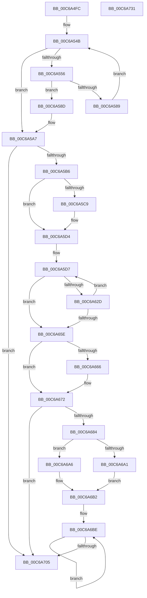

# MiMeasureDemandCoalesceTimeBounds

- RVA: `0x00C6A4FC`–`0x00C6A732` (길이 `566` bytes)
- VA: `0x0000000140C6A4FC`
- 실행 섹션: `INIT`
- PDB 이름 있음: `예`; PDB Function 태그: `아니요`
- unwind 정보 RVA: `0x000D9274`
- 디코드: `142`개 명령, `566/566` bytes 표시
- 미해석 바이트: `0` (있으면 어셈블리에 `.byte`로 보존)

> 이 문서는 커널 이미지의 기계어와 PDB 기호를 분석해 생성했습니다. 4번과 5번은 함수 원형과 자료형을 바이너리 사용 방식에서 추정한 C 해석이며 원본 소스 복구 결과는 아닙니다.

## 1. Dependencies

- 직접 호출 지점: **11**; 고유 호출 대상: **7**
- 직접 호출자로 확인된 함수: **1**
- RIP 상대 이미지 참조: **4**

### Outgoing calls
- `0x00C6A57C` → [MmAllocatePartitionNodePagesForMdlEx](../../text/3E/MmAllocatePartitionNodePagesForMdlEx_function_003EA960.md) (function, `0x003EA960`)
- `0x00C6A598` → [MiFreePagesFromMdl](../../text/3F/MiFreePagesFromMdl_function_003F8300.md) (function, `0x003F8300`)
- `0x00C6A5A2` → [ExFreePoolWithTag](../../poolcode/B8/ExFreePoolWithTag_function_00B82870.md) (function, `0x00B82870`)
- `0x00C6A5CF` → [KiRaiseIrqlProcessIrqlFlags](../../text/4F/KiRaiseIrqlProcessIrqlFlags_function_004F56FC.md) (function, `0x004F56FC`)
- `0x00C6A5DC` → [KeQueryUnbiasedInterruptTimePrecise](../../text/37/KeQueryUnbiasedInterruptTimePrecise_function_0037AC20.md) (function, `0x0037AC20`)
- `0x00C6A60C` → [MmAllocatePartitionNodePagesForMdlEx](../../text/3E/MmAllocatePartitionNodePagesForMdlEx_function_003EA960.md) (function, `0x003EA960`)
- `0x00C6A61B` → [KeQueryUnbiasedInterruptTimePrecise](../../text/37/KeQueryUnbiasedInterruptTimePrecise_function_0037AC20.md) (function, `0x0037AC20`)
- `0x00C6A638` → [MiFreePagesFromMdl](../../text/3F/MiFreePagesFromMdl_function_003F8300.md) (function, `0x003F8300`)
- `0x00C6A644` → [ExFreePoolWithTag](../../poolcode/B8/ExFreePoolWithTag_function_00B82870.md) (function, `0x00B82870`)
- `0x00C6A66D` → [KiLowerIrqlProcessIrqlFlags](../../text/4F/KiLowerIrqlProcessIrqlFlags_function_004F5698.md) (function, `0x004F5698`)
- `0x00C6A70D` → [_security_check_cookie](../../text/6A/_security_check_cookie_function_006AC640.md) (function, `0x006AC640`)

### Direct callers
- [MiInitNucleus](../C5/MiInitNucleus_function_00C5FD38.md) at `0x00C6056B`

### Static image references
- `0x00C6A519` → RVA `0x00E0A740` (`.data`; read)
- `0x00C6A54B` → RVA `0x00FC5000` (`ALMOSTRO`; read)
- `0x00C6A5C1` → RVA `0x00FC6D20` (`ALMOSTRO`; read)
- `0x00C6A6B7` → RVA `0x00000000` (`image boundary/outside`; read)

## 2. Other-region calls and transfers

- 다른 실행 섹션으로 향하는 call: **11**
  - `0x00C6A57C` → [MmAllocatePartitionNodePagesForMdlEx](../../text/3E/MmAllocatePartitionNodePagesForMdlEx_function_003EA960.md) (`INIT` → `.text`)
  - `0x00C6A598` → [MiFreePagesFromMdl](../../text/3F/MiFreePagesFromMdl_function_003F8300.md) (`INIT` → `.text`)
  - `0x00C6A5A2` → [ExFreePoolWithTag](../../poolcode/B8/ExFreePoolWithTag_function_00B82870.md) (`INIT` → `POOLCODE`)
  - `0x00C6A5CF` → [KiRaiseIrqlProcessIrqlFlags](../../text/4F/KiRaiseIrqlProcessIrqlFlags_function_004F56FC.md) (`INIT` → `.text`)
  - `0x00C6A5DC` → [KeQueryUnbiasedInterruptTimePrecise](../../text/37/KeQueryUnbiasedInterruptTimePrecise_function_0037AC20.md) (`INIT` → `.text`)
  - `0x00C6A60C` → [MmAllocatePartitionNodePagesForMdlEx](../../text/3E/MmAllocatePartitionNodePagesForMdlEx_function_003EA960.md) (`INIT` → `.text`)
  - `0x00C6A61B` → [KeQueryUnbiasedInterruptTimePrecise](../../text/37/KeQueryUnbiasedInterruptTimePrecise_function_0037AC20.md) (`INIT` → `.text`)
  - `0x00C6A638` → [MiFreePagesFromMdl](../../text/3F/MiFreePagesFromMdl_function_003F8300.md) (`INIT` → `.text`)
  - `0x00C6A644` → [ExFreePoolWithTag](../../poolcode/B8/ExFreePoolWithTag_function_00B82870.md) (`INIT` → `POOLCODE`)
  - `0x00C6A66D` → [KiLowerIrqlProcessIrqlFlags](../../text/4F/KiLowerIrqlProcessIrqlFlags_function_004F5698.md) (`INIT` → `.text`)
  - `0x00C6A70D` → [_security_check_cookie](../../text/6A/_security_check_cookie_function_006AC640.md) (`INIT` → `.text`)
- 별도 외부 분기/꼬리 이동을 확인하지 못했습니다.

## 3. Assembly (complete function range)

```asm
00C6A4FC  4C 8B DC                        mov r11, rsp
00C6A4FF  49 89 5B 08                     mov qword ptr [r11 + 8], rbx
00C6A503  49 89 6B 10                     mov qword ptr [r11 + 0x10], rbp
00C6A507  49 89 7B 18                     mov qword ptr [r11 + 0x18], rdi
00C6A50B  4D 89 63 20                     mov qword ptr [r11 + 0x20], r12
00C6A50F  41 55                           push r13
00C6A511  41 56                           push r14
00C6A513  41 57                           push r15
00C6A515  48 83 EC 70                     sub rsp, 0x70
00C6A519  48 8B 05 20 02 1A 00            mov rax, qword ptr [rip + 0x1a0220]
00C6A520  48 33 C4                        xor rax, rsp
00C6A523  48 89 44 24 68                  mov qword ptr [rsp + 0x68], rax
00C6A528  41 BF 02 00 00 00               mov r15d, 2
00C6A52E  33 DB                           xor ebx, ebx
00C6A530  45 89 7B D0                     mov dword ptr [r11 - 0x30], r15d
00C6A534  BF 00 00 01 00                  mov edi, 0x10000
00C6A539  C7 44 24 5C 28 00 00 00         mov dword ptr [rsp + 0x5c], 0x28
00C6A541  8B EB                           mov ebp, ebx
00C6A543  41 8D 47 62                     lea eax, [r15 + 0x62]
00C6A547  89 44 24 60                     mov dword ptr [rsp + 0x60], eax
00C6A54B  0F B7 05 AE AA 35 00            movzx eax, word ptr [rip + 0x35aaae]
00C6A552  3B E8                           cmp ebp, eax
00C6A554  73 51                           jae 0x140c6a5a7
00C6A556  48 89 5C 24 38                  mov qword ptr [rsp + 0x38], rbx
00C6A55B  4C 8B CF                        mov r9, rdi
00C6A55E  C7 44 24 30 67 00 00 00         mov dword ptr [rsp + 0x30], 0x67
00C6A566  4C 8B C7                        mov r8, rdi
00C6A569  89 6C 24 28                     mov dword ptr [rsp + 0x28], ebp
00C6A56D  48 83 CA FF                     or rdx, 0xffffffffffffffff
00C6A571  48 8B CB                        mov rcx, rbx
00C6A574  C7 44 24 20 01 00 00 00         mov dword ptr [rsp + 0x20], 1
00C6A57C  E8 DF 03 78 FF                  call 0x1403ea960
00C6A581  4C 8B F0                        mov r14, rax
00C6A584  48 85 C0                        test rax, rax
00C6A587  75 04                           jne 0x140c6a58d
00C6A589  FF C5                           inc ebp
00C6A58B  EB BE                           jmp 0x140c6a54b
00C6A58D  45 33 C9                        xor r9d, r9d
00C6A590  45 33 C0                        xor r8d, r8d
00C6A593  33 D2                           xor edx, edx
00C6A595  49 8B CE                        mov rcx, r14
00C6A598  E8 63 DD 78 FF                  call 0x1403f8300
00C6A59D  33 D2                           xor edx, edx
00C6A59F  49 8B CE                        mov rcx, r14
00C6A5A2  E8 C9 82 F1 FF                  call 0x140b82870
00C6A5A7  0F B7 05 52 AA 35 00            movzx eax, word ptr [rip + 0x35aa52]
00C6A5AE  3B E8                           cmp ebp, eax
00C6A5B0  0F 84 4F 01 00 00               je 0x140c6a705
00C6A5B6  4C 8B E3                        mov r12, rbx
00C6A5B9  45 0F 20 C6                     mov r14, cr8
00C6A5BD  45 0F 22 C7                     mov cr8, r15
00C6A5C1  39 1D 59 C7 35 00               cmp dword ptr [rip + 0x35c759], ebx
00C6A5C7  74 0B                           je 0x140c6a5d4
00C6A5C9  41 8A D7                        mov dl, r15b
00C6A5CC  41 8A CE                        mov cl, r14b
00C6A5CF  E8 28 B1 88 FF                  call 0x1404f56fc
00C6A5D4  44 8B FB                        mov r15d, ebx
00C6A5D7  48 8D 4C 24 48                  lea rcx, [rsp + 0x48]
00C6A5DC  E8 3F 06 71 FF                  call 0x14037ac20
00C6A5E1  48 89 5C 24 38                  mov qword ptr [rsp + 0x38], rbx
00C6A5E6  4C 8B CF                        mov r9, rdi
00C6A5E9  C7 44 24 30 67 00 00 00         mov dword ptr [rsp + 0x30], 0x67
00C6A5F1  4C 8B C7                        mov r8, rdi
00C6A5F4  89 6C 24 28                     mov dword ptr [rsp + 0x28], ebp
00C6A5F8  48 83 CA FF                     or rdx, 0xffffffffffffffff
00C6A5FC  48 8B CB                        mov rcx, rbx
00C6A5FF  C7 44 24 20 01 00 00 00         mov dword ptr [rsp + 0x20], 1
00C6A607  48 89 44 24 50                  mov qword ptr [rsp + 0x50], rax
00C6A60C  E8 4F 03 78 FF                  call 0x1403ea960
00C6A611  48 8D 4C 24 48                  lea rcx, [rsp + 0x48]
00C6A616  48 89 44 24 40                  mov qword ptr [rsp + 0x40], rax
00C6A61B  E8 00 06 71 FF                  call 0x14037ac20
00C6A620  4C 8B E8                        mov r13, rax
00C6A623  48 8B 44 24 40                  mov rax, qword ptr [rsp + 0x40]
00C6A628  48 85 C0                        test rax, rax
00C6A62B  74 31                           je 0x140c6a65e
00C6A62D  45 33 C9                        xor r9d, r9d
00C6A630  45 33 C0                        xor r8d, r8d
00C6A633  33 D2                           xor edx, edx
00C6A635  48 8B C8                        mov rcx, rax
00C6A638  E8 C3 DC 78 FF                  call 0x1403f8300
00C6A63D  48 8B 4C 24 40                  mov rcx, qword ptr [rsp + 0x40]
00C6A642  33 D2                           xor edx, edx
00C6A644  E8 27 82 F1 FF                  call 0x140b82870
00C6A649  4C 2B 6C 24 50                  sub r13, qword ptr [rsp + 0x50]
00C6A64E  41 FF C7                        inc r15d
00C6A651  4D 03 E5                        add r12, r13
00C6A654  41 83 FF 0A                     cmp r15d, 0xa
00C6A658  0F 82 79 FF FF FF               jb 0x140c6a5d7
00C6A65E  39 1D BC C6 35 00               cmp dword ptr [rip + 0x35c6bc], ebx
00C6A664  74 0C                           je 0x140c6a672
00C6A666  44 0F 20 C1                     mov rcx, cr8
00C6A66A  41 8A D6                        mov dl, r14b
00C6A66D  E8 26 B0 88 FF                  call 0x1404f5698
00C6A672  41 0F B6 C6                     movzx eax, r14b
00C6A676  44 0F 22 C0                     mov cr8, rax
00C6A67A  41 83 FF 0A                     cmp r15d, 0xa
00C6A67E  0F 85 81 00 00 00               jne 0x140c6a705
00C6A684  48 B8 CD CC CC CC CC CC CC CC   movabs rax, 0xcccccccccccccccd
00C6A68E  45 8D 4F F9                     lea r9d, [r15 - 7]
00C6A692  49 F7 E4                        mul r12
00C6A695  4C 8B C2                        mov r8, rdx
00C6A698  49 C1 E8 03                     shr r8, 3
00C6A69C  4D 3B C1                        cmp r8, r9
00C6A69F  77 05                           ja 0x140c6a6a6
00C6A6A1  45 8B C1                        mov r8d, r9d
00C6A6A4  EB 0C                           jmp 0x140c6a6b2
00C6A6A6  B8 64 00 00 00                  mov eax, 0x64
00C6A6AB  4C 3B C0                        cmp r8, rax
00C6A6AE  4C 0F 43 C0                     cmovae r8, rax
00C6A6B2  4C 8D 54 24 58                  lea r10, [rsp + 0x58]
00C6A6B7  4C 8D 1D 42 59 39 FF            lea r11, [rip - 0xc6a6be]
00C6A6BE  41 8B 02                        mov eax, dword ptr [r10]
00C6A6C1  4D 8D 52 04                     lea r10, [r10 + 4]
00C6A6C5  4A 8B 8C 1B 60 1C 01 00         mov rcx, qword ptr [rbx + r11 + 0x11c60]
00C6A6CD  48 8D 5B 08                     lea rbx, [rbx + 8]
00C6A6D1  48 C1 E9 04                     shr rcx, 4
00C6A6D5  48 0F AF C8                     imul rcx, rax
00C6A6D9  48 B8 15 AE 47 E1 7A 14 AE 47   movabs rax, 0x47ae147ae147ae15
00C6A6E3  49 0F AF C8                     imul rcx, r8
00C6A6E7  48 F7 E1                        mul rcx
00C6A6EA  48 2B CA                        sub rcx, rdx
00C6A6ED  48 D1 E9                        shr rcx, 1
00C6A6F0  48 03 CA                        add rcx, rdx
00C6A6F3  48 C1 E9 06                     shr rcx, 6
00C6A6F7  4A 89 8C 1B C8 EC E0 00         mov qword ptr [rbx + r11 + 0xe0ecc8], rcx
00C6A6FF  49 83 E9 01                     sub r9, 1
00C6A703  75 B9                           jne 0x140c6a6be
00C6A705  48 8B 4C 24 68                  mov rcx, qword ptr [rsp + 0x68]
00C6A70A  48 33 CC                        xor rcx, rsp
00C6A70D  E8 2E 1F A4 FF                  call 0x1406ac640
00C6A712  4C 8D 5C 24 70                  lea r11, [rsp + 0x70]
00C6A717  49 8B 5B 20                     mov rbx, qword ptr [r11 + 0x20]
00C6A71B  49 8B 6B 28                     mov rbp, qword ptr [r11 + 0x28]
00C6A71F  49 8B 7B 30                     mov rdi, qword ptr [r11 + 0x30]
00C6A723  4D 8B 63 38                     mov r12, qword ptr [r11 + 0x38]
00C6A727  49 8B E3                        mov rsp, r11
00C6A72A  41 5F                           pop r15
00C6A72C  41 5E                           pop r14
00C6A72E  41 5D                           pop r13
00C6A730  C3                              ret
00C6A731  CC                              int3
```

## 4. C-style interpretation (structured pseudocode)

```c
__int64 __fastcall MiMeasureDemandCoalesceTimeBounds(__int64 a1, __int64 a2)
{
    __int64 result;
    __int64 v_r12;
    __int64 v_r13;
    __int64 v_r15;
    __int64 v_rbp;
    __int64 v_rbx;
    __int64 v_rsp;
    unsigned __int64 v_stack_m18;
    unsigned __int64 v_stack_m20;
    unsigned int v_stack_m28;
    unsigned int v_stack_m2C;
    unsigned __int64 v_stack_m30;
    unsigned __int64 v_stack_m38;
    unsigned __int64 v_stack_m40;
    unsigned __int64 v_stack_m48;
    unsigned __int64 v_stack_m50;
    unsigned int v_stack_m58;
    unsigned int v_stack_m60;
    unsigned int v_stack_m68;

    *(unsigned __int64 *)(v_rsp + 8) = v_rbx;
    *(unsigned __int64 *)(v_rsp + 16) = v_rbp;
    *(unsigned __int64 *)(v_rsp + 24) = v_rdi;
    *(unsigned __int64 *)(v_rsp + 32) = v_r12;
    v_rsp = (v_rsp) - (112);
    result = (*(unsigned __int64 *)(v_rip + 1704480)) ^ (v_rsp);
    v_stack_m20 = result;
    v_rbx = 0;
    *(unsigned int *)(v_rsp - 48) = 2;
    v_stack_m2C = 40;
    v_stack_m28 = (unsigned int)(2 + 98);
loc_00C6A54B:
    if (0 >= ((unsigned int)(*(unsigned __int16 *)(v_rip + 3517102)))) goto loc_00C6A5A7;
    v_stack_m50 = 0;
    v_stack_m58 = 103;
    v_stack_m60 = 0;
    a2 = (a2) | (-1);
    v_stack_m68 = 1;
    result = MmAllocatePartitionNodePagesForMdlEx(0, a2, (unsigned int)(0x10000ULL), (unsigned int)(0x10000ULL));
    if (result != 0) goto loc_00C6A58D;
    v_rbp = (unsigned int)((0) + 1);
    goto loc_00C6A54B;
loc_00C6A58D:
    a4 = 0;
    a3 = 0;
    a2 = 0;
    result = MiFreePagesFromMdl(result, a2, a3, a4);
    a2 = 0;
    result = ExFreePoolWithTag(result, a2, a3, a4);
loc_00C6A5A7:
    if (((unsigned int)(v_rbp)) == ((unsigned int)(*(unsigned __int16 *)(v_rip + 3517010)))) goto loc_00C6A705;
    result = *(unsigned __int16 *)(v_rip + 3517010);
    if ((*(unsigned int *)(v_rip + 3524441)) != 0) {
        a2 = 2;
        a1 = (unsigned __int8)(v_cr8);
        result = KiRaiseIrqlProcessIrqlFlags(a1, a2, a3, a4);
    }
loc_00C6A5D7:
    result = KeQueryUnbiasedInterruptTimePrecise(v_stack_m40, a2, a3, a4);
    v_stack_m50 = 0;
    v_stack_m58 = 103;
    v_stack_m60 = (unsigned int)(v_rbp);
    a2 = (a2) | (-1);
    v_stack_m68 = 1;
    v_stack_m38 = result;
    result = MmAllocatePartitionNodePagesForMdlEx(0, a2, (unsigned int)(0x10000ULL), (unsigned int)(0x10000ULL));
    v_stack_m48 = result;
    result = KeQueryUnbiasedInterruptTimePrecise(v_stack_m40, a2, (unsigned int)(0x10000ULL), (unsigned int)(0x10000ULL));
    if (v_stack_m48 == 0) goto loc_00C6A65E;
    a4 = 0;
    a3 = 0;
    a2 = 0;
    result = MiFreePagesFromMdl(v_stack_m48, a2, a3, a4);
    a2 = 0;
    result = ExFreePoolWithTag(v_stack_m48, a2, a3, a4);
    v_r13 = (result) - (v_stack_m38);
    v_r15 = (unsigned int)((0) + 1);
    v_r12 = (0) + (v_r13);
    if (((unsigned int)(v_r15)) < 10) goto loc_00C6A5D7;
loc_00C6A65E:
    if ((*(unsigned int *)(v_rip + 3524284)) != 0) {
        a1 = 2;
        a2 = (unsigned __int8)(v_cr8);
        result = KiLowerIrqlProcessIrqlFlags(a1, a2, a3, a4);
    }
    if (((unsigned int)(v_r15)) != 10) goto loc_00C6A705;
    a3 = (a2) >> (3);
    if (a3 > (v_r15 - 7)) goto loc_00C6A6A6;
    goto loc_00C6A6B2;
loc_00C6A6A6:
    a3 = (unsigned int)((unsigned int)(v_r15 - 7));
    if (((unsigned int)((unsigned int)(v_r15 - 7))) >= 100) { a3 = 100; }
loc_00C6A6B2:
loc_00C6A6BE:
    a1 = (*(unsigned __int64 *)(v_rbx + v_rip - 13018814 * 1 + 72800)) >> (4);
    a1 = (a1) * ((unsigned int)(*(unsigned int *)(v_stack_m30)));
    a1 = (a1) * (a3);
    a1 = (a1) - (a2);
    a1 = (a1) >> (1);
    a1 = (a1) + (a2);
    a1 = (a1) >> (6);
    *(unsigned __int64 *)(v_rbx + 8 + v_rip - 13018814 * 1 + 14740680) = a1;
    a4 = (v_r15 - 7) - (1);
    if (condition_is_not_equal) goto loc_00C6A6BE;
loc_00C6A705:
    a1 = (v_stack_m20) ^ (v_rsp);
    result = _security_check_cookie(a1, a2, a3, a4);
    return result;
}
```

## 5. (Beta) C Style

```c
int64_t MiMeasureDemandCoalesceTimeBounds(int64_t Arg1, int64_t Arg2)
{
    int64_t result;
    int64_t local_r12;
    int64_t local_r13;
    int64_t local_r15;
    int64_t local_rbp;
    int64_t local_rbx;
    int64_t local_rsp;
    uint64_t v_stack_m18;
    uint64_t v_stack_m20;
    uint32_t v_stack_m28;
    uint32_t v_stack_m2C;
    uint64_t v_stack_m30;
    uint64_t v_stack_m38;
    uint64_t v_stack_m40;
    uint64_t v_stack_m48;
    uint64_t v_stack_m50;
    uint32_t v_stack_m58;
    uint32_t v_stack_m60;
    uint32_t v_stack_m68;

    *(uint64_t *)(local_rsp + 0x8) = local_rbx;
    *(uint64_t *)(local_rsp + 0x10) = local_rbp;
    *(uint64_t *)(local_rsp + 0x18) = local_rdi;
    *(uint64_t *)(local_rsp + 0x20) = local_r12;
    local_rsp = (local_rsp) - (112);
    result = (*(uint64_t *)(v_rip + 0x1A0220)) ^ (local_rsp);
    v_stack_m20 = result;
    local_rbx = 0;
    *(uint32_t *)(local_rsp - 0x30) = 2;
    v_stack_m2C = 40;
    v_stack_m28 = (uint32_t)(2 + 98);
loc_00C6A54B:
    if (0 >= ((uint32_t)(*(uint16_t *)(v_rip + 0x35AAAE)))) goto loc_00C6A5A7;
    v_stack_m50 = 0;
    v_stack_m58 = 103;
    v_stack_m60 = 0;
    Arg2 = (Arg2) | (-1);
    v_stack_m68 = 1;
    result = MmAllocatePartitionNodePagesForMdlEx(0, Arg2, (uint32_t)(0x10000ULL), (uint32_t)(0x10000ULL));
    if (result != 0) goto loc_00C6A58D;
    local_rbp = (uint32_t)((0) + 1);
    goto loc_00C6A54B;
loc_00C6A58D:
    a4 = 0;
    a3 = 0;
    Arg2 = 0;
    result = MiFreePagesFromMdl(result, Arg2, a3, a4);
    Arg2 = 0;
    result = ExFreePoolWithTag(result, Arg2, a3, a4);
loc_00C6A5A7:
    if (((uint32_t)(local_rbp)) == ((uint32_t)(*(uint16_t *)(v_rip + 0x35AA52)))) goto loc_00C6A705;
    result = *(uint16_t *)(v_rip + 0x35AA52);
    if ((*(uint32_t *)(v_rip + 0x35C759)) != 0) {
        Arg2 = 2;
        Arg1 = (uint8_t)(v_cr8);
        result = KiRaiseIrqlProcessIrqlFlags(Arg1, Arg2, a3, a4);
    }
loc_00C6A5D7:
    result = KeQueryUnbiasedInterruptTimePrecise(v_stack_m40, Arg2, a3, a4);
    v_stack_m50 = 0;
    v_stack_m58 = 103;
    v_stack_m60 = (uint32_t)(local_rbp);
    Arg2 = (Arg2) | (-1);
    v_stack_m68 = 1;
    v_stack_m38 = result;
    result = MmAllocatePartitionNodePagesForMdlEx(0, Arg2, (uint32_t)(0x10000ULL), (uint32_t)(0x10000ULL));
    v_stack_m48 = result;
    result = KeQueryUnbiasedInterruptTimePrecise(v_stack_m40, Arg2, (uint32_t)(0x10000ULL), (uint32_t)(0x10000ULL));
    if (v_stack_m48 == 0) goto loc_00C6A65E;
    a4 = 0;
    a3 = 0;
    Arg2 = 0;
    result = MiFreePagesFromMdl(v_stack_m48, Arg2, a3, a4);
    Arg2 = 0;
    result = ExFreePoolWithTag(v_stack_m48, Arg2, a3, a4);
    local_r13 = (result) - (v_stack_m38);
    local_r15 = (uint32_t)((0) + 1);
    local_r12 = (0) + (local_r13);
    if (((uint32_t)(local_r15)) < 10) goto loc_00C6A5D7;
loc_00C6A65E:
    if ((*(uint32_t *)(v_rip + 0x35C6BC)) != 0) {
        Arg1 = 2;
        Arg2 = (uint8_t)(v_cr8);
        result = KiLowerIrqlProcessIrqlFlags(Arg1, Arg2, a3, a4);
    }
    if (((uint32_t)(local_r15)) != 10) goto loc_00C6A705;
    a3 = (Arg2) >> (3);
    if (a3 > (local_r15 - 7)) goto loc_00C6A6A6;
    goto loc_00C6A6B2;
loc_00C6A6A6:
    a3 = (uint32_t)((uint32_t)(local_r15 - 7));
    if (((uint32_t)((uint32_t)(local_r15 - 7))) >= 100) { a3 = 100; }
loc_00C6A6B2:
loc_00C6A6BE:
    Arg1 = (*(uint64_t *)(local_rbx + v_rip - 0xC6A6BE * 1 + 0x11C60)) >> (4);
    Arg1 = (Arg1) * ((uint32_t)(*(uint32_t *)(v_stack_m30)));
    Arg1 = (Arg1) * (a3);
    Arg1 = (Arg1) - (Arg2);
    Arg1 = (Arg1) >> (1);
    Arg1 = (Arg1) + (Arg2);
    Arg1 = (Arg1) >> (6);
    *(uint64_t *)(local_rbx + 0x8 + v_rip - 0xC6A6BE * 1 + 0xE0ECC8) = Arg1;
    a4 = (local_r15 - 7) - (1);
    if (condition_is_not_equal) goto loc_00C6A6BE;
loc_00C6A705:
    Arg1 = (v_stack_m20) ^ (local_rsp);
    result = _security_check_cookie(Arg1, Arg2, a3, a4);
    return result;
}
```

## 6. Execution-region graph

[열기: 2D/3D 그래프와 함수 탐색 컨트롤 패널](../../../control-panel.html?section=init&rva=0x00C6A4FC&view=graph)

- 2D 그래프는 위에서 아래로 흐르고, 3D 그래프는 빈 공간을 드래그해 회전합니다. Shift+드래그는 이동, 휠은 확대·축소, 함수 노드 선택은 대상 보고서 이동입니다.

### Static fallback


