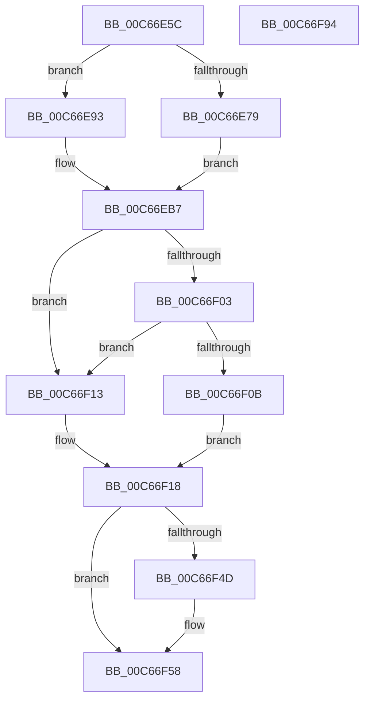

# MiMemoryLicense

- RVA: `0x00C66E5C`–`0x00C66F95` (길이 `313` bytes)
- VA: `0x0000000140C66E5C`
- 실행 섹션: `INIT`
- PDB 이름 있음: `예`; PDB Function 태그: `아니요`
- unwind 정보 RVA: `0x000D83F8`
- 디코드: `73`개 명령, `313/313` bytes 표시
- 미해석 바이트: `0` (있으면 어셈블리에 `.byte`로 보존)

> 이 문서는 커널 이미지의 기계어와 PDB 기호를 분석해 생성했습니다. 4번과 5번은 함수 원형과 자료형을 바이너리 사용 방식에서 추정한 C 해석이며 원본 소스 복구 결과는 아닙니다.

## 1. Dependencies

- 직접 호출 지점: **3**; 고유 호출 대상: **3**
- 직접 호출자로 확인된 함수: **1**
- RIP 상대 이미지 참조: **11**

### Outgoing calls
- `0x00C66EFA` → [NtQueryLicenseValue](../../page/96/NtQueryLicenseValue_function_0096BCC0.md) (function, `0x0096BCC0`)
- `0x00C66F61` → [MiLimitLoaderBlockHighMemory](MiLimitLoaderBlockHighMemory_function_00C66AA8.md) (function, `0x00C66AA8`)
- `0x00C66F6C` → [MiLimitLoaderBlockTotalMemory](MiLimitLoaderBlockTotalMemory_function_00C66C54.md) (function, `0x00C66C54`)

### Direct callers
- [MiInitNucleus](../C5/MiInitNucleus_function_00C5FD38.md) at `0x00C5FEF0`

### Static image references
- `0x00C66E69` → RVA `0x00FC521C` (`ALMOSTRO`; read)
- `0x00C66E79` → RVA `0x00FC5008` (`ALMOSTRO`; read)
- `0x00C66E8A` → RVA `0x00FC521C` (`ALMOSTRO`; read/write)
- `0x00C66EAD` → RVA `0x00FC521C` (`ALMOSTRO`; write)
- `0x00C66EBC` → RVA `0x00C7E630` (` ?? ::PBOPGDP::`string'`; read)
- `0x00C66F18` → RVA `0x00E2DC3C` (`.data`; read)
- `0x00C66F2D` → RVA `0x00E2DC48` (`.data`; write)
- `0x00C66F41` → RVA `0x00E2DC80` (`.data`; read)
- `0x00C66F71` → RVA `0x00E2DCE0` (`.data`; write)
- `0x00C66F7D` → RVA `0x00FC6BD4` (`ALMOSTRO`; write)
- `0x00C66F84` → RVA `0x00E35C00` (`.data`; write)

## 2. Other-region calls and transfers

- 다른 실행 섹션으로 향하는 call: **1**
  - `0x00C66EFA` → [NtQueryLicenseValue](../../page/96/NtQueryLicenseValue_function_0096BCC0.md) (`INIT` → `PAGE`)
- 별도 외부 분기/꼬리 이동을 확인하지 못했습니다.

## 3. Assembly (complete function range)

```asm
00C66E5C  48 89 5C 24 08                  mov qword ptr [rsp + 8], rbx
00C66E61  56                              push rsi
00C66E62  57                              push rdi
00C66E63  41 56                           push r14
00C66E65  48 83 EC 40                     sub rsp, 0x40
00C66E69  8B 05 AD E3 35 00               mov eax, dword ptr [rip + 0x35e3ad]
00C66E6F  48 8B F1                        mov rsi, rcx
00C66E72  3D 57 00 69 00                  cmp eax, 0x690057
00C66E77  75 1A                           jne 0x140c66e93
00C66E79  48 8B 05 88 E1 35 00            mov rax, qword ptr [rip + 0x35e188]
00C66E80  C7 80 64 02 00 00 01 00 00 00   mov dword ptr [rax + 0x264], 1
00C66E8A  83 25 8B E3 35 00 00            and dword ptr [rip + 0x35e38b], 0
00C66E91  EB 24                           jmp 0x140c66eb7
00C66E93  33 C9                           xor ecx, ecx
00C66E95  3D 4C 00 61 00                  cmp eax, 0x61004c
00C66E9A  48 8B 05 67 E1 35 00            mov rax, qword ptr [rip + 0x35e167]
00C66EA1  0F 95 C1                        setne cl
00C66EA4  83 C1 02                        add ecx, 2
00C66EA7  89 88 64 02 00 00               mov dword ptr [rax + 0x264], ecx
00C66EAD  C7 05 65 E3 35 00 01 00 00 00   mov dword ptr [rip + 0x35e365], 1
00C66EB7  83 64 24 78 00                  and dword ptr [rsp + 0x78], 0
00C66EBC  48 8D 05 6D 77 01 00            lea rax, [rip + 0x1776d]
00C66EC3  83 64 24 68 00                  and dword ptr [rsp + 0x68], 0
00C66EC8  4C 8D 44 24 68                  lea r8, [rsp + 0x68]
00C66ECD  48 89 44 24 38                  mov qword ptr [rsp + 0x38], rax
00C66ED2  48 8D 54 24 78                  lea rdx, [rsp + 0x78]
00C66ED7  48 8D 44 24 70                  lea rax, [rsp + 0x70]
00C66EDC  48 C7 44 24 30 3C 00 3E 00      mov qword ptr [rsp + 0x30], 0x3e003c
00C66EE5  41 B9 04 00 00 00               mov r9d, 4
00C66EEB  48 89 44 24 20                  mov qword ptr [rsp + 0x20], rax
00C66EF0  48 8D 4C 24 30                  lea rcx, [rsp + 0x30]
00C66EF5  44 89 4C 24 70                  mov dword ptr [rsp + 0x70], r9d
00C66EFA  E8 C1 4D D0 FF                  call 0x14096bcc0
00C66EFF  85 C0                           test eax, eax
00C66F01  78 10                           js 0x140c66f13
00C66F03  8B 44 24 68                     mov eax, dword ptr [rsp + 0x68]
00C66F07  85 C0                           test eax, eax
00C66F09  74 08                           je 0x140c66f13
00C66F0B  8B F8                           mov edi, eax
00C66F0D  48 C1 E7 08                     shl rdi, 8
00C66F11  EB 05                           jmp 0x140c66f18
00C66F13  BF 00 00 08 00                  mov edi, 0x80000
00C66F18  8B 0D 1E 6D 1C 00               mov ecx, dword ptr [rip + 0x1c6d1e]
00C66F1E  49 BE FE F7 FF FF 3F 00 00 00   movabs r14, 0x3ffffff7fe
00C66F28  B8 01 00 00 00                  mov eax, 1
00C66F2D  48 89 3D 14 6D 1C 00            mov qword ptr [rip + 0x1c6d14], rdi
00C66F34  48 D3 E0                        shl rax, cl
00C66F37  49 8B DE                        mov rbx, r14
00C66F3A  49 3B C6                        cmp rax, r14
00C66F3D  48 0F 42 D8                     cmovb rbx, rax
00C66F41  48 8B 05 38 6D 1C 00            mov rax, qword ptr [rip + 0x1c6d38]
00C66F48  48 85 C0                        test rax, rax
00C66F4B  74 0B                           je 0x140c66f58
00C66F4D  48 C1 E8 0C                     shr rax, 0xc
00C66F51  48 3B D8                        cmp rbx, rax
00C66F54  48 0F 47 D8                     cmova rbx, rax
00C66F58  48 FF CB                        dec rbx
00C66F5B  48 8B CE                        mov rcx, rsi
00C66F5E  48 8B D3                        mov rdx, rbx
00C66F61  E8 42 FB FF FF                  call 0x140c66aa8
00C66F66  48 8B D7                        mov rdx, rdi
00C66F69  48 8B CE                        mov rcx, rsi
00C66F6C  E8 E3 FC FF FF                  call 0x140c66c54
00C66F71  48 89 1D 68 6D 1C 00            mov qword ptr [rip + 0x1c6d68], rbx
00C66F78  48 8B 5C 24 60                  mov rbx, qword ptr [rsp + 0x60]
00C66F7D  C6 05 50 FC 35 00 01            mov byte ptr [rip + 0x35fc50], 1
00C66F84  4C 89 35 75 EC 1C 00            mov qword ptr [rip + 0x1cec75], r14
00C66F8B  48 83 C4 40                     add rsp, 0x40
00C66F8F  41 5E                           pop r14
00C66F91  5F                              pop rdi
00C66F92  5E                              pop rsi
00C66F93  C3                              ret
00C66F94  CC                              int3
```

## 4. C-style interpretation (structured pseudocode)

```c
__int64 __fastcall MiMemoryLicense(__int64 a1)
{
    __int64 result;
    __int64 v_rbx;
    __int64 v_rdi;
    __int64 v_rsp;
    unsigned __int64 v_stack_m20;
    unsigned __int64 v_stack_m28;
    unsigned __int64 v_stack_m38;
    unsigned int v_stack_p10;
    unsigned __int64 v_stack_p18;
    unsigned int v_stack_p20;
    unsigned __int64 v_stack_p8;

    v_stack_p8 = v_rbx;
    v_rsp = (v_rsp) - (64);
    if (((unsigned int)((unsigned int)(*(unsigned int *)(v_rip + 3531693)))) != 0x690057ULL) goto loc_00C66E93;
    *(unsigned int *)(*(unsigned __int64 *)(v_rip + 3531144) + 612) = 1;
    goto loc_00C66EB7;
loc_00C66E93:
    a1 = 0;
    a1 = (((unsigned int)(*(unsigned __int64 *)(v_rip + 3531144))) != 0x61004CULL) ? 1 : 0;
    a1 = (unsigned int)((a1) + (2));
    *(unsigned int *)(*(unsigned __int64 *)(v_rip + 3531111) + 612) = (unsigned int)(a1);
    *(unsigned int *)(v_rip + 3531621) = 1;
loc_00C66EB7:
    v_stack_m20 = v_rip + 96109;
    v_stack_m28 = 0x3E003CULL;
    v_stack_m38 = v_stack_p18;
    v_stack_p18 = 4;
    result = NtQueryLicenseValue(v_stack_m28, v_stack_p20, v_stack_p10, 4);
    if (sign_flag) goto loc_00C66F13;
    if ((unsigned int)((unsigned int)(v_stack_p10)) == 0) goto loc_00C66F13;
    v_rdi = ((unsigned int)((unsigned int)((unsigned int)(v_stack_p10)))) << (8);
    goto loc_00C66F18;
loc_00C66F13:
loc_00C66F18:
    *(unsigned __int64 *)(v_rip + 1862932) = (unsigned int)(0x80000ULL);
    result = (1) << ((unsigned __int8)((unsigned int)(*(unsigned int *)(v_rip + 1862942))));
    v_rbx = v_r14;
    if (result < v_r14) { v_rbx = result; }
    result = *(unsigned __int64 *)(v_rip + 1862968);
    if (*(unsigned __int64 *)(v_rip + 1862968) != 0) {
        result = (*(unsigned __int64 *)(v_rip + 1862968)) >> (12);
        if (v_rbx > result) { v_rbx = result; }
    }
    v_rbx = (v_rbx) - 1;
    result = MiLimitLoaderBlockHighMemory(a1, v_rbx, v_stack_p10, 4);
    result = MiLimitLoaderBlockTotalMemory(a1, (unsigned int)(0x80000ULL), v_stack_p10, 4);
    *(unsigned __int64 *)(v_rip + 1863016) = v_rbx;
    *(unsigned __int8 *)(v_rip + 3538000) = 1;
    *(unsigned __int64 *)(v_rip + 1895541) = v_r14;
    v_rsp = (v_rsp) + (64);
    return result;
}
```

## 5. (Beta) C Style

```c
int64_t MiMemoryLicense(int64_t Arg1)
{
    int64_t result;
    int64_t local_rbx;
    int64_t local_rdi;
    int64_t local_rsp;
    uint64_t v_stack_m20;
    uint64_t v_stack_m28;
    uint64_t v_stack_m38;
    uint32_t v_stack_p10;
    uint64_t v_stack_p18;
    uint32_t v_stack_p20;
    uint64_t v_stack_p8;

    v_stack_p8 = local_rbx;
    local_rsp = (local_rsp) - (64);
    if (((uint32_t)((uint32_t)(*(uint32_t *)(v_rip + 0x35E3AD)))) != 0x690057ULL) goto loc_00C66E93;
    *(uint32_t *)(*(uint64_t *)(v_rip + 0x35E188) + 0x264) = 1;
    goto loc_00C66EB7;
loc_00C66E93:
    Arg1 = 0;
    Arg1 = (((uint32_t)(*(uint64_t *)(v_rip + 0x35E188))) != 0x61004CULL) ? 1 : 0;
    Arg1 = (uint32_t)((Arg1) + (2));
    *(uint32_t *)(*(uint64_t *)(v_rip + 0x35E167) + 0x264) = (uint32_t)(Arg1);
    *(uint32_t *)(v_rip + 0x35E365) = 1;
loc_00C66EB7:
    v_stack_m20 = v_rip + 96109;
    v_stack_m28 = 0x3E003CULL;
    v_stack_m38 = v_stack_p18;
    v_stack_p18 = 4;
    result = NtQueryLicenseValue(v_stack_m28, v_stack_p20, v_stack_p10, 4);
    if (sign_flag) goto loc_00C66F13;
    if ((uint32_t)((uint32_t)(v_stack_p10)) == 0) goto loc_00C66F13;
    local_rdi = ((uint32_t)((uint32_t)((uint32_t)(v_stack_p10)))) << (8);
    goto loc_00C66F18;
loc_00C66F13:
loc_00C66F18:
    *(uint64_t *)(v_rip + 0x1C6D14) = (uint32_t)(0x80000ULL);
    result = (1) << ((uint8_t)((uint32_t)(*(uint32_t *)(v_rip + 0x1C6D1E))));
    local_rbx = local_r14;
    if (result < local_r14) { local_rbx = result; }
    result = *(uint64_t *)(v_rip + 0x1C6D38);
    if (*(uint64_t *)(v_rip + 0x1C6D38) != 0) {
        result = (*(uint64_t *)(v_rip + 0x1C6D38)) >> (12);
        if (local_rbx > result) { local_rbx = result; }
    }
    local_rbx = (local_rbx) - 1;
    result = MiLimitLoaderBlockHighMemory(Arg1, local_rbx, v_stack_p10, 4);
    result = MiLimitLoaderBlockTotalMemory(Arg1, (uint32_t)(0x80000ULL), v_stack_p10, 4);
    *(uint64_t *)(v_rip + 0x1C6D68) = local_rbx;
    *(uint8_t *)(v_rip + 0x35FC50) = 1;
    *(uint64_t *)(v_rip + 0x1CEC75) = local_r14;
    local_rsp = (local_rsp) + (64);
    return result;
}
```

## 6. Execution-region graph

[열기: 2D/3D 그래프와 함수 탐색 컨트롤 패널](../../../control-panel.html?section=init&rva=0x00C66E5C&view=graph)

- 2D 그래프는 위에서 아래로 흐르고, 3D 그래프는 빈 공간을 드래그해 회전합니다. Shift+드래그는 이동, 휠은 확대·축소, 함수 노드 선택은 대상 보고서 이동입니다.

### Static fallback


