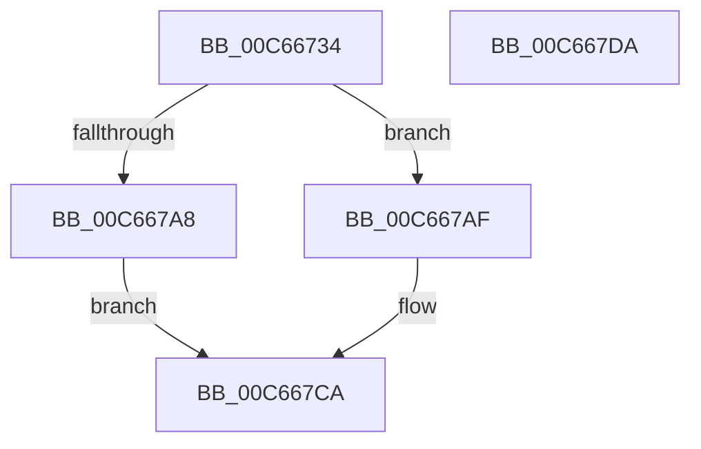

# MiPrepareScpFixupsForNtAndHal

- RVA: `0x00C66734`–`0x00C667DB` (길이 `167` bytes)
- VA: `0x0000000140C66734`
- 실행 섹션: `INIT`
- PDB 이름 있음: `예`; PDB Function 태그: `아니요`
- unwind 정보 RVA: `0x000A9ACC`
- 디코드: `43`개 명령, `167/167` bytes 표시
- 미해석 바이트: `0` (있으면 어셈블리에 `.byte`로 보존)

> 이 문서는 커널 이미지의 기계어와 PDB 기호를 분석해 생성했습니다. 4번과 5번은 함수 원형과 자료형을 바이너리 사용 방식에서 추정한 C 해석이며 원본 소스 복구 결과는 아닙니다.

## 1. Dependencies

- 직접 호출 지점: **3**; 고유 호출 대상: **3**
- 직접 호출자로 확인된 함수: **1**
- RIP 상대 이미지 참조: **5**

### Outgoing calls
- `0x00C66778` → [RtlImageNtHeaderEx](../../text/41/RtlImageNtHeaderEx_function_0041EAA0.md) (function, `0x0041EAA0`)
- `0x00C66789` → [RtlLookupImageSectionByName](../../text/4B/RtlLookupImageSectionByName_function_004B4F20.md) (function, `0x004B4F20`)
- `0x00C667C5` → [MiApplyDynamicFixupsToKernelAndHal](MiApplyDynamicFixupsToKernelAndHal_function_00C65EBC.md) (function, `0x00C65EBC`)

### Direct callers
- [MiRebaseDynamicRelocationRegions](MiRebaseDynamicRelocationRegions_function_00C65C4C.md) at `0x00C65DD9`

### Static image references
- `0x00C66768` → RVA `0x00E2D838` (`.data`; write)
- `0x00C66782` → RVA `0x00C7E680` (` ?? ::PBOPGDP::`string'`; read)
- `0x00C667A0` → RVA `0x00E2D838` (`.data`; read)
- `0x00C667B8` → RVA `0x00E2D83C` (`.data`; write)
- `0x00C667BE` → RVA `0x00E2D830` (`.data`; write)

## 2. Other-region calls and transfers

- 다른 실행 섹션으로 향하는 call: **2**
  - `0x00C66778` → [RtlImageNtHeaderEx](../../text/41/RtlImageNtHeaderEx_function_0041EAA0.md) (`INIT` → `.text`)
  - `0x00C66789` → [RtlLookupImageSectionByName](../../text/4B/RtlLookupImageSectionByName_function_004B4F20.md) (`INIT` → `.text`)
- 별도 외부 분기/꼬리 이동을 확인하지 못했습니다.

## 3. Assembly (complete function range)

```asm
00C66734  4C 8B DC                        mov r11, rsp
00C66737  49 89 5B 10                     mov qword ptr [r11 + 0x10], rbx
00C6673B  49 89 73 18                     mov qword ptr [r11 + 0x18], rsi
00C6673F  57                              push rdi
00C66740  48 83 EC 20                     sub rsp, 0x20
00C66744  4C 8B 41 10                     mov r8, qword ptr [rcx + 0x10]
00C66748  4D 8D 4B 08                     lea r9, [r11 + 8]
00C6674C  48 8B 81 F0 00 00 00            mov rax, qword ptr [rcx + 0xf0]
00C66753  33 DB                           xor ebx, ebx
00C66755  48 8B F9                        mov rdi, rcx
00C66758  49 89 5B 08                     mov qword ptr [r11 + 8], rbx
00C6675C  8B 90 AC 0D 00 00               mov edx, dword ptr [rax + 0xdac]
00C66762  8D 4B 01                        lea ecx, [rbx + 1]
00C66765  C1 EA 0C                        shr edx, 0xc
00C66768  89 15 CA 70 1C 00               mov dword ptr [rip + 0x1c70ca], edx
00C6676E  49 8B 70 30                     mov rsi, qword ptr [r8 + 0x30]
00C66772  45 33 C0                        xor r8d, r8d
00C66775  48 8B D6                        mov rdx, rsi
00C66778  E8 23 83 7B FF                  call 0x14041eaa0
00C6677D  48 8B 4C 24 30                  mov rcx, qword ptr [rsp + 0x30]
00C66782  48 8D 15 F7 7E 01 00            lea rdx, [rip + 0x17ef7]
00C66789  E8 92 E7 84 FF                  call 0x1404b4f20
00C6678E  8B 48 08                        mov ecx, dword ptr [rax + 8]
00C66791  F7 C1 FF 0F 00 00               test ecx, 0xfff
00C66797  0F 95 C3                        setne bl
00C6679A  C1 E9 0C                        shr ecx, 0xc
00C6679D  8D 14 0B                        lea edx, [rbx + rcx]
00C667A0  3B 15 92 70 1C 00               cmp edx, dword ptr [rip + 0x1c7092]
00C667A6  76 07                           jbe 0x140c667af
00C667A8  B8 0D 00 00 C0                  mov eax, 0xc000000d
00C667AD  EB 1B                           jmp 0x140c667ca
00C667AF  8B 40 0C                        mov eax, dword ptr [rax + 0xc]
00C667B2  48 8B CF                        mov rcx, rdi
00C667B5  48 03 C6                        add rax, rsi
00C667B8  89 15 7E 70 1C 00               mov dword ptr [rip + 0x1c707e], edx
00C667BE  48 89 05 6B 70 1C 00            mov qword ptr [rip + 0x1c706b], rax
00C667C5  E8 F2 F6 FF FF                  call 0x140c65ebc
00C667CA  48 8B 5C 24 38                  mov rbx, qword ptr [rsp + 0x38]
00C667CF  48 8B 74 24 40                  mov rsi, qword ptr [rsp + 0x40]
00C667D4  48 83 C4 20                     add rsp, 0x20
00C667D8  5F                              pop rdi
00C667D9  C3                              ret
00C667DA  CC                              int3
```

## 4. C-style interpretation (structured pseudocode)

```c
__int64 __fastcall MiPrepareScpFixupsForNtAndHal(__int64 a1)
{
    __int64 result;
    __int64 v_rbx;
    __int64 v_rsp;
    unsigned __int64 v_stack_p10;
    unsigned __int64 v_stack_p18;
    unsigned __int64 v_stack_p8;

    *(unsigned __int64 *)(v_rsp + 16) = v_rbx;
    *(unsigned __int64 *)(v_rsp + 24) = v_rsi;
    v_rsp = (v_rsp) - (32);
    v_rbx = 0;
    *(unsigned __int64 *)(v_rsp + 8) = 0;
    a2 = (unsigned int)(((unsigned int)(*(unsigned int *)(*(unsigned __int64 *)(a1 + 240) + 3500))) >> (12));
    *(unsigned int *)(v_rip + 1863882) = (unsigned int)(a2);
    a3 = 0;
    result = RtlImageNtHeaderEx(v_rbx + 1, *(unsigned __int64 *)(*(unsigned __int64 *)(a1 + 16) + 48), a3, v_rsp + 8);
    result = RtlLookupImageSectionByName(v_stack_p8, v_rip + 98039, a3, v_rsp + 8);
    v_rbx = ((((unsigned int)((unsigned int)(*(unsigned int *)(result + 8)))) & (0xFFFULL)) != 0) ? 1 : 0;
    a1 = (unsigned int)(((unsigned int)(*(unsigned int *)(result + 8))) >> (12));
    if (((unsigned int)(v_rbx + a1 * 1)) <= (*(unsigned int *)(v_rip + 1863826))) goto loc_00C667AF;
    goto loc_00C667CA;
loc_00C667AF:
    result = ((unsigned int)(*(unsigned int *)((unsigned int)(0xC000000DULL) + 12))) + (*(unsigned __int64 *)(*(unsigned __int64 *)(a1 + 16) + 48));
    *(unsigned int *)(v_rip + 1863806) = (unsigned int)(v_rbx + a1 * 1);
    *(unsigned __int64 *)(v_rip + 1863787) = result;
    result = MiApplyDynamicFixupsToKernelAndHal(a1, v_rbx + a1 * 1, a3, v_rsp + 8);
loc_00C667CA:
    v_rsp = (v_rsp) + (32);
    return result;
}
```

## 5. (Beta) C Style

```c
int64_t MiPrepareScpFixupsForNtAndHal(void *Arg1)
{
    uint8_t *arg1 = (uint8_t *)Arg1;

    int64_t result;
    int64_t local_rbx;
    int64_t local_rsp;
    uint64_t v_stack_p10;
    uint64_t v_stack_p18;
    uint64_t v_stack_p8;

    *(uint64_t *)(local_rsp + 0x10) = local_rbx;
    *(uint64_t *)(local_rsp + 0x18) = local_rsi;
    local_rsp = (local_rsp) - (32);
    local_rbx = 0;
    *(uint64_t *)(local_rsp + 0x8) = 0;
    a2 = (uint32_t)(((uint32_t)(*(uint32_t *)(*(uint64_t *)(arg1 + 0xF0) + 0xDAC))) >> (12));
    *(uint32_t *)(v_rip + 0x1C70CA) = (uint32_t)(a2);
    a3 = 0;
    result = RtlImageNtHeaderEx(local_rbx + 1, *(uint64_t *)(*(uint64_t *)(arg1 + 0x10) + 0x30), a3, local_rsp + 8);
    result = RtlLookupImageSectionByName(v_stack_p8, v_rip + 98039, a3, local_rsp + 8);
    local_rbx = ((((uint32_t)((uint32_t)(*(uint32_t *)(result + 0x8)))) & (0xFFFULL)) != 0) ? 1 : 0;
    Arg1 = (uint32_t)(((uint32_t)(*(uint32_t *)(result + 0x8))) >> (12));
    if (((uint32_t)(local_rbx + Arg1 * 1)) <= (*(uint32_t *)(v_rip + 0x1C7092))) goto loc_00C667AF;
    goto loc_00C667CA;
loc_00C667AF:
    result = ((uint32_t)(*(uint32_t *)((uint32_t)(0xC000000DULL) + 0xC))) + (*(uint64_t *)(*(uint64_t *)(arg1 + 0x10) + 0x30));
    *(uint32_t *)(v_rip + 0x1C707E) = (uint32_t)(local_rbx + Arg1 * 1);
    *(uint64_t *)(v_rip + 0x1C706B) = result;
    result = MiApplyDynamicFixupsToKernelAndHal(Arg1, local_rbx + Arg1 * 1, a3, local_rsp + 8);
loc_00C667CA:
    local_rsp = (local_rsp) + (32);
    return result;
}
```

### 관측된 메모리 오프셋

구조체 형식이 확인되지 않은 접근은 인자 기준의 오프셋으로만 기록했습니다.

| 기준 인자 | 오프셋 표현 | 폭 (bit) | 접근 |
|---|---:|---:|---|
| `Arg1` | `+ 0x10` | `64` | `R` |
| `Arg1` | `+ 0xF0` | `64` | `R` |

## 6. Execution-region graph

[열기: 2D/3D 그래프와 함수 탐색 컨트롤 패널](../../../control-panel.html?section=init&rva=0x00C66734&view=graph)

- 2D 그래프는 위에서 아래로 흐르고, 3D 그래프는 빈 공간을 드래그해 회전합니다. Shift+드래그는 이동, 휠은 확대·축소, 함수 노드 선택은 대상 보고서 이동입니다.

### Static fallback


