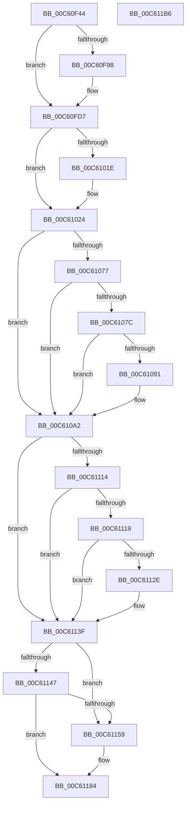

# MiProtectSharedUserPage

- RVA: `0x00C60F44`–`0x00C611B7` (길이 `627` bytes)
- VA: `0x0000000140C60F44`
- 실행 섹션: `INIT`
- PDB 이름 있음: `예`; PDB Function 태그: `아니요`
- unwind 정보 RVA: `0x0005D79C`
- 디코드: `151`개 명령, `627/627` bytes 표시
- 미해석 바이트: `0` (있으면 어셈블리에 `.byte`로 보존)

> 이 문서는 커널 이미지의 기계어와 PDB 기호를 분석해 생성했습니다. 4번과 5번은 함수 원형과 자료형을 바이너리 사용 방식에서 추정한 C 해석이며 원본 소스 복구 결과는 아닙니다.

## 1. Dependencies

- 직접 호출 지점: **16**; 고유 호출 대상: **13**
- 직접 호출자로 확인된 함수: **1**
- RIP 상대 이미지 참조: **6**

### Outgoing calls
- `0x00C60FBF` → [wil_details_FeatureReporting_ReportUsageToService](../../text/53/wil_details_FeatureReporting_ReportUsageToService_function_0053E6E4.md) (function, `0x0053E6E4`)
- `0x00C60FD2` → [wil_details_FeatureStateCache_TryEnableDeviceUsageFastPath](../../text/53/wil_details_FeatureStateCache_TryEnableDeviceUsageFastPath_function_0053E774.md) (function, `0x0053E774`)
- `0x00C6100C` → [MiReservePtes](../../text/31/MiReservePtes_function_00318D20.md) (function, `0x00318D20`)
- `0x00C6101E` → [MxInstallMoreMemory](../../text/67/MxInstallMoreMemory_function_00671A04.md) (function, `0x00671A04`)
- `0x00C61027` → [MiMakeProtectionPfnCompatible](../../text/22/MiMakeProtectionPfnCompatible_function_00229CD0.md) (function, `0x00229CD0`)
- `0x00C6103A` → [MiMakeValidPte](../../text/2C/MiMakeValidPte_function_002C5590.md) (function, `0x002C5590`)
- `0x00C61047` → [MiGetAnyMultiplexedVm](../../text/44/MiGetAnyMultiplexedVm_function_00448BD0.md) (function, `0x00448BD0`)
- `0x00C6105A` → [MiLockWorkingSetOptimal](../../text/23/MiLockWorkingSetOptimal_function_00238FC0.md) (function, `0x00238FC0`)
- `0x00C6109D` → [MiCheckLinearProtectedPteAccessedBit](../../text/29/MiCheckLinearProtectedPteAccessedBit_function_00292D80.md) (function, `0x00292D80`)
- `0x00C610B1` → [MiIncreaseUsedPtes](../../text/24/MiIncreaseUsedPtes_function_00243630.md) (function, `0x00243630`)
- `0x00C610C1` → [MiUnlockWorkingSetOptimal](../../text/23/MiUnlockWorkingSetOptimal_function_00238DFC.md) (function, `0x00238DFC`)
- `0x00C610EF` → [MiMakeProtectionPfnCompatible](../../text/22/MiMakeProtectionPfnCompatible_function_00229CD0.md) (function, `0x00229CD0`)
- `0x00C61101` → [MiMakeValidPte](../../text/2C/MiMakeValidPte_function_002C5590.md) (function, `0x002C5590`)
- `0x00C6113A` → [MiCheckLinearProtectedPteAccessedBit](../../text/29/MiCheckLinearProtectedPteAccessedBit_function_00292D80.md) (function, `0x00292D80`)
- `0x00C6117F` → [MiWriteValidPteNewProtection](../../text/28/MiWriteValidPteNewProtection_function_00281810.md) (function, `0x00281810`)
- `0x00C61194` → [MiFlushSingleTbEntry](../../text/28/MiFlushSingleTbEntry_function_0028E730.md) (function, `0x0028E730`)

### Direct callers
- [MiInitNucleus](../C5/MiInitNucleus_function_00C5FD38.md) at `0x00C60185`

### Static image references
- `0x00C60F89` → RVA `0x00FC4CE0` (`.data`; read)
- `0x00C60FB5` → RVA `0x000DFC08` (`.rdata`; read)
- `0x00C61002` → RVA `0x00E37668` (`.data`; read)
- `0x00C6105F` → RVA `0x00FC6A88` (`ALMOSTRO`; read)
- `0x00C610E8` → RVA `0x00FC5008` (`ALMOSTRO`; write)
- `0x00C61151` → RVA `0x00E2EE84` (`.data`; read)

## 2. Other-region calls and transfers

- 다른 실행 섹션으로 향하는 call: **16**
  - `0x00C60FBF` → [wil_details_FeatureReporting_ReportUsageToService](../../text/53/wil_details_FeatureReporting_ReportUsageToService_function_0053E6E4.md) (`INIT` → `.text`)
  - `0x00C60FD2` → [wil_details_FeatureStateCache_TryEnableDeviceUsageFastPath](../../text/53/wil_details_FeatureStateCache_TryEnableDeviceUsageFastPath_function_0053E774.md) (`INIT` → `.text`)
  - `0x00C6100C` → [MiReservePtes](../../text/31/MiReservePtes_function_00318D20.md) (`INIT` → `.text`)
  - `0x00C6101E` → [MxInstallMoreMemory](../../text/67/MxInstallMoreMemory_function_00671A04.md) (`INIT` → `.text`)
  - `0x00C61027` → [MiMakeProtectionPfnCompatible](../../text/22/MiMakeProtectionPfnCompatible_function_00229CD0.md) (`INIT` → `.text`)
  - `0x00C6103A` → [MiMakeValidPte](../../text/2C/MiMakeValidPte_function_002C5590.md) (`INIT` → `.text`)
  - `0x00C61047` → [MiGetAnyMultiplexedVm](../../text/44/MiGetAnyMultiplexedVm_function_00448BD0.md) (`INIT` → `.text`)
  - `0x00C6105A` → [MiLockWorkingSetOptimal](../../text/23/MiLockWorkingSetOptimal_function_00238FC0.md) (`INIT` → `.text`)
  - `0x00C6109D` → [MiCheckLinearProtectedPteAccessedBit](../../text/29/MiCheckLinearProtectedPteAccessedBit_function_00292D80.md) (`INIT` → `.text`)
  - `0x00C610B1` → [MiIncreaseUsedPtes](../../text/24/MiIncreaseUsedPtes_function_00243630.md) (`INIT` → `.text`)
  - `0x00C610C1` → [MiUnlockWorkingSetOptimal](../../text/23/MiUnlockWorkingSetOptimal_function_00238DFC.md) (`INIT` → `.text`)
  - `0x00C610EF` → [MiMakeProtectionPfnCompatible](../../text/22/MiMakeProtectionPfnCompatible_function_00229CD0.md) (`INIT` → `.text`)
  - `0x00C61101` → [MiMakeValidPte](../../text/2C/MiMakeValidPte_function_002C5590.md) (`INIT` → `.text`)
  - `0x00C6113A` → [MiCheckLinearProtectedPteAccessedBit](../../text/29/MiCheckLinearProtectedPteAccessedBit_function_00292D80.md) (`INIT` → `.text`)
  - `0x00C6117F` → [MiWriteValidPteNewProtection](../../text/28/MiWriteValidPteNewProtection_function_00281810.md) (`INIT` → `.text`)
  - `0x00C61194` → [MiFlushSingleTbEntry](../../text/28/MiFlushSingleTbEntry_function_0028E730.md) (`INIT` → `.text`)
- 별도 외부 분기/꼬리 이동을 확인하지 못했습니다.

## 3. Assembly (complete function range)

```asm
00C60F44  48 89 5C 24 10                  mov qword ptr [rsp + 0x10], rbx
00C60F49  48 89 6C 24 18                  mov qword ptr [rsp + 0x18], rbp
00C60F4E  48 89 74 24 20                  mov qword ptr [rsp + 0x20], rsi
00C60F53  57                              push rdi
00C60F54  41 54                           push r12
00C60F56  41 55                           push r13
00C60F58  41 56                           push r14
00C60F5A  41 57                           push r15
00C60F5C  48 83 EC 20                     sub rsp, 0x20
00C60F60  48 B8 00 00 00 00 80 F6 FF FF   movabs rax, 0xfffff68000000000
00C60F6A  48 8B F8                        mov rdi, rax
00C60F6D  48 B8 00 00 00 C0 7B 00 00 00   movabs rax, 0x7bc0000000
00C60F77  48 03 F8                        add rdi, rax
00C60F7A  48 8B 37                        mov rsi, qword ptr [rdi]
00C60F7D  48 83 64 24 50 00               and qword ptr [rsp + 0x50], 0
00C60F83  41 BD 01 00 00 00               mov r13d, 1
00C60F89  8B 0D 51 3D 36 00               mov ecx, dword ptr [rip + 0x363d51]
00C60F8F  89 4C 24 50                     mov dword ptr [rsp + 0x50], ecx
00C60F93  F6 C1 10                        test cl, 0x10
00C60F96  75 3F                           jne 0x140c60fd7
00C60F98  48 8B 44 24 50                  mov rax, qword ptr [rsp + 0x50]
00C60F9D  41 8D 5D 02                     lea ebx, [r13 + 2]
00C60FA1  41 0B CD                        or ecx, r13d
00C60FA4  48 89 44 24 50                  mov qword ptr [rsp + 0x50], rax
00C60FA9  89 4C 24 50                     mov dword ptr [rsp + 0x50], ecx
00C60FAD  45 8B CD                        mov r9d, r13d
00C60FB0  48 8B 54 24 50                  mov rdx, qword ptr [rsp + 0x50]
00C60FB5  48 8D 0D 4C EC 47 FF            lea rcx, [rip - 0xb813b4]
00C60FBC  44 8B C3                        mov r8d, ebx
00C60FBF  E8 20 D7 8D FF                  call 0x14053e6e4
00C60FC4  48 8B 4C 24 50                  mov rcx, qword ptr [rsp + 0x50]
00C60FC9  4C 8D 05 38 EC 47 FF            lea r8, [rip - 0xb813c8]
00C60FD0  8B D3                           mov edx, ebx
00C60FD2  E8 9D D7 8D FF                  call 0x14053e774
00C60FD7  48 C1 EE 0C                     shr rsi, 0xc
00C60FDB  48 B8 FF FF FF FF FF 00 00 00   movabs rax, 0xffffffffff
00C60FE5  48 23 F0                        and rsi, rax
00C60FE8  C6 44 24 50 00                  mov byte ptr [rsp + 0x50], 0
00C60FED  48 8D 2C 76                     lea rbp, [rsi + rsi*2]
00C60FF1  48 C1 E5 04                     shl rbp, 4
00C60FF5  48 B8 00 00 00 00 00 DE FF FF   movabs rax, 0xffffde0000000000
00C60FFF  41 8B D5                        mov edx, r13d
00C61002  48 8D 0D 5F 66 1D 00            lea rcx, [rip + 0x1d665f]
00C61009  48 03 E8                        add rbp, rax
00C6100C  E8 0F 7D 6B FF                  call 0x140318d20
00C61011  4C 8B F0                        mov r14, rax
00C61014  B9 04 00 00 00                  mov ecx, 4
00C61019  48 85 C0                        test rax, rax
00C6101C  75 06                           jne 0x140c61024
00C6101E  E8 E1 09 A1 FF                  call 0x140671a04
00C61023  CC                              int3
00C61024  48 8B D5                        mov rdx, rbp
00C61027  E8 A4 8C 5C FF                  call 0x140229cd0
00C6102C  0D 00 00 00 A0                  or eax, 0xa0000000
00C61031  48 8B D6                        mov rdx, rsi
00C61034  44 8B C0                        mov r8d, eax
00C61037  49 8B CE                        mov rcx, r14
00C6103A  E8 51 45 66 FF                  call 0x1402c5590
00C6103F  B9 04 00 00 00                  mov ecx, 4
00C61044  48 8B D8                        mov rbx, rax
00C61047  E8 84 7B 7E FF                  call 0x140448bd0
00C6104C  48 8B C8                        mov rcx, rax
00C6104F  4C 8D 44 24 50                  lea r8, [rsp + 0x50]
00C61054  49 8B D6                        mov rdx, r14
00C61057  4C 8B F8                        mov r15, rax
00C6105A  E8 61 7F 5D FF                  call 0x140238fc0
00C6105F  48 0F BA 25 20 5A 36 00 24      bt qword ptr [rip + 0x365a20], 0x24
00C61068  4C 8B E0                        mov r12, rax
00C6106B  48 BA 00 00 00 00 40 00 00 00   movabs rdx, 0x4000000000
00C61075  73 2B                           jae 0x140c610a2
00C61077  F6 C3 20                        test bl, 0x20
00C6107A  75 26                           jne 0x140c610a2
00C6107C  48 B8 00 00 00 00 80 F6 FF FF   movabs rax, 0xfffff68000000000
00C61086  48 8B C8                        mov rcx, rax
00C61089  48 03 CA                        add rcx, rdx
00C6108C  4C 3B F1                        cmp r14, rcx
00C6108F  72 11                           jb 0x140c610a2
00C61091  41 B8 80 00 00 00               mov r8d, 0x80
00C61097  48 8B D3                        mov rdx, rbx
00C6109A  49 8B CE                        mov rcx, r14
00C6109D  E8 DE 1C 63 FF                  call 0x140292d80
00C610A2  41 B9 06 00 00 00               mov r9d, 6
00C610A8  49 89 1E                        mov qword ptr [r14], rbx
00C610AB  45 8B C5                        mov r8d, r13d
00C610AE  49 8B D4                        mov rdx, r12
00C610B1  E8 7A 25 5E FF                  call 0x140243630
00C610B6  44 8A 44 24 50                  mov r8b, byte ptr [rsp + 0x50]
00C610BB  49 8B D4                        mov rdx, r12
00C610BE  49 8B CF                        mov rcx, r15
00C610C1  E8 36 7D 5D FF                  call 0x140238dfc
00C610C6  49 C1 E6 19                     shl r14, 0x19
00C610CA  49 BF 00 00 00 00 80 F6 FF FF   movabs r15, 0xfffff68000000000
00C610D4  49 8B C7                        mov rax, r15
00C610D7  48 C1 E0 19                     shl rax, 0x19
00C610DB  48 8B D5                        mov rdx, rbp
00C610DE  4C 2B F0                        sub r14, rax
00C610E1  41 8B CD                        mov ecx, r13d
00C610E4  49 C1 FE 10                     sar r14, 0x10
00C610E8  4C 89 35 19 3F 36 00            mov qword ptr [rip + 0x363f19], r14
00C610EF  E8 DC 8B 5C FF                  call 0x140229cd0
00C610F4  0F BA E8 1D                     bts eax, 0x1d
00C610F8  48 8B D6                        mov rdx, rsi
00C610FB  44 8B C0                        mov r8d, eax
00C610FE  48 8B CF                        mov rcx, rdi
00C61101  E8 8A 44 66 FF                  call 0x1402c5590
00C61106  48 0F BA 25 79 59 36 00 24      bt qword ptr [rip + 0x365979], 0x24
00C6110F  48 8B D8                        mov rbx, rax
00C61112  73 2B                           jae 0x140c6113f
00C61114  F6 C3 20                        test bl, 0x20
00C61117  75 26                           jne 0x140c6113f
00C61119  49 8B C7                        mov rax, r15
00C6111C  48 B9 00 00 00 00 40 00 00 00   movabs rcx, 0x4000000000
00C61126  48 03 C1                        add rax, rcx
00C61129  48 3B F8                        cmp rdi, rax
00C6112C  72 11                           jb 0x140c6113f
00C6112E  41 B8 80 00 00 00               mov r8d, 0x80
00C61134  48 8B D3                        mov rdx, rbx
00C61137  48 8B CF                        mov rcx, rdi
00C6113A  E8 41 1C 63 FF                  call 0x140292d80
00C6113F  48 89 1F                        mov qword ptr [rdi], rbx
00C61142  48 85 DB                        test rbx, rbx
00C61145  79 12                           jns 0x140c61159
00C61147  48 8B CB                        mov rcx, rbx
00C6114A  48 C1 E9 08                     shr rcx, 8
00C6114E  41 22 CD                        and cl, r13b
00C61151  3A 0D 2D DD 1C 00               cmp cl, byte ptr [rip + 0x1cdd2d]
00C61157  74 2B                           je 0x140c61184
00C61159  0F B6 15 24 DD 1C 00            movzx edx, byte ptr [rip + 0x1cdd24]
00C61160  48 B8 00 00 00 00 00 00 80 FF   movabs rax, 0xff80000000000000
00C6116A  49 23 D5                        and rdx, r13
00C6116D  48 0F BA F3 08                  btr rbx, 8
00C61172  48 0B D0                        or rdx, rax
00C61175  48 8B CF                        mov rcx, rdi
00C61178  48 C1 E2 08                     shl rdx, 8
00C6117C  48 0B D3                        or rdx, rbx
00C6117F  E8 8C 06 62 FF                  call 0x140281810
00C61184  33 D2                           xor edx, edx
00C61186  48 B9 00 00 00 00 80 F7 FF FF   movabs rcx, 0xfffff78000000000
00C61190  44 8D 42 20                     lea r8d, [rdx + 0x20]
00C61194  E8 97 D5 62 FF                  call 0x14028e730
00C61199  48 8B 5C 24 58                  mov rbx, qword ptr [rsp + 0x58]
00C6119E  48 8B 6C 24 60                  mov rbp, qword ptr [rsp + 0x60]
00C611A3  48 8B 74 24 68                  mov rsi, qword ptr [rsp + 0x68]
00C611A8  48 83 C4 20                     add rsp, 0x20
00C611AC  41 5F                           pop r15
00C611AE  41 5E                           pop r14
00C611B0  41 5D                           pop r13
00C611B2  41 5C                           pop r12
00C611B4  5F                              pop rdi
00C611B5  C3                              ret
00C611B6  CC                              int3
```

## 4. C-style interpretation (structured pseudocode)

```c
__int64 __fastcall MiProtectSharedUserPage(void)
{
    __int64 result;
    __int64 v_r14;
    __int64 v_rbp;
    __int64 v_rbx;
    __int64 v_rdi;
    __int64 v_rsi;
    __int64 v_rsp;
    unsigned __int64 v_stack_p10;
    unsigned __int64 v_stack_p18;
    unsigned __int64 v_stack_p20;
    unsigned __int64 v_stack_p8;

    v_stack_p10 = v_rbx;
    v_stack_p18 = v_rbp;
    v_stack_p20 = v_rsi;
    v_rsp = (v_rsp) - (32);
    v_rdi = (result) + (result);
    v_stack_p8 = (unsigned int)((unsigned int)(*(unsigned int *)(v_rip + 3554641)));
    if ((((unsigned __int8)((unsigned int)(*(unsigned int *)(v_rip + 3554641)))) & (16)) == 0) {
        result = v_stack_p8;
        v_rbx = 1 + 2;
        a1 = (unsigned int)(((unsigned int)(*(unsigned int *)(v_rip + 3554641))) | (1));
        v_stack_p8 = result;
        v_stack_p8 = (unsigned int)(a1);
        a4 = 1;
        a2 = v_stack_p8;
        a1 = v_rip - 12063668;
        a3 = (unsigned int)(v_rbx);
        result = wil_details_FeatureReporting_ReportUsageToService(a1, a2, a3, a4);
        a1 = v_stack_p8;
        a3 = v_rip - 12063688;
        a2 = (unsigned int)(v_rbx);
        result = wil_details_FeatureStateCache_TryEnableDeviceUsageFastPath(a1, a2, a3, a4);
    }
    v_rsi = (*(unsigned __int64 *)(v_rdi)) >> (12);
    v_rsi = (v_rsi) & (result);
    v_stack_p8 = 0;
    v_rbp = (v_rsi + v_rsi * 2) << (4);
    v_rbp = (v_rbp) + (result);
    result = MiReservePtes(v_rip + 1926751, 1, a3, a4);
    if (result == 0) {
        result = MxInstallMoreMemory(4, 1, a3, a4);
    }
    result = MiMakeProtectionPfnCompatible(4, v_rbp, a3, a4);
    result = (unsigned int)((result) | (0xA0000000ULL));
    result = MiMakeValidPte(result, v_rsi, (unsigned int)((unsigned int)(result)), a4);
    result = MiGetAnyMultiplexedVm(4, v_rsi, (unsigned int)((unsigned int)(result)), a4);
    result = MiLockWorkingSetOptimal(result, result, v_stack_p8, a4);
    if (condition_is_above_or_equal) goto loc_00C610A2;
    if ((((unsigned __int8)(result)) & (32)) != 0) goto loc_00C610A2;
    a1 = (result) + (result);
    if (result >= a1) {
        a3 = 128;
        a2 = result;
        a1 = result;
        result = MiCheckLinearProtectedPteAccessedBit(a1, a2, a3, a4);
    }
    *(unsigned __int64 *)(result) = result;
    result = MiIncreaseUsedPtes(a1, result, 1, 6);
    result = MiUnlockWorkingSetOptimal(result, result, v_stack_p8, 6);
    v_r14 = (result) << (25);
    result = (result) << (25);
    v_r14 = (v_r14) - (result);
    v_r14 = (v_r14) >> (16);
    *(unsigned __int64 *)(v_rip + 3555097) = v_r14;
    result = MiMakeProtectionPfnCompatible(1, v_rbp, v_stack_p8, 6);
    result = MiMakeValidPte(v_rdi, v_rsi, (unsigned int)((unsigned int)(result)), 6);
    if (condition_is_above_or_equal) goto loc_00C6113F;
    if ((((unsigned __int8)(result)) & (32)) != 0) goto loc_00C6113F;
    result = (result) + (v_rdi);
    if (v_rdi >= result) {
        a3 = 128;
        a2 = result;
        a1 = v_rdi;
        result = MiCheckLinearProtectedPteAccessedBit(a1, a2, a3, 6);
    }
    *(unsigned __int64 *)(v_rdi) = result;
    if (!sign_flag) goto loc_00C61159;
    a1 = (result) >> (8);
    a1 = (unsigned __int8)((a1) & (1));
    if (((unsigned __int8)(a1)) != (*(unsigned __int8 *)(v_rip + 1891629))) {
        a2 = *(unsigned __int8 *)(v_rip + 1891620);
        a2 = (a2) & (1);
        a2 = (a2) | (result);
        a1 = v_rdi;
        a2 = (a2) << (8);
        a2 = (a2) | (result);
        result = MiWriteValidPteNewProtection(a1, a2, a3, 6);
    }
    a2 = 0;
    result = MiFlushSingleTbEntry(a1, a2, a2 + 32, 6);
    v_rsp = (v_rsp) + (32);
    return result;
}
```

## 5. (Beta) C Style

```c
void MiProtectSharedUserPage(void)
{
    int64_t result;
    int64_t local_r14;
    int64_t local_rbp;
    int64_t local_rbx;
    int64_t local_rdi;
    int64_t local_rsi;
    int64_t local_rsp;
    uint64_t v_stack_p10;
    uint64_t v_stack_p18;
    uint64_t v_stack_p20;
    uint64_t v_stack_p8;

    v_stack_p10 = local_rbx;
    v_stack_p18 = local_rbp;
    v_stack_p20 = local_rsi;
    local_rsp = (local_rsp) - (32);
    local_rdi = (result) + (result);
    v_stack_p8 = (uint32_t)((uint32_t)(*(uint32_t *)(v_rip + 0x363D51)));
    if ((((uint8_t)((uint32_t)(*(uint32_t *)(v_rip + 0x363D51)))) & (16)) == 0) {
        result = v_stack_p8;
        local_rbx = 1 + 2;
        a1 = (uint32_t)(((uint32_t)(*(uint32_t *)(v_rip + 0x363D51))) | (1));
        v_stack_p8 = result;
        v_stack_p8 = (uint32_t)(a1);
        a4 = 1;
        a2 = v_stack_p8;
        a1 = v_rip - 12063668;
        a3 = (uint32_t)(local_rbx);
        result = wil_details_FeatureReporting_ReportUsageToService(a1, a2, a3, a4);
        a1 = v_stack_p8;
        a3 = v_rip - 12063688;
        a2 = (uint32_t)(local_rbx);
        result = wil_details_FeatureStateCache_TryEnableDeviceUsageFastPath(a1, a2, a3, a4);
    }
    local_rsi = (*(uint64_t *)(local_rdi)) >> (12);
    local_rsi = (local_rsi) & (result);
    v_stack_p8 = 0;
    local_rbp = (local_rsi + local_rsi * 2) << (4);
    local_rbp = (local_rbp) + (result);
    result = MiReservePtes(v_rip + 1926751, 1, a3, a4);
    if (result == 0) {
        result = MxInstallMoreMemory(4, 1, a3, a4);
    }
    result = MiMakeProtectionPfnCompatible(4, local_rbp, a3, a4);
    result = (uint32_t)((result) | (0xA0000000ULL));
    result = MiMakeValidPte(result, local_rsi, (uint32_t)((uint32_t)(result)), a4);
    result = MiGetAnyMultiplexedVm(4, local_rsi, (uint32_t)((uint32_t)(result)), a4);
    result = MiLockWorkingSetOptimal(result, result, v_stack_p8, a4);
    if (condition_is_above_or_equal) goto loc_00C610A2;
    if ((((uint8_t)(result)) & (32)) != 0) goto loc_00C610A2;
    a1 = (result) + (result);
    if (result >= a1) {
        a3 = 128;
        a2 = result;
        a1 = result;
        result = MiCheckLinearProtectedPteAccessedBit(a1, a2, a3, a4);
    }
    *(uint64_t *)(result) = result;
    result = MiIncreaseUsedPtes(a1, result, 1, 6);
    result = MiUnlockWorkingSetOptimal(result, result, v_stack_p8, 6);
    local_r14 = (result) << (25);
    result = (result) << (25);
    local_r14 = (local_r14) - (result);
    local_r14 = (local_r14) >> (16);
    *(uint64_t *)(v_rip + 0x363F19) = local_r14;
    result = MiMakeProtectionPfnCompatible(1, local_rbp, v_stack_p8, 6);
    result = MiMakeValidPte(local_rdi, local_rsi, (uint32_t)((uint32_t)(result)), 6);
    if (condition_is_above_or_equal) goto loc_00C6113F;
    if ((((uint8_t)(result)) & (32)) != 0) goto loc_00C6113F;
    result = (result) + (local_rdi);
    if (local_rdi >= result) {
        a3 = 128;
        a2 = result;
        a1 = local_rdi;
        result = MiCheckLinearProtectedPteAccessedBit(a1, a2, a3, 6);
    }
    *(uint64_t *)(local_rdi) = result;
    if (!sign_flag) goto loc_00C61159;
    a1 = (result) >> (8);
    a1 = (uint8_t)((a1) & (1));
    if (((uint8_t)(a1)) != (*(uint8_t *)(v_rip + 0x1CDD2D))) {
        a2 = *(uint8_t *)(v_rip + 0x1CDD24);
        a2 = (a2) & (1);
        a2 = (a2) | (result);
        a1 = local_rdi;
        a2 = (a2) << (8);
        a2 = (a2) | (result);
        result = MiWriteValidPteNewProtection(a1, a2, a3, 6);
    }
    a2 = 0;
    result = MiFlushSingleTbEntry(a1, a2, a2 + 32, 6);
    local_rsp = (local_rsp) + (32);
    return result;
}
```

## 6. Execution-region graph

[열기: 2D/3D 그래프와 함수 탐색 컨트롤 패널](../../../control-panel.html?section=init&rva=0x00C60F44&view=graph)

- 2D 그래프는 위에서 아래로 흐르고, 3D 그래프는 빈 공간을 드래그해 회전합니다. Shift+드래그는 이동, 휠은 확대·축소, 함수 노드 선택은 대상 보고서 이동입니다.

### Static fallback


