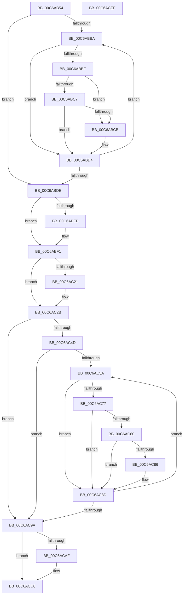

# MiQueryHardwareCacheInformation

- RVA: `0x00C6AB54`–`0x00C6ACF0` (길이 `412` bytes)
- VA: `0x0000000140C6AB54`
- 실행 섹션: `INIT`
- PDB 이름 있음: `예`; PDB Function 태그: `아니요`
- unwind 정보 RVA: `0x000BD830`
- 디코드: `107`개 명령, `412/412` bytes 표시
- 미해석 바이트: `0` (있으면 어셈블리에 `.byte`로 보존)

> 이 문서는 커널 이미지의 기계어와 PDB 기호를 분석해 생성했습니다. 4번과 5번은 함수 원형과 자료형을 바이너리 사용 방식에서 추정한 C 해석이며 원본 소스 복구 결과는 아닙니다.

## 1. Dependencies

- 직접 호출 지점: **3**; 고유 호출 대상: **2**
- 직접 호출자로 확인된 함수: **1**
- RIP 상대 이미지 참조: **11**

### Outgoing calls
- `0x00C6AC44` → [guard_dispatch_icall](../../text/6B/guard_dispatch_icall_function_006BAAD0.md) (function, `0x006BAAD0`)
- `0x00C6AC6E` → [guard_dispatch_icall](../../text/6B/guard_dispatch_icall_function_006BAAD0.md) (function, `0x006BAAD0`)
- `0x00C6ACCD` → [_security_check_cookie](../../text/6A/_security_check_cookie_function_006AC640.md) (function, `0x006AC640`)

### Direct callers
- [MiCreatePfnDatabase](../C5/MiCreatePfnDatabase_function_00C5F930.md) at `0x00C5F93D`

### Static image references
- `0x00C6AB72` → RVA `0x00E0A740` (`.data`; read)
- `0x00C6ABCE` → RVA `0x00E2DC34` (`.data`; write)
- `0x00C6ABE3` → RVA `0x00E2DC34` (`.data`; read)
- `0x00C6ABF1` → RVA `0x00E2DC5C` (`.data`; write)
- `0x00C6AC0A` → RVA `0x00E2DC30` (`.data`; write)
- `0x00C6AC2B` → RVA `0x00E00638` (`.data`; read)
- `0x00C6AC4D` → RVA `0x00FC5000` (`ALMOSTRO`; read)
- `0x00C6AC9A` → RVA `0x00E2DCCC` (`.data`; write)
- `0x00C6ACA3` → RVA `0x00E2DCC8` (`.data`; write)
- `0x00C6ACBA` → RVA `0x00E2DCC0` (`.data`; write)
- `0x00C6ACC0` → RVA `0x00E2DCC4` (`.data`; write)

## 2. Other-region calls and transfers

- 다른 실행 섹션으로 향하는 call: **3**
  - `0x00C6AC44` → [guard_dispatch_icall](../../text/6B/guard_dispatch_icall_function_006BAAD0.md) (`INIT` → `.text`)
  - `0x00C6AC6E` → [guard_dispatch_icall](../../text/6B/guard_dispatch_icall_function_006BAAD0.md) (`INIT` → `.text`)
  - `0x00C6ACCD` → [_security_check_cookie](../../text/6A/_security_check_cookie_function_006AC640.md) (`INIT` → `.text`)
- 별도 외부 분기/꼬리 이동을 확인하지 못했습니다.

## 3. Assembly (complete function range)

```asm
00C6AB54  48 8B C4                        mov rax, rsp
00C6AB57  48 89 58 08                     mov qword ptr [rax + 8], rbx
00C6AB5B  48 89 70 10                     mov qword ptr [rax + 0x10], rsi
00C6AB5F  48 89 78 18                     mov qword ptr [rax + 0x18], rdi
00C6AB63  4C 89 70 20                     mov qword ptr [rax + 0x20], r14
00C6AB67  55                              push rbp
00C6AB68  48 8B EC                        mov rbp, rsp
00C6AB6B  48 81 EC 80 00 00 00            sub rsp, 0x80
00C6AB72  48 8B 05 C7 FB 19 00            mov rax, qword ptr [rip + 0x19fbc7]
00C6AB79  48 33 C4                        xor rax, rsp
00C6AB7C  48 89 45 F8                     mov qword ptr [rbp - 8], rax
00C6AB80  33 C0                           xor eax, eax
00C6AB82  0F 57 C0                        xorps xmm0, xmm0
00C6AB85  45 33 F6                        xor r14d, r14d
00C6AB88  48 89 45 F0                     mov qword ptr [rbp - 0x10], rax
00C6AB8C  44 89 75 B0                     mov dword ptr [rbp - 0x50], r14d
00C6AB90  0F 11 45 D0                     movups xmmword ptr [rbp - 0x30], xmm0
00C6AB94  48 89 45 C8                     mov qword ptr [rbp - 0x38], rax
00C6AB98  0F 11 45 E0                     movups xmmword ptr [rbp - 0x20], xmm0
00C6AB9C  0F 11 45 B8                     movups xmmword ptr [rbp - 0x48], xmm0
00C6ABA0  65 48 8B 04 25 20 00 00 00      mov rax, qword ptr gs:[0x20]
00C6ABA9  8B 90 94 8B 00 00               mov edx, dword ptr [rax + 0x8b94]
00C6ABAF  48 8D 88 58 8B 00 00            lea rcx, [rax + 0x8b58]
00C6ABB6  85 D2                           test edx, edx
00C6ABB8  74 24                           je 0x140c6abde
00C6ABBA  80 39 01                        cmp byte ptr [rcx], 1
00C6ABBD  75 15                           jne 0x140c6abd4
00C6ABBF  8B 41 08                        mov eax, dword ptr [rcx + 8]
00C6ABC2  83 F8 02                        cmp eax, 2
00C6ABC5  74 04                           je 0x140c6abcb
00C6ABC7  85 C0                           test eax, eax
00C6ABC9  75 09                           jne 0x140c6abd4
00C6ABCB  8B 41 04                        mov eax, dword ptr [rcx + 4]
00C6ABCE  89 05 60 30 1C 00               mov dword ptr [rip + 0x1c3060], eax
00C6ABD4  48 83 C1 0C                     add rcx, 0xc
00C6ABD8  48 83 EA 01                     sub rdx, 1
00C6ABDC  75 DC                           jne 0x140c6abba
00C6ABDE  B8 00 40 00 00                  mov eax, 0x4000
00C6ABE3  39 05 4B 30 1C 00               cmp dword ptr [rip + 0x1c304b], eax
00C6ABE9  73 06                           jae 0x140c6abf1
00C6ABEB  89 05 43 30 1C 00               mov dword ptr [rip + 0x1c3043], eax
00C6ABF1  C7 05 61 30 1C 00 00 01 00 00   mov dword ptr [rip + 0x1c3061], 0x100
00C6ABFB  65 48 8B 04 25 18 00 00 00      mov rax, qword ptr gs:[0x18]
00C6AC04  8B B0 BC 00 00 00               mov esi, dword ptr [rax + 0xbc]
00C6AC0A  89 35 20 30 1C 00               mov dword ptr [rip + 0x1c3020], esi
00C6AC10  65 48 8B 0C 25 18 00 00 00      mov rcx, qword ptr gs:[0x18]
00C6AC19  0F B6 41 51                     movzx eax, byte ptr [rcx + 0x51]
00C6AC1D  84 C0                           test al, al
00C6AC1F  74 0A                           je 0x140c6ac2b
00C6AC21  8B C8                           mov ecx, eax
00C6AC23  33 D2                           xor edx, edx
00C6AC25  8B C6                           mov eax, esi
00C6AC27  F7 F1                           div ecx
00C6AC29  8B F0                           mov esi, eax
00C6AC2B  48 8B 05 06 5A 19 00            mov rax, qword ptr [rip + 0x195a06]
00C6AC32  4C 8D 4D B0                     lea r9, [rbp - 0x50]
00C6AC36  48 83 CF FF                     or rdi, 0xffffffffffffffff
00C6AC3A  4C 8D 45 B8                     lea r8, [rbp - 0x48]
00C6AC3E  8D 57 19                        lea edx, [rdi + 0x19]
00C6AC41  8D 4F 33                        lea ecx, [rdi + 0x33]
00C6AC44  E8 87 FE A4 FF                  call 0x1406baad0
00C6AC49  85 C0                           test eax, eax
00C6AC4B  78 4D                           js 0x140c6ac9a
00C6AC4D  66 44 3B 35 AB A3 35 00         cmp r14w, word ptr [rip + 0x35a3ab]
00C6AC55  41 8B DE                        mov ebx, r14d
00C6AC58  73 40                           jae 0x140c6ac9a
00C6AC5A  48 8B 45 B8                     mov rax, qword ptr [rbp - 0x48]
00C6AC5E  4C 8D 45 D0                     lea r8, [rbp - 0x30]
00C6AC62  41 B9 28 00 00 00               mov r9d, 0x28
00C6AC68  8B CB                           mov ecx, ebx
00C6AC6A  41 8D 51 D9                     lea edx, [r9 - 0x27]
00C6AC6E  E8 5D FE A4 FF                  call 0x1406baad0
00C6AC73  85 C0                           test eax, eax
00C6AC75  78 16                           js 0x140c6ac8d
00C6AC77  48 8B 45 D8                     mov rax, qword ptr [rbp - 0x28]
00C6AC7B  48 85 C0                        test rax, rax
00C6AC7E  74 0D                           je 0x140c6ac8d
00C6AC80  83 7D E8 01                     cmp dword ptr [rbp - 0x18], 1
00C6AC84  75 07                           jne 0x140c6ac8d
00C6AC86  48 3B C7                        cmp rax, rdi
00C6AC89  48 0F 42 F8                     cmovb rdi, rax
00C6AC8D  0F B7 05 6C A3 35 00            movzx eax, word ptr [rip + 0x35a36c]
00C6AC94  FF C3                           inc ebx
00C6AC96  3B D8                           cmp ebx, eax
00C6AC98  72 C0                           jb 0x140c6ac5a
00C6AC9A  89 35 2C 30 1C 00               mov dword ptr [rip + 0x1c302c], esi
00C6ACA0  C1 EE 04                        shr esi, 4
00C6ACA3  89 35 1F 30 1C 00               mov dword ptr [rip + 0x1c301f], esi
00C6ACA9  48 83 FF FF                     cmp rdi, -1
00C6ACAD  74 17                           je 0x140c6acc6
00C6ACAF  48 8B C7                        mov rax, rdi
00C6ACB2  48 C1 E8 15                     shr rax, 0x15
00C6ACB6  48 C1 EF 1E                     shr rdi, 0x1e
00C6ACBA  89 3D 00 30 1C 00               mov dword ptr [rip + 0x1c3000], edi
00C6ACC0  89 05 FE 2F 1C 00               mov dword ptr [rip + 0x1c2ffe], eax
00C6ACC6  48 8B 4D F8                     mov rcx, qword ptr [rbp - 8]
00C6ACCA  48 33 CC                        xor rcx, rsp
00C6ACCD  E8 6E 19 A4 FF                  call 0x1406ac640
00C6ACD2  4C 8D 9C 24 80 00 00 00         lea r11, [rsp + 0x80]
00C6ACDA  49 8B 5B 10                     mov rbx, qword ptr [r11 + 0x10]
00C6ACDE  49 8B 73 18                     mov rsi, qword ptr [r11 + 0x18]
00C6ACE2  49 8B 7B 20                     mov rdi, qword ptr [r11 + 0x20]
00C6ACE6  4D 8B 73 28                     mov r14, qword ptr [r11 + 0x28]
00C6ACEA  49 8B E3                        mov rsp, r11
00C6ACED  5D                              pop rbp
00C6ACEE  C3                              ret
00C6ACEF  CC                              int3
```

## 4. C-style interpretation (structured pseudocode)

```c
__int64 __fastcall MiQueryHardwareCacheInformation(void)
{
    __int64 result;
    __int64 v_r14;
    __int64 v_rbx;
    __int64 v_rdi;
    __int64 v_rsi;
    __int64 v_rsp;
    unsigned __int64 v_stack_m10;
    unsigned __int64 v_stack_m18;
    unsigned int v_stack_m20;
    unsigned __int64 v_stack_m28;
    unsigned __int64 v_stack_m30;
    unsigned __int64 v_stack_m38;
    unsigned __int64 v_stack_m40;
    unsigned __int64 v_stack_m50;
    unsigned int v_stack_m58;
    unsigned __int64 v_stack_m8;

    *(unsigned __int64 *)(v_rsp + 8) = v_rbx;
    *(unsigned __int64 *)(v_rsp + 16) = v_rsi;
    *(unsigned __int64 *)(v_rsp + 24) = v_rdi;
    *(unsigned __int64 *)(v_rsp + 32) = v_r14;
    v_rsp = (v_rsp) - (128);
    result = (*(unsigned __int64 *)(v_rip + 1702855)) ^ (v_rsp);
    v_stack_m10 = result;
    result = 0;
    v_r14 = 0;
    v_stack_m18 = 0;
    v_stack_m58 = 0;
    v_stack_m38 = v_xmm0;
    v_stack_m40 = 0;
    v_stack_m28 = v_xmm0;
    v_stack_m50 = v_xmm0;
    if ((unsigned int)((unsigned int)(*(unsigned int *)(*(unsigned __int64 *)(gs_base + (0 + 32)) + 35732))) == 0) goto loc_00C6ABDE;
loc_00C6ABBA:
    if ((*(unsigned __int8 *)(*(unsigned __int64 *)(gs_base + (0 + 32)) + 35672)) != 1) goto loc_00C6ABD4;
    if (((unsigned int)((unsigned int)(*(unsigned int *)(*(unsigned __int64 *)(gs_base + (0 + 32)) + 35672 + 8)))) == 2) goto loc_00C6ABCB;
    result = (unsigned int)(*(unsigned int *)(*(unsigned __int64 *)(gs_base + (0 + 32)) + 35672 + 8));
    if ((unsigned int)((unsigned int)(*(unsigned int *)(*(unsigned __int64 *)(gs_base + (0 + 32)) + 35672 + 8))) == 0) {
        result = *(unsigned int *)(*(unsigned __int64 *)(gs_base + (0 + 32)) + 35672 + 4);
        *(unsigned int *)(v_rip + 1847392) = (unsigned int)(result);
    }
    a1 = (*(unsigned __int64 *)(gs_base + (0 + 32)) + 35672) + (12);
    a2 = ((unsigned int)(*(unsigned int *)(*(unsigned __int64 *)(gs_base + (0 + 32)) + 35732))) - (1);
    if (condition_is_not_equal) goto loc_00C6ABBA;
loc_00C6ABDE:
    if ((*(unsigned int *)(v_rip + 1847371)) < ((unsigned int)((unsigned int)(0x4000ULL)))) {
        *(unsigned int *)(v_rip + 1847363) = (unsigned int)((unsigned int)(0x4000ULL));
    }
    *(unsigned int *)(v_rip + 1847393) = 256;
    *(unsigned int *)(v_rip + 1847328) = (unsigned int)((unsigned int)(*(unsigned int *)(*(unsigned __int64 *)(gs_base + (0 + 24)) + 188)));
    result = *(unsigned __int8 *)(*(unsigned __int64 *)(gs_base + (0 + 24)) + 81);
    v_rsi = (unsigned int)(*(unsigned int *)(*(unsigned __int64 *)(gs_base + (0 + 24)) + 188));
    if ((unsigned __int8)(*(unsigned __int8 *)(*(unsigned __int64 *)(gs_base + (0 + 24)) + 81)) != 0) {
        a1 = (unsigned int)(*(unsigned __int8 *)(*(unsigned __int64 *)(gs_base + (0 + 24)) + 81));
        a2 = 0;
        result = (unsigned int)((unsigned int)(*(unsigned int *)(*(unsigned __int64 *)(gs_base + (0 + 24)) + 188)));
        v_rsi = (unsigned int)(result);
    }
    v_rdi = (v_rdi) | (-1);
    result = guard_dispatch_icall(v_rdi + 51, v_rdi + 25, v_stack_m50, v_stack_m58);
    if (sign_flag) goto loc_00C6AC9A;
    if (0 >= (*(unsigned __int16 *)(v_rip + 3515307))) goto loc_00C6AC9A;
loc_00C6AC5A:
    result = guard_dispatch_icall(0, 40 - 39, v_stack_m38, 40);
    if (sign_flag) goto loc_00C6AC8D;
    if (v_stack_m30 == 0) goto loc_00C6AC8D;
    if (v_stack_m20 == 1) {
        if (v_stack_m30 < v_rdi) { v_rdi = v_stack_m30; }
    }
    v_rbx = (unsigned int)((0) + 1);
    if (((unsigned int)(v_rbx)) < ((unsigned int)(*(unsigned __int16 *)(v_rip + 3515244)))) goto loc_00C6AC5A;
loc_00C6AC9A:
    *(unsigned int *)(v_rip + 1847340) = (unsigned int)(v_rsi);
    v_rsi = (unsigned int)((v_rsi) >> (4));
    *(unsigned int *)(v_rip + 1847327) = (unsigned int)(v_rsi);
    result = *(unsigned __int16 *)(v_rip + 3515244);
    if (v_rdi != -1) {
        result = v_rdi;
        result = (result) >> (21);
        v_rdi = (v_rdi) >> (30);
        *(unsigned int *)(v_rip + 1847296) = (unsigned int)(v_rdi);
        *(unsigned int *)(v_rip + 1847294) = (unsigned int)(result);
    }
    a1 = (v_stack_m10) ^ (v_rsp);
    result = _security_check_cookie(a1, 40 - 39, v_stack_m38, 40);
    return result;
}
```

## 5. (Beta) C Style

```c
void MiQueryHardwareCacheInformation(void)
{
    int64_t result;
    int64_t local_r14;
    int64_t local_rbx;
    int64_t local_rdi;
    int64_t local_rsi;
    int64_t local_rsp;
    uint64_t v_stack_m10;
    uint64_t v_stack_m18;
    uint32_t v_stack_m20;
    uint64_t v_stack_m28;
    uint64_t v_stack_m30;
    uint64_t v_stack_m38;
    uint64_t v_stack_m40;
    uint64_t v_stack_m50;
    uint32_t v_stack_m58;
    uint64_t v_stack_m8;

    *(uint64_t *)(local_rsp + 0x8) = local_rbx;
    *(uint64_t *)(local_rsp + 0x10) = local_rsi;
    *(uint64_t *)(local_rsp + 0x18) = local_rdi;
    *(uint64_t *)(local_rsp + 0x20) = local_r14;
    local_rsp = (local_rsp) - (128);
    result = (*(uint64_t *)(v_rip + 0x19FBC7)) ^ (local_rsp);
    v_stack_m10 = result;
    result = 0;
    local_r14 = 0;
    v_stack_m18 = 0;
    v_stack_m58 = 0;
    v_stack_m38 = v_xmm0;
    v_stack_m40 = 0;
    v_stack_m28 = v_xmm0;
    v_stack_m50 = v_xmm0;
    if ((uint32_t)((uint32_t)(*(uint32_t *)(*(uint64_t *)(gs_base + (0 + 0x20)) + 0x8B94))) == 0) goto loc_00C6ABDE;
loc_00C6ABBA:
    if ((*(uint8_t *)(*(uint64_t *)(gs_base + (0 + 0x20)) + 0x8B58)) != 1) goto loc_00C6ABD4;
    if (((uint32_t)((uint32_t)(*(uint32_t *)(*(uint64_t *)(gs_base + (0 + 0x20)) + 0x8B58 + 0x8)))) == 2) goto loc_00C6ABCB;
    result = (uint32_t)(*(uint32_t *)(*(uint64_t *)(gs_base + (0 + 0x20)) + 0x8B58 + 0x8));
    if ((uint32_t)((uint32_t)(*(uint32_t *)(*(uint64_t *)(gs_base + (0 + 0x20)) + 0x8B58 + 0x8))) == 0) {
        result = *(uint32_t *)(*(uint64_t *)(gs_base + (0 + 0x20)) + 0x8B58 + 0x4);
        *(uint32_t *)(v_rip + 0x1C3060) = (uint32_t)(result);
    }
    a1 = (*(uint64_t *)(gs_base + (0 + 0x20)) + 35672) + (12);
    a2 = ((uint32_t)(*(uint32_t *)(*(uint64_t *)(gs_base + (0 + 0x20)) + 0x8B94))) - (1);
    if (condition_is_not_equal) goto loc_00C6ABBA;
loc_00C6ABDE:
    if ((*(uint32_t *)(v_rip + 0x1C304B)) < ((uint32_t)((uint32_t)(0x4000ULL)))) {
        *(uint32_t *)(v_rip + 0x1C3043) = (uint32_t)((uint32_t)(0x4000ULL));
    }
    *(uint32_t *)(v_rip + 0x1C3061) = 256;
    *(uint32_t *)(v_rip + 0x1C3020) = (uint32_t)((uint32_t)(*(uint32_t *)(*(uint64_t *)(gs_base + (0 + 0x18)) + 0xBC)));
    result = *(uint8_t *)(*(uint64_t *)(gs_base + (0 + 0x18)) + 0x51);
    local_rsi = (uint32_t)(*(uint32_t *)(*(uint64_t *)(gs_base + (0 + 0x18)) + 0xBC));
    if ((uint8_t)(*(uint8_t *)(*(uint64_t *)(gs_base + (0 + 0x18)) + 0x51)) != 0) {
        a1 = (uint32_t)(*(uint8_t *)(*(uint64_t *)(gs_base + (0 + 0x18)) + 0x51));
        a2 = 0;
        result = (uint32_t)((uint32_t)(*(uint32_t *)(*(uint64_t *)(gs_base + (0 + 0x18)) + 0xBC)));
        local_rsi = (uint32_t)(result);
    }
    local_rdi = (local_rdi) | (-1);
    result = guard_dispatch_icall(local_rdi + 51, local_rdi + 25, v_stack_m50, v_stack_m58);
    if (sign_flag) goto loc_00C6AC9A;
    if (0 >= (*(uint16_t *)(v_rip + 0x35A3AB))) goto loc_00C6AC9A;
loc_00C6AC5A:
    result = guard_dispatch_icall(0, 40 - 39, v_stack_m38, 40);
    if (sign_flag) goto loc_00C6AC8D;
    if (v_stack_m30 == 0) goto loc_00C6AC8D;
    if (v_stack_m20 == 1) {
        if (v_stack_m30 < local_rdi) { local_rdi = v_stack_m30; }
    }
    local_rbx = (uint32_t)((0) + 1);
    if (((uint32_t)(local_rbx)) < ((uint32_t)(*(uint16_t *)(v_rip + 0x35A36C)))) goto loc_00C6AC5A;
loc_00C6AC9A:
    *(uint32_t *)(v_rip + 0x1C302C) = (uint32_t)(local_rsi);
    local_rsi = (uint32_t)((local_rsi) >> (4));
    *(uint32_t *)(v_rip + 0x1C301F) = (uint32_t)(local_rsi);
    result = *(uint16_t *)(v_rip + 0x35A36C);
    if (local_rdi != -1) {
        result = local_rdi;
        result = (result) >> (21);
        local_rdi = (local_rdi) >> (30);
        *(uint32_t *)(v_rip + 0x1C3000) = (uint32_t)(local_rdi);
        *(uint32_t *)(v_rip + 0x1C2FFE) = (uint32_t)(result);
    }
    a1 = (v_stack_m10) ^ (local_rsp);
    result = _security_check_cookie(a1, 40 - 39, v_stack_m38, 40);
    return result;
}
```

## 6. Execution-region graph

[열기: 2D/3D 그래프와 함수 탐색 컨트롤 패널](../../../control-panel.html?section=init&rva=0x00C6AB54&view=graph)

- 2D 그래프는 위에서 아래로 흐르고, 3D 그래프는 빈 공간을 드래그해 회전합니다. Shift+드래그는 이동, 휠은 확대·축소, 함수 노드 선택은 대상 보고서 이동입니다.

### Static fallback


