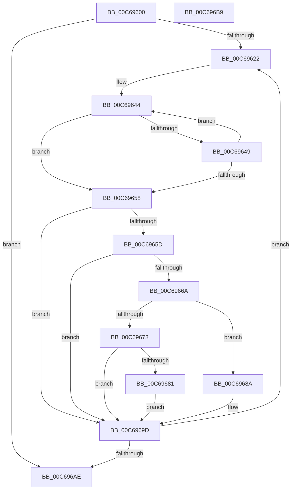

# MiReassignProcessorsToMemoryOnlyNodes

- RVA: `0x00C69600`–`0x00C696BA` (길이 `186` bytes)
- VA: `0x0000000140C69600`
- 실행 섹션: `INIT`
- PDB 이름 있음: `예`; PDB Function 태그: `아니요`
- unwind 정보 RVA: `0x0005CAAC`
- 디코드: `52`개 명령, `186/186` bytes 표시
- 미해석 바이트: `0` (있으면 어셈블리에 `.byte`로 보존)

> 이 문서는 커널 이미지의 기계어와 PDB 기호를 분석해 생성했습니다. 4번과 5번은 함수 원형과 자료형을 바이너리 사용 방식에서 추정한 C 해석이며 원본 소스 복구 결과는 아닙니다.

## 1. Dependencies

- 직접 호출 지점: **3**; 고유 호출 대상: **1**
- 직접 호출자로 확인된 함수: **1**
- RIP 상대 이미지 참조: **4**

### Outgoing calls
- `0x00C69661` → [MiFindProcessorsForMemoryOnlyNode](MiFindProcessorsForMemoryOnlyNode_function_00C692FC.md) (function, `0x00C692FC`)
- `0x00C6966F` → [MiFindProcessorsForMemoryOnlyNode](MiFindProcessorsForMemoryOnlyNode_function_00C692FC.md) (function, `0x00C692FC`)
- `0x00C69691` → [MiFindProcessorsForMemoryOnlyNode](MiFindProcessorsForMemoryOnlyNode_function_00C692FC.md) (function, `0x00C692FC`)

### Direct callers
- [MiComputeMemoryNodeProcessorAssignments](MiComputeMemoryNodeProcessorAssignments_function_00C68F8C.md) at `0x00C692CC`

### Static image references
- `0x00C6960C` → RVA `0x00E2DBC8` (`.data`; write)
- `0x00C69613` → RVA `0x00FC5000` (`ALMOSTRO`; read)
- `0x00C69628` → RVA `0x00E2DBF8` (`.data`; read)
- `0x00C69678` → RVA `0x00E2DBC8` (`.data`; read)

## 2. Other-region calls and transfers

- 다른 실행 섹션으로 향하는 call: **0**
- 별도 외부 분기/꼬리 이동을 확인하지 못했습니다.

## 3. Assembly (complete function range)

```asm
00C69600  48 89 5C 24 08                  mov qword ptr [rsp + 8], rbx
00C69605  57                              push rdi
00C69606  48 83 EC 20                     sub rsp, 0x20
00C6960A  33 FF                           xor edi, edi
00C6960C  C6 05 B5 45 1C 00 01            mov byte ptr [rip + 0x1c45b5], 1
00C69613  66 3B 3D E6 B9 35 00            cmp di, word ptr [rip + 0x35b9e6]
00C6961A  8B DF                           mov ebx, edi
00C6961C  0F 83 8C 00 00 00               jae 0x140c696ae
00C69622  8B C3                           mov eax, ebx
00C69624  48 8D 0C 40                     lea rcx, [rax + rax*2]
00C69628  48 8B 05 C9 45 1C 00            mov rax, qword ptr [rip + 0x1c45c9]
00C6962F  48 C1 E1 07                     shl rcx, 7
00C69633  48 8B 94 01 78 01 00 00         mov rdx, qword ptr [rcx + rax + 0x178]
00C6963B  8B C7                           mov eax, edi
00C6963D  48 83 C2 12                     add rdx, 0x12
00C69641  48 8B CF                        mov rcx, rdi
00C69644  66 39 3A                        cmp word ptr [rdx], di
00C69647  75 0F                           jne 0x140c69658
00C69649  FF C0                           inc eax
00C6964B  48 FF C1                        inc rcx
00C6964E  48 83 C2 02                     add rdx, 2
00C69652  48 83 F9 03                     cmp rcx, 3
00C69656  7C EC                           jl 0x140c69644
00C69658  83 F8 03                        cmp eax, 3
00C6965B  75 40                           jne 0x140c6969d
00C6965D  33 D2                           xor edx, edx
00C6965F  8B CB                           mov ecx, ebx
00C69661  E8 96 FC FF FF                  call 0x140c692fc
00C69666  85 C0                           test eax, eax
00C69668  75 33                           jne 0x140c6969d
00C6966A  8D 50 01                        lea edx, [rax + 1]
00C6966D  8B CB                           mov ecx, ebx
00C6966F  E8 88 FC FF FF                  call 0x140c692fc
00C69674  85 C0                           test eax, eax
00C69676  74 12                           je 0x140c6968a
00C69678  80 3D 49 45 1C 00 02            cmp byte ptr [rip + 0x1c4549], 2
00C6967F  73 1C                           jae 0x140c6969d
00C69681  C6 05 40 45 1C 00 02            mov byte ptr [rip + 0x1c4540], 2
00C69688  EB 13                           jmp 0x140c6969d
00C6968A  BA 02 00 00 00                  mov edx, 2
00C6968F  8B CB                           mov ecx, ebx
00C69691  E8 66 FC FF FF                  call 0x140c692fc
00C69696  C6 05 2B 45 1C 00 03            mov byte ptr [rip + 0x1c452b], 3
00C6969D  0F B7 05 5C B9 35 00            movzx eax, word ptr [rip + 0x35b95c]
00C696A4  FF C3                           inc ebx
00C696A6  3B D8                           cmp ebx, eax
00C696A8  0F 82 74 FF FF FF               jb 0x140c69622
00C696AE  48 8B 5C 24 30                  mov rbx, qword ptr [rsp + 0x30]
00C696B3  48 83 C4 20                     add rsp, 0x20
00C696B7  5F                              pop rdi
00C696B8  C3                              ret
00C696B9  CC                              int3
```

## 4. C-style interpretation (structured pseudocode)

```c
__int64 __fastcall MiReassignProcessorsToMemoryOnlyNodes(void)
{
    __int64 result;
    __int64 v_rbx;
    __int64 v_rdi;
    __int64 v_rsp;
    unsigned __int64 v_stack_p8;

    v_stack_p8 = v_rbx;
    v_rsp = (v_rsp) - (32);
    v_rdi = 0;
    *(unsigned __int8 *)(v_rip + 1852853) = 1;
    if (0 >= (*(unsigned __int16 *)(v_rip + 3520998))) goto loc_00C696AE;
loc_00C69622:
    a1 = (0 + 0 * 2) << (7);
    a2 = (*(unsigned __int64 *)(a1 + *(unsigned __int64 *)(v_rip + 1852873) * 1 + 376)) + (18);
loc_00C69644:
    if ((*(unsigned __int16 *)(a2)) != 0) goto loc_00C69658;
    result = (unsigned int)((0) + 1);
    a1 = (0) + 1;
    a2 = (a2) + (2);
    if (a1 < 3) goto loc_00C69644;
loc_00C69658:
    if (((unsigned int)(result)) != 3) goto loc_00C6969D;
    a2 = 0;
    result = MiFindProcessorsForMemoryOnlyNode(0, a2, a3, a4);
    if ((unsigned int)(result) != 0) goto loc_00C6969D;
    result = MiFindProcessorsForMemoryOnlyNode(0, result + 1, a3, a4);
    if ((unsigned int)(result) == 0) goto loc_00C6968A;
    if ((*(unsigned __int8 *)(v_rip + 1852745)) >= 2) goto loc_00C6969D;
    *(unsigned __int8 *)(v_rip + 1852736) = 2;
    goto loc_00C6969D;
loc_00C6968A:
    result = MiFindProcessorsForMemoryOnlyNode(0, 2, a3, a4);
    *(unsigned __int8 *)(v_rip + 1852715) = 3;
loc_00C6969D:
    v_rbx = (unsigned int)((0) + 1);
    if (((unsigned int)(v_rbx)) < ((unsigned int)(*(unsigned __int16 *)(v_rip + 3520860)))) goto loc_00C69622;
loc_00C696AE:
    v_rsp = (v_rsp) + (32);
    return *(unsigned __int16 *)(v_rip + 3520860);
}
```

## 5. (Beta) C Style

```c
void MiReassignProcessorsToMemoryOnlyNodes(void)
{
    int64_t result;
    int64_t local_rbx;
    int64_t local_rdi;
    int64_t local_rsp;
    uint64_t v_stack_p8;

    v_stack_p8 = local_rbx;
    local_rsp = (local_rsp) - (32);
    local_rdi = 0;
    *(uint8_t *)(v_rip + 0x1C45B5) = 1;
    if (0 >= (*(uint16_t *)(v_rip + 0x35B9E6))) goto loc_00C696AE;
loc_00C69622:
    a1 = (0 + 0 * 2) << (7);
    a2 = (*(uint64_t *)(a1 + *(uint64_t *)(v_rip + 0x1C45C9) * 1 + 0x178)) + (18);
loc_00C69644:
    if ((*(uint16_t *)(a2)) != 0) goto loc_00C69658;
    result = (uint32_t)((0) + 1);
    a1 = (0) + 1;
    a2 = (a2) + (2);
    if (a1 < 3) goto loc_00C69644;
loc_00C69658:
    if (((uint32_t)(result)) != 3) goto loc_00C6969D;
    a2 = 0;
    result = MiFindProcessorsForMemoryOnlyNode(0, a2, a3, a4);
    if ((uint32_t)(result) != 0) goto loc_00C6969D;
    result = MiFindProcessorsForMemoryOnlyNode(0, result + 1, a3, a4);
    if ((uint32_t)(result) == 0) goto loc_00C6968A;
    if ((*(uint8_t *)(v_rip + 0x1C4549)) >= 2) goto loc_00C6969D;
    *(uint8_t *)(v_rip + 0x1C4540) = 2;
    goto loc_00C6969D;
loc_00C6968A:
    result = MiFindProcessorsForMemoryOnlyNode(0, 2, a3, a4);
    *(uint8_t *)(v_rip + 0x1C452B) = 3;
loc_00C6969D:
    local_rbx = (uint32_t)((0) + 1);
    if (((uint32_t)(local_rbx)) < ((uint32_t)(*(uint16_t *)(v_rip + 0x35B95C)))) goto loc_00C69622;
loc_00C696AE:
    local_rsp = (local_rsp) + (32);
    return *(uint16_t *)(v_rip + 0x35B95C);
}
```

## 6. Execution-region graph

[열기: 2D/3D 그래프와 함수 탐색 컨트롤 패널](../../../control-panel.html?section=init&rva=0x00C69600&view=graph)

- 2D 그래프는 위에서 아래로 흐르고, 3D 그래프는 빈 공간을 드래그해 회전합니다. Shift+드래그는 이동, 휠은 확대·축소, 함수 노드 선택은 대상 보고서 이동입니다.

### Static fallback


