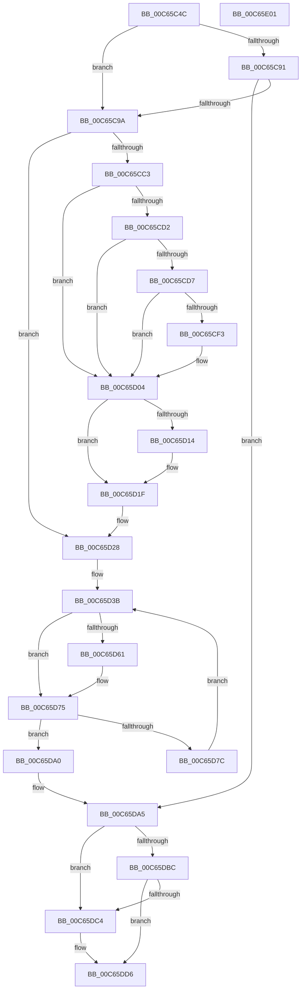

# MiRebaseDynamicRelocationRegions

- RVA: `0x00C65C4C`–`0x00C65E02` (길이 `438` bytes)
- VA: `0x0000000140C65C4C`
- 실행 섹션: `INIT`
- PDB 이름 있음: `예`; PDB Function 태그: `아니요`
- unwind 정보 RVA: `0x00068D9C`
- 디코드: `108`개 명령, `438/438` bytes 표시
- 미해석 바이트: `0` (있으면 어셈블리에 `.byte`로 보존)

> 이 문서는 커널 이미지의 기계어와 PDB 기호를 분석해 생성했습니다. 4번과 5번은 함수 원형과 자료형을 바이너리 사용 방식에서 추정한 C 해석이며 원본 소스 복구 결과는 아닙니다.

## 1. Dependencies

- 직접 호출 지점: **6**; 고유 호출 대상: **4**
- 직접 호출자로 확인된 함수: **1**
- RIP 상대 이미지 참조: **6**

### Outgoing calls
- `0x00C65CFF` → [MiCheckLinearProtectedPteAccessedBit](../../text/29/MiCheckLinearProtectedPteAccessedBit_function_00292D80.md) (function, `0x00292D80`)
- `0x00C65D23` → [KeFlushEntireTb](../../text/5B/KeFlushEntireTb_function_005BDBF0.md) (function, `0x005BDBF0`)
- `0x00C65D48` → [MiApplyDynamicRelocations](MiApplyDynamicRelocations_function_00C696C0.md) (function, `0x00C696C0`)
- `0x00C65D70` → [MiApplyDynamicRelocations](MiApplyDynamicRelocations_function_00C696C0.md) (function, `0x00C696C0`)
- `0x00C65DD1` → [MiApplyDynamicRelocations](MiApplyDynamicRelocations_function_00C696C0.md) (function, `0x00C696C0`)
- `0x00C65DD9` → [MiPrepareScpFixupsForNtAndHal](MiPrepareScpFixupsForNtAndHal_function_00C66734.md) (function, `0x00C66734`)

### Direct callers
- [MiInitializeSystemVa](../C7/MiInitializeSystemVa_function_00C77020.md) at `0x00C7709B`

### Static image references
- `0x00C65C65` → RVA `0x00FC6A88` (`ALMOSTRO`; read)
- `0x00C65C81` → RVA `0x00E38C68` (`.data`; read)
- `0x00C65C88` → RVA `0x00E38BA8` (`.data`; read)
- `0x00C65D14` → RVA `0x00010880` (`.rdata`; read)
- `0x00C65DE3` → RVA `0x00FC54C8` (`ALMOSTRO`; write)
- `0x00C65DEA` → RVA `0x00E013C0` (`.data`; write)

## 2. Other-region calls and transfers

- 다른 실행 섹션으로 향하는 call: **2**
  - `0x00C65CFF` → [MiCheckLinearProtectedPteAccessedBit](../../text/29/MiCheckLinearProtectedPteAccessedBit_function_00292D80.md) (`INIT` → `.text`)
  - `0x00C65D23` → [KeFlushEntireTb](../../text/5B/KeFlushEntireTb_function_005BDBF0.md) (`INIT` → `.text`)
- 별도 외부 분기/꼬리 이동을 확인하지 못했습니다.

## 3. Assembly (complete function range)

```asm
00C65C4C  48 89 5C 24 18                  mov qword ptr [rsp + 0x18], rbx
00C65C51  48 89 4C 24 08                  mov qword ptr [rsp + 8], rcx
00C65C56  55                              push rbp
00C65C57  56                              push rsi
00C65C58  57                              push rdi
00C65C59  41 54                           push r12
00C65C5B  41 55                           push r13
00C65C5D  41 56                           push r14
00C65C5F  41 57                           push r15
00C65C61  48 83 EC 20                     sub rsp, 0x20
00C65C65  48 F7 05 18 0E 36 00 00 40 00 00  test qword ptr [rip + 0x360e18], 0x4000
00C65C70  4C 8B F9                        mov r15, rcx
00C65C73  48 8B 69 10                     mov rbp, qword ptr [rcx + 0x10]
00C65C77  49 BE 00 00 00 00 80 F6 FF FF   movabs r14, 0xfffff68000000000
00C65C81  48 8B 3D E0 2F 1D 00            mov rdi, qword ptr [rip + 0x1d2fe0]
00C65C88  4C 8B 25 19 2F 1D 00            mov r12, qword ptr [rip + 0x1d2f19]
00C65C8F  75 09                           jne 0x140c65c9a
00C65C91  49 3B FE                        cmp rdi, r14
00C65C94  0F 84 0B 01 00 00               je 0x140c65da5
00C65C9A  48 8B C7                        mov rax, rdi
00C65C9D  48 B9 00 D0 BE 7D FB F6 FF FF   movabs rcx, 0xfffff6fb7dbed000
00C65CA7  48 C1 E8 27                     shr rax, 0x27
00C65CAB  49 BD 68 DF BE 7D FB F6 FF FF   movabs r13, 0xfffff6fb7dbedf68
00C65CB5  25 FF 01 00 00                  and eax, 0x1ff
00C65CBA  48 8D 34 C1                     lea rsi, [rcx + rax*8]
00C65CBE  49 3B F5                        cmp rsi, r13
00C65CC1  74 65                           je 0x140c65d28
00C65CC3  49 8B 5D 00                     mov rbx, qword ptr [r13]
00C65CC7  48 0F BA 25 B8 0D 36 00 24      bt qword ptr [rip + 0x360db8], 0x24
00C65CD0  73 32                           jae 0x140c65d04
00C65CD2  F6 C3 20                        test bl, 0x20
00C65CD5  75 2D                           jne 0x140c65d04
00C65CD7  48 B8 00 00 00 00 80 F6 FF FF   movabs rax, 0xfffff68000000000
00C65CE1  48 B9 00 00 00 00 40 00 00 00   movabs rcx, 0x4000000000
00C65CEB  48 03 C1                        add rax, rcx
00C65CEE  48 3B F0                        cmp rsi, rax
00C65CF1  72 11                           jb 0x140c65d04
00C65CF3  41 B8 80 00 00 00               mov r8d, 0x80
00C65CF9  48 8B D3                        mov rdx, rbx
00C65CFC  48 8B CE                        mov rcx, rsi
00C65CFF  E8 7C D0 62 FF                  call 0x140292d80
00C65D04  48 89 1E                        mov qword ptr [rsi], rbx
00C65D07  48 F7 05 76 0D 36 00 00 00 10 00  test qword ptr [rip + 0x360d76], 0x100000
00C65D12  75 0B                           jne 0x140c65d1f
00C65D14  48 8B 05 65 AB 3A FF            mov rax, qword ptr [rip - 0xc5549b]
00C65D1B  49 89 45 00                     mov qword ptr [r13], rax
00C65D1F  B2 01                           mov dl, 1
00C65D21  33 C9                           xor ecx, ecx
00C65D23  E8 C8 7E 95 FF                  call 0x1405bdbf0
00C65D28  33 F6                           xor esi, esi
00C65D2A  48 8B DF                        mov rbx, rdi
00C65D2D  49 BF F8 FF FF FF 7F 00 00 00   movabs r15, 0x7ffffffff8
00C65D37  44 8D 6E 27                     lea r13d, [rsi + 0x27]
00C65D3B  8B 55 40                        mov edx, dword ptr [rbp + 0x40]
00C65D3E  4C 8B CB                        mov r9, rbx
00C65D41  48 8B 4D 30                     mov rcx, qword ptr [rbp + 0x30]
00C65D45  4D 8B C6                        mov r8, r14
00C65D48  E8 73 39 00 00                  call 0x140c696c0
00C65D4D  49 8B CD                        mov rcx, r13
00C65D50  B8 01 00 00 00                  mov eax, 1
00C65D55  48 D3 E0                        shl rax, cl
00C65D58  48 FF C8                        dec rax
00C65D5B  49 83 FD 0C                     cmp r13, 0xc
00C65D5F  72 14                           jb 0x140c65d75
00C65D61  8B 55 40                        mov edx, dword ptr [rbp + 0x40]
00C65D64  4D 8D 04 06                     lea r8, [r14 + rax]
00C65D68  48 8B 4D 30                     mov rcx, qword ptr [rbp + 0x30]
00C65D6C  4C 8D 0C 03                     lea r9, [rbx + rax]
00C65D70  E8 4B 39 00 00                  call 0x140c696c0
00C65D75  FF C6                           inc esi
00C65D77  83 FE 04                        cmp esi, 4
00C65D7A  77 24                           ja 0x140c65da0
00C65D7C  49 C1 EE 09                     shr r14, 9
00C65D80  48 B8 00 00 00 00 80 09 00 00   movabs rax, 0x98000000000
00C65D8A  48 C1 EB 09                     shr rbx, 9
00C65D8E  4D 23 F7                        and r14, r15
00C65D91  49 23 DF                        and rbx, r15
00C65D94  4C 2B F0                        sub r14, rax
00C65D97  48 03 DF                        add rbx, rdi
00C65D9A  49 83 ED 09                     sub r13, 9
00C65D9E  EB 9B                           jmp 0x140c65d3b
00C65DA0  4C 8B 7C 24 60                  mov r15, qword ptr [rsp + 0x60]
00C65DA5  48 F7 05 D8 0C 36 00 00 40 00 00  test qword ptr [rip + 0x360cd8], 0x4000
00C65DB0  48 B9 00 00 00 00 00 DE FF FF   movabs rcx, 0xffffde0000000000
00C65DBA  75 08                           jne 0x140c65dc4
00C65DBC  48 8B C1                        mov rax, rcx
00C65DBF  49 3B C4                        cmp rax, r12
00C65DC2  74 12                           je 0x140c65dd6
00C65DC4  4C 8B C1                        mov r8, rcx
00C65DC7  8B 55 40                        mov edx, dword ptr [rbp + 0x40]
00C65DCA  4D 8B CC                        mov r9, r12
00C65DCD  48 8B 4D 30                     mov rcx, qword ptr [rbp + 0x30]
00C65DD1  E8 EA 38 00 00                  call 0x140c696c0
00C65DD6  49 8B CF                        mov rcx, r15
00C65DD9  E8 56 09 00 00                  call 0x140c66734
00C65DDE  48 8B 5C 24 70                  mov rbx, qword ptr [rsp + 0x70]
00C65DE3  48 89 3D DE F6 35 00            mov qword ptr [rip + 0x35f6de], rdi
00C65DEA  48 89 3D CF B5 19 00            mov qword ptr [rip + 0x19b5cf], rdi
00C65DF1  48 83 C4 20                     add rsp, 0x20
00C65DF5  41 5F                           pop r15
00C65DF7  41 5E                           pop r14
00C65DF9  41 5D                           pop r13
00C65DFB  41 5C                           pop r12
00C65DFD  5F                              pop rdi
00C65DFE  5E                              pop rsi
00C65DFF  5D                              pop rbp
00C65E00  C3                              ret
00C65E01  CC                              int3
```

## 4. C-style interpretation (structured pseudocode)

```c
__int64 __fastcall MiRebaseDynamicRelocationRegions(__int64 a1)
{
    __int64 result;
    __int64 v_r13;
    __int64 v_r14;
    __int64 v_rbx;
    __int64 v_rsi;
    __int64 v_rsp;
    unsigned __int64 v_stack_p18;
    unsigned __int64 v_stack_p8;

    v_stack_p18 = v_rbx;
    v_stack_p8 = a1;
    v_rsp = (v_rsp) - (32);
    if (((*(unsigned __int64 *)(v_rip + 3542552)) & (0x4000ULL)) != 0) goto loc_00C65C9A;
    if ((*(unsigned __int64 *)(v_rip + 1912800)) == v_r14) goto loc_00C65DA5;
loc_00C65C9A:
    result = (*(unsigned __int64 *)(v_rip + 1912800)) >> (39);
    result = (unsigned int)((result) & (511));
    if ((a1 + result * 8) == v_r13) goto loc_00C65D28;
    if ((a1 + result * 8) >= v_r13) goto loc_00C65D04;
    if ((((unsigned __int8)(*(unsigned __int64 *)(v_r13))) & (32)) != 0) goto loc_00C65D04;
    result = (result) + (a1);
    if ((a1 + result * 8) >= result) {
        a3 = 128;
        a2 = *(unsigned __int64 *)(v_r13);
        a1 = a1 + result * 8;
        result = MiCheckLinearProtectedPteAccessedBit(a1, a2, a3, a4);
    }
    *(unsigned __int64 *)(a1 + result * 8) = *(unsigned __int64 *)(v_r13);
    if (((*(unsigned __int64 *)(v_rip + 3542390)) & (0x100000ULL)) == 0) {
        result = *(unsigned __int64 *)(v_rip - 12932251);
        *(unsigned __int64 *)(v_r13) = result;
    }
    a1 = 0;
    result = KeFlushEntireTb(a1, 1, a3, a4);
loc_00C65D28:
    v_rsi = 0;
loc_00C65D3B:
    result = MiApplyDynamicRelocations(*(unsigned __int64 *)(*(unsigned __int64 *)(a1 + 16) + 48), (unsigned int)(*(unsigned int *)(*(unsigned __int64 *)(a1 + 16) + 64)), v_r14, *(unsigned __int64 *)(v_rip + 1912800));
    result = (1) << ((unsigned __int8)(v_rsi + 39));
    result = (result) - 1;
    if ((v_rsi + 39) >= 12) {
        a2 = *(unsigned int *)(*(unsigned __int64 *)(a1 + 16) + 64);
        a3 = v_r14 + result * 1;
        a1 = *(unsigned __int64 *)(*(unsigned __int64 *)(a1 + 16) + 48);
        a4 = *(unsigned __int64 *)(v_rip + 1912800) + result * 1;
        result = MiApplyDynamicRelocations(a1, a2, a3, a4);
    }
    v_rsi = (unsigned int)((v_rsi) + 1);
    if (((unsigned int)(v_rsi)) > 4) goto loc_00C65DA0;
    v_r14 = (v_r14) >> (9);
    v_rbx = (*(unsigned __int64 *)(v_rip + 1912800)) >> (9);
    v_r14 = (v_r14) & (a1);
    v_rbx = (v_rbx) & (a1);
    v_r14 = (v_r14) - (result);
    v_rbx = (v_rbx) + (*(unsigned __int64 *)(v_rip + 1912800));
    v_r13 = (v_rsi + 39) - (9);
    goto loc_00C65D3B;
loc_00C65DA0:
loc_00C65DA5:
    if (((*(unsigned __int64 *)(v_rip + 3542232)) & (0x4000ULL)) != 0) goto loc_00C65DC4;
    result = a1;
    if (a1 != (*(unsigned __int64 *)(v_rip + 1912601))) {
        a3 = a1;
        a2 = *(unsigned int *)(*(unsigned __int64 *)(a1 + 16) + 64);
        a4 = *(unsigned __int64 *)(v_rip + 1912601);
        a1 = *(unsigned __int64 *)(*(unsigned __int64 *)(a1 + 16) + 48);
        result = MiApplyDynamicRelocations(a1, a2, a3, a4);
    }
    result = MiPrepareScpFixupsForNtAndHal(v_stack_p8, a2, a3, a4);
    *(unsigned __int64 *)(v_rip + 3536606) = *(unsigned __int64 *)(v_rip + 1912800);
    *(unsigned __int64 *)(v_rip + 1684943) = *(unsigned __int64 *)(v_rip + 1912800);
    v_rsp = (v_rsp) + (32);
    return result;
}
```

## 5. (Beta) C Style

```c
int64_t MiRebaseDynamicRelocationRegions(void *Arg1)
{
    uint8_t *arg1 = (uint8_t *)Arg1;

    int64_t result;
    int64_t local_r13;
    int64_t local_r14;
    int64_t local_rbx;
    int64_t local_rsi;
    int64_t local_rsp;
    uint64_t v_stack_p18;
    uint64_t v_stack_p8;

    v_stack_p18 = local_rbx;
    v_stack_p8 = Arg1;
    local_rsp = (local_rsp) - (32);
    if (((*(uint64_t *)(v_rip + 0x360E18)) & (0x4000ULL)) != 0) goto loc_00C65C9A;
    if ((*(uint64_t *)(v_rip + 0x1D2FE0)) == local_r14) goto loc_00C65DA5;
loc_00C65C9A:
    result = (*(uint64_t *)(v_rip + 0x1D2FE0)) >> (39);
    result = (uint32_t)((result) & (511));
    if ((Arg1 + result * 8) == local_r13) goto loc_00C65D28;
    if ((Arg1 + result * 8) >= local_r13) goto loc_00C65D04;
    if ((((uint8_t)(*(uint64_t *)(local_r13))) & (32)) != 0) goto loc_00C65D04;
    result = (result) + (Arg1);
    if ((Arg1 + result * 8) >= result) {
        a3 = 128;
        a2 = *(uint64_t *)(local_r13);
        Arg1 = Arg1 + result * 8;
        result = MiCheckLinearProtectedPteAccessedBit(Arg1, a2, a3, a4);
    }
    *(uint64_t *)(arg1 + result * 8) = *(uint64_t *)(local_r13);
    if (((*(uint64_t *)(v_rip + 0x360D76)) & (0x100000ULL)) == 0) {
        result = *(uint64_t *)(v_rip - 0xC5549B);
        *(uint64_t *)(local_r13) = result;
    }
    Arg1 = 0;
    result = KeFlushEntireTb(Arg1, 1, a3, a4);
loc_00C65D28:
    local_rsi = 0;
loc_00C65D3B:
    result = MiApplyDynamicRelocations(*(uint64_t *)(*(uint64_t *)(arg1 + 0x10) + 0x30), (uint32_t)(*(uint32_t *)(*(uint64_t *)(arg1 + 0x10) + 0x40)), local_r14, *(uint64_t *)(v_rip + 0x1D2FE0));
    result = (1) << ((uint8_t)(local_rsi + 39));
    result = (result) - 1;
    if ((local_rsi + 39) >= 12) {
        a2 = *(uint32_t *)(*(uint64_t *)(arg1 + 0x10) + 0x40);
        a3 = local_r14 + result * 1;
        Arg1 = *(uint64_t *)(*(uint64_t *)(arg1 + 0x10) + 0x30);
        a4 = *(uint64_t *)(v_rip + 0x1D2FE0) + result * 1;
        result = MiApplyDynamicRelocations(Arg1, a2, a3, a4);
    }
    local_rsi = (uint32_t)((local_rsi) + 1);
    if (((uint32_t)(local_rsi)) > 4) goto loc_00C65DA0;
    local_r14 = (local_r14) >> (9);
    local_rbx = (*(uint64_t *)(v_rip + 0x1D2FE0)) >> (9);
    local_r14 = (local_r14) & (Arg1);
    local_rbx = (local_rbx) & (Arg1);
    local_r14 = (local_r14) - (result);
    local_rbx = (local_rbx) + (*(uint64_t *)(v_rip + 0x1D2FE0));
    local_r13 = (local_rsi + 39) - (9);
    goto loc_00C65D3B;
loc_00C65DA0:
loc_00C65DA5:
    if (((*(uint64_t *)(v_rip + 0x360CD8)) & (0x4000ULL)) != 0) goto loc_00C65DC4;
    result = Arg1;
    if (Arg1 != (*(uint64_t *)(v_rip + 0x1D2F19))) {
        a3 = Arg1;
        a2 = *(uint32_t *)(*(uint64_t *)(arg1 + 0x10) + 0x40);
        a4 = *(uint64_t *)(v_rip + 0x1D2F19);
        Arg1 = *(uint64_t *)(*(uint64_t *)(arg1 + 0x10) + 0x30);
        result = MiApplyDynamicRelocations(Arg1, a2, a3, a4);
    }
    result = MiPrepareScpFixupsForNtAndHal(v_stack_p8, a2, a3, a4);
    *(uint64_t *)(v_rip + 0x35F6DE) = *(uint64_t *)(v_rip + 0x1D2FE0);
    *(uint64_t *)(v_rip + 0x19B5CF) = *(uint64_t *)(v_rip + 0x1D2FE0);
    local_rsp = (local_rsp) + (32);
    return result;
}
```

### 관측된 메모리 오프셋

구조체 형식이 확인되지 않은 접근은 인자 기준의 오프셋으로만 기록했습니다.

| 기준 인자 | 오프셋 표현 | 폭 (bit) | 접근 |
|---|---:|---:|---|
| `Arg1` | `+ 0x10` | `64` | `R` |

## 6. Execution-region graph

[열기: 2D/3D 그래프와 함수 탐색 컨트롤 패널](../../../control-panel.html?section=init&rva=0x00C65C4C&view=graph)

- 2D 그래프는 위에서 아래로 흐르고, 3D 그래프는 빈 공간을 드래그해 회전합니다. Shift+드래그는 이동, 휠은 확대·축소, 함수 노드 선택은 대상 보고서 이동입니다.

### Static fallback


