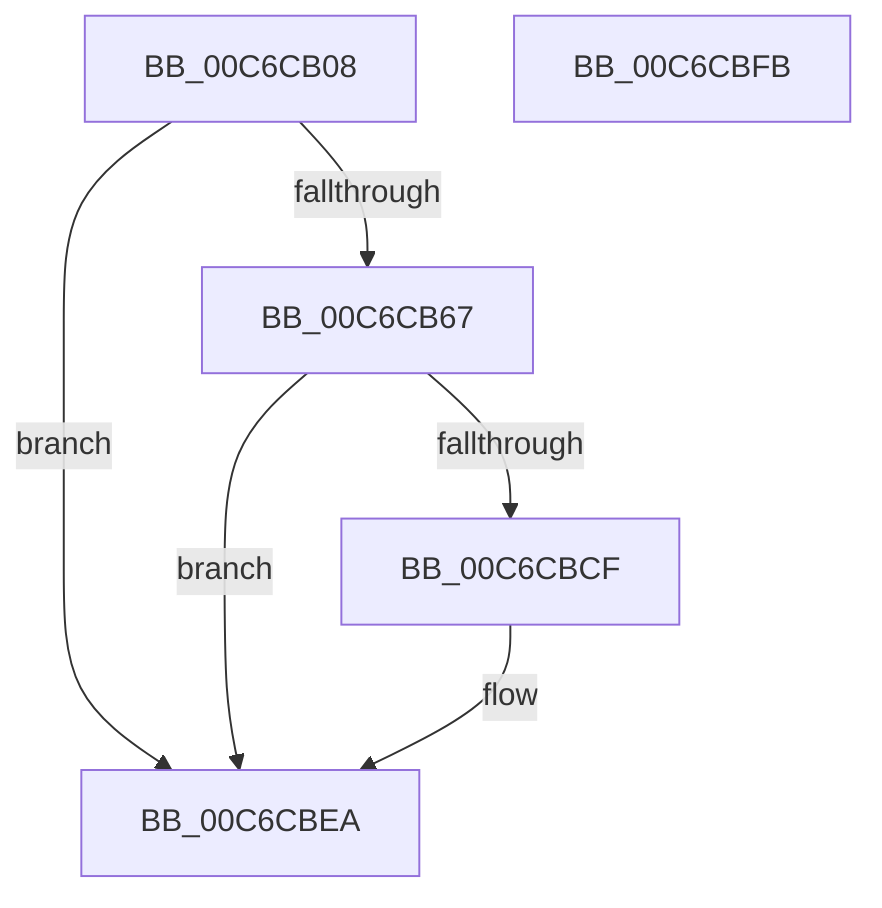

# MiRegisterForHardwareAcceleratorChanges

- RVA: `0x00C6CB08`–`0x00C6CBFC` (길이 `244` bytes)
- VA: `0x0000000140C6CB08`
- 실행 섹션: `INIT`
- PDB 이름 있음: `예`; PDB Function 태그: `아니요`
- unwind 정보 RVA: `0x000D95BC`
- 디코드: `50`개 명령, `244/244` bytes 표시
- 미해석 바이트: `0` (있으면 어셈블리에 `.byte`로 보존)

> 이 문서는 커널 이미지의 기계어와 PDB 기호를 분석해 생성했습니다. 4번과 5번은 함수 원형과 자료형을 바이너리 사용 방식에서 추정한 C 해석이며 원본 소스 복구 결과는 아닙니다.

## 1. Dependencies

- 직접 호출 지점: **3**; 고유 호출 대상: **3**
- 직접 호출자로 확인된 함수: **1**
- RIP 상대 이미지 참조: **9**

### Outgoing calls
- `0x00C6CB53` → `ext-ms-win-accel-api-km-l1-1-0.dll!AccelInitializeOffloadWorkspace` (import, 간접 대상; import `ext-ms-win-accel-api-km-l1-1-0.dll!AccelInitializeOffloadWorkspace`)
- `0x00C6CBBF` → `ext-ms-win-accel-api-km-l1-1-0.dll!AccelAcquireResourcesAsync` (import, 간접 대상; import `ext-ms-win-accel-api-km-l1-1-0.dll!AccelAcquireResourcesAsync`)
- `0x00C6CBD6` → `ext-ms-win-accel-api-km-l1-1-0.dll!AccelDestroyOffloadWorkspace` (import, 간접 대상; import `ext-ms-win-accel-api-km-l1-1-0.dll!AccelDestroyOffloadWorkspace`)

### Direct callers
- [MiInitSystem](../C5/MiInitSystem_function_00C5E6C0.md) at `0x00C5ED24`

### Static image references
- `0x00C6CB1E` → RVA `0x0003A118` (`.rdata`; read)
- `0x00C6CB29` → RVA `0x00E37560` (`.data`; read)
- `0x00C6CB41` → RVA `0x00F8C440` (`.data`; read)
- `0x00C6CB53` → RVA `0x00151188` (`ext-ms-win-accel-api-km-l1-1-0.dll!AccelInitializeOffloadWorkspace (IAT)`; read)
- `0x00C6CB93` → RVA `0x0003A108` (`.rdata`; read)
- `0x00C6CB9E` → RVA `0x00811520` (`MmAcceleratorCallbackRoutine`; read)
- `0x00C6CBBF` → RVA `0x00151190` (`ext-ms-win-accel-api-km-l1-1-0.dll!AccelAcquireResourcesAsync (IAT)`; read)
- `0x00C6CBD6` → RVA `0x00151180` (`ext-ms-win-accel-api-km-l1-1-0.dll!AccelDestroyOffloadWorkspace (IAT)`; read)
- `0x00C6CBE2` → RVA `0x00E37560` (`.data`; read/write)

## 2. Other-region calls and transfers

- 다른 실행 섹션으로 향하는 call: **0**
- 별도 외부 분기/꼬리 이동을 확인하지 못했습니다.

## 3. Assembly (complete function range)

```asm
00C6CB08  48 89 7C 24 08                  mov qword ptr [rsp + 8], rdi
00C6CB0D  55                              push rbp
00C6CB0E  48 8D 6C 24 A9                  lea rbp, [rsp - 0x57]
00C6CB13  48 81 EC A0 00 00 00            sub rsp, 0xa0
00C6CB1A  83 65 DB 00                     and dword ptr [rbp - 0x25], 0
00C6CB1E  48 8D 05 F3 D5 3C FF            lea rax, [rip - 0xc32a0d]
00C6CB25  83 65 EB 00                     and dword ptr [rbp - 0x15], 0
00C6CB29  48 8D 15 30 AA 1C 00            lea rdx, [rip + 0x1caa30]
00C6CB30  83 65 E7 00                     and dword ptr [rbp - 0x19], 0
00C6CB34  48 8D 4D D7                     lea rcx, [rbp - 0x29]
00C6CB38  48 89 45 DF                     mov qword ptr [rbp - 0x21], rax
00C6CB3C  BF 01 00 00 00                  mov edi, 1
00C6CB41  48 8B 05 F8 F8 31 00            mov rax, qword ptr [rip + 0x31f8f8]
00C6CB48  48 89 45 EF                     mov qword ptr [rbp - 0x11], rax
00C6CB4C  C7 45 D7 01 00 20 00            mov dword ptr [rbp - 0x29], 0x200001
00C6CB53  48 FF 15 2E 46 4E FF            call qword ptr [rip - 0xb1b9d2]
00C6CB5A  0F 1F 44 00 00                  nop dword ptr [rax + rax]
00C6CB5F  85 C0                           test eax, eax
00C6CB61  0F 88 83 00 00 00               js 0x140c6cbea
00C6CB67  48 83 65 27 00                  and qword ptr [rbp + 0x27], 0
00C6CB6C  48 8D 4D F7                     lea rcx, [rbp - 9]
00C6CB70  48 83 65 17 00                  and qword ptr [rbp + 0x17], 0
00C6CB75  33 C0                           xor eax, eax
00C6CB77  48 83 65 37 00                  and qword ptr [rbp + 0x37], 0
00C6CB7C  83 65 3F 00                     and dword ptr [rbp + 0x3f], 0
00C6CB80  48 83 65 47 00                  and qword ptr [rbp + 0x47], 0
00C6CB85  89 45 43                        mov dword ptr [rbp + 0x43], eax
00C6CB88  48 8B 05 D1 A9 1C 00            mov rax, qword ptr [rip + 0x1ca9d1]
00C6CB8F  48 89 45 FF                     mov qword ptr [rbp - 1], rax
00C6CB93  48 8D 05 6E D5 3C FF            lea rax, [rip - 0xc32a92]
00C6CB9A  48 89 45 07                     mov qword ptr [rbp + 7], rax
00C6CB9E  48 8D 05 7B 49 BA FF            lea rax, [rip - 0x45b685]
00C6CBA5  48 89 45 1F                     mov qword ptr [rbp + 0x1f], rax
00C6CBA9  48 C7 45 F7 01 00 58 00         mov qword ptr [rbp - 9], 0x580001
00C6CBB1  48 C7 45 2F 00 00 11 00         mov qword ptr [rbp + 0x2f], 0x110000
00C6CBB9  89 7D 0F                        mov dword ptr [rbp + 0xf], edi
00C6CBBC  89 7D 13                        mov dword ptr [rbp + 0x13], edi
00C6CBBF  48 FF 15 CA 45 4E FF            call qword ptr [rip - 0xb1ba36]
00C6CBC6  0F 1F 44 00 00                  nop dword ptr [rax + rax]
00C6CBCB  85 C0                           test eax, eax
00C6CBCD  79 1B                           jns 0x140c6cbea
00C6CBCF  48 8B 0D 8A A9 1C 00            mov rcx, qword ptr [rip + 0x1ca98a]
00C6CBD6  48 FF 15 A3 45 4E FF            call qword ptr [rip - 0xb1ba5d]
00C6CBDD  0F 1F 44 00 00                  nop dword ptr [rax + rax]
00C6CBE2  48 83 25 76 A9 1C 00 00         and qword ptr [rip + 0x1ca976], 0
00C6CBEA  48 8B BC 24 B0 00 00 00         mov rdi, qword ptr [rsp + 0xb0]
00C6CBF2  48 81 C4 A0 00 00 00            add rsp, 0xa0
00C6CBF9  5D                              pop rbp
00C6CBFA  C3                              ret
00C6CBFB  CC                              int3
```

## 4. C-style interpretation (structured pseudocode)

```c
__int64 __fastcall MiRegisterForHardwareAcceleratorChanges(void)
{
    __int64 result;
    __int64 v_rsp;
    unsigned __int64 v_stack_m18;
    unsigned int v_stack_m1C;
    unsigned int v_stack_m20;
    unsigned __int64 v_stack_m28;
    unsigned __int64 v_stack_m30;
    unsigned __int64 v_stack_m38;
    unsigned __int64 v_stack_m40;
    unsigned __int64 v_stack_m48;
    unsigned int v_stack_m4C;
    unsigned int v_stack_m50;
    unsigned __int64 v_stack_m58;
    unsigned __int64 v_stack_m5F;
    unsigned __int64 v_stack_m60;
    unsigned __int64 v_stack_m68;
    unsigned __int64 v_stack_m70;
    unsigned int v_stack_m74;
    unsigned int v_stack_m78;
    unsigned __int64 v_stack_m80;
    unsigned int v_stack_m84;
    unsigned __int64 v_stack_m88;
    unsigned __int64 v_stack_p8;

    v_stack_p8 = v_rdi;
    v_rsp = (v_rsp) - (160);
    v_stack_m80 = v_rip - 12790285;
    v_stack_m70 = *(unsigned __int64 *)(v_rip + 3275000);
    v_stack_m88 = 0x200001ULL;
    result = ext_ms_win_accel_api_km_l1_1_0_dll_AccelInitializeOffloadWorkspace(v_stack_m88, v_rip + 1878576, a3, a4);
    if (sign_flag) goto loc_00C6CBEA;
    result = 0;
    v_stack_m1C = 0;
    v_stack_m60 = *(unsigned __int64 *)(v_rip + 1878481);
    v_stack_m58 = v_rip - 12790418;
    v_stack_m40 = v_rip - 4568709;
    v_stack_m68 = 0x580001ULL;
    v_stack_m30 = 0x110000ULL;
    v_stack_m50 = 1;
    v_stack_m4C = 1;
    result = ext_ms_win_accel_api_km_l1_1_0_dll_AccelAcquireResourcesAsync(v_stack_m68, v_rip + 1878576, a3, a4);
    if (sign_flag) {
        a1 = *(unsigned __int64 *)(v_rip + 1878410);
        result = ext_ms_win_accel_api_km_l1_1_0_dll_AccelDestroyOffloadWorkspace(a1, v_rip + 1878576, a3, a4);
    }
    v_rsp = (v_rsp) + (160);
    return result;
}
```

## 5. (Beta) C Style

```c
void MiRegisterForHardwareAcceleratorChanges(void)
{
    int64_t result;
    int64_t local_rsp;
    uint64_t v_stack_m18;
    uint32_t v_stack_m1C;
    uint32_t v_stack_m20;
    uint64_t v_stack_m28;
    uint64_t v_stack_m30;
    uint64_t v_stack_m38;
    uint64_t v_stack_m40;
    uint64_t v_stack_m48;
    uint32_t v_stack_m4C;
    uint32_t v_stack_m50;
    uint64_t v_stack_m58;
    uint64_t v_stack_m5F;
    uint64_t v_stack_m60;
    uint64_t v_stack_m68;
    uint64_t v_stack_m70;
    uint32_t v_stack_m74;
    uint32_t v_stack_m78;
    uint64_t v_stack_m80;
    uint32_t v_stack_m84;
    uint64_t v_stack_m88;
    uint64_t v_stack_p8;

    v_stack_p8 = local_rdi;
    local_rsp = (local_rsp) - (160);
    v_stack_m80 = v_rip - 12790285;
    v_stack_m70 = *(uint64_t *)(v_rip + 0x31F8F8);
    v_stack_m88 = 0x200001ULL;
    result = kernel_indirect_call(v_stack_m88, v_rip + 1878576, a3, a4);
    if (sign_flag) goto loc_00C6CBEA;
    result = 0;
    v_stack_m1C = 0;
    v_stack_m60 = *(uint64_t *)(v_rip + 0x1CA9D1);
    v_stack_m58 = v_rip - 12790418;
    v_stack_m40 = v_rip - 4568709;
    v_stack_m68 = 0x580001ULL;
    v_stack_m30 = 0x110000ULL;
    v_stack_m50 = 1;
    v_stack_m4C = 1;
    result = kernel_indirect_call(v_stack_m68, v_rip + 1878576, a3, a4);
    if (sign_flag) {
        a1 = *(uint64_t *)(v_rip + 0x1CA98A);
        result = kernel_indirect_call(a1, v_rip + 1878576, a3, a4);
    }
    local_rsp = (local_rsp) + (160);
    return result;
}
```

## 6. Execution-region graph

[열기: 2D/3D 그래프와 함수 탐색 컨트롤 패널](../../../control-panel.html?section=init&rva=0x00C6CB08&view=graph)

- 2D 그래프는 위에서 아래로 흐르고, 3D 그래프는 빈 공간을 드래그해 회전합니다. Shift+드래그는 이동, 휠은 확대·축소, 함수 노드 선택은 대상 보고서 이동입니다.

### Static fallback


