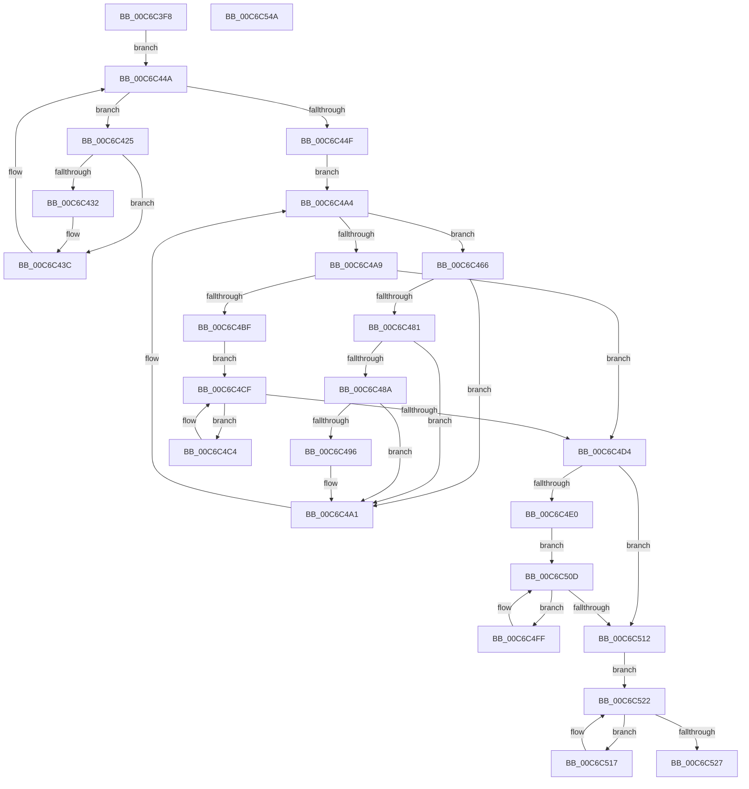

# MiReloadBootLoadedDrivers

- RVA: `0x00C6C3F8`–`0x00C6C54B` (길이 `339` bytes)
- VA: `0x0000000140C6C3F8`
- 실행 섹션: `INIT`
- PDB 이름 있음: `예`; PDB Function 태그: `아니요`
- unwind 정보 RVA: `0x0005C954`
- 디코드: `92`개 명령, `339/339` bytes 표시
- 미해석 바이트: `0` (있으면 어셈블리에 `.byte`로 보존)

> 이 문서는 커널 이미지의 기계어와 PDB 기호를 분석해 생성했습니다. 4번과 5번은 함수 원형과 자료형을 바이너리 사용 방식에서 추정한 C 해석이며 원본 소스 복구 결과는 아닙니다.

## 1. Dependencies

- 직접 호출 지점: **10**; 고유 호출 대상: **10**
- 직접 호출자로 확인된 함수: **1**
- RIP 상대 이미지 참조: **7**

### Outgoing calls
- `0x00C6C414` → [MiAcquireLoadLock](../../text/2A/MiAcquireLoadLock_function_002A3950.md) (function, `0x002A3950`)
- `0x00C6C437` → [MiProcessLoadConfigForDriver](../../page/A7/MiProcessLoadConfigForDriver_function_00A7FCE4.md) (function, `0x00A7FCE4`)
- `0x00C6C442` → [MiHandleBootImage](MiHandleBootImage_function_00C6B854.md) (function, `0x00C6B854`)
- `0x00C6C45C` → [MmReleaseLoadLock](../../text/4D/MmReleaseLoadLock_function_004D36D0.md) (function, `0x004D36D0`)
- `0x00C6C48D` → [MI_IS_PHYSICAL_ADDRESS](../../text/23/MI_IS_PHYSICAL_ADDRESS_function_0023B3A0.md) (function, `0x0023B3A0`)
- `0x00C6C49C` → [MiMapKernelScp](../../text/4D/MiMapKernelScp_function_004DCAD4.md) (function, `0x004DCAD4`)
- `0x00C6C4C7` → [MiApplyRetpolineToBootDriver](MiApplyRetpolineToBootDriver_function_00C66264.md) (function, `0x00C66264`)
- `0x00C6C505` → [MiApplyImportOptimizationToBootDriver](MiApplyImportOptimizationToBootDriver_function_00C66108.md) (function, `0x00C66108`)
- `0x00C6C51A` → [MiApplyFunctionOverrideToBootDriver](MiApplyFunctionOverrideToBootDriver_function_00C6B19C.md) (function, `0x00C6B19C`)
- `0x00C6C529` → [KeQueryPerformanceCounter](../../text/37/KeQueryPerformanceCounter_function_0037E7E0.md) (function, `0x0037E7E0`)

### Direct callers
- [MiInitializeLoadedModuleList](MiInitializeLoadedModuleList_function_00C6BCDC.md) at `0x00C6BD2B`

### Static image references
- `0x00C6C425` → RVA `0x00FC6B28` (`ALMOSTRO`; read)
- `0x00C6C453` → RVA `0x00FC6A88` (`ALMOSTRO`; read/write)
- `0x00C6C481` → RVA `0x00FC6B98` (`ALMOSTRO`; read)
- `0x00C6C4A9` → RVA `0x00FC6B48` (`ALMOSTRO`; read)
- `0x00C6C4D4` → RVA `0x00F10EC0` (`.data`; read)
- `0x00C6C4F0` → RVA `0x004CDA40` (`MiIsTargetFullyRetpolined`; read)
- `0x00C6C53D` → RVA `0x01008890` (`INITDATA`; write)

## 2. Other-region calls and transfers

- 다른 실행 섹션으로 향하는 call: **6**
  - `0x00C6C414` → [MiAcquireLoadLock](../../text/2A/MiAcquireLoadLock_function_002A3950.md) (`INIT` → `.text`)
  - `0x00C6C437` → [MiProcessLoadConfigForDriver](../../page/A7/MiProcessLoadConfigForDriver_function_00A7FCE4.md) (`INIT` → `PAGE`)
  - `0x00C6C45C` → [MmReleaseLoadLock](../../text/4D/MmReleaseLoadLock_function_004D36D0.md) (`INIT` → `.text`)
  - `0x00C6C48D` → [MI_IS_PHYSICAL_ADDRESS](../../text/23/MI_IS_PHYSICAL_ADDRESS_function_0023B3A0.md) (`INIT` → `.text`)
  - `0x00C6C49C` → [MiMapKernelScp](../../text/4D/MiMapKernelScp_function_004DCAD4.md) (`INIT` → `.text`)
  - `0x00C6C529` → [KeQueryPerformanceCounter](../../text/37/KeQueryPerformanceCounter_function_0037E7E0.md) (`INIT` → `.text`)
- 별도 외부 분기/꼬리 이동을 확인하지 못했습니다.

## 3. Assembly (complete function range)

```asm
00C6C3F8  48 89 5C 24 08                  mov qword ptr [rsp + 8], rbx
00C6C3FD  48 89 6C 24 10                  mov qword ptr [rsp + 0x10], rbp
00C6C402  48 89 74 24 18                  mov qword ptr [rsp + 0x18], rsi
00C6C407  57                              push rdi
00C6C408  48 83 EC 20                     sub rsp, 0x20
00C6C40C  48 8B F1                        mov rsi, rcx
00C6C40F  B9 01 00 00 00                  mov ecx, 1
00C6C414  E8 37 75 63 FF                  call 0x1402a3950
00C6C419  48 8D 5E 10                     lea rbx, [rsi + 0x10]
00C6C41D  48 8B E8                        mov rbp, rax
00C6C420  48 8B 3B                        mov rdi, qword ptr [rbx]
00C6C423  EB 25                           jmp 0x140c6c44a
00C6C425  48 8B 0D FC A6 35 00            mov rcx, qword ptr [rip + 0x35a6fc]
00C6C42C  48 39 4F 30                     cmp qword ptr [rdi + 0x30], rcx
00C6C430  74 0A                           je 0x140c6c43c
00C6C432  33 D2                           xor edx, edx
00C6C434  48 8B CF                        mov rcx, rdi
00C6C437  E8 A8 38 E1 FF                  call 0x140a7fce4
00C6C43C  48 8B D7                        mov rdx, rdi
00C6C43F  48 8B CE                        mov rcx, rsi
00C6C442  E8 0D F4 FF FF                  call 0x140c6b854
00C6C447  48 8B 3F                        mov rdi, qword ptr [rdi]
00C6C44A  48 3B FB                        cmp rdi, rbx
00C6C44D  75 D6                           jne 0x140c6c425
00C6C44F  90                              nop
00C6C450  48 8B CD                        mov rcx, rbp
00C6C453  48 0F BA 2D 2C A6 35 00 0B      bts qword ptr [rip + 0x35a62c], 0xb
00C6C45C  E8 6F 72 86 FF                  call 0x1404d36d0
00C6C461  48 8B 3B                        mov rdi, qword ptr [rbx]
00C6C464  EB 3E                           jmp 0x140c6c4a4
00C6C466  8B 77 40                        mov esi, dword ptr [rdi + 0x40]
00C6C469  48 8B 6F 30                     mov rbp, qword ptr [rdi + 0x30]
00C6C46D  48 81 C6 FF 0F 00 00            add rsi, 0xfff
00C6C474  48 C1 EE 0C                     shr rsi, 0xc
00C6C478  48 3B 2D A9 A6 35 00            cmp rbp, qword ptr [rip + 0x35a6a9]
00C6C47F  74 20                           je 0x140c6c4a1
00C6C481  48 3B 2D 10 A7 35 00            cmp rbp, qword ptr [rip + 0x35a710]
00C6C488  74 17                           je 0x140c6c4a1
00C6C48A  48 8B CD                        mov rcx, rbp
00C6C48D  E8 0E EF 5C FF                  call 0x14023b3a0
00C6C492  85 C0                           test eax, eax
00C6C494  75 0B                           jne 0x140c6c4a1
00C6C496  48 8B D6                        mov rdx, rsi
00C6C499  48 8B CD                        mov rcx, rbp
00C6C49C  E8 33 06 87 FF                  call 0x1404dcad4
00C6C4A1  48 8B 3F                        mov rdi, qword ptr [rdi]
00C6C4A4  48 3B FB                        cmp rdi, rbx
00C6C4A7  75 BD                           jne 0x140c6c466
00C6C4A9  48 8B 05 98 A6 35 00            mov rax, qword ptr [rip + 0x35a698]
00C6C4B0  48 BE 00 00 00 00 00 02 00 00   movabs rsi, 0x20000000000
00C6C4BA  48 85 C6                        test rsi, rax
00C6C4BD  74 15                           je 0x140c6c4d4
00C6C4BF  48 8B 3B                        mov rdi, qword ptr [rbx]
00C6C4C2  EB 0B                           jmp 0x140c6c4cf
00C6C4C4  48 8B CF                        mov rcx, rdi
00C6C4C7  E8 98 9D FF FF                  call 0x140c66264
00C6C4CC  48 8B 3F                        mov rdi, qword ptr [rdi]
00C6C4CF  48 3B FB                        cmp rdi, rbx
00C6C4D2  75 F0                           jne 0x140c6c4c4
00C6C4D4  F7 05 E2 49 2A 00 00 00 02 00   test dword ptr [rip + 0x2a49e2], 0x20000
00C6C4DE  75 32                           jne 0x140c6c512
00C6C4E0  48 8B 05 61 A6 35 00            mov rax, qword ptr [rip + 0x35a661]
00C6C4E7  48 8B 3B                        mov rdi, qword ptr [rbx]
00C6C4EA  48 23 C6                        and rax, rsi
00C6C4ED  48 F7 D8                        neg rax
00C6C4F0  48 8D 05 49 15 86 FF            lea rax, [rip - 0x79eab7]
00C6C4F7  48 1B F6                        sbb rsi, rsi
00C6C4FA  48 23 F0                        and rsi, rax
00C6C4FD  EB 0E                           jmp 0x140c6c50d
00C6C4FF  48 8B D6                        mov rdx, rsi
00C6C502  48 8B CF                        mov rcx, rdi
00C6C505  E8 FE 9B FF FF                  call 0x140c66108
00C6C50A  48 8B 3F                        mov rdi, qword ptr [rdi]
00C6C50D  48 3B FB                        cmp rdi, rbx
00C6C510  75 ED                           jne 0x140c6c4ff
00C6C512  48 8B 3B                        mov rdi, qword ptr [rbx]
00C6C515  EB 0B                           jmp 0x140c6c522
00C6C517  48 8B CF                        mov rcx, rdi
00C6C51A  E8 7D EC FF FF                  call 0x140c6b19c
00C6C51F  48 8B 3F                        mov rdi, qword ptr [rdi]
00C6C522  48 3B FB                        cmp rdi, rbx
00C6C525  75 F0                           jne 0x140c6c517
00C6C527  33 C9                           xor ecx, ecx
00C6C529  E8 B2 22 71 FF                  call 0x14037e7e0
00C6C52E  48 8B 5C 24 30                  mov rbx, qword ptr [rsp + 0x30]
00C6C533  48 8B 6C 24 38                  mov rbp, qword ptr [rsp + 0x38]
00C6C538  48 8B 74 24 40                  mov rsi, qword ptr [rsp + 0x40]
00C6C53D  48 89 05 4C C3 39 00            mov qword ptr [rip + 0x39c34c], rax
00C6C544  48 83 C4 20                     add rsp, 0x20
00C6C548  5F                              pop rdi
00C6C549  C3                              ret
00C6C54A  CC                              int3
```

## 4. C-style interpretation (structured pseudocode)

```c
__int64 __fastcall MiReloadBootLoadedDrivers(__int64 a1, int a2)
{
    __int64 result;
    __int64 v_rsi;
    __int64 v_rsp;
    unsigned __int64 v_stack_p10;
    unsigned __int64 v_stack_p18;
    unsigned __int64 v_stack_p8;

    v_stack_p8 = v_rbx;
    v_stack_p10 = v_rbp;
    v_stack_p18 = v_rsi;
    v_rsp = (v_rsp) - (32);
    result = MiAcquireLoadLock(1, a2, a3, a4);
    goto loc_00C6C44A;
loc_00C6C425:
    if ((*(unsigned __int64 *)(*(unsigned __int64 *)(a1 + 16) + 48)) != (*(unsigned __int64 *)(v_rip + 3516156))) {
        a2 = 0;
        a1 = *(unsigned __int64 *)(a1 + 16);
        result = MiProcessLoadConfigForDriver(a1, a2, a3, a4);
    }
    result = MiHandleBootImage(a1, *(unsigned __int64 *)(a1 + 16), a3, a4);
loc_00C6C44A:
    if ((*(unsigned __int64 *)(*(unsigned __int64 *)(a1 + 16))) != (a1 + 16)) goto loc_00C6C425;
    result = MmReleaseLoadLock(result, *(unsigned __int64 *)(a1 + 16), a3, a4);
    goto loc_00C6C4A4;
loc_00C6C466:
    v_rsi = ((unsigned int)(*(unsigned int *)(*(unsigned __int64 *)(a1 + 16) + 64))) + (0xFFFULL);
    v_rsi = (v_rsi) >> (12);
    if ((*(unsigned __int64 *)(*(unsigned __int64 *)(a1 + 16) + 48)) == (*(unsigned __int64 *)(v_rip + 3516073))) goto loc_00C6C4A1;
    if ((*(unsigned __int64 *)(*(unsigned __int64 *)(a1 + 16) + 48)) == (*(unsigned __int64 *)(v_rip + 3516176))) goto loc_00C6C4A1;
    result = MI_IS_PHYSICAL_ADDRESS(*(unsigned __int64 *)(*(unsigned __int64 *)(a1 + 16) + 48), *(unsigned __int64 *)(a1 + 16), a3, a4);
    if ((unsigned int)(result) == 0) {
        a2 = v_rsi;
        a1 = *(unsigned __int64 *)(*(unsigned __int64 *)(a1 + 16) + 48);
        result = MiMapKernelScp(a1, a2, a3, a4);
    }
loc_00C6C4A4:
    if ((*(unsigned __int64 *)(*(unsigned __int64 *)(a1 + 16))) != (a1 + 16)) goto loc_00C6C466;
    if (((v_rsi) & (*(unsigned __int64 *)(v_rip + 3516056))) == 0) goto loc_00C6C4D4;
    goto loc_00C6C4CF;
loc_00C6C4C4:
    result = MiApplyRetpolineToBootDriver(*(unsigned __int64 *)(a1 + 16), a2, a3, a4);
loc_00C6C4CF:
    if ((*(unsigned __int64 *)(*(unsigned __int64 *)(a1 + 16))) != (a1 + 16)) goto loc_00C6C4C4;
loc_00C6C4D4:
    if (((*(unsigned int *)(v_rip + 2771426)) & (0x20000ULL)) != 0) goto loc_00C6C512;
    result = (*(unsigned __int64 *)(v_rip + 3516001)) & (v_rsi);
    result = -(result);
    v_rsi = (v_rsi) & (v_rip - 7989943);
    goto loc_00C6C50D;
loc_00C6C4FF:
    result = MiApplyImportOptimizationToBootDriver(*(unsigned __int64 *)(a1 + 16), v_rsi, a3, a4);
loc_00C6C50D:
    if ((*(unsigned __int64 *)(*(unsigned __int64 *)(a1 + 16))) != (a1 + 16)) goto loc_00C6C4FF;
loc_00C6C512:
    goto loc_00C6C522;
loc_00C6C517:
    result = MiApplyFunctionOverrideToBootDriver(*(unsigned __int64 *)(a1 + 16), v_rsi, a3, a4);
loc_00C6C522:
    if ((*(unsigned __int64 *)(*(unsigned __int64 *)(a1 + 16))) != (a1 + 16)) goto loc_00C6C517;
    a1 = 0;
    result = KeQueryPerformanceCounter(a1, v_rsi, a3, a4);
    *(unsigned __int64 *)(v_rip + 3785548) = result;
    v_rsp = (v_rsp) + (32);
    return result;
}
```

## 5. (Beta) C Style

```c
int64_t MiReloadBootLoadedDrivers(void *Arg1, int32_t Arg2)
{
    uint8_t *arg1 = (uint8_t *)Arg1;

    int64_t result;
    int64_t local_rsi;
    int64_t local_rsp;
    uint64_t v_stack_p10;
    uint64_t v_stack_p18;
    uint64_t v_stack_p8;

    v_stack_p8 = local_rbx;
    v_stack_p10 = local_rbp;
    v_stack_p18 = local_rsi;
    local_rsp = (local_rsp) - (32);
    result = MiAcquireLoadLock(1, Arg2, a3, a4);
    goto loc_00C6C44A;
loc_00C6C425:
    if ((*(uint64_t *)(*(uint64_t *)(arg1 + 0x10) + 0x30)) != (*(uint64_t *)(v_rip + 0x35A6FC))) {
        Arg2 = 0;
        Arg1 = *(uint64_t *)(arg1 + 0x10);
        result = MiProcessLoadConfigForDriver(Arg1, Arg2, a3, a4);
    }
    result = MiHandleBootImage(Arg1, *(uint64_t *)(arg1 + 0x10), a3, a4);
loc_00C6C44A:
    if ((*(uint64_t *)(*(uint64_t *)(arg1 + 0x10))) != (Arg1 + 16)) goto loc_00C6C425;
    result = MmReleaseLoadLock(result, *(uint64_t *)(arg1 + 0x10), a3, a4);
    goto loc_00C6C4A4;
loc_00C6C466:
    local_rsi = ((uint32_t)(*(uint32_t *)(*(uint64_t *)(arg1 + 0x10) + 0x40))) + (0xFFFULL);
    local_rsi = (local_rsi) >> (12);
    if ((*(uint64_t *)(*(uint64_t *)(arg1 + 0x10) + 0x30)) == (*(uint64_t *)(v_rip + 0x35A6A9))) goto loc_00C6C4A1;
    if ((*(uint64_t *)(*(uint64_t *)(arg1 + 0x10) + 0x30)) == (*(uint64_t *)(v_rip + 0x35A710))) goto loc_00C6C4A1;
    result = MI_IS_PHYSICAL_ADDRESS(*(uint64_t *)(*(uint64_t *)(arg1 + 0x10) + 0x30), *(uint64_t *)(arg1 + 0x10), a3, a4);
    if ((uint32_t)(result) == 0) {
        Arg2 = local_rsi;
        Arg1 = *(uint64_t *)(*(uint64_t *)(arg1 + 0x10) + 0x30);
        result = MiMapKernelScp(Arg1, Arg2, a3, a4);
    }
loc_00C6C4A4:
    if ((*(uint64_t *)(*(uint64_t *)(arg1 + 0x10))) != (Arg1 + 16)) goto loc_00C6C466;
    if (((local_rsi) & (*(uint64_t *)(v_rip + 0x35A698))) == 0) goto loc_00C6C4D4;
    goto loc_00C6C4CF;
loc_00C6C4C4:
    result = MiApplyRetpolineToBootDriver(*(uint64_t *)(arg1 + 0x10), Arg2, a3, a4);
loc_00C6C4CF:
    if ((*(uint64_t *)(*(uint64_t *)(arg1 + 0x10))) != (Arg1 + 16)) goto loc_00C6C4C4;
loc_00C6C4D4:
    if (((*(uint32_t *)(v_rip + 0x2A49E2)) & (0x20000ULL)) != 0) goto loc_00C6C512;
    result = (*(uint64_t *)(v_rip + 0x35A661)) & (local_rsi);
    result = -(result);
    local_rsi = (local_rsi) & (v_rip - 7989943);
    goto loc_00C6C50D;
loc_00C6C4FF:
    result = MiApplyImportOptimizationToBootDriver(*(uint64_t *)(arg1 + 0x10), local_rsi, a3, a4);
loc_00C6C50D:
    if ((*(uint64_t *)(*(uint64_t *)(arg1 + 0x10))) != (Arg1 + 16)) goto loc_00C6C4FF;
loc_00C6C512:
    goto loc_00C6C522;
loc_00C6C517:
    result = MiApplyFunctionOverrideToBootDriver(*(uint64_t *)(arg1 + 0x10), local_rsi, a3, a4);
loc_00C6C522:
    if ((*(uint64_t *)(*(uint64_t *)(arg1 + 0x10))) != (Arg1 + 16)) goto loc_00C6C517;
    Arg1 = 0;
    result = KeQueryPerformanceCounter(Arg1, local_rsi, a3, a4);
    *(uint64_t *)(v_rip + 0x39C34C) = result;
    local_rsp = (local_rsp) + (32);
    return result;
}
```

### 관측된 메모리 오프셋

구조체 형식이 확인되지 않은 접근은 인자 기준의 오프셋으로만 기록했습니다.

| 기준 인자 | 오프셋 표현 | 폭 (bit) | 접근 |
|---|---:|---:|---|
| `Arg1` | `+ 0x0` | `64` | `R` |
| `Arg1` | `+ 0x10` | `64` | `R` |

## 6. Execution-region graph

[열기: 2D/3D 그래프와 함수 탐색 컨트롤 패널](../../../control-panel.html?section=init&rva=0x00C6C3F8&view=graph)

- 2D 그래프는 위에서 아래로 흐르고, 3D 그래프는 빈 공간을 드래그해 회전합니다. Shift+드래그는 이동, 휠은 확대·축소, 함수 노드 선택은 대상 보고서 이동입니다.

### Static fallback


