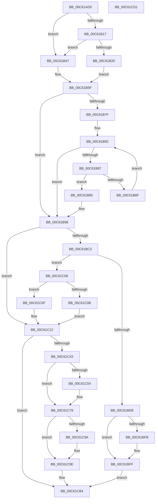

# MiReserveBootDriverPtes

- RVA: `0x00C61AD0`–`0x00C61CD2` (길이 `514` bytes)
- VA: `0x0000000140C61AD0`
- 실행 섹션: `INIT`
- PDB 이름 있음: `예`; PDB Function 태그: `아니요`
- unwind 정보 RVA: `0x00075C18`
- 디코드: `143`개 명령, `514/514` bytes 표시
- 미해석 바이트: `0` (있으면 어셈블리에 `.byte`로 보존)

> 이 문서는 커널 이미지의 기계어와 PDB 기호를 분석해 생성했습니다. 4번과 5번은 함수 원형과 자료형을 바이너리 사용 방식에서 추정한 C 해석이며 원본 소스 복구 결과는 아닙니다.

## 1. Dependencies

- 직접 호출 지점: **5**; 고유 호출 대상: **4**
- 직접 호출자로 확인된 함수: **1**
- RIP 상대 이미지 참조: **7**

### Outgoing calls
- `0x00C61BF1` → [RtlSetBits](../../text/3E/RtlSetBits_function_003E1610.md) (function, `0x003E1610`)
- `0x00C61C36` → [MiAllocatePool](../../text/35/MiAllocatePool_function_0035B540.md) (function, `0x0035B540`)
- `0x00C61C60` → [memcpy](../../text/6C/memcpy_function_006C6840.md) (function, `0x006C6840`)
- `0x00C61C74` → [ExFreePoolWithTag](../../poolcode/B8/ExFreePoolWithTag_function_00B82870.md) (function, `0x00B82870`)
- `0x00C61C8C` → [RtlSetBits](../../text/3E/RtlSetBits_function_003E1610.md) (function, `0x003E1610`)

### Direct callers
- [MiInitializeDriverPtes](MiInitializeDriverPtes_function_00C61818.md) at `0x00C6197C`

### Static image references
- `0x00C61B0E` → RVA `0x00FC6B28` (`ALMOSTRO`; read)
- `0x00C61B17` → RVA `0x00FC6B98` (`ALMOSTRO`; read)
- `0x00C61B20` → RVA `0x00E375B0` (`.data`; read)
- `0x00C61B2B` → RVA `0x00E375AC` (`.data`; read)
- `0x00C61B3D` → RVA `0x00E2D838` (`.data`; read)
- `0x00C61B98` → RVA `0x00E2D960` (`.data`; read)
- `0x00C61C6D` → RVA `0x00E2D960` (`.data`; write)

## 2. Other-region calls and transfers

- 다른 실행 섹션으로 향하는 call: **5**
  - `0x00C61BF1` → [RtlSetBits](../../text/3E/RtlSetBits_function_003E1610.md) (`INIT` → `.text`)
  - `0x00C61C36` → [MiAllocatePool](../../text/35/MiAllocatePool_function_0035B540.md) (`INIT` → `.text`)
  - `0x00C61C60` → [memcpy](../../text/6C/memcpy_function_006C6840.md) (`INIT` → `.text`)
  - `0x00C61C74` → [ExFreePoolWithTag](../../poolcode/B8/ExFreePoolWithTag_function_00B82870.md) (`INIT` → `POOLCODE`)
  - `0x00C61C8C` → [RtlSetBits](../../text/3E/RtlSetBits_function_003E1610.md) (`INIT` → `.text`)
- 별도 외부 분기/꼬리 이동을 확인하지 못했습니다.

## 3. Assembly (complete function range)

```asm
00C61AD0  48 89 5C 24 08                  mov qword ptr [rsp + 8], rbx
00C61AD5  48 89 6C 24 10                  mov qword ptr [rsp + 0x10], rbp
00C61ADA  48 89 74 24 18                  mov qword ptr [rsp + 0x18], rsi
00C61ADF  57                              push rdi
00C61AE0  41 54                           push r12
00C61AE2  41 55                           push r13
00C61AE4  41 56                           push r14
00C61AE6  41 57                           push r15
00C61AE8  48 83 EC 20                     sub rsp, 0x20
00C61AEC  4C 8B C1                        mov r8, rcx
00C61AEF  44 8B CA                        mov r9d, edx
00C61AF2  49 C1 E0 19                     shl r8, 0x19
00C61AF6  48 8B F1                        mov rsi, rcx
00C61AF9  48 B8 00 00 00 00 80 F6 FF FF   movabs rax, 0xfffff68000000000
00C61B03  48 C1 E0 19                     shl rax, 0x19
00C61B07  4C 2B C0                        sub r8, rax
00C61B0A  49 C1 F8 10                     sar r8, 0x10
00C61B0E  4C 3B 05 13 50 36 00            cmp r8, qword ptr [rip + 0x365013]
00C61B15  74 30                           je 0x140c61b47
00C61B17  4C 3B 05 7A 50 36 00            cmp r8, qword ptr [rip + 0x36507a]
00C61B1E  74 27                           je 0x140c61b47
00C61B20  8B 15 8A 5A 1D 00               mov edx, dword ptr [rip + 0x1d5a8a]
00C61B26  B9 00 00 00 00                  mov ecx, 0
00C61B2B  03 15 7B 5A 1D 00               add edx, dword ptr [rip + 0x1d5a7b]
00C61B31  F7 C2 FF 0F 00 00               test edx, 0xfff
00C61B37  0F 95 C1                        setne cl
00C61B3A  C1 EA 0C                        shr edx, 0xc
00C61B3D  03 0D F5 BC 1C 00               add ecx, dword ptr [rip + 0x1cbcf5]
00C61B43  03 D1                           add edx, ecx
00C61B45  EB 18                           jmp 0x140c61b5f
00C61B47  8B 05 5F 5A 1D 00               mov eax, dword ptr [rip + 0x1d5a5f]
00C61B4D  BA 00 00 00 00                  mov edx, 0
00C61B52  A9 FF 0F 00 00                  test eax, 0xfff
00C61B57  0F 95 C2                        setne dl
00C61B5A  C1 E8 0C                        shr eax, 0xc
00C61B5D  03 D0                           add edx, eax
00C61B5F  42 8D 04 0A                     lea eax, [rdx + r9]
00C61B63  45 33 E4                        xor r12d, r12d
00C61B66  4C 8D 0C C6                     lea r9, [rsi + rax*8]
00C61B6A  44 8B F0                        mov r14d, eax
00C61B6D  49 8D 51 78                     lea rdx, [r9 + 0x78]
00C61B71  48 83 E2 80                     and rdx, 0xffffffffffffff80
00C61B75  41 8D 5C 24 01                  lea ebx, [r12 + 1]
00C61B7A  4C 3B CA                        cmp r9, rdx
00C61B7D  74 19                           je 0x140c61b98
00C61B7F  49 8B C9                        mov rcx, r9
00C61B82  48 3B CA                        cmp rcx, rdx
00C61B85  73 11                           jae 0x140c61b98
00C61B87  48 8B 01                        mov rax, qword ptr [rcx]
00C61B8A  48 85 C0                        test rax, rax
00C61B8D  75 06                           jne 0x140c61b95
00C61B8F  48 83 C1 08                     add rcx, 8
00C61B93  EB ED                           jmp 0x140c61b82
00C61B95  44 8B E3                        mov r12d, ebx
00C61B98  48 8B 3D C1 BD 1C 00            mov rdi, qword ptr [rip + 0x1cbdc1]
00C61B9F  48 C7 C0 00 F0 FF FF            mov rax, 0xfffffffffffff000
00C61BA6  49 81 C1 F8 0F 00 00            add r9, 0xff8
00C61BAD  49 83 C6 0F                     add r14, 0xf
00C61BB1  48 8B EE                        mov rbp, rsi
00C61BB4  49 C1 EE 04                     shr r14, 4
00C61BB8  48 23 E8                        and rbp, rax
00C61BBB  4C 23 C8                        and r9, rax
00C61BBE  48 85 FF                        test rdi, rdi
00C61BC1  74 4F                           je 0x140c61c12
00C61BC3  4C 8B 47 08                     mov r8, qword ptr [rdi + 8]
00C61BC7  B9 10 00 00 00                  mov ecx, 0x10
00C61BCC  48 8B C6                        mov rax, rsi
00C61BCF  49 2B C0                        sub rax, r8
00C61BD2  48 C1 F8 03                     sar rax, 3
00C61BD6  48 99                           cqo
00C61BD8  48 F7 F9                        idiv rcx
00C61BDB  48 8D 4F 10                     lea rcx, [rdi + 0x10]
00C61BDF  8B 11                           mov edx, dword ptr [rcx]
00C61BE1  4C 8B D0                        mov r10, rax
00C61BE4  41 03 C6                        add eax, r14d
00C61BE7  3B C2                           cmp eax, edx
00C61BE9  77 1B                           ja 0x140c61c06
00C61BEB  45 8B C6                        mov r8d, r14d
00C61BEE  41 8B D2                        mov edx, r10d
00C61BF1  E8 1A FA 77 FF                  call 0x1403e1610
00C61BF6  45 85 E4                        test r12d, r12d
00C61BF9  74 04                           je 0x140c61bff
00C61BFB  83 4F 24 02                     or dword ptr [rdi + 0x24], 2
00C61BFF  8B C3                           mov eax, ebx
00C61C01  E9 AE 00 00 00                  jmp 0x140c61cb4
00C61C06  44 3B D2                        cmp r10d, edx
00C61C09  72 04                           jb 0x140c61c0f
00C61C0B  33 FF                           xor edi, edi
00C61C0D  EB 03                           jmp 0x140c61c12
00C61C0F  49 8B E8                        mov rbp, r8
00C61C12  4C 2B CD                        sub r9, rbp
00C61C15  B9 40 00 00 00                  mov ecx, 0x40
00C61C1A  49 C1 F9 03                     sar r9, 3
00C61C1E  41 B8 4D 6D 44 70               mov r8d, 0x70446d4d
00C61C24  41 C1 E9 04                     shr r9d, 4
00C61C28  41 8B D1                        mov edx, r9d
00C61C2B  48 C1 EA 03                     shr rdx, 3
00C61C2F  48 83 C2 38                     add rdx, 0x38
00C61C33  45 8B E9                        mov r13d, r9d
00C61C36  E8 05 99 6F FF                  call 0x14035b540
00C61C3B  48 8B D8                        mov rbx, rax
00C61C3E  48 85 C0                        test rax, rax
00C61C41  74 71                           je 0x140c61cb4
00C61C43  44 89 68 10                     mov dword ptr [rax + 0x10], r13d
00C61C47  48 8D 48 38                     lea rcx, [rax + 0x38]
00C61C4B  48 89 48 18                     mov qword ptr [rax + 0x18], rcx
00C61C4F  48 85 FF                        test rdi, rdi
00C61C52  74 25                           je 0x140c61c79
00C61C54  44 8B 47 10                     mov r8d, dword ptr [rdi + 0x10]
00C61C58  48 8B 57 18                     mov rdx, qword ptr [rdi + 0x18]
00C61C5C  49 C1 E8 03                     shr r8, 3
00C61C60  E8 DB 4B A6 FF                  call 0x1406c6840
00C61C65  48 8B 07                        mov rax, qword ptr [rdi]
00C61C68  33 D2                           xor edx, edx
00C61C6A  48 8B CF                        mov rcx, rdi
00C61C6D  48 89 05 EC BC 1C 00            mov qword ptr [rip + 0x1cbcec], rax
00C61C74  E8 F7 0B F2 FF                  call 0x140b82870
00C61C79  48 2B F5                        sub rsi, rbp
00C61C7C  48 8D 4B 10                     lea rcx, [rbx + 0x10]
00C61C80  48 C1 FE 03                     sar rsi, 3
00C61C84  45 8B C6                        mov r8d, r14d
00C61C87  C1 EE 04                        shr esi, 4
00C61C8A  8B D6                           mov edx, esi
00C61C8C  E8 7F F9 77 FF                  call 0x1403e1610
00C61C91  48 89 6B 08                     mov qword ptr [rbx + 8], rbp
00C61C95  45 85 E4                        test r12d, r12d
00C61C98  74 04                           je 0x140c61c9e
00C61C9A  83 4B 24 02                     or dword ptr [rbx + 0x24], 2
00C61C9E  48 8B 05 BB BC 1C 00            mov rax, qword ptr [rip + 0x1cbcbb]
00C61CA5  48 89 03                        mov qword ptr [rbx], rax
00C61CA8  B8 01 00 00 00                  mov eax, 1
00C61CAD  48 89 1D AC BC 1C 00            mov qword ptr [rip + 0x1cbcac], rbx
00C61CB4  48 8B 5C 24 50                  mov rbx, qword ptr [rsp + 0x50]
00C61CB9  48 8B 6C 24 58                  mov rbp, qword ptr [rsp + 0x58]
00C61CBE  48 8B 74 24 60                  mov rsi, qword ptr [rsp + 0x60]
00C61CC3  48 83 C4 20                     add rsp, 0x20
00C61CC7  41 5F                           pop r15
00C61CC9  41 5E                           pop r14
00C61CCB  41 5D                           pop r13
00C61CCD  41 5C                           pop r12
00C61CCF  5F                              pop rdi
00C61CD0  C3                              ret
00C61CD1  CC                              int3
```

## 4. C-style interpretation (structured pseudocode)

```c
__int64 __fastcall MiReserveBootDriverPtes(__int64 a1, int a2)
{
    __int64 result;
    __int64 v_r12;
    __int64 v_r14;
    __int64 v_rbp;
    __int64 v_rdi;
    __int64 v_rsi;
    __int64 v_rsp;
    unsigned __int64 v_stack_p10;
    unsigned __int64 v_stack_p18;
    unsigned __int64 v_stack_p8;

    v_stack_p8 = v_rbx;
    v_stack_p10 = v_rbp;
    v_stack_p18 = v_rsi;
    v_rsp = (v_rsp) - (32);
    a3 = (a1) << (25);
    result = (result) << (25);
    a3 = (a3) - (result);
    a3 = (a3) >> (16);
    if (a3 == (*(unsigned __int64 *)(v_rip + 3559443))) goto loc_00C61B47;
    if (a3 == (*(unsigned __int64 *)(v_rip + 3559546))) goto loc_00C61B47;
    a2 = (unsigned int)(((unsigned int)(*(unsigned int *)(v_rip + 1923722))) + (*(unsigned int *)(v_rip + 1923707)));
    a1 = (((a2) & (0xFFFULL)) != 0) ? 1 : 0;
    a2 = (unsigned int)((a2) >> (12));
    a1 = (unsigned int)((a1) + (*(unsigned int *)(v_rip + 1883381)));
    a2 = (unsigned int)((a2) + ((unsigned int)(a1)));
    goto loc_00C61B5F;
loc_00C61B47:
    a2 = ((((unsigned int)((unsigned int)(*(unsigned int *)(v_rip + 1923679)))) & (0xFFFULL)) != 0) ? 1 : 0;
    result = (unsigned int)(((unsigned int)(*(unsigned int *)(v_rip + 1923679))) >> (12));
    a2 = (unsigned int)((a2) + ((unsigned int)(result)));
loc_00C61B5F:
    v_r12 = 0;
    a2 = (a1 + a2 + (unsigned int)(a2) * 1 * 8 + 120) & (-128);
    if ((a1 + a2 + (unsigned int)(a2) * 1 * 8) == a2) goto loc_00C61B98;
loc_00C61B82:
    if ((a1 + a2 + (unsigned int)(a2) * 1 * 8) >= a2) goto loc_00C61B98;
    if (*(unsigned __int64 *)(a1 + a2 + (unsigned int)(a2) * 1 * 8) != 0) goto loc_00C61B95;
    a1 = (a1 + a2 + (unsigned int)(a2) * 1 * 8) + (8);
    goto loc_00C61B82;
loc_00C61B95:
loc_00C61B98:
    a4 = (a1 + a2 + (unsigned int)(a2) * 1 * 8) + (0xFF8ULL);
    v_r14 = ((unsigned int)((unsigned int)(a2 + (unsigned int)(a2) * 1))) + (15);
    v_r14 = (v_r14) >> (4);
    v_rbp = (a1) & (0xFFFFFFFFFFFFF000ULL);
    a4 = (a4) & (0xFFFFFFFFFFFFF000ULL);
    if (*(unsigned __int64 *)(v_rip + 1883585) == 0) goto loc_00C61C12;
    result = (a1) - (*(unsigned __int64 *)(*(unsigned __int64 *)(v_rip + 1883585) + 8));
    result = (result) >> (3);
    result = (unsigned int)((result) + ((unsigned int)(v_r14)));
    if (((unsigned int)(result)) > ((unsigned int)((unsigned int)(*(unsigned int *)(*(unsigned __int64 *)(v_rip + 1883585) + 16))))) goto loc_00C61C06;
    result = RtlSetBits(*(unsigned __int64 *)(v_rip + 1883585) + 16, (unsigned int)((unsigned int)(result)), (unsigned int)((unsigned int)(v_r14)), a4);
    if ((unsigned int)((unsigned int)((unsigned int)(v_r12 + 1))) != 0) {
    }
    goto loc_00C61CB4;
loc_00C61C06:
    if (((unsigned int)(result)) < ((unsigned int)((unsigned int)((unsigned int)(result))))) goto loc_00C61C0F;
    v_rdi = 0;
    goto loc_00C61C12;
loc_00C61C0F:
loc_00C61C12:
    a4 = (a4) - ((unsigned int)((unsigned int)(v_r14)));
    a4 = (a4) >> (3);
    a4 = (unsigned int)((a4) >> (4));
    a2 = ((unsigned int)((unsigned int)(a4))) >> (3);
    a2 = (a2) + (56);
    result = MiAllocatePool(64, a2, (unsigned int)(0x70446D4DULL), a4);
    if (result == 0) goto loc_00C61CB4;
    *(unsigned int *)(result + 16) = (unsigned int)((unsigned int)((unsigned int)(a4)));
    *(unsigned __int64 *)(result + 24) = result + 56;
    if (0 != 0) {
        a3 = *(unsigned int *)(v_rdi + 16);
        a2 = *(unsigned __int64 *)(v_rdi + 24);
        a3 = (a3) >> (3);
        result = memcpy(result + 56, a2, a3, a4);
        result = *(unsigned __int64 *)(v_rdi);
        a2 = 0;
        a1 = 0;
        *(unsigned __int64 *)(v_rip + 1883372) = result;
        result = ExFreePoolWithTag(a1, a2, a3, a4);
    }
    v_rsi = (a1) - ((unsigned int)((unsigned int)(v_r14)));
    v_rsi = (v_rsi) >> (3);
    v_rsi = (unsigned int)((v_rsi) >> (4));
    result = RtlSetBits(result + 16, (unsigned int)((unsigned int)(v_rsi)), (unsigned int)((unsigned int)(v_r14)), a4);
    *(unsigned __int64 *)(result + 8) = (unsigned int)((unsigned int)(v_r14));
    if ((unsigned int)((unsigned int)((unsigned int)(v_r12 + 1))) != 0) {
    }
    *(unsigned __int64 *)(result) = *(unsigned __int64 *)(v_rip + 1883323);
    *(unsigned __int64 *)(v_rip + 1883308) = result;
loc_00C61CB4:
    v_rsp = (v_rsp) + (32);
    return 1;
}
```

## 5. (Beta) C Style

```c
int64_t MiReserveBootDriverPtes(void *Arg1, int32_t Arg2)
{
    uint8_t *arg1 = (uint8_t *)Arg1;

    int64_t result;
    int64_t local_r12;
    int64_t local_r14;
    int64_t local_rbp;
    int64_t local_rdi;
    int64_t local_rsi;
    int64_t local_rsp;
    uint64_t v_stack_p10;
    uint64_t v_stack_p18;
    uint64_t v_stack_p8;

    v_stack_p8 = local_rbx;
    v_stack_p10 = local_rbp;
    v_stack_p18 = local_rsi;
    local_rsp = (local_rsp) - (32);
    a3 = (Arg1) << (25);
    result = (result) << (25);
    a3 = (a3) - (result);
    a3 = (a3) >> (16);
    if (a3 == (*(uint64_t *)(v_rip + 0x365013))) goto loc_00C61B47;
    if (a3 == (*(uint64_t *)(v_rip + 0x36507A))) goto loc_00C61B47;
    Arg2 = (uint32_t)(((uint32_t)(*(uint32_t *)(v_rip + 0x1D5A8A))) + (*(uint32_t *)(v_rip + 0x1D5A7B)));
    Arg1 = (((Arg2) & (0xFFFULL)) != 0) ? 1 : 0;
    Arg2 = (uint32_t)((Arg2) >> (12));
    Arg1 = (uint32_t)((Arg1) + (*(uint32_t *)(v_rip + 0x1CBCF5)));
    Arg2 = (uint32_t)((Arg2) + ((uint32_t)(Arg1)));
    goto loc_00C61B5F;
loc_00C61B47:
    Arg2 = ((((uint32_t)((uint32_t)(*(uint32_t *)(v_rip + 0x1D5A5F)))) & (0xFFFULL)) != 0) ? 1 : 0;
    result = (uint32_t)(((uint32_t)(*(uint32_t *)(v_rip + 0x1D5A5F))) >> (12));
    Arg2 = (uint32_t)((Arg2) + ((uint32_t)(result)));
loc_00C61B5F:
    local_r12 = 0;
    Arg2 = (Arg1 + Arg2 + (uint32_t)(Arg2) * 1 * 8 + 120) & (-128);
    if ((Arg1 + Arg2 + (uint32_t)(Arg2) * 1 * 8) == Arg2) goto loc_00C61B98;
loc_00C61B82:
    if ((Arg1 + Arg2 + (uint32_t)(Arg2) * 1 * 8) >= Arg2) goto loc_00C61B98;
    if (*(uint64_t *)(arg1 + Arg2 + (uint32_t)(Arg2) * 1 * 8) != 0) goto loc_00C61B95;
    Arg1 = (Arg1 + Arg2 + (uint32_t)(Arg2) * 1 * 8) + (8);
    goto loc_00C61B82;
loc_00C61B95:
loc_00C61B98:
    a4 = (Arg1 + Arg2 + (uint32_t)(Arg2) * 1 * 8) + (0xFF8ULL);
    local_r14 = ((uint32_t)((uint32_t)(Arg2 + (uint32_t)(Arg2) * 1))) + (15);
    local_r14 = (local_r14) >> (4);
    local_rbp = (Arg1) & (0xFFFFFFFFFFFFF000ULL);
    a4 = (a4) & (0xFFFFFFFFFFFFF000ULL);
    if (*(uint64_t *)(v_rip + 0x1CBDC1) == 0) goto loc_00C61C12;
    result = (Arg1) - (*(uint64_t *)(*(uint64_t *)(v_rip + 0x1CBDC1) + 0x8));
    result = (result) >> (3);
    result = (uint32_t)((result) + ((uint32_t)(local_r14)));
    if (((uint32_t)(result)) > ((uint32_t)((uint32_t)(*(uint32_t *)(*(uint64_t *)(v_rip + 0x1CBDC1) + 0x10))))) goto loc_00C61C06;
    result = RtlSetBits(*(uint64_t *)(v_rip + 0x1CBDC1) + 16, (uint32_t)((uint32_t)(result)), (uint32_t)((uint32_t)(local_r14)), a4);
    if ((uint32_t)((uint32_t)((uint32_t)(local_r12 + 1))) != 0) {
    }
    goto loc_00C61CB4;
loc_00C61C06:
    if (((uint32_t)(result)) < ((uint32_t)((uint32_t)((uint32_t)(result))))) goto loc_00C61C0F;
    local_rdi = 0;
    goto loc_00C61C12;
loc_00C61C0F:
loc_00C61C12:
    a4 = (a4) - ((uint32_t)((uint32_t)(local_r14)));
    a4 = (a4) >> (3);
    a4 = (uint32_t)((a4) >> (4));
    Arg2 = ((uint32_t)((uint32_t)(a4))) >> (3);
    Arg2 = (Arg2) + (56);
    result = MiAllocatePool(64, Arg2, (uint32_t)(0x70446D4DULL), a4);
    if (result == 0) goto loc_00C61CB4;
    *(uint32_t *)(result + 0x10) = (uint32_t)((uint32_t)((uint32_t)(a4)));
    *(uint64_t *)(result + 0x18) = result + 56;
    if (0 != 0) {
        a3 = *(uint32_t *)(local_rdi + 0x10);
        Arg2 = *(uint64_t *)(local_rdi + 0x18);
        a3 = (a3) >> (3);
        result = memcpy(result + 56, Arg2, a3, a4);
        result = *(uint64_t *)(local_rdi);
        Arg2 = 0;
        Arg1 = 0;
        *(uint64_t *)(v_rip + 0x1CBCEC) = result;
        result = ExFreePoolWithTag(Arg1, Arg2, a3, a4);
    }
    local_rsi = (Arg1) - ((uint32_t)((uint32_t)(local_r14)));
    local_rsi = (local_rsi) >> (3);
    local_rsi = (uint32_t)((local_rsi) >> (4));
    result = RtlSetBits(result + 16, (uint32_t)((uint32_t)(local_rsi)), (uint32_t)((uint32_t)(local_r14)), a4);
    *(uint64_t *)(result + 0x8) = (uint32_t)((uint32_t)(local_r14));
    if ((uint32_t)((uint32_t)((uint32_t)(local_r12 + 1))) != 0) {
    }
    *(uint64_t *)(result) = *(uint64_t *)(v_rip + 0x1CBCBB);
    *(uint64_t *)(v_rip + 0x1CBCAC) = result;
loc_00C61CB4:
    local_rsp = (local_rsp) + (32);
    return 1;
}
```

### 관측된 메모리 오프셋

구조체 형식이 확인되지 않은 접근은 인자 기준의 오프셋으로만 기록했습니다.

| 기준 인자 | 오프셋 표현 | 폭 (bit) | 접근 |
|---|---:|---:|---|
| `Arg1` | `+ 0x0 + rax*8` | `64` | `R` |
| `Arg1` | `+ 0x78` | `64` | `R` |

## 6. Execution-region graph

[열기: 2D/3D 그래프와 함수 탐색 컨트롤 패널](../../../control-panel.html?section=init&rva=0x00C61AD0&view=graph)

- 2D 그래프는 위에서 아래로 흐르고, 3D 그래프는 빈 공간을 드래그해 회전합니다. Shift+드래그는 이동, 휠은 확대·축소, 함수 노드 선택은 대상 보고서 이동입니다.

### Static fallback


