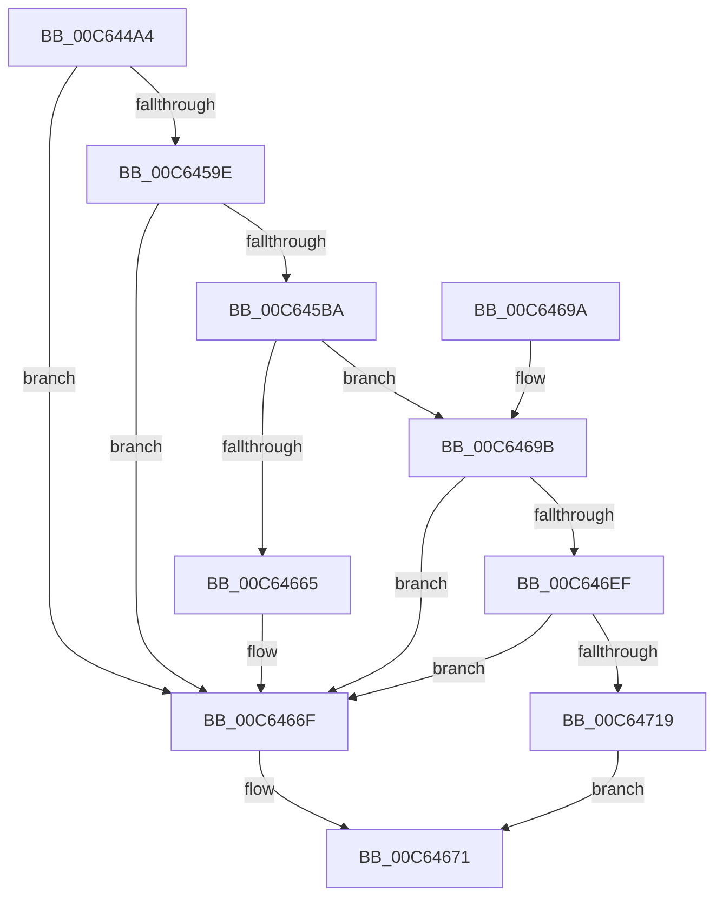

# MiSectionInitialization

- RVA: `0x00C644A4`–`0x00C64727` (길이 `643` bytes)
- VA: `0x0000000140C644A4`
- 실행 섹션: `INIT`
- PDB 이름 있음: `예`; PDB Function 태그: `아니요`
- unwind 정보 RVA: `0x000D7CF8`
- 디코드: `145`개 명령, `643/643` bytes 표시
- 미해석 바이트: `0` (있으면 어셈블리에 `.byte`로 보존)

> 이 문서는 커널 이미지의 기계어와 PDB 기호를 분석해 생성했습니다. 4번과 5번은 함수 원형과 자료형을 바이너리 사용 방식에서 추정한 C 해석이며 원본 소스 복구 결과는 아닙니다.

## 1. Dependencies

- 직접 호출 지점: **11**; 고유 호출 대상: **9**
- 직접 호출자로 확인된 함수: **1**
- RIP 상대 이미지 참조: **19**

### Outgoing calls
- `0x00C64520` → [memset](../../text/6C/memset_function_006C6C40.md) (function, `0x006C6C40`)
- `0x00C64591` → [ObCreateObjectType](../../page/70/ObCreateObjectType_function_00705230.md) (function, `0x00705230`)
- `0x00C645A9` → [MiAllocatePool](../../text/35/MiAllocatePool_function_0035B540.md) (function, `0x0035B540`)
- `0x00C645C9` → [memset](../../text/6C/memset_function_006C6C40.md) (function, `0x006C6C40`)
- `0x00C645DD` → [memset](../../text/6C/memset_function_006C6C40.md) (function, `0x006C6C40`)
- `0x00C6465C` → [ObCreateObject](../../page/87/ObCreateObject_function_00872CB0.md) (function, `0x00872CB0`)
- `0x00C6466A` → [ExFreePoolWithTag](../../poolcode/B8/ExFreePoolWithTag_function_00B82870.md) (function, `0x00B82870`)
- `0x00C64678` → [_security_check_cookie](../../text/6A/_security_check_cookie_function_006AC640.md) (function, `0x006AC640`)
- `0x00C646E6` → [ObInsertObject](../../page/8B/ObInsertObject_function_008B9100.md) (function, `0x008B9100`)
- `0x00C646F6` → [ObCloseHandle](../../page/8A/ObCloseHandle_function_008A1870.md) (function, `0x008A1870`)
- `0x00C64704` → [MiReservePtes](../../text/31/MiReservePtes_function_00318D20.md) (function, `0x00318D20`)

### Direct callers
- [MiInitSystem](../C5/MiInitSystem_function_00C5E6C0.md) at `0x00C5EB57`

### Static image references
- `0x00C644C3` → RVA `0x00E0A740` (`.data`; read)
- `0x00C644DC` → RVA `0x00C7E670` (` ?? ::PBOPGDP::`string'`; read)
- `0x00C644EF` → RVA `0x00C79720` (` ?? ::PBOPGDP::`string'`; read)
- `0x00C64519` → RVA `0x00E2CD08` (`.data`; write)
- `0x00C64525` → RVA `0x00C82220` (`MiSectionMapping`; read)
- `0x00C64530` → RVA `0x008871E0` (`MiSectionOpen`; read)
- `0x00C64542` → RVA `0x00888970` (`MiSectionClose`; read)
- `0x00C64552` → RVA `0x00A2ECA0` (`MiSectionDelete`; read)
- `0x00C6455C` → RVA `0x00FC6BD8` (`ALMOSTRO`; read)
- `0x00C645BF` → RVA `0x00E2D5D0` (`.data`; read)
- `0x00C645D0` → RVA `0x00E2D538` (`.data`; read)
- `0x00C645EB` → RVA `0x00E2D608` (`.data`; read/write)
- `0x00C64603` → RVA `0x00E2D538` (`.data`; write)
- `0x00C64618` → RVA `0x00E2D5D0` (`.data`; write)
- `0x00C6461F` → RVA `0x00E2D5E8` (`.data`; write)
- `0x00C646B0` → RVA `0x00E2DC38` (`.data`; read)
- `0x00C646FD` → RVA `0x00E37668` (`.data`; read)
- `0x00C64709` → RVA `0x00E2D720` (`.data`; write)
- `0x00C64719` → RVA `0x00E2D718` (`.data`; write)

## 2. Other-region calls and transfers

- 다른 실행 섹션으로 향하는 call: **11**
  - `0x00C64520` → [memset](../../text/6C/memset_function_006C6C40.md) (`INIT` → `.text`)
  - `0x00C64591` → [ObCreateObjectType](../../page/70/ObCreateObjectType_function_00705230.md) (`INIT` → `PAGE`)
  - `0x00C645A9` → [MiAllocatePool](../../text/35/MiAllocatePool_function_0035B540.md) (`INIT` → `.text`)
  - `0x00C645C9` → [memset](../../text/6C/memset_function_006C6C40.md) (`INIT` → `.text`)
  - `0x00C645DD` → [memset](../../text/6C/memset_function_006C6C40.md) (`INIT` → `.text`)
  - `0x00C6465C` → [ObCreateObject](../../page/87/ObCreateObject_function_00872CB0.md) (`INIT` → `PAGE`)
  - `0x00C6466A` → [ExFreePoolWithTag](../../poolcode/B8/ExFreePoolWithTag_function_00B82870.md) (`INIT` → `POOLCODE`)
  - `0x00C64678` → [_security_check_cookie](../../text/6A/_security_check_cookie_function_006AC640.md) (`INIT` → `.text`)
  - `0x00C646E6` → [ObInsertObject](../../page/8B/ObInsertObject_function_008B9100.md) (`INIT` → `PAGE`)
  - `0x00C646F6` → [ObCloseHandle](../../page/8A/ObCloseHandle_function_008A1870.md) (`INIT` → `PAGE`)
  - `0x00C64704` → [MiReservePtes](../../text/31/MiReservePtes_function_00318D20.md) (`INIT` → `.text`)
- 별도 외부 분기/꼬리 이동을 확인하지 못했습니다.

## 3. Assembly (complete function range)

```asm
00C644A4  48 8B C4                        mov rax, rsp
00C644A7  48 89 58 08                     mov qword ptr [rax + 8], rbx
00C644AB  48 89 70 10                     mov qword ptr [rax + 0x10], rsi
00C644AF  48 89 78 18                     mov qword ptr [rax + 0x18], rdi
00C644B3  4C 89 70 20                     mov qword ptr [rax + 0x20], r14
00C644B7  55                              push rbp
00C644B8  48 8D 68 B8                     lea rbp, [rax - 0x48]
00C644BC  48 81 EC 40 01 00 00            sub rsp, 0x140
00C644C3  48 8B 05 76 62 1A 00            mov rax, qword ptr [rip + 0x1a6276]
00C644CA  48 33 C4                        xor rax, rsp
00C644CD  48 89 45 30                     mov qword ptr [rbp + 0x30], rax
00C644D1  33 FF                           xor edi, edi
00C644D3  48 C7 44 24 60 0E 00 10 00      mov qword ptr [rsp + 0x60], 0x10000e
00C644DC  48 8D 05 8D A1 01 00            lea rax, [rip + 0x1a18d]
00C644E3  89 7D 84                        mov dword ptr [rbp - 0x7c], edi
00C644E6  48 89 44 24 68                  mov qword ptr [rsp + 0x68], rax
00C644EB  48 8D 4D B0                     lea rcx, [rbp - 0x50]
00C644EF  48 8D 05 2A 52 01 00            lea rax, [rip + 0x1522a]
00C644F6  89 7D 9C                        mov dword ptr [rbp - 0x64], edi
00C644F9  8D 5F 78                        lea ebx, [rdi + 0x78]
00C644FC  48 89 7C 24 50                  mov qword ptr [rsp + 0x50], rdi
00C64501  44 8B C3                        mov r8d, ebx
00C64504  48 89 7C 24 58                  mov qword ptr [rsp + 0x58], rdi
00C64509  33 D2                           xor edx, edx
00C6450B  48 C7 44 24 70 2C 00 2E 00      mov qword ptr [rsp + 0x70], 0x2e002c
00C64514  48 89 44 24 78                  mov qword ptr [rsp + 0x78], rax
00C64519  48 89 3D E8 87 1C 00            mov qword ptr [rip + 0x1c87e8], rdi
00C64520  E8 1B 27 A6 FF                  call 0x1406c6c40
00C64525  0F 10 05 F4 DC 01 00            movups xmm0, xmmword ptr [rip + 0x1dcf4]
00C6452C  80 4D B2 04                     or byte ptr [rbp - 0x4e], 4
00C64530  48 8D 05 A9 2C C2 FF            lea rax, [rip - 0x3dd357]
00C64537  48 89 45 E8                     mov qword ptr [rbp - 0x18], rax
00C6453B  8D 77 01                        lea esi, [rdi + 1]
00C6453E  66 89 5D B0                     mov word ptr [rbp - 0x50], bx
00C64542  48 8D 05 27 44 C2 FF            lea rax, [rip - 0x3dbbd9]
00C64549  BB 00 01 00 00                  mov ebx, 0x100
00C6454E  48 89 45 F0                     mov qword ptr [rbp - 0x10], rax
00C64552  48 8D 05 47 A7 DC FF            lea rax, [rip - 0x2358b9]
00C64559  89 5D B8                        mov dword ptr [rbp - 0x48], ebx
00C6455C  4C 8D 0D 75 26 36 00            lea r9, [rip + 0x362675]
00C64563  48 89 45 F8                     mov qword ptr [rbp - 8], rax
00C64567  45 33 C0                        xor r8d, r8d
00C6456A  89 75 D4                        mov dword ptr [rbp - 0x2c], esi
00C6456D  44 8D 73 80                     lea r14d, [rbx - 0x80]
00C64571  C7 45 D8 40 00 00 00            mov dword ptr [rbp - 0x28], 0x40
00C64578  48 8D 55 B0                     lea rdx, [rbp - 0x50]
00C6457C  C7 45 CC 1F 00 0F 00            mov dword ptr [rbp - 0x34], 0xf001f
00C64583  48 8D 4C 24 60                  lea rcx, [rsp + 0x60]
00C64588  44 89 75 B4                     mov dword ptr [rbp - 0x4c], r14d
00C6458C  F3 0F 7F 45 BC                  movdqu xmmword ptr [rbp - 0x44], xmm0
00C64591  E8 9A 0C AA FF                  call 0x140705230
00C64596  85 C0                           test eax, eax
00C64598  0F 88 D1 00 00 00               js 0x140c6466f
00C6459E  8D 57 48                        lea edx, [rdi + 0x48]
00C645A1  41 B8 4D 6D 53 67               mov r8d, 0x67536d4d
00C645A7  8B CB                           mov ecx, ebx
00C645A9  E8 92 6F 6F FF                  call 0x14035b540
00C645AE  48 8B D8                        mov rbx, rax
00C645B1  48 85 C0                        test rax, rax
00C645B4  0F 84 B5 00 00 00               je 0x140c6466f
00C645BA  45 8B C6                        mov r8d, r14d
00C645BD  33 D2                           xor edx, edx
00C645BF  4C 8D 35 0A 90 1C 00            lea r14, [rip + 0x1c900a]
00C645C6  49 8B CE                        mov rcx, r14
00C645C9  E8 72 26 A6 FF                  call 0x1406c6c40
00C645CE  33 D2                           xor edx, edx
00C645D0  48 8D 0D 61 8F 1C 00            lea rcx, [rip + 0x1c8f61]
00C645D7  41 B8 98 00 00 00               mov r8d, 0x98
00C645DD  E8 5E 26 A6 FF                  call 0x1406c6c40
00C645E2  48 89 7B 28                     mov qword ptr [rbx + 0x28], rdi
00C645E6  48 8D 44 24 70                  lea rax, [rsp + 0x70]
00C645EB  0F BA 2D 15 90 1C 00 0A         bts dword ptr [rip + 0x1c9015], 0xa
00C645F3  4C 8D 45 80                     lea r8, [rbp - 0x80]
00C645F7  48 89 45 90                     mov qword ptr [rbp - 0x70], rax
00C645FB  0F 57 C0                        xorps xmm0, xmm0
00C645FE  48 8D 44 24 50                  lea rax, [rsp + 0x50]
00C64603  4C 89 35 2E 8F 1C 00            mov qword ptr [rip + 0x1c8f2e], r14
00C6460A  48 89 44 24 40                  mov qword ptr [rsp + 0x40], rax
00C6460F  45 33 C9                        xor r9d, r9d
00C64612  89 7C 24 38                     mov dword ptr [rsp + 0x38], edi
00C64616  33 C9                           xor ecx, ecx
00C64618  48 89 1D B1 8F 1C 00            mov qword ptr [rip + 0x1c8fb1], rbx
00C6461F  48 89 35 C2 8F 1C 00            mov qword ptr [rip + 0x1c8fc2], rsi
00C64626  C7 44 24 30 40 00 00 00         mov dword ptr [rsp + 0x30], 0x40
00C6462E  4C 89 33                        mov qword ptr [rbx], r14
00C64631  48 8B 15 A0 25 36 00            mov rdx, qword ptr [rip + 0x3625a0]
00C64638  C7 44 24 28 40 00 00 00         mov dword ptr [rsp + 0x28], 0x40
00C64640  48 89 7C 24 20                  mov qword ptr [rsp + 0x20], rdi
00C64645  C7 45 80 30 00 00 00            mov dword ptr [rbp - 0x80], 0x30
00C6464C  48 89 7D 88                     mov qword ptr [rbp - 0x78], rdi
00C64650  C7 45 98 10 00 01 00            mov dword ptr [rbp - 0x68], 0x10010
00C64657  F3 0F 7F 45 A0                  movdqu xmmword ptr [rbp - 0x60], xmm0
00C6465C  E8 4F E6 C0 FF                  call 0x140872cb0
00C64661  85 C0                           test eax, eax
00C64663  79 36                           jns 0x140c6469b
00C64665  33 D2                           xor edx, edx
00C64667  48 8B CB                        mov rcx, rbx
00C6466A  E8 01 E2 F1 FF                  call 0x140b82870
00C6466F  33 C0                           xor eax, eax
00C64671  48 8B 4D 30                     mov rcx, qword ptr [rbp + 0x30]
00C64675  48 33 CC                        xor rcx, rsp
00C64678  E8 C3 7F A4 FF                  call 0x1406ac640
00C6467D  4C 8D 9C 24 40 01 00 00         lea r11, [rsp + 0x140]
00C64685  49 8B 5B 10                     mov rbx, qword ptr [r11 + 0x10]
00C64689  49 8B 73 18                     mov rsi, qword ptr [r11 + 0x18]
00C6468D  49 8B 7B 20                     mov rdi, qword ptr [r11 + 0x20]
00C64691  4D 8B 73 28                     mov r14, qword ptr [r11 + 0x28]
00C64695  49 8B E3                        mov rsp, r11
00C64698  5D                              pop rbp
00C64699  C3                              ret
00C6469A  CC                              int3
00C6469B  4C 8B 54 24 50                  mov r10, qword ptr [rsp + 0x50]
00C646A0  45 33 C9                        xor r9d, r9d
00C646A3  48 8B C6                        mov rax, rsi
00C646A6  33 D2                           xor edx, edx
00C646A8  4D 89 72 28                     mov qword ptr [r10 + 0x28], r14
00C646AC  45 8D 41 04                     lea r8d, [r9 + 4]
00C646B0  8B 0D 82 95 1C 00               mov ecx, dword ptr [rip + 0x1c9582]
00C646B6  48 D3 E0                        shl rax, cl
00C646B9  49 8B CA                        mov rcx, r10
00C646BC  48 2B C6                        sub rax, rsi
00C646BF  49 89 42 30                     mov qword ptr [r10 + 0x30], rax
00C646C3  41 89 7A 38                     mov dword ptr [r10 + 0x38], edi
00C646C7  41 8B 42 3C                     mov eax, dword ptr [r10 + 0x3c]
00C646CB  25 40 F0 FF FF                  and eax, 0xfffff040
00C646D0  83 C8 40                        or eax, 0x40
00C646D3  41 89 42 3C                     mov dword ptr [r10 + 0x3c], eax
00C646D7  48 8D 44 24 58                  lea rax, [rsp + 0x58]
00C646DC  48 89 44 24 28                  mov qword ptr [rsp + 0x28], rax
00C646E1  48 89 7C 24 20                  mov qword ptr [rsp + 0x20], rdi
00C646E6  E8 15 4A C5 FF                  call 0x1408b9100
00C646EB  85 C0                           test eax, eax
00C646ED  78 80                           js 0x140c6466f
00C646EF  48 8B 4C 24 58                  mov rcx, qword ptr [rsp + 0x58]
00C646F4  33 D2                           xor edx, edx
00C646F6  E8 75 D1 C3 FF                  call 0x1408a1870
00C646FB  8B D6                           mov edx, esi
00C646FD  48 8D 0D 64 2F 1D 00            lea rcx, [rip + 0x1d2f64]
00C64704  E8 17 46 6B FF                  call 0x140318d20
00C64709  48 89 05 10 90 1C 00            mov qword ptr [rip + 0x1c9010], rax
00C64710  48 85 C0                        test rax, rax
00C64713  0F 84 56 FF FF FF               je 0x140c6466f
00C64719  48 89 3D F8 8F 1C 00            mov qword ptr [rip + 0x1c8ff8], rdi
00C64720  8B C6                           mov eax, esi
00C64722  E9 4A FF FF FF                  jmp 0x140c64671
```

## 4. C-style interpretation (structured pseudocode)

```c
__int64 __fastcall MiSectionInitialization(__int64 a1, int a2)
{
    __int64 result;
    __int64 v_rdi;
    __int64 v_rsp;
    unsigned __int64 v_stack_m108;
    unsigned int v_stack_m110;
    unsigned int v_stack_m118;
    unsigned int v_stack_m120;
    unsigned __int64 v_stack_m128;
    unsigned __int64 v_stack_m8;
    unsigned __int64 v_stack_mD0;
    unsigned __int64 v_stack_mD8;
    unsigned __int64 v_stack_mE0;
    unsigned __int64 v_stack_mE8;
    unsigned __int64 v_stack_mF0;
    unsigned __int64 v_stack_mF8;

    *(unsigned __int64 *)(v_rsp + 8) = v_rbx;
    *(unsigned __int64 *)(v_rsp + 16) = v_rsi;
    *(unsigned __int64 *)(v_rsp + 24) = v_rdi;
    *(unsigned __int64 *)(v_rsp + 32) = v_r14;
    v_rsp = (v_rsp) - (320);
    result = (*(unsigned __int64 *)(v_rip + 1729142)) ^ (v_rsp);
    *(unsigned __int64 *)(v_rsp - 72 + 48) = result;
    v_rdi = 0;
    v_stack_mE8 = 0x10000EULL;
    *(unsigned int *)(v_rsp - 72 - 124) = 0;
    v_stack_mE0 = v_rip + 106893;
    *(unsigned int *)(v_rsp - 72 - 100) = 0;
    v_stack_mF8 = 0;
    v_stack_mF0 = 0;
    a2 = 0;
    v_stack_mD8 = 0x2E002CULL;
    v_stack_mD0 = v_rip + 86570;
    *(unsigned __int64 *)(v_rip + 1869800) = 0;
    result = memset(v_rsp - 72 - 80, a2, (unsigned int)((unsigned int)(v_rdi + 120)), a4);
    *(unsigned __int64 *)(v_rsp - 72 - 24) = v_rip - 4051799;
    *(unsigned __int16 *)(v_rsp - 72 - 80) = (unsigned __int16)(v_rdi + 120);
    *(unsigned __int64 *)(v_rsp - 72 - 16) = v_rip - 4045785;
    *(unsigned int *)(v_rsp - 72 - 72) = 256;
    *(unsigned __int64 *)(v_rsp - 72 - 8) = v_rip - 2316473;
    a3 = 0;
    *(unsigned int *)(v_rsp - 72 - 44) = (unsigned int)(v_rdi + 1);
    *(unsigned int *)(v_rsp - 72 - 40) = 64;
    *(unsigned int *)(v_rsp - 72 - 52) = 0xF001FULL;
    *(unsigned int *)(v_rsp - 72 - 76) = (unsigned int)(256 - 128);
    *(unsigned __int64 *)(v_rsp - 72 - 68) = v_xmm0;
    result = ObCreateObjectType(v_stack_mE8, v_rsp - 72 - 80, a3, v_rip + 3548789);
    if (sign_flag) goto loc_00C6466F;
    result = MiAllocatePool(256, v_rdi + 72, (unsigned int)(0x67536D4DULL), v_rip + 3548789);
    if (result == 0) goto loc_00C6466F;
    a2 = 0;
    result = memset(v_rip + 1871882, a2, (unsigned int)((unsigned int)(256 - 128)), v_rip + 3548789);
    a2 = 0;
    result = memset(v_rip + 1871713, a2, 152, v_rip + 3548789);
    *(unsigned __int64 *)(result + 40) = 0;
    *(unsigned __int64 *)(v_rsp - 72 - 112) = v_stack_mD8;
    *(unsigned __int64 *)(v_rip + 1871662) = v_rip + 1871882;
    v_stack_m108 = v_stack_mF8;
    a4 = 0;
    v_stack_m110 = 0;
    a1 = 0;
    *(unsigned __int64 *)(v_rip + 1871793) = result;
    *(unsigned __int64 *)(v_rip + 1871810) = v_rdi + 1;
    v_stack_m118 = 64;
    *(unsigned __int64 *)(result) = v_rip + 1871882;
    v_stack_m120 = 64;
    v_stack_m128 = 0;
    *(unsigned int *)(v_rsp - 72 - 128) = 48;
    *(unsigned __int64 *)(v_rsp - 72 - 120) = 0;
    *(unsigned int *)(v_rsp - 72 - 104) = 0x10010ULL;
    *(unsigned __int64 *)(v_rsp - 72 - 96) = v_xmm0;
    result = ObCreateObject(a1, *(unsigned __int64 *)(v_rip + 3548576), v_rsp - 72 - 128, a4);
    if (!sign_flag) goto loc_00C6469B;
    a2 = 0;
    result = ExFreePoolWithTag(result, a2, v_rsp - 72 - 128, a4);
loc_00C6466F:
    result = 0;
loc_00C64671:
    a1 = (*(unsigned __int64 *)(v_rsp - 72 + 48)) ^ (v_rsp);
    result = _security_check_cookie(a1, a2, v_rsp - 72 - 128, a4);
    return result;
loc_00C6469B:
    a4 = 0;
    a2 = 0;
    *(unsigned __int64 *)(v_stack_mF0 + 40) = *(unsigned __int64 *)(v_stack_m8 + 40);
    result = (*(unsigned __int64 *)(v_stack_m8 + 24)) << ((unsigned __int8)((unsigned int)(*(unsigned int *)(v_rip + 1873282))));
    result = (result) - (*(unsigned __int64 *)(v_stack_m8 + 24));
    *(unsigned __int64 *)(v_stack_mF0 + 48) = result;
    *(unsigned int *)(v_stack_mF0 + 56) = (unsigned int)(*(unsigned __int64 *)(v_stack_m8 + 32));
    result = (unsigned int)(((unsigned int)(*(unsigned int *)(v_stack_mF0 + 60))) & (0xFFFFF040ULL));
    result = (unsigned int)((result) | (64));
    *(unsigned int *)(v_stack_mF0 + 60) = (unsigned int)(result);
    v_stack_m118 = v_stack_mE8;
    v_stack_m120 = *(unsigned __int64 *)(v_stack_m8 + 32);
    result = ObInsertObject(v_stack_mF0, a2, a4 + 4, a4);
    if (sign_flag) goto loc_00C6466F;
    a2 = 0;
    result = ObCloseHandle(v_stack_mE8, a2, a4 + 4, a4);
    result = MiReservePtes(v_rip + 1912676, (unsigned int)((unsigned int)(*(unsigned __int64 *)(v_stack_m8 + 24))), a4 + 4, a4);
    *(unsigned __int64 *)(v_rip + 1871888) = result;
    if (result == 0) goto loc_00C6466F;
    *(unsigned __int64 *)(v_rip + 1871864) = *(unsigned __int64 *)(v_stack_m8 + 32);
    goto loc_00C64671;
}
```

## 5. (Beta) C Style

```c
int64_t MiSectionInitialization(int64_t Arg1, int32_t Arg2)
{
    int64_t result;
    int64_t local_rdi;
    int64_t local_rsp;
    uint64_t v_stack_m108;
    uint32_t v_stack_m110;
    uint32_t v_stack_m118;
    uint32_t v_stack_m120;
    uint64_t v_stack_m128;
    uint64_t v_stack_m8;
    uint64_t v_stack_mD0;
    uint64_t v_stack_mD8;
    uint64_t v_stack_mE0;
    uint64_t v_stack_mE8;
    uint64_t v_stack_mF0;
    uint64_t v_stack_mF8;

    *(uint64_t *)(local_rsp + 0x8) = local_rbx;
    *(uint64_t *)(local_rsp + 0x10) = local_rsi;
    *(uint64_t *)(local_rsp + 0x18) = local_rdi;
    *(uint64_t *)(local_rsp + 0x20) = local_r14;
    local_rsp = (local_rsp) - (320);
    result = (*(uint64_t *)(v_rip + 0x1A6276)) ^ (local_rsp);
    *(uint64_t *)(local_rsp - 0x48 + 0x30) = result;
    local_rdi = 0;
    v_stack_mE8 = 0x10000EULL;
    *(uint32_t *)(local_rsp - 0x48 - 0x7C) = 0;
    v_stack_mE0 = v_rip + 106893;
    *(uint32_t *)(local_rsp - 0x48 - 0x64) = 0;
    v_stack_mF8 = 0;
    v_stack_mF0 = 0;
    Arg2 = 0;
    v_stack_mD8 = 0x2E002CULL;
    v_stack_mD0 = v_rip + 86570;
    *(uint64_t *)(v_rip + 0x1C87E8) = 0;
    result = memset(local_rsp - 72 - 80, Arg2, (uint32_t)((uint32_t)(local_rdi + 120)), a4);
    *(uint64_t *)(local_rsp - 0x48 - 0x18) = v_rip - 4051799;
    *(uint16_t *)(local_rsp - 0x48 - 0x50) = (uint16_t)(local_rdi + 120);
    *(uint64_t *)(local_rsp - 0x48 - 0x10) = v_rip - 4045785;
    *(uint32_t *)(local_rsp - 0x48 - 0x48) = 256;
    *(uint64_t *)(local_rsp - 0x48 - 0x8) = v_rip - 2316473;
    a3 = 0;
    *(uint32_t *)(local_rsp - 0x48 - 0x2C) = (uint32_t)(local_rdi + 1);
    *(uint32_t *)(local_rsp - 0x48 - 0x28) = 64;
    *(uint32_t *)(local_rsp - 0x48 - 0x34) = 0xF001FULL;
    *(uint32_t *)(local_rsp - 0x48 - 0x4C) = (uint32_t)(256 - 128);
    *(uint64_t *)(local_rsp - 0x48 - 0x44) = v_xmm0;
    result = ObCreateObjectType(v_stack_mE8, local_rsp - 72 - 80, a3, v_rip + 3548789);
    if (sign_flag) goto loc_00C6466F;
    result = MiAllocatePool(256, local_rdi + 72, (uint32_t)(0x67536D4DULL), v_rip + 3548789);
    if (result == 0) goto loc_00C6466F;
    Arg2 = 0;
    result = memset(v_rip + 1871882, Arg2, (uint32_t)((uint32_t)(256 - 128)), v_rip + 3548789);
    Arg2 = 0;
    result = memset(v_rip + 1871713, Arg2, 152, v_rip + 3548789);
    *(uint64_t *)(result + 0x28) = 0;
    *(uint64_t *)(local_rsp - 0x48 - 0x70) = v_stack_mD8;
    *(uint64_t *)(v_rip + 0x1C8F2E) = v_rip + 1871882;
    v_stack_m108 = v_stack_mF8;
    a4 = 0;
    v_stack_m110 = 0;
    Arg1 = 0;
    *(uint64_t *)(v_rip + 0x1C8FB1) = result;
    *(uint64_t *)(v_rip + 0x1C8FC2) = local_rdi + 1;
    v_stack_m118 = 64;
    *(uint64_t *)(result) = v_rip + 1871882;
    v_stack_m120 = 64;
    v_stack_m128 = 0;
    *(uint32_t *)(local_rsp - 0x48 - 0x80) = 48;
    *(uint64_t *)(local_rsp - 0x48 - 0x78) = 0;
    *(uint32_t *)(local_rsp - 0x48 - 0x68) = 0x10010ULL;
    *(uint64_t *)(local_rsp - 0x48 - 0x60) = v_xmm0;
    result = ObCreateObject(Arg1, *(uint64_t *)(v_rip + 0x3625A0), local_rsp - 72 - 128, a4);
    if (!sign_flag) goto loc_00C6469B;
    Arg2 = 0;
    result = ExFreePoolWithTag(result, Arg2, local_rsp - 72 - 128, a4);
loc_00C6466F:
    result = 0;
loc_00C64671:
    Arg1 = (*(uint64_t *)(local_rsp - 0x48 + 0x30)) ^ (local_rsp);
    result = _security_check_cookie(Arg1, Arg2, local_rsp - 72 - 128, a4);
    return result;
loc_00C6469B:
    a4 = 0;
    Arg2 = 0;
    *(uint64_t *)(v_stack_mF0 + 0x28) = *(uint64_t *)(v_stack_m8 + 0x28);
    result = (*(uint64_t *)(v_stack_m8 + 0x18)) << ((uint8_t)((uint32_t)(*(uint32_t *)(v_rip + 0x1C9582))));
    result = (result) - (*(uint64_t *)(v_stack_m8 + 0x18));
    *(uint64_t *)(v_stack_mF0 + 0x30) = result;
    *(uint32_t *)(v_stack_mF0 + 0x38) = (uint32_t)(*(uint64_t *)(v_stack_m8 + 0x20));
    result = (uint32_t)(((uint32_t)(*(uint32_t *)(v_stack_mF0 + 0x3C))) & (0xFFFFF040ULL));
    result = (uint32_t)((result) | (64));
    *(uint32_t *)(v_stack_mF0 + 0x3C) = (uint32_t)(result);
    v_stack_m118 = v_stack_mE8;
    v_stack_m120 = *(uint64_t *)(v_stack_m8 + 0x20);
    result = ObInsertObject(v_stack_mF0, Arg2, a4 + 4, a4);
    if (sign_flag) goto loc_00C6466F;
    Arg2 = 0;
    result = ObCloseHandle(v_stack_mE8, Arg2, a4 + 4, a4);
    result = MiReservePtes(v_rip + 1912676, (uint32_t)((uint32_t)(*(uint64_t *)(v_stack_m8 + 0x18))), a4 + 4, a4);
    *(uint64_t *)(v_rip + 0x1C9010) = result;
    if (result == 0) goto loc_00C6466F;
    *(uint64_t *)(v_rip + 0x1C8FF8) = *(uint64_t *)(v_stack_m8 + 0x20);
    goto loc_00C64671;
}
```

## 6. Execution-region graph

[열기: 2D/3D 그래프와 함수 탐색 컨트롤 패널](../../../control-panel.html?section=init&rva=0x00C644A4&view=graph)

- 2D 그래프는 위에서 아래로 흐르고, 3D 그래프는 빈 공간을 드래그해 회전합니다. Shift+드래그는 이동, 휠은 확대·축소, 함수 노드 선택은 대상 보고서 이동입니다.

### Static fallback


