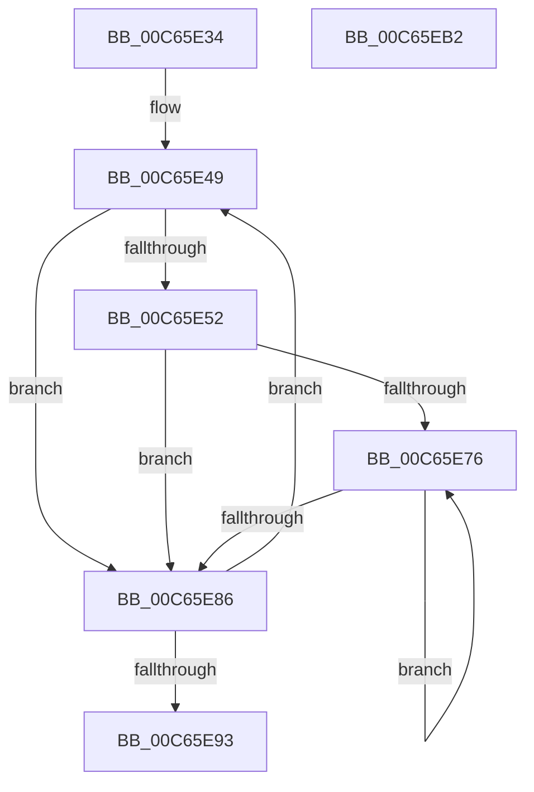

# MiSetSystemRegionTypes

- RVA: `0x00C65E34`–`0x00C65EB3` (길이 `127` bytes)
- VA: `0x0000000140C65E34`
- 실행 섹션: `INIT`
- PDB 이름 있음: `예`; PDB Function 태그: `아니요`
- unwind 정보 RVA: `0x0005C788`
- 디코드: `32`개 명령, `127/127` bytes 표시
- 미해석 바이트: `0` (있으면 어셈블리에 `.byte`로 보존)

> 이 문서는 커널 이미지의 기계어와 PDB 기호를 분석해 생성했습니다. 4번과 5번은 함수 원형과 자료형을 바이너리 사용 방식에서 추정한 C 해석이며 원본 소스 복구 결과는 아닙니다.

## 1. Dependencies

- 직접 호출 지점: **1**; 고유 호출 대상: **1**
- 직접 호출자로 확인된 함수: **1**
- RIP 상대 이미지 참조: **2**

### Outgoing calls
- `0x00C65E65` → [MiConvertAssignedRegionToVaType](MiConvertAssignedRegionToVaType_function_00C65888.md) (function, `0x00C65888`)

### Direct callers
- [MiInitializeSystemVa](../C7/MiInitializeSystemVa_function_00C77020.md) at `0x00C77093`

### Static image references
- `0x00C65E3B` → RVA `0x00E38BB0` (`.data`; read)
- `0x00C65E42` → RVA `0x00E2CB40` (`.data`; read)

## 2. Other-region calls and transfers

- 다른 실행 섹션으로 향하는 call: **0**
- 별도 외부 분기/꼬리 이동을 확인하지 못했습니다.

## 3. Assembly (complete function range)

```asm
00C65E34  48 83 EC 28                     sub rsp, 0x28
00C65E38  45 33 C9                        xor r9d, r9d
00C65E3B  4C 8D 05 6E 2D 1D 00            lea r8, [rip + 0x1d2d6e]
00C65E42  4C 8D 1D F7 6C 1C 00            lea r11, [rip + 0x1c6cf7]
00C65E49  49 8B 50 F8                     mov rdx, qword ptr [r8 - 8]
00C65E4D  48 85 D2                        test rdx, rdx
00C65E50  74 34                           je 0x140c65e86
00C65E52  48 C1 EA 27                     shr rdx, 0x27
00C65E56  41 8B C9                        mov ecx, r9d
00C65E59  81 E2 FF 01 00 00               and edx, 0x1ff
00C65E5F  81 EA 00 01 00 00               sub edx, 0x100
00C65E65  E8 1E FA FF FF                  call 0x140c65888
00C65E6A  4D 8B 10                        mov r10, qword ptr [r8]
00C65E6D  49 C1 EA 27                     shr r10, 0x27
00C65E71  4D 85 D2                        test r10, r10
00C65E74  74 10                           je 0x140c65e86
00C65E76  42 88 84 1A 68 BF 00 00         mov byte ptr [rdx + r11 + 0xbf68], al
00C65E7E  FF C2                           inc edx
00C65E80  49 83 EA 01                     sub r10, 1
00C65E84  75 F0                           jne 0x140c65e76
00C65E86  41 FF C1                        inc r9d
00C65E89  49 83 C0 10                     add r8, 0x10
00C65E8D  41 83 F9 12                     cmp r9d, 0x12
00C65E91  72 B6                           jb 0x140c65e49
00C65E93  49 8B C3                        mov rax, r11
00C65E96  48 C1 E8 27                     shr rax, 0x27
00C65E9A  25 FF 01 00 00                  and eax, 0x1ff
00C65E9F  2D 00 01 00 00                  sub eax, 0x100
00C65EA4  42 C6 84 18 68 BF 00 00 0B      mov byte ptr [rax + r11 + 0xbf68], 0xb
00C65EAD  48 83 C4 28                     add rsp, 0x28
00C65EB1  C3                              ret
00C65EB2  CC                              int3
```

## 4. C-style interpretation (structured pseudocode)

```c
__int64 __fastcall MiSetSystemRegionTypes(__int64 a1, __int64 a2, __int64 a3, int a4)
{
    __int64 result;
    __int64 v_r10;
    __int64 v_rsp;

    v_rsp = (v_rsp) - (40);
    a4 = 0;
loc_00C65E49:
    if (*(unsigned __int64 *)(v_rip + 1912174 - 8) == 0) goto loc_00C65E86;
    a2 = (*(unsigned __int64 *)(v_rip + 1912174 - 8)) >> (39);
    a2 = (unsigned int)((a2) & (511));
    a2 = (unsigned int)((a2) - (256));
    result = MiConvertAssignedRegionToVaType(0, a2, v_rip + 1912174, a4);
    v_r10 = (*(unsigned __int64 *)(v_rip + 1912174)) >> (39);
    if (v_r10 == 0) goto loc_00C65E86;
loc_00C65E76:
    *(unsigned __int8 *)(a2 + v_rip + 1862903 * 1 + 49000) = (unsigned __int8)(result);
    a2 = (unsigned int)((a2) + 1);
    v_r10 = (v_r10) - (1);
    if (condition_is_not_equal) goto loc_00C65E76;
loc_00C65E86:
    a4 = (unsigned int)((a4) + 1);
    a3 = (v_rip + 1912174) + (16);
    if (a4 < 18) goto loc_00C65E49;
    result = (v_rip + 1862903) >> (39);
    result = (unsigned int)((result) & (511));
    result = (unsigned int)((result) - (256));
    *(unsigned __int8 *)(result + v_rip + 1862903 * 1 + 49000) = 11;
    v_rsp = (v_rsp) + (40);
    return result;
}
```

## 5. (Beta) C Style

```c
int64_t MiSetSystemRegionTypes(int64_t Arg1, int64_t Arg2, int64_t Arg3, int32_t Arg4)
{
    int64_t result;
    int64_t local_r10;
    int64_t local_rsp;

    local_rsp = (local_rsp) - (40);
    Arg4 = 0;
loc_00C65E49:
    if (*(uint64_t *)(v_rip + 0x1D2D6E - 0x8) == 0) goto loc_00C65E86;
    Arg2 = (*(uint64_t *)(v_rip + 0x1D2D6E - 0x8)) >> (39);
    Arg2 = (uint32_t)((Arg2) & (511));
    Arg2 = (uint32_t)((Arg2) - (256));
    result = MiConvertAssignedRegionToVaType(0, Arg2, v_rip + 1912174, Arg4);
    local_r10 = (*(uint64_t *)(v_rip + 0x1D2D6E)) >> (39);
    if (local_r10 == 0) goto loc_00C65E86;
loc_00C65E76:
    *(uint8_t *)(Arg2 + v_rip + 0x1C6CF7 * 1 + 0xBF68) = (uint8_t)(result);
    Arg2 = (uint32_t)((Arg2) + 1);
    local_r10 = (local_r10) - (1);
    if (condition_is_not_equal) goto loc_00C65E76;
loc_00C65E86:
    Arg4 = (uint32_t)((Arg4) + 1);
    Arg3 = (v_rip + 1912174) + (16);
    if (Arg4 < 18) goto loc_00C65E49;
    result = (v_rip + 1862903) >> (39);
    result = (uint32_t)((result) & (511));
    result = (uint32_t)((result) - (256));
    *(uint8_t *)(result + v_rip + 0x1C6CF7 * 1 + 0xBF68) = 11;
    local_rsp = (local_rsp) + (40);
    return result;
}
```

## 6. Execution-region graph

[열기: 2D/3D 그래프와 함수 탐색 컨트롤 패널](../../../control-panel.html?section=init&rva=0x00C65E34&view=graph)

- 2D 그래프는 위에서 아래로 흐르고, 3D 그래프는 빈 공간을 드래그해 회전합니다. Shift+드래그는 이동, 휠은 확대·축소, 함수 노드 선택은 대상 보고서 이동입니다.

### Static fallback


