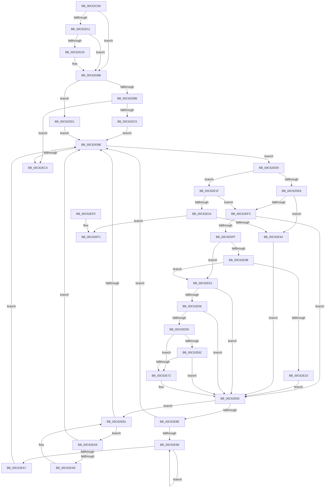

# MiSwitchToPfns

- RVA: `0x00C62C90`–`0x00C62F12` (길이 `642` bytes)
- VA: `0x0000000140C62C90`
- 실행 섹션: `INIT`
- PDB 이름 있음: `예`; PDB Function 태그: `아니요`
- unwind 정보 RVA: `0x000D79D0`
- 디코드: `171`개 명령, `642/642` bytes 표시
- 미해석 바이트: `0` (있으면 어셈블리에 `.byte`로 보존)

> 이 문서는 커널 이미지의 기계어와 PDB 기호를 분석해 생성했습니다. 4번과 5번은 함수 원형과 자료형을 바이너리 사용 방식에서 추정한 C 해석이며 원본 소스 복구 결과는 아닙니다.

## 1. Dependencies

- 직접 호출 지점: **10**; 고유 호출 대상: **8**
- 직접 호출자로 확인된 함수: **1**
- RIP 상대 이미지 참조: **5**

### Outgoing calls
- `0x00C62CD8` → [MiCreatePfnTemplate](../../text/67/MiCreatePfnTemplate_function_00671824.md) (function, `0x00671824`)
- `0x00C62CE9` → [MiCreatePfnTemplate](../../text/67/MiCreatePfnTemplate_function_00671824.md) (function, `0x00671824`)
- `0x00C62D1E` → [MiSetPfnContainingFrame](../../text/36/MiSetPfnContainingFrame_function_00363FC0.md) (function, `0x00363FC0`)
- `0x00C62DA2` → [qsort](../../text/50/qsort_function_005009F0.md) (function, `0x005009F0`)
- `0x00C62E18` → [MiCreateFreePfns](MiCreateFreePfns_function_00C61F8C.md) (function, `0x00C61F8C`)
- `0x00C62E37` → [HvlChangeIsolatedMemoryVisibility](../../text/58/HvlChangeIsolatedMemoryVisibility_function_00589FD0.md) (function, `0x00589FD0`)
- `0x00C62E47` → [MiCreateFreePfns](MiCreateFreePfns_function_00C61F8C.md) (function, `0x00C61F8C`)
- `0x00C62E7D` → [MiCreateDescriptorPfns](MiCreateDescriptorPfns_function_00C61D74.md) (function, `0x00C61D74`)
- `0x00C62EC9` → [MI_FLUSH_ENTIRE_TB](../../text/31/MI_FLUSH_ENTIRE_TB_function_00314110.md) (function, `0x00314110`)
- `0x00C62F0C` → [KeBugCheckEx](../../text/4F/KeBugCheckEx_function_004FD660.md) (function, `0x004FD660`)

### Direct callers
- [MiInitNucleus](../C5/MiInitNucleus_function_00C5FD38.md) at `0x00C600B7`

### Static image references
- `0x00C62CEE` → RVA `0x00E3D540` (`.data`; read)
- `0x00C62D90` → RVA `0x00C62F40` (`MxBootSortConsumedPages`; read)
- `0x00C62D97` → RVA `0x010093D0` (`INITDATA`; read)
- `0x00C62DE6` → RVA `0x00FC6A88` (`ALMOSTRO`; read)
- `0x00C62ECE` → RVA `0x00FC6A88` (`ALMOSTRO`; read/write)

## 2. Other-region calls and transfers

- 다른 실행 섹션으로 향하는 call: **7**
  - `0x00C62CD8` → [MiCreatePfnTemplate](../../text/67/MiCreatePfnTemplate_function_00671824.md) (`INIT` → `.text`)
  - `0x00C62CE9` → [MiCreatePfnTemplate](../../text/67/MiCreatePfnTemplate_function_00671824.md) (`INIT` → `.text`)
  - `0x00C62D1E` → [MiSetPfnContainingFrame](../../text/36/MiSetPfnContainingFrame_function_00363FC0.md) (`INIT` → `.text`)
  - `0x00C62DA2` → [qsort](../../text/50/qsort_function_005009F0.md) (`INIT` → `.text`)
  - `0x00C62E37` → [HvlChangeIsolatedMemoryVisibility](../../text/58/HvlChangeIsolatedMemoryVisibility_function_00589FD0.md) (`INIT` → `.text`)
  - `0x00C62EC9` → [MI_FLUSH_ENTIRE_TB](../../text/31/MI_FLUSH_ENTIRE_TB_function_00314110.md) (`INIT` → `.text`)
  - `0x00C62F0C` → [KeBugCheckEx](../../text/4F/KeBugCheckEx_function_004FD660.md) (`INIT` → `.text`)
- 별도 외부 분기/꼬리 이동을 확인하지 못했습니다.

## 3. Assembly (complete function range)

```asm
00C62C90  48 8B C4                        mov rax, rsp
00C62C93  48 89 58 10                     mov qword ptr [rax + 0x10], rbx
00C62C97  48 89 70 18                     mov qword ptr [rax + 0x18], rsi
00C62C9B  48 89 78 20                     mov qword ptr [rax + 0x20], rdi
00C62C9F  55                              push rbp
00C62CA0  48 8D 68 A1                     lea rbp, [rax - 0x5f]
00C62CA4  48 81 EC 90 00 00 00            sub rsp, 0x90
00C62CAB  0F 57 C0                        xorps xmm0, xmm0
00C62CAE  0F 57 C9                        xorps xmm1, xmm1
00C62CB1  48 8B F9                        mov rdi, rcx
00C62CB4  45 33 C0                        xor r8d, r8d
00C62CB7  48 8D 4D 27                     lea rcx, [rbp + 0x27]
00C62CBB  BA 80 00 00 00                  mov edx, 0x80
00C62CC0  0F 11 45 27                     movups xmmword ptr [rbp + 0x27], xmm0
00C62CC4  0F 11 45 37                     movups xmmword ptr [rbp + 0x37], xmm0
00C62CC8  0F 11 45 47                     movups xmmword ptr [rbp + 0x47], xmm0
00C62CCC  0F 11 4D F7                     movups xmmword ptr [rbp - 9], xmm1
00C62CD0  0F 11 4D 07                     movups xmmword ptr [rbp + 7], xmm1
00C62CD4  0F 11 4D 17                     movups xmmword ptr [rbp + 0x17], xmm1
00C62CD8  E8 47 EB A0 FF                  call 0x140671824
00C62CDD  45 33 C0                        xor r8d, r8d
00C62CE0  48 8D 4D F7                     lea rcx, [rbp - 9]
00C62CE4  BA 00 01 00 00                  mov edx, 0x100
00C62CE9  E8 36 EB A0 FF                  call 0x140671824
00C62CEE  48 8B 05 4B A8 1D 00            mov rax, qword ptr [rip + 0x1da84b]
00C62CF5  48 8D 1C 40                     lea rbx, [rax + rax*2]
00C62CF9  48 C1 E3 04                     shl rbx, 4
00C62CFD  48 B9 00 00 00 00 00 DE FF FF   movabs rcx, 0xffffde0000000000
00C62D07  48 03 D9                        add rbx, rcx
00C62D0A  33 F6                           xor esi, esi
00C62D0C  48 85 C0                        test rax, rax
00C62D0F  75 7A                           jne 0x140c62d8b
00C62D11  8B 43 20                        mov eax, dword ptr [rbx + 0x20]
00C62D14  66 85 C0                        test ax, ax
00C62D17  75 72                           jne 0x140c62d8b
00C62D19  33 D2                           xor edx, edx
00C62D1B  48 8B CB                        mov rcx, rbx
00C62D1E  E8 9D 12 70 FF                  call 0x140363fc0
00C62D23  48 B8 00 00 00 00 80 F6 FF FF   movabs rax, 0xfffff68000000000
00C62D2D  48 89 43 08                     mov qword ptr [rbx + 8], rax
00C62D31  48 B9 01 00 00 00 00 00 00 C0   movabs rcx, 0xc000000000000001
00C62D3B  48 8B 43 18                     mov rax, qword ptr [rbx + 0x18]
00C62D3F  48 23 C1                        and rax, rcx
00C62D42  48 B9 00 00 00 00 00 00 40 00   movabs rcx, 0x40000000000000
00C62D4C  48 83 C8 01                     or rax, 1
00C62D50  48 89 43 18                     mov qword ptr [rbx + 0x18], rax
00C62D54  8B 43 20                        mov eax, dword ptr [rbx + 0x20]
00C62D57  89 45 67                        mov dword ptr [rbp + 0x67], eax
00C62D5A  C1 E8 10                        shr eax, 0x10
00C62D5D  24 FD                           and al, 0xfd
00C62D5F  0C 05                           or al, 5
00C62D61  88 45 69                        mov byte ptr [rbp + 0x69], al
00C62D64  8B 45 67                        mov eax, dword ptr [rbp + 0x67]
00C62D67  89 43 20                        mov dword ptr [rbx + 0x20], eax
00C62D6A  8B 43 20                        mov eax, dword ptr [rbx + 0x20]
00C62D6D  89 45 67                        mov dword ptr [rbp + 0x67], eax
00C62D70  C1 E8 10                        shr eax, 0x10
00C62D73  24 3F                           and al, 0x3f
00C62D75  0C 40                           or al, 0x40
00C62D77  88 45 69                        mov byte ptr [rbp + 0x69], al
00C62D7A  8B 45 67                        mov eax, dword ptr [rbp + 0x67]
00C62D7D  89 43 20                        mov dword ptr [rbx + 0x20], eax
00C62D80  48 8B 43 28                     mov rax, qword ptr [rbx + 0x28]
00C62D84  48 0B C1                        or rax, rcx
00C62D87  48 89 43 28                     mov qword ptr [rbx + 0x28], rax
00C62D8B  BA 40 00 00 00                  mov edx, 0x40
00C62D90  4C 8D 0D A9 01 00 00            lea r9, [rip + 0x1a9]
00C62D97  48 8D 0D 32 66 3A 00            lea rcx, [rip + 0x3a6632]
00C62D9E  44 8D 42 F8                     lea r8d, [rdx - 8]
00C62DA2  E8 49 DC 89 FF                  call 0x1405009f0
00C62DA7  48 8D 9F 60 01 00 00            lea rbx, [rdi + 0x160]
00C62DAE  BF 02 00 00 00                  mov edi, 2
00C62DB3  48 8B 43 08                     mov rax, qword ptr [rbx + 8]
00C62DB7  A8 01                           test al, 1
00C62DB9  74 16                           je 0x140c62dd1
00C62DBB  48 83 F8 01                     cmp rax, 1
00C62DBF  0F 84 FF 00 00 00               je 0x140c62ec4
00C62DC5  48 83 CB 01                     or rbx, 1
00C62DC9  48 33 D8                        xor rbx, rax
00C62DCC  E9 EA 00 00 00                  jmp 0x140c62ebb
00C62DD1  48 8B D8                        mov rbx, rax
00C62DD4  E9 E2 00 00 00                  jmp 0x140c62ebb
00C62DD9  8B 43 18                        mov eax, dword ptr [rbx + 0x18]
00C62DDC  25 FF FF FF 1F                  and eax, 0x1fffffff
00C62DE1  83 F8 1D                        cmp eax, 0x1d
00C62DE4  75 39                           jne 0x140c62e1f
00C62DE6  48 F7 05 97 3C 36 00 00 10 00 00  test qword ptr [rip + 0x363c97], 0x1000
00C62DF1  74 51                           je 0x140c62e44
00C62DF3  48 63 4B 18                     movsxd rcx, dword ptr [rbx + 0x18]
00C62DF7  85 C9                           test ecx, ecx
00C62DF9  0F 88 83 00 00 00               js 0x140c62e82
00C62DFF  8B C1                           mov eax, ecx
00C62E01  25 FF FF FF 1F                  and eax, 0x1fffffff
00C62E06  83 F8 18                        cmp eax, 0x18
00C62E09  77 46                           ja 0x140c62e51
00C62E0B  BA 34 01 00 01                  mov edx, 0x1000134
00C62E10  0F A3 C2                        bt edx, eax
00C62E13  73 3C                           jae 0x140c62e51
00C62E15  48 8B CB                        mov rcx, rbx
00C62E18  E8 6F F1 FF FF                  call 0x140c61f8c
00C62E1D  EB 63                           jmp 0x140c62e82
00C62E1F  83 F8 2A                        cmp eax, 0x2a
00C62E22  75 CF                           jne 0x140c62df3
00C62E24  48 8B 53 28                     mov rdx, qword ptr [rbx + 0x28]
00C62E28  4C 8D 4D 67                     lea r9, [rbp + 0x67]
00C62E2C  48 8B 4B 20                     mov rcx, qword ptr [rbx + 0x20]
00C62E30  45 33 C0                        xor r8d, r8d
00C62E33  48 89 75 67                     mov qword ptr [rbp + 0x67], rsi
00C62E37  E8 94 71 92 FF                  call 0x140589fd0
00C62E3C  85 C0                           test eax, eax
00C62E3E  0F 88 AD 00 00 00               js 0x140c62ef1
00C62E44  48 8B CB                        mov rcx, rbx
00C62E47  E8 40 F1 FF FF                  call 0x140c61f8c
00C62E4C  89 7B 18                        mov dword ptr [rbx + 0x18], edi
00C62E4F  EB 31                           jmp 0x140c62e82
00C62E51  83 F9 06                        cmp ecx, 6
00C62E54  74 2C                           je 0x140c62e82
00C62E56  8D 41 E2                        lea eax, [rcx - 0x1e]
00C62E59  3B C7                           cmp eax, edi
00C62E5B  76 25                           jbe 0x140c62e82
00C62E5D  83 F9 2C                        cmp ecx, 0x2c
00C62E60  77 10                           ja 0x140c62e72
00C62E62  48 B8 08 00 C0 00 C4 15 00 00   movabs rax, 0x15c400c00008
00C62E6C  48 0F A3 C8                     bt rax, rcx
00C62E70  72 10                           jb 0x140c62e82
00C62E72  4C 8D 45 F7                     lea r8, [rbp - 9]
00C62E76  48 8B CB                        mov rcx, rbx
00C62E79  48 8D 55 27                     lea rdx, [rbp + 0x27]
00C62E7D  E8 F2 EE FF FF                  call 0x140c61d74
00C62E82  48 8B 43 08                     mov rax, qword ptr [rbx + 8]
00C62E86  48 8B CB                        mov rcx, rbx
00C62E89  48 85 C0                        test rax, rax
00C62E8C  74 23                           je 0x140c62eb1
00C62E8E  48 8B 08                        mov rcx, qword ptr [rax]
00C62E91  48 8B D8                        mov rbx, rax
00C62E94  48 85 C9                        test rcx, rcx
00C62E97  74 22                           je 0x140c62ebb
00C62E99  48 8B 01                        mov rax, qword ptr [rcx]
00C62E9C  48 8B D9                        mov rbx, rcx
00C62E9F  48 8B C8                        mov rcx, rax
00C62EA2  48 85 C0                        test rax, rax
00C62EA5  75 F2                           jne 0x140c62e99
00C62EA7  EB 12                           jmp 0x140c62ebb
00C62EA9  48 39 0B                        cmp qword ptr [rbx], rcx
00C62EAC  74 0D                           je 0x140c62ebb
00C62EAE  48 8B CB                        mov rcx, rbx
00C62EB1  48 8B 5B 10                     mov rbx, qword ptr [rbx + 0x10]
00C62EB5  48 83 E3 FC                     and rbx, 0xfffffffffffffffc
00C62EB9  75 EE                           jne 0x140c62ea9
00C62EBB  48 85 DB                        test rbx, rbx
00C62EBE  0F 85 15 FF FF FF               jne 0x140c62dd9
00C62EC4  83 CA FF                        or edx, 0xffffffff
00C62EC7  8B CF                           mov ecx, edi
00C62EC9  E8 42 12 6B FF                  call 0x140314110
00C62ECE  48 0F BA 2D B1 3B 36 00 1C      bts qword ptr [rip + 0x363bb1], 0x1c
00C62ED7  4C 8D 9C 24 90 00 00 00         lea r11, [rsp + 0x90]
00C62EDF  49 8B 5B 18                     mov rbx, qword ptr [r11 + 0x18]
00C62EE3  49 8B 73 20                     mov rsi, qword ptr [r11 + 0x20]
00C62EE7  49 8B 7B 28                     mov rdi, qword ptr [r11 + 0x28]
00C62EEB  49 8B E3                        mov rsp, r11
00C62EEE  5D                              pop rbp
00C62EEF  C3                              ret
00C62EF0  CC                              int3
00C62EF1  48 8B 45 67                     mov rax, qword ptr [rbp + 0x67]
00C62EF5  BA 18 03 03 03                  mov edx, 0x3030318
00C62EFA  4C 8B 4B 28                     mov r9, qword ptr [rbx + 0x28]
00C62EFE  B9 1A 00 00 00                  mov ecx, 0x1a
00C62F03  4C 8B 43 20                     mov r8, qword ptr [rbx + 0x20]
00C62F07  48 89 44 24 20                  mov qword ptr [rsp + 0x20], rax
00C62F0C  E8 4F A7 89 FF                  call 0x1404fd660
00C62F11  CC                              int3
```

## 4. C-style interpretation (structured pseudocode)

```c
__int64 __fastcall MiSwitchToPfns(__int64 a1, __int64 a2, int a3)
{
    __int64 result;
    __int64 v_rbx;
    __int64 v_rsi;
    __int64 v_rsp;
    unsigned __int64 v_stack_m70;
    unsigned __int64 v_stack_m8;

    *(unsigned __int64 *)(v_rsp + 16) = v_rbx;
    *(unsigned __int64 *)(v_rsp + 24) = v_rsi;
    *(unsigned __int64 *)(v_rsp + 32) = v_rdi;
    v_rsp = (v_rsp) - (144);
    a3 = 0;
    *(unsigned __int64 *)(v_rsp - 95 + 39) = v_xmm0;
    *(unsigned __int64 *)(v_rsp - 95 + 55) = v_xmm0;
    *(unsigned __int64 *)(v_rsp - 95 + 71) = v_xmm0;
    *(unsigned __int64 *)(v_rsp - 95 - 9) = v_xmm1;
    *(unsigned __int64 *)(v_rsp - 95 + 7) = v_xmm1;
    *(unsigned __int64 *)(v_rsp - 95 + 23) = v_xmm1;
    result = MiCreatePfnTemplate(v_rsp - 95 + 39, 128, a3, a4);
    a3 = 0;
    result = MiCreatePfnTemplate(v_rsp - 95 - 9, 256, a3, a4);
    v_rbx = (*(unsigned __int64 *)(v_rip + 1943627) + *(unsigned __int64 *)(v_rip + 1943627) * 2) << (4);
    v_rbx = (v_rbx) + (v_rsp - 95 - 9);
    v_rsi = 0;
    if (*(unsigned __int64 *)(v_rip + 1943627) != 0) goto loc_00C62D8B;
    result = (unsigned int)(*(unsigned int *)(v_rbx + 32));
    if ((unsigned __int16)((unsigned int)(*(unsigned int *)(v_rbx + 32))) == 0) {
        a2 = 0;
        a1 = v_rbx;
        result = MiSetPfnContainingFrame(a1, a2, a3, a4);
        *(unsigned __int64 *)(v_rbx + 8) = result;
        result = *(unsigned __int64 *)(v_rbx + 24);
        result = (result) & (a1);
        result = (result) | (1);
        *(unsigned __int64 *)(v_rbx + 24) = result;
        result = *(unsigned int *)(v_rbx + 32);
        *(unsigned int *)(v_rsp - 95 + 103) = (unsigned int)(result);
        result = (unsigned int)((result) >> (16));
        result = (unsigned __int8)((result) & (253));
        result = (unsigned __int8)((result) | (5));
        *(unsigned __int8 *)(v_rsp - 95 + 105) = (unsigned __int8)(result);
        result = *(unsigned int *)(v_rsp - 95 + 103);
        *(unsigned int *)(v_rbx + 32) = (unsigned int)(result);
        result = *(unsigned int *)(v_rbx + 32);
        *(unsigned int *)(v_rsp - 95 + 103) = (unsigned int)(result);
        result = (unsigned int)((result) >> (16));
        result = (unsigned __int8)((result) & (63));
        result = (unsigned __int8)((result) | (64));
        *(unsigned __int8 *)(v_rsp - 95 + 105) = (unsigned __int8)(result);
        result = *(unsigned int *)(v_rsp - 95 + 103);
        *(unsigned int *)(v_rbx + 32) = (unsigned int)(result);
        result = *(unsigned __int64 *)(v_rbx + 40);
        result = (result) | (a1);
        *(unsigned __int64 *)(v_rbx + 40) = result;
    }
    result = qsort(v_rip + 3827250, 64, 64 - 8, v_rip + 425);
    if ((((unsigned __int8)(*(unsigned __int64 *)(a1 + 352 + 8))) & (1)) == 0) goto loc_00C62DD1;
    if ((*(unsigned __int64 *)(a1 + 352 + 8)) == 1) goto loc_00C62EC4;
    v_rbx = (a1 + 352) | (1);
    v_rbx = (v_rbx) ^ (*(unsigned __int64 *)(a1 + 352 + 8));
    goto loc_00C62EBB;
loc_00C62DD1:
    goto loc_00C62EBB;
loc_00C62DD9:
    result = (unsigned int)(((unsigned int)(*(unsigned int *)(*(unsigned __int64 *)(a1 + 352 + 8) + 24))) & (0x1FFFFFFFULL));
    if (((unsigned int)(result)) != 29) goto loc_00C62E1F;
    if (((*(unsigned __int64 *)(v_rip + 3554455)) & (0x1000ULL)) == 0) goto loc_00C62E44;
loc_00C62DF3:
    if (sign_flag) goto loc_00C62E82;
    result = (unsigned int)(((unsigned int)((unsigned int)((int)(*(unsigned int *)(*(unsigned __int64 *)(a1 + 352 + 8) + 24))))) & (0x1FFFFFFFULL));
    if (((unsigned int)(result)) > 24) goto loc_00C62E51;
    if (((unsigned int)(result)) >= 24) goto loc_00C62E51;
    result = MiCreateFreePfns(*(unsigned __int64 *)(a1 + 352 + 8), (unsigned int)(0x1000134ULL), 64 - 8, v_rip + 425);
    goto loc_00C62E82;
loc_00C62E1F:
    if (((unsigned int)(result)) != 42) goto loc_00C62DF3;
    a3 = 0;
    *(unsigned __int64 *)(v_rsp - 95 + 103) = 0;
    result = HvlChangeIsolatedMemoryVisibility(*(unsigned __int64 *)(*(unsigned __int64 *)(a1 + 352 + 8) + 32), *(unsigned __int64 *)(*(unsigned __int64 *)(a1 + 352 + 8) + 40), a3, v_rsp - 95 + 103);
    if (sign_flag) goto loc_00C62EF1;
loc_00C62E44:
    result = MiCreateFreePfns(*(unsigned __int64 *)(a1 + 352 + 8), *(unsigned __int64 *)(*(unsigned __int64 *)(a1 + 352 + 8) + 40), a3, v_rsp - 95 + 103);
    *(unsigned int *)(*(unsigned __int64 *)(a1 + 352 + 8) + 24) = 2;
    goto loc_00C62E82;
loc_00C62E51:
    if (((unsigned int)(*(unsigned __int64 *)(a1 + 352 + 8))) == 6) goto loc_00C62E82;
    if (((unsigned int)(*(unsigned __int64 *)(a1 + 352 + 8) - 30)) <= 2) goto loc_00C62E82;
    if (((unsigned int)(*(unsigned __int64 *)(a1 + 352 + 8))) > 44) goto loc_00C62E72;
    result = *(unsigned __int64 *)(a1 + 352 + 8) - 30;
    if (((unsigned int)(*(unsigned __int64 *)(a1 + 352 + 8))) >= 44) {
        a3 = v_rsp - 95 - 9;
        a1 = *(unsigned __int64 *)(a1 + 352 + 8);
        a2 = v_rsp - 95 + 39;
        result = MiCreateDescriptorPfns(a1, a2, a3, v_rsp - 95 + 103);
    }
    if (*(unsigned __int64 *)(*(unsigned __int64 *)(a1 + 352 + 8) + 8) == 0) goto loc_00C62EB1;
    if (*(unsigned __int64 *)(*(unsigned __int64 *)(*(unsigned __int64 *)(a1 + 352 + 8) + 8)) == 0) goto loc_00C62EBB;
loc_00C62E99:
    if (*(unsigned __int64 *)(*(unsigned __int64 *)(*(unsigned __int64 *)(*(unsigned __int64 *)(a1 + 352 + 8) + 8))) != 0) goto loc_00C62E99;
    goto loc_00C62EBB;
loc_00C62EA9:
    if ((*(unsigned __int64 *)(*(unsigned __int64 *)(*(unsigned __int64 *)(*(unsigned __int64 *)(a1 + 352 + 8) + 8)))) == (*(unsigned __int64 *)(*(unsigned __int64 *)(*(unsigned __int64 *)(*(unsigned __int64 *)(a1 + 352 + 8) + 8))))) goto loc_00C62EBB;
loc_00C62EB1:
    v_rbx = (*(unsigned __int64 *)(*(unsigned __int64 *)(*(unsigned __int64 *)(*(unsigned __int64 *)(a1 + 352 + 8) + 8)) + 16)) & (-4);
    if (condition_is_not_equal) goto loc_00C62EA9;
loc_00C62EBB:
    if (v_rbx != 0) goto loc_00C62DD9;
loc_00C62EC4:
    a2 = (unsigned int)((a2) | (0xFFFFFFFFULL));
    result = MI_FLUSH_ENTIRE_TB(2, a2, a3, v_rsp - 95 + 103);
    return result;
loc_00C62EF1:
    v_stack_m70 = *(unsigned __int64 *)(v_rsp - 95 + 103);
    result = KeBugCheckEx(26, (unsigned int)(0x3030318ULL), *(unsigned __int64 *)(*(unsigned __int64 *)(v_stack_m8 + 24) + 32), *(unsigned __int64 *)(*(unsigned __int64 *)(v_stack_m8 + 24) + 40));
    return result;
}
```

## 5. (Beta) C Style

```c
int64_t MiSwitchToPfns(void *Arg1, int64_t Arg2, int32_t Arg3)
{
    uint8_t *arg1 = (uint8_t *)Arg1;

    int64_t result;
    int64_t local_rbx;
    int64_t local_rsi;
    int64_t local_rsp;
    uint64_t v_stack_m70;
    uint64_t v_stack_m8;

    *(uint64_t *)(local_rsp + 0x10) = local_rbx;
    *(uint64_t *)(local_rsp + 0x18) = local_rsi;
    *(uint64_t *)(local_rsp + 0x20) = local_rdi;
    local_rsp = (local_rsp) - (144);
    Arg3 = 0;
    *(uint64_t *)(local_rsp - 0x5F + 0x27) = v_xmm0;
    *(uint64_t *)(local_rsp - 0x5F + 0x37) = v_xmm0;
    *(uint64_t *)(local_rsp - 0x5F + 0x47) = v_xmm0;
    *(uint64_t *)(local_rsp - 0x5F - 0x9) = v_xmm1;
    *(uint64_t *)(local_rsp - 0x5F + 0x7) = v_xmm1;
    *(uint64_t *)(local_rsp - 0x5F + 0x17) = v_xmm1;
    result = MiCreatePfnTemplate(local_rsp - 95 + 39, 128, Arg3, a4);
    Arg3 = 0;
    result = MiCreatePfnTemplate(local_rsp - 95 - 9, 256, Arg3, a4);
    local_rbx = (*(uint64_t *)(v_rip + 0x1DA84B) + *(uint64_t *)(v_rip + 0x1DA84B) * 2) << (4);
    local_rbx = (local_rbx) + (local_rsp - 95 - 9);
    local_rsi = 0;
    if (*(uint64_t *)(v_rip + 0x1DA84B) != 0) goto loc_00C62D8B;
    result = (uint32_t)(*(uint32_t *)(local_rbx + 0x20));
    if ((uint16_t)((uint32_t)(*(uint32_t *)(local_rbx + 0x20))) == 0) {
        Arg2 = 0;
        Arg1 = local_rbx;
        result = MiSetPfnContainingFrame(Arg1, Arg2, Arg3, a4);
        *(uint64_t *)(local_rbx + 0x8) = result;
        result = *(uint64_t *)(local_rbx + 0x18);
        result = (result) & (Arg1);
        result = (result) | (1);
        *(uint64_t *)(local_rbx + 0x18) = result;
        result = *(uint32_t *)(local_rbx + 0x20);
        *(uint32_t *)(local_rsp - 0x5F + 0x67) = (uint32_t)(result);
        result = (uint32_t)((result) >> (16));
        result = (uint8_t)((result) & (253));
        result = (uint8_t)((result) | (5));
        *(uint8_t *)(local_rsp - 0x5F + 0x69) = (uint8_t)(result);
        result = *(uint32_t *)(local_rsp - 0x5F + 0x67);
        *(uint32_t *)(local_rbx + 0x20) = (uint32_t)(result);
        result = *(uint32_t *)(local_rbx + 0x20);
        *(uint32_t *)(local_rsp - 0x5F + 0x67) = (uint32_t)(result);
        result = (uint32_t)((result) >> (16));
        result = (uint8_t)((result) & (63));
        result = (uint8_t)((result) | (64));
        *(uint8_t *)(local_rsp - 0x5F + 0x69) = (uint8_t)(result);
        result = *(uint32_t *)(local_rsp - 0x5F + 0x67);
        *(uint32_t *)(local_rbx + 0x20) = (uint32_t)(result);
        result = *(uint64_t *)(local_rbx + 0x28);
        result = (result) | (Arg1);
        *(uint64_t *)(local_rbx + 0x28) = result;
    }
    result = qsort(v_rip + 3827250, 64, 64 - 8, v_rip + 425);
    if ((((uint8_t)(*(uint64_t *)(arg1 + 0x160 + 0x8))) & (1)) == 0) goto loc_00C62DD1;
    if ((*(uint64_t *)(arg1 + 0x160 + 0x8)) == 1) goto loc_00C62EC4;
    local_rbx = (Arg1 + 352) | (1);
    local_rbx = (local_rbx) ^ (*(uint64_t *)(arg1 + 0x160 + 0x8));
    goto loc_00C62EBB;
loc_00C62DD1:
    goto loc_00C62EBB;
loc_00C62DD9:
    result = (uint32_t)(((uint32_t)(*(uint32_t *)(*(uint64_t *)(arg1 + 0x160 + 0x8) + 0x18))) & (0x1FFFFFFFULL));
    if (((uint32_t)(result)) != 29) goto loc_00C62E1F;
    if (((*(uint64_t *)(v_rip + 0x363C97)) & (0x1000ULL)) == 0) goto loc_00C62E44;
loc_00C62DF3:
    if (sign_flag) goto loc_00C62E82;
    result = (uint32_t)(((uint32_t)((uint32_t)((int32_t)(*(uint32_t *)(*(uint64_t *)(arg1 + 0x160 + 0x8) + 0x18))))) & (0x1FFFFFFFULL));
    if (((uint32_t)(result)) > 24) goto loc_00C62E51;
    if (((uint32_t)(result)) >= 24) goto loc_00C62E51;
    result = MiCreateFreePfns(*(uint64_t *)(arg1 + 0x160 + 0x8), (uint32_t)(0x1000134ULL), 64 - 8, v_rip + 425);
    goto loc_00C62E82;
loc_00C62E1F:
    if (((uint32_t)(result)) != 42) goto loc_00C62DF3;
    Arg3 = 0;
    *(uint64_t *)(local_rsp - 0x5F + 0x67) = 0;
    result = HvlChangeIsolatedMemoryVisibility(*(uint64_t *)(*(uint64_t *)(arg1 + 0x160 + 0x8) + 0x20), *(uint64_t *)(*(uint64_t *)(arg1 + 0x160 + 0x8) + 0x28), Arg3, local_rsp - 95 + 103);
    if (sign_flag) goto loc_00C62EF1;
loc_00C62E44:
    result = MiCreateFreePfns(*(uint64_t *)(arg1 + 0x160 + 0x8), *(uint64_t *)(*(uint64_t *)(arg1 + 0x160 + 0x8) + 0x28), Arg3, local_rsp - 95 + 103);
    *(uint32_t *)(*(uint64_t *)(arg1 + 0x160 + 0x8) + 0x18) = 2;
    goto loc_00C62E82;
loc_00C62E51:
    if (((uint32_t)(*(uint64_t *)(arg1 + 0x160 + 0x8))) == 6) goto loc_00C62E82;
    if (((uint32_t)(*(uint64_t *)(arg1 + 0x160 + 0x8) - 30)) <= 2) goto loc_00C62E82;
    if (((uint32_t)(*(uint64_t *)(arg1 + 0x160 + 0x8))) > 44) goto loc_00C62E72;
    result = *(uint64_t *)(arg1 + 0x160 + 0x8) - 30;
    if (((uint32_t)(*(uint64_t *)(arg1 + 0x160 + 0x8))) >= 44) {
        Arg3 = local_rsp - 95 - 9;
        Arg1 = *(uint64_t *)(arg1 + 0x160 + 0x8);
        Arg2 = local_rsp - 95 + 39;
        result = MiCreateDescriptorPfns(Arg1, Arg2, Arg3, local_rsp - 95 + 103);
    }
    if (*(uint64_t *)(*(uint64_t *)(arg1 + 0x160 + 0x8) + 0x8) == 0) goto loc_00C62EB1;
    if (*(uint64_t *)(*(uint64_t *)(*(uint64_t *)(arg1 + 0x160 + 0x8) + 0x8)) == 0) goto loc_00C62EBB;
loc_00C62E99:
    if (*(uint64_t *)(*(uint64_t *)(*(uint64_t *)(*(uint64_t *)(arg1 + 0x160 + 0x8) + 0x8))) != 0) goto loc_00C62E99;
    goto loc_00C62EBB;
loc_00C62EA9:
    if ((*(uint64_t *)(*(uint64_t *)(*(uint64_t *)(*(uint64_t *)(arg1 + 0x160 + 0x8) + 0x8)))) == (*(uint64_t *)(*(uint64_t *)(*(uint64_t *)(*(uint64_t *)(arg1 + 0x160 + 0x8) + 0x8))))) goto loc_00C62EBB;
loc_00C62EB1:
    local_rbx = (*(uint64_t *)(*(uint64_t *)(*(uint64_t *)(*(uint64_t *)(arg1 + 0x160 + 0x8) + 0x8)) + 0x10)) & (-4);
    if (condition_is_not_equal) goto loc_00C62EA9;
loc_00C62EBB:
    if (local_rbx != 0) goto loc_00C62DD9;
loc_00C62EC4:
    Arg2 = (uint32_t)((Arg2) | (0xFFFFFFFFULL));
    result = MI_FLUSH_ENTIRE_TB(2, Arg2, Arg3, local_rsp - 95 + 103);
    return result;
loc_00C62EF1:
    v_stack_m70 = *(uint64_t *)(local_rsp - 0x5F + 0x67);
    result = KeBugCheckEx(26, (uint32_t)(0x3030318ULL), *(uint64_t *)(*(uint64_t *)(v_stack_m8 + 0x18) + 0x20), *(uint64_t *)(*(uint64_t *)(v_stack_m8 + 0x18) + 0x28));
    return result;
}
```

### 관측된 메모리 오프셋

구조체 형식이 확인되지 않은 접근은 인자 기준의 오프셋으로만 기록했습니다.

| 기준 인자 | 오프셋 표현 | 폭 (bit) | 접근 |
|---|---:|---:|---|
| `Arg1` | `+ 0x8` | `64` | `R` |
| `Arg1` | `+ 0x160` | `64` | `R` |

## 6. Execution-region graph

[열기: 2D/3D 그래프와 함수 탐색 컨트롤 패널](../../../control-panel.html?section=init&rva=0x00C62C90&view=graph)

- 2D 그래프는 위에서 아래로 흐르고, 3D 그래프는 빈 공간을 드래그해 회전합니다. Shift+드래그는 이동, 휠은 확대·축소, 함수 노드 선택은 대상 보고서 이동입니다.

### Static fallback


