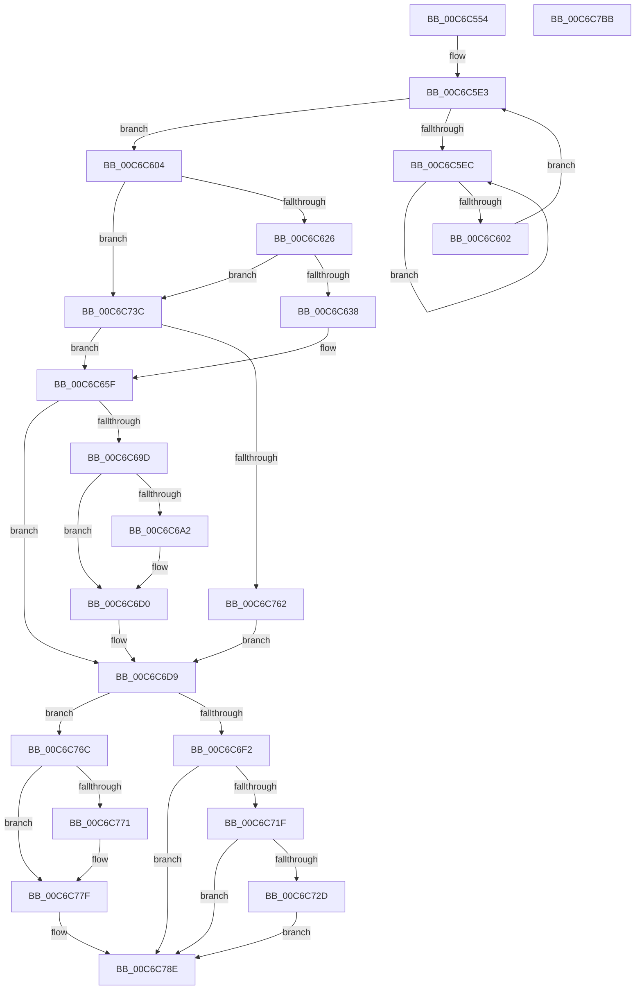

# MiTradeBootImagePage

- RVA: `0x00C6C554`–`0x00C6C7BC` (길이 `616` bytes)
- VA: `0x0000000140C6C554`
- 실행 섹션: `INIT`
- PDB 이름 있음: `예`; PDB Function 태그: `아니요`
- unwind 정보 RVA: `0x000D9540`
- 디코드: `154`개 명령, `616/616` bytes 표시
- 미해석 바이트: `0` (있으면 어셈블리에 `.byte`로 보존)

> 이 문서는 커널 이미지의 기계어와 PDB 기호를 분석해 생성했습니다. 4번과 5번은 함수 원형과 자료형을 바이너리 사용 방식에서 추정한 C 해석이며 원본 소스 복구 결과는 아닙니다.

## 1. Dependencies

- 직접 호출 지점: **12**; 고유 호출 대상: **10**
- 직접 호출자로 확인된 함수: **1**
- RIP 상대 이미지 참조: **1**

### Outgoing calls
- `0x00C6C5CF` → [MiLockPageInline](../../text/31/MiLockPageInline_function_0031A340.md) (function, `0x0031A340`)
- `0x00C6C5F4` → [KeYieldProcessorEx](../../text/3F/KeYieldProcessorEx_function_003FBD00.md) (function, `0x003FBD00`)
- `0x00C6C60A` → [MiCopyPfnEntryEx](../../text/2B/MiCopyPfnEntryEx_function_002B2670.md) (function, `0x002B2670`)
- `0x00C6C65A` → [KeCopyPrivilegedPage](../../text/49/KeCopyPrivilegedPage_function_004977E0.md) (function, `0x004977E0`)
- `0x00C6C692` → [MiTransformValidPteUsingAccessedBit](../../text/37/MiTransformValidPteUsingAccessedBit_function_00376640.md) (function, `0x00376640`)
- `0x00C6C6CB` → [KeCopyPrivilegedPage](../../text/49/KeCopyPrivilegedPage_function_004977E0.md) (function, `0x004977E0`)
- `0x00C6C70D` → [MiFlushSingleTbEntry](../../text/28/MiFlushSingleTbEntry_function_0028E730.md) (function, `0x0028E730`)
- `0x00C6C735` → [MiClearPfnImageVerified](../../text/40/MiClearPfnImageVerified_function_00407000.md) (function, `0x00407000`)
- `0x00C6C753` → [MiCopyPage](../../text/2B/MiCopyPage_function_002B1B30.md) (function, `0x002B1B30`)
- `0x00C6C77A` → [MiCopyPage](../../text/2B/MiCopyPage_function_002B1B30.md) (function, `0x002B1B30`)
- `0x00C6C797` → [MiDecrementShareCountEx](../../text/33/MiDecrementShareCountEx_function_00333F70.md) (function, `0x00333F70`)
- `0x00C6C7A6` → [MiUnlockPage](../../text/31/MiUnlockPage_function_0031A3E0.md) (function, `0x0031A3E0`)

### Direct callers
- [MiHandleBootImage](MiHandleBootImage_function_00C6B854.md) at `0x00C6B9FA`

### Static image references
- `0x00C6C60F` → RVA `0x00FC6A88` (`ALMOSTRO`; read)

## 2. Other-region calls and transfers

- 다른 실행 섹션으로 향하는 call: **12**
  - `0x00C6C5CF` → [MiLockPageInline](../../text/31/MiLockPageInline_function_0031A340.md) (`INIT` → `.text`)
  - `0x00C6C5F4` → [KeYieldProcessorEx](../../text/3F/KeYieldProcessorEx_function_003FBD00.md) (`INIT` → `.text`)
  - `0x00C6C60A` → [MiCopyPfnEntryEx](../../text/2B/MiCopyPfnEntryEx_function_002B2670.md) (`INIT` → `.text`)
  - `0x00C6C65A` → [KeCopyPrivilegedPage](../../text/49/KeCopyPrivilegedPage_function_004977E0.md) (`INIT` → `.text`)
  - `0x00C6C692` → [MiTransformValidPteUsingAccessedBit](../../text/37/MiTransformValidPteUsingAccessedBit_function_00376640.md) (`INIT` → `.text`)
  - `0x00C6C6CB` → [KeCopyPrivilegedPage](../../text/49/KeCopyPrivilegedPage_function_004977E0.md) (`INIT` → `.text`)
  - `0x00C6C70D` → [MiFlushSingleTbEntry](../../text/28/MiFlushSingleTbEntry_function_0028E730.md) (`INIT` → `.text`)
  - `0x00C6C735` → [MiClearPfnImageVerified](../../text/40/MiClearPfnImageVerified_function_00407000.md) (`INIT` → `.text`)
  - `0x00C6C753` → [MiCopyPage](../../text/2B/MiCopyPage_function_002B1B30.md) (`INIT` → `.text`)
  - `0x00C6C77A` → [MiCopyPage](../../text/2B/MiCopyPage_function_002B1B30.md) (`INIT` → `.text`)
  - `0x00C6C797` → [MiDecrementShareCountEx](../../text/33/MiDecrementShareCountEx_function_00333F70.md) (`INIT` → `.text`)
  - `0x00C6C7A6` → [MiUnlockPage](../../text/31/MiUnlockPage_function_0031A3E0.md) (`INIT` → `.text`)
- 별도 외부 분기/꼬리 이동을 확인하지 못했습니다.

## 3. Assembly (complete function range)

```asm
00C6C554  48 89 4C 24 08                  mov qword ptr [rsp + 8], rcx
00C6C559  55                              push rbp
00C6C55A  56                              push rsi
00C6C55B  57                              push rdi
00C6C55C  41 54                           push r12
00C6C55E  41 55                           push r13
00C6C560  41 56                           push r14
00C6C562  41 57                           push r15
00C6C564  48 83 EC 40                     sub rsp, 0x40
00C6C568  48 8B 39                        mov rdi, qword ptr [rcx]
00C6C56B  0F 57 C0                        xorps xmm0, xmm0
00C6C56E  4C 8B E9                        mov r13, rcx
00C6C571  4C 8B E2                        mov r12, rdx
00C6C574  0F 11 44 24 30                  movups xmmword ptr [rsp + 0x30], xmm0
00C6C579  49 C1 E5 19                     shl r13, 0x19
00C6C57D  48 B8 00 00 00 00 80 F6 FF FF   movabs rax, 0xfffff68000000000
00C6C587  48 C1 E0 19                     shl rax, 0x19
00C6C58B  4C 8B FF                        mov r15, rdi
00C6C58E  4C 2B E8                        sub r13, rax
00C6C591  49 C1 EF 0C                     shr r15, 0xc
00C6C595  48 B8 FF FF FF FF FF 00 00 00   movabs rax, 0xffffffffff
00C6C59F  49 C1 FD 10                     sar r13, 0x10
00C6C5A3  4C 23 F8                        and r15, rax
00C6C5A6  48 B9 00 00 00 00 00 DE FF FF   movabs rcx, 0xffffde0000000000
00C6C5B0  4B 8D 34 7F                     lea rsi, [r15 + r15*2]
00C6C5B4  48 C1 E6 04                     shl rsi, 4
00C6C5B8  48 8B C1                        mov rax, rcx
00C6C5BB  48 8D 2C 52                     lea rbp, [rdx + rdx*2]
00C6C5BF  48 03 F0                        add rsi, rax
00C6C5C2  48 C1 E5 04                     shl rbp, 4
00C6C5C6  48 8B C1                        mov rax, rcx
00C6C5C9  48 8B CE                        mov rcx, rsi
00C6C5CC  48 03 E8                        add rbp, rax
00C6C5CF  E8 6C DD 6A FF                  call 0x14031a340
00C6C5D4  83 A4 24 90 00 00 00 00         and dword ptr [rsp + 0x90], 0
00C6C5DC  88 84 24 88 00 00 00            mov byte ptr [rsp + 0x88], al
00C6C5E3  F0 48 0F BA 6D 18 3F            lock bts qword ptr [rbp + 0x18], 0x3f
00C6C5EA  73 18                           jae 0x140c6c604
00C6C5EC  48 8D 8C 24 90 00 00 00         lea rcx, [rsp + 0x90]
00C6C5F4  E8 07 F7 78 FF                  call 0x1403fbd00
00C6C5F9  48 8B 45 18                     mov rax, qword ptr [rbp + 0x18]
00C6C5FD  48 85 C0                        test rax, rax
00C6C600  78 EA                           js 0x140c6c5ec
00C6C602  EB DF                           jmp 0x140c6c5e3
00C6C604  48 8B D6                        mov rdx, rsi
00C6C607  48 8B CD                        mov rcx, rbp
00C6C60A  E8 61 60 64 FF                  call 0x1402b2670
00C6C60F  48 8B 0D 72 A4 35 00            mov rcx, qword ptr [rip + 0x35a472]
00C6C616  45 33 F6                        xor r14d, r14d
00C6C619  48 C1 E9 0E                     shr rcx, 0xe
00C6C61D  83 E1 01                        and ecx, 1
00C6C620  0F 84 16 01 00 00               je 0x140c6c73c
00C6C626  48 8B 46 28                     mov rax, qword ptr [rsi + 0x28]
00C6C62A  48 C1 E8 3C                     shr rax, 0x3c
00C6C62E  24 07                           and al, 7
00C6C630  3C 03                           cmp al, 3
00C6C632  0F 84 04 01 00 00               je 0x140c6c73c
00C6C638  C7 44 24 28 01 00 00 00         mov dword ptr [rsp + 0x28], 1
00C6C640  4C 8D 4C 24 30                  lea r9, [rsp + 0x30]
00C6C645  4C 21 74 24 20                  and qword ptr [rsp + 0x20], r14
00C6C64A  48 8D 54 24 30                  lea rdx, [rsp + 0x30]
00C6C64F  4D 8B C7                        mov r8, r15
00C6C652  4C 89 6C 24 30                  mov qword ptr [rsp + 0x30], r13
00C6C657  49 8B CC                        mov rcx, r12
00C6C65A  E8 81 B1 82 FF                  call 0x1404977e0
00C6C65F  83 64 24 20 00                  and dword ptr [rsp + 0x20], 0
00C6C664  48 B9 FF 0F 00 00 00 00 F0 FF   movabs rcx, 0xfff0000000000fff
00C6C66E  49 8B C4                        mov rax, r12
00C6C671  41 B9 40 00 00 00               mov r9d, 0x40
00C6C677  48 C1 E0 0C                     shl rax, 0xc
00C6C67B  4C 8B C0                        mov r8, rax
00C6C67E  4C 33 C7                        xor r8, rdi
00C6C681  4C 23 C1                        and r8, rcx
00C6C684  48 8B 8C 24 80 00 00 00         mov rcx, qword ptr [rsp + 0x80]
00C6C68C  48 8B D1                        mov rdx, rcx
00C6C68F  4C 33 C0                        xor r8, rax
00C6C692  E8 A9 9F 70 FF                  call 0x140376640
00C6C697  8B F8                           mov edi, eax
00C6C699  85 C0                           test eax, eax
00C6C69B  75 3C                           jne 0x140c6c6d9
00C6C69D  45 85 F6                        test r14d, r14d
00C6C6A0  75 2E                           jne 0x140c6c6d0
00C6C6A2  48 83 64 24 38 00               and qword ptr [rsp + 0x38], 0
00C6C6A8  4C 8D 4C 24 30                  lea r9, [rsp + 0x30]
00C6C6AD  C7 44 24 28 01 00 00 00         mov dword ptr [rsp + 0x28], 1
00C6C6B5  48 8D 54 24 30                  lea rdx, [rsp + 0x30]
00C6C6BA  48 83 64 24 20 00               and qword ptr [rsp + 0x20], 0
00C6C6C0  4D 8B C4                        mov r8, r12
00C6C6C3  49 8B CF                        mov rcx, r15
00C6C6C6  4C 89 6C 24 30                  mov qword ptr [rsp + 0x30], r13
00C6C6CB  E8 10 B1 82 FF                  call 0x1404977e0
00C6C6D0  48 8B C6                        mov rax, rsi
00C6C6D3  48 8B F5                        mov rsi, rbp
00C6C6D6  48 8B E8                        mov rbp, rax
00C6C6D9  48 8B 46 18                     mov rax, qword ptr [rsi + 0x18]
00C6C6DD  48 B9 00 00 00 00 00 00 00 40   movabs rcx, 0x4000000000000000
00C6C6E7  48 0B C1                        or rax, rcx
00C6C6EA  48 89 46 18                     mov qword ptr [rsi + 0x18], rax
00C6C6EE  85 FF                           test edi, edi
00C6C6F0  74 7A                           je 0x140c6c76c
00C6C6F2  48 B8 FF FF FF FF FF FF FF 7F   movabs rax, 0x7fffffffffffffff
00C6C6FC  F0 48 21 45 18                  lock and qword ptr [rbp + 0x18], rax
00C6C701  41 B8 40 00 00 00               mov r8d, 0x40
00C6C707  83 CA FF                        or edx, 0xffffffff
00C6C70A  49 8B CD                        mov rcx, r13
00C6C70D  E8 1E 20 62 FF                  call 0x14028e730
00C6C712  48 F7 05 6B A3 35 00 00 40 00 00  test qword ptr [rip + 0x35a36b], 0x4000
00C6C71D  75 6F                           jne 0x140c6c78e
00C6C71F  48 8B 46 28                     mov rax, qword ptr [rsi + 0x28]
00C6C723  48 C1 E8 3C                     shr rax, 0x3c
00C6C727  24 07                           and al, 7
00C6C729  3C 03                           cmp al, 3
00C6C72B  75 61                           jne 0x140c6c78e
00C6C72D  BA 0C 00 00 00                  mov edx, 0xc
00C6C732  48 8B CE                        mov rcx, rsi
00C6C735  E8 C6 A8 79 FF                  call 0x140407000
00C6C73A  EB 52                           jmp 0x140c6c78e
00C6C73C  48 F7 D9                        neg rcx
00C6C73F  49 8B D7                        mov rdx, r15
00C6C742  49 8B CC                        mov rcx, r12
00C6C745  45 1B F6                        sbb r14d, r14d
00C6C748  41 83 E6 22                     and r14d, 0x22
00C6C74C  41 83 C6 04                     add r14d, 4
00C6C750  45 8B C6                        mov r8d, r14d
00C6C753  E8 D8 53 64 FF                  call 0x1402b1b30
00C6C758  41 F6 C6 20                     test r14b, 0x20
00C6C75C  0F 84 FD FE FF FF               je 0x140c6c65f
00C6C762  BF 01 00 00 00                  mov edi, 1
00C6C767  E9 6D FF FF FF                  jmp 0x140c6c6d9
00C6C76C  45 85 F6                        test r14d, r14d
00C6C76F  74 0E                           je 0x140c6c77f
00C6C771  45 8B C6                        mov r8d, r14d
00C6C774  49 8B D4                        mov rdx, r12
00C6C777  49 8B CF                        mov rcx, r15
00C6C77A  E8 B1 53 64 FF                  call 0x1402b1b30
00C6C77F  48 B8 FF FF FF FF FF FF FF 7F   movabs rax, 0x7fffffffffffffff
00C6C789  F0 48 21 45 18                  lock and qword ptr [rbp + 0x18], rax
00C6C78E  80 66 23 F7                     and byte ptr [rsi + 0x23], 0xf7
00C6C792  33 D2                           xor edx, edx
00C6C794  48 8B CE                        mov rcx, rsi
00C6C797  E8 D4 77 6C FF                  call 0x140333f70
00C6C79C  8A 94 24 88 00 00 00            mov dl, byte ptr [rsp + 0x88]
00C6C7A3  48 8B CE                        mov rcx, rsi
00C6C7A6  E8 35 DC 6A FF                  call 0x14031a3e0
00C6C7AB  48 83 C4 40                     add rsp, 0x40
00C6C7AF  41 5F                           pop r15
00C6C7B1  41 5E                           pop r14
00C6C7B3  41 5D                           pop r13
00C6C7B5  41 5C                           pop r12
00C6C7B7  5F                              pop rdi
00C6C7B8  5E                              pop rsi
00C6C7B9  5D                              pop rbp
00C6C7BA  C3                              ret
00C6C7BB  CC                              int3
```

## 4. C-style interpretation (structured pseudocode)

```c
__int64 __fastcall MiTradeBootImagePage(__int64 a1, __int64 a2)
{
    __int64 result;
    __int64 v_r13;
    __int64 v_r14;
    __int64 v_r15;
    __int64 v_rbp;
    __int64 v_rsi;
    __int64 v_rsp;
    unsigned __int64 v_stack_m40;
    unsigned __int64 v_stack_m48;
    unsigned int v_stack_m50;
    unsigned __int64 v_stack_m58;
    unsigned __int8 v_stack_p10;
    unsigned int v_stack_p18;
    unsigned __int64 v_stack_p8;

    v_stack_p8 = a1;
    v_rsp = (v_rsp) - (64);
    v_stack_m48 = v_xmm0;
    v_r13 = (a1) << (25);
    result = (result) << (25);
    v_r13 = (v_r13) - (result);
    v_r15 = (*(unsigned __int64 *)(a1)) >> (12);
    v_r13 = (v_r13) >> (16);
    v_r15 = (v_r15) & (result);
    v_rsi = (v_r15 + v_r15 * 2) << (4);
    v_rsi = (v_rsi) + (a1);
    v_rbp = (a2 + a2 * 2) << (4);
    v_rbp = (v_rbp) + (a1);
    result = MiLockPageInline(v_rsi, a2, a3, a4);
    v_stack_p10 = (unsigned __int8)(result);
loc_00C6C5E3:
    if (condition_is_above_or_equal) goto loc_00C6C604;
loc_00C6C5EC:
    result = KeYieldProcessorEx(v_stack_p18, a2, a3, a4);
    if (sign_flag) goto loc_00C6C5EC;
    goto loc_00C6C5E3;
loc_00C6C604:
    result = MiCopyPfnEntryEx(v_rbp, v_rsi, a3, a4);
    v_r14 = 0;
    a1 = (*(unsigned __int64 *)(v_rip + 3515506)) >> (14);
    a1 = (unsigned int)((a1) & (1));
    if (condition_is_equal) goto loc_00C6C73C;
    result = (*(unsigned __int64 *)(v_rsi + 40)) >> (60);
    result = (unsigned __int8)((result) & (7));
    if (((unsigned __int8)(result)) == 3) goto loc_00C6C73C;
    v_stack_m50 = 1;
    v_stack_m48 = v_r13;
    result = KeCopyPrivilegedPage(a2, v_stack_m48, v_r15, v_stack_m48);
loc_00C6C65F:
    result = (a2) << (12);
    a3 = (result) ^ (*(unsigned __int64 *)(a1));
    a3 = (a3) & (a2);
    a3 = (a3) ^ (result);
    result = MiTransformValidPteUsingAccessedBit(v_stack_p8, v_stack_p8, a3, 64);
    if ((unsigned int)(result) != 0) goto loc_00C6C6D9;
    if (0 == 0) {
        a4 = v_stack_m48;
        v_stack_m50 = 1;
        a2 = v_stack_m48;
        a3 = a2;
        a1 = v_r15;
        v_stack_m48 = v_r13;
        result = KeCopyPrivilegedPage(a1, a2, a3, a4);
    }
loc_00C6C6D9:
    result = (*(unsigned __int64 *)(v_rbp + 24)) | (a1);
    *(unsigned __int64 *)(v_rbp + 24) = result;
    if ((unsigned int)((unsigned int)((unsigned int)(result))) == 0) goto loc_00C6C76C;
    a2 = (unsigned int)((a2) | (0xFFFFFFFFULL));
    result = MiFlushSingleTbEntry(v_r13, a2, 64, a4);
    if (((*(unsigned __int64 *)(v_rip + 3515243)) & (0x4000ULL)) != 0) goto loc_00C6C78E;
    result = (*(unsigned __int64 *)(v_rbp + 40)) >> (60);
    result = (unsigned __int8)((result) & (7));
    if (((unsigned __int8)(result)) != 3) goto loc_00C6C78E;
    result = MiClearPfnImageVerified(v_rbp, 12, 64, a4);
    goto loc_00C6C78E;
loc_00C6C73C:
    a1 = -(v_rbp);
    v_r14 = (unsigned int)((v_r14) & (34));
    v_r14 = (unsigned int)((v_r14) + (4));
    result = MiCopyPage(a2, v_r15, (unsigned int)((unsigned int)(v_r14)), a4);
    if ((((unsigned __int8)(v_r14)) & (32)) == 0) goto loc_00C6C65F;
    goto loc_00C6C6D9;
loc_00C6C76C:
    if ((unsigned int)(v_r14) != 0) {
        a3 = (unsigned int)(v_r14);
        a2 = a2;
        a1 = v_r15;
        result = MiCopyPage(a1, a2, a3, a4);
    }
loc_00C6C78E:
    a2 = 0;
    result = MiDecrementShareCountEx(v_rbp, a2, a3, a4);
    result = MiUnlockPage(v_rbp, v_stack_p10, a3, a4);
    v_rsp = (v_rsp) + (64);
    return result;
}
```

## 5. (Beta) C Style

```c
int64_t MiTradeBootImagePage(void *Arg1, void *Arg2)
{
    uint8_t *arg1 = (uint8_t *)Arg1;
    uint8_t *arg2 = (uint8_t *)Arg2;

    int64_t result;
    int64_t local_r13;
    int64_t local_r14;
    int64_t local_r15;
    int64_t local_rbp;
    int64_t local_rsi;
    int64_t local_rsp;
    uint64_t v_stack_m40;
    uint64_t v_stack_m48;
    uint32_t v_stack_m50;
    uint64_t v_stack_m58;
    uint8_t v_stack_p10;
    uint32_t v_stack_p18;
    uint64_t v_stack_p8;

    v_stack_p8 = Arg1;
    local_rsp = (local_rsp) - (64);
    v_stack_m48 = v_xmm0;
    local_r13 = (Arg1) << (25);
    result = (result) << (25);
    local_r13 = (local_r13) - (result);
    local_r15 = (*(uint64_t *)(arg1)) >> (12);
    local_r13 = (local_r13) >> (16);
    local_r15 = (local_r15) & (result);
    local_rsi = (local_r15 + local_r15 * 2) << (4);
    local_rsi = (local_rsi) + (Arg1);
    local_rbp = (Arg2 + Arg2 * 2) << (4);
    local_rbp = (local_rbp) + (Arg1);
    result = MiLockPageInline(local_rsi, Arg2, a3, a4);
    v_stack_p10 = (uint8_t)(result);
loc_00C6C5E3:
    if (condition_is_above_or_equal) goto loc_00C6C604;
loc_00C6C5EC:
    result = KeYieldProcessorEx(v_stack_p18, Arg2, a3, a4);
    if (sign_flag) goto loc_00C6C5EC;
    goto loc_00C6C5E3;
loc_00C6C604:
    result = MiCopyPfnEntryEx(local_rbp, local_rsi, a3, a4);
    local_r14 = 0;
    Arg1 = (*(uint64_t *)(v_rip + 0x35A472)) >> (14);
    Arg1 = (uint32_t)((Arg1) & (1));
    if (condition_is_equal) goto loc_00C6C73C;
    result = (*(uint64_t *)(local_rsi + 0x28)) >> (60);
    result = (uint8_t)((result) & (7));
    if (((uint8_t)(result)) == 3) goto loc_00C6C73C;
    v_stack_m50 = 1;
    v_stack_m48 = local_r13;
    result = KeCopyPrivilegedPage(Arg2, v_stack_m48, local_r15, v_stack_m48);
loc_00C6C65F:
    result = (Arg2) << (12);
    a3 = (result) ^ (*(uint64_t *)(arg1));
    a3 = (a3) & (Arg2);
    a3 = (a3) ^ (result);
    result = MiTransformValidPteUsingAccessedBit(v_stack_p8, v_stack_p8, a3, 64);
    if ((uint32_t)(result) != 0) goto loc_00C6C6D9;
    if (0 == 0) {
        a4 = v_stack_m48;
        v_stack_m50 = 1;
        Arg2 = v_stack_m48;
        a3 = Arg2;
        Arg1 = local_r15;
        v_stack_m48 = local_r13;
        result = KeCopyPrivilegedPage(Arg1, Arg2, a3, a4);
    }
loc_00C6C6D9:
    result = (*(uint64_t *)(local_rbp + 0x18)) | (Arg1);
    *(uint64_t *)(local_rbp + 0x18) = result;
    if ((uint32_t)((uint32_t)((uint32_t)(result))) == 0) goto loc_00C6C76C;
    Arg2 = (uint32_t)((Arg2) | (0xFFFFFFFFULL));
    result = MiFlushSingleTbEntry(local_r13, Arg2, 64, a4);
    if (((*(uint64_t *)(v_rip + 0x35A36B)) & (0x4000ULL)) != 0) goto loc_00C6C78E;
    result = (*(uint64_t *)(local_rbp + 0x28)) >> (60);
    result = (uint8_t)((result) & (7));
    if (((uint8_t)(result)) != 3) goto loc_00C6C78E;
    result = MiClearPfnImageVerified(local_rbp, 12, 64, a4);
    goto loc_00C6C78E;
loc_00C6C73C:
    Arg1 = -(local_rbp);
    local_r14 = (uint32_t)((local_r14) & (34));
    local_r14 = (uint32_t)((local_r14) + (4));
    result = MiCopyPage(Arg2, local_r15, (uint32_t)((uint32_t)(local_r14)), a4);
    if ((((uint8_t)(local_r14)) & (32)) == 0) goto loc_00C6C65F;
    goto loc_00C6C6D9;
loc_00C6C76C:
    if ((uint32_t)(local_r14) != 0) {
        a3 = (uint32_t)(local_r14);
        Arg2 = Arg2;
        Arg1 = local_r15;
        result = MiCopyPage(Arg1, Arg2, a3, a4);
    }
loc_00C6C78E:
    Arg2 = 0;
    result = MiDecrementShareCountEx(local_rbp, Arg2, a3, a4);
    result = MiUnlockPage(local_rbp, v_stack_p10, a3, a4);
    local_rsp = (local_rsp) + (64);
    return result;
}
```

### 관측된 메모리 오프셋

구조체 형식이 확인되지 않은 접근은 인자 기준의 오프셋으로만 기록했습니다.

| 기준 인자 | 오프셋 표현 | 폭 (bit) | 접근 |
|---|---:|---:|---|
| `Arg1` | `+ 0x0` | `64` | `R` |
| `Arg2` | `+ 0x0 + rdx*2` | `64` | `R` |

## 6. Execution-region graph

[열기: 2D/3D 그래프와 함수 탐색 컨트롤 패널](../../../control-panel.html?section=init&rva=0x00C6C554&view=graph)

- 2D 그래프는 위에서 아래로 흐르고, 3D 그래프는 빈 공간을 드래그해 회전합니다. Shift+드래그는 이동, 휠은 확대·축소, 함수 노드 선택은 대상 보고서 이동입니다.

### Static fallback


