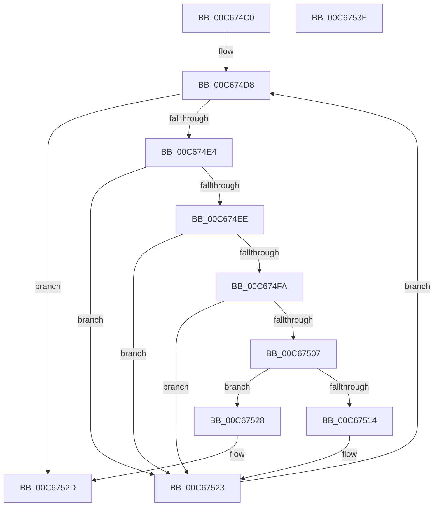

# MiUpdateBootDriverHotPatchImports

- RVA: `0x00C674C0`–`0x00C67540` (길이 `128` bytes)
- VA: `0x0000000140C674C0`
- 실행 섹션: `INIT`
- PDB 이름 있음: `예`; PDB Function 태그: `아니요`
- unwind 정보 RVA: `0x00060BC4`
- 디코드: `35`개 명령, `128/128` bytes 표시
- 미해석 바이트: `0` (있으면 어셈블리에 `.byte`로 보존)

> 이 문서는 커널 이미지의 기계어와 PDB 기호를 분석해 생성했습니다. 4번과 5번은 함수 원형과 자료형을 바이너리 사용 방식에서 추정한 C 해석이며 원본 소스 복구 결과는 아닙니다.

## 1. Dependencies

- 직접 호출 지점: **2**; 고유 호출 대상: **2**
- 직접 호출자로 확인된 함수: **1**
- RIP 상대 이미지 참조: **1**

### Outgoing calls
- `0x00C6750A` → [MiAddEntryToImportList](../../page/7F/MiAddEntryToImportList_function_007F7D20.md) (function, `0x007F7D20`)
- `0x00C6751E` → [MiFreeLoadedImportList](../../page/AB/MiFreeLoadedImportList_function_00AB6380.md) (function, `0x00AB6380`)

### Direct callers
- [MiInitializeLoadedModuleList](MiInitializeLoadedModuleList_function_00C6BCDC.md) at `0x00C6BF62`

### Static image references
- `0x00C674CF` → RVA `0x00EF54C0` (`.data`; read)

## 2. Other-region calls and transfers

- 다른 실행 섹션으로 향하는 call: **2**
  - `0x00C6750A` → [MiAddEntryToImportList](../../page/7F/MiAddEntryToImportList_function_007F7D20.md) (`INIT` → `PAGE`)
  - `0x00C6751E` → [MiFreeLoadedImportList](../../page/AB/MiFreeLoadedImportList_function_00AB6380.md) (`INIT` → `PAGE`)
- 별도 외부 분기/꼬리 이동을 확인하지 못했습니다.

## 3. Assembly (complete function range)

```asm
00C674C0  48 89 5C 24 08                  mov qword ptr [rsp + 8], rbx
00C674C5  48 89 74 24 10                  mov qword ptr [rsp + 0x10], rsi
00C674CA  57                              push rdi
00C674CB  48 83 EC 20                     sub rsp, 0x20
00C674CF  48 8B 1D EA DF 28 00            mov rbx, qword ptr [rip + 0x28dfea]
00C674D6  33 FF                           xor edi, edi
00C674D8  48 8D 05 E1 DF 28 00            lea rax, [rip + 0x28dfe1]
00C674DF  48 3B D8                        cmp rbx, rax
00C674E2  74 49                           je 0x140c6752d
00C674E4  8B 83 B8 00 00 00               mov eax, dword ptr [rbx + 0xb8]
00C674EA  84 C0                           test al, al
00C674EC  78 35                           js 0x140c67523
00C674EE  48 8B 93 F8 00 00 00            mov rdx, qword ptr [rbx + 0xf8]
00C674F5  48 85 D2                        test rdx, rdx
00C674F8  74 29                           je 0x140c67523
00C674FA  48 8B B3 88 00 00 00            mov rsi, qword ptr [rbx + 0x88]
00C67501  48 83 FE 01                     cmp rsi, 1
00C67505  74 1C                           je 0x140c67523
00C67507  48 8B CE                        mov rcx, rsi
00C6750A  E8 11 08 B9 FF                  call 0x1407f7d20
00C6750F  48 85 C0                        test rax, rax
00C67512  74 14                           je 0x140c67528
00C67514  48 8B CE                        mov rcx, rsi
00C67517  48 89 83 88 00 00 00            mov qword ptr [rbx + 0x88], rax
00C6751E  E8 5D EE E4 FF                  call 0x140ab6380
00C67523  48 8B 1B                        mov rbx, qword ptr [rbx]
00C67526  EB B0                           jmp 0x140c674d8
00C67528  BF 9A 00 00 C0                  mov edi, 0xc000009a
00C6752D  48 8B 5C 24 30                  mov rbx, qword ptr [rsp + 0x30]
00C67532  8B C7                           mov eax, edi
00C67534  48 8B 74 24 38                  mov rsi, qword ptr [rsp + 0x38]
00C67539  48 83 C4 20                     add rsp, 0x20
00C6753D  5F                              pop rdi
00C6753E  C3                              ret
00C6753F  CC                              int3
```

## 4. C-style interpretation (structured pseudocode)

```c
__int64 __fastcall MiUpdateBootDriverHotPatchImports(void)
{
    __int64 result;
    __int64 v_rdi;
    __int64 v_rsp;
    unsigned __int64 v_stack_p10;
    unsigned __int64 v_stack_p8;

    v_stack_p8 = v_rbx;
    v_stack_p10 = v_rsi;
    v_rsp = (v_rsp) - (32);
    v_rdi = 0;
loc_00C674D8:
    if ((*(unsigned __int64 *)(v_rip + 2678762)) == (v_rip + 2678753)) goto loc_00C6752D;
    if (sign_flag) goto loc_00C67523;
    if (*(unsigned __int64 *)(*(unsigned __int64 *)(v_rip + 2678762) + 248) == 0) goto loc_00C67523;
    if ((*(unsigned __int64 *)(*(unsigned __int64 *)(v_rip + 2678762) + 136)) == 1) goto loc_00C67523;
    result = MiAddEntryToImportList(*(unsigned __int64 *)(*(unsigned __int64 *)(v_rip + 2678762) + 136), *(unsigned __int64 *)(*(unsigned __int64 *)(v_rip + 2678762) + 248), a3, a4);
    if (result == 0) goto loc_00C67528;
    *(unsigned __int64 *)(*(unsigned __int64 *)(v_rip + 2678762) + 136) = result;
    result = MiFreeLoadedImportList(*(unsigned __int64 *)(*(unsigned __int64 *)(v_rip + 2678762) + 136), *(unsigned __int64 *)(*(unsigned __int64 *)(v_rip + 2678762) + 248), a3, a4);
loc_00C67523:
    goto loc_00C674D8;
loc_00C67528:
loc_00C6752D:
    v_rsp = (v_rsp) + (32);
    return (unsigned int)((unsigned int)((unsigned int)(0xC000009AULL)));
}
```

## 5. (Beta) C Style

```c
void MiUpdateBootDriverHotPatchImports(void)
{
    int64_t result;
    int64_t local_rdi;
    int64_t local_rsp;
    uint64_t v_stack_p10;
    uint64_t v_stack_p8;

    v_stack_p8 = local_rbx;
    v_stack_p10 = local_rsi;
    local_rsp = (local_rsp) - (32);
    local_rdi = 0;
loc_00C674D8:
    if ((*(uint64_t *)(v_rip + 0x28DFEA)) == (v_rip + 2678753)) goto loc_00C6752D;
    if (sign_flag) goto loc_00C67523;
    if (*(uint64_t *)(*(uint64_t *)(v_rip + 0x28DFEA) + 0xF8) == 0) goto loc_00C67523;
    if ((*(uint64_t *)(*(uint64_t *)(v_rip + 0x28DFEA) + 0x88)) == 1) goto loc_00C67523;
    result = MiAddEntryToImportList(*(uint64_t *)(*(uint64_t *)(v_rip + 0x28DFEA) + 0x88), *(uint64_t *)(*(uint64_t *)(v_rip + 0x28DFEA) + 0xF8), a3, a4);
    if (result == 0) goto loc_00C67528;
    *(uint64_t *)(*(uint64_t *)(v_rip + 0x28DFEA) + 0x88) = result;
    result = MiFreeLoadedImportList(*(uint64_t *)(*(uint64_t *)(v_rip + 0x28DFEA) + 0x88), *(uint64_t *)(*(uint64_t *)(v_rip + 0x28DFEA) + 0xF8), a3, a4);
loc_00C67523:
    goto loc_00C674D8;
loc_00C67528:
loc_00C6752D:
    local_rsp = (local_rsp) + (32);
    return (uint32_t)((uint32_t)((uint32_t)(0xC000009AULL)));
}
```

## 6. Execution-region graph

[열기: 2D/3D 그래프와 함수 탐색 컨트롤 패널](../../../control-panel.html?section=init&rva=0x00C674C0&view=graph)

- 2D 그래프는 위에서 아래로 흐르고, 3D 그래프는 빈 공간을 드래그해 회전합니다. Shift+드래그는 이동, 휠은 확대·축소, 함수 노드 선택은 대상 보고서 이동입니다.

### Static fallback


