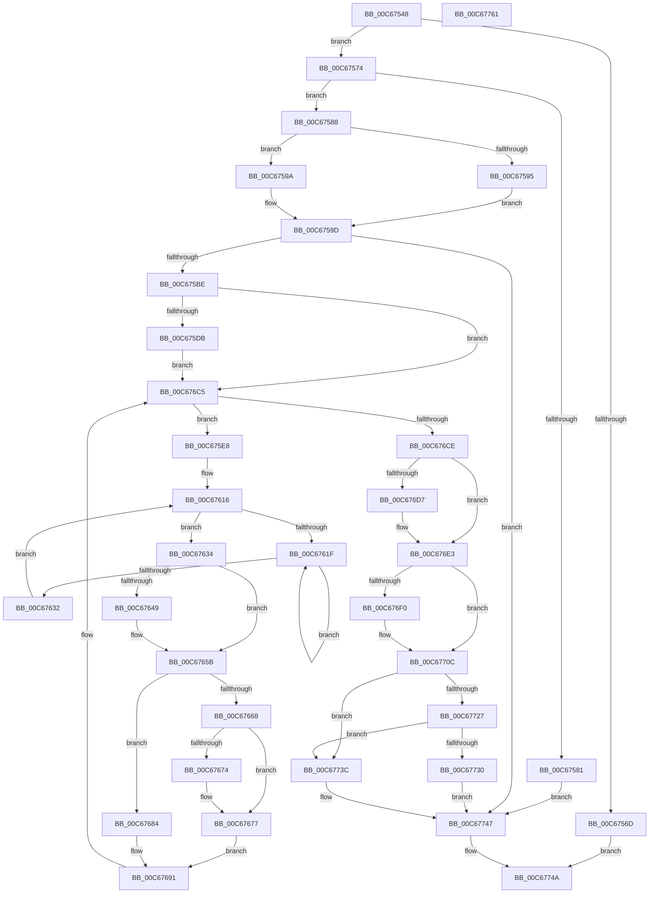

# MiUpdateBootHpatPagesInUse

- RVA: `0x00C67548`–`0x00C67762` (길이 `538` bytes)
- VA: `0x0000000140C67548`
- 실행 섹션: `INIT`
- PDB 이름 있음: `예`; PDB Function 태그: `아니요`
- unwind 정보 RVA: `0x000733F8`
- 디코드: `139`개 명령, `538/538` bytes 표시
- 미해석 바이트: `0` (있으면 어셈블리에 `.byte`로 보존)

> 이 문서는 커널 이미지의 기계어와 PDB 기호를 분석해 생성했습니다. 4번과 5번은 함수 원형과 자료형을 바이너리 사용 방식에서 추정한 C 해석이며 원본 소스 복구 결과는 아닙니다.

## 1. Dependencies

- 직접 호출 지점: **9**; 고유 호출 대상: **9**
- 직접 호출자로 확인된 함수: **1**
- RIP 상대 이미지 참조: **10**

### Outgoing calls
- `0x00C67577` → [MiFindLoaderAppliedHotPatchEntry](MiFindLoaderAppliedHotPatchEntry_function_00C673E4.md) (function, `0x00C673E4`)
- `0x00C675DE` → [KiRaiseIrqlProcessIrqlFlags](../../text/4F/KiRaiseIrqlProcessIrqlFlags_function_004F56FC.md) (function, `0x004F56FC`)
- `0x00C67624` → [KeYieldProcessorEx](../../text/3F/KeYieldProcessorEx_function_003FBD00.md) (function, `0x003FBD00`)
- `0x00C67650` → [MiMarkPfnVerified](../../text/38/MiMarkPfnVerified_function_003833C4.md) (function, `0x003833C4`)
- `0x00C6765E` → [MiGetPfnSlabType](../../text/28/MiGetPfnSlabType_function_0028E2D0.md) (function, `0x0028E2D0`)
- `0x00C6766B` → [MiIsPfnFromChargedSlabAllocation](../../text/2A/MiIsPfnFromChargedSlabAllocation_function_002A2968.md) (function, `0x002A2968`)
- `0x00C676A9` → [MiUpdatePageFileHighInPte](../../text/36/MiUpdatePageFileHighInPte_function_0036D840.md) (function, `0x0036D840`)
- `0x00C676DE` → [KiLowerIrqlProcessIrqlFlags](../../text/4F/KiLowerIrqlProcessIrqlFlags_function_004F5698.md) (function, `0x004F5698`)
- `0x00C67700` → [MiAcquireNonPagedResources](../../text/28/MiAcquireNonPagedResources_function_00286C60.md) (function, `0x00286C60`)

### Direct callers
- [MiHandleBootImage](MiHandleBootImage_function_00C6B854.md) at `0x00C6B93E`

### Static image references
- `0x00C6755E` → RVA `0x00E375AC` (`.data`; read)
- `0x00C675CF` → RVA `0x00FC6D20` (`ALMOSTRO`; read)
- `0x00C67684` → RVA `0x00E3D9C0` (`.data`; read/write)
- `0x00C676F3` → RVA `0x00E38D00` (`.data`; read)
- `0x00C67705` → RVA `0x00E3D9E8` (`.data`; read/write)
- `0x00C6770C` → RVA `0x00E2DCE8` (`.data`; read/write)
- `0x00C6771E` → RVA `0x00FC6B28` (`ALMOSTRO`; read)
- `0x00C67727` → RVA `0x00FC6B98` (`ALMOSTRO`; read)
- `0x00C67732` → RVA `0x00E376F0` (`.data`; read/write)
- `0x00C6773F` → RVA `0x00E376D8` (`.data`; read/write)

## 2. Other-region calls and transfers

- 다른 실행 섹션으로 향하는 call: **8**
  - `0x00C675DE` → [KiRaiseIrqlProcessIrqlFlags](../../text/4F/KiRaiseIrqlProcessIrqlFlags_function_004F56FC.md) (`INIT` → `.text`)
  - `0x00C67624` → [KeYieldProcessorEx](../../text/3F/KeYieldProcessorEx_function_003FBD00.md) (`INIT` → `.text`)
  - `0x00C67650` → [MiMarkPfnVerified](../../text/38/MiMarkPfnVerified_function_003833C4.md) (`INIT` → `.text`)
  - `0x00C6765E` → [MiGetPfnSlabType](../../text/28/MiGetPfnSlabType_function_0028E2D0.md) (`INIT` → `.text`)
  - `0x00C6766B` → [MiIsPfnFromChargedSlabAllocation](../../text/2A/MiIsPfnFromChargedSlabAllocation_function_002A2968.md) (`INIT` → `.text`)
  - `0x00C676A9` → [MiUpdatePageFileHighInPte](../../text/36/MiUpdatePageFileHighInPte_function_0036D840.md) (`INIT` → `.text`)
  - `0x00C676DE` → [KiLowerIrqlProcessIrqlFlags](../../text/4F/KiLowerIrqlProcessIrqlFlags_function_004F5698.md) (`INIT` → `.text`)
  - `0x00C67700` → [MiAcquireNonPagedResources](../../text/28/MiAcquireNonPagedResources_function_00286C60.md) (`INIT` → `.text`)
- 별도 외부 분기/꼬리 이동을 확인하지 못했습니다.

## 3. Assembly (complete function range)

```asm
00C67548  48 89 5C 24 08                  mov qword ptr [rsp + 8], rbx
00C6754D  48 89 6C 24 10                  mov qword ptr [rsp + 0x10], rbp
00C67552  56                              push rsi
00C67553  57                              push rdi
00C67554  41 54                           push r12
00C67556  41 56                           push r14
00C67558  41 57                           push r15
00C6755A  48 83 EC 30                     sub rsp, 0x30
00C6755E  83 3D 47 00 1D 00 00            cmp dword ptr [rip + 0x1d0047], 0
00C67565  4C 8B F2                        mov r14, rdx
00C67568  4C 8B F9                        mov r15, rcx
00C6756B  75 07                           jne 0x140c67574
00C6756D  33 C0                           xor eax, eax
00C6756F  E9 D6 01 00 00                  jmp 0x140c6774a
00C67574  49 8B D0                        mov rdx, r8
00C67577  E8 68 FE FF FF                  call 0x140c673e4
00C6757C  48 85 C0                        test rax, rax
00C6757F  75 07                           jne 0x140c67588
00C67581  33 FF                           xor edi, edi
00C67583  E9 BF 01 00 00                  jmp 0x140c67747
00C67588  66 0F BA 61 6E 09               bt word ptr [rcx + 0x6e], 9
00C6758E  B9 00 00 00 00                  mov ecx, 0
00C67593  72 05                           jb 0x140c6759a
00C67595  8B 40 30                        mov eax, dword ptr [rax + 0x30]
00C67598  EB 03                           jmp 0x140c6759d
00C6759A  8B 40 34                        mov eax, dword ptr [rax + 0x34]
00C6759D  48 C1 E0 03                     shl rax, 3
00C675A1  48 A9 FF 0F 00 00               test rax, 0xfff
00C675A7  0F 95 C1                        setne cl
00C675AA  48 C1 E8 0C                     shr rax, 0xc
00C675AE  48 03 C8                        add rcx, rax
00C675B1  48 8D 3C 09                     lea rdi, [rcx + rcx]
00C675B5  48 85 FF                        test rdi, rdi
00C675B8  0F 84 89 01 00 00               je 0x140c67747
00C675BE  33 F6                           xor esi, esi
00C675C0  4D 8D 24 FE                     lea r12, [r14 + rdi*8]
00C675C4  44 0F 20 C5                     mov rbp, cr8
00C675C8  8D 56 02                        lea edx, [rsi + 2]
00C675CB  44 0F 22 C2                     mov cr8, rdx
00C675CF  39 35 4B F7 35 00               cmp dword ptr [rip + 0x35f74b], esi
00C675D5  0F 84 EA 00 00 00               je 0x140c676c5
00C675DB  40 8A CD                        mov cl, bpl
00C675DE  E8 19 E1 88 FF                  call 0x1404f56fc
00C675E3  E9 DD 00 00 00                  jmp 0x140c676c5
00C675E8  49 8B 06                        mov rax, qword ptr [r14]
00C675EB  48 B9 FF FF FF FF FF 00 00 00   movabs rcx, 0xffffffffff
00C675F5  48 C1 E8 0C                     shr rax, 0xc
00C675F9  48 23 C1                        and rax, rcx
00C675FC  48 8D 1C 40                     lea rbx, [rax + rax*2]
00C67600  48 C1 E3 04                     shl rbx, 4
00C67604  48 B8 00 00 00 00 00 DE FF FF   movabs rax, 0xffffde0000000000
00C6760E  48 03 D8                        add rbx, rax
00C67611  83 64 24 20 00                  and dword ptr [rsp + 0x20], 0
00C67616  F0 48 0F BA 6B 18 3F            lock bts qword ptr [rbx + 0x18], 0x3f
00C6761D  73 15                           jae 0x140c67634
00C6761F  48 8D 4C 24 20                  lea rcx, [rsp + 0x20]
00C67624  E8 D7 46 79 FF                  call 0x1403fbd00
00C67629  48 8B 43 18                     mov rax, qword ptr [rbx + 0x18]
00C6762D  48 85 C0                        test rax, rax
00C67630  78 ED                           js 0x140c6761f
00C67632  EB E2                           jmp 0x140c67616
00C67634  48 8B 43 28                     mov rax, qword ptr [rbx + 0x28]
00C67638  41 B9 03 00 00 00               mov r9d, 3
00C6763E  48 C1 E8 3C                     shr rax, 0x3c
00C67642  24 07                           and al, 7
00C67644  41 3A C1                        cmp al, r9b
00C67647  74 12                           je 0x140c6765b
00C67649  41 8D 51 01                     lea edx, [r9 + 1]
00C6764D  48 8B CB                        mov rcx, rbx
00C67650  E8 6F BD 71 FF                  call 0x1403833c4
00C67655  41 B9 03 00 00 00               mov r9d, 3
00C6765B  48 8B CB                        mov rcx, rbx
00C6765E  E8 6D 6C 62 FF                  call 0x14028e2d0
00C67663  83 F8 09                        cmp eax, 9
00C67666  74 1C                           je 0x140c67684
00C67668  48 8B CB                        mov rcx, rbx
00C6766B  E8 F8 B2 63 FF                  call 0x1402a2968
00C67670  85 C0                           test eax, eax
00C67672  75 03                           jne 0x140c67677
00C67674  48 FF C6                        inc rsi
00C67677  F7 D8                           neg eax
00C67679  48 1B D2                        sbb rdx, rdx
00C6767C  83 E2 04                        and edx, 4
00C6767F  49 03 D1                        add rdx, r9
00C67682  EB 0D                           jmp 0x140c67691
00C67684  F0 48 FF 05 34 63 1D 00         lock inc qword ptr [rip + 0x1d6334]
00C6768C  BA 01 00 00 00                  mov edx, 1
00C67691  8B 43 20                        mov eax, dword ptr [rbx + 0x20]
00C67694  89 44 24 78                     mov dword ptr [rsp + 0x78], eax
00C67698  66 44 89 4C 24 78               mov word ptr [rsp + 0x78], r9w
00C6769E  8B 44 24 78                     mov eax, dword ptr [rsp + 0x78]
00C676A2  89 43 20                        mov dword ptr [rbx + 0x20], eax
00C676A5  48 8B 4B 10                     mov rcx, qword ptr [rbx + 0x10]
00C676A9  E8 92 61 70 FF                  call 0x14036d840
00C676AE  48 89 43 10                     mov qword ptr [rbx + 0x10], rax
00C676B2  48 B8 FF FF FF FF FF FF FF 7F   movabs rax, 0x7fffffffffffffff
00C676BC  F0 48 21 43 18                  lock and qword ptr [rbx + 0x18], rax
00C676C1  49 83 C6 08                     add r14, 8
00C676C5  4D 3B F4                        cmp r14, r12
00C676C8  0F 82 1A FF FF FF               jb 0x140c675e8
00C676CE  83 3D 4B F6 35 00 00            cmp dword ptr [rip + 0x35f64b], 0
00C676D5  74 0C                           je 0x140c676e3
00C676D7  44 0F 20 C1                     mov rcx, cr8
00C676DB  40 8A D5                        mov dl, bpl
00C676DE  E8 B5 DF 88 FF                  call 0x1404f5698
00C676E3  40 0F B6 C5                     movzx eax, bpl
00C676E7  44 0F 22 C0                     mov cr8, rax
00C676EB  48 85 F6                        test rsi, rsi
00C676EE  74 1C                           je 0x140c6770c
00C676F0  45 33 C9                        xor r9d, r9d
00C676F3  48 8D 0D 06 16 1D 00            lea rcx, [rip + 0x1d1606]
00C676FA  45 33 C0                        xor r8d, r8d
00C676FD  48 8B D6                        mov rdx, rsi
00C67700  E8 5B F5 61 FF                  call 0x140286c60
00C67705  48 01 35 DC 62 1D 00            add qword ptr [rip + 0x1d62dc], rsi
00C6770C  F0 48 01 3D D4 65 1C 00         lock add qword ptr [rip + 0x1c65d4], rdi
00C67714  49 8B 4F 30                     mov rcx, qword ptr [r15 + 0x30]
00C67718  48 8B C7                        mov rax, rdi
00C6771B  48 2B C6                        sub rax, rsi
00C6771E  48 3B 0D 03 F4 35 00            cmp rcx, qword ptr [rip + 0x35f403]
00C67725  74 15                           je 0x140c6773c
00C67727  48 3B 0D 6A F4 35 00            cmp rcx, qword ptr [rip + 0x35f46a]
00C6772E  74 0C                           je 0x140c6773c
00C67730  F7 D8                           neg eax
00C67732  F0 0F C1 05 B6 FF 1C 00         lock xadd dword ptr [rip + 0x1cffb6], eax
00C6773A  EB 0B                           jmp 0x140c67747
00C6773C  48 F7 D8                        neg rax
00C6773F  F0 48 01 05 91 FF 1C 00         lock add qword ptr [rip + 0x1cff91], rax
00C67747  48 8B C7                        mov rax, rdi
00C6774A  48 8B 5C 24 60                  mov rbx, qword ptr [rsp + 0x60]
00C6774F  48 8B 6C 24 68                  mov rbp, qword ptr [rsp + 0x68]
00C67754  48 83 C4 30                     add rsp, 0x30
00C67758  41 5F                           pop r15
00C6775A  41 5E                           pop r14
00C6775C  41 5C                           pop r12
00C6775E  5F                              pop rdi
00C6775F  5E                              pop rsi
00C67760  C3                              ret
00C67761  CC                              int3
```

## 4. C-style interpretation (structured pseudocode)

```c
__int64 __fastcall MiUpdateBootHpatPagesInUse(__int64 a1, __int64 a2, __int64 a3)
{
    __int64 result;
    __int64 v_r14;
    __int64 v_rbx;
    __int64 v_rdi;
    __int64 v_rsi;
    __int64 v_rsp;
    unsigned int v_stack_m38;
    unsigned __int64 v_stack_p10;
    unsigned int v_stack_p20;
    unsigned __int64 v_stack_p8;

    v_stack_p8 = v_rbx;
    v_stack_p10 = v_rbp;
    v_rsp = (v_rsp) - (48);
    if ((*(unsigned int *)(v_rip + 1900615)) != 0) goto loc_00C67574;
    result = 0;
    goto loc_00C6774A;
loc_00C67574:
    result = MiFindLoaderAppliedHotPatchEntry(a1, a3, a3, a4);
    if (result != 0) goto loc_00C67588;
    v_rdi = 0;
    goto loc_00C67747;
loc_00C67588:
    if (condition_is_below) goto loc_00C6759A;
    goto loc_00C6759D;
loc_00C6759A:
loc_00C6759D:
    result = ((unsigned int)(*(unsigned int *)((unsigned int)(*(unsigned int *)(result + 48)) + 52))) << (3);
    a1 = (((result) & (0xFFFULL)) != 0) ? 1 : 0;
    result = (result) >> (12);
    a1 = (a1) + (result);
    if (a1 + a1 * 1 == 0) goto loc_00C67747;
    v_rsi = 0;
    if ((*(unsigned int *)(v_rip + 3536715)) == 0) goto loc_00C676C5;
    result = KiRaiseIrqlProcessIrqlFlags((unsigned __int8)(v_cr8), v_rsi + 2, a3, a4);
    goto loc_00C676C5;
loc_00C675E8:
    result = (*(unsigned __int64 *)(a2)) >> (12);
    result = (result) & ((unsigned __int8)(v_cr8));
    v_rbx = (result + result * 2) << (4);
    v_rbx = (v_rbx) + (result);
loc_00C67616:
    if (condition_is_above_or_equal) goto loc_00C67634;
loc_00C6761F:
    result = KeYieldProcessorEx(v_stack_m38, v_rsi + 2, a3, a4);
    if (sign_flag) goto loc_00C6761F;
    goto loc_00C67616;
loc_00C67634:
    result = (*(unsigned __int64 *)(v_rbx + 40)) >> (60);
    result = (unsigned __int8)((result) & (7));
    if (((unsigned __int8)(result)) != 3) {
        a2 = 3 + 1;
        a1 = v_rbx;
        result = MiMarkPfnVerified(a1, a2, a3, 3);
        a4 = 3;
    }
    result = MiGetPfnSlabType(v_rbx, a2, a3, a4);
    if (((unsigned int)(result)) == 9) goto loc_00C67684;
    result = MiIsPfnFromChargedSlabAllocation(v_rbx, a2, a3, a4);
    if ((unsigned int)(result) == 0) {
        v_rsi = (v_rsi) + 1;
    }
    result = (unsigned int)(-(result));
    a2 = (unsigned int)((a2) & (4));
    a2 = (a2) + (a4);
    goto loc_00C67691;
loc_00C67684:
loc_00C67691:
    v_stack_p20 = (unsigned int)((unsigned int)(*(unsigned int *)(v_rbx + 32)));
    v_stack_p20 = (unsigned __int16)(a4);
    *(unsigned int *)(v_rbx + 32) = (unsigned int)((unsigned int)(v_stack_p20));
    result = MiUpdatePageFileHighInPte(*(unsigned __int64 *)(v_rbx + 16), 1, a3, a4);
    *(unsigned __int64 *)(v_rbx + 16) = result;
    v_r14 = (a2) + (8);
loc_00C676C5:
    if (v_r14 < (a2 + a1 + a1 * 1 * 8)) goto loc_00C675E8;
    if ((*(unsigned int *)(v_rip + 3536459)) != 0) {
        a1 = v_rsi + 2;
        a2 = (unsigned __int8)(v_cr8);
        result = KiLowerIrqlProcessIrqlFlags(a1, a2, a3, a4);
    }
    result = (unsigned __int8)(v_cr8);
    if (v_rsi != 0) {
        a4 = 0;
        a1 = v_rip + 1906182;
        a3 = 0;
        a2 = v_rsi;
        result = MiAcquireNonPagedResources(a1, a2, a3, a4);
    }
    result = (a1 + a1 * 1) - (v_rsi);
    if ((*(unsigned __int64 *)(a1 + 48)) == (*(unsigned __int64 *)(v_rip + 3535875))) goto loc_00C6773C;
    if ((*(unsigned __int64 *)(a1 + 48)) == (*(unsigned __int64 *)(v_rip + 3535978))) goto loc_00C6773C;
    result = (unsigned int)(-(result));
    goto loc_00C67747;
loc_00C6773C:
    result = -(result);
loc_00C67747:
loc_00C6774A:
    v_rsp = (v_rsp) + (48);
    return a1 + a1 * 1;
}
```

## 5. (Beta) C Style

```c
int64_t MiUpdateBootHpatPagesInUse(void *Arg1, void *Arg2, int64_t Arg3)
{
    uint8_t *arg1 = (uint8_t *)Arg1;
    uint8_t *arg2 = (uint8_t *)Arg2;

    int64_t result;
    int64_t local_r14;
    int64_t local_rbx;
    int64_t local_rdi;
    int64_t local_rsi;
    int64_t local_rsp;
    uint32_t v_stack_m38;
    uint64_t v_stack_p10;
    uint32_t v_stack_p20;
    uint64_t v_stack_p8;

    v_stack_p8 = local_rbx;
    v_stack_p10 = local_rbp;
    local_rsp = (local_rsp) - (48);
    if ((*(uint32_t *)(v_rip + 0x1D0047)) != 0) goto loc_00C67574;
    result = 0;
    goto loc_00C6774A;
loc_00C67574:
    result = MiFindLoaderAppliedHotPatchEntry(Arg1, Arg3, Arg3, a4);
    if (result != 0) goto loc_00C67588;
    local_rdi = 0;
    goto loc_00C67747;
loc_00C67588:
    if (condition_is_below) goto loc_00C6759A;
    goto loc_00C6759D;
loc_00C6759A:
loc_00C6759D:
    result = ((uint32_t)(*(uint32_t *)((uint32_t)(*(uint32_t *)(result + 0x30)) + 0x34))) << (3);
    Arg1 = (((result) & (0xFFFULL)) != 0) ? 1 : 0;
    result = (result) >> (12);
    Arg1 = (Arg1) + (result);
    if (Arg1 + Arg1 * 1 == 0) goto loc_00C67747;
    local_rsi = 0;
    if ((*(uint32_t *)(v_rip + 0x35F74B)) == 0) goto loc_00C676C5;
    result = KiRaiseIrqlProcessIrqlFlags((uint8_t)(v_cr8), local_rsi + 2, Arg3, a4);
    goto loc_00C676C5;
loc_00C675E8:
    result = (*(uint64_t *)(arg2)) >> (12);
    result = (result) & ((uint8_t)(v_cr8));
    local_rbx = (result + result * 2) << (4);
    local_rbx = (local_rbx) + (result);
loc_00C67616:
    if (condition_is_above_or_equal) goto loc_00C67634;
loc_00C6761F:
    result = KeYieldProcessorEx(v_stack_m38, local_rsi + 2, Arg3, a4);
    if (sign_flag) goto loc_00C6761F;
    goto loc_00C67616;
loc_00C67634:
    result = (*(uint64_t *)(local_rbx + 0x28)) >> (60);
    result = (uint8_t)((result) & (7));
    if (((uint8_t)(result)) != 3) {
        Arg2 = 3 + 1;
        Arg1 = local_rbx;
        result = MiMarkPfnVerified(Arg1, Arg2, Arg3, 3);
        a4 = 3;
    }
    result = MiGetPfnSlabType(local_rbx, Arg2, Arg3, a4);
    if (((uint32_t)(result)) == 9) goto loc_00C67684;
    result = MiIsPfnFromChargedSlabAllocation(local_rbx, Arg2, Arg3, a4);
    if ((uint32_t)(result) == 0) {
        local_rsi = (local_rsi) + 1;
    }
    result = (uint32_t)(-(result));
    Arg2 = (uint32_t)((Arg2) & (4));
    Arg2 = (Arg2) + (a4);
    goto loc_00C67691;
loc_00C67684:
loc_00C67691:
    v_stack_p20 = (uint32_t)((uint32_t)(*(uint32_t *)(local_rbx + 0x20)));
    v_stack_p20 = (uint16_t)(a4);
    *(uint32_t *)(local_rbx + 0x20) = (uint32_t)((uint32_t)(v_stack_p20));
    result = MiUpdatePageFileHighInPte(*(uint64_t *)(local_rbx + 0x10), 1, Arg3, a4);
    *(uint64_t *)(local_rbx + 0x10) = result;
    local_r14 = (Arg2) + (8);
loc_00C676C5:
    if (local_r14 < (Arg2 + Arg1 + Arg1 * 1 * 8)) goto loc_00C675E8;
    if ((*(uint32_t *)(v_rip + 0x35F64B)) != 0) {
        Arg1 = local_rsi + 2;
        Arg2 = (uint8_t)(v_cr8);
        result = KiLowerIrqlProcessIrqlFlags(Arg1, Arg2, Arg3, a4);
    }
    result = (uint8_t)(v_cr8);
    if (local_rsi != 0) {
        a4 = 0;
        Arg1 = v_rip + 1906182;
        Arg3 = 0;
        Arg2 = local_rsi;
        result = MiAcquireNonPagedResources(Arg1, Arg2, Arg3, a4);
    }
    result = (Arg1 + Arg1 * 1) - (local_rsi);
    if ((*(uint64_t *)(arg1 + 0x30)) == (*(uint64_t *)(v_rip + 0x35F403))) goto loc_00C6773C;
    if ((*(uint64_t *)(arg1 + 0x30)) == (*(uint64_t *)(v_rip + 0x35F46A))) goto loc_00C6773C;
    result = (uint32_t)(-(result));
    goto loc_00C67747;
loc_00C6773C:
    result = -(result);
loc_00C67747:
loc_00C6774A:
    local_rsp = (local_rsp) + (48);
    return Arg1 + Arg1 * 1;
}
```

### 관측된 메모리 오프셋

구조체 형식이 확인되지 않은 접근은 인자 기준의 오프셋으로만 기록했습니다.

| 기준 인자 | 오프셋 표현 | 폭 (bit) | 접근 |
|---|---:|---:|---|
| `Arg1` | `+ 0x30` | `64` | `R` |
| `Arg2` | `+ 0x0 + rdi*8` | `64` | `R` |

## 6. Execution-region graph

[열기: 2D/3D 그래프와 함수 탐색 컨트롤 패널](../../../control-panel.html?section=init&rva=0x00C67548&view=graph)

- 2D 그래프는 위에서 아래로 흐르고, 3D 그래프는 빈 공간을 드래그해 회전합니다. Shift+드래그는 이동, 휠은 확대·축소, 함수 노드 선택은 대상 보고서 이동입니다.

### Static fallback


