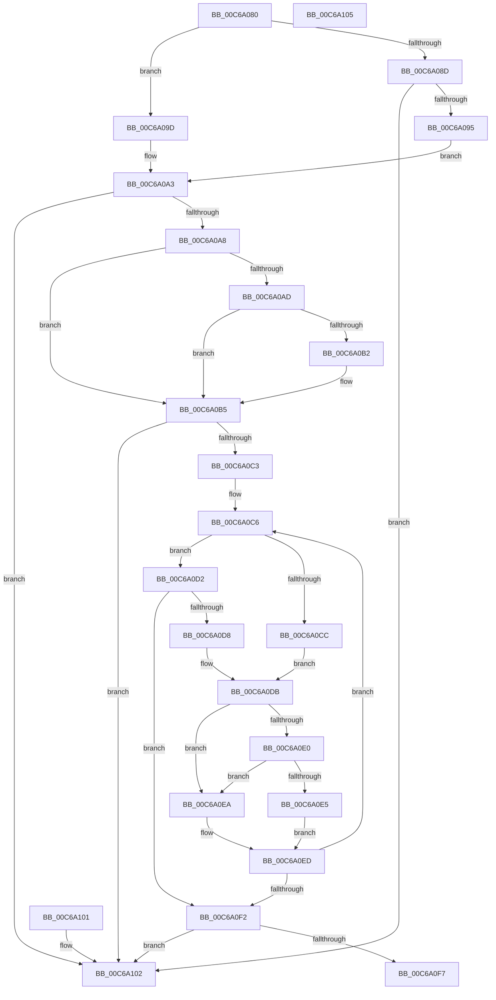

# MiUpdateSlabRangeTypeHelper

- RVA: `0x00C6A080`–`0x00C6A106` (길이 `134` bytes)
- VA: `0x0000000140C6A080`
- 실행 섹션: `INIT`
- PDB 이름 있음: `예`; PDB Function 태그: `아니요`
- unwind 정보 RVA: `0x000DB714`
- 디코드: `49`개 명령, `134/134` bytes 표시
- 미해석 바이트: `0` (있으면 어셈블리에 `.byte`로 보존)

> 이 문서는 커널 이미지의 기계어와 PDB 기호를 분석해 생성했습니다. 4번과 5번은 함수 원형과 자료형을 바이너리 사용 방식에서 추정한 C 해석이며 원본 소스 복구 결과는 아닙니다.

## 1. Dependencies

- 직접 호출 지점: **0**; 고유 호출 대상: **0**
- 직접 호출자로 확인된 함수: **0**
- RIP 상대 이미지 참조: **0**

### Outgoing calls
- 직접 디코드된 call 명령이 없습니다.

### Direct callers
- 이 함수 시작 RVA로 연결되는 직접 call은 확인되지 않았습니다. 간접 호출은 완전히 역산할 수 없습니다.

### Static image references
- 디코드된 RIP-relative 메모리 참조가 없습니다.

## 2. Other-region calls and transfers

- 다른 실행 섹션으로 향하는 call: **0**
- 별도 외부 분기/꼬리 이동을 확인하지 못했습니다.

## 3. Assembly (complete function range)

```asm
00C6A080  4C 8B 4A 08                     mov r9, qword ptr [rdx + 8]
00C6A084  4D 8B D0                        mov r10, r8
00C6A087  41 83 E1 01                     and r9d, 1
00C6A08B  74 10                           je 0x140c6a09d
00C6A08D  48 8B 02                        mov rax, qword ptr [rdx]
00C6A090  48 85 C0                        test rax, rax
00C6A093  74 6D                           je 0x140c6a102
00C6A095  48 8B C8                        mov rcx, rax
00C6A098  48 33 CA                        xor rcx, rdx
00C6A09B  EB 06                           jmp 0x140c6a0a3
00C6A09D  48 8B 0A                        mov rcx, qword ptr [rdx]
00C6A0A0  48 8B C1                        mov rax, rcx
00C6A0A3  48 85 C9                        test rcx, rcx
00C6A0A6  74 5A                           je 0x140c6a102
00C6A0A8  4D 85 C9                        test r9, r9
00C6A0AB  74 08                           je 0x140c6a0b5
00C6A0AD  48 85 C0                        test rax, rax
00C6A0B0  74 03                           je 0x140c6a0b5
00C6A0B2  48 33 C2                        xor rax, rdx
00C6A0B5  44 0F B6 42 08                  movzx r8d, byte ptr [rdx + 8]
00C6A0BA  41 83 E0 01                     and r8d, 1
00C6A0BE  48 85 C0                        test rax, rax
00C6A0C1  74 3F                           je 0x140c6a102
00C6A0C3  49 8B 12                        mov rdx, qword ptr [r10]
00C6A0C6  48 3B 50 30                     cmp rdx, qword ptr [rax + 0x30]
00C6A0CA  76 06                           jbe 0x140c6a0d2
00C6A0CC  48 8B 48 08                     mov rcx, qword ptr [rax + 8]
00C6A0D0  EB 09                           jmp 0x140c6a0db
00C6A0D2  48 3B 50 28                     cmp rdx, qword ptr [rax + 0x28]
00C6A0D6  73 1A                           jae 0x140c6a0f2
00C6A0D8  48 8B 08                        mov rcx, qword ptr [rax]
00C6A0DB  45 85 C0                        test r8d, r8d
00C6A0DE  74 0A                           je 0x140c6a0ea
00C6A0E0  48 85 C9                        test rcx, rcx
00C6A0E3  74 05                           je 0x140c6a0ea
00C6A0E5  48 33 C1                        xor rax, rcx
00C6A0E8  EB 03                           jmp 0x140c6a0ed
00C6A0EA  48 8B C1                        mov rax, rcx
00C6A0ED  48 85 C0                        test rax, rax
00C6A0F0  75 D4                           jne 0x140c6a0c6
00C6A0F2  48 85 C0                        test rax, rax
00C6A0F5  74 0B                           je 0x140c6a102
00C6A0F7  49 89 42 08                     mov qword ptr [r10 + 8], rax
00C6A0FB  B8 01 00 00 00                  mov eax, 1
00C6A100  C3                              ret
00C6A101  CC                              int3
00C6A102  33 C0                           xor eax, eax
00C6A104  C3                              ret
00C6A105  CC                              int3
```

## 4. C-style interpretation (structured pseudocode)

```c
__int64 __fastcall MiUpdateSlabRangeTypeHelper(__int64 a1, __int64 a2, __int64 a3)
{
    __int64 result;

    a4 = (unsigned int)((*(unsigned __int64 *)(a2 + 8)) & (1));
    if (condition_is_equal) goto loc_00C6A09D;
    if (*(unsigned __int64 *)(a2) == 0) goto loc_00C6A102;
    a1 = (*(unsigned __int64 *)(a2)) ^ (a2);
    goto loc_00C6A0A3;
loc_00C6A09D:
loc_00C6A0A3:
    if (*(unsigned __int64 *)(a2) == 0) goto loc_00C6A102;
    if (a4 == 0) goto loc_00C6A0B5;
    result = *(unsigned __int64 *)(a2);
    if (*(unsigned __int64 *)(a2) != 0) {
        result = (*(unsigned __int64 *)(a2)) ^ (a2);
    }
    a3 = (unsigned int)((*(unsigned __int8 *)(a2 + 8)) & (1));
    if (result == 0) goto loc_00C6A102;
loc_00C6A0C6:
    if ((*(unsigned __int64 *)(a3)) <= (*(unsigned __int64 *)(result + 48))) goto loc_00C6A0D2;
    goto loc_00C6A0DB;
loc_00C6A0D2:
    if ((*(unsigned __int64 *)(a3)) >= (*(unsigned __int64 *)(result + 40))) goto loc_00C6A0F2;
loc_00C6A0DB:
    if ((unsigned int)(a3) == 0) goto loc_00C6A0EA;
    if (*(unsigned __int64 *)(result) == 0) goto loc_00C6A0EA;
    result = (result) ^ (*(unsigned __int64 *)(result));
    goto loc_00C6A0ED;
loc_00C6A0EA:
loc_00C6A0ED:
    if (*(unsigned __int64 *)(result) != 0) goto loc_00C6A0C6;
loc_00C6A0F2:
    if (*(unsigned __int64 *)(result) == 0) goto loc_00C6A102;
    *(unsigned __int64 *)(a3 + 8) = *(unsigned __int64 *)(result);
    return 1;
loc_00C6A102:
    result = 0;
    return result;
}
```

## 5. (Beta) C Style

```c
int64_t MiUpdateSlabRangeTypeHelper(int64_t Arg1, void *Arg2, void *Arg3)
{
    uint8_t *arg2 = (uint8_t *)Arg2;
    uint8_t *arg3 = (uint8_t *)Arg3;

    int64_t result;

    a4 = (uint32_t)((*(uint64_t *)(arg2 + 0x8)) & (1));
    if (condition_is_equal) goto loc_00C6A09D;
    if (*(uint64_t *)(arg2) == 0) goto loc_00C6A102;
    Arg1 = (*(uint64_t *)(arg2)) ^ (Arg2);
    goto loc_00C6A0A3;
loc_00C6A09D:
loc_00C6A0A3:
    if (*(uint64_t *)(arg2) == 0) goto loc_00C6A102;
    if (a4 == 0) goto loc_00C6A0B5;
    result = *(uint64_t *)(arg2);
    if (*(uint64_t *)(arg2) != 0) {
        result = (*(uint64_t *)(arg2)) ^ (Arg2);
    }
    Arg3 = (uint32_t)((*(uint8_t *)(arg2 + 0x8)) & (1));
    if (result == 0) goto loc_00C6A102;
loc_00C6A0C6:
    if ((*(uint64_t *)(arg3)) <= (*(uint64_t *)(result + 0x30))) goto loc_00C6A0D2;
    goto loc_00C6A0DB;
loc_00C6A0D2:
    if ((*(uint64_t *)(arg3)) >= (*(uint64_t *)(result + 0x28))) goto loc_00C6A0F2;
loc_00C6A0DB:
    if ((uint32_t)(Arg3) == 0) goto loc_00C6A0EA;
    if (*(uint64_t *)(result) == 0) goto loc_00C6A0EA;
    result = (result) ^ (*(uint64_t *)(result));
    goto loc_00C6A0ED;
loc_00C6A0EA:
loc_00C6A0ED:
    if (*(uint64_t *)(result) != 0) goto loc_00C6A0C6;
loc_00C6A0F2:
    if (*(uint64_t *)(result) == 0) goto loc_00C6A102;
    *(uint64_t *)(arg3 + 0x8) = *(uint64_t *)(result);
    return 1;
loc_00C6A102:
    result = 0;
    return result;
}
```

### 관측된 메모리 오프셋

구조체 형식이 확인되지 않은 접근은 인자 기준의 오프셋으로만 기록했습니다.

| 기준 인자 | 오프셋 표현 | 폭 (bit) | 접근 |
|---|---:|---:|---|
| `Arg2` | `+ 0x0` | `64` | `R` |
| `Arg2` | `+ 0x8` | `8` | `R` |
| `Arg2` | `+ 0x8` | `64` | `R` |
| `Arg3` | `+ 0x0` | `64` | `R` |
| `Arg3` | `+ 0x8` | `64` | `W` |

## 6. Execution-region graph

[열기: 2D/3D 그래프와 함수 탐색 컨트롤 패널](../../../control-panel.html?section=init&rva=0x00C6A080&view=graph)

- 2D 그래프는 위에서 아래로 흐르고, 3D 그래프는 빈 공간을 드래그해 회전합니다. Shift+드래그는 이동, 휠은 확대·축소, 함수 노드 선택은 대상 보고서 이동입니다.

### Static fallback


