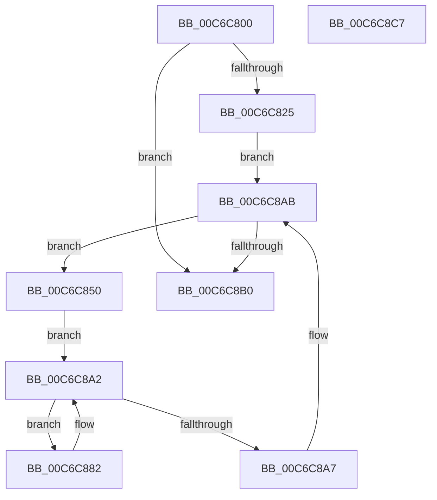

# MiValidateKernelHalLargePageRange

- RVA: `0x00C6C800`–`0x00C6C8C8` (길이 `200` bytes)
- VA: `0x0000000140C6C800`
- 실행 섹션: `INIT`
- PDB 이름 있음: `예`; PDB Function 태그: `아니요`
- unwind 정보 RVA: `0x0005C954`
- 디코드: `51`개 명령, `200/200` bytes 표시
- 미해석 바이트: `0` (있으면 어셈블리에 `.byte`로 보존)

> 이 문서는 커널 이미지의 기계어와 PDB 기호를 분석해 생성했습니다. 4번과 5번은 함수 원형과 자료형을 바이너리 사용 방식에서 추정한 C 해석이며 원본 소스 복구 결과는 아닙니다.

## 1. Dependencies

- 직접 호출 지점: **1**; 고유 호출 대상: **1**
- 직접 호출자로 확인된 함수: **0**
- RIP 상대 이미지 참조: **0**

### Outgoing calls
- `0x00C6C899` → [MiMarkPfnVerified](../../text/38/MiMarkPfnVerified_function_003833C4.md) (function, `0x003833C4`)

### Direct callers
- 이 함수 시작 RVA로 연결되는 직접 call은 확인되지 않았습니다. 간접 호출은 완전히 역산할 수 없습니다.

### Static image references
- 디코드된 RIP-relative 메모리 참조가 없습니다.

## 2. Other-region calls and transfers

- 다른 실행 섹션으로 향하는 call: **1**
  - `0x00C6C899` → [MiMarkPfnVerified](../../text/38/MiMarkPfnVerified_function_003833C4.md) (`INIT` → `.text`)
- 별도 외부 분기/꼬리 이동을 확인하지 못했습니다.

## 3. Assembly (complete function range)

```asm
00C6C800  48 89 5C 24 08                  mov qword ptr [rsp + 8], rbx
00C6C805  48 89 6C 24 10                  mov qword ptr [rsp + 0x10], rbp
00C6C80A  48 89 74 24 18                  mov qword ptr [rsp + 0x18], rsi
00C6C80F  57                              push rdi
00C6C810  48 83 EC 20                     sub rsp, 0x20
00C6C814  48 8B F2                        mov rsi, rdx
00C6C817  48 8B F9                        mov rdi, rcx
00C6C81A  41 0F BA E0 1D                  bt r8d, 0x1d
00C6C81F  0F 83 8B 00 00 00               jae 0x140c6c8b0
00C6C825  48 C1 EF 12                     shr rdi, 0x12
00C6C829  BA F8 FF FF 3F                  mov edx, 0x3ffffff8
00C6C82E  48 23 FA                        and rdi, rdx
00C6C831  48 B9 00 00 00 40 FB F6 FF FF   movabs rcx, 0xfffff6fb40000000
00C6C83B  48 8B C1                        mov rax, rcx
00C6C83E  48 C1 EE 12                     shr rsi, 0x12
00C6C842  48 03 F8                        add rdi, rax
00C6C845  48 23 F2                        and rsi, rdx
00C6C848  48 8B C1                        mov rax, rcx
00C6C84B  48 03 F0                        add rsi, rax
00C6C84E  EB 5B                           jmp 0x140c6c8ab
00C6C850  48 8B 07                        mov rax, qword ptr [rdi]
00C6C853  48 B9 FF FF FF FF FF 00 00 00   movabs rcx, 0xffffffffff
00C6C85D  48 C1 E8 0C                     shr rax, 0xc
00C6C861  48 23 C1                        and rax, rcx
00C6C864  48 8D 1C 40                     lea rbx, [rax + rax*2]
00C6C868  48 C1 E3 04                     shl rbx, 4
00C6C86C  48 B8 00 00 00 00 00 DE FF FF   movabs rax, 0xffffde0000000000
00C6C876  48 03 D8                        add rbx, rax
00C6C879  48 8D AB 00 60 00 00            lea rbp, [rbx + 0x6000]
00C6C880  EB 20                           jmp 0x140c6c8a2
00C6C882  48 8B 43 10                     mov rax, qword ptr [rbx + 0x10]
00C6C886  33 D2                           xor edx, edx
00C6C888  48 25 7F FC FF FF               and rax, 0xfffffffffffffc7f
00C6C88E  48 8B CB                        mov rcx, rbx
00C6C891  48 83 C8 60                     or rax, 0x60
00C6C895  48 89 43 10                     mov qword ptr [rbx + 0x10], rax
00C6C899  E8 26 6B 71 FF                  call 0x1403833c4
00C6C89E  48 83 C3 30                     add rbx, 0x30
00C6C8A2  48 3B DD                        cmp rbx, rbp
00C6C8A5  72 DB                           jb 0x140c6c882
00C6C8A7  48 83 C7 08                     add rdi, 8
00C6C8AB  48 3B FE                        cmp rdi, rsi
00C6C8AE  72 A0                           jb 0x140c6c850
00C6C8B0  48 8B 5C 24 30                  mov rbx, qword ptr [rsp + 0x30]
00C6C8B5  33 C0                           xor eax, eax
00C6C8B7  48 8B 6C 24 38                  mov rbp, qword ptr [rsp + 0x38]
00C6C8BC  48 8B 74 24 40                  mov rsi, qword ptr [rsp + 0x40]
00C6C8C1  48 83 C4 20                     add rsp, 0x20
00C6C8C5  5F                              pop rdi
00C6C8C6  C3                              ret
00C6C8C7  CC                              int3
```

## 4. C-style interpretation (structured pseudocode)

```c
__int64 __fastcall MiValidateKernelHalLargePageRange(__int64 a1, __int64 a2, int a3)
{
    __int64 result;
    __int64 v_rbx;
    __int64 v_rdi;
    __int64 v_rsi;
    __int64 v_rsp;
    unsigned __int64 v_stack_p10;
    unsigned __int64 v_stack_p18;
    unsigned __int64 v_stack_p8;

    v_stack_p8 = v_rbx;
    v_stack_p10 = v_rbp;
    v_stack_p18 = v_rsi;
    v_rsp = (v_rsp) - (32);
    if (condition_is_above_or_equal) goto loc_00C6C8B0;
    v_rdi = (a1) >> (18);
    v_rdi = (v_rdi) & ((unsigned int)(0x3FFFFFF8ULL));
    v_rsi = (a2) >> (18);
    v_rdi = (v_rdi) + (a1);
    v_rsi = (v_rsi) & ((unsigned int)(0x3FFFFFF8ULL));
    v_rsi = (v_rsi) + (a1);
    goto loc_00C6C8AB;
loc_00C6C850:
    result = (*(unsigned __int64 *)(v_rdi)) >> (12);
    result = (result) & (a1);
    v_rbx = (result + result * 2) << (4);
    v_rbx = (v_rbx) + (result);
    goto loc_00C6C8A2;
loc_00C6C882:
    a2 = 0;
    result = (*(unsigned __int64 *)(v_rbx + 16)) & (-897);
    result = (result) | (96);
    *(unsigned __int64 *)(v_rbx + 16) = result;
    result = MiMarkPfnVerified(v_rbx, a2, a3, a4);
    v_rbx = (v_rbx) + (48);
loc_00C6C8A2:
    if (v_rbx < (v_rbx + 24576)) goto loc_00C6C882;
    v_rdi = (v_rdi) + (8);
loc_00C6C8AB:
    if (v_rdi < v_rsi) goto loc_00C6C850;
loc_00C6C8B0:
    result = 0;
    v_rsp = (v_rsp) + (32);
    return result;
}
```

## 5. (Beta) C Style

```c
int64_t MiValidateKernelHalLargePageRange(int64_t Arg1, int64_t Arg2, int32_t Arg3)
{
    int64_t result;
    int64_t local_rbx;
    int64_t local_rdi;
    int64_t local_rsi;
    int64_t local_rsp;
    uint64_t v_stack_p10;
    uint64_t v_stack_p18;
    uint64_t v_stack_p8;

    v_stack_p8 = local_rbx;
    v_stack_p10 = local_rbp;
    v_stack_p18 = local_rsi;
    local_rsp = (local_rsp) - (32);
    if (condition_is_above_or_equal) goto loc_00C6C8B0;
    local_rdi = (Arg1) >> (18);
    local_rdi = (local_rdi) & ((uint32_t)(0x3FFFFFF8ULL));
    local_rsi = (Arg2) >> (18);
    local_rdi = (local_rdi) + (Arg1);
    local_rsi = (local_rsi) & ((uint32_t)(0x3FFFFFF8ULL));
    local_rsi = (local_rsi) + (Arg1);
    goto loc_00C6C8AB;
loc_00C6C850:
    result = (*(uint64_t *)(local_rdi)) >> (12);
    result = (result) & (Arg1);
    local_rbx = (result + result * 2) << (4);
    local_rbx = (local_rbx) + (result);
    goto loc_00C6C8A2;
loc_00C6C882:
    Arg2 = 0;
    result = (*(uint64_t *)(local_rbx + 0x10)) & (-897);
    result = (result) | (96);
    *(uint64_t *)(local_rbx + 0x10) = result;
    result = MiMarkPfnVerified(local_rbx, Arg2, Arg3, a4);
    local_rbx = (local_rbx) + (48);
loc_00C6C8A2:
    if (local_rbx < (local_rbx + 24576)) goto loc_00C6C882;
    local_rdi = (local_rdi) + (8);
loc_00C6C8AB:
    if (local_rdi < local_rsi) goto loc_00C6C850;
loc_00C6C8B0:
    result = 0;
    local_rsp = (local_rsp) + (32);
    return result;
}
```

## 6. Execution-region graph

[열기: 2D/3D 그래프와 함수 탐색 컨트롤 패널](../../../control-panel.html?section=init&rva=0x00C6C800&view=graph)

- 2D 그래프는 위에서 아래로 흐르고, 3D 그래프는 빈 공간을 드래그해 회전합니다. Shift+드래그는 이동, 휠은 확대·축소, 함수 노드 선택은 대상 보고서 이동입니다.

### Static fallback


