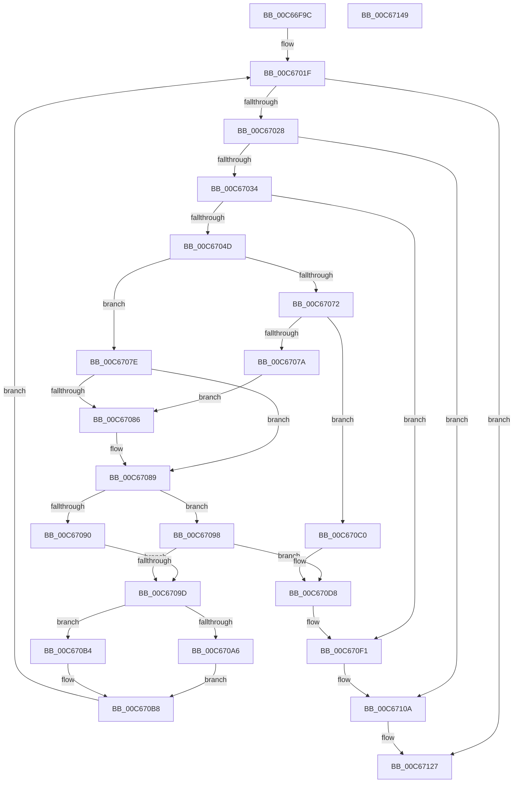

# MiVerifyLargeSectionLayout

- RVA: `0x00C66F9C`–`0x00C6714A` (길이 `430` bytes)
- VA: `0x0000000140C66F9C`
- 실행 섹션: `INIT`
- PDB 이름 있음: `예`; PDB Function 태그: `아니요`
- unwind 정보 RVA: `0x000601BC`
- 디코드: `116`개 명령, `430/430` bytes 표시
- 미해석 바이트: `0` (있으면 어셈블리에 `.byte`로 보존)

> 이 문서는 커널 이미지의 기계어와 PDB 기호를 분석해 생성했습니다. 4번과 5번은 함수 원형과 자료형을 바이너리 사용 방식에서 추정한 C 해석이며 원본 소스 복구 결과는 아닙니다.

## 1. Dependencies

- 직접 호출 지점: **6**; 고유 호출 대상: **3**
- 직접 호출자로 확인된 함수: **1**
- RIP 상대 이미지 참조: **1**

### Outgoing calls
- `0x00C66FE4` → [RtlImageNtHeaderEx](../../text/41/RtlImageNtHeaderEx_function_0041EAA0.md) (function, `0x0041EAA0`)
- `0x00C670D2` → [KeBugCheckEx](../../text/4F/KeBugCheckEx_function_004FD660.md) (function, `0x004FD660`)
- `0x00C670EB` → [KeBugCheckEx](../../text/4F/KeBugCheckEx_function_004FD660.md) (function, `0x004FD660`)
- `0x00C67104` → [KeBugCheckEx](../../text/4F/KeBugCheckEx_function_004FD660.md) (function, `0x004FD660`)
- `0x00C67121` → [KeBugCheckEx](../../text/4F/KeBugCheckEx_function_004FD660.md) (function, `0x004FD660`)
- `0x00C6712E` → [_security_check_cookie](../../text/6A/_security_check_cookie_function_006AC640.md) (function, `0x006AC640`)

### Direct callers
- [MiCheckLargePageOk](MiCheckLargePageOk_function_00C667E4.md) at `0x00C6689F`

### Static image references
- `0x00C66FB3` → RVA `0x00E0A740` (`.data`; read)

## 2. Other-region calls and transfers

- 다른 실행 섹션으로 향하는 call: **6**
  - `0x00C66FE4` → [RtlImageNtHeaderEx](../../text/41/RtlImageNtHeaderEx_function_0041EAA0.md) (`INIT` → `.text`)
  - `0x00C670D2` → [KeBugCheckEx](../../text/4F/KeBugCheckEx_function_004FD660.md) (`INIT` → `.text`)
  - `0x00C670EB` → [KeBugCheckEx](../../text/4F/KeBugCheckEx_function_004FD660.md) (`INIT` → `.text`)
  - `0x00C67104` → [KeBugCheckEx](../../text/4F/KeBugCheckEx_function_004FD660.md) (`INIT` → `.text`)
  - `0x00C67121` → [KeBugCheckEx](../../text/4F/KeBugCheckEx_function_004FD660.md) (`INIT` → `.text`)
  - `0x00C6712E` → [_security_check_cookie](../../text/6A/_security_check_cookie_function_006AC640.md) (`INIT` → `.text`)
- 별도 외부 분기/꼬리 이동을 확인하지 못했습니다.

## 3. Assembly (complete function range)

```asm
00C66F9C  48 89 5C 24 10                  mov qword ptr [rsp + 0x10], rbx
00C66FA1  48 89 74 24 18                  mov qword ptr [rsp + 0x18], rsi
00C66FA6  48 89 7C 24 20                  mov qword ptr [rsp + 0x20], rdi
00C66FAB  55                              push rbp
00C66FAC  48 8B EC                        mov rbp, rsp
00C66FAF  48 83 EC 70                     sub rsp, 0x70
00C66FB3  48 8B 05 86 37 1A 00            mov rax, qword ptr [rip + 0x1a3786]
00C66FBA  48 33 C4                        xor rax, rsp
00C66FBD  48 89 45 F0                     mov qword ptr [rbp - 0x10], rax
00C66FC1  48 83 65 D0 00                  and qword ptr [rbp - 0x30], 0
00C66FC6  4C 8D 4D C0                     lea r9, [rbp - 0x40]
00C66FCA  48 83 65 C0 00                  and qword ptr [rbp - 0x40], 0
00C66FCF  45 33 C0                        xor r8d, r8d
00C66FD2  48 8B D9                        mov rbx, rcx
00C66FD5  0F 57 C0                        xorps xmm0, xmm0
00C66FD8  48 8B D1                        mov rdx, rcx
00C66FDB  F3 0F 7F 45 DC                  movdqu xmmword ptr [rbp - 0x24], xmm0
00C66FE0  41 8D 48 01                     lea ecx, [r8 + 1]
00C66FE4  E8 B7 7A 7B FF                  call 0x14041eaa0
00C66FE9  48 8B 7D C0                     mov rdi, qword ptr [rbp - 0x40]
00C66FED  4C 8D 4D C8                     lea r9, [rbp - 0x38]
00C66FF1  33 C9                           xor ecx, ecx
00C66FF3  BE 00 00 00 40                  mov esi, 0x40000000
00C66FF8  0F 57 C0                        xorps xmm0, xmm0
00C66FFB  45 33 DB                        xor r11d, r11d
00C66FFE  44 0F B7 57 06                  movzx r10d, word ptr [rdi + 6]
00C67003  48 21 4D D0                     and qword ptr [rbp - 0x30], rcx
00C67007  48 21 4D C8                     and qword ptr [rbp - 0x38], rcx
00C6700B  F3 0F 7F 45 DC                  movdqu xmmword ptr [rbp - 0x24], xmm0
00C67010  89 75 EC                        mov dword ptr [rbp - 0x14], esi
00C67013  41 FF C2                        inc r10d
00C67016  8B 47 54                        mov eax, dword ptr [rdi + 0x54]
00C67019  89 45 D0                        mov dword ptr [rbp - 0x30], eax
00C6701C  89 45 D8                        mov dword ptr [rbp - 0x28], eax
00C6701F  45 85 D2                        test r10d, r10d
00C67022  0F 84 FF 00 00 00               je 0x140c67127
00C67028  41 8B 51 0C                     mov edx, dword ptr [r9 + 0xc]
00C6702C  3B CA                           cmp ecx, edx
00C6702E  0F 85 D6 00 00 00               jne 0x140c6710a
00C67034  41 8B 49 10                     mov ecx, dword ptr [r9 + 0x10]
00C67038  8B C1                           mov eax, ecx
00C6703A  45 8B 41 08                     mov r8d, dword ptr [r9 + 8]
00C6703E  41 3B C8                        cmp ecx, r8d
00C67041  41 0F 42 C0                     cmovb eax, r8d
00C67045  85 C0                           test eax, eax
00C67047  0F 84 A4 00 00 00               je 0x140c670f1
00C6704D  41 3B C8                        cmp ecx, r8d
00C67050  41 0F 42 C8                     cmovb ecx, r8d
00C67054  45 8B 41 24                     mov r8d, dword ptr [r9 + 0x24]
00C67058  81 C1 FF 0F 00 00               add ecx, 0xfff
00C6705E  41 8B C0                        mov eax, r8d
00C67061  81 E1 00 F0 FF FF               and ecx, 0xfffff000
00C67067  25 00 00 00 E0                  and eax, 0xe0000000
00C6706C  03 CA                           add ecx, edx
00C6706E  3B C6                           cmp eax, esi
00C67070  74 0C                           je 0x140c6707e
00C67072  F7 C2 FF FF 1F 00               test edx, 0x1fffff
00C67078  75 46                           jne 0x140c670c0
00C6707A  8B F0                           mov esi, eax
00C6707C  EB 08                           jmp 0x140c67086
00C6707E  F7 C2 FF FF 1F 00               test edx, 0x1fffff
00C67084  75 03                           jne 0x140c67089
00C67086  45 33 DB                        xor r11d, r11d
00C67089  41 0F BA E0 19                  bt r8d, 0x19
00C6708E  73 08                           jae 0x140c67098
00C67090  41 BB 01 00 00 00               mov r11d, 1
00C67096  EB 05                           jmp 0x140c6709d
00C67098  45 85 DB                        test r11d, r11d
00C6709B  75 3B                           jne 0x140c670d8
00C6709D  48 8D 45 C8                     lea rax, [rbp - 0x38]
00C670A1  4C 3B C8                        cmp r9, rax
00C670A4  75 0E                           jne 0x140c670b4
00C670A6  44 0F B7 4F 14                  movzx r9d, word ptr [rdi + 0x14]
00C670AB  49 83 C1 18                     add r9, 0x18
00C670AF  4C 03 CF                        add r9, rdi
00C670B2  EB 04                           jmp 0x140c670b8
00C670B4  49 83 C1 28                     add r9, 0x28
00C670B8  41 FF CA                        dec r10d
00C670BB  E9 5F FF FF FF                  jmp 0x140c6701f
00C670C0  48 89 54 24 20                  mov qword ptr [rsp + 0x20], rdx
00C670C5  4C 8B C3                        mov r8, rbx
00C670C8  BA 0C 03 03 03                  mov edx, 0x303030c
00C670CD  B9 1A 00 00 00                  mov ecx, 0x1a
00C670D2  E8 89 65 89 FF                  call 0x1404fd660
00C670D7  CC                              int3
00C670D8  48 83 64 24 20 00               and qword ptr [rsp + 0x20], 0
00C670DE  4C 8B C3                        mov r8, rbx
00C670E1  BA 0D 03 03 03                  mov edx, 0x303030d
00C670E6  B9 1A 00 00 00                  mov ecx, 0x1a
00C670EB  E8 70 65 89 FF                  call 0x1404fd660
00C670F0  CC                              int3
00C670F1  48 83 64 24 20 00               and qword ptr [rsp + 0x20], 0
00C670F7  4C 8B C3                        mov r8, rbx
00C670FA  BA 0B 03 03 03                  mov edx, 0x303030b
00C670FF  B9 1A 00 00 00                  mov ecx, 0x1a
00C67104  E8 57 65 89 FF                  call 0x1404fd660
00C67109  CC                              int3
00C6710A  8B C1                           mov eax, ecx
00C6710C  4C 8B CA                        mov r9, rdx
00C6710F  BA 0A 03 03 03                  mov edx, 0x303030a
00C67114  48 89 44 24 20                  mov qword ptr [rsp + 0x20], rax
00C67119  B9 1A 00 00 00                  mov ecx, 0x1a
00C6711E  4C 8B C3                        mov r8, rbx
00C67121  E8 3A 65 89 FF                  call 0x1404fd660
00C67126  CC                              int3
00C67127  48 8B 4D F0                     mov rcx, qword ptr [rbp - 0x10]
00C6712B  48 33 CC                        xor rcx, rsp
00C6712E  E8 0D 55 A4 FF                  call 0x1406ac640
00C67133  4C 8D 5C 24 70                  lea r11, [rsp + 0x70]
00C67138  49 8B 5B 18                     mov rbx, qword ptr [r11 + 0x18]
00C6713C  49 8B 73 20                     mov rsi, qword ptr [r11 + 0x20]
00C67140  49 8B 7B 28                     mov rdi, qword ptr [r11 + 0x28]
00C67144  49 8B E3                        mov rsp, r11
00C67147  5D                              pop rbp
00C67148  C3                              ret
00C67149  CC                              int3
```

## 4. C-style interpretation (structured pseudocode)

```c
__int64 __fastcall MiVerifyLargeSectionLayout(__int64 a1, __int64 a2, int a3)
{
    __int64 result;
    __int64 v_r10;
    __int64 v_r11;
    __int64 v_rsp;
    unsigned __int64 v_stack_m18;
    unsigned int v_stack_m1C;
    unsigned __int64 v_stack_m2C;
    unsigned int v_stack_m30;
    unsigned __int64 v_stack_m38;
    unsigned __int64 v_stack_m40;
    unsigned __int64 v_stack_m48;
    unsigned __int64 v_stack_m58;
    unsigned __int64 v_stack_m8;
    unsigned __int64 v_stack_p10;
    unsigned __int64 v_stack_p18;
    unsigned __int64 v_stack_p20;

    v_stack_p10 = v_rbx;
    v_stack_p18 = v_rsi;
    v_stack_p20 = v_rdi;
    v_rsp = (v_rsp) - (112);
    result = (*(unsigned __int64 *)(v_rip + 1718150)) ^ (v_rsp);
    v_stack_m18 = result;
    a3 = 0;
    v_stack_m2C = v_xmm0;
    result = RtlImageNtHeaderEx(a3 + 1, a1, a3, v_stack_m48);
    a1 = 0;
    v_r11 = 0;
    v_stack_m2C = v_xmm0;
    v_stack_m1C = (unsigned int)((unsigned int)(0x40000000ULL));
    v_r10 = (unsigned int)((*(unsigned __int16 *)(v_stack_m48 + 6)) + 1);
    v_stack_m38 = (unsigned int)((unsigned int)(*(unsigned int *)(v_stack_m48 + 84)));
    v_stack_m30 = (unsigned int)((unsigned int)(*(unsigned int *)(v_stack_m48 + 84)));
loc_00C6701F:
    if ((unsigned int)(v_r10) == 0) goto loc_00C67127;
    if (0 != ((unsigned int)((unsigned int)(*(unsigned int *)(v_stack_m40 + 12))))) goto loc_00C6710A;
    result = (unsigned int)((unsigned int)((unsigned int)(*(unsigned int *)(v_stack_m40 + 16))));
    if (((unsigned int)((unsigned int)(*(unsigned int *)(v_stack_m40 + 16)))) < ((unsigned int)((unsigned int)(*(unsigned int *)(v_stack_m40 + 8))))) { result = (unsigned int)((unsigned int)(*(unsigned int *)(v_stack_m40 + 8))); }
    if ((unsigned int)(result) == 0) goto loc_00C670F1;
    a1 = (unsigned int)(*(unsigned int *)(v_stack_m40 + 16));
    if (((unsigned int)((unsigned int)(*(unsigned int *)(v_stack_m40 + 16)))) < ((unsigned int)((unsigned int)(*(unsigned int *)(v_stack_m40 + 8))))) { a1 = (unsigned int)((unsigned int)(*(unsigned int *)(v_stack_m40 + 8))); }
    a1 = (unsigned int)((a1) + (0xFFFULL));
    a1 = (unsigned int)((a1) & (0xFFFFF000ULL));
    result = (unsigned int)(((unsigned int)((unsigned int)((unsigned int)(*(unsigned int *)(v_stack_m40 + 36))))) & (0xE0000000ULL));
    a1 = (unsigned int)((a1) + ((unsigned int)((unsigned int)(*(unsigned int *)(v_stack_m40 + 12)))));
    if (((unsigned int)(result)) == ((unsigned int)((unsigned int)(0x40000000ULL)))) goto loc_00C6707E;
    if ((((unsigned int)((unsigned int)(*(unsigned int *)(v_stack_m40 + 12)))) & (0x1FFFFFULL)) != 0) goto loc_00C670C0;
    goto loc_00C67086;
loc_00C6707E:
    if ((((unsigned int)((unsigned int)(*(unsigned int *)(v_stack_m40 + 12)))) & (0x1FFFFFULL)) == 0) {
        v_r11 = 0;
    }
    if (condition_is_above_or_equal) goto loc_00C67098;
    goto loc_00C6709D;
loc_00C67098:
    if (1 != 0) goto loc_00C670D8;
loc_00C6709D:
    if (v_stack_m40 != v_stack_m40) goto loc_00C670B4;
    a4 = (*(unsigned __int16 *)(v_stack_m48 + 20)) + (24);
    a4 = (a4) + (v_stack_m48);
    goto loc_00C670B8;
loc_00C670B4:
    a4 = (a4) + (40);
loc_00C670B8:
    v_r10 = (unsigned int)((v_r10) - 1);
    goto loc_00C6701F;
loc_00C670C0:
    v_stack_m58 = (unsigned int)(*(unsigned int *)(v_stack_m40 + 12));
    result = KeBugCheckEx(26, (unsigned int)(0x303030CULL), a1, a4);
loc_00C670D8:
    result = KeBugCheckEx(26, (unsigned int)(0x303030DULL), a1, a4);
loc_00C670F1:
    result = KeBugCheckEx(26, (unsigned int)(0x303030BULL), a1, a4);
loc_00C6710A:
    v_stack_m58 = 26;
    result = KeBugCheckEx(26, (unsigned int)(0x303030AULL), a1, (unsigned int)(0x303030BULL));
loc_00C67127:
    a1 = (v_stack_m18) ^ (v_rsp);
    result = _security_check_cookie(a1, (unsigned int)(0x303030AULL), a1, (unsigned int)(0x303030BULL));
    return result;
}
```

## 5. (Beta) C Style

```c
int64_t MiVerifyLargeSectionLayout(int64_t Arg1, int64_t Arg2, int32_t Arg3)
{
    int64_t result;
    int64_t local_r10;
    int64_t local_r11;
    int64_t local_rsp;
    uint64_t v_stack_m18;
    uint32_t v_stack_m1C;
    uint64_t v_stack_m2C;
    uint32_t v_stack_m30;
    uint64_t v_stack_m38;
    uint64_t v_stack_m40;
    uint64_t v_stack_m48;
    uint64_t v_stack_m58;
    uint64_t v_stack_m8;
    uint64_t v_stack_p10;
    uint64_t v_stack_p18;
    uint64_t v_stack_p20;

    v_stack_p10 = local_rbx;
    v_stack_p18 = local_rsi;
    v_stack_p20 = local_rdi;
    local_rsp = (local_rsp) - (112);
    result = (*(uint64_t *)(v_rip + 0x1A3786)) ^ (local_rsp);
    v_stack_m18 = result;
    Arg3 = 0;
    v_stack_m2C = v_xmm0;
    result = RtlImageNtHeaderEx(Arg3 + 1, Arg1, Arg3, v_stack_m48);
    Arg1 = 0;
    local_r11 = 0;
    v_stack_m2C = v_xmm0;
    v_stack_m1C = (uint32_t)((uint32_t)(0x40000000ULL));
    local_r10 = (uint32_t)((*(uint16_t *)(v_stack_m48 + 0x6)) + 1);
    v_stack_m38 = (uint32_t)((uint32_t)(*(uint32_t *)(v_stack_m48 + 0x54)));
    v_stack_m30 = (uint32_t)((uint32_t)(*(uint32_t *)(v_stack_m48 + 0x54)));
loc_00C6701F:
    if ((uint32_t)(local_r10) == 0) goto loc_00C67127;
    if (0 != ((uint32_t)((uint32_t)(*(uint32_t *)(v_stack_m40 + 0xC))))) goto loc_00C6710A;
    result = (uint32_t)((uint32_t)((uint32_t)(*(uint32_t *)(v_stack_m40 + 0x10))));
    if (((uint32_t)((uint32_t)(*(uint32_t *)(v_stack_m40 + 0x10)))) < ((uint32_t)((uint32_t)(*(uint32_t *)(v_stack_m40 + 0x8))))) { result = (uint32_t)((uint32_t)(*(uint32_t *)(v_stack_m40 + 0x8))); }
    if ((uint32_t)(result) == 0) goto loc_00C670F1;
    Arg1 = (uint32_t)(*(uint32_t *)(v_stack_m40 + 0x10));
    if (((uint32_t)((uint32_t)(*(uint32_t *)(v_stack_m40 + 0x10)))) < ((uint32_t)((uint32_t)(*(uint32_t *)(v_stack_m40 + 0x8))))) { Arg1 = (uint32_t)((uint32_t)(*(uint32_t *)(v_stack_m40 + 0x8))); }
    Arg1 = (uint32_t)((Arg1) + (0xFFFULL));
    Arg1 = (uint32_t)((Arg1) & (0xFFFFF000ULL));
    result = (uint32_t)(((uint32_t)((uint32_t)((uint32_t)(*(uint32_t *)(v_stack_m40 + 0x24))))) & (0xE0000000ULL));
    Arg1 = (uint32_t)((Arg1) + ((uint32_t)((uint32_t)(*(uint32_t *)(v_stack_m40 + 0xC)))));
    if (((uint32_t)(result)) == ((uint32_t)((uint32_t)(0x40000000ULL)))) goto loc_00C6707E;
    if ((((uint32_t)((uint32_t)(*(uint32_t *)(v_stack_m40 + 0xC)))) & (0x1FFFFFULL)) != 0) goto loc_00C670C0;
    goto loc_00C67086;
loc_00C6707E:
    if ((((uint32_t)((uint32_t)(*(uint32_t *)(v_stack_m40 + 0xC)))) & (0x1FFFFFULL)) == 0) {
        local_r11 = 0;
    }
    if (condition_is_above_or_equal) goto loc_00C67098;
    goto loc_00C6709D;
loc_00C67098:
    if (1 != 0) goto loc_00C670D8;
loc_00C6709D:
    if (v_stack_m40 != v_stack_m40) goto loc_00C670B4;
    a4 = (*(uint16_t *)(v_stack_m48 + 0x14)) + (24);
    a4 = (a4) + (v_stack_m48);
    goto loc_00C670B8;
loc_00C670B4:
    a4 = (a4) + (40);
loc_00C670B8:
    local_r10 = (uint32_t)((local_r10) - 1);
    goto loc_00C6701F;
loc_00C670C0:
    v_stack_m58 = (uint32_t)(*(uint32_t *)(v_stack_m40 + 0xC));
    result = KeBugCheckEx(26, (uint32_t)(0x303030CULL), Arg1, a4);
loc_00C670D8:
    result = KeBugCheckEx(26, (uint32_t)(0x303030DULL), Arg1, a4);
loc_00C670F1:
    result = KeBugCheckEx(26, (uint32_t)(0x303030BULL), Arg1, a4);
loc_00C6710A:
    v_stack_m58 = 26;
    result = KeBugCheckEx(26, (uint32_t)(0x303030AULL), Arg1, (uint32_t)(0x303030BULL));
loc_00C67127:
    Arg1 = (v_stack_m18) ^ (local_rsp);
    result = _security_check_cookie(Arg1, (uint32_t)(0x303030AULL), Arg1, (uint32_t)(0x303030BULL));
    return result;
}
```

## 6. Execution-region graph

[열기: 2D/3D 그래프와 함수 탐색 컨트롤 패널](../../../control-panel.html?section=init&rva=0x00C66F9C&view=graph)

- 2D 그래프는 위에서 아래로 흐르고, 3D 그래프는 빈 공간을 드래그해 회전합니다. Shift+드래그는 이동, 휠은 확대·축소, 함수 노드 선택은 대상 보고서 이동입니다.

### Static fallback


