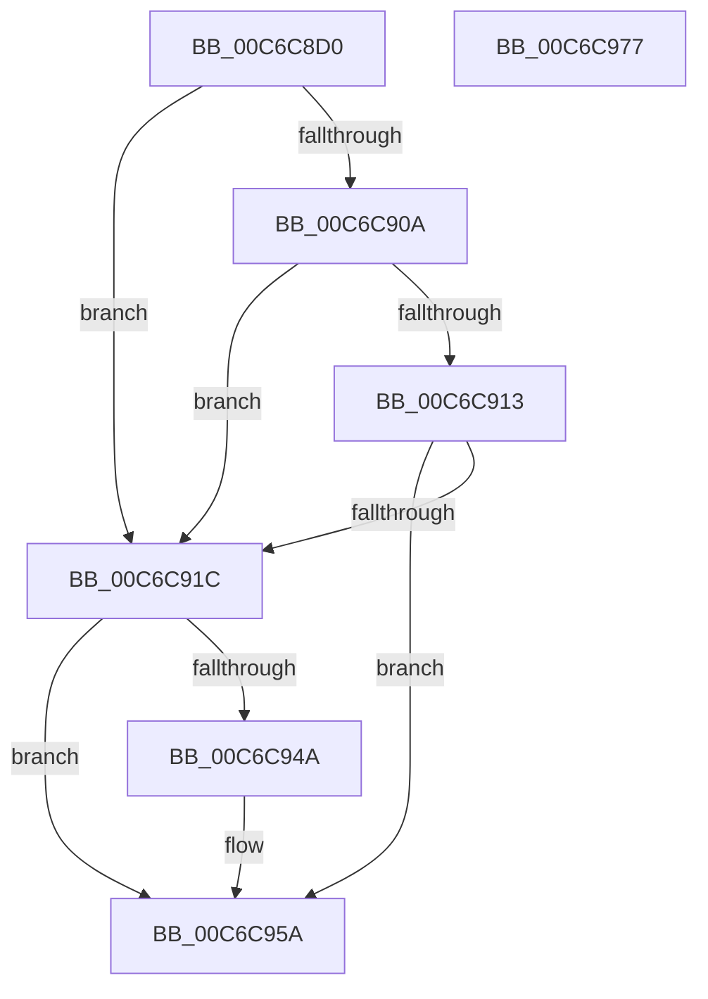

# MmDiscardDriverSection

- RVA: `0x00C6C8D0`–`0x00C6C978` (길이 `168` bytes)
- VA: `0x0000000140C6C8D0`
- 실행 섹션: `INIT`
- PDB 이름 있음: `예`; PDB Function 태그: `아니요`
- unwind 정보 RVA: `0x000C3DF4`
- 디코드: `45`개 명령, `168/168` bytes 표시
- 미해석 바이트: `0` (있으면 어셈블리에 `.byte`로 보존)

> 이 문서는 커널 이미지의 기계어와 PDB 기호를 분석해 생성했습니다. 4번과 5번은 함수 원형과 자료형을 바이너리 사용 방식에서 추정한 C 해석이며 원본 소스 복구 결과는 아닙니다.

## 1. Dependencies

- 직접 호출 지점: **5**; 고유 호출 대상: **5**
- 직접 호출자로 확인된 함수: **1**
- RIP 상대 이미지 참조: **2**

### Outgoing calls
- `0x00C6C8F2` → [MiLockLoadedDataTableEntry](../../text/2A/MiLockLoadedDataTableEntry_function_002A38F4.md) (function, `0x002A38F4`)
- `0x00C6C901` → [MI_IS_PHYSICAL_ADDRESS](../../text/23/MI_IS_PHYSICAL_ADDRESS_function_0023B3A0.md) (function, `0x0023B3A0`)
- `0x00C6C93B` → [MiSnapDriverRange](../../page/A4/MiSnapDriverRange_function_00A4B328.md) (function, `0x00A4B328`)
- `0x00C6C955` → [MiFreeInitializationCode](../../page/7F/MiFreeInitializationCode_function_007F88A0.md) (function, `0x007F88A0`)
- `0x00C6C962` → [MiUnlockLoadedDataTableEntry](../../text/2A/MiUnlockLoadedDataTableEntry_function_002A385C.md) (function, `0x002A385C`)

### Direct callers
- [KeFreeInitializationCode](../BE/KeFreeInitializationCode_function_00BEFB10.md) at `0x00BEFB36`

### Static image references
- `0x00C6C90A` → RVA `0x00FC6B28` (`ALMOSTRO`; read)
- `0x00C6C913` → RVA `0x00FC6B98` (`ALMOSTRO`; read)

## 2. Other-region calls and transfers

- 다른 실행 섹션으로 향하는 call: **5**
  - `0x00C6C8F2` → [MiLockLoadedDataTableEntry](../../text/2A/MiLockLoadedDataTableEntry_function_002A38F4.md) (`INIT` → `.text`)
  - `0x00C6C901` → [MI_IS_PHYSICAL_ADDRESS](../../text/23/MI_IS_PHYSICAL_ADDRESS_function_0023B3A0.md) (`INIT` → `.text`)
  - `0x00C6C93B` → [MiSnapDriverRange](../../page/A4/MiSnapDriverRange_function_00A4B328.md) (`INIT` → `PAGE`)
  - `0x00C6C955` → [MiFreeInitializationCode](../../page/7F/MiFreeInitializationCode_function_007F88A0.md) (`INIT` → `PAGE`)
  - `0x00C6C962` → [MiUnlockLoadedDataTableEntry](../../text/2A/MiUnlockLoadedDataTableEntry_function_002A385C.md) (`INIT` → `.text`)
- 별도 외부 분기/꼬리 이동을 확인하지 못했습니다.

## 3. Assembly (complete function range)

```asm
00C6C8D0  48 8B C4                        mov rax, rsp
00C6C8D3  48 89 58 08                     mov qword ptr [rax + 8], rbx
00C6C8D7  48 89 70 20                     mov qword ptr [rax + 0x20], rsi
00C6C8DB  57                              push rdi
00C6C8DC  48 83 EC 30                     sub rsp, 0x30
00C6C8E0  48 83 60 18 00                  and qword ptr [rax + 0x18], 0
00C6C8E5  BA 01 00 00 00                  mov edx, 1
00C6C8EA  48 83 60 10 00                  and qword ptr [rax + 0x10], 0
00C6C8EF  48 8B F1                        mov rsi, rcx
00C6C8F2  E8 FD 6F 63 FF                  call 0x1402a38f4
00C6C8F7  48 8B D8                        mov rbx, rax
00C6C8FA  48 8B 78 30                     mov rdi, qword ptr [rax + 0x30]
00C6C8FE  48 8B CF                        mov rcx, rdi
00C6C901  E8 9A EA 5C FF                  call 0x14023b3a0
00C6C906  85 C0                           test eax, eax
00C6C908  74 12                           je 0x140c6c91c
00C6C90A  48 3B 3D 17 A2 35 00            cmp rdi, qword ptr [rip + 0x35a217]
00C6C911  74 09                           je 0x140c6c91c
00C6C913  48 3B 3D 7E A2 35 00            cmp rdi, qword ptr [rip + 0x35a27e]
00C6C91A  75 3E                           jne 0x140c6c95a
00C6C91C  48 8D 44 24 50                  lea rax, [rsp + 0x50]
00C6C921  4C 8B CE                        mov r9, rsi
00C6C924  48 89 44 24 28                  mov qword ptr [rsp + 0x28], rax
00C6C929  45 33 C0                        xor r8d, r8d
00C6C92C  48 8D 44 24 48                  lea rax, [rsp + 0x48]
00C6C931  33 D2                           xor edx, edx
00C6C933  48 8B CB                        mov rcx, rbx
00C6C936  48 89 44 24 20                  mov qword ptr [rsp + 0x20], rax
00C6C93B  E8 E8 E9 DD FF                  call 0x140a4b328
00C6C940  48 8B 54 24 48                  mov rdx, qword ptr [rsp + 0x48]
00C6C945  48 85 D2                        test rdx, rdx
00C6C948  74 10                           je 0x140c6c95a
00C6C94A  4C 8B 44 24 50                  mov r8, qword ptr [rsp + 0x50]
00C6C94F  45 33 C9                        xor r9d, r9d
00C6C952  48 8B CB                        mov rcx, rbx
00C6C955  E8 46 BF B8 FF                  call 0x1407f88a0
00C6C95A  BA 01 00 00 00                  mov edx, 1
00C6C95F  48 8B CB                        mov rcx, rbx
00C6C962  E8 F5 6E 63 FF                  call 0x1402a385c
00C6C967  48 8B 5C 24 40                  mov rbx, qword ptr [rsp + 0x40]
00C6C96C  48 8B 74 24 58                  mov rsi, qword ptr [rsp + 0x58]
00C6C971  48 83 C4 30                     add rsp, 0x30
00C6C975  5F                              pop rdi
00C6C976  C3                              ret
00C6C977  CC                              int3
```

## 4. C-style interpretation (structured pseudocode)

```c
__int64 __fastcall MmDiscardDriverSection(__int64 a1, __int64 a2, int a3)
{
    __int64 result;
    __int64 v_rsp;
    unsigned __int64 v_stack_m10;
    unsigned __int64 v_stack_m18;
    unsigned __int64 v_stack_p10;
    unsigned __int64 v_stack_p18;
    unsigned __int64 v_stack_p20;
    unsigned __int64 v_stack_p8;

    *(unsigned __int64 *)(v_rsp + 8) = v_rbx;
    *(unsigned __int64 *)(v_rsp + 32) = v_rsi;
    v_rsp = (v_rsp) - (48);
    result = MiLockLoadedDataTableEntry(a1, 1, a3, a4);
    result = MI_IS_PHYSICAL_ADDRESS(*(unsigned __int64 *)(result + 48), 1, a3, a4);
    if ((unsigned int)(result) == 0) goto loc_00C6C91C;
    if ((*(unsigned __int64 *)(result + 48)) == (*(unsigned __int64 *)(v_rip + 3514903))) goto loc_00C6C91C;
    if ((*(unsigned __int64 *)(result + 48)) != (*(unsigned __int64 *)(v_rip + 3515006))) goto loc_00C6C95A;
loc_00C6C91C:
    v_stack_m10 = v_stack_p18;
    a3 = 0;
    a2 = 0;
    v_stack_m18 = v_stack_p10;
    result = MiSnapDriverRange(result, a2, a3, a1);
    if (v_stack_p10 != 0) {
        a3 = v_stack_p18;
        a4 = 0;
        a1 = result;
        result = MiFreeInitializationCode(a1, v_stack_p10, a3, a4);
    }
    result = MiUnlockLoadedDataTableEntry(result, 1, a3, a4);
    v_rsp = (v_rsp) + (48);
    return result;
}
```

## 5. (Beta) C Style

```c
int64_t MmDiscardDriverSection(int64_t Arg1, int64_t Arg2, int32_t Arg3)
{
    int64_t result;
    int64_t local_rsp;
    uint64_t v_stack_m10;
    uint64_t v_stack_m18;
    uint64_t v_stack_p10;
    uint64_t v_stack_p18;
    uint64_t v_stack_p20;
    uint64_t v_stack_p8;

    *(uint64_t *)(local_rsp + 0x8) = local_rbx;
    *(uint64_t *)(local_rsp + 0x20) = local_rsi;
    local_rsp = (local_rsp) - (48);
    result = MiLockLoadedDataTableEntry(Arg1, 1, Arg3, a4);
    result = MI_IS_PHYSICAL_ADDRESS(*(uint64_t *)(result + 0x30), 1, Arg3, a4);
    if ((uint32_t)(result) == 0) goto loc_00C6C91C;
    if ((*(uint64_t *)(result + 0x30)) == (*(uint64_t *)(v_rip + 0x35A217))) goto loc_00C6C91C;
    if ((*(uint64_t *)(result + 0x30)) != (*(uint64_t *)(v_rip + 0x35A27E))) goto loc_00C6C95A;
loc_00C6C91C:
    v_stack_m10 = v_stack_p18;
    Arg3 = 0;
    Arg2 = 0;
    v_stack_m18 = v_stack_p10;
    result = MiSnapDriverRange(result, Arg2, Arg3, Arg1);
    if (v_stack_p10 != 0) {
        Arg3 = v_stack_p18;
        a4 = 0;
        Arg1 = result;
        result = MiFreeInitializationCode(Arg1, v_stack_p10, Arg3, a4);
    }
    result = MiUnlockLoadedDataTableEntry(result, 1, Arg3, a4);
    local_rsp = (local_rsp) + (48);
    return result;
}
```

## 6. Execution-region graph

[열기: 2D/3D 그래프와 함수 탐색 컨트롤 패널](../../../control-panel.html?section=init&rva=0x00C6C8D0&view=graph)

- 2D 그래프는 위에서 아래로 흐르고, 3D 그래프는 빈 공간을 드래그해 회전합니다. Shift+드래그는 이동, 휠은 확대·축소, 함수 노드 선택은 대상 보고서 이동입니다.

### Static fallback


