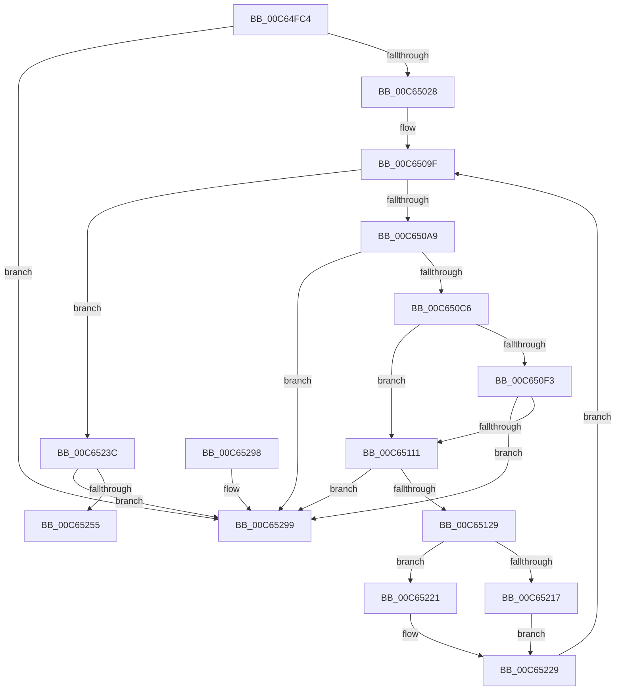

# MmInitializeImageViewExtensionCfg

- RVA: `0x00C64FC4`–`0x00C652A4` (길이 `736` bytes)
- VA: `0x0000000140C64FC4`
- 실행 섹션: `INIT`
- PDB 이름 있음: `예`; PDB Function 태그: `아니요`
- unwind 정보 RVA: `0x000D7F6C`
- 디코드: `174`개 명령, `736/736` bytes 표시
- 미해석 바이트: `0` (있으면 어셈블리에 `.byte`로 보존)

> 이 문서는 커널 이미지의 기계어와 PDB 기호를 분석해 생성했습니다. 4번과 5번은 함수 원형과 자료형을 바이너리 사용 방식에서 추정한 C 해석이며 원본 소스 복구 결과는 아닙니다.

## 1. Dependencies

- 직접 호출 지점: **17**; 고유 호출 대상: **17**
- 직접 호출자로 확인된 함수: **1**
- RIP 상대 이미지 참조: **6**

### Outgoing calls
- `0x00C65017` → [MiReservePtes](../../text/31/MiReservePtes_function_00318D20.md) (function, `0x00318D20`)
- `0x00C65054` → [MiInitializePageColorBase](../../text/32/MiInitializePageColorBase_function_00320410.md) (function, `0x00320410`)
- `0x00C650B9` → [MiAcquireNonPagedResources](../../text/28/MiAcquireNonPagedResources_function_00286C60.md) (function, `0x00286C60`)
- `0x00C650E5` → [MiGetSlabPage](../../text/37/MiGetSlabPage_function_00376FBC.md) (function, `0x00376FBC`)
- `0x00C650FF` → [MiGetPage](../../text/28/MiGetPage_function_002884C0.md) (function, `0x002884C0`)
- `0x00C65118` → [MiAllocateCombineBlock](../../text/31/MiAllocateCombineBlock_function_00317294.md) (function, `0x00317294`)
- `0x00C65132` → [memset](../../text/6C/memset_function_006C6C40.md) (function, `0x006C6C40`)
- `0x00C6514F` → [MiLockPageInline](../../text/31/MiLockPageInline_function_0031A340.md) (function, `0x0031A340`)
- `0x00C6516B` → [MiInitializePfn](../../text/33/MiInitializePfn_function_00331E60.md) (function, `0x00331E60`)
- `0x00C65191` → [MiMakeValidPte](../../text/2C/MiMakeValidPte_function_002C5590.md) (function, `0x002C5590`)
- `0x00C651B6` → [MiDecrementShareCountEx](../../text/33/MiDecrementShareCountEx_function_00333F70.md) (function, `0x00333F70`)
- `0x00C651C1` → [MiUnlockPage](../../text/31/MiUnlockPage_function_0031A3E0.md) (function, `0x0031A3E0`)
- `0x00C65203` → [MiMapSinglePage](../../text/22/MiMapSinglePage_function_00229D00.md) (function, `0x00229D00`)
- `0x00C6524C` → [PsInitializeScpCfgPages](../C4/PsInitializeScpCfgPages_function_00C46EEC.md) (function, `0x00C46EEC`)
- `0x00C65265` → [MiReleasePtes](../../text/24/MiReleasePtes_function_00247240.md) (function, `0x00247240`)
- `0x00C65272` → [_security_check_cookie](../../text/6A/_security_check_cookie_function_006AC640.md) (function, `0x006AC640`)
- `0x00C6529E` → [MxInstallMoreMemory](../../text/67/MxInstallMoreMemory_function_00671A04.md) (function, `0x00671A04`)

### Direct callers
- [MmInitializeImageViewExtension](MmInitializeImageViewExtension_function_00C64F08.md) at `0x00C64FA5`

### Static image references
- `0x00C64FE3` → RVA `0x00E0A740` (`.data`; read)
- `0x00C64FFC` → RVA `0x00E37668` (`.data`; read)
- `0x00C6506F` → RVA `0x00E2CB40` (`.data`; read)
- `0x00C650AC` → RVA `0x00E38D00` (`.data`; read)
- `0x00C65111` → RVA `0x00E3CF58` (`.data`; read)
- `0x00C6523C` → RVA `0x00E2DB88` (`.data`; read)

## 2. Other-region calls and transfers

- 다른 실행 섹션으로 향하는 call: **16**
  - `0x00C65017` → [MiReservePtes](../../text/31/MiReservePtes_function_00318D20.md) (`INIT` → `.text`)
  - `0x00C65054` → [MiInitializePageColorBase](../../text/32/MiInitializePageColorBase_function_00320410.md) (`INIT` → `.text`)
  - `0x00C650B9` → [MiAcquireNonPagedResources](../../text/28/MiAcquireNonPagedResources_function_00286C60.md) (`INIT` → `.text`)
  - `0x00C650E5` → [MiGetSlabPage](../../text/37/MiGetSlabPage_function_00376FBC.md) (`INIT` → `.text`)
  - `0x00C650FF` → [MiGetPage](../../text/28/MiGetPage_function_002884C0.md) (`INIT` → `.text`)
  - `0x00C65118` → [MiAllocateCombineBlock](../../text/31/MiAllocateCombineBlock_function_00317294.md) (`INIT` → `.text`)
  - `0x00C65132` → [memset](../../text/6C/memset_function_006C6C40.md) (`INIT` → `.text`)
  - `0x00C6514F` → [MiLockPageInline](../../text/31/MiLockPageInline_function_0031A340.md) (`INIT` → `.text`)
  - `0x00C6516B` → [MiInitializePfn](../../text/33/MiInitializePfn_function_00331E60.md) (`INIT` → `.text`)
  - `0x00C65191` → [MiMakeValidPte](../../text/2C/MiMakeValidPte_function_002C5590.md) (`INIT` → `.text`)
  - `0x00C651B6` → [MiDecrementShareCountEx](../../text/33/MiDecrementShareCountEx_function_00333F70.md) (`INIT` → `.text`)
  - `0x00C651C1` → [MiUnlockPage](../../text/31/MiUnlockPage_function_0031A3E0.md) (`INIT` → `.text`)
  - `0x00C65203` → [MiMapSinglePage](../../text/22/MiMapSinglePage_function_00229D00.md) (`INIT` → `.text`)
  - `0x00C65265` → [MiReleasePtes](../../text/24/MiReleasePtes_function_00247240.md) (`INIT` → `.text`)
  - `0x00C65272` → [_security_check_cookie](../../text/6A/_security_check_cookie_function_006AC640.md) (`INIT` → `.text`)
  - `0x00C6529E` → [MxInstallMoreMemory](../../text/67/MxInstallMoreMemory_function_00671A04.md) (`INIT` → `.text`)
- 별도 외부 분기/꼬리 이동을 확인하지 못했습니다.

## 3. Assembly (complete function range)

```asm
00C64FC4  48 89 5C 24 08                  mov qword ptr [rsp + 8], rbx
00C64FC9  48 89 6C 24 10                  mov qword ptr [rsp + 0x10], rbp
00C64FCE  48 89 74 24 18                  mov qword ptr [rsp + 0x18], rsi
00C64FD3  57                              push rdi
00C64FD4  41 54                           push r12
00C64FD6  41 55                           push r13
00C64FD8  41 56                           push r14
00C64FDA  41 57                           push r15
00C64FDC  48 81 EC 80 00 00 00            sub rsp, 0x80
00C64FE3  48 8B 05 56 57 1A 00            mov rax, qword ptr [rip + 0x1a5756]
00C64FEA  48 33 C4                        xor rax, rsp
00C64FED  48 89 44 24 78                  mov qword ptr [rsp + 0x78], rax
00C64FF2  0F 57 C9                        xorps xmm1, xmm1
00C64FF5  88 4C 24 30                     mov byte ptr [rsp + 0x30], cl
00C64FF9  0F 57 C0                        xorps xmm0, xmm0
00C64FFC  48 8D 0D 65 26 1D 00            lea rcx, [rip + 0x1d2665]
00C65003  BA 04 00 00 00                  mov edx, 4
00C65008  0F 11 44 24 48                  movups xmmword ptr [rsp + 0x48], xmm0
00C6500D  0F 11 4C 24 58                  movups xmmword ptr [rsp + 0x58], xmm1
00C65012  0F 11 4C 24 68                  movups xmmword ptr [rsp + 0x68], xmm1
00C65017  E8 04 3D 6B FF                  call 0x140318d20
00C6501C  4C 8B E8                        mov r13, rax
00C6501F  48 85 C0                        test rax, rax
00C65022  0F 84 71 02 00 00               je 0x140c65299
00C65028  48 C1 E0 19                     shl rax, 0x19
00C6502C  48 B9 00 00 00 00 80 F6 FF FF   movabs rcx, 0xfffff68000000000
00C65036  48 C1 E1 19                     shl rcx, 0x19
00C6503A  4C 8D 4C 24 48                  lea r9, [rsp + 0x48]
00C6503F  48 2B C1                        sub rax, rcx
00C65042  45 33 C0                        xor r8d, r8d
00C65045  48 C1 F8 10                     sar rax, 0x10
00C65049  33 C9                           xor ecx, ecx
00C6504B  48 89 44 24 40                  mov qword ptr [rsp + 0x40], rax
00C65050  41 8D 50 03                     lea edx, [r8 + 3]
00C65054  E8 B7 B3 6B FF                  call 0x140320410
00C65059  4C 8B 4C 24 48                  mov r9, qword ptr [rsp + 0x48]
00C6505E  BE 01 00 00 00                  mov esi, 1
00C65063  8B C6                           mov eax, esi
00C65065  F0 41 0F C1 01                  lock xadd dword ptr [r9], eax
00C6506A  4C 8B 44 24 50                  mov r8, qword ptr [rsp + 0x50]
00C6506F  4C 8D 0D CA 7A 1C 00            lea r9, [rip + 0x1c7aca]
00C65076  83 64 24 38 00                  and dword ptr [rsp + 0x38], 0
00C6507B  33 D2                           xor edx, edx
00C6507D  49 8B C8                        mov rcx, r8
00C65080  48 C1 E9 10                     shr rcx, 0x10
00C65084  83 E1 03                        and ecx, 3
00C65087  41 F7 B4 89 80 11 00 00         div dword ptr [r9 + rcx*4 + 0x1180]
00C6508F  8A 44 24 30                     mov al, byte ptr [rsp + 0x30]
00C65093  41 33 D0                        xor edx, r8d
00C65096  0F B6 DA                        movzx ebx, dl
00C65099  41 33 D8                        xor ebx, r8d
00C6509C  45 33 F6                        xor r14d, r14d
00C6509F  49 83 FE 20                     cmp r14, 0x20
00C650A3  0F 8D 93 01 00 00               jge 0x140c6523c
00C650A9  45 33 C9                        xor r9d, r9d
00C650AC  48 8D 0D 4D 3C 1D 00            lea rcx, [rip + 0x1d3c4d]
00C650B3  45 33 C0                        xor r8d, r8d
00C650B6  48 8B D6                        mov rdx, rsi
00C650B9  E8 A2 1B 62 FF                  call 0x140286c60
00C650BE  85 C0                           test eax, eax
00C650C0  0F 88 D3 01 00 00               js 0x140c65299
00C650C6  83 64 24 28 00                  and dword ptr [rsp + 0x28], 0
00C650CB  48 8D 0D 2E 3C 1D 00            lea rcx, [rip + 0x1d3c2e]
00C650D2  48 83 4C 24 20 FF               or qword ptr [rsp + 0x20], 0xffffffffffffffff
00C650D8  41 B9 02 00 00 00               mov r9d, 2
00C650DE  44 8B C3                        mov r8d, ebx
00C650E1  41 8D 51 05                     lea edx, [r9 + 5]
00C650E5  E8 D2 1E 71 FF                  call 0x140376fbc
00C650EA  4C 8B E0                        mov r12, rax
00C650ED  48 83 F8 FF                     cmp rax, -1
00C650F1  75 1E                           jne 0x140c65111
00C650F3  45 33 C0                        xor r8d, r8d
00C650F6  48 8D 0D 03 3C 1D 00            lea rcx, [rip + 0x1d3c03]
00C650FD  8B D3                           mov edx, ebx
00C650FF  E8 BC 33 62 FF                  call 0x1402884c0
00C65104  4C 8B E0                        mov r12, rax
00C65107  48 83 F8 FF                     cmp rax, -1
00C6510B  0F 84 88 01 00 00               je 0x140c65299
00C65111  48 8D 0D 40 7E 1D 00            lea rcx, [rip + 0x1d7e40]
00C65118  E8 77 21 6B FF                  call 0x140317294
00C6511D  4C 8B F8                        mov r15, rax
00C65120  48 85 C0                        test rax, rax
00C65123  0F 84 70 01 00 00               je 0x140c65299
00C65129  33 D2                           xor edx, edx
00C6512B  48 8B C8                        mov rcx, rax
00C6512E  44 8D 42 48                     lea r8d, [rdx + 0x48]
00C65132  E8 09 1B A6 FF                  call 0x1406c6c40
00C65137  4B 8D 2C 64                     lea rbp, [r12 + r12*2]
00C6513B  48 C1 E5 04                     shl rbp, 4
00C6513F  48 B8 00 00 00 00 00 DE FF FF   movabs rax, 0xffffde0000000000
00C65149  48 03 E8                        add rbp, rax
00C6514C  48 8B CD                        mov rcx, rbp
00C6514F  E8 EC 51 6B FF                  call 0x14031a340
00C65154  41 B9 07 00 00 00               mov r9d, 7
00C6515A  49 8D 7F 20                     lea rdi, [r15 + 0x20]
00C6515E  48 8B D7                        mov rdx, rdi
00C65161  48 8B CD                        mov rcx, rbp
00C65164  40 8A F0                        mov sil, al
00C65167  45 8D 41 FC                     lea r8d, [r9 - 4]
00C6516B  E8 F0 CC 6C FF                  call 0x140331e60
00C65170  48 8B 4D 08                     mov rcx, qword ptr [rbp + 8]
00C65174  48 B8 FF FF FF FF FF FF FF 7F   movabs rax, 0x7fffffffffffffff
00C6517E  48 23 C8                        and rcx, rax
00C65181  41 B8 03 00 00 00               mov r8d, 3
00C65187  48 89 4D 08                     mov qword ptr [rbp + 8], rcx
00C6518B  49 8B D4                        mov rdx, r12
00C6518E  48 8B CF                        mov rcx, rdi
00C65191  E8 FA 03 66 FF                  call 0x1402c5590
00C65196  48 89 07                        mov qword ptr [rdi], rax
00C65199  33 D2                           xor edx, edx
00C6519B  8B 45 20                        mov eax, dword ptr [rbp + 0x20]
00C6519E  48 8B CD                        mov rcx, rbp
00C651A1  89 44 24 34                     mov dword ptr [rsp + 0x34], eax
00C651A5  B8 01 00 00 00                  mov eax, 1
00C651AA  66 01 44 24 34                  add word ptr [rsp + 0x34], ax
00C651AF  8B 44 24 34                     mov eax, dword ptr [rsp + 0x34]
00C651B3  89 45 20                        mov dword ptr [rbp + 0x20], eax
00C651B6  E8 B5 ED 6C FF                  call 0x140333f70
00C651BB  40 8A D6                        mov dl, sil
00C651BE  48 8B CD                        mov rcx, rbp
00C651C1  E8 1A 52 6B FF                  call 0x14031a3e0
00C651C6  48 8B 4C 24 40                  mov rcx, qword ptr [rsp + 0x40]
00C651CB  BE 01 00 00 00                  mov esi, 1
00C651D0  48 63 7C 24 38                  movsxd rdi, dword ptr [rsp + 0x38]
00C651D5  48 B8 00 00 00 00 00 00 00 10   movabs rax, 0x1000000000000000
00C651DF  49 89 77 28                     mov qword ptr [r15 + 0x28], rsi
00C651E3  48 03 CF                        add rcx, rdi
00C651E6  49 89 77 38                     mov qword ptr [r15 + 0x38], rsi
00C651EA  45 33 C9                        xor r9d, r9d
00C651ED  49 89 47 30                     mov qword ptr [r15 + 0x30], rax
00C651F1  41 B8 20 00 00 40               mov r8d, 0x40000020
00C651F7  49 8B D4                        mov rdx, r12
00C651FA  49 89 77 18                     mov qword ptr [r15 + 0x18], rsi
00C651FE  4A 89 4C 34 58                  mov qword ptr [rsp + r14 + 0x58], rcx
00C65203  E8 F8 4A 5C FF                  call 0x140229d00
00C65208  8A 44 24 30                     mov al, byte ptr [rsp + 0x30]
00C6520C  48 8D 0D 2D 79 1C 00            lea rcx, [rip + 0x1c792d]
00C65213  84 C0                           test al, al
00C65215  74 0A                           je 0x140c65221
00C65217  4D 89 BC 0E 78 0D 00 00         mov qword ptr [r14 + rcx + 0xd78], r15
00C6521F  EB 08                           jmp 0x140c65229
00C65221  4D 89 BC 0E 98 0D 00 00         mov qword ptr [r14 + rcx + 0xd98], r15
00C65229  81 C7 00 10 00 00               add edi, 0x1000
00C6522F  89 7C 24 38                     mov dword ptr [rsp + 0x38], edi
00C65233  49 83 C6 08                     add r14, 8
00C65237  E9 63 FE FF FF                  jmp 0x140c6509f
00C6523C  4C 8B 0D 45 89 1C 00            mov r9, qword ptr [rip + 0x1c8945]
00C65243  48 8D 4C 24 58                  lea rcx, [rsp + 0x58]
00C65248  88 44 24 28                     mov byte ptr [rsp + 0x28], al
00C6524C  E8 9B 1C FE FF                  call 0x140c46eec
00C65251  85 C0                           test eax, eax
00C65253  78 44                           js 0x140c65299
00C65255  41 B8 04 00 00 00               mov r8d, 4
00C6525B  48 8D 0D 06 24 1D 00            lea rcx, [rip + 0x1d2406]
00C65262  49 8B D5                        mov rdx, r13
00C65265  E8 D6 1F 5E FF                  call 0x140247240
00C6526A  48 8B 4C 24 78                  mov rcx, qword ptr [rsp + 0x78]
00C6526F  48 33 CC                        xor rcx, rsp
00C65272  E8 C9 73 A4 FF                  call 0x1406ac640
00C65277  4C 8D 9C 24 80 00 00 00         lea r11, [rsp + 0x80]
00C6527F  49 8B 5B 30                     mov rbx, qword ptr [r11 + 0x30]
00C65283  49 8B 6B 38                     mov rbp, qword ptr [r11 + 0x38]
00C65287  49 8B 73 40                     mov rsi, qword ptr [r11 + 0x40]
00C6528B  49 8B E3                        mov rsp, r11
00C6528E  41 5F                           pop r15
00C65290  41 5E                           pop r14
00C65292  41 5D                           pop r13
00C65294  41 5C                           pop r12
00C65296  5F                              pop rdi
00C65297  C3                              ret
00C65298  CC                              int3
00C65299  B9 31 00 00 00                  mov ecx, 0x31
00C6529E  E8 61 C7 A0 FF                  call 0x140671a04
00C652A3  CC                              int3
```

## 4. C-style interpretation (structured pseudocode)

```c
__int64 __fastcall MmInitializeImageViewExtensionCfg(unsigned __int8 a1, __int64 a2, int a3)
{
    __int64 result;
    __int64 v_r14;
    __int64 v_rbp;
    __int64 v_rbx;
    __int64 v_rdi;
    __int64 v_rsp;
    unsigned __int64 v_stack_m28;
    unsigned __int64 v_stack_m30;
    unsigned __int64 v_stack_m40;
    unsigned __int64 v_stack_m50;
    unsigned __int64 v_stack_m58;
    unsigned __int64 v_stack_m60;
    unsigned __int64 v_stack_m68;
    unsigned int v_stack_m70;
    unsigned int v_stack_m74;
    unsigned __int8 v_stack_m78;
    unsigned int v_stack_m80;
    unsigned __int64 v_stack_m88;
    unsigned __int64 v_stack_p10;
    unsigned __int64 v_stack_p18;
    unsigned __int64 v_stack_p8;

    v_stack_p8 = v_rbx;
    v_stack_p10 = v_rbp;
    v_stack_p18 = v_rsi;
    v_rsp = (v_rsp) - (128);
    result = (*(unsigned __int64 *)(v_rip + 1726294)) ^ (v_rsp);
    v_stack_m30 = result;
    v_stack_m78 = a1;
    v_stack_m60 = v_xmm0;
    v_stack_m50 = v_xmm1;
    v_stack_m40 = v_xmm1;
    result = MiReservePtes(v_rip + 1910373, 4, a3, a4);
    if (result == 0) goto loc_00C65299;
    result = (result) << (25);
    a1 = (v_rip + 1910373) << (25);
    result = (result) - (a1);
    a3 = 0;
    result = (result) >> (16);
    a1 = 0;
    v_stack_m68 = result;
    result = MiInitializePageColorBase(a1, a3 + 3, a3, v_stack_m60);
    a2 = 0;
    a1 = (v_stack_m58) >> (16);
    a1 = (unsigned int)((a1) & (3));
    a2 = (unsigned int)((a2) ^ ((unsigned int)(v_stack_m58)));
    v_rbx = (unsigned int)(((unsigned __int8)(a2)) ^ ((unsigned int)(v_stack_m58)));
    v_r14 = 0;
loc_00C6509F:
    if (0 >= 32) goto loc_00C6523C;
    a4 = 0;
    a3 = 0;
    result = MiAcquireNonPagedResources(v_rip + 1915981, 1, a3, a4);
    if (sign_flag) goto loc_00C65299;
    result = MiGetSlabPage(v_rip + 1915950, 2 + 5, (unsigned int)((unsigned int)(v_rbx)), 2);
    if (result != -1) goto loc_00C65111;
    a3 = 0;
    result = MiGetPage(v_rip + 1915907, (unsigned int)((unsigned int)(v_rbx)), a3, 2);
    if (result == -1) goto loc_00C65299;
loc_00C65111:
    result = MiAllocateCombineBlock(v_rip + 1932864, (unsigned int)((unsigned int)(v_rbx)), a3, 2);
    if (result == 0) goto loc_00C65299;
    a2 = 0;
    result = memset(result, a2, a2 + 72, 2);
    v_rbp = (result + result * 2) << (4);
    v_rbp = (v_rbp) + (result);
    result = MiLockPageInline(v_rbp, a2, a2 + 72, 2);
    result = MiInitializePfn(v_rbp, result + 32, 7 - 4, 7);
    a1 = (*(unsigned __int64 *)(v_rbp + 8)) & (result);
    *(unsigned __int64 *)(v_rbp + 8) = a1;
    result = MiMakeValidPte(result + 32, result, 3, 7);
    *(unsigned __int64 *)(result + 32) = result;
    a2 = 0;
    v_stack_m74 = (unsigned int)((unsigned int)(*(unsigned int *)(v_rbp + 32)));
    *(unsigned int *)(v_rbp + 32) = (unsigned int)((unsigned int)(v_stack_m74));
    result = MiDecrementShareCountEx(v_rbp, a2, 3, 7);
    result = MiUnlockPage(v_rbp, (unsigned __int8)((unsigned __int8)(result)), 3, 7);
    *(unsigned __int64 *)(result + 40) = 1;
    a1 = (v_stack_m68) + ((int)(v_stack_m70));
    *(unsigned __int64 *)(result + 56) = 1;
    a4 = 0;
    *(unsigned __int64 *)(result + 48) = result;
    *(unsigned __int64 *)(result + 24) = 1;
    *(unsigned __int64 *)(v_rsp + v_r14 * 1 + 88) = a1;
    result = MiMapSinglePage(a1, result, (unsigned int)(0x40000020ULL), a4);
    if ((unsigned __int8)(v_stack_m78) == 0) goto loc_00C65221;
    *(unsigned __int64 *)(v_r14 + v_rip + 1866029 * 1 + 3448) = result;
    goto loc_00C65229;
loc_00C65221:
    *(unsigned __int64 *)(v_r14 + v_rip + 1866029 * 1 + 3480) = result;
loc_00C65229:
    v_rdi = (unsigned int)(((int)(v_stack_m70)) + (0x1000ULL));
    v_stack_m70 = (unsigned int)(v_rdi);
    v_r14 = (v_r14) + (8);
    goto loc_00C6509F;
loc_00C6523C:
    v_stack_m80 = (unsigned __int8)(v_stack_m78);
    result = PsInitializeScpCfgPages(v_stack_m50, result, (unsigned int)(0x40000020ULL), *(unsigned __int64 *)(v_rip + 1870149));
    if (sign_flag) goto loc_00C65299;
    result = MiReleasePtes(v_rip + 1909766, result, 4, *(unsigned __int64 *)(v_rip + 1870149));
    a1 = (v_stack_m30) ^ (v_rsp);
    result = _security_check_cookie(a1, result, 4, *(unsigned __int64 *)(v_rip + 1870149));
    return result;
loc_00C65299:
    result = MxInstallMoreMemory(49, result, 4, *(unsigned __int64 *)(v_rip + 1870149));
    return result;
}
```

## 5. (Beta) C Style

```c
int64_t MmInitializeImageViewExtensionCfg(uint8_t Arg1, int64_t Arg2, int32_t Arg3)
{
    int64_t result;
    int64_t local_r14;
    int64_t local_rbp;
    int64_t local_rbx;
    int64_t local_rdi;
    int64_t local_rsp;
    uint64_t v_stack_m28;
    uint64_t v_stack_m30;
    uint64_t v_stack_m40;
    uint64_t v_stack_m50;
    uint64_t v_stack_m58;
    uint64_t v_stack_m60;
    uint64_t v_stack_m68;
    uint32_t v_stack_m70;
    uint32_t v_stack_m74;
    uint8_t v_stack_m78;
    uint32_t v_stack_m80;
    uint64_t v_stack_m88;
    uint64_t v_stack_p10;
    uint64_t v_stack_p18;
    uint64_t v_stack_p8;

    v_stack_p8 = local_rbx;
    v_stack_p10 = local_rbp;
    v_stack_p18 = local_rsi;
    local_rsp = (local_rsp) - (128);
    result = (*(uint64_t *)(v_rip + 0x1A5756)) ^ (local_rsp);
    v_stack_m30 = result;
    v_stack_m78 = Arg1;
    v_stack_m60 = v_xmm0;
    v_stack_m50 = v_xmm1;
    v_stack_m40 = v_xmm1;
    result = MiReservePtes(v_rip + 1910373, 4, Arg3, a4);
    if (result == 0) goto loc_00C65299;
    result = (result) << (25);
    Arg1 = (v_rip + 1910373) << (25);
    result = (result) - (Arg1);
    Arg3 = 0;
    result = (result) >> (16);
    Arg1 = 0;
    v_stack_m68 = result;
    result = MiInitializePageColorBase(Arg1, Arg3 + 3, Arg3, v_stack_m60);
    Arg2 = 0;
    Arg1 = (v_stack_m58) >> (16);
    Arg1 = (uint32_t)((Arg1) & (3));
    Arg2 = (uint32_t)((Arg2) ^ ((uint32_t)(v_stack_m58)));
    local_rbx = (uint32_t)(((uint8_t)(Arg2)) ^ ((uint32_t)(v_stack_m58)));
    local_r14 = 0;
loc_00C6509F:
    if (0 >= 32) goto loc_00C6523C;
    a4 = 0;
    Arg3 = 0;
    result = MiAcquireNonPagedResources(v_rip + 1915981, 1, Arg3, a4);
    if (sign_flag) goto loc_00C65299;
    result = MiGetSlabPage(v_rip + 1915950, 2 + 5, (uint32_t)((uint32_t)(local_rbx)), 2);
    if (result != -1) goto loc_00C65111;
    Arg3 = 0;
    result = MiGetPage(v_rip + 1915907, (uint32_t)((uint32_t)(local_rbx)), Arg3, 2);
    if (result == -1) goto loc_00C65299;
loc_00C65111:
    result = MiAllocateCombineBlock(v_rip + 1932864, (uint32_t)((uint32_t)(local_rbx)), Arg3, 2);
    if (result == 0) goto loc_00C65299;
    Arg2 = 0;
    result = memset(result, Arg2, Arg2 + 72, 2);
    local_rbp = (result + result * 2) << (4);
    local_rbp = (local_rbp) + (result);
    result = MiLockPageInline(local_rbp, Arg2, Arg2 + 72, 2);
    result = MiInitializePfn(local_rbp, result + 32, 7 - 4, 7);
    Arg1 = (*(uint64_t *)(local_rbp + 0x8)) & (result);
    *(uint64_t *)(local_rbp + 0x8) = Arg1;
    result = MiMakeValidPte(result + 32, result, 3, 7);
    *(uint64_t *)(result + 0x20) = result;
    Arg2 = 0;
    v_stack_m74 = (uint32_t)((uint32_t)(*(uint32_t *)(local_rbp + 0x20)));
    *(uint32_t *)(local_rbp + 0x20) = (uint32_t)((uint32_t)(v_stack_m74));
    result = MiDecrementShareCountEx(local_rbp, Arg2, 3, 7);
    result = MiUnlockPage(local_rbp, (uint8_t)((uint8_t)(result)), 3, 7);
    *(uint64_t *)(result + 0x28) = 1;
    Arg1 = (v_stack_m68) + ((int32_t)(v_stack_m70));
    *(uint64_t *)(result + 0x38) = 1;
    a4 = 0;
    *(uint64_t *)(result + 0x30) = result;
    *(uint64_t *)(result + 0x18) = 1;
    *(uint64_t *)(local_rsp + local_r14 * 1 + 0x58) = Arg1;
    result = MiMapSinglePage(Arg1, result, (uint32_t)(0x40000020ULL), a4);
    if ((uint8_t)(v_stack_m78) == 0) goto loc_00C65221;
    *(uint64_t *)(local_r14 + v_rip + 0x1C792D * 1 + 0xD78) = result;
    goto loc_00C65229;
loc_00C65221:
    *(uint64_t *)(local_r14 + v_rip + 0x1C792D * 1 + 0xD98) = result;
loc_00C65229:
    local_rdi = (uint32_t)(((int32_t)(v_stack_m70)) + (0x1000ULL));
    v_stack_m70 = (uint32_t)(local_rdi);
    local_r14 = (local_r14) + (8);
    goto loc_00C6509F;
loc_00C6523C:
    v_stack_m80 = (uint8_t)(v_stack_m78);
    result = PsInitializeScpCfgPages(v_stack_m50, result, (uint32_t)(0x40000020ULL), *(uint64_t *)(v_rip + 0x1C8945));
    if (sign_flag) goto loc_00C65299;
    result = MiReleasePtes(v_rip + 1909766, result, 4, *(uint64_t *)(v_rip + 0x1C8945));
    Arg1 = (v_stack_m30) ^ (local_rsp);
    result = _security_check_cookie(Arg1, result, 4, *(uint64_t *)(v_rip + 0x1C8945));
    return result;
loc_00C65299:
    result = MxInstallMoreMemory(49, result, 4, *(uint64_t *)(v_rip + 0x1C8945));
    return result;
}
```

## 6. Execution-region graph

[열기: 2D/3D 그래프와 함수 탐색 컨트롤 패널](../../../control-panel.html?section=init&rva=0x00C64FC4&view=graph)

- 2D 그래프는 위에서 아래로 흐르고, 3D 그래프는 빈 공간을 드래그해 회전합니다. Shift+드래그는 이동, 휠은 확대·축소, 함수 노드 선택은 대상 보고서 이동입니다.

### Static fallback


